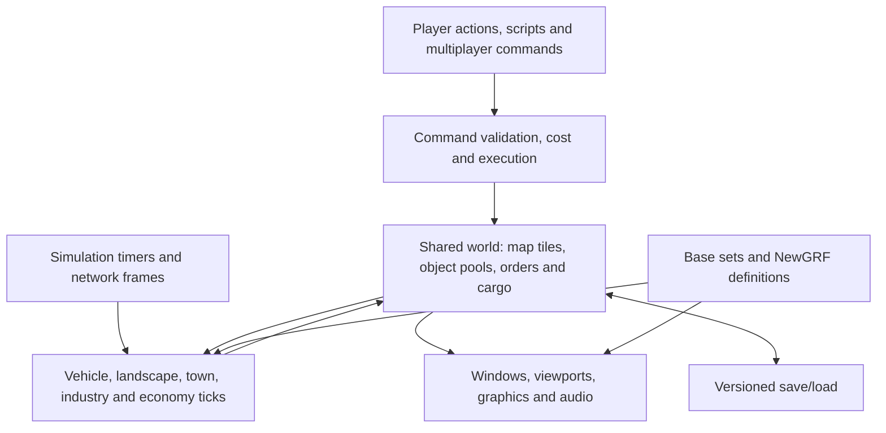

# OpenTTD: level 0 architecture

This page describes the game as a whole and provides an entry point to every other file in this architecture directory, including its subdirectories. It reflects this repository on 2026-10-04, after the multi-layer map work. The [initial inventory](initial-inventory.md) remains the original source-tree and build survey; the [map-layer architecture](map-layers/archi-map-layers.md) records the current changes that cut across older subsystem notes.

## The game

OpenTTD is a transport simulation based on Chris Sawyer's Transport Tycoon Deluxe. Players operate transport companies: they build infrastructure, buy vehicles, give them orders, and earn money by carrying passengers, mail and freight between towns and industries. Construction, vehicle purchases, maintenance and running costs compete with delivery income. Stations connect transport services, and cargo may travel through several services before reaching its destination.

Railways use tracks, depots, stations, signals and reservations. Road services use roads, depots and passenger or freight stops; trams are also available on Surface. Ships use navigable water and docks. Aircraft use airports and their movement state machines. Towns produce and accept cargo and grow over time; industries supply raw materials or process delivered cargo. Orders determine where vehicles go and how they load, transfer or unload. Pathfinding determines how to reach the ordered destination through the available infrastructure.

The program supports generated worlds, scenarios, a scenario editor, saved games, single-player games, multiplayer games and dedicated servers. NoAI scripts operate companies through the command API; Game Scripts can implement goals and scenario rules. Graphics, sounds and music come from base sets. NewGRFs can replace or extend vehicles, cargo, industries, houses, stations and other game definitions.

This fork adds four map layers of the same horizontal dimensions:

| Layer, in menu order | Current role |
| --- | --- |
| Surface | The ordinary landscape and all standard transport modes. |
| Underground | Flat bedrock with rail and road networks, their stations/stops, depots, signals and portals. |
| Deep Underground | Dark bedrock with roads, road stops, road depots and timed road elevators; rail is prohibited. |
| Outer Space | A vacuum floor with signs; further construction and transport are reserved for future work. |

Rail and road tunnels connect Surface with Underground. Road elevators connect Deep Underground with either Surface or Underground. Layer buttons open a dropdown of icons and names in the main toolbar, scenario editor, extra viewports and small map. Each view chooses its own layer, while simulation continues across all layers. The `N` hotkey cycles the main game view. Menu order differs from immutable storage order; see [map layers](map-layers/archi-map-layers.md) for addressing, save versions, portal behavior and graphics.

## How the program fits together

The shared world consists of packed map tiles and pooled objects such as companies, towns, industries, stations, vehicles, orders and cargo packets. Tiles describe terrain and infrastructure; object IDs connect them to the larger entities. A tile's layer is encoded in its `TileIndex`, so vehicles, orders and stations can use the existing tile references throughout the stacked world.

Player and script actions enter the command system, which checks legality and cost before execution. Multiplayer distributes commands for execution at agreed simulation frames. The game loop advances vehicles, tile behavior, production, town growth, the economy and timers. Pathfinders find routes over infrastructure; the cargo link graph plans flows between stations. These services work on the shared world rather than the layer currently visible to a player.

Windows and viewports read that world to display it and turn interaction into commands. Sprite loading, sorting, blitting and video drivers produce the image; sound and music drivers produce audio. Camera position, selected layer and audio playback are client presentation state. Deterministic commands, simulation ticks and random-number use are the boundary that multiplayer desync checks protect. Link-graph worker results are published at controlled simulation points.

Saving serializes the shared world through versioned chunks and object references; loading also performs compatibility conversions and rebuilds derived state. The multi-layer format stores every map plane and the road elevator's remaining wait. The main camera is saved in Surface coordinates, and loading starts on Surface at the same horizontal position and zoom. Choosing an Underground camera does not change simulation data or portal behavior.

## Source and runtime boundaries

The game is primarily C++20, built out of source with CMake. The project version in the current [CMake file](../../../CMakeLists.txt) is 16.0. `openttd_lib` contains the shared game code, `openttd` is the application, and `openttd_test` runs Catch2 tests. Language, settings and script API tables have build-time generators. The game is licensed under GPL-2.0; bundled third-party components have their own licenses, listed in the [repository README](../../../README.md).

| Location | Responsibility |
| --- | --- |
| `src/`, including `*_cmd.cpp` and `*_map.h` | Game objects, commands, tile accessors, simulation and most windows. |
| `src/core/`, `src/table/`, `src/timer/` | Shared containers and utilities, static/generated tables, and timer domains. |
| `src/pathfinder/`, `src/linkgraph/` | Vehicle route searches and cargo-distribution planning. |
| `src/saveload/`, `src/network/` | Persistence, compatibility, multiplayer and external network protocols. |
| `src/script/`, `src/ai/`, `src/game/`, `src/newgrf/` | Script hosting and content-defined behavior. |
| `src/video/`, `src/blitter/`, `src/spriteloader/`, `src/sound/`, `src/music/`, `src/os/` | Platform and presentation implementations. |
| `media/baseset/`, `src/lang/`, `bin/` | Extra base graphics, translations and shipped scripts/data. |
| `cmake/`, `regression/`, `src/tests/`, `.github/` | Build generation, tests, CI and distribution. |
| `docs/zz-reach2/upgrades/` | Fork implementation plans, decisions, asset tooling and validation records. |

Runtime files are found through platform-specific search paths and `openttd.cfg`. Selected base sets and NewGRFs are external data dependencies; the custom 66-sprite map-layer block is packaged into OpenTTD's extra GRF. Drivers are selected independently of the simulation, allowing GUI and headless execution to share the same game logic. Build options and dependencies are detailed in [initial-inventory.md](initial-inventory.md); data lookup is detailed in [archi-files.md](files/archi-files.md).

## Architecture directory guide

Every other file currently in this directory tree is linked below. Primary `archi-*.md` pages explain subsystem boundaries and code locations; companion pages describe individual mechanisms or formats. Subsystem pages written before the layer work should be read together with [archi-map-layers.md](map-layers/archi-map-layers.md) when changing coordinates, iteration, rendering, routing or persistence.

### Orientation and working notes

| File | Purpose |
| --- | --- |
| [README.md](README.md) | Subsystem index, documentation conventions and coverage gaps. |
| [initial-inventory.md](initial-inventory.md) | Original inventory of build products, dependencies, repository layout and code patterns. |
| [save-game.md](save-game.md) | Retained save inspection/capture helpers, corrected test saves and historical fixture preparation notes. |

### Shared world and simulation

| File | Purpose |
| --- | --- |
| [archi-commands.md](commands/archi-commands.md) | Validation, cost, execution, network/script entry and command invariants. |
| [archi-game-loop.md](game-loop/archi-game-loop.md) | Startup, frame ownership, simulation ticks and timer scheduling. |
| [archi-landscape.md](landscape/archi-landscape.md) | Packed tile storage, tile procedure dispatch and landscape behavior. |
| [archi-map-layers.md](map-layers/archi-map-layers.md) | Four-layer addressing, rules, views, portals, generated graphics and save compatibility. |
| [archi-towns.md](towns/archi-towns.md) | Town identity, houses, cargo and local authority. |
| [town-growth.md](towns/town-growth.md) | Growth decisions, placement, zones and cargo conditions. |
| [town-import.md](towns/town-import.md) | Town-data import and its construction pipeline. |
| [archi-industries.md](industries/archi-industries.md) | Industry objects, production, cargo slots and station relationships. |
| [archi-industry-construction.md](industries/archi-industry-construction.md) | Placement checks, construction stages and industry generation. |
| [archi-economy.md](economy/archi-economy.md) | Company cash, prices, inflation, running costs and delivery payments. |
| [archi-cargo-payment.md](economy/archi-cargo-payment.md) | Cargo-income arithmetic and payment adjustments. |
| [archi-subsidies.md](economy/archi-subsidies.md) | Subsidy offers, awards, eligibility and expiry. |
| [archi-savegame.md](savegame/archi-savegame.md) | Chunk formats, object references, loading and compatibility conversion. |

### Tile representations

| File | Purpose |
| --- | --- |
| [clear-tiles.md](landscape/clear-tiles.md) | Ground, snow and farm-field fields. |
| [house-tiles.md](landscape/house-tiles.md) | House tiles and their town/building data. |
| [industry-tiles.md](landscape/industry-tiles.md) | Industry tile graphics, construction and object references. |
| [object-tiles.md](landscape/object-tiles.md) | Placed objects and their map representation. |
| [rail-tiles.md](landscape/rail-tiles.md) | Track, signals and rail depots. |
| [road-tiles.md](landscape/road-tiles.md) | Roads, trams, crossings and road depots. |
| [station-tiles.md](landscape/station-tiles.md) | Stations, stops, waypoints, airports and docks. |
| [tree-tiles.md](landscape/tree-tiles.md) | Tree type, count, growth and ground fields. |
| [tunnelbridge-tiles.md](landscape/tunnelbridge-tiles.md) | Ordinary tunnel mouths, bridge ramps and bridge-over-tile bits. |
| [water-tiles.md](landscape/water-tiles.md) | Water, coast, locks and ship depots. |

### Vehicles, routes and cargo flows

| File | Purpose |
| --- | --- |
| [archi-vehicles.md](vehicles/archi-vehicles.md) | Vehicle pools, common ticking, orders, cargo and breakdowns. |
| [trains.md](vehicles/trains.md) | Train consists, movement and rail-specific behavior. |
| [road-vehicles.md](vehicles/road-vehicles.md) | Buses, trucks, trams and articulated road movement. |
| [ships.md](vehicles/ships.md) | Ship movement and water tracks. |
| [aircraft.md](vehicles/aircraft.md) | Airport state machines and flight. |
| [archi-pathfinder.md](pathfinder/archi-pathfinder.md) | Shared YAPF search, nodes, open lists and caches. |
| [archi-pathfinder-rail.md](pathfinder/archi-pathfinder-rail.md) | Rail destinations, costs and reservations. |
| [archi-pathfinder-road.md](pathfinder/archi-pathfinder-road.md) | Road search, destinations and vehicle path caches. |
| [archi-pathfinder-ship.md](pathfinder/archi-pathfinder-ship.md) | Ship searches over region corridors and tiles. |
| [archi-pathfinder-water-regions.md](pathfinder/archi-pathfinder-water-regions.md) | Water-region connectivity and coarse route search. |
| [archi-linkgraph.md](linkgraph/archi-linkgraph.md) | Cargo network topology, station links and flow publication. |
| [demands.md](linkgraph/demands.md) | Demand generation between cargo sources and destinations. |
| [jobs.md](linkgraph/jobs.md) | Background snapshots, scheduling and deterministic publication. |
| [solver.md](linkgraph/solver.md) | Cargo-flow solving and capacity allocation. |

### Presentation, content and scripting

| File | Purpose |
| --- | --- |
| [archi-gui.md](gui/archi-gui.md) | Windows, nested widgets, events and construction tools. |
| [archi-viewport.md](gui/archi-viewport.md) | Isometric projection, collection, sorting, zoom and map picking. |
| [archi-blitter.md](gui/archi-blitter.md) | Pixel drawing, sprite caches and video-driver boundaries. |
| [archi-audio.md](audio/archi-audio.md) | Sound/music ownership and separation from simulation. |
| [archi-audio-effects-and-music.md](audio/archi-audio-effects-and-music.md) | Sample mixing, music selection and playback drivers. |
| [archi-basesets.md](basesets/archi-basesets.md) | Base-set discovery, selection and payload loading. |
| [obg.md](basesets/obg.md) | Graphics base-set metadata. |
| [obs.md](basesets/obs.md) | Sound base-set metadata. |
| [obm.md](basesets/obm.md) | Music base-set metadata. |
| [archi-newgrf.md](newgrf/archi-newgrf.md) | GRF loading, action interpretation, resolution and persistence. |
| [features.md](newgrf/features.md) | Feature IDs, properties and action bindings. |
| [callbacks.md](newgrf/callbacks.md) | Callback identifiers and implemented meanings. |
| [sprite-groups.md](newgrf/sprite-groups.md) | Sprite-group chains and runtime resolution. |
| [archi-files.md](files/archi-files.md) | Search roots, data directories, archives and `openttd.cfg`. |
| [archi-scripting.md](scripting/archi-scripting.md) | Squirrel hosting, command suspension, API glue and saved script state. |
| [archi-script-instances.md](scripting/archi-script-instances.md) | NoAI/Game Script identities, lifecycles, events and APIs. |

### Networking, diagnostics and distribution

| File | Purpose |
| --- | --- |
| [archi-admin-network.md](admin-network/archi-admin-network.md) | Server admin connections, subscriptions and external control. |
| [packet-catalogue.md](admin-network/packet-catalogue.md) | Admin packet identifiers and wire fields. |
| [archi-game-coordinator.md](game-coordinator/archi-game-coordinator.md) | Server discovery and peer introduction implemented by the game. |
| [archi-stun-turn.md](game-coordinator/archi-stun-turn.md) | The game's custom TCP NAT-introduction and relay protocols. |
| [archi-desync.md](desync/archi-desync.md) | Lockstep consistency checks, diagnostics and desync investigation. |
| [archi-logging.md](logging/archi-logging.md) | Debug output, console, gamelog and performance instrumentation. |
| [archi-release.md](release/archi-release.md) | Version generation, packaging and release workflows. |
| [archi-symbol-server.md](release/archi-symbol-server.md) | Crash artifacts, symbols and their publication. |

## Current delivery and remaining validation

The [multi-layer epic](../upgrades/2026-10/r2mlm-multi-layered-map.md) is closed for implementation, generated assets and automated work, with operator/review tasks explicitly recorded as skipped. The delivered state includes Deep Underground, layer dropdowns, timed elevators, separate road tunnel tools, the 66-sprite graphics set, portal foreground repairs, rail-pair conversion fixes and camera save normalization. Debug and RelWithDebInfo built successfully; the final recorded checks passed 111 Debug unit cases and 115 release CTest cases including regressions.

Representative-save checks demonstrated connected stations and path signals working across Surface/Underground portals. Layer switching does not share Surface house catchment with Underground stations; that is future gameplay work. Full multiplayer, extended traffic/queue scenarios, large-map performance, the complete graphics gallery and human art approval remain unverified. Detailed evidence and limitations belong to the [map-layer page](map-layers/archi-map-layers.md) and the implementation plans it references. Retained helpers and the corrected save variants are indexed in [save-game.md](save-game.md).
