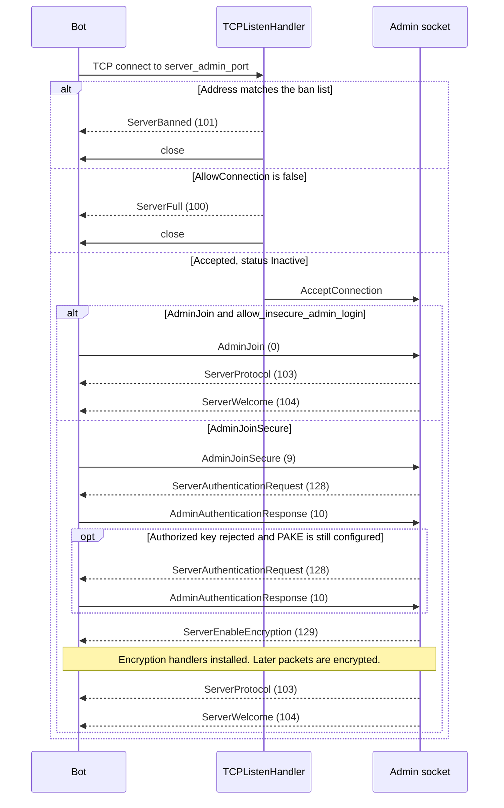
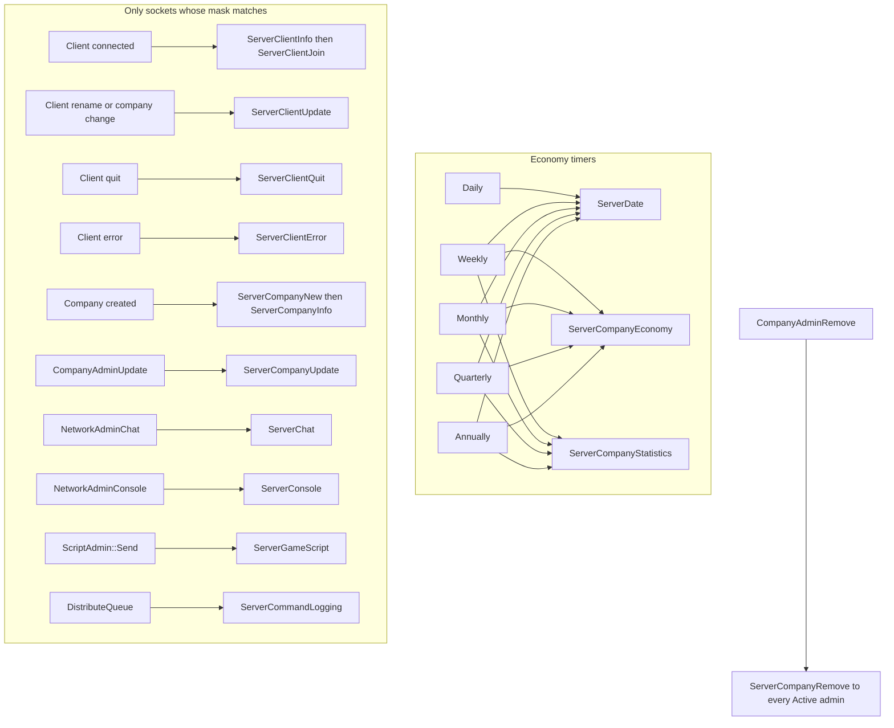

# Admin network architecture

The admin port is a second TCP listener on the game server. An external process (an admin bot) speaks `PacketAdminType` on that socket. It can watch clients and companies, read console and chat, run console commands, and hand JSON to the GameScript. It is not a player client: it never downloads the map, never joins a company, and never sits in the command lockstep.

The wire types, their ordinals, and the bytes each sender writes are in [packet-catalogue.md](packet-catalogue.md). Ordinals below are the C++ enumerator values in `src/network/core/tcp_admin.h` lines 21–64. `ServerFull` is the only explicit initializer (`= 100`). Every other value is the next enumerator. Do not renumber them; the header says the order must not be changed (lines 18–19).

`docs/admin_network.md` (dated 2024-03-26) is the older protocol note. The section [Where that note has gone stale](#where-that-note-has-gone-stale) lists claims that this tree no longer matches. Layout comments in `tcp_admin.h` that disagree with the send functions are called out in the catalogue; the sender is the wire format.

Protocol version on the wire is `NETWORK_GAME_ADMIN_VERSION`, which is 3 (`src/network/core/config.h` line 46).

## Where the socket sits

| Socket | Default port | Setting | Role |
| --- | --- | --- | --- |
| Admin listen | 3977 (`NETWORK_ADMIN_PORT`, `config.h` line 24) | `network.server_admin_port` (`src/table/settings/network_settings.ini` lines 166–173) | Admin bots |
| Game listen | 3979 (`NETWORK_DEFAULT_PORT`, `config.h` line 23) | `network.server_port` | Player clients and the lockstep |

`NetworkServerStart` opens the admin listener only when `AdminAuthenticationConfigured()` is true: a non-empty `network.admin_password`, or a non-empty `network.admin_authorized_keys` list (`src/settings_type.h` lines 422–441, `src/network/network.cpp` lines 936–939). With neither set, there is no admin port.

Accepted sockets live in `NetworkAdminSocketPool`. `AdminID` runs to 16, with invalid id `0xFF` (`src/network/network_type.h` line 53), so the pool holds at most 16 connections (`Pool::MAX_SIZE` is that end value, `src/core/pool_type.hpp` line 144). The pool’s growth step of 2 (`network_admin.h` line 21) is only how the array grows.

`AllowConnection` is the same predicate plus “the pool can allocate another item” (`network_admin.cpp` lines 92–95). `TCPListenHandler::ValidateClient` checks the shared ban list first and answers `ServerBanned` (101), then `AllowConnection` and answers `ServerFull` (100). Either refusal writes one packet and closes the TCP connection before an admin socket object exists (`src/network/core/tcp_listen.h` lines 39–70). The ban list is `_network_ban_list`, the same list as game clients.

`NetworkGameLoop` reads admin sockets in `NetworkReceive` before it distributes game commands, and flushes them in `NetworkSend` after the frame (`src/network/network.cpp` lines 1082–1091, 1128–1132, 1267–1273, 1315). The 10-second authorisation timer is checked inside `ServerNetworkAdminSocketHandler::Send` (`network_admin.cpp` lines 44–45 and 98–105). It applies while status is `Inactive` (0) or `Authenticate` (1). An `Active` (2) socket is not closed by that timer.

## Packet framing

Admin sockets use `Packet` (`src/network/core/packet.h` lines 18–19, 46–57). On the wire the first two bytes are the packet size, little-endian, covering the whole buffer including those two bytes (`packet.cpp` `PrepareToSend`, lines 64–70, `Size` at lines 248–250). The next byte is the `PacketAdminType` ordinal. Multi-byte integers are little-endian. A bool is a `uint8` of 0 or 1 (`packet.cpp` lines 109–111). A string is the bytes plus a trailing `'\0'`, with no length prefix (`packet.cpp` lines 170–174). `Recv_string`’s argument is a maximum, not a length on the wire.

Packets this code builds use the `Packet` default limit `COMPAT_MTU` (1460, `config.h` line 44), except where a sender bails out first (`SendConsole` refuses a pair of strings that would reach that limit, `network_admin.cpp` lines 561–565).

After a secure join, `PrepareToSend` encrypts the bytes after the size prefix and reserves a 16-byte MAC (`X25519_MAC_SIZE`, `src/network/network_crypto_internal.h` lines 16–20; `packet.cpp` lines 46–53 and 72–76). `ServerEnableEncryption` itself is still plaintext: `SendPacket` calls `PrepareToSend` immediately (`src/network/core/tcp.cpp` lines 57–62), and the encryption handlers are installed only after that packet has been queued (`network_admin.cpp` lines 901–906). `ServerProtocol` and everything after it on that socket are encrypted.

## Join and authentication

A new socket starts at `AdminStatus::Inactive` (`network_admin.cpp` lines 67–71). The bot has 10 seconds to authenticate. Anything other than the join and authentication packets, while status is still `Inactive` or `Authenticate`, is answered with `ServerError` and `NetworkErrorCode::NotExpected`, and the socket is closed. `AdminQuit` is the exception: it closes immediately (`network_admin.cpp` lines 693–696).

Two join packets exist.

**Plaintext `AdminJoin` (0).** Accepted only when `network.allow_insecure_admin_login` is true. That setting defaults to false (`network_settings.ini` lines 181–185). The packet carries the password, the application name, and a version string. An empty configured password, a mismatch, or an empty name or version closes the socket (`WrongPassword` or `IllegalPacket` or `NotAuthorized`, `network_admin.cpp` lines 664–690). Length caps are `NETWORK_PASSWORD_LENGTH` 33, `NETWORK_CLIENT_NAME_LENGTH` 25, and `NETWORK_REVISION_LENGTH` 33, each including the terminating `'\0'` (`config.h` lines 54–56). On success the server calls `SendProtocol`, which sets status to `Active` and then sends `ServerWelcome`.

**`AdminJoinSecure` (9).** This is the path a bot should use. The packet carries the name, the version, and a `uint16` bitmask of `NetworkAuthenticationMethod` (`tcp_admin.h` lines 206–217). The server clears `X25519_KeyExchangeOnly` from that mask before it builds a handler (`network_admin.cpp` lines 843–844). That method is defined as “no credential check” and is not used for admin joins (`network_crypto.h` lines 182–185).

`NetworkAuthenticationServerHandler::Create` adds password-authenticated key agreement (`X25519_PAKE`) when the client offered it and a password is configured, then authorized-key authentication (`X25519_AuthorizedKey`) when the client offered it and the authorized-key list is non-empty (`network_crypto.cpp` lines 483–499). A handler whose `CanBeUsed()` is false is dropped (`network_crypto.cpp` lines 400–405). PAKE’s `CanBeUsed` requires a non-empty password (`network_crypto_internal.h` line 229). The combined handler sends the request for `handlers.back()`, so when both methods are available the authorized-key request goes out first. A failed authorized-key check returns `NotAuthenticated`, the handler is popped, and the server sends another `ServerAuthenticationRequest` for PAKE (`network_crypto.cpp` lines 416–424, `network_admin.cpp` lines 907–910). A failure with nothing left to try is `WrongPassword`. No common method is `NoAuthenticationMethodAvailable` (`network_admin.cpp` lines 851–852).

The authentication request packet is a `uint8` method, then 32 public-key bytes and 24 nonce bytes (`X25519_KEY_SIZE`, `X25519_NONCE_SIZE`, `network_crypto.cpp` lines 191–194 and 408–413). The bot answers `AdminAuthenticationResponse` with 32 public-key bytes, a 16-byte MAC, and 8 bytes of encrypted message (`network_crypto.cpp` lines 235–237; the size check is lines 290–292). Constants are `network_crypto_internal.h` lines 16–22.

On success the server queues `ServerEnableEncryption` (24-byte nonce, `network_crypto.cpp` lines 254–256), installs the two encryption handlers, drops the authentication handler, and sends `ServerProtocol` then `ServerWelcome` (`network_admin.cpp` lines 897–906 and 153–171).

`ServerProtocol` is one `uint8` version (3), then one record per `AdminUpdateType` except `End`: `bool` true, `uint16` type ordinal, `uint16` allowed-frequency bitmask. A final `bool` false ends the list (`network_admin.cpp` lines 159–168). The masks are in the catalogue. `ServerWelcome` follows immediately, in the same `SendProtocol` call.

Until `ServerWelcome`, the server pushes no game state. After it, the socket stays up across a dedicated-server map change. Game clients do not.

## What a bot can ask for

There is no acknowledgement of a subscription. A type at or past `AdminUpdateType::End`, or a frequency bitmask that sets a bit the type does not allow, is `IllegalPacket` and the socket is closed (`network_admin.cpp` lines 699–710). The test is `allowed.All(requested)` (`src/core/base_bitset_type.hpp` lines 166–168): every requested bit must already be in the mask from `ServerProtocol`. A mask of 0 passes that test and clears the subscription.

`AdminUpdateFrequency` values are bits, not a single choice. `EnumBitSet` stores `1 << ordinal` (`base_bitset_type.hpp` lines 55–58). `Poll` is bit 0 (`0x0001`), `Daily` bit 1 (`0x0002`), `Weekly` `0x0004`, `Monthly` `0x0008`, `Quarterly` `0x0010`, `Annually` `0x0020`, `Automatic` `0x0040` (`tcp_admin.h` lines 94–102). The `uint16` in `AdminUpdateFrequency` is that bitmask. The matching field in `AdminPoll` is a `uint8` type, not a `uint16` (`tcp_admin.h` lines 141–157, receive sites `network_admin.cpp` lines 703 and 723).

The layout comment says that setting `Poll` on an update-frequency packet is ignored (`tcp_admin.h` line 143). The receiver stores the mask unchanged. The economy timers never test the `Poll` bit, so a mask that is only `Poll` produces no pushes. A mask of `Poll|Daily` still pushes on the daily timer, because `Test(Daily)` is true.

Several frequencies may be set together. `Daily|Annually` on `Date` sends `ServerDate` from both timers.

| `AdminUpdateType` | Ordinal | Allowed mask (`SendProtocol`) | Push packets | Poll (`AdminPoll`, id in `uint32`) |
| --- | --- | --- | --- | --- |
| `Date` | 0 | `0x003F` (63) | `ServerDate` | Current calendar date. The id is ignored |
| `ClientInfo` | 1 | `0x0041` (65) | Join, info, update, quit, error | One client, or `0xFFFFFFFF` for the server client plus every connected client |
| `CompanyInfo` | 2 | `0x0041` (65) | New, info, update. Remove is separate | One company, or `0xFFFFFFFF` for every company |
| `CompanyEconomy` | 3 | `0x003D` (61) | `ServerCompanyEconomy` | All companies. No `Daily` bit |
| `CompanyStats` | 4 | `0x003D` (61) | `ServerCompanyStatistics` | All companies. No `Daily` bit |
| `Chat` | 5 | `0x0040` (64) | `ServerChat` | Illegal |
| `Console` | 6 | `0x0040` (64) | `ServerConsole` | Illegal |
| `CmdNames` | 7 | `0x0001` (1) | None | `ServerCommandNames`, possibly several packets |
| `CmdLogging` | 8 | `0x0040` (64) | `ServerCommandLogging` | Illegal |
| `Gamescript` | 9 | `0x0040` (64) | `ServerGameScript` | Illegal |

The masks are the `.base()` values of `_admin_update_type_frequencies` (`network_admin.cpp` lines 49–60 and 162–165).

`ClientInfo` pushes when the stored mask `Test`s `Automatic` (`network_admin.cpp` lines 931, 947, 960, 974). `CompanyInfo` pushes for new and update only when the stored mask is exactly `Automatic` (`!=` at lines 992 and 1008). A bot that sets `Poll|Automatic` (`0x0041`) is therefore subscribed for clients and not for company new/update. `0xFFFFFFFF` as a poll id means “all” (`network_admin.cpp` lines 734 and 752). An unknown client or company id is skipped with no packet and no error (`tcp_admin.h` lines 149–150, `network_admin.cpp` lines 744–758).

`ClientID::Server` is 1 (`network_type.h` lines 43–46). Polling it, or polling all clients, includes the server’s own client info with an empty hostname, because there is no `NetworkClientSocket` (`network_admin.cpp` lines 262–263 and 734–742). Company ids on the wire are `0 .. MAX_COMPANIES-1`. `MAX_COMPANIES` is 15 (`CompanyID` ends at `0xF`, `src/company_type.h` lines 16 and 32). A spectating client reports play-as `COMPANY_SPECTATOR`, 255 (line 21).

### Requests that are not subscriptions

Once status is `Active`, the bot can also send:

| Packet | Ordinal | What the server does |
| --- | --- | --- |
| `AdminPoll` | 3 | One-shot reply, see the table above |
| `AdminChat` | 4 | Chat as the server. Actions accepted: `ChatBroadcast` (3), `ChatClient` (5), `ChatTeam` (4), `ServerMessage` (2). Anything else is `IllegalPacket` (`network_admin.cpp` lines 796–806) |
| `AdminExternalChat` | 8 | Chat shown as an external user, with a source name, a colour, a user name, and a message (`network_admin.cpp` lines 812–826, `network_server.cpp` lines 1424–1429) |
| `AdminRemoteConsoleCommand` | 5 | `IConsoleCmdExec` on the server, then `ServerRemoteConsoleCommandEnd` (`network_admin.cpp` lines 516–527) |
| `AdminGameScript` | 6 | `Game::NewEvent(new ScriptEventAdminPort(json))` (`network_admin.cpp` lines 530–538). Cap `NETWORK_GAMESCRIPT_JSON_LENGTH` 9000 (`config.h` line 58) |
| `AdminPing` | 7 | `ServerPong` with the same `uint32` (`network_admin.cpp` lines 542–550) |
| `AdminQuit` | 1 | Close |

`AdminChat` calls `NetworkServerSendChat` with `from_admin` true (`network_admin.cpp` line 801). `NetworkAdminChat` returns immediately in that case (lines 1036–1038), so a chat the bot injected with `AdminChat` is not copied back out as `ServerChat`.

Rcon needs no second password. While the command runs, `_redirect_console_to_admin` points at this socket, and `IConsolePrint` sends those lines as `ServerRemoteConsoleCommand` instead of `ServerConsole` (`console.cpp` lines 101–103, `network_admin.cpp` lines 524–527). The redirect is cleared before `ServerRemoteConsoleCommandEnd`. Output that a console command prints only after `IConsoleCmdExec` has returned is not an rcon packet. On a dedicated server, later console lines still go out as `ServerConsole` when this socket’s console subscription is `Automatic` (`console.cpp` lines 110–112).

`say`, `say_company`, and `say_client` compute a `from_admin` bool and pass it as the sixth argument of `NetworkServerSendChat`. That argument is `int64_t data`. The seventh argument, `from_admin`, stays at its default `false` (`src/network/network_func.h` line 78, `console_cmds.cpp` lines 2053–2054, 2085–2086, 2112–2113). An rcon `say` is therefore copied to admins who subscribed to chat, and the `uint64` data field is 0 or 1.

## What the server pushes

Pushes go only to sockets whose status is `Active` (`IterateActive`, `network_admin.h` lines 94–111), except `ServerFull` and `ServerBanned`, which are written before a socket object exists.

Economy timers call `NetworkAdminUpdate` (`network_server.cpp` lines 1933–1973). Each call walks the subscribed types and sends `ServerDate`, `ServerCompanyEconomy`, or `ServerCompanyStatistics` (`network_admin.cpp` lines 1115–1138). Any other type in that switch is `NOT_REACHED`.

| Timer | Trigger | Frequencies processed |
| --- | --- | --- |
| `_economy_network_daily` | `TimerGameEconomy::Trigger::Day` | `Daily` |
| `_network_weekly` | `TimerGameEconomy::Trigger::Week` | `Weekly` |
| `_network_monthly` | `TimerGameEconomy::Trigger::Month` | `Monthly` |
| `_network_quarterly` | `TimerGameEconomy::Trigger::Quarter` | `Quarterly` |
| `_economy_network_yearly` | `TimerGameEconomy::Trigger::Year` | `Annually` |

These are economy-time boundaries. The calendar-year timer in the same file does not call `NetworkAdminUpdate` (`network_server.cpp` lines 1926–1931). `ServerDate` still carries `TimerGameCalendar::date` (`network_admin.cpp` lines 226–228). A bot that subscribed to `Annually` hears the economy year, and the payload is the calendar date at that moment.

`Welcome`’s start-date field is 1 January of `game_creation.starting_year`, converted with `TimerGameCalendar::ConvertYMDToDate`, not “today” (`network_admin.cpp` lines 186–189).

Client automatic updates require `Test(Automatic)`. The new-client order is info, then join (`network_admin.cpp` lines 931–935). Company create order is new, then info (lines 994–995). Company removal does not look at the frequency mask at all (lines 1019–1023). Every `Active` admin receives `ServerCompanyRemove`. Reasons are `Manual` 0, `Autoclean` 1, `Bankrupt` 2, and they are asserted equal to `CompanyRemoveReason` (`tcp_admin.h` lines 106–110, `tcp_admin.cpp` lines 17–21, `company_cmd.cpp` lines 897–899).

Chat reaches `NetworkAdminChat` from `NetworkServerSendChat` (`network_server.cpp` lines 1307–1414):

- Broadcast is always passed through.
- A private message whose destination is `ClientID::Server` is passed through when `network.server_admin_chat` is true (default true, `network_settings.ini` lines 175–179).
- Team chat is passed through when the server’s `_local_company` is that company and `server_admin_chat` is true.
- A private message from one player client to another player client is not passed through.

`from_admin` true drops the copy (`network_admin.cpp` lines 1036–1038). `AdminExternalChat` is displayed to game clients and the local console (`network_server.cpp` lines 1424–1429) and is not fed back into `NetworkAdminChat`.

Console subscription also turns on remote debug forwarding. `DebugReconsiderSendRemoteMessages` enables the queue when any active admin has console `Automatic` (`src/debug.cpp` lines 230–241). `DebugSendRemoteMessages` then calls `NetworkAdminConsole` with the facility name as the origin (lines 206–216).

GameScript to bot: `ScriptAdmin::Send` turns a Squirrel table into JSON and calls `NetworkAdminGameScript` (`src/script/api/script_admin.cpp` lines 118–132). Delivery requires `Gamescript` at `Automatic` (`network_admin.cpp` lines 1076–1081). Bot to GameScript is the other direction, `AdminGameScript`, and does not require that subscription.

Command names and command logs are explicitly unstable. The send comments say the ids and the parameter bytes are for logging and can change between revisions (`tcp_admin.h` lines 470–473 and 488–491). Logging happens inside `DistributeQueue`, after the server has already decided to hand that `CommandPacket` to game clients (`src/network/network_command.cpp` lines 351–352). The admin copy cannot accept or reject the command. A null owner is reported as `_network_own_client_id` (`network_admin.cpp` lines 1090–1092).

`ServerCommandLoggingOld` is ordinal 123. The comment says it was `ServerCommandLogging` in admin protocol version 1 (`tcp_admin.h` line 58). This server never sends it. `HandlePacket` has no case for it, so a bot that sends 123 is treated as an unknown type and the socket is closed (`tcp_admin.cpp` lines 75–85).

### Map change and shutdown

`SwitchToMode` calls `NetworkReboot` for a server load, new game, or restart, and `NetworkDisconnect` otherwise (`src/openttd.cpp` lines 1015–1018).

`NetworkReboot` sends `ServerNewGame` to every active admin and flushes, then `NetworkClose(!_network_dedicated)` (`network.cpp` lines 1008–1024). On a dedicated server the admin sockets stay in the pool. The listen socket is still closed and opened again by the following `NetworkServerStart` (lines 1022–1032). When the new map is up, `NetworkOnGameStart` calls `WelcomeAll`, which sends `ServerWelcome` again (`network.cpp` lines 998–1000, `network_admin.cpp` lines 1104–1108). That second welcome exists only on a dedicated server. Subscriptions are fields on the socket, so they survive the new map. The server does not replay current clients and companies; the bot polls for them.

On a non-dedicated server the same reboot closes admin sockets inside `NetworkClose` with no `ServerShutdown` (`network.cpp` lines 600–606). Leaving for the menu uses `NetworkDisconnect()`, whose default closes admins: each active socket gets `ServerShutdown`, then the connection is dropped (`network_func.h` line 43, `network.cpp` lines 1031–1044).

## Code map

| Concern | Where |
| --- | --- |
| Packet ordinals, status, update types, frequencies, payload comments | `src/network/core/tcp_admin.h` lines 21–112 and the `Receive*` comments through line 538 |
| Dispatch of every ordinal the server recognises | `src/network/core/tcp_admin.cpp` `HandlePacket`, lines 34–86 |
| Pool, send, receive, frequency table, auth | `src/network/network_admin.h`, `src/network/network_admin.cpp` |
| Listen, reboot, shutdown, welcome-all, game loop | `src/network/network.cpp` lines 586–634, 919–940, 975–1049, 1078–1104, 1128–1315 |
| Ban and “full” before a socket exists | `src/network/core/tcp_listen.h` lines 39–70 |
| Economy timers that push date, economy, and stats | `src/network/network_server.cpp` lines 1926–1973 |
| Which chats are copied to admins | `src/network/network_server.cpp` `NetworkServerSendChat`, lines 1307–1414 |
| External chat to players | `src/network/network_server.cpp` lines 1417–1429 |
| Rcon redirect | `src/console.cpp` lines 91–116; `src/network/network_admin.cpp` lines 516–527 |
| `say` / `say_company` / `say_client` argument order | `src/console_cmds.cpp` lines 2050–2114 |
| Command-log copy | `src/network/network_command.cpp` `DistributeQueue`, lines 327–354 |
| GameScript JSON out and in | `src/script/api/script_admin.cpp` lines 118–135; `network_admin.cpp` lines 530–538 and 1076–1081 |
| X25519 method order and key sizes | `src/network/network_crypto.h` lines 182–190; `src/network/network_crypto.cpp` lines 191–256 and 400–499; `src/network/network_crypto_internal.h` lines 16–22 |
| Company create and remove hooks | `src/company_cmd.cpp` lines 887–899, 941, 984 |
| Port, version, string limits, MTU | `src/network/core/config.h` lines 23–24, 43–46, 51–59 |
| Settings defaults | `src/table/settings/network_settings.ini` lines 166–185 |
| Older protocol note | `docs/admin_network.md` |

## Where that note has gone stale

`docs/admin_network.md` still describes the join, the frequency packet, polling, rcon, and the idea that unknown extra bytes should be ignored. These claims do not match this tree.

| Older note | What this tree does |
| --- | --- |
| Section 1. An admin can run rcon “with no further authentication.” | Rcon after `Active` still has no second password (`network_admin.cpp` lines 516–527). The listener itself stays down until a password or an authorized key is configured (`network.cpp` lines 936–939). Plaintext `AdminJoin` is off unless `allow_insecure_admin_login` is set, and that setting defaults to false. |
| Section 2. After either join, the next packets are `ServerProtocol` then `ServerWelcome`. | Secure success queues `ServerEnableEncryption` first. Protocol and Welcome are encrypted. Plaintext `AdminJoin` does go Protocol then Welcome, with no encryption packet (`network_admin.cpp` lines 690 and 897–906). |
| Section 2. The only unsolicited packets are `ServerError`, `ServerWelcome`, `ServerNewGame`, and `ServerShutdown`. | Also `ServerFull`, `ServerBanned`, `ServerProtocol`, `ServerAuthenticationRequest`, `ServerEnableEncryption`, and `ServerPong` when the bot pinged. `ServerCompanyRemove` is sent to every active admin with no subscription (lines 1019–1023). |
| Section 2. `ServerWelcome` carries “NetworkLanguage”. | Welcome has no language field. The map-name string is sent empty (`network_admin.cpp` lines 182–191). Client info’s old language byte is sent as 0 (line 265). |
| Section 2. `ServerWelcome` only follows `ServerNewGame`. | The first Welcome follows Protocol at join. A later Welcome follows NewGame only on a dedicated server (`network.cpp` lines 998–1000). A non-dedicated reboot sends NewGame and then closes the socket with no Shutdown and no second Welcome. |
| Section 3. The update-type list stops at `CmdLogging`. | `Gamescript` (9) pushes `ServerGameScript`. `CmdNames` (7) is poll-only and is mentioned later, in section 3.1. `AdminPing`, `AdminExternalChat`, and `AdminGameScript` are absent from the note. |
| Section 3. An illegal update disconnects with `NETWORK_ERROR_ILLEGAL_PACKET`. | The enumerator is `NetworkErrorCode::IllegalPacket`, ordinal 4 (`network_type.h` lines 99–105). The disconnect behaviour matches. |
| Section 4. The rcon terminator is `PacketAdminType::AdminRemoteConsoleCommandEnd`. | The enumerator is `ServerRemoteConsoleCommandEnd`, ordinal 125 (`tcp_admin.h` line 60). There is no admin-to-server packet by the name in the note. |
| Section 4. An rcon `say` is not copied back into the admin network. | `AdminChat` is not copied back, because that path passes `from_admin` true. Console `say` passes that bool as the `data` argument, so `from_admin` stays false and subscribed admins do receive `ServerChat` (`console_cmds.cpp` lines 2053–2054). |
| Section 5. Subscribing to chat yields “all chat the server can see.” `server_admin_chat` covers “private chat for the server.” | Broadcast is copied. Private-to-server and team chat are copied only when `server_admin_chat` is true, and team chat only when `_local_company` is that company. Player-to-player private chat is not copied (`network_server.cpp` lines 1312–1407). |
| Section 5. The chat actions are `NETWORK_ACTION_CHAT`, `NETWORK_ACTION_CHAT_CLIENT`, `NETWORK_ACTION_CHAT_COMPANY`, and `NETWORK_ACTION_SERVER_MESSAGE`. | The enumerators are `NetworkAction::ChatBroadcast` (3), `ChatClient` (5), `ChatTeam` (4), and `ServerMessage` (2) (`network_type.h` lines 79–92). |
| Section 7. `ServerClientJoin` and `ServerCompanyNew` both follow their info packets. | Client connect sends info, then join (`network_admin.cpp` lines 932–934). Company create sends new, then info (lines 994–995). |
| Section 7. Every `Server*` ordinal is greater than 100. | `ServerFull` is 100. The rest run 101 through 129. |
| Section 7. `ADMIN_UPDATE_FREQUENCY` uses `uint16` and `ADMIN_POLL` uses `uint8`. | The packet names are `AdminUpdateFrequency` (2) and `AdminPoll` (3). The width difference is still true (`network_admin.cpp` lines 703 and 723). |
| Section 1. Data inside a packet is never removed, only appended. | Welcome’s map name and client-info’s language byte are still present and empty. `SendCompanyUpdate` does not write the four share-owner bytes that the layout comment in `tcp_admin.h` lines 373–387 still lists. `SendCompanyInfo` writes a bankruptcy-quarters byte that the layout comment at lines 359–370 does not list. Trust the send functions, listed in the catalogue. |

The 10-second authorisation window, the default port 3977, the lack of a subscription acknowledgement, the poll id `0xFFFFFFFF`, and the warning that command names and command logs are unstable all still match the code.

## Invariants

1. **The admin port is not the game lockstep.** A bot has no company, no map, no client slot, and no frame acknowledgement. `NetworkReceive` handles its packets before `NetworkDistributeCommands`, and `NetworkSend` flushes them after `StateGameLoop` (`network.cpp` lines 1128–1132, 1267–1289, 1315). Nothing in that path waits for the bot. Slow or silent admins do not pause the game and do not enter the desync check.

2. **Command logging is a copy, taken after the server has committed to distributing the command.** `NetworkAdminCmdLogging` runs inside `DistributeQueue` on the `CommandPacket` that is about to be erased from the wait queue (`network_command.cpp` lines 351–353). The `uint32` frame in `ServerCommandLogging` is that packet’s scheduled frame. The bot cannot drop, delay, or rewrite it.

3. **Rcon and GameScript JSON run on the server as local side effects.** `IConsoleCmdExec` may later post an ordinary game command, which then joins the same queue as a player’s command. `AdminGameScript` only constructs a `ScriptEventAdminPort`. Neither packet is itself a lockstep command.

4. **Subscriptions are per socket and unconfirmed.** They survive a dedicated-server `ServerNewGame` because the socket object survives. They do not cause a snapshot. After Welcome, or after the second Welcome on a new map, the bot polls for the current date, clients, companies, economy, stats, and command names.

5. **Company removal ignores the subscription.** Every `Active` admin receives `ServerCompanyRemove`. Client and company *updates* do not.

6. **`ServerCompanyInfo`’s frequency test is equality with `Automatic`.** `ClientInfo` uses `Test`. A mask of `Poll|Automatic` is legal for both and produces client pushes only.

7. **Unknown admin packet types close the socket.** `HandlePacket`’s default logs the type and returns `MalformedPacket` (`tcp_admin.cpp` lines 81–85). The older note’s advice to ignore unknown *server* packets is advice for the bot. The server does not ignore unknown admin packets. Ordinal 123 (`ServerCommandLoggingOld`) is one of those unknowns on receive, and it is never sent.

8. **Encryption starts on the packet after `ServerEnableEncryption`.** That packet is plaintext. `ServerProtocol` is the first encrypted packet on a secure join. Plaintext `AdminJoin` never enables encryption.

9. **At most 16 admin sockets, and only while a password or an authorized key is configured.** A seventeenth connection, or a connection when `AllowConnection` is false, receives `ServerFull` and is closed. A banned address receives `ServerBanned` and is closed. Neither case creates a pool item.
