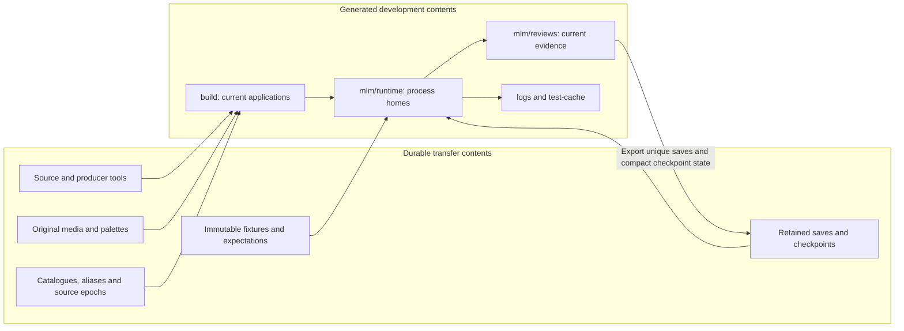
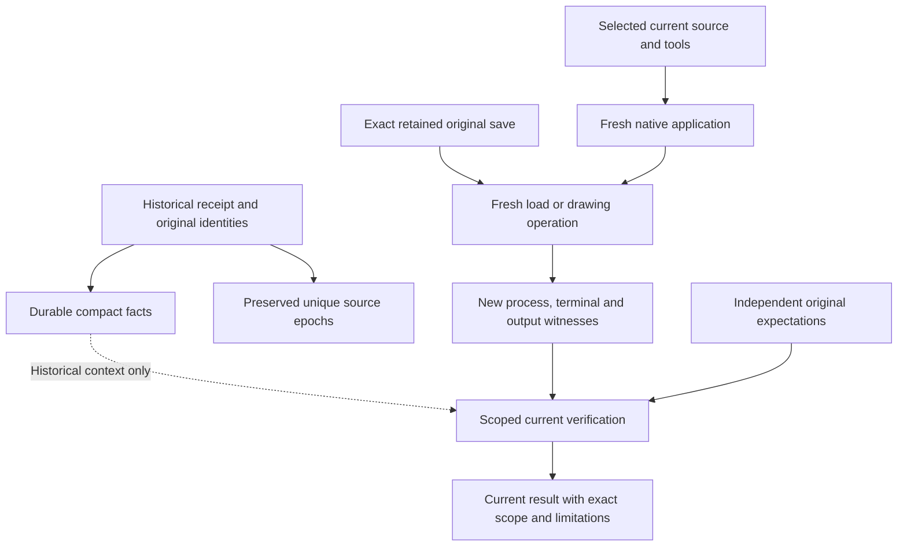
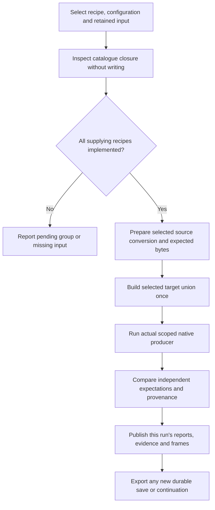
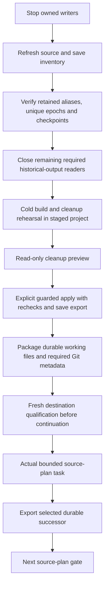

# Historical debugging, retained inputs and reproducible artifacts

Owner: this architecture note and the [shared multilayer layout](../upgrades/2026-10/r2mlvs-multilayer-vehicles-and-structures.md#development-artifact-layout). Implementation history: [completed preservation and artifact reconstruction](../upgrades/2026-10/r2fc-file-cleanup3.md), with measured results in its [execution record](../upgrades/2026-10/r2fc-file-cleanup3-a-execution.md). Execution and closure: [R2FC2 - migrations, cleanup, transfer and Space resumption](../upgrades/2026-10/r2fc2-file-cleanup3.md). Related engine contracts: [files](files/archi-files.md), [savegames](savegame/archi-savegame.md) and [logging](logging/archi-logging.md).

This page describes where development inputs and debug artifacts belong, how a
consumer selects them, and how to reconstruct generated evidence. It covers the
multilayer development harness; ordinary player save/configuration paths remain
owned by the engine's file subsystem.

## Delivery boundary

As of2026-10-23, retained-first readers, compact Space foundations,
incremental save export, the guarded cleaner, portable build inputs and the
shared cold rehearsal are delivered. Group33removed59128115119bytes
(55.07GiB), zero failures;17320existing non-journal files were byte-identical.
Its journal then verified5230payloads/16489aliases and reapply reported
`Nothing to clean`. Those counts describe that completed cleanup boundary.

Group34verified the complete2.50GiBsource archive, external checksum and fresh
short-root extraction. This is the transfer snapshot before later development.
Group35freshly qualified the user-selected `D:/Codez/Sandbox/OpenTTD` in both
configurations. Group36then implemented and bound the real Plan11Goods query
and ordinary reload pair at zero ticks/all121families unchanged. Group37exported
that actual successor; the [execution plan](../upgrades/2026-10/r2fc2-file-cleanup3.md)
records its closing checks. Development has resumed through actual source-plan
work. Next is Plan11GZVEEJ's read-only additional-service usefulness gate;
no purchase,033or further cash scope is granted. Tube/provisional feature and
human/useful-route gates remain open. This page is the storage/rebuild owner.

## Storage ownership

Paths below are relative to the repository root. Durable inputs travel with the
source tree. Generated artifacts can be discarded only after every unique save,
source epoch and required semantic input has a verified durable owner.

| Location | Contents and authority | Lifecycle |
| --- | --- | --- |
| `src/`, `src/tests/`, `mlm/tools/`, `media/multilayer/` | Implementation, test producers, diagnostic helpers and original art tooling. | Preserve working files, including valuable untracked/ignored files. |
| `media/` | Authored/selected originals, palettes, source contracts and canonical shipping assets, including the existing GRF authority. | Preserve exact originals; regenerating a prompt cannot recover approved pixels. |
| `src/tests/fixtures/<feature>/<purpose>/`, `regression/` | Curated immutable worlds, older-format compatibility inputs and independent expectations. | Preserve; ordinary tests must not regenerate their own expected baselines. |
| `src/tests/fixtures/checkpoints/space/` | Exact Space continuation save pair, compact state/closed-policy contract and historical facts. | Durable checkpoint; current qualification is generated separately. |
| `src/tests/fixtures/checkpoints/underground/` | Paused Tube source checkpoint, distinct baseline epochs and historical terminal scope. | Durable; does not qualify the provisional five-model feature. |
| `savegames/retained/` | Other discovered saves, scenarios, backups and aliases of exported review/runtime saves. | Preserve every payload; equal bytes may share storage with complete aliases. |
| `src/tests/fixtures/cleanup/` | Save migration map, source-epoch inventory, dependency dispositions and compact historical facts. Unique source versions use `source-epochs/`. | Durable preservation contracts, not a second image/EXE cache. Refresh live-source references before deleting their original snapshots. |
| `src/tests/fixtures/config/multilayer/` | Runtime templates, portable native build profile and pinned dependency recipe sources. | Durable configuration/tool contract; machine CMake caches are disposable. |
| `src/tests/fixtures/baseset/original-dos/` | Exact user-provided original DOS graphics, sound and music inputs selected by native observers. | Preserve immutable bytes; the portable build profile pins each source hash and distribution destination. |
| `mlm/review-producers.json` | Sole producer/recipe catalogue: dependencies, retained roles, targets, tags, outputs and implementation status. | Durable routing authority; inspect it instead of inventing a second asset catalogue. |
| `mlm/reviews/<feature>/<scenario>/<run-id>/` | Current generated images, saves, payloads, reports and required transcripts. | Generated; export unique saves/checkpoints before removal. Keep the routing README. |
| `mlm/runtime/<profile>/<run-id>/<process>/` | Mutable runtime configuration/scripts, distribution copies, autosaves and process-local files. | Generated; separate host/client homes, export saves before retirement. |
| `logs/` | Optional process/build/test diagnostics. | Payloads are disposable after migration; preserve any `.gitignore` routing marker. Never the sole checkpoint or authorization authority. |
| `test-cache/` | Unit-test output, scratch, temporary scripts, verification artifacts and temporary console images. | Payloads are disposable after preservation gates; preserve `.gitignore` routing metadata. Test tooling needed long term stays beside tests. |
| Declared `build/` products | Configured native/dependency builds and current executable images. | Rebuild from source/profile; preserve meaningful configuration and saves first. |
| `docs/zz-reach2/` | Architecture, plans and handovers. | Documentation; assisting R2FC-3 Markdown stays beside its plan. |

Incremental export is delivered by
[save_retention.py](../../../src/tests/multilayer/support/save_retention.py).
`plan_save_exports(root, scopes)` reads only; `apply_save_exports(plan, root)`
publishes verified payloads and the atomic supplementary
`src/tests/fixtures/cleanup/save-exports.json` journal. `verify_save_exports`
rescans the exact watched scopes and retained hashes before deletion. Original
Group9 migration/catalogue keys remain frozen; later mutable save versions keep
their own payload identities and complete historical aliases. Decoder support
is never a preservation gate. CLI preview:
`python -B src/tests/multilayer/support/save_retention.py`; explicit `--apply`
exports saves without deleting sources. The cleaner must still enforce its
independent ownership, source-preservation and stopped-writer gates.

Within each export boundary, watched owner ancestry is validated once and every
retained destination is checked against that canonical set. The next
plan/apply/verification boundary validates the owners afresh; full save
observations and retained byte hashes still detect changed/new inputs. This
avoids resolving the same deletion scopes thousands of times per plan.

Python and native runtime preparation copy the two English fallback language
packs plus the isolated config's `[misc].language`; they keep process scripts,
configs and autosaves private. Repeated console/DLL preparation reuses identical
bytes or atomically replaces changed entries, preserving source and peer images.
Python preparation resolves migrated build templates through their retained
catalogue hashes and creates a private scripts directory on cold distributions.
Recipe native verification has a300-second supervisor cap for bounded execution
plus complete provenance checks; preparation/pure stages retain120seconds and
the native subprocess's own smaller cap remains in force.
There is no shared writable cache or junction. Current recipes retain current
run/build images only; completed homes remain subject to verified save export
and the cleaner's independent guards before removal.



### A generated review run

```text
mlm/reviews/<feature>/<scenario>/<run-id>/
  images/     native PPM/IDX, lossless PNG, review sheets
  saves/      newly emitted SAV/SCN checkpoints awaiting export
  data/       generated indexed/packed/expected payloads
  reports/    requests, stage results, native records, selections
  evidence/   required actual stdout/stderr and observations
  scratch/    invocation-local intermediates
```

`RunContext` in [artifact_paths.py](../../../src/tests/multilayer/support/artifact_paths.py)
owns these paths and resolves contained input aliases. Native producers share the
contract through [test_artifact_paths.cpp](../../../src/tests/test_artifact_paths.cpp).
Mixed feature captures may share one invocation ID, with separate feature paths.
Runtime profile and process names isolate mutable state; they do not select a
different source fixture implicitly.

### Why retained save paths contain a timestamp and a hash-looking suffix

For example,
`savegames/retained/mlm/reviews/space/surface-entry-capital-earn/20261019-013752-7bf4c3e74e/saves/surface-launch-earn-440.sav`
preserves its original review-relative provenance. The default run ID is UTC
`YYYYMMDD-HHMMSS-` followed by ten random UUID hex characters. That suffix is a
collision-avoidance identifier, **not a content hash**. Explicit run IDs are also
supported. SHA256 identities live in the manifests and reports.

Retention does not imply a test reads every save. Some saves support automated
fixtures or continuation; others preserve a development branch for manual load,
inspection or replay. The capital-earn example preserves such an intermediate
Space branch, rather than naming the active continuation checkpoint. Consult
`cleanup/migration.json` for original aliases/recorded consumers and
`multilayer-inputs.json` for stable input keys. Never select a save solely because
its directory sorts last. The original migration measured5707 distinct save
payloads and15573 aliases; those are dated inventory facts, not a fixed future
count or a pruning rule.

## Historical facts and current proof

A historical receipt records what an earlier source/application/save combination
did. Its old hashes remain historical even after the original generated folders
are removed. A new build receives its own identity and must produce fresh proof.
Keeping hundreds of historical EXEs is not required to use a durable checkpoint.

The recipe owner validates live reference roles, including nested current
receipts, exact prepared prerequisites and current-run output destinations.
Historical facts and optional diagnostics do not become physical dependencies.
Missing or corrupt independent expectations refuse execution; current output
cannot replace them. Current native image reuse checks the complete source
inventory, including added and removed files, and rejects archived images.
Retired cache-based publication CLIs refuse before loading their old readers.
Stable catalogue keys also redirect through migrated physical aliases to their
retained owners. Cleanup and staging refuse any required physical reference
inside a selected disposable scope, even while its original bytes still exist.

The cleanup source gate accepts exact authored equivalents, retained source
epochs or exact path/hash members of the pinned dependency source bundle.
Edited provider files remain valuable sources. Consumed native source inventories
and differing original source bytes are retained separately; this preserves
historical identities without certifying a new build as historical proof.

| Question | Required material |
| --- | --- |
| What happened in an earlier run? | Compact retained facts, source versions where unique, save identities and dated handover. |
| Can this original world load correctly now? | Retained world plus a current native build and new load/static qualification. |
| Does the current renderer preserve approved pixels? | Original art, independent immutable expectations, current source conversion and actual native captures. |
| Can an exact old application be recreated? | Its exact source epoch, build/dependency contract and compatible tools; current proof alone cannot promise byte-identical EXEs. |
| May feature work continue? | Live source-plan dispatch and its own authorization/gates; an art fixture or static load grants none. |



Shared [runner.py](../../../src/tests/multilayer/support/runner.py) records the
actual executable, configuration, argv, input identities, native artifacts and
retained transcript. `save_native_capture` records lossless native-to-PNG
conversion; schema2 [evidence.py](../../../media/multilayer/evidence.py)
connects a selected frame to that process, source, native writer and terminal.
An attractive source canvas or old screenshot cannot substitute for this chain.
Ground retains complete original PPM/IDX fingerprints as an additional check.

## Reconstituting debug artifacts

Run commands from the repository root. Select one recipe/configuration and a
fresh explicit ID. Inspect before execution; disabled recipes name their pending
implementation groups and refuse to execute. Never repair a refusal by copying
an old EXE, rewriting a receipt hash or choosing an undeclared workstation cache.



### Inspect and run a selected graph

The actual CLI uses a **positional recipe**, with `--inspect` for read-only
inspection. Earlier planning examples using `--recipe` or `--stage verify` are
obsolete.

```powershell
python -B src/tests/multilayer/support/artifact_rebuild.py space-checkpoint --configuration Debug --inspect
python -B src/tests/multilayer/support/artifact_rebuild.py ground-viewport-stations --configuration RelWithDebInfo --inspect

# Example host tool locations; replace with this machine's installations.
$buildTools = @('--vcpkg', 'D:/Codez/Tools/vcpkg', '--grfcodec', 'D:/Codez/Tools/grfcodec/grfcodec-6.2.0-windows-win64/bin')
python -B src/tests/multilayer/support/artifact_rebuild.py space-checkpoint --configuration Debug --run-id recovery-debug-001 @buildTools
```

Use a new ID for a new independent run. To retry an interrupted invocation,
select the same recipe/configuration with `--resume <exact-run-id>` instead of
`--run-id`. Resume checks unchanged declarations, inputs, sources and passed
stage/output witnesses; a completed or still-owned invocation refuses. Changed
source requires a fresh run. Progress is
`mlm/reviews/rebuild/<recipe>/<run-id>/reports/rebuild.json`.

The following implemented graph entry points reconstruct their selected closure.
They have bounded producer validation; full cold staging remains Groups30–32.

| Recipe | Producer and actual native scope | Recreated material |
| --- | --- | --- |
| `space-checkpoint` | `acceptance/space_checkpoint_load.py`, `openttd_surface_capital_test` `[.space-checkpoint-load]`, plus ordinary `openttd` static reload. | Fresh zero-tick qualification of the retained continuation, not paid cash-work. |
| `state-prior-native` | `support/prior_stage_evidence.py` and the shared ordinary `openttd` metadata fixture; one selected Debug or RelWithDebInfo load. | Reloads the retained version371 original and publishes compact native semantics/save roles without replaying a historical chain. |
| `tube-checkpoint` | `qualify_tube_terminals.py`; no native target or tag. | Verifies retained model9 terminal history, both source epochs and original media; five-model work remains provisional and paused. |
| `sprite-native-loaders` | `support/sprite_native_loader.py`; five original loader families: M1, Space, orbital, launch-fleet and Ground. | Selected source conversions/packing, independent expected payloads and actual native decoder evidence. Select an individual `<family>-native-loader` when only one is needed. |
| `space-current-producers`, `orbital-current-producers`, `launch-current-producers`, `ground-current-producers` | Original source-selector cases in their catalogue targets/tags. | Current source/decoder/selector results; these alone do not claim ordinary viewport review. |
| `launch-occupied-viewports` | `launch_facility_render_checks.py`, `openttd_space_art_test` `[.launch-facility-render]`. | Actual selected occupied-launch frames and source-pixel checks. |
| `space-paused-viewports`, `orbital-paused-viewports` | Original `acceptance/*_final_art_checks-1.py` wrappers using ordinary `openttd`. | Actual paused ordinary application captures and preserved-world observations. |
| `ground-viewport-collector`, `ground-viewport-industry-states` | Original Ground wrappers, `openttd_ground_viewport_test` `[.ground-industry-runtime]`. | Retained collector or original industry-state capture matrix. |
| `ground-viewport-purchases`, `ground-viewport-rail`, `ground-viewport-road` | `ground_transport_runtime_checks.py`, same viewport target `[.ground-transport-runtime]`. | Purchase canvases or selected native body/list matrices. |
| `ground-viewport-stations` | `ground_station_runtime_checks.py`, same viewport target `[.ground-station-runtime]`. | Station depth, glass, appearance and vehicle foreground matrix. |

The catalogue supplies exact retained input/output roles and prerequisites.
`GroundSourceViews` consumes explicit Ground packing and three original M1
source suppliers; `ground-review-worlds.json` binds the original review worlds
and complete raster expectations. Ground's later-owner exclusions and useful
route/human gates remain outside these technical drawing passes. Some superseded
Ground declarations remain disabled; inspect actual selected recipe status.
Missing old pacing semantics refuse explicitly: retained393/394 compatibility
inputs cannot be regenerated by using old-looking names for current saves.
The new Goods proposal is unimplemented and has no cleanup-supplied recipe/tag.

### Build prerequisites and explicit prepared captures

[native-build-profile.json](../../../src/tests/fixtures/config/multilayer/native-build-profile.json)
records the observed Windows/MSVC tool, SDK, options and dependency versions.
Its adjacent dependency-source bundle retains recipe/patch sources. Inspect tools
with `python -B src/tests/multilayer/support/native_build.py --inspect @buildTools`.
Optional explicit overrides include `--cmake`, `--git`, `--patch`,
`--visual-studio` and `--windows-sdk`. External tool installations stay read-only;
owned dependency downloads/builds and temporary files stay under `build/`.

For a manual bounded Ground capture, build all three targets together, then
execute its actual decoder and59-case consumer against that exact build:

```powershell
python -B src/tests/multilayer/support/native_build.py --configuration RelWithDebInfo --target openttd_ground_art_test --target openttd_ground_consumer_test --target openttd_ground_viewport_test @buildTools
```

The returned `native-build.json` identifies the images and source epoch. A later
relink/source change can invalidate earlier proof, so graph execution computes
the selected target union before the first native observation. Debug and
RelWithDebInfo have independent images and qualification.

The already prepared capture CLI is:

```powershell
python -B src/tests/multilayer/ground_viewport_review.py --mode stations --configuration RelWithDebInfo --selector-result <current-ground-consumer.json> --build-result <same-current-native-build.json> --source-result <explicit-completed-pure-source-rebuild.json> --run-id ground-stations-001
```

Angle-bracket arguments are explicit caller selections, not literal filenames.
Only completed pure source bytes may be reused through this interface. Old native
outcomes, timestamps and copied applications never qualify the new capture.
The common mode choices are `collector`, `industry-states`, `purchases`, `rail`,
`road` and `stations`. Each original wrapper exposes only its owned modes.

### Find and inspect the result

Read the returned report identity, then its `selected_capture` / `selection`
references. Open PNGs in that exact run's `images/`; native IDX buffers and scene
palette/geometry metadata support pixel diagnosis. Required native stdout is in
`evidence/`, not an arbitrary diagnostic log. A failure leaves its own evidence
and remains incomplete; neither a partial matrix nor exit status alone passes.
Run only the focused corruption suite relevant to a changed mechanism. Tests
must not manufacture a replacement expected baseline from changed output.

## Checkpoints, cleanup and transfer

The immutable original Space seal remains
`src/tests/fixtures/checkpoints/space/checkpoint.json`, SHA256
`5083a1e8c64359f06eb3f9913032ad8b25b7ba5fea73d2c5ad16519985928df9`.
GZVEEH is closed at32windows/64000ticks. Both30000exceptions are spent;
40000operating/100000capital floors remain, cash182302/debt5000000unchanged.

The selected current continuation is the completed GZVEEIquery successor:
`src/tests/fixtures/checkpoints/space/continuations/5d8ca01b552778970bde977259f25037e935d3c87de779803e221280d398252c/reports/foundation.json`,
SHA256 `8cc7f8743c2922537d49b1745641049692a3c297a1e1d72208526748c76a1f6e`.
Load it with `space_checkpoint.load_foundation/verify_foundation`. Both original
worlds passed the actual native proposal and ordinary reload with all121families,
zero ticks and unchanged body/material/finance state. Version-two operations
retain ordinary result/process/terminal/save witnesses alongside native proof;
version-one completed receipts remain supported. No old executable is a physical
dependency of the exported closure.

The qualified predecessor for reproducing that pure proposal is Group35:
`src/tests/fixtures/checkpoints/space/continuations/8919e87faaec30bfaacee97e55dece2d54c3181eeff173bde90c9f0da4427c1d/reports/foundation.json`,
SHA256 `ed75dbf2582e5b9b4b55b9d07105918daa282f9ab9f14b61f3e3988c004c764e`.
Original qualification ran `cleanup35-checkpoint-rwd-01` and
`cleanup35-checkpoint-debug-01`; actual query runs are `cleanup36-goods-rwd-01`
and `cleanup36-goods-debug-01`. Group22/30foundations remain history.
Current build reuse requires exact source/tool/save/image identities, including
added/removed source paths. Fresh original qualification does not reset the
selected successor's source-plan dispatch or reopen a completed cash stage.
The removable transfer note was deleted after recovery.

**Next task:** [Plan11GZVEEJ](../upgrades/2026-10/r2mlvs11-orbital-stations-and-manufacturing.md#group-15csgzveej---establish-useful-additional-goods-service-before-buying-capacity).
All four requested capital lots are financially funded, but only2Goods wait at13
while mixed52has50empty Goods spaces on15/13. Establish useful incremental
service before selecting paid capacity. Affordability grants no spending.

The cold rehearsal used `C:/Users/Axonn/AppData/Local/cxc-a` on this workstation.
Representative Space/Ground observers passed; the Ground stations native result
passed independent210-frame/2580-assertion verification after its outer dispatcher
timed out. That failed graph was not rewritten. Native verification now has a
bounded300-second supervisor budget. The single staged clean/rebuild then passed
all12Space graph nodes with identical PNG/NFO/header bytes and indexed field
pixels,36unchanged owners and zero ticks. These checks do not claim another
machine or qualify provisional Tube work.

Measured tools: Visual Studio2022 Build Tools/MSVC19.44.35216 (toolset14.44.35207),
MSBuild17.14.23.42201, CMake3.31.6-msvc6, WindowsSDK10.0.26100.0,
vcpkg2026-09-26-51bf87ca6e9bf3e622d84ff323bd202ab1ca0c0b,
GRFCodec/nforenum6.2.0, Git2.56.0.windows.1 and GNU patch2.8. The retained native
profile pins dependency sources and seven original DOS runtime assets; builds
materialize private providers/downloads/caches and use at most two workers with
owned node reuse disabled.

To export an explicitly completed generated foundation before later cleaning:

```powershell
python -B src/tests/multilayer/acceptance/space_checkpoint.py --export-foundation mlm/reviews/space/checkpoint-qualification/<exact-run>/reports/foundation.json
```

For a fresh checkout, run the implemented `space-checkpoint` recipe separately
with `--configuration Debug` and `--configuration RelWithDebInfo`, selecting
explicit new run IDs and the actual prerequisite tools as shown above. Each
`mlm/reviews/space/checkpoint-recovery/<run>/reports/current-<configuration>.json`
contains its `native_result`, `ordinary_result` and `build_result` references.
Publish the pair through the delivered API, using those exact selected results:

```python
import json
import sys
from pathlib import Path
sys.path.insert(0, "src/tests/multilayer/acceptance")
from space_checkpoint import load_checkpoint, qualify_checkpoint, export_foundation
from artifact_paths import create_run_context

# Replace these illustrative IDs with the two actual selected successful runs.
runs = {"Debug": "recovery-debug-001", "RelWithDebInfo": "recovery-relwithdebinfo-001"}
rows = {configuration: json.loads(Path(
    f"mlm/reviews/space/checkpoint-recovery/{run}/reports/current-{configuration}.json"
).read_text(encoding="utf-8")) for configuration, run in runs.items()}
context = create_run_context("space", "checkpoint-qualification", run_id="recovery-qualified-001")
foundation = qualify_checkpoint(load_checkpoint(),
    {configuration: row["native_result"] for configuration, row in rows.items()},
    {configuration: row["ordinary_result"] for configuration, row in rows.items()},
    {configuration: row["build_result"] for configuration, row in rows.items()},
    context.reports / "foundation.json")
retained = export_foundation(foundation)
print(retained.manifest_path, retained.sha256)
```

The current checks must still match their actual source/tool/save/image inputs.
The staged Groups30-32 rehearsal and destination Groups35-37 own their native
runs; documentation edits do not require repeating them. New feature work uses
`publish_successor` with its actual source-plan business validator, then exports
that selected foundation. Legacy `--retain` EXE graphs are retired. GZVEEIis
complete; current development continues at GZVEEJunder its closest Local.
Reconstructing proof never changes that dispatch or reopens a financial scope.

To reconstruct the completed pure Goods proposal after relevant source/image
changes, select its explicit Group35predecessor above, not the latest successor
whose next task is different. These are the actual public build/query interfaces:

```powershell
$goodsTools = @('--vcpkg', 'D:/Codez/Tools/vcpkg', '--grfcodec', 'D:/Codez/Tools/grfcodec/grfcodec-6.2.0-windows-win64/bin')
$goodsBuild = python -B src/tests/multilayer/support/native_build.py --configuration RelWithDebInfo --target openttd_surface_capital_test --target openttd @goodsTools | ConvertFrom-Json
python -B src/tests/multilayer/acceptance/space_goods_capacity.py run --foundation src/tests/fixtures/checkpoints/space/continuations/8919e87faaec30bfaacee97e55dece2d54c3181eeff173bde90c9f0da4427c1d/reports/foundation.json --configuration RelWithDebInfo --build-result $goodsBuild.path --run-id goods-rebuild-rwd-001
```

Use fresh IDs. For a required pair repeat with Debug, then the producer's
`publish` command selects both exact `--operation <configuration> <report>`
arguments, explicit `--foundation`, `--next-task` and `--run-id`. Export its
completed typed foundation through the public API above. Unchanged exact current
results can be reused; documentation updates do not require another native run.
The two-image receipt checks the ordinary target as well as the changed isolated
target; incidental generated shared content may refresh without a game source
edit or broad target build. Both producers are registered in the sole catalogue.
Optional rebuildable diagnostics are `test-cache/cleanup/cleanup36-goods-*.log`
and `goods36-*.log`; actual required process transcripts belong in review
`evidence/`. The consumed inventory is retained as
`src/tests/fixtures/cleanup/source-epochs/native-0888c1850056a966.json`.

Underground retains both `before.json` and `before-definitions.json` source
epochs. Completed Group9 terminal history stays distinct from provisional,
unqualified Group10 five-model source edits. Cleanup does not resume that feature.



Current read-only preservation checks are
`artifact_preservation.py --retained-only --verify-catalogue` and
`artifact_source_epochs.py` under `src/tests/multilayer/support/`.
Their explicit `--export` operations preserve inventoried saves/source epochs;
they are not the incremental save exporter. Refresh source epochs while original
ignored snapshots still exist, before real deletion. Group24 delivers incremental
save export; Groups26–28 deliver and test the broad cleaner and dependency guard.
Cold acceptance, real cleanup and the final package remain gated by Groups30–34.

`src/tests/multilayer/support/package_transfer.py` enumerates all preserved
working files and local Git metadata, independently of ignore/tracking status.
It obtains exclusions from the actual cleaner, rejects tracked excluded files,
external object stores/alternates, partial clones and linked-worktree metadata,
and retains complete local nested source repositories. Staging exports newly
discovered saves/configurations before copying independent source bytes. Archive
creation refuses unexported generated saves. Outputs must be outside their
payload, in project scratch or the authorized user Temp/`cxc-*` area.

The tracked `test-cache/.gitignore` is preserved as source. The cleaner selects
its generated siblings individually and still refuses arbitrary tracked payloads
or forced removal of their routing parent. Staging checks this exclusion/tracking
boundary before expensive preservation work. Existing committed exports can be
reused only through fresh save-observation and retained-byte verification;
changed/new saves take the ordinary export path.

```powershell
python -B src/tests/multilayer/support/package_transfer.py --stage C:/Users/Axonn/AppData/Local/cxc-a
python -B src/tests/multilayer/support/package_transfer.py --root D:/Codez/Sandbox/OpenTTD --archive C:/Users/Axonn/AppData/Local/cxc-a/test-cache/cleanup/openttd-transfer-20261023-01.zip
python -B src/tests/multilayer/support/package_transfer.py --verify C:/Users/Axonn/AppData/Local/cxc-a/test-cache/cleanup/openttd-transfer-20261023-01.zip --extract C:/Users/Axonn/AppData/Local/cxc-b
```

Use fresh destination names; existing stages/packages refuse replacement.
The actual Group34package identity, source/archive byte totals and extraction
result are recorded outside the payload in
`C:/Users/Axonn/AppData/Local/cxc-a/test-cache/cleanup/transfer-20261023-current.json`.
Its selected archive has an external `.sha256` sidecar. Keeping that checksum
outside the source avoids changing the payload to record its own hash. A final
metadata/status change requires a new explicitly named archive and verification;
unchanged payloads do not need another package.
The public recipe interface supports explicit shared compilation for sequential
rehearsal groups. `--prebuild-recipe <registered-graph>` adds only that graph's
native targets before the first observer; it does not execute or accept the
later graph. `--build-result <current-native-build.json>` reuses exact images
only after checking the current source inventory, configuration and target
slots. It never searches historical outputs or substitutes earlier proof.
For the selected cold rehearsal, run `space-checkpoint --configuration
RelWithDebInfo --prebuild-recipe space-paused-viewports --prebuild-recipe
ground-viewport-stations` first, then the independent Debug checkpoint recipe.
Later optimized graphics and prior-stage recipes select the first optimized
build report with `--build-result`; their own native observations still run.

Use short Windows roots: immutable retained paths can occupy259characters even
under `cxc-a`. Stage/extraction refuses longer paths before creating the tree;
retained aliases and machine registry settings are unchanged.
The ZIP64 manifest hashes every payload file and explicitly excludes itself;
the external `<archive>.sha256` hashes the archive. Verification checks the
exact member set, paths and complete bytes before extraction, then validates
the extracted Git stores. Verification/build diagnostics belong under the
staged project's `test-cache/` or `logs/`. Group29's small fixture tests these
contracts; Group34 separately verifies the actual final archive and footprint.

The cleaner must keep preview as its default and preserve containment, reparse
point, nested repository, tracked-file, active-writer and changed-save refusals.
Unknown ignored/untracked files do not become disposable merely because Git does
not track them. Protect other worktrees, `OpenTTD-baseline/`, legacy saves and
all valuable working material. Transfer packaging must include that material and
required Git metadata without invoking Git-writing commands.
