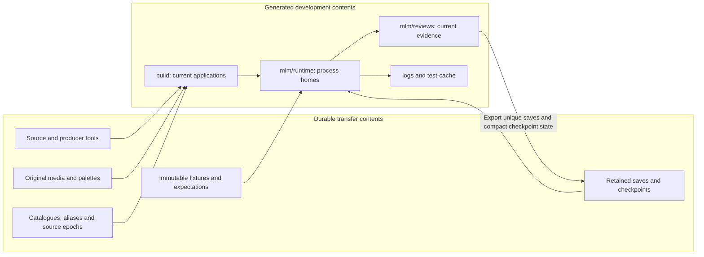
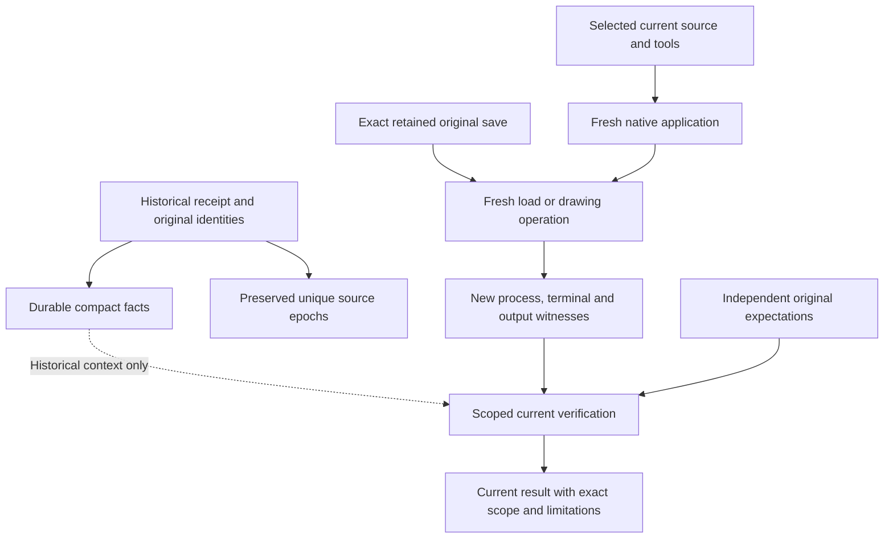
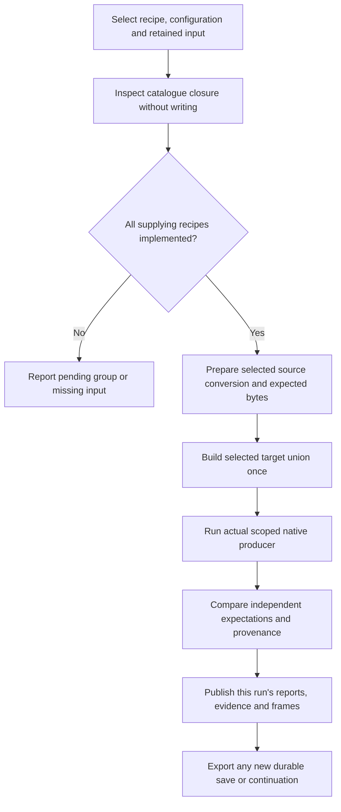
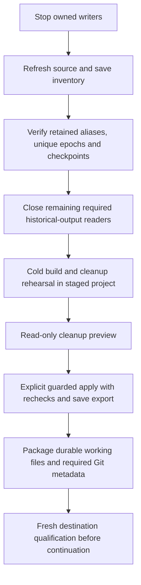

# Historical debugging, retained inputs and reproducible artifacts

Owner: this architecture note and the [shared multilayer layout](../upgrades/2026-10/r2mlvs-multilayer-vehicles-and-structures.md#development-artifact-layout). Implementation history: [completed preservation and artifact reconstruction](../upgrades/2026-10/r2fc-file-cleanup3.md), with measured results in its [execution record](../upgrades/2026-10/r2fc-file-cleanup3-a-execution.md). Remaining implementation: [R2FC2 - migrations, cleanup, transfer and Space resumption](../upgrades/2026-10/r2fc2-file-cleanup3.md). Related engine contracts: [files](files/archi-files.md), [savegames](savegame/archi-savegame.md) and [logging](logging/archi-logging.md).

This page describes where development inputs and debug artifacts belong, how a
consumer selects them, and how to reconstruct generated evidence. It covers the
multilayer development harness; ordinary player save/configuration paths remain
owned by the engine's file subsystem.

## Delivery boundary

As of the R2FC-3 checkpoint on2026-10-22, retention, shared routing, selected
builds, Space checkpoint recovery and the implemented graphics producers are
available. Remaining consumer migrations, automatic save export, broad cleanup
and cold transfer rehearsals are unfinished. Existing generated folders must
remain until those preservation gates pass. The current `clean.ps1` still has
its earlier narrow target policy; this document does not authorize an ad hoc
recursive deletion.

Group20BB is complete. Execution is paused at the user's request; the next
implementation group is20BC in the [remaining work plan](../upgrades/2026-10/r2fc2-file-cleanup3.md).
The completed plan and continuation carry the exact pause/resume status; this architecture page is
the stable storage and reconstruction reference.

## Storage ownership

Paths below are relative to the repository root. Durable inputs travel with the
source tree. Generated artifacts can be discarded only after every unique save,
source epoch and required semantic input has a verified durable owner.

| Location | Contents and authority | Lifecycle |
| --- | --- | --- |
| `src/`, `src/tests/`, `mlm/tools/`, `media/multilayer/` | Implementation, test producers, diagnostic helpers and original art tooling. | Preserve working files, including valuable untracked/ignored files. |
| `media/` | Authored/selected originals, palettes, source contracts and canonical shipping assets, including the existing GRF authority. | Preserve exact originals; regenerating a prompt cannot recover approved pixels. |
| `src/tests/fixtures/<feature>/<purpose>/`, `regression/` | Curated immutable worlds, older-format compatibility inputs and independent expectations. | Preserve; ordinary tests must not regenerate their own expected baselines. |
| `src/tests/fixtures/checkpoints/space/` | Exact Space continuation save pair, compact state/closed-policy contract and historical facts. | Durable checkpoint; current qualification is generated separately. |
| `src/tests/fixtures/checkpoints/underground/` | Paused Tube source checkpoint, distinct baseline epochs and historical terminal scope. | Durable; does not qualify the provisional five-model feature. |
| `savegames/retained/` | Other discovered saves, scenarios, backups and aliases of exported review/runtime saves. | Preserve every payload; equal bytes may share storage with complete aliases. |
| `src/tests/fixtures/cleanup/` | Save migration map, source-epoch inventory, dependency dispositions and compact historical facts. Unique source versions use `source-epochs/`. | Durable preservation contracts, not a second image/EXE cache. Refresh live-source references before deleting their original snapshots. |
| `src/tests/fixtures/config/multilayer/` | Runtime templates, portable native build profile and pinned dependency recipe sources. | Durable configuration/tool contract; machine CMake caches are disposable. |
| `mlm/review-producers.json` | Sole producer/recipe catalogue: dependencies, retained roles, targets, tags, outputs and implementation status. | Durable routing authority; inspect it instead of inventing a second asset catalogue. |
| `mlm/reviews/<feature>/<scenario>/<run-id>/` | Current generated images, saves, payloads, reports and required transcripts. | Generated; export unique saves/checkpoints before removal. Keep the routing README. |
| `mlm/runtime/<profile>/<run-id>/<process>/` | Mutable runtime configuration/scripts, distribution copies, autosaves and process-local files. | Generated; separate host/client homes, export saves before retirement. |
| `logs/` | Optional process/build/test diagnostics. | Disposable after migration; never the sole checkpoint or authorization authority. |
| `test-cache/` | Unit-test output, scratch, temporary scripts, verification artifacts and temporary console images. | Disposable after preservation gates; test tooling needed long term stays beside tests. |
| Declared `build/` products | Configured native/dependency builds and current executable images. | Rebuild from source/profile; preserve meaningful configuration and saves first. |
| `docs/zz-reach2/` | Architecture, plans and handovers. | Documentation; assisting R2FC-3 Markdown stays beside its plan. |



### A generated review run

```text
mlm/reviews/<feature>/<scenario>/<run-id>/
  images/     native PPM/IDX, lossless PNG, review sheets
  saves/      newly emitted SAV/SCN checkpoints awaiting export
  data/       generated indexed/packed/expected payloads
  reports/    requests, stage results, native records, selections
  evidence/   required actual stdout/stderr and observations
  scratch/    invocation-local intermediates
```

`RunContext` in [artifact_paths.py](../../../src/tests/multilayer/support/artifact_paths.py)
owns these paths and resolves contained input aliases. Native producers share the
contract through [test_artifact_paths.cpp](../../../src/tests/test_artifact_paths.cpp).
Mixed feature captures may share one invocation ID, with separate feature paths.
Runtime profile and process names isolate mutable state; they do not select a
different source fixture implicitly.

### Why retained save paths contain a timestamp and a hash-looking suffix

For example,
`savegames/retained/mlm/reviews/space/surface-entry-capital-earn/20261019-013752-7bf4c3e74e/saves/surface-launch-earn-440.sav`
preserves its original review-relative provenance. The default run ID is UTC
`YYYYMMDD-HHMMSS-` followed by ten random UUID hex characters. That suffix is a
collision-avoidance identifier, **not a content hash**. Explicit run IDs are also
supported. SHA256 identities live in the manifests and reports.

Retention does not imply a test reads every save. Some saves support automated
fixtures or continuation; others preserve a development branch for manual load,
inspection or replay. The capital-earn example preserves such an intermediate
Space branch, rather than naming the active continuation checkpoint. Consult
`cleanup/migration.json` for original aliases/recorded consumers and
`multilayer-inputs.json` for stable input keys. Never select a save solely because
its directory sorts last. The original migration measured5707 distinct save
payloads and15573 aliases; those are dated inventory facts, not a fixed future
count or a pruning rule.

## Historical facts and current proof

A historical receipt records what an earlier source/application/save combination
did. Its old hashes remain historical even after the original generated folders
are removed. A new build receives its own identity and must produce fresh proof.
Keeping hundreds of historical EXEs is not required to use a durable checkpoint.

| Question | Required material |
| --- | --- |
| What happened in an earlier run? | Compact retained facts, source versions where unique, save identities and dated handover. |
| Can this original world load correctly now? | Retained world plus a current native build and new load/static qualification. |
| Does the current renderer preserve approved pixels? | Original art, independent immutable expectations, current source conversion and actual native captures. |
| Can an exact old application be recreated? | Its exact source epoch, build/dependency contract and compatible tools; current proof alone cannot promise byte-identical EXEs. |
| May feature work continue? | Live source-plan dispatch and its own authorization/gates; an art fixture or static load grants none. |



Shared [runner.py](../../../src/tests/multilayer/support/runner.py) records the
actual executable, configuration, argv, input identities, native artifacts and
retained transcript. `save_native_capture` records lossless native-to-PNG
conversion; schema2 [evidence.py](../../../media/multilayer/evidence.py)
connects a selected frame to that process, source, native writer and terminal.
An attractive source canvas or old screenshot cannot substitute for this chain.
Ground retains complete original PPM/IDX fingerprints as an additional check.

## Reconstituting debug artifacts

Run commands from the repository root. Select one recipe/configuration and a
fresh explicit ID. Inspect before execution; disabled recipes name their pending
implementation groups and refuse to execute. Never repair a refusal by copying
an old EXE, rewriting a receipt hash or choosing an undeclared workstation cache.



### Inspect and run a selected graph

The actual CLI uses a **positional recipe**, with `--inspect` for read-only
inspection. Earlier planning examples using `--recipe` or `--stage verify` are
obsolete.

```powershell
python -B src/tests/multilayer/support/artifact_rebuild.py space-checkpoint --configuration Debug --inspect
python -B src/tests/multilayer/support/artifact_rebuild.py ground-viewport-stations --configuration RelWithDebInfo --inspect

# Example host tool locations; replace with this machine's installations.
$buildTools = @('--vcpkg', 'D:/Codez/Tools/vcpkg', '--grfcodec', 'D:/Codez/Tools/grfcodec/grfcodec-6.2.0-windows-win64/bin')
python -B src/tests/multilayer/support/artifact_rebuild.py space-checkpoint --configuration Debug --run-id recovery-debug-001 @buildTools
```

Use a new ID for a new independent run. To retry an interrupted invocation,
select the same recipe/configuration with `--resume <exact-run-id>` instead of
`--run-id`. Resume checks unchanged declarations, inputs, sources and passed
stage/output witnesses; a completed or still-owned invocation refuses. Changed
source requires a fresh run. Progress is
`mlm/reviews/rebuild/<recipe>/<run-id>/reports/rebuild.json`.

The following implemented graph entry points reconstruct their selected closure.
They have bounded producer validation; full cold staging remains Groups30–32.

| Recipe | Producer and actual native scope | Recreated material |
| --- | --- | --- |
| `space-checkpoint` | `acceptance/space_checkpoint_load.py`, `openttd_surface_capital_test` `[.space-checkpoint-load]`, plus ordinary `openttd` static reload. | Fresh zero-tick qualification of the retained continuation, not paid cash-work. |
| `sprite-native-loaders` | `support/sprite_native_loader.py`; five original loader families: M1, Space, orbital, launch-fleet and Ground. | Selected source conversions/packing, independent expected payloads and actual native decoder evidence. Select an individual `<family>-native-loader` when only one is needed. |
| `space-current-producers`, `orbital-current-producers`, `launch-current-producers`, `ground-current-producers` | Original source-selector cases in their catalogue targets/tags. | Current source/decoder/selector results; these alone do not claim ordinary viewport review. |
| `launch-occupied-viewports` | `launch_facility_render_checks.py`, `openttd_space_art_test` `[.launch-facility-render]`. | Actual selected occupied-launch frames and source-pixel checks. |
| `space-paused-viewports`, `orbital-paused-viewports` | Original `acceptance/*_final_art_checks-1.py` wrappers using ordinary `openttd`. | Actual paused ordinary application captures and preserved-world observations. |
| `ground-viewport-collector`, `ground-viewport-industry-states` | Original Ground wrappers, `openttd_ground_viewport_test` `[.ground-industry-runtime]`. | Retained collector or original industry-state capture matrix. |
| `ground-viewport-purchases`, `ground-viewport-rail`, `ground-viewport-road` | `ground_transport_runtime_checks.py`, same viewport target `[.ground-transport-runtime]`. | Purchase canvases or selected native body/list matrices. |
| `ground-viewport-stations` | `ground_station_runtime_checks.py`, same viewport target `[.ground-station-runtime]`. | Station depth, glass, appearance and vehicle foreground matrix. |

The catalogue supplies exact retained input/output roles and prerequisites.
`GroundSourceViews` consumes explicit Ground packing and three original M1
source suppliers; `ground-review-worlds.json` binds the original review worlds
and complete raster expectations. Ground's later-owner exclusions and useful
route/human gates remain outside these technical drawing passes. Some superseded
Ground declarations and `tube-checkpoint` are still disabled; inspect their
status rather than assuming a family name makes them runnable.

### Build prerequisites and explicit prepared captures

[native-build-profile.json](../../../src/tests/fixtures/config/multilayer/native-build-profile.json)
records the observed Windows/MSVC tool, SDK, options and dependency versions.
Its adjacent dependency-source bundle retains recipe/patch sources. Inspect tools
with `python -B src/tests/multilayer/support/native_build.py --inspect @buildTools`.
Optional explicit overrides include `--cmake`, `--git`, `--patch`,
`--visual-studio` and `--windows-sdk`. External tool installations stay read-only;
owned dependency downloads/builds and temporary files stay under `build/`.

For a manual bounded Ground capture, build all three targets together, then
execute its actual decoder and59-case consumer against that exact build:

```powershell
python -B src/tests/multilayer/support/native_build.py --configuration RelWithDebInfo --target openttd_ground_art_test --target openttd_ground_consumer_test --target openttd_ground_viewport_test @buildTools
```

The returned `native-build.json` identifies the images and source epoch. A later
relink/source change can invalidate earlier proof, so graph execution computes
the selected target union before the first native observation. Debug and
RelWithDebInfo have independent images and qualification.

The already prepared capture CLI is:

```powershell
python -B src/tests/multilayer/ground_viewport_review.py --mode stations --configuration RelWithDebInfo --selector-result <current-ground-consumer.json> --build-result <same-current-native-build.json> --source-result <explicit-completed-pure-source-rebuild.json> --run-id ground-stations-001
```

Angle-bracket arguments are explicit caller selections, not literal filenames.
Only completed pure source bytes may be reused through this interface. Old native
outcomes, timestamps and copied applications never qualify the new capture.
The common mode choices are `collector`, `industry-states`, `purchases`, `rail`,
`road` and `stations`. Each original wrapper exposes only its owned modes.

### Find and inspect the result

Read the returned report identity, then its `selected_capture` / `selection`
references. Open PNGs in that exact run's `images/`; native IDX buffers and scene
palette/geometry metadata support pixel diagnosis. Required native stdout is in
`evidence/`, not an arbitrary diagnostic log. A failure leaves its own evidence
and remains incomplete; neither a partial matrix nor exit status alone passes.
Run only the focused corruption suite relevant to a changed mechanism. Tests
must not manufacture a replacement expected baseline from changed output.

## Checkpoints, cleanup and transfer

Space's durable contract is
`src/tests/fixtures/checkpoints/space/checkpoint.json`. At this checkpoint,
GZVEEH is closed at32 windows/64000 ticks; GZVEEI is the next unimplemented task.
Both30000 exceptions are spent; the40000 operating and100000 capital floors
remain. Fresh static/art qualification grants no new purchase, income window
or gameplay tick. The current generated foundation still needs the Group22
durable publication work before its report folders may be removed.

Underground retains both `before.json` and `before-definitions.json` source
epochs. Completed Group9 terminal history stays distinct from provisional,
unqualified Group10 five-model source edits. Cleanup does not resume that feature.



Current read-only preservation checks are
`artifact_preservation.py --retained-only --verify-catalogue` and
`artifact_source_epochs.py` under `src/tests/multilayer/support/`.
Their explicit `--export` operations preserve inventoried saves/source epochs;
they are not the future reusable automatic exporter. Refresh source epochs while
original ignored snapshots still exist, before real deletion. Group24 implements
incremental save export; Groups26–28 implement/test the broad cleaner;
Groups29–34 stage, rehearse, clean and package. These steps remain pending.

The cleaner must keep preview as its default and preserve containment, reparse
point, nested repository, tracked-file, active-writer and changed-save refusals.
Unknown ignored/untracked files do not become disposable merely because Git does
not track them. Protect other worktrees, `OpenTTD-baseline/`, legacy saves and
all valuable working material. Transfer packaging must include that material and
required Git metadata without invoking Git-writing commands.
