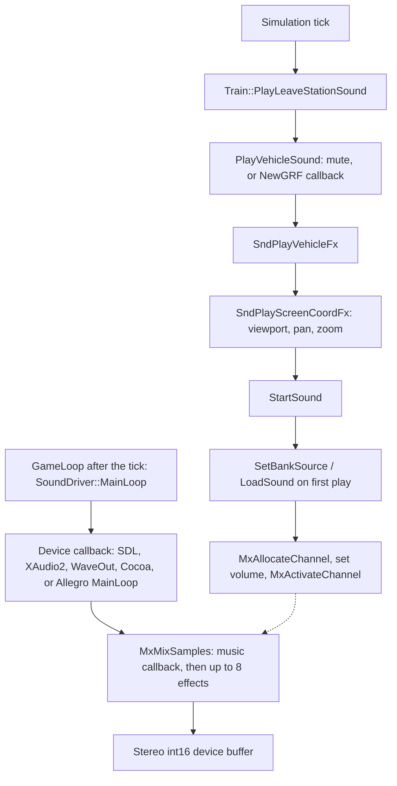
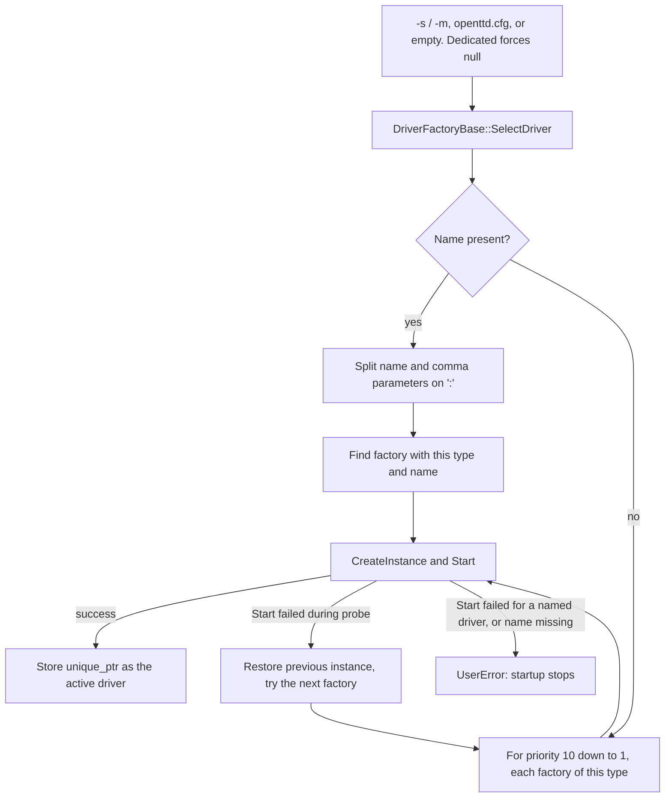

# Audio architecture

OpenTTD keeps sound effects and music off the simulation. A game tick decides that something audible happened, asks the sound or music layer to play it, and continues whether a sample was decoded, a mixer channel was free, or a MIDI device accepted the song.

Two driver families share one factory. Sound effects are decoded to PCM and mixed in-process. Music is either rendered into that same mix (FluidSynth) or handed to a platform MIDI device that never touches the mixer.

Base-set file formats and `.obs` / `.obm` metadata live in the base-media documentation. This page only describes what happens after a set has been chosen.

## Driver and DriverFactoryBase

`Driver` (`src/driver.h`) is the common device interface: `Start(parm)`, `Stop()`, and `GetName()`. `Start` returns `std::nullopt` on success and an error string otherwise. The caller decides whether that string aborts startup or the next factory is tried.

`Driver::Type` is ordered `Music`, then `Sound`, then `Video`. Shutdown walks that order so an external MIDI process (`extmidi`) is stopped before the sound device it may share is torn down.

`DriverFactoryBase` is the registry. Each concrete backend has a small factory subclass whose constructor passes type, priority, short name, and description into `DriverFactoryBase`. A file-scope static instance of that factory runs before `main` and inserts itself into a process-wide map. The map key is the type name concatenated with the driver name (`"sound"` + `"sdl"`, `"music"` + `"fluidsynth"`), so a sound driver and a music driver may both be called `"win32"`.

`CreateInstance()` returns a `std::unique_ptr<Driver>`. The live instance for each type sits in a static array indexed by `Driver::Type`. `SoundDriver::GetInstance()` and `MusicDriver::GetInstance()` cast the slot for their type.

### Selection

`openttd.cpp` calls `DriverFactoryBase::SelectDriver` after the basesets are chosen. The string comes from `-s` / `-m`, otherwise from `openttd.cfg` (`_ini_sounddriver`, `_ini_musicdriver`). Dedicated mode (`-D`) forces both names to `"null"`.

`SelectDriverImpl` (`src/driver.cpp`) has two modes:

- An empty name is an autoprobe. Factories of the requested type are tried from priority 10 down to priority 1. Priority 0 is never auto-selected (that slot is for drivers such as the null video driver). For each candidate, the previous instance is held aside, `CreateInstance` + `Start({})` runs, and a failed `Start` restores the previous instance and continues. The first success is kept.
- A non-empty name is split on the first `:`. The left side is the driver name (case-insensitive). The right side is a comma-separated parameter list (`hz=44100`, `samples=1024`, `soundfont=...`). Exactly that factory is started. A failed `Start`, or an unknown name, calls `UserError` and startup stops.

Sound and music priorities in the tree (higher is tried first on autoprobe):

| Name | Type | Priority | Output |
| --- | --- | --- | --- |
| `xaudio2` | sound | 10 | Windows XAudio2, pulls the mixer |
| `cocoa` | sound | 10 | Core Audio, pulls the mixer |
| `win32` | sound | 9 | WaveOut, pulls the mixer |
| `sdl` | sound | 5 | SDL2 audio callback, pulls the mixer |
| `allegro` | sound | 4 | Allegro stream, filled from `MainLoop` |
| `null` | sound | 1 | No device. `HasOutput()` is false |
| `dmusic` | music | 10 | DirectMusic |
| `cocoa` | music | 10 | Core MIDI |
| `bemidi` | music | 10 | Haiku MIDI |
| `win32` | music | 5 | `midiOut` |
| `fluidsynth` | music | 5 | Software synth into the mixer |
| `extmidi` | music | 3 | Forked external player |
| `allegro` | music | 9 if built without SDL2, else 2 | Allegro MIDI |
| `null` | music | 1 | `PlaySong` is a no-op |

Because `null` sits at priority 1, an autoprobe that cannot open a real device still obtains a driver and the process continues. Naming a driver that fails to start does not.

Driver parameters are parsed by `GetDriverParam`, `GetDriverParamBool`, and `GetDriverParamInt` in `src/driver.cpp`.

## SoundDriver and MusicDriver

`SoundDriver` (`src/sound/sound_driver.hpp`) adds `MainLoop()` (default empty) and `HasOutput()`. It does not expose "play this sample". Samples are queued on the mixer; the active sound driver only asks the mixer to fill a device buffer.

`MusicDriver` (`src/music/music_driver.hpp`) is a player: `PlaySong(MusicSongInfo)`, `StopSong`, `IsSongPlaying`, `SetVolume`. The GUI and `MusicLoop` talk only to this interface. Which backend is installed is invisible to the playlist.

`GameLoop` (`src/openttd.cpp`) runs the simulation (`StateGameLoop` or `NetworkGameLoop`), then `SoundDriver::GetInstance()->MainLoop()`, then `MusicLoop()`. Allegro is the sound driver that fills its stream inside `MainLoop`. SDL2, XAudio2, Win32 WaveOut, and Cocoa fill buffers from the audio device callback and leave `MainLoop` empty. `MusicLoop` only advances the playlist when the current song has ended.

## Mixing

The mixer (`src/mixer.h`, `src/mixer.cpp`) is the single PCM path for sound effects.

- Eight `MixerChannel` slots. `MxAllocateChannel` returns null when all eight are active; the effect is dropped.
- `MxMixSamples(buffer, samples)` zeroes an interleaved stereo `int16` buffer, optionally renders the installed music callback into it, then adds each active effect channel. A channel with no samples left is closed.
- The game thread allocates, arms, and stops channels. The device thread mixes. Channel masks are atomics (`_active_channels`, `_stop_channels`), so `MxCloseAllChannels` from the game thread is a flag, not a lock around the device callback.
- Effect volume is the per-sample volume times a master curve. `SetEffectVolume` stores 0–127; the mixer cubes that value so the slider matches perceived loudness.
- Pan is a sine law: left and right gains stay at constant power as the source moves across a viewport.
- `MxInitialize(rate)` records the device rate (default before any driver starts is 11025) and clears `_music_stream`, because a music renderer is tied to that rate. Startup therefore starts the sound driver first and the music driver second. FluidSynth calls `MxSetMusicSource` only after the mixer rate is known.

Each effect is one mono buffer, 8-bit or 16-bit. If the file rate differs from `MxGetRate()`, `LoadSoundData` asks `SoundResampler` providers (soxr) to resample before the channel is armed. The mixer also keeps a fractional playback position so a leftover rate difference can be interpolated, and loaders append one padding sample for that interpolator.

Music joins this buffer only when a driver installs an `MxStreamCallback`. In this tree that is FluidSynth (`RenderMusicStream` in `src/music/fluidsynth.cpp`). The callback tries the synth mutex and returns immediately if the game thread holds it, so a `PlaySong` does not block the audio callback; that buffer stays silent for music and effects still mix. Win32 MIDI, DirectMusic, Cocoa, Allegro, BeOS, and `extmidi` play outside the mixer. Their audio never appears in `MxMixSamples`.

## When a game event triggers a sound

Callers check the client sound switches (`_settings_client.sound.*`) themselves. `SndPlayTileFx`, `SndPlayVehicleFx`, and `SndPlayFx` play whenever they are called.

One vehicle path, a train leaving a station (`Train::PlayLeaveStationSound` in `src/train_cmd.cpp`):

1. `PlayVehicleSound(this, VehicleSoundEvent::Start, force)` (`src/newgrf_sound.cpp`). If vehicle sounds are muted and `force` is false, it returns true and the default effect is skipped. If the engine's NewGRF implements `CBID_VEHICLE_SOUND_EFFECT`, the callback result is either "play nothing", "play this NewGRF sample" via `SndPlayVehicleFx`, or "use the default". A failed callback falls through.
2. Otherwise the engine class selects a baseset id (`SND_04_DEPARTURE_STEAM`, `SND_0A_DEPARTURE_TRAIN`, `SND_47_DEPARTURE_MONORAIL`, or `SND_41_DEPARTURE_MAGLEV`) and calls `SndPlayVehicleFx`.
3. `SndPlayVehicleFx` forwards the vehicle's bounding box to `SndPlayScreenCoordFx`.
4. Viewports are walked from the back so the main view wins. If the box misses every viewport, nothing is played. If it hits, horizontal position inside the viewport becomes pan in `[0, 1]`, and `_vol_factor_by_zoom` scales volume down as the view zooms out.
5. `StartSound` returns immediately when volume is 0, the id is missing, a previous decode failed (`rate == 0` and `file == nullptr`), or no mixer channel is free. Otherwise `SetBankSource` decodes on first use, `MxSetChannelVolume` applies the sample's own volume times the zoom volume, and `MxActivateChannel` publishes the channel to the device thread.

`SndPlayFx` (GUI beeps, news) skips the viewport and uses a centred pan with full zoom volume. `SndClickBeep` and `SndConfirmBeep` are the settings gates for `SND_15_BEEP`.

The same `StartSound` path serves industry ambient ticks, disasters, construction, and NewGRF tile sounds. Those call sites differ only in which `SoundID` they pass and which settings bit they consult.

## Diagrams

### Game event to the sound device

### Driver factory selection

## Code map

| Piece | Path | Role |
| --- | --- | --- |
| Driver, factory, selection | `src/driver.h`, `src/driver.cpp` | `Start`/`Stop`, registry, autoprobe, named parameters |
| Sound driver base | `src/sound/sound_driver.hpp` | `MainLoop`, `HasOutput`, active instance |
| Music driver base | `src/music/music_driver.hpp` | `PlaySong` / `StopSong` / `IsSongPlaying` / `SetVolume` |
| Effect API and bank bind | `src/sound.cpp`, `src/sound_func.h` | `InitializeSound`, `ChangeSoundSet`, `SndPlay*` |
| Sound pool | `src/newgrf_sound.cpp` | `_sounds`, `GetSound`, NewGRF vehicle/tile triggers |
| Decode dispatch | `src/soundloader.cpp`, `src/soundloader_type.h` | `LoadSound` / `LoadSoundData`, loader registry |
| WAV / Opus / raw | `src/soundloader_wav.cpp`, `src/soundloader_opus.cpp`, `src/soundloader_raw.cpp` | PCM decode; raw is the old-format fallback |
| Resample | `src/soundresampler_soxr.cpp` | Match file rate to `MxGetRate` |
| Mixer | `src/mixer.cpp` | Eight channels, music callback, device buffer |
| SDL2 sound | `src/sound/sdl2_s.cpp` | Callback calls `MxMixSamples` |
| XAudio2 sound | `src/sound/xaudio2_s.cpp` | `OnBufferEnd` submits the next mixed buffer |
| Win32 WaveOut | `src/sound/win32_s.cpp` | Wave header callback mixes PCM |
| Null sound | `src/sound/null_s.cpp` | Starts cleanly, produces no samples |
| Music playlist | `src/music.cpp`, `src/music_gui.cpp` | Bind used set into playlists; `MusicLoop` |
| MIDI file for drivers | `src/music/midifile.cpp` | `LoadSong`, `GetSMFFile` (SMF path or CAT/MPS convert) |
| FluidSynth | `src/music/fluidsynth.cpp` | Renders into the mixer |
| Win32 MIDI | `src/music/win32_m.cpp` | `midiOut` timer, not the mixer |
| DirectMusic | `src/music/dmusic.cpp` | Windows MIDI, priority 10 |
| External MIDI | `src/music/extmidi.cpp` | Forked player; shut down before sound |
| Startup | `src/openttd.cpp` | `SelectDriver` for sound then music; `GameLoop` pumps both |

## Invariants

- The simulation does not read back success from `SndPlay*`, `PlaySong`, or `LoadSound`. Those functions return void or a bool that only the audio layer uses. A train still leaves the station when the departure sample is missing, the viewport does not contain it, or all eight mixer channels are busy.
- `GameLoop` runs `StateGameLoop` / `NetworkGameLoop` before `SoundDriver::MainLoop` and `MusicLoop`. Audio work on that path cannot change game state. Playlist changes write client settings and window invalidation, not company or vehicle state.
- A failed decode marks that `SoundEntry` so it is not retried (`file` cleared, empty PCM skipped). The slot stays in the pool; NewGRF overrides of other slots are unchanged.
- `ChangeSoundSet` closes mixer channels and replaces baseset slots (`grf_container_ver == 0`). A channel that is already playing holds its own `shared_ptr` to the old PCM, so unloading the bank does not free memory the device thread is still reading.
- Music driver failures (`PlaySong` cannot open a file, FluidSynth cannot create a player, Win32 `LoadSong` fails) log and return. `IsSongPlaying` then becomes false and `MusicLoop` advances the playlist. The game clock is unchanged.
- FluidSynth's render callback uses `try_lock`. If the game thread holds the synth mutex, that buffer is left without music. Effects still mix. The callback does not wait.
- `MxInitialize` drops the music callback. The sound driver is started before the music driver so FluidSynth installs its callback against the final sample rate.
- The null sound and null music drivers are real `Driver` instances. Dedicated mode selects them on purpose. `HasOutput() == false` tells the UI not to treat a silent null device as a missing sound set.
- A running session always has both instances: `GameLoop` calls `SoundDriver::GetInstance()->MainLoop()` unconditionally once past bootstrap. Autoprobe falls through to `null` (priority 1). The case that aborts the process is startup `UserError` when a *named* driver fails `Start`, or when no sound or music set can be selected at all. That happens before the simulation loop, and it is a process start failure, not a tick that diverges.
