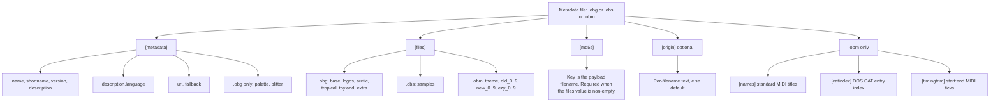
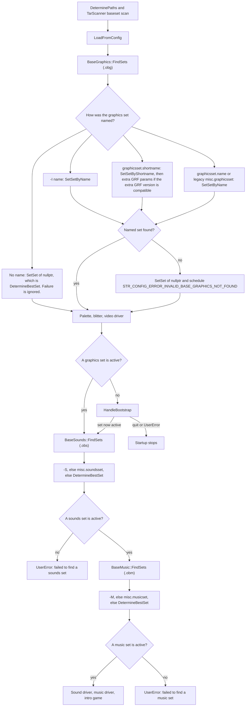

# Base sets

A base set is the graphics, sound, or music pack the game starts with. OpenTTD always has three independent selections: one graphics set, one sound set, and one music set. The selectable object is a small INI-like metadata file. The sprites, samples, and songs are separate payload files named by that metadata.

| Kind | Metadata | Extension | In-memory type | Scanner |
| --- | --- | --- | --- | --- |
| Graphics | OpenTTD Base Graphics | `.obg` | `GraphicsSet` via `BaseGraphics` | `BaseMedia<GraphicsSet>::FindSets` |
| Sound | OpenTTD Base Sounds | `.obs` | `SoundsSet` via `BaseSounds` | `BaseMedia<SoundsSet>::FindSets` |
| Music | OpenTTD Base Music | `.obm` | `MusicSet` via `BaseMusic` | `BaseMedia<MusicSet>::FindSets` |

The shared reader is `BaseSet<T>::FillSetDetails` in `src/base_media_func.h`. Graphics and music override it (`GraphicsSet::FillSetDetails` in `src/gfxinit.cpp`, `MusicSet::FillSetDetails` in `src/music.cpp`). Sound uses the shared reader only. Key lists for the three formats are in [obg.md](obg.md), [obs.md](obs.md), and [obm.md](obm.md). The legacy examples are `docs/obg_format.txt`, `docs/obs_format.txt`, and `docs/obm_format.txt`. Where those examples disagree with the parser, the parser is the one that runs.

Nothing in the scanners treats a bare `.grf` as a base set. `FindSets` only collects the metadata extensions above.

## What a set contains

Every metadata file that parses has:

- `name`, the string `-I`, `-S`, `-M`, and the config file match
- `shortname`, four bytes used as the set's identity (content download, duplicate detection, and the graphics config key)
- `version`, one or more decimal integers separated by `.`
- `description`, plus any `description.<language>` lines
- a fixed list of `[files]` slots
- an MD5 for every slot that names a payload
- optional `url`, `fallback`, and `[origin]` text

Payload paths are stored as the metadata file's directory plus the filename from `[files]` (`BaseMedia::AddFile`). The directory is the path relative to the search root. `MD5File::CheckMD5` then opens that relative path through the baseset file open, which also looks in `gm/` and `data/` (`FioFOpenFile` in `src/fileio.cpp`). A slot written as `TRG1.GRF` inside `baseset/myset/set.obg` is opened as `myset/TRG1.GRF`, not as a bare `TRG1.GRF` in some other folder. `docs/obg_format.txt` says the same thing. When the metadata file itself sits at the root of a search directory, the stored name has no directory prefix, and the usual baseset open walks the search paths for that bare name.

Which search directories are walked is covered in `docs/directory_structure.md`. The part that matters here: `FindSets` scans recursively for the metadata extension. Graphics and sounds also look inside `.tar` archives (`BaseSetTraits::search_in_tars`). Music does not. After a content download, a music tar is extracted on purpose because of that (`ClientNetworkContentSocketHandler::AfterDownload` in `src/network/network_content.cpp`).

### Graphics

Six slots, in this order (`GraphicsFileType` and `_graphics_file_names` in `src/gfxinit.cpp`):

| Key | Role | How it is loaded |
| --- | --- | --- |
| `base` | Sprites for every climate | `LoadGrfFile`, old-style GRF, first sprite at 0 |
| `logos` | Logos, landscape icons, original terrain generator | `LoadGrfFile`, first sprite at 4793 |
| `arctic` | Arctic replacements | `LoadGrfFileIndexed`, only when the landscape is not temperate |
| `tropical` | Tropical replacements | same |
| `toyland` | Toyland replacements | same |
| `extra` | Sprites that were not in the original game | NewGRF pipeline, then removed from the user NewGRF list |

`palette` is required. `blitter` is optional and defaults to 8bpp. An empty filename is rejected (`FillSetDetails` is called with `allow_empty_filename = false`).

The first five files are classic sprite containers. `LoadGrfFile` reads container version, sprite offsets, and sprites. A Windows palette set is remapped (`PaletteType::DOS != used_set->palette`). They are not registered as user NewGRFs.

`extra` is a NewGRF. `LoadSpriteTables` builds two temporary `GRFConfig` entries and calls `LoadNewGRF(SPR_OPENTTD_BASE, 2)`:

1. A hardcoded fallback, filename `OPENTTD.GRF` (`GetDefaultExtraGRFConfig`).
2. The set's own `extra` file (`GetBasesetExtraGRFConfig`).

Both are erased from `_grfconfig` afterwards, so they do not stay in the NewGRF list. Sprites the set's extra file does not provide are counted from `OPENTTD.GRF`. If that missing count is large enough that the set supplied fewer than 500 extra sprites, the missing count is forced to 0. The comment in `LoadSpriteTables` says the original baseset extra graphics use the fallback on purpose.

A NewGRF whose Action 8 GRFID starts with `0xFF` is marked `GRFConfigFlag::System` (`ScanInfo` in `src/newgrf/newgrf_act8.cpp`). `FillGRFDetails` then returns false for it, and the settings loader reports it as a system GRF, so it cannot be picked from the in-game NewGRF list. `docs/obg_format.txt` tells authors to use such an id so the extra file is not loaded twice. The `.obg` parser does not check the id. The check happens when that GRF is scanned as a NewGRF.

Graphics MD5s cover the GRF data section when the file is container version 2, and the whole file otherwise (`GraphicsSet::CheckMD5` calls `GRFGetSizeOfDataSection`). Sound and music hash the whole file (`BaseSet::CheckMD5` passes `SIZE_MAX`). That is why `docs/obg_format.txt` says a plain `md5sum` is wrong for GRF container versions other than 1, while `docs/obs_format.txt` and `docs/obm_format.txt` say `md5sum` is the tool to use.

### Sound

One slot, key `samples` (`_sound_file_names` in `src/sound.cpp`). The payload is a sample bank, not a GRF. `OpenBankFile` reads a count dword. Bit 31 set means the newer bank (`SoundSource::BasesetNewFormat`, Opus and WAV). Bit 31 clear means the original TTD bank (`SoundSource::BasesetOldFormat`). The count is then divided by 8 and must equal `ORIGINAL_SAMPLE_COUNT` (73). A wrong count is ignored and the set stays selected; the metadata parser does not look inside the bank.

An empty `samples` value is valid. `media/baseset/no_sound.obs` is that set (`name = NoSound`, `fallback = true`). `InitializeSound` returns without loading when the filename is empty.

NewGRF sound replacements are a different path. They override entries in the sound pool. `ChangeSoundSet` only rewrites pool entries whose `grf_container_ver` is 0, which the comment there calls the baseset sounds.

### Music

Thirty-one slots (`NUM_SONGS_AVAILABLE` = 1 theme + 3 classes × 10): `theme`, `old_0` … `old_9`, `new_0` … `new_9`, `ezy_0` … `ezy_9`. An empty value is a slot with no song. `media/baseset/no_music.obm` leaves every slot empty (`name = NoMusic`, `fallback = true`).

A slot with a `[catindex]` entry is MPS MIDI inside a DOS music CAT (`MTT_MPSMIDI`). The index is the CAT entry, and the displayed name is read from the CAT. Any other non-empty file is a standard MIDI file (`MTT_STANDARDMIDI`) and needs a `[names]` entry. `[timingtrim]` is optional `start:end` MIDI ticks. Only the Win32 and DirectMusic drivers copy those ticks into playback (`src/music/win32_m.cpp`, `src/music/dmusic.cpp`). `docs/obm_format.txt` already says not every music driver supports the trim.

`MusicSystem::BuildPlaylists` maps index 0 to the theme playlist and does not put it in the style playlists. Indexes 1–10, 11–20, and 21–30 are Old style, New style, and Ezy Street. A song with an empty `songname` is left out of the playlists.

## Metadata file structure

Sections and keys are matched exactly, including case (`IniGroup::GetItem`, `IniLoadFile::GetGroup`). `;` and `#` start a comment only when they are the first character of the line. The rest of a value line is the value, so a comment after a value becomes part of the value. That matches the "you can't add comments after values" line in the legacy texts.

`[files]` keys outside the fixed list are ignored. The same is true of unused `[md5s]` keys. A missing `[metadata]` group, or a metadata file that could not be read, is rejected with the log line "Is the file readable for the user running OpenTTD?".

Shipped sources under `media/baseset/` contain `@description_STR_...@` and `${ORIG_EXTRA_GRF_MD5}`. `cmake/scripts/Baseset.cmake` expands those before the game sees the file. They are not runtime keys.

## Startup resolution

Config is loaded before any set is activated (`LoadFromConfig` in `src/openttd.cpp`).

- Sound and music names are `[misc]` `soundsset` and `musicset` (`src/table/settings/misc_settings.ini`), stored in `BaseSounds::ini_set` and `BaseMusic::ini_set`.
- Graphics still reads the old `[misc]` `graphicsset` string, then replaces it from the `[graphicsset]` group: `name`, `shortname` (exactly 8 hex digits, byte-swapped), `extra_version`, `extra_params` (`GraphicsSetLoadConfig` in `src/settings.cpp`). Saving writes that group, not `misc.graphicsset` (`GraphicsSetSaveConfig`).

`-I`, `-S`, and `-M` supply a `name` and override the config. The comparison is exact (`SetSetByName`).

`SetSetByName("")` and `SetSet(nullptr)` both call `DetermineBestSet`. A failed `-I` still does that, and also schedules an error. A failed `-S` or `-M` does that only when the requested name was non-empty. If the requested sound or music name is empty and the best-set search also fails, startup stops with `UserError`.

`HandleBootstrap` (`src/bootstrap_gui.cpp`) runs only when no graphics set is active. A blitter with screen depth 0 (dedicated server) goes straight to `UserError`. The download UI is compiled in for Emscripten, Windows with Uniscribe, FreeType with Fontconfig or on Apple, and Cocoa. On those builds a missing network also `UserError`s. Every other build `UserError`s without asking. Where the UI exists, the game enters `GameMode::Bootstrap` and asks to download a base graphics pack. Emscripten starts that download without the question. Refusing, or failing to connect, leaves startup. After a download, `FindSets` runs again and `SetSet(nullptr)` must find a set.

Sound and music are chosen after that graphics bootstrap. The bootstrap download requests `ContentType::BaseGraphics` only. A tree with no usable `.obs` or `.obm` still stops, even if graphics were just downloaded. The files shipped in `media/baseset/no_sound.obs` and `media/baseset/no_music.obm` are complete fallback sets, so a stock install has a sounds set and a music set before any original CD data is present.

`CheckExternalFiles` (`src/gfxinit.cpp`) runs when the active set changes. If the active graphics or sounds set has a missing or mismatched file, it shows an info dialog and continues. It does not inspect music. Opening a missing graphics payload later is `UserError` from `RandomAccessFile` ("Cannot open file").

On the way back to the main menu, if `soundsset` was empty, the active sound set is a fallback, and the sound driver has output, the game shows `STR_WARNING_FALLBACK_SOUNDSET` and then stores that set's name so the warning is not repeated (`SwitchMode::Menu` in `src/openttd.cpp`). There is no matching music warning.

## Choosing among several parsed sets

`AddFile` keeps a set whose metadata parsed. A missing payload does not reject it. The set is counted in `found_files` when the file exists, and in `valid_files` when the MD5 matches. An empty allowed filename counts as both. `GetNumMissing()` is `NUM_FILES - found_files`. `GetNumInvalid()` is `NUM_FILES - valid_files` and treats a missing file as invalid.

Two sets of the same kind with the same `name` or the same `shortname` are duplicates. The one with more `valid_files` wins. If those counts are equal, the higher `version` vector wins (`std::vector` order: component by component, and a longer equal prefix is greater). The loser stays in `duplicate_sets` so content download can treat it as already present. `BaseMedia::HasSet` matches `ContentInfo.unique_id` to `shortname` and, when asked, the XOR of every file MD5 to `ContentInfo.md5sum`. Sets with a missing file are skipped. Both the available list and the duplicate list are checked.

`DetermineBestSet` ignores sets with any missing file. A mismatch-only set can still win. Ranking:

- If the current best is a fallback and the candidate is not, the candidate wins immediately, even with fewer valid files.
- More `valid_files` wins, even when the candidate is a fallback and the current best is not.
- For sound and music, equal `valid_files` replaces the current best only when the `shortname` matches and `version` is greater. Otherwise the one found earlier stays.
- For graphics, after that version check, a DOS palette replaces a non-DOS palette at the same `valid_files`, including when the DOS set is a fallback.

`fallback` itself comes from metadata key `fallback`. The key is optional. Missing, `0`, and `false` mean not a fallback. Any other present value means it is a fallback. The comparison with `false` is case sensitive.

The four shortnames `TTDD`, `TTDW`, `TTDO`, and `TTOD` are the original TTD graphics, music, sound, and TTO music identities in `FillSetDetails`. For those, a missing file or a bad MD5 is logged at `Error` instead of `Critical`, because a DOS and a Windows `SAMPLE.CAT` share `TTDO` and only one checksum can match. Shipped metadata uses that: `orig_dos.obg` and `orig_dos_de.obg` are both `TTDD` and therefore duplicates of each other; `orig_dos.obs` and `orig_win.obs` are both `TTDO`.

`-h` prints every set that parsed (`GetSetsList`), including incomplete ones. Missing files are marked unusable. MD5 mismatches with no missing files are marked corrupt. The game-options dropdown hides sets that have missing files, except the set that is already active (`GetNumSets`).

## Code map

| Concern | Symbol | File |
| --- | --- | --- |
| Shared metadata parse, MD5, origin, version, fallback, description lookup | `BaseSet<T>::FillSetDetails`, `GetDescription`, `DecodeShortName` | `src/base_media_func.h` |
| Scan, duplicate policy, activate by name or shortname, `-h` list | `BaseMedia<T>::AddFile`, `FindSets`, `SetSet`, `SetSetByName`, `SetSetByShortname`, `DetermineBestSet`, `GetSetsList`, `HasSet` | `src/base_media_base.h`, `src/base_media_func.h` |
| Per-kind file counts and tar policy | `BaseSetTraits<GraphicsSet>`, `BaseSetTraits<SoundsSet>`, `BaseSetTraits<MusicSet>` | `src/base_media_graphics.h`, `src/base_media_sounds.h`, `src/base_media_music.h` |
| `.obg` keys, palette, blitter, GRF MD5, sprite load, extra NewGRF | `GraphicsSet::FillSetDetails`, `GraphicsSet::CheckMD5`, `LoadSpriteTables`, `BaseMedia<GraphicsSet>::DetermineBestSet` | `src/gfxinit.cpp` |
| `.obs` key, bank load, 73-sample check | `BaseSet<SoundsSet>::GetFilenames`, `OpenBankFile`, `BaseMedia<SoundsSet>::DetermineBestSet` | `src/sound.cpp` |
| `.obm` keys, CAT index, names, trim | `MusicSet::FillSetDetails`, `GetMusicCatEntryName` | `src/music.cpp` |
| Playlists from the 31 slots | `MusicSystem::BuildPlaylists` | `src/music_gui.cpp` |
| Startup order, `-I` `-S` `-M`, bootstrap call, fallback sound warning | `openttd` main, `SwitchMode::Menu` | `src/openttd.cpp` |
| Missing graphics download | `HandleBootstrap` | `src/bootstrap_gui.cpp` |
| `[graphicsset]` load and save; legacy `misc.graphicsset` | `GraphicsSetLoadConfig`, `GraphicsSetSaveConfig` | `src/settings.cpp` |
| `misc.soundsset`, `misc.musicset` | settings table | `src/table/settings/misc_settings.ini` |
| INI syntax used by the metadata files | `IniLoadFile::LoadFromDisk` | `src/ini_load.cpp` |
| System GRFID `0xFF` | `ScanInfo` | `src/newgrf/newgrf_act8.cpp` |
| User NewGRF list rejects system GRFs | `FillGRFDetails` | `src/newgrf_config.cpp` |
| GRF container v2 data-section size for MD5 | `GRFGetSizeOfDataSection` | `src/newgrf_config.cpp` |
| Incomplete graphics or sounds dialog | `CheckExternalFiles` | `src/gfxinit.cpp` |
| Content-download identity and music tar extract | `BaseMedia::HasSet`, `AfterDownload` | `src/base_media_func.h`, `src/network/network_content.cpp` |
| Shipped original and empty sets | `orig_*.obg`, `orig_*.obs`, `orig_*.obm`, `no_sound.obs`, `no_music.obm` | `media/baseset/` |
| Legacy format examples | | `docs/obg_format.txt`, `docs/obs_format.txt`, `docs/obm_format.txt` |

## Where the legacy format text is stale

These sentences in `docs/obg_format.txt`, `docs/obs_format.txt`, and `docs/obm_format.txt` do not match the parser. Details sit in the format notes.

- `version` is described as a single integer. The parser stores every dot-separated `uint32` and compares the vectors.
- The description example says `en_US` is used for `en_GB`. `GetDescription` tries the full code, then the first two characters, then the bare `description`. `description.en_US` does not satisfy `en_GB`.
- `openttd -d grf=1` is described as the way to see metadata parse errors. Those logs use facility `misc`. `Severity::Critical` prints at the default level (`Debug` in `src/debug.h`). `-d grf=1` raises facility `grf` to `Error` and does not enable the misc lines. Original-set MD5 and missing-file notes are `misc` at `Error`.
- `-h` is described as listing sets that were found correct. `GetSetsList` lists every parsed set and annotates missing and corrupt files.
- A missing MD5 is described as "a lot of warnings" while the set still loads. `FillSetDetails` returns false and the set is not added.
- "MD5 for each file" and "you may not miss any of the metadata or files items" over-reach. An empty sound or music filename skips the MD5 and is valid. `url`, `blitter`, and `fallback` are optional. A missing `[origin]` logs and continues.
- `shortname` is documented as four characters. The parser keeps the first four and does not reject a longer or a shorter non-empty value.
- "Preferably less than 16 characters" for `name` is not checked.
- `docs/obg_format.txt` says the default graphics set is `graphicsset` under `[misc]`. That key is only the legacy read. The current group is `[graphicsset]` with `name`, `shortname`, `extra_version`, and `extra_params`.
- `docs/obg_format.txt` presents `palette` as DOS or Windows and `blitter` as 8bpp or 32bpp. The parser checks the first character (`D`/`d`, or `3`).
- `docs/obs_format.txt` calls the files section "files that replace sprites". The only key is `samples`.
- `docs/obs_format.txt` says the sample file must contain exactly 73 samples. That check is in `OpenBankFile`, not in the metadata parser, and a wrong count does not reject the `.obs`.
- `docs/obm_format.txt` says `musicset` makes OpenTTD start with "that sound set". The key is the music set. It does live under `[misc]`, as the text says.
- `docs/obm_format.txt` says every `[files]` entry must have a `[names]` line or the game warns. Empty slots are skipped. CAT slots take the name from the CAT. A standard MIDI file with no name rejects the whole `.obm`.

## Invariants

- A running game has a graphics set, a sound set, and a music set, or startup has already stopped.
- No graphics set: `HandleBootstrap` offers a base-graphics download when the build can show text without sprites and the network is available. Dedicated servers, builds that cannot do that, a refused download, and a failed download end in `UserError` ("Failed to find a graphics set") or a quit. Startup does not continue with a null graphics set.
- A named graphics set that is not installed: the best remaining graphics set is activated, if one exists, and `STR_CONFIG_ERROR_INVALID_BASE_GRAPHICS_NOT_FOUND` is scheduled. If none exists, bootstrap runs.
- No usable sound set, or no usable music set: `UserError` ("Failed to find a sounds set" or "Failed to find a music set") and startup returns. There is no download bootstrap for sound or music on this path.
- A named sound or music set that is not installed, while some other set has no missing files: that other set is activated (the best-set rules above) and `STR_CONFIG_ERROR_INVALID_BASE_SOUNDS_NOT_FOUND` or `STR_CONFIG_ERROR_INVALID_BASE_MUSIC_NOT_FOUND` is scheduled.
- `no_sound.obs` and `no_music.obm` are valid sets. Empty slots count as present. They are fallbacks, so any non-fallback set with as many valid files is preferred. Silence from these sets does not block startup.
- A missing payload or a bad MD5 does not, by itself, stop set selection. The set can still be the active one if it was named explicitly. `DetermineBestSet` will also keep a set whose files all exist but fail the MD5 (`found_files` still increases). It will not pick a set that has a missing file. `CheckExternalFiles` shows a dialog for incomplete graphics or sounds and then continues. The next graphics load opens the payload with `RandomAccessFile`, which `UserError`s on "Cannot open file". `InitializeSound` does the same for a `samples` file that was named and is missing. An empty `samples` value does not open a file. A missing music file is skipped when the `.obm` is parsed (`ChecksumResult::NoFile`) and does not abort startup.
- Sets with a missing file are not chosen by `DetermineBestSet` and are hidden from the options dropdown unless already active. They still appear in `-h`.
- The extra graphics NewGRF and `OPENTTD.GRF` are loaded as base graphics and then removed from `_grfconfig`. They are not the user's NewGRF list. A GRFID starting with `0xFF` is what keeps that file out of the user list; the `.obg` parser does not enforce it.
