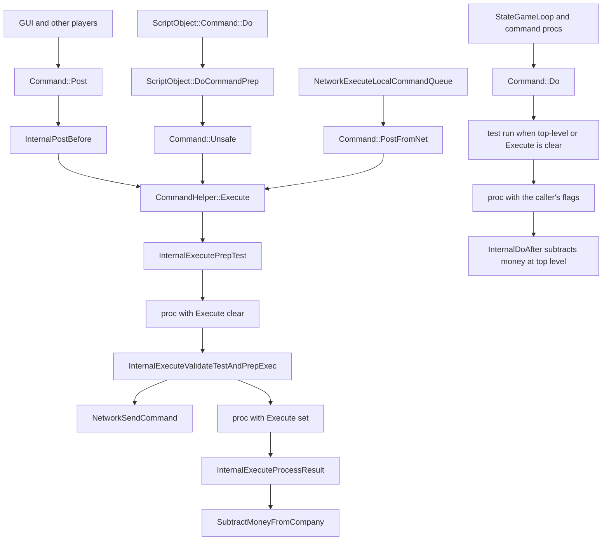

# Commands

Every player action that changes the game is a command. The command is a function that returns `CommandCost`, registered with `DEF_CMD_TRAIT` against the `Commands` enum. Declarations live in `*_cmd.h`. Implementations live in `*_cmd.cpp`. `src/command.cpp` includes those headers and builds the master table from the traits.

This is the determinism boundary described in `docs/zz-reach2/architecture/initial-inventory.md` section 1. The GUI, a script, and the network request a command. The simulation applies it through the same proc on every peer.

The names `DoCommand` and `DoCommandP` survive in comments and in the script API. The C++ entry points are `Command<Tcmd>::Do` and `Command<Tcmd>::Post` in `src/command_func.h`.

## Pipeline



`Post`, `Unsafe`, and `PostFromNet` share `Execute`. That helper always tests, then either sends the command or executes it. `Do` is the in-simulation path. It tests when the call is top-level or when `DoCommandFlag::Execute` is clear, then runs the proc with the caller's flags.

## Code map

| Symbol | Location | Role |
| --- | --- | --- |
| `CommandCost` | `src/command_type.h` lines 24–185 | Money, expense type, success, and error `StringID`s |
| `Commands` | `src/command_type.h` lines 200–384 | Every engine command. `Commands::End` stays last |
| `DoCommandFlag` / `DoCommandFlags` | `src/command_type.h` lines 391–407 | Flags for one call, including `Execute` and `QueryCost` |
| `CommandFlag` / `CommandFlags` | `src/command_type.h` lines 414–430 | Flags stored on the command by `DEF_CMD_TRAIT` |
| `CommandType` | `src/command_type.h` lines 433–445 | Kind used to decide what is allowed while paused |
| `CommandPauseLevel` | `src/command_type.h` lines 449–454 | Pause setting compared with `CommandType` |
| `DEF_CMD_TRAIT` | `src/command_type.h` lines 476–488 | Specialises `CommandTraits<Tcmd>` with proc, flags, type, and name |
| `CommandCallback` / `CommandCallbackData` | `src/command_type.h` lines 502–514 | Client callbacks after `Post` finishes locally |
| `_command_table` | `src/command.cpp` lines 89–94 | `CommandInfo` for every `Commands` value below `End` |
| `GetCommandFlags` / `GetCommandName` / `IsValidCommand` | `src/command.cpp` lines 102–129 | Lookups used by the network |
| `IsCommandAllowedWhilePaused` | `src/command.cpp` lines 136–154 | Maps `CommandType` through `command_type_lookup` |
| `CommandHelperBase::InternalDoBefore` / `InternalDoAfter` | `src/command.cpp` lines 161–188 | Test-mode and money for `Command::Do` |
| `InternalPostBefore` / `InternalPostResult` | `src/command.cpp` lines 199–250 | Pause rejection, estimate-only, error and cost UI |
| `InternalExecutePrepTest` | `src/command.cpp` lines 270–289 | Company check, spectator switch, test mode |
| `InternalExecuteValidateTestAndPrepExec` | `src/command.cpp` lines 300–327 | Bail out, or send, or enter command mode |
| `InternalExecuteProcessResult` | `src/command.cpp` lines 340–391 | Company restore, extra cash, subtract money, signals |
| `CommandCost::AddCost` / `CommandCostWithParam` | `src/command.cpp` lines 399–421 | Combine costs; attach a parameterised local error |
| `RecursiveCommandCounter` | `src/command_func.h` lines 58–72 | Nesting depth. Top level means `_counter == 1` |
| `Command<Tcmd>::Do` | `src/command_func.h` lines 167–193 | Direct execution. Historical `DoCommand` |
| `Command<Tcmd>::Post` | `src/command_func.h` lines 229–234 | Player entry. Historical `DoCommandP` |
| `Command<Tcmd>::PostFromNet` | `src/command_func.h` lines 244–248 | Execution of a command that already came from the network |
| `Command<Tcmd>::SendNet` | `src/command_func.h` lines 256–261 | Queue a command without the local test |
| `CommandHelper::Execute` | `src/command_func.h` lines 402–464 | Test, optional `NetworkSendCommand`, execute |
| `CommandFlagsToDCFlags` | `src/command_func.h` lines 49–56 | Copies `NoWater`, `Auto`, and `AllTiles` onto the call |
| `CheckCompanyHasMoney` / `SubtractMoneyFromCompany` | `src/company_cmd.cpp` lines 276–339 | Cash test and the actual deduction |
| `ScriptObject::DoCommandPrep` / `DoCommandProcessResult` | `src/script/api/script_object.cpp` lines 260–331 | Script gate and suspend |
| `ScriptObject::Command<Tcmd>::Do` | `src/script/api/script_object.hpp` lines 169–186 and 413–445 | Script entry. Calls `::Command<Tcmd>::Unsafe` |
| `NetworkExecuteLocalCommandQueue` | `src/network/network_command.cpp` lines 257–286 | Runs this frame's packets via `PostFromNet` |
| `NetworkGameSocketHandler::ReceiveCommand` | `src/network/network_command.cpp` lines 375–389 | Rejects an unknown command and `CommandFlag::Offline` |

`src/command.cpp` pulls in the `*_cmd.h` headers (`rail_cmd.h`, `road_cmd.h`, `town_cmd.h`, `vehicle_cmd.h`, and the rest of that include list). Each header's `DEF_CMD_TRAIT` specialises `CommandTraits`. `MakeCommandsFromTraits` then instantiates one `CommandInfo` per integer from `0` up to `Commands::End`.

A registration looks like this (`src/vehicle_cmd.h` line 38):

```cpp
DEF_CMD_TRAIT(Commands::CloneVehicle, CmdCloneVehicle, CommandFlag::NoTest, CommandType::VehicleConstruction)
```

The macro stores `proc = CmdCloneVehicle`, the flags, the `CommandType`, and `name = "CmdCloneVehicle"`. The proc signature is `CommandCost(DoCommandFlags, ...)` or a tuple whose first element is `CommandCost` (`CommandFunctionTraitHelper` in `src/command_type.h` lines 457–471).

## `Commands`

`Commands` (`src/command_type.h` lines 200–384) is a `uint8_t` enum. Observing the game, such as the query tool or reading a vehicle's profit, is absent from this list: those reads do not run in the engine and are not sent to the server. `Commands::End` is the sentinel and stays last (line 383).

The enumerators follow the feature they mutate: rail, road, stations, vehicles, orders, industries, company and money, towns, subsidies and goals, groups, timetables, league tables. `Commands::Pause` is the pause command. `Commands::MoneyCheat` and `Commands::ChangeBankBalance` move cash. The table above is the index; the enum comments are the per-command descriptions.

## `CommandCost`, money, and error strings

`CommandCost` holds:

| Field | Meaning |
| --- | --- |
| `cost` | `Money`. Positive is a charge. Zero and negative pass the cash test |
| `expense_type` | Column on the finances view. `SubtractMoneyFromCompany` asserts it is set when the cost is non-zero |
| `success` | `Succeeded()` / `Failed()` |
| `message` | `StringID` used when `success` is false. `GetErrorMessage()` returns `INVALID_STRING_ID` on success |
| `extra_message` | Second `StringID`, same success rule |
| `owner` | Company whose face the error window can show (`SetErrorOwner`) |
| `encoded_message` | Parameterised text for the local player (`SetEncodedMessage`) |

Constructors: default success with cost 0; `CommandCost(StringID)` failure; `CommandCost(ExpensesType)` success at cost 0; `CommandCost(ExpensesType, Money)` success with a starting cost. `MakeError` flips an existing value to failure. `AddCost(CommandCost &&)` adds the money and, when this value still succeeds and the other failed, copies the failure across.

`CMD_ERROR` in `src/command_func.h` line 28 is `CommandCost(INVALID_STRING_ID)`, a failure with no specific string.

`CheckCompanyHasMoney` (`src/company_cmd.cpp` lines 276–289) returns true when the cost is `<= 0`, when `_settings_game.difficulty.infinite_money` is set, or when the company can pay. Otherwise it calls `MakeError(STR_ERROR_NOT_ENOUGH_CASH_REQUIRES_CURRENCY)` and, for the local company, stores an encoded string that includes the amount.

`SubtractMoneyFromCompany` (`src/company_cmd.cpp` lines 297–338) subtracts `GetCost()` from `Company::money`, adds it to `yearly_expenses`, and updates `cur_economy.income` or `cur_economy.expenses` for the matching `ExpensesType` sets. An invalid company is a no-op.

`CommandCostWithParam` builds a failed `CommandCost` and, when `IsLocalCompany()`, attaches `GetEncodedString(str, value)`.

Where money is applied:

- `Command::Do`, test phase, top-level only (`InternalDoAfter`, `src/command.cpp` lines 176–181). On success, and when the flags omit `QueryCost` and `Bankrupt`, `CheckCompanyHasMoney` can turn the result into an error.
- `Command::Do`, execute phase, top-level only (lines 182–186). On success, and when `Bankrupt` is clear, `SubtractMoneyFromCompany(_current_company, res)`.
- `Execute`, after the test (`InternalExecuteValidateTestAndPrepExec`, lines 313–315). Failure, estimate-only, or (when the command lacks `CommandFlag::NoTest`) a failed money check returns the test result and skips execution.
- `Execute`, after the real run (`InternalExecuteProcessResult`, lines 367–382). If the proc's result tuple carries a second `Money` and that `extra_cash` is non-zero while the executed cost is 0, the helper flushes the signal buffer and returns `CommandCostWithParam(STR_ERROR_NOT_ENOUGH_CASH_REQUIRES_CURRENCY, extra_cash)`. Otherwise it subtracts `res_exec`.

A nested `Do` still runs the proc. The money check and the subtraction stay on the top-level call, because `InternalDoAfter` requires `top_level`.

## Test, then execute

`Command::Do` (`src/command_func.h` lines 167–193) is documented to be called from `StateGameLoop` or from inside a command. Players use `Post`.

`Do` rejects an out-of-range tile unless the tile is 0 or `DoCommandFlag::AllTiles` is set. It then constructs a `RecursiveCommandCounter`.

The test call runs when `counter.IsTopLevel()` or when `DoCommandFlag::Execute` is clear. The proc is invoked with `Execute` reset. `InternalDoBefore(top_level, true)` clears `_cleared_object_areas` at top level and turns on town-rating test mode. `InternalDoAfter` runs the money check described above. A failed test, or a call that never asked for `Execute`, returns that result.

The execute call invokes the proc with the caller's flags. `InternalDoBefore(top_level, false)` clears cleared-object areas at top level and leaves town-rating test mode alone. `InternalDoAfter` subtracts money at top level.

`Execute` (`src/command_func.h` lines 402–464), used by `Post`, `PostFromNet`, and `Unsafe`:

1. `RecursiveCommandCounter` must already be top-level (`assert(counter.IsTopLevel())`). The comment on that assert: a recursive `Post` makes a mess over the network.
2. `InternalExecutePrepTest` returns false for a normal-game company that is invalid, unless the command is server/spectator or `OWNER_DEITY` with `CommandFlag::Deity`. Server and spectator commands switch `_current_company` to `COMPANY_SPECTATOR`. The helper clears `_cleared_object_areas`, enables town-rating test mode, and switches persistent storage to `PSM_ENTER_TESTMODE`.
3. The proc runs with `CommandFlagsToDCFlags` only. `Execute` is clear. This is the test.
4. `InternalExecuteValidateTestAndPrepExec` leaves test mode. It asserts the company was not changed, except for server/spectator commands which must be `COMPANY_SPECTATOR`. It bails out when the test failed, when this is estimate-only, or when test and execute must agree and `CheckCompanyHasMoney` fails. `CommandFlag::NoTest` means the two phases may disagree, so the money check is skipped here and the later cost-equality assert is skipped too.
5. When `_networking` is set, the world is not generating, and this call is not already a network command, `NetworkSendCommand` queues the bytes and `Execute` returns a default result. Local execution waits for the queue.
6. Otherwise the proc runs again with `DoCommandFlag::Execute` set, after persistent storage enters `PSM_ENTER_COMMAND`.
7. `InternalExecuteProcessResult` leaves command mode. `Commands::CompanyControl` keeps the new `_local_company`. Every other command restores the backed-up company and asserts it did not change. When `NoTest` is clear, cost and failure must match the test. The helper then handles `extra_cash`, records `Company::last_build_coordinate` when the tile is non-zero, subtracts money, sets `PauseMode::CommandDuringPause` when the game is paused and the command is not a `CommandType::ServerSetting`, and calls `UpdateSignalsInBuffer`.

`InternalPostBefore` (`src/command.cpp` lines 199–218) decides three booleans before `Execute`:

- `estimate_only` is `_shift_pressed && IsLocalCompany() && !_generating_world && !network_command` and the command lacks `CommandFlag::NoEst`. Shift-cost from the local player estimates. An incoming network command, map generation, and the pause button still execute.
- `only_sending` is `_networking && !network_command`.
- A paused game rejects the command when `IsCommandAllowedWhilePaused` is false and this is not an estimate. The player sees `err_message` plus `STR_ERROR_NOT_ALLOWED_WHILE_PAUSED`.

`InternalPostResult` (lines 230–249) shows the error when the estimate failed, or when the local company issued the command and `err_message` is non-zero. A successful estimate calls `ShowEstimatedCostOrIncome`. A successful local execution with a non-zero tile, outside the editor, and when the command was actually executed here, calls `ShowCostOrIncomeAnimation`.

`IsCommandAllowedWhilePaused` (lines 136–154) allows every command in `GameMode::Editor`. Otherwise `command_type_lookup` maps each `CommandType` to a `CommandPauseLevel`, and the command is allowed when that level is `<= _settings_game.construction.command_pause_level`. Landscape construction requires `AllActions`. Vehicle construction and money management require at least `NoLandscaping`. Vehicle, route, and other management require at least `NoConstruction`. Company settings, server settings, and cheats sit at `NoActions`, so they remain available at the strictest pause level.

## Command flags

`CommandFlag` is what `DEF_CMD_TRAIT` stores. `DoCommandFlag` is what a single `Do` / proc call receives.

| `CommandFlag` | Effect in the code that was read |
| --- | --- |
| `Server` | May be initiated as the server. `Execute` runs the command as `COMPANY_SPECTATOR`. `src/network/network_server.cpp` line 1133 drops a server command whose client is not `ClientID::Server` |
| `Spectator` | Same spectator switch as `Server` |
| `Offline` | `ReceiveCommand` returns `"single-player only command"` (`src/network/network_command.cpp` line 380) |
| `Auto` | `CommandFlagsToDCFlags` sets `DoCommandFlag::Auto` (do not build on structures) |
| `AllTiles` | Copied to `DoCommandFlag::AllTiles`. Tile  checks treat `TileType::Void` as in range |
| `NoTest` | Test and execute may return different costs. The equality assert and the pre-execute money check are skipped. `Commands::CloneVehicle` uses it because NewGRF callbacks make the estimate wrong. `Commands::LevelLand` uses it because the test can clear a tile more than once |
| `NoWater` | Copied to `DoCommandFlag::NoWater` |
| `ClientID` | `Post` fills invalid `ClientID` arguments before send. `Execute` asserts every `ClientID` argument is set. The network packet path can replace them via `NetworkReplaceCommandClientId` |
| `Deity` | `OWNER_DEITY` may run the command in a normal game (`InternalExecutePrepTest`) |
| `StrCtrl` | Script string sanitising is skipped for this command (`script_object.hpp` lines 419–421). Network sanitising allows control codes on the client (`network_command.cpp` lines 468–471) |
| `NoEst` | Shift does not force estimate-only (`InternalPostBefore`) |
| `Location` | The proc has no leading `TileIndex`. `Command<>` is the `THasTile = false` helper, and `Post` takes an explicit location for the error window (`command_func.h` lines 474–525) |

| `DoCommandFlag` | Role |
| --- | --- |
| `Execute` | The proc applies the change. Clear means test |
| `Auto` | Also set from `CommandFlag::Auto` |
| `QueryCost` | `InternalDoAfter` skips the top-level money check on the test |
| `NoWater` | Also set from `CommandFlag::NoWater` |
| `NoTestTownRating` | Passed through to the proc; the helper does not branch on it |
| `Bankrupt` | Skips the money check and the subtraction |
| `AutoReplace` | Passed through to the proc |
| `NoCargoCapacityCheck` | Passed through to the proc |
| `AllTiles` | Also set from `CommandFlag::AllTiles` |
| `NoModifyTownRating` | Passed through to the proc |
| `ForceClearTile` | Passed through to the proc |
| `ClearToRocks` | Passed through to the proc |

## Network entry

`Post` is safe to call from the GUI. `InternalPost` (`src/command_func.h` lines 325–364) checks the tile, calls `InternalPostBefore`, fills `ClientID` arguments when the command has `CommandFlag::ClientID` and did not come from the network, then `Execute`.

When `Execute` sets `send_net`, the payload is `EndianBufferWriter<CommandDataBuffer>::FromValue(args)` and `NetworkSendCommand` takes the command, the error prefix, the callback, and `_current_company`. The function returns a default `Tret`, so the local UI does not treat the send as the final result. `InternalPostResult` sees `only_sending` and skips the cost animation.

The server and the client apply the queue on the game thread, immediately before `StateGameLoop`:

- `NetworkGameLoop` (`src/network/network.cpp` lines 1286–1289) calls `NetworkExecuteLocalCommandQueue` then `StateGameLoop` on the server.
- `ClientNetworkGameSocketHandler::GameLoop` (`src/network/network_client.cpp` lines 223–229) does the same on the client.

`NetworkExecuteLocalCommandQueue` (`src/network/network_command.cpp` lines 257–286) walks the server's `_local_execution_queue` or the client's `incoming_queue`. Packets are in frame order. A packet with `frame` equal to `_frame_counter` is unpacked. `_cmd_dispatch[cmd].Unpack` ends in `Command<Tcmd>::PostFromNet` (line 511), which sets `network_command` so `Execute` runs the proc here. A packet whose frame is still in the future stops the scan. A packet whose frame is already past calls `FatalError`. Afterwards `_current_company` is set back to `_local_company`.

`ReceiveCommand` rejects a command id that fails `IsValidCommand`, and rejects `CommandFlag::Offline`.

`LogCommandExecution` (`src/command.cpp` lines 259–262) writes a desync line `cmd` or `cmdf` with `TimerGameEconomy::date`, `date_fract`, company, command, error `StringID`, and the hex arguments. `Execute` logs a failed line (`cmdf`) when it bails out of the test and the process is offline, generating the world, or already running a network command. It logs a successful line (`cmd`) when it is about to run the proc and desync error severity is visible. A command that is only queued with `NetworkSendCommand` returns before that success log.

## Script entry

AI and Game Script code calls `ScriptObject::Command<Tcmd>::Do` (`src/script/api/script_object.hpp` lines 171–178). That helper is the script `DoCommand`. The simulation entry with the historical `DoCommand` name is `::Command<Tcmd>::Do`, and the script helper calls `::Command<Tcmd>::Unsafe` instead, which shares `Execute` with `Post`.

`ScriptDoCommandHelper::Execute` (lines 413–445):

1. `ScriptObject::DoCommandPrep` (`src/script/api/script_object.cpp` lines 260–279). `CanSuspend()` must be true. A call from a constructor, `Save()`, `Load()`, or a valuator throws `Script_FatalError`. Estimate mode comes from `GetDoCommandMode`. Asynchronous mode comes from `GetDoCommandAsyncMode`. A company that is neither deity nor valid sets `ScriptError::ERR_PRECONDITION_INVALID_COMPANY` and returns an error tuple.
2. Strings are passed through `StrMakeValidInPlace` unless the command has `CommandFlag::StrCtrl`.
3. Out-of-range tiles return false, with the same `AllTiles` exception as `Post`.
4. `CommandFlag::ClientID` arguments that are `ClientID::Invalid` become `ClientID` `UINT32_MAX` so the network fill-in still runs.
5. When this is a real (non-estimate) networked command, `SetLastCommand` stores the bytes for callback checks.
6. `::Command<Tcmd>::Unsafe` calls `Execute` with `estimate_only` from the script mode. The callback is `ScriptObject::GetDoCommandCallback()` when the command is synchronous and networked. `my_cmd` is false.

`DoCommandProcessResult` (lines 282–331) maps a failed `StringID` through `ScriptError::StringToError` and returns false. An estimate adds `GetCost()` via `IncreaseDoCommandCosts` and returns true. A successful command stores `SetLastCost` and `SetLastCommandRes(true)`. World generation and asynchronous commands add the cost and, outside generation, charge 100 squirrel ops; the callback's return value is thrown as a squirrel control code. A networked synchronous command throws `Script_Suspend` for `GetDoCommandDelay()` ticks so the script waits until the server has run the command. A local synchronous command also suspends for `GetDoCommandDelay()` ticks so single-player scripts see the same pause the multiplayer path uses.

## Recursive commands

`RecursiveCommandCounter` (`src/command_func.h` lines 58–72, counter defined at `src/command.cpp` line 66) increments in the constructor and decrements in the destructor. `IsTopLevel()` is `_counter == 1`.

`Command::Do` may nest. Each `Do` pushes a counter. A nested `Do` that already has `DoCommandFlag::Execute` skips its own test (`command_func.h` lines 177–184) and runs the proc. Money stays on the outermost `InternalDoAfter`. Town-rating test mode and cleared-object-area resets follow `top_level` inside `InternalDoBefore`.

`Command::Post` / `Execute` refuses nesting. The counter's constructor runs, then `assert(counter.IsTopLevel())` (`command_func.h` lines 404–406). A command proc that needs a nested mutation calls `Command<...>::Do`, which is the path the comment on `Do` allows "from within the execution of a Command".

## Invariants

High-level game state changes go through commands, and `StateGameLoop` is the frame the source names as the place that changes that state. The comment on `StateGameLoop` (`src/openttd.cpp` lines 1196–1199) says the state must not be changed from anywhere but there, and that the check is enforced in the command path. What the command code enforces is:

- A world change is a `Commands` value with a `DEF_CMD_TRAIT` proc that returns `CommandCost`.
- Players enter through `Command::Post`. The network replays through `PostFromNet` from `NetworkExecuteLocalCommandQueue`, on the game thread, immediately before `StateGameLoop`. Scripts enter through `ScriptObject::Command::Do`, which calls `Command::Unsafe` and therefore the same `Execute` helper.
- `Execute` asserts it is not recursive. Nested work is `Command::Do`, which is specified to run from `StateGameLoop` or from inside a command already on that path.
- Applying a change is test-then-execute: the proc runs once with `DoCommandFlag::Execute` clear, then once with it set, except a nested `Do` that is already executing. Money is checked against the test result and subtracted from the top-level successful execute result.

Timers stay deterministic. Calendar, economy, and tick time advance one step per unpaused `GameMode::Normal` call of `StateGameLoop`, in the order documented in `docs/zz-reach2/architecture/game-loop/archi-game-loop.md`. Command procs and command callbacks do not advance those timers. A command that needs the date reads `TimerGameEconomy` / `TimerGameCalendar` / `TimerGameTick` as the frame left them.
