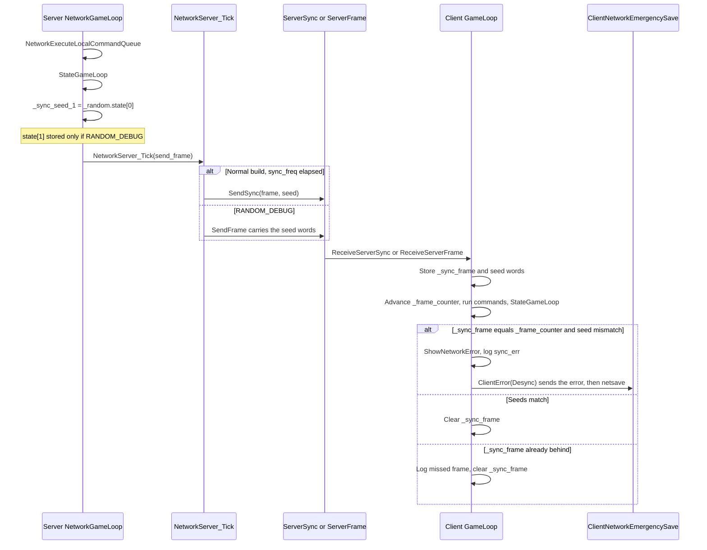
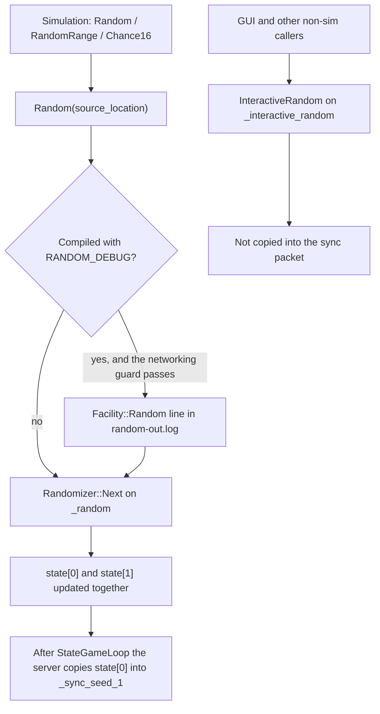

# Desync detection and debugging

Architecture of OpenTTD lockstep desync detection, as implemented in this tree. Two older write-ups still sit beside the code:

- `docs/desync.md` (dated 2014-02-23) is the theory and replay guide. Cited below as **Legacy desync**.
- `docs/debugging_desyncs.md` is the recording and bug-report guide. Cited below as **Legacy report**.

Every behavioural claim is tagged:

- **Code** — read from the functions named in the [code map](#code-map).
- **Legacy** — a procedure or anecdote that exists only in those two docs. It is not re-derived here.
- **Stale** — a sentence in those docs that disagrees with the current sources. Collected again in [Stale claims](#stale-claims).

There is no symbol named `NetworkServerSync`. The packet is `PacketGameType::ServerSync`. The server sends it from `ServerNetworkGameSocketHandler::SendSync`, called by `NetworkServer_Tick`. The client reads it in `ClientNetworkGameSocketHandler::ReceiveServerSync`.

## Why a lockstep sim desyncs

**Legacy desync §1.1**, and the same shape is still in the code.

The world is large and changes every tick (vehicles move, tiles and industries advance). Most of that change is deterministic. Multiplayer does not ship the whole state every frame. A joining client receives a savegame of the server state (`ServerNetworkGameSocketHandler::SendMap` writes the map with `SaveWithFilter`). After that, peers exchange commands: player actions, AI and GameScript actions, admin-port and rcon commands, and anything else that is not implied by the previous state.

Commands are not applied at the moment a client clicks. `Command<>::Execute` (`src/command_func.h`) always does a local test run first. If that test succeeds and this peer is a networked client that did not receive the command from the network, `NetworkSendCommand` queues it and the local execution is aborted. The server assigns a network frame (`_frame_counter_max + 1` in `DistributeCommandPacket` and in the server branch of `NetworkSendCommand`) and `NetworkDistributeCommands` sends the same `CommandPacket` to every client that is at least in the map-download state, and into the server's own `_local_execution_queue`. `NetworkExecuteLocalCommandQueue` runs a packet only when `_frame_counter` equals `cp->frame`, in queue order. A packet whose frame is already past is a fatal error.

Each client, including the server, then runs the deterministic tick itself. The server does not send vehicle positions. It sends how far the client may simulate:

- `ServerNetworkGameSocketHandler::SendFrame` carries `_frame_counter` and `_frame_counter_max`.
- `NetworkGameLoop` on the server advances `_frame_counter` every call, and sets `_frame_counter_max = _frame_counter + network.frame_freq` when the counter passes the previous max (`frame_freq` default is 0 in `src/table/settings/network_settings.ini`, so the max moves every server tick).
- The client, in `ClientNetworkGameSocketHandler::GameLoop`, increments its own `_frame_counter`, runs `NetworkExecuteLocalCommandQueue`, then `StateGameLoop`. `NetworkGameLoop` repeats that until the client has caught the server frame, and otherwise runs at most one frame while `_frame_counter < _frame_counter_max`.

`_frame_counter` is not economy time and not calendar time. **Code:** `NetworkGameLoop` increments it before `StateGameLoop`. `StateGameLoop` returns immediately when `_pause_mode` is set or a modal progress window is open, so the economy and calendar clocks (advanced inside the unpaused branch) do not move, while the network frame still does. **Legacy desync §1.1** says the same thing: network frames keep running while the game is paused so paused commands have a defined frame. `TimerGameTick`'s own comment says that game-tick timer pauses with the game; that timer is the one `StateGameLoop` steps with `TimerManager<TimerGameTick>::Elapsed(1)`, not `_frame_counter`.

`GameLoop` in `src/openttd.cpp` is the caller. If `_networking` is set and no modal progress window is up, it calls `NetworkGameLoop`. Otherwise it calls `StateGameLoop` directly (single player). The comment on `NetworkGameLoop` still says it is called from `ttd.c`; the call site is `GameLoop`.

A desync is any divergence of that simulated state. **Legacy desync §1.2** describes the failure mode: nobody is told at the moment the states split. The diverged client keeps applying the server's command stream. A different vehicle choice changes arrival time, cargo, and industry production, and the two worlds drift further apart. The same section records a historical case that was visible to the checksum only after 20 game years. That anecdote is **Legacy**; this tree does not encode it.

**Legacy desync §1.3** lists the usual causes. They match the guards in the current command and load paths:

- The savegame omits or fails to load a field the next tick reads, or a previous game's data survives into the load. `AfterLoadGame` states this directly for pause flags: clearing `PauseMode::ActiveClients` or `PauseMode::Join` on a network client makes that client run `StateGameLoop` while the server does not.
- Cached values used by the simulation are stale. `CheckCaches` and the YAPF rail checks exist to log that class of bug.
- The simulation order or result depends on something that is not the same on every machine (unstable sort of equal keys, word size, endianness).
- A command test run, or any path that is not a command, writes simulation state. The test run is supposed to discard its writes. `InternalExecutePrepTest` enters persistent-storage test mode; leaving test mode or command mode discards temporary NewGRF storage changes (`BasePersistentStorageArray::SwitchMode`). Sites that still need `Random` during a test copy the seeds and restore them (`CmdBuildVehicle` refit path) or refuse to draw until `DoCommandFlag::Execute` (terraform rock placement).

`NetworkSyncCommandQueue` copies the server's not-yet-executed local queue onto a joining client. Its comment states the failure if that copy is skipped: the client never sees commands that were queued before its map save, and is desynced from the moment it finishes joining.

## What is compared

The live check does not hash the map, the vehicles, or the savegame. **Code:** after the server's `StateGameLoop`, `NetworkGameLoop` stores the game-state RNG:

```1291:1294:src/network/network.cpp
		_sync_seed_1 = _random.state[0];
#ifdef NETWORK_SEND_DOUBLE_SEED
		_sync_seed_2 = _random.state[1];
#endif
```

`_random` is the `Randomizer` "used in the game state calculations" (`src/core/random_func.hpp`). `_interactive_random` is the other generator, "used everywhere else, where it does not (directly) influence the game state." The sync packet does not carry `_interactive_random`.

`Randomizer::Next` is a pure function of the two `uint32_t` words:

```41:48:src/core/random_func.cpp
uint32_t Randomizer::Next()
{
	const uint32_t s = this->state[0];
	const uint32_t t = this->state[1];

	this->state[0] = s + std::rotr(t ^ 0x1234567F, 7) + 1;
	return this->state[1] = std::rotr(s, 3) - 1;
}
```

**Legacy desync §1.2** calls this pair "the checksum" and says it is the state of the game-logic RNG. That description still matches the intent. The packet, on a normal build, contains only `state[0]`. `NETWORK_SEND_DOUBLE_SEED` (and therefore `state[1]` on the wire) exists only when the binary is built with `RANDOM_DEBUG`. The header comment above that define says one seed is theoretically enough. The client compare is:

```232:238:src/network/network_client.cpp
	if (_sync_frame != 0) {
		if (_sync_frame == _frame_counter) {
#ifdef NETWORK_SEND_DOUBLE_SEED
			if (_sync_seed_1 != _random.state[0] || _sync_seed_2 != _random.state[1]) {
#else
			if (_sync_seed_1 != _random.state[0]) {
#endif
```

The compare runs after that frame's commands and after `StateGameLoop`, so both sides are looking at the post-tick words for the same `_frame_counter`. The server does not compare a client's seed. The client decides, shows `STR_NETWORK_ERROR_DESYNC`, logs `sync_err`, and calls `ClientError(NetworkRecvStatus::Desync)`.

If `_sync_frame` is already behind `_frame_counter`, the client logs `Missed frame for sync-test` on the `net` facility and clears `_sync_frame`. That path does not declare a desync.

How often the server asks, **Code**, `NetworkServer_Tick`:

- Normal build: when `_frame_counter >= _last_sync_frame + network.sync_freq`, it sends `PacketGameType::ServerSync` with the frame and `_sync_seed_1`. `sync_freq` defaults to 100 (`network_settings.ini`). The comment in `src/network/network_internal.h` describes the same interval: one sync in about 100 frames.
- `RANDOM_DEBUG` defines `ENABLE_NETWORK_SYNC_EVERY_FRAME`, which compiles out that periodic `SendSync` and appends the seed words to every `ServerFrame` packet instead. `ReceiveServerFrame` copies them into `_sync_frame` / `_sync_seed_*` only when `CanReadFromPacket` says the extra words are present.

The same header says both the client and the server must be compiled with this option or "nothing will happen." That follows from the ifdefs: a `RANDOM_DEBUG` server does not send `ServerSync` at all, and a client built without the option never reads the extra words on `ServerFrame`.

A second, offline record of the same RNG is the daily log line. On the server only, when `TimerGameEconomy::date_fract == 0` and the economy date changed since the last log, `NetworkGameLoop` writes both words, even on a build without `RANDOM_DEBUG`:

`sync: <date>; <date_fract>; <state[0]>; <state[1]>`

Replay (below) compares both words from that line. The live packet and the log line are different checks.

### Words that are saved but not put in the sync packet

| State | Where it is saved | Role in detection |
| --- | --- | --- |
| `_random.state[0]`, `_random.state[1]` | `misc` chunk, `src/saveload/misc_sl.cpp` | `state[0]` is the live sync word. Both words are in the daily `sync:` log and in the save the client loaded |
| `TimerGameEconomy::date`, `date_fract` | same `misc` chunk | Economy day counter and fraction. Desync log lines and the `dmp_cmds` schedule use these, not the network frame |
| `TimerGameCalendar::date`, `date_fract`, `sub_date_fract` | same chunk | Calendar clock. Vehicle calendar-day work is spread with `TimerGameCalendar::date_fract` |
| Per-owner script `Randomizer` | chunk `SRND`, `src/saveload/randomizer_sl.cpp` | Separate generators. `ScriptObject::InitializeRandomizers` copies `_random` and draws the script seeds from the copy, so `_random` itself does not advance |

`RandomBytesWithFallback` is a different generator (OS cryptographic RNG, with `InteractiveRandom` as its fallback). It is not the lockstep RNG.

### `date_fract`

`TimerGameEconomy::date_fract` is the fractional part of the economy day. The economy timer comment states there are 74 ticks in a day; `Ticks::DAY_TICKS` is 74. Each unpaused `StateGameLoop` steps the economy timer. At `date_fract == 0` a new economy day has just started.

That fraction is part of the simulation, not a display value. `RunEconomyVehicleDayProc` processes vehicles whose index modulo `DAY_TICKS` equals `TimerGameEconomy::date_fract`. `RunVehicleCalendarDayProc` does the same with `TimerGameCalendar::date_fract`. Two clients whose fractions differ run day handlers on different vehicles on the same tick.

Desync log lines stamp economy `date` and `date_fract` so a later replay can line a command up with a tick. The network frame is not in those lines.

## When dumps and logs are written

`Debug` visibility is `_debug_level[facility] >= severity` (`IsVisibleSeverity`). `Severity` is ordered so a higher `-d` number shows more lines:

| Numeric level | `Severity` | What the desync facility does at this level |
| --- | --- | --- |
| 0 | `Critical` | `Debug` always emits `Critical`, but `DebugPrint` sends desync `Critical` to stderr. The replay messages are the only desync `Critical` lines, and they are compiled only with `DEBUG_DUMP_COMMANDS` |
| 1 | `Error` | Command log, daily `sync:`, `client:`, `msg:`, `save:` / `load:`, `new_map:`, `sync_err:`, and `dmp_cmds_*.sav` |
| 2 | `Warning` | Everything at level 1, plus `CheckCaches`, YAPF rail cache probes, and the "discarding persistent storage" warning |
| 3 and above | `Notice` and weaker | No further desync-facility gate in this tree |

`SetDebugString` accepts `-d desync=<n>` and the console command `debug_level`. **Legacy report** documents both entry points. That part still matches.

Non-`Critical` desync lines go to `commands-out.log` under `Subdirectory::Autosave`, which is `save/autosave/` (`src/fileio.cpp`). The file is opened once per process with mode `"wb"`, so a restart truncates it. **Legacy report** says the same. Lines are flushed on every write. Desync lines do not also go to stderr. `Facility::Random` lines go to `random-out.log` in the same autosave directory, and only when `RANDOM_DEBUG` is compiled.

### `dmp_cmds` savegames

**Code.** Both writers use the same name and directory (`Subdirectory::Autosave`):

`dmp_cmds_<generation_seed 8 hex digits>_<TimerGameEconomy::date 8 hex digits>.sav`

1. Map generation, after a successful generate, in `src/genworld.cpp`. Gated only on `IsVisibleSeverity(Facility::Desync, Severity::Error)`, so `-d desync=1` or higher. It also logs `new_map: <generation_seed>`.
2. `StateGameLoop`, in the non-editor branch, before `CheckCaches` and before the tick advances the date. The gate is desync `Error` **and** `TimerGameEconomy::date_fract == 0` **and** `(TimerGameEconomy::date.base() & 0x1F) == 0`. That is the first unpaused tick of every 32nd economy day counter value, not a calendar month. Editor mode does not take this branch. A paused game returns from `StateGameLoop` before the check; the next unpaused tick still sees the same date and fraction, so the save happens then.

Nothing in `src/` deletes `dmp_cmds_*.sav`. **Legacy report** is right about that. A later save with the same seed and the same economy date uses the same filename; `SaveOrLoad` opens it `"wb"`, so that one file is replaced. `SaveOrLoad` also logs `save: <date>; <date_fract>; <filename>` at desync `Error`, for every save, including autosaves and netsaves.

### Emergency save when a client detects a desync

**Code.** This is the dump at detection time. It is not a `dmp_cmds` file.

`ClientNetworkGameSocketHandler::ClientError` for a local fault (including `NetworkRecvStatus::Desync`) sends `NetworkErrorCode::Desync`, closes the connection, then calls `ClientNetworkEmergencySave`. That calls `DoAutoOrNetsave` with prefix `netsave`. The filename is `netsave<N>.sav` in the autosave directory, rotating with `gui.max_num_autosaves`. If `gui.keep_all_autosave` is set, the name is the default save name plus the extension `-netsave.sav`. The client then leaves for the menu (`_networking` is cleared, `_switch_mode` becomes `SwitchMode::Menu`). `ShowNetworkError` has already been called, which also requests the menu.

`sync_err` is logged before `ClientError`, so if desync logging is on it is already in `commands-out.log`.

### Command lines

**Code**, `CommandHelperBase::LogCommandExecution`, called from `Command<>::Execute` when the desync `Error` level is visible:

- `cmd:` — the test passed and the command is about to run for real (or, on a client, the test passed and the command is being sent; the `desync_log` flag is computed even when `send_net` aborts local execution, but the success log is placed after the `send_net` return, so the executing peer logs `cmd`, and a failed test logs `cmdf`).
- `cmdf:` — the test failed, or the company cannot pay, or the call was estimate-only.

The format is:

`cmd|cmdf: <economy date>; <date_fract>; <company>; <command id>; <error string id>; <argument bytes as hex> (<command name>)`

Other `Error` lines the replay parser knows about: `client:` (identify, and later client-info updates), `msg:` (chat and status text from `NetworkTextMessage`), `load:`.

### Cache checks at desync level 2

**Code.** `CheckCaches` returns immediately unless desync `Warning` is visible. `StateGameLoop` calls it once per unpaused non-editor tick, before the tick body. It recomputes town caches, company infrastructure, vehicle and NewGRF vehicle caches, station docking tiles, and station/town/industry "near" lists, and logs `warning:` lines. Cargo cache checks `assert` after `InvalidateCache` rather than logging. The recomputed town, infrastructure, vehicle, and catchment data is left in place; the function logs mismatches and does not restore the previous cache.

At the same severity, YAPF rail (`FindNearestDepotTwoWay`, `FindSafeTile`, `ChooseRailTrack`, `CheckReverseTrain`) runs a second uncached search and logs a mismatch. While that level is visible, `stChooseRailTrack` runs the cached search with reservation disabled and returns that track; the uncached search is the call that still honours `reserve_track`. `stFindNearestSafeTile` returns the uncached search, which is the one allowed to reserve. Those probes are side-effecting.

**Legacy desync §2.1** says `-d desync=2` checks caches every tick and logs to `commands-out.log`. The level and the file match. The call is every unpaused non-editor tick, and the checks cover more than vehicle caches. **Legacy report**'s "checking vehicle caches" understates the same function.

## How `RANDOM_DEBUG` changes RNG logging

**Code** and `COMPILING.md` (developers' `CXXFLAGS`). `-DRANDOM_DEBUG` is a compile flag. A clean build directory is required after changing `CXXFLAGS` because CMake caches them. It is independent of `-d desync=`.

When the flag is off, `Random()` is inline and returns `_random.Next()`. The `std::source_location` argument is ignored.

When the flag is on:

1. `Random()` is an out-of-line function. `RandomRange` and `Chance16` / `Chance16R` pass their `source_location` through, so those draws are logged too. Direct `_random.Next()` does not occur elsewhere in `src/`; sim draws go through `Random()`.
2. If `_networking` is set, and this process is not the server or client slot 0 exists and is not `Inactive`, it logs at `Facility::Random`, `Severity::Critical`:

   `<economy date>; <date_fract>; <frame_counter>; <company>; <file>:<line>`

   `DebugPrint` writes that facility to `save/autosave/random-out.log` with no log-prefix timestamp. A dedicated server with no connected client slot 0 does not take the log branch; it still advances `_random`.
3. The same flag defines `ENABLE_NETWORK_SYNC_EVERY_FRAME` and `NETWORK_SEND_DOUBLE_SEED`, described above.
4. `ScriptBase` does not name its squirrel helpers `Random` / `RandomRange`. The file comment says `RANDOM_DEBUG` rewrites those names. Script gameplay draws use `ScriptObject`'s per-owner `Randomizer`, not `::Random()`.

`SaveRandomSeeds` / `RestoreRandomSeeds` snapshot both generators. They are how a test run that must draw (vehicle build while refitting) puts `_random` back. Terraform's rock roll calls `RandomRange` only when `DoCommandFlag::Execute` is set; the comment on that line says a test-run draw desyncs.

## Detection sequence

**Code.** From the server's post-tick snapshot to the client's emergency save.



`SendSync` packet fields are `_frame_counter`, `_sync_seed_1`, and `_sync_seed_2` only with `NETWORK_SEND_DOUBLE_SEED`. `SendFrame` fields are `_frame_counter`, `_frame_counter_max`, then those seed words only with `ENABLE_NETWORK_SYNC_EVERY_FRAME`, then an optional ack token. The token is `InteractiveRandomRange`, so it draws on `_interactive_random`.

## RNG draw path

**Code.**



The networking guard is the condition in `Random()` under `RANDOM_DEBUG`: networked, and either this process is a client, or client slot 0 is present and not inactive.

## Recording and replay

Steps below are only those written in the legacy docs or present as hooks in the code. Each step is marked.

### What the running game records

| Step | Source |
| --- | --- |
| Start with `-d desync=<level>` or console `debug_level desync=<level>` | **Legacy report**, and **Code** `SetDebugString` / `ConDebugLevel` |
| Level 0 writes no desync `Error` or `Warning` lines | **Code** `IsVisibleSeverity`. **Legacy report** says "0: nothing", which holds for a normal build because the `Critical` desync lines exist only inside `DEBUG_DUMP_COMMANDS` |
| Level 1 writes `commands-out.log` | **Code** and **Legacy report** |
| Level 1 also writes `dmp_cmds_*.sav` on map generate and every 32 economy days | **Code** only. **Stale** relative to both legacy docs, which put those saves at level 3 |
| Level 2 adds cache and YAPF `warning:` lines | **Code**. **Legacy desync §2.1** matches the level. **Legacy report** calls this "vehicle caches" only |
| Level 3 adds no further desync behaviour | **Code**. **Stale** against both legacy docs |
| Restarting the process truncates `commands-out.log` and leaves old `dmp_cmds_*.sav` on disk | **Legacy report** and **Code** |
| Name shape `dmp_cmds_<seed>_<date>.sav`, seed then economy date, so files group by game | **Legacy report** and **Code** (the date field is `TimerGameEconomy::date`) |

### Bug-report bundle

**Legacy report** asks for this attachment list. It is a reporting procedure, not something the binary checks:

- `commands-out.log`
- the last desync save, found by searching for the last line that begins with `save: dmp_cmds_`
- the first `save` line whose prefix up to the last `_` matches that save, or the scenario/save the server was started from
- optional saves around 50%, 75%, 85%, 90%, and 95% of the run
- NewGRFs, unless they are easy to find on BaNaNaS or in the `#openttdcoop` pack
- keep the `dmp_cmds` files until the bug is fixed

The search recipe is **Stale**. **Code** writes `save: <date>; <date_fract>; <filename>`, so the line does not begin with `save: dmp_cmds_`. The filename is the third field, and the same prefix is used for autosaves and netsaves. Which file is "the last desync save" has to be read from that filename field.

### Replay

**Legacy desync §3.1** gives the procedure. The compile hooks are still in the tree. The log vocabulary has drifted.

1. **Legacy.** Use the same OpenTTD version as the server. Nothing in the replay parser checks the version.
2. **Legacy**, still **Code**. Uncomment `DEBUG_DUMP_COMMANDS` in `src/network/network_func.h`. The replay block in `NetworkGameLoop`, the fast-forward in `VideoDriver::GetGameInterval`, the skipping of `AI::GameLoop` / `Game::GameLoop`, and the decision to keep `OrderBackup` objects in `AfterLoadGame` are all inside that define. `DEBUG_FAILED_DUMP_COMMANDS` is the second commented define in the same header.
3. **Legacy.** Copy `commands-out.log` to the save directory (`Subdirectory::Save`, `save/`, not autosave) under the name `commands.log`. **Code** opens exactly `"commands.log"` from `Subdirectory::Save`.
4. **Legacy.** Strip everything up to and including the `newgame` entry. **Stale token.** The generator logs `new_map:`. The parser does not ignore `new_map`. An unrecognised line logs `Trying to parse:` and hits `NOT_REACHED`. Prefixes the parser skips are `msg:`, `client:`, `load:`, `save:`, `warning:`. Prefixes it acts on are `cmd:`, `cmdf:` (only if `DEBUG_FAILED_DUMP_COMMANDS` is also defined), `join:`, and `sync:`. No current writer emits `join:`.
5. **Legacy.** Run `openttd -D -d desync=0 -g <start save>`. **Code** still has `-D` (dedicated), `-d` (debug string), and `-g` (load a file). Use `-d desync=0` only if the goal is replay without new `dmp_cmds` files. The replay compare itself is `Severity::Critical` and `NOT_REACHED`, so it runs at desync level 0. **Legacy** says `-d desync=3` to also produce a fresh `commands-out.log` and `dmp_cmds_*.sav`. **Code:** those files appear at desync level 1 and higher. Level 3 is not a separate dump switch.

While `DEBUG_DUMP_COMMANDS` is compiled, `_ddc_fastforward` starts true and `GetGameInterval` returns a zero sleep, so the dedicated server runs as fast as it can. The only assignment that sets it false is the `join:` arm of the parser. A log without `join:` stays in fast-forward for the whole replay.

On a `sync:` line, when the replay reaches that economy date and `date_fract`, both RNG words are compared with `_random`. A match logs `Sync check: ... match`. A mismatch logs the expected and actual words and executes `NOT_REACHED`. **Legacy desync §3.2** describes that `NOT_REACHED`. It also says you can comment that `NOT_REACHED` out to obtain another `dmp_cmds` after the mismatch. That edit is **Legacy**; the call is still there to comment.

`cmd:` lines are injected with `NetworkSendCommand` when the economy date and fraction match, so they enter the normal server command queue rather than being applied inline. `cmdf:` lines are skipped with a critical log unless `DEBUG_FAILED_DUMP_COMMANDS` is defined, in which case they are injected like `cmd:`. **Legacy desync §3.2** interprets a replay that fails only after enabling that define as evidence that the failed command's test run modified state. The define itself only changes whether `cmdf` lines are injected; the interpretation is **Legacy**.

`AI::GameLoop` and `Game::GameLoop` are not called when `DEBUG_DUMP_COMMANDS` is defined, including the paused branch of `StateGameLoop`. **Legacy desync §3.3** says scripts do not run during replay, only their recorded commands do, so script internal state in the save will differ. That matches the ifdef.

The rest of **Legacy desync §3.2** is a search procedure, not extra code:

- If the full replay matches, start again from later `dmp_cmds_*.sav` files and truncate the front of `commands.log` to match. A failure between two dumps localises the bug. The doc's point is that this imitates a client joining mid-game.
- If you have the server's `dmp_cmds` files, compare them with the replay's files.
- If the replay matches and the server never wrote `dmp_cmds` files, the doc says to enable those saves and wait for the next desync. With current code, desync level 1 already writes them.
- Comparing the original `commands-out.log` with the replay's log: **Legacy** says they differ in dates and that the original contains chat, and otherwise should match.

**Legacy desync §3.3** says a binary diff of two saves is not meaningful, because NewGRF paths, the gamelog of the load, and AI/GameScript data differ. It then says to export JSON with the external tool `https://github.com/TrueBrain/OpenTTD-savegame-reader`:

`python -m savegame_reader --export-json dmp_cmds_NNN.sav | jq . > NNN.json`

That tool is not in this tree. The command is **Legacy**.

## Code map

| Piece | Location | Role |
| --- | --- | --- |
| `GameLoop` | `src/openttd.cpp` | Calls `NetworkGameLoop` or, in single player, `StateGameLoop` |
| `StateGameLoop` | `src/openttd.cpp` | Unpaused non-editor tick. Writes `dmp_cmds` on the 32-day gate, calls `CheckCaches`, then advances timers and entities. Skips AI/GameScript under `DEBUG_DUMP_COMMANDS` |
| `NetworkGameLoop` | `src/network/network.cpp` | Server: daily `sync:` log, optional `commands.log` replay, distribute commands, increment `_frame_counter`, run the tick, snapshot `_sync_seed_*`, `NetworkServer_Tick`. Client: catch up to the server frame |
| `NetworkServer_Tick` | `src/network/network_server.cpp` | Every `sync_freq` frames, `SendSync`. With `RANDOM_DEBUG`, that call is compiled out |
| `SendSync` / `ReceiveServerSync` | `src/network/network_server.cpp`, `src/network/network_client.cpp` | `PacketGameType::ServerSync`: frame plus RNG word(s) |
| `SendFrame` / `ReceiveServerFrame` | same files | How far the client may run. Carries RNG words only with `ENABLE_NETWORK_SYNC_EVERY_FRAME` |
| Client compare and `ClientError` | `src/network/network_client.cpp` `GameLoop`, `ClientError` | Mismatch becomes `NetworkErrorCode::Desync`, then `ClientNetworkEmergencySave` |
| `ClientNetworkEmergencySave` | `src/network/network_client.cpp` | `netsave` autosave. This is the desync-time dump |
| `NetworkSendCommand`, `NetworkDistributeCommands`, `NetworkExecuteLocalCommandQueue`, `NetworkSyncCommandQueue` | `src/network/network_command.cpp` | Lockstep command stream |
| `Command<>::Execute`, `LogCommandExecution` | `src/command_func.h`, `src/command.cpp` | Test run, optional network send, `cmd` / `cmdf` log |
| `Randomizer::Next`, `Random`, `_random`, `_interactive_random` | `src/core/random_func.cpp`, `src/core/random_func.hpp` | Game RNG versus GUI RNG. `RANDOM_DEBUG` logs draws |
| `DebugPrint` | `src/debug.cpp` | Desync text to `commands-out.log`; random text to `random-out.log` |
| `Severity`, `Facility::Desync` | `src/debug_type.h` | Level 0 critical, 1 error, 2 warning |
| `CheckCaches` | `src/cachecheck.cpp` | Level-2 cache recomputation and `warning:` lines |
| YAPF rail cache probes | `src/pathfinder/yapf/yapf_rail.cpp` | Level-2 second search |
| Map-generation dump | `src/genworld.cpp` | `new_map:` and the first `dmp_cmds` save |
| `SaveOrLoad` desync line | `src/saveload/saveload.cpp` | `save:` / `load:` |
| RNG and `date_fract` in the save | `src/saveload/misc_sl.cpp`, `src/saveload/randomizer_sl.cpp` | What a joining client starts from |
| `DEBUG_DUMP_COMMANDS` | `src/network/network_func.h` | Commented compile switch for replay |
| `network.sync_freq`, `network.frame_freq` | `src/table/settings/network_settings.ini` | Defaults 100 and 0 |
| Vehicle day spreading | `src/vehicle.cpp` `RunVehicleCalendarDayProc`, `RunEconomyVehicleDayProc` | Why `date_fract` is simulation state |
| Pause-flag warning | `src/saveload/afterload.cpp` | Clearing join/active-client pause on a client desyncs |

## Stale claims

### `docs/debugging_desyncs.md`

| Sentence in the doc | What the code does |
| --- | --- |
| "1: dumping of commands to 'commands-out.log'." | Level 1 also writes `dmp_cmds_*.sav` (`StateGameLoop`, `genworld.cpp`), because both use `Severity::Error` |
| "2: same as 1 plus checking vehicle caches and dumping that too." | Level 2 is real (`Severity::Warning`), but `CheckCaches` also checks towns, company infrastructure, stations, industries, and NewGRF vehicle caches, and YAPF adds its own warnings |
| "3: same as 2 plus monthly saves in autosave." and "4 and higher: same as 3" | No desync path is gated on `Severity::Notice` or higher. The periodic save is level 1, and the condition is `date_fract == 0` and `(economy date & 0x1F) == 0` (every 32 economy-day counts), not a calendar month |
| "search for the last line beginning with 'save: dmp_cmds_'" and the matching "first line beginning with 'save'" rule | The line is `save: <date>; <date_fract>; <filename>`. It does not begin with `save: dmp_cmds_` |

These sentences in the same file still match the code: the `-d desync=` / `debug_level` switches, level 0 on a normal build, `commands-out.log` in the autosave directory, truncation of that log on restart, `dmp_cmds_<seed>_<date>.sav` grouping, and the lack of any deleter for those saves.

### `docs/desync.md`

| Sentence in the doc | What the code does |
| --- | --- |
| "There are two levels of Desync recording, which are enabled via '-d desync=2' resp. '-d desync=3'. Both will record all commands" | Commands are recorded at desync level 1 (`Severity::Error`). Level 2 adds cache warnings. Level 3 adds nothing further |
| "'-d desync=3' also creates regular savegames at defined spots in network time. (more defined than regular autosaves)." | Those saves are created at desync level 1, on an economy-date test (`date_fract` and `date & 0x1F`), not at level 3 and not on a network-frame test |
| "Strip everything and including the \"newgame\" entry from the log." | The current marker is `new_map:`. The replay parser does not recognise that prefix and `NOT_REACHED`s on it. No writer emits `newgame` or `join:` |
| "Use \"-d desync=3\" to also create a new 'commands-out.log' and 'dmp_cmds_*.sav'" during replay | Desync level 1 is enough for both files. The replay `NOT_REACHED` does not depend on the debug level |
| "it is a lost case. Enable creation of the 'dmp_cmd_*.sav' on the server" (also the filename spelling `dmp_cmd_` in that section) | The files are spelled `dmp_cmds_`. Creation is `-d desync=1`, which is the same switch as the command log, not a higher level |

These sentences in the same file still match the code, with the tags above:

- Lockstep by savegame plus a command stream, frames distinct from economy time, frames continuing while paused (**§1.1**). `DoCommandP` / `DoCommandPInternal` are the old names; the implementation is `Command<>::Execute` and `NetworkSendCommand`.
- The detector compares game RNG state, late, and does not say which earlier tick diverged (**§1.2**). On a normal build only `state[0]` is on the wire.
- Cache validation at `-d desync=2`, logged to `commands-out.log`, including in single player (**§2.1**). `StateGameLoop` calls `CheckCaches` only in `GameMode::Normal` and only when not paused.
- Replay still requires `DEBUG_DUMP_COMMANDS`, `save/commands.log`, and the same binary version is still only advice (**§3.1**). `NOT_REACHED` on a `sync:` mismatch is still the replay failure (**§3.2**).
- Scripts are not ticked during a `DEBUG_DUMP_COMMANDS` replay (**§3.3**). The JSON export command is unchanged **Legacy** and is not implemented in this tree.

## Invariants

A network game stays in sync only while all three hold.

1. **Same command stream.** Every peer executes the same `CommandPacket`s, on the same `_frame_counter`, in queue order. The server assigns the frame; clients do not invent one. Commands that are queued before a join map is saved are copied with `NetworkSyncCommandQueue`. A test run that is only deciding whether to send must leave the simulation as it found it, including `_random`.

2. **Same RNG draws.** Given the same `_random` words loaded from the join save, every peer must call `Random` / `RandomRange` / `Chance16` the same number of times and in the same order. `Next` then produces the same `state[0]` the server puts in the sync packet. Draws made to choose GUI text, a company face in the GUI, or an ack token go through `_interactive_random` and are not part of that packet. Script instances draw from their own saved `Randomizer`s, which were seeded from a copy of `_random`.

3. **No GUI-only state in the sim.** Viewport scroll, window positions, and anything stored only in client settings must not change the next tick's world or the next `_random` draw. Economy `date_fract` and calendar `date_fract` are not GUI state: they select which vehicles run their day handlers, they are saved in the `misc` chunk, and the desync log uses the economy fraction to name a tick. Pause flags that gate `StateGameLoop` are simulation control; `AfterLoadGame` refuses to clear the network pause bits on a client for that reason.
