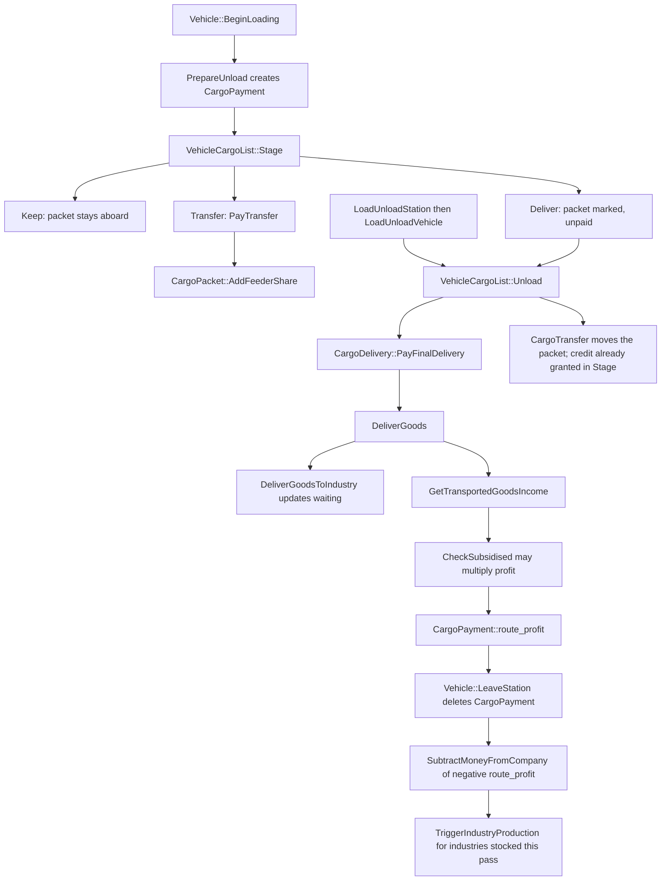

# Economy architecture

This document is the payment boundary: company cash, the price table, inflation, how a cargo delivery becomes money, the running costs `economy.cpp` charges itself, and how subsidies change that payment. Cargo-payment arithmetic is in [archi-cargo-payment.md](archi-cargo-payment.md). Subsidy offer, award, and expiry are in [archi-subsidies.md](archi-subsidies.md).

Industry production, station catchment, and the link graph each have their own architecture documents. The hand-off is named here and left there.

`Money` is `OverflowSafeInt64` (`src/economy_type.h`). The live economy is the global `Economy _economy` plus the price array `Prices _price` (`src/economy.cpp`).

## Payment boundary

A vehicle stop is turned into money inside `economy.cpp`. The neighbouring systems supply the facts that payment reads, and they keep the rules for how those facts were produced.

| System | What economy reads | What that system still owns |
| --- | --- | --- |
| Link graph | `VehicleCargoList::Stage` reads `GoodsEntry` flows and classifies each packet as keep, transfer, or deliver (`src/cargopacket.cpp`) | How flows are built, refreshed, and shared |
| Station | Acceptance bit, `industries_near`, `always_accepted`, catchment tiles, the loading queue | Catchment, ratings, facilities, station construction |
| Industry | Whether an industry in `industries_near` accepts the cargo right now, then `accepted[].waiting` | Production, closures, callbacks, stock consumption |
| Cargo packet | Source, `periods_in_transit`, feeder share, and `GetDistance` | Packet storage and the link-graph next hop |

`PrepareUnload` creates one `CargoPayment` for the consist and asks each part to stage its cargo (`src/economy.cpp`). Staging is where the link graph's next hop becomes a payment action. Transfer credits are recorded there. Final delivery is priced later, while the cargo is unloaded, by `DeliverGoods`.

`DeliverGoods` does four economy-side things with the accepted count, then returns a profit (`src/economy.cpp`):

1. `DeliverGoodsToIndustry` adds pieces to the nearest accepting industry's `waiting` stock, capped so `waiting` stays inside `uint16_t`.
2. Station goods flags and `Company::cur_economy.delivered_cargo` are updated from `accepted_total`.
3. The station town's `received` counter for that cargo's `town_acceptance_effect` is increased. Pieces the industry did not take are recorded on the town's cargo history.
4. `GetTransportedGoodsIncome` prices `accepted_total`. `CheckSubsidised` may then multiply that profit.

`accepted_total` is every unloaded piece when the station's `always_accepted` bit is set for that cargo, and otherwise only the pieces an industry actually took. Payment uses that count. Pieces that are neither industry-accepted nor always-accepted contribute zero income.

After the station's load/unload pass, `LoadUnloadStation` calls `TriggerIndustryProduction` for each industry that received cargo in that pass, then clears the list. That call is the end of the economy's involvement. What the industry produces from `waiting` belongs to the industry document.

`EconomyType` (`Original`, `Smooth`, `Frozen` in `src/economy_type.h`) selects how industry production changes. `economy.cpp` does not apply it. The recession flag below is the piece of "the economy" that this file does own.

`ScaleByCargoScale` / `ScaleByInverseCargoScale` (`src/economy_func.h`) scale town and industry production amounts. They are not inputs to `GetTransportedGoodsIncome`.

## Money and the ledger

A `CommandCost` is an expense category plus a signed amount (`src/command_type.h`). `SubtractMoneyFromCompany` is the ledger write for a live company:

```297:328:src/company_cmd.cpp
static void SubtractMoneyFromCompany(Company *c, const CommandCost &cost)
{
	using ExpensesTypes = EnumBitSet<ExpensesType, uint16_t>;
	static constexpr ExpensesTypes EXPENSESTYPES_INCOME{
		ExpensesType::TrainRevenue,
		ExpensesType::RoadVehRevenue,
		ExpensesType::AircraftRevenue,
		ExpensesType::ShipRevenue
	};
	static constexpr ExpensesTypes EXPENSESTYPES_EXPENSES{
		ExpensesType::TrainRun,
		ExpensesType::RoadVehRun,
		ExpensesType::AircraftRun,
		ExpensesType::ShipRun,
		ExpensesType::Property,
		ExpensesType::LoanInterest
	};

	if (cost.GetCost() == 0) return;
	assert(cost.GetExpensesType() != ExpensesType::Invalid);

	c->money -= cost.GetCost();
	c->yearly_expenses[0][cost.GetExpensesType()] += cost.GetCost();

	if (EXPENSESTYPES_INCOME.Test(cost.GetExpensesType())) {
		c->cur_economy.income -= cost.GetCost();
	} else if (EXPENSESTYPES_EXPENSES.Test(cost.GetExpensesType())) {
		c->cur_economy.expenses -= cost.GetCost();
	}

	InvalidateCompanyWindows(c);
}
```

The amount is subtracted from `Company::money`. Income is stored as a negative cost, so the same subtraction credits the company. Revenue categories also increase `cur_economy.income` because that field subtracts the (negative) cost. Running-cost, property, and loan-interest categories increase `cur_economy.expenses` the same way. Construction, new vehicles, and `ExpensesType::Other` change `money` and `yearly_expenses` only.

`SubtractMoneyFromCompanyFract` keeps an 8-bit remainder on `Company::money_fraction` and banks whole units through `SubtractMoneyFromCompany` (`src/company_cmd.cpp`). Vehicle running costs use it. Cargo delivery uses the whole-unit helper.

Successful top-level commands pay in `CommandHelperBase::InternalExecuteProcessResult`, which calls `SubtractMoneyFromCompany(_current_company, res_exec)` (`src/command.cpp`). The test run uses `CheckCompanyHasMoney` and does not touch cash. `InternalDoAfter` is the same pair for the helper path: test checks funds, execute subtracts, and `DoCommandFlag::Bankrupt` skips the subtraction.

`GetAvailableMoney` returns `INT64_MAX` when infinite money is on or the company id is not valid (`src/company_cmd.cpp`). `CheckCompanyHasMoney` then treats any positive cost as affordable. Infinite money does not bypass `SubtractMoneyFromCompany` itself.

Loan principal is cash that moves with `current_loan`, not an expense. `CmdIncreaseLoan` adds the same amount to `money` and `current_loan`; `CmdDecreaseLoan` subtracts it from both; both return a zero `CommandCost` so the command helper does not subtract a second time (`src/misc_cmd.cpp`). A new company starts with `money` and `current_loan` set to the same inflation-scaled `INITIAL_LOAN`, rounded down to `LOAN_INTERVAL` and capped by `_economy.max_loan` (`DoStartupNewCompany` in `src/company_cmd.cpp`). `Company::GetMaxLoan` returns `_economy.max_loan` unless a per-company maximum has been set.

`CmdGiveMoney` returns a positive `CommandCost` for the sender (the command helper debits them) and credits the destination with `SubtractMoneyFromCompany` of the negated amount (`src/company_cmd.cpp`). `CmdChangeBankBalance` is deity-only and credits or debits through the same helper, returning a zero cost so the deity is not charged (`src/misc_cmd.cpp`). `CmdMoneyCheat` is only a negative `CommandCost`; the command helper applies it.

While a company is being deleted, `ChangeOwnershipOfCompanyItems` sets that company's `money` to `UINT64_MAX >> 2` so the removal commands can pay (`src/economy.cpp`). That write is the deletion path, not a delivery.

`CmdBuyCompany` (`src/economy.cpp`) charges `ExpensesType::Other` for `CalculateHostileTakeoverValue` or the stored `bankrupt_value`. Asset value is station-facility count times `_price[Price::StationValue] * 25`, plus each vehicle's `value * 3 >> 1` (`CalculateCompanyAssetValue`). Company value adds `money` and, when requested, subtracts `current_loan`, with a floor of 1.

## Price table and inflation

`_price_base_specs` in `src/table/pricebase.h` is the start price and `PriceCategory` for every `Price`. Cargo payment rates are not in that table. They start as `CargoSpec::initial_payment` in `src/table/cargo_const.h` (the `ip` argument of `MK`), and a NewGRF action 0 may overwrite `initial_payment` (`src/newgrf/newgrf_act0_cargo.cpp`).

`InitializeEconomy` sets both inflation accumulators to `1 << 16` (`src/economy.cpp`). Each accumulator is a 16.16 fixed point. `StartupEconomy` copies difficulty interest into the rates and, when inflation is enabled, replays inflation from `CalendarTime::ORIGINAL_BASE_YEAR` (1920) up to the game start, capped at `ORIGINAL_MAX_YEAR` (2090):

```899:912:src/economy.cpp
void StartupEconomy()
{
	_economy.interest_rate = _settings_game.difficulty.initial_interest;
	_economy.infl_amount = _settings_game.difficulty.initial_interest;
	_economy.infl_amount_pr = std::max(0, _settings_game.difficulty.initial_interest - 1);
	_economy.fluct = GB(Random(), 0, 8) + 168;

	if (_settings_game.economy.inflation) {
		/* Apply inflation that happened before our game start year. */
		int months = (std::min(TimerGameCalendar::year, CalendarTime::ORIGINAL_MAX_YEAR) - CalendarTime::ORIGINAL_BASE_YEAR).base() * 12;
		for (int i = 0; i < months; i++) {
			AddInflation(false);
		}
	}
```

Price inflation uses `infl_amount`. Cargo-payment inflation uses `infl_amount_pr`, which is one point lower than interest and never negative. The comment on `AddInflation` says the payment rate is deliberately lower so transport income falls behind costs over the original 170-year span.

```719:728:src/economy.cpp
	/* Approximation for (100 + infl_amount)% ** (1 / 12) - 100%
	 * scaled by 65536
	 * 12 -> months per year
	 * This is only a good approximation for small values
	 */
	_economy.inflation_prices  += (_economy.inflation_prices  * _economy.infl_amount    * 54) >> 16;
	_economy.inflation_payment += (_economy.inflation_payment * _economy.infl_amount_pr * 54) >> 16;

	if (_economy.inflation_prices > MAX_INFLATION) _economy.inflation_prices = MAX_INFLATION;
	if (_economy.inflation_payment > MAX_INFLATION) _economy.inflation_payment = MAX_INFLATION;
```

`AddInflation(true)` returns without changing either accumulator when the calendar year is outside `[ORIGINAL_BASE_YEAR, ORIGINAL_MAX_YEAR)`, or when either accumulator is already `MAX_INFLATION` (`src/economy_type.h`: `(1ull << (63 - 32)) - 1`). The calendar month timer calls `AddInflation()` and then `RecomputePrices()` only while `economy.inflation` is on (`_calendar_inflation_monthly` in `src/economy.cpp`). Startup replay passes `check_year = false`, so a start year past 2090 still receives the 170 years of inflation once.

`RecomputePrices` rebuilds `_economy.max_loan`, every `_price[i]`, and every `CargoSpec::current_payment`.

```738:793:src/economy.cpp
	_economy.max_loan = ((uint64_t)_settings_game.difficulty.max_loan * _economy.inflation_prices >> 16) / LOAN_INTERVAL * LOAN_INTERVAL;

	/* Setup price bases */
	for (Price i : EnumRange(Price::End)) {
		Money price = _price_base_specs[i].start_price;

		/* Apply difficulty settings */
		uint mod = 1;
		switch (_price_base_specs[i].category) {
			case PriceCategory::Running:
				mod = _settings_game.difficulty.vehicle_costs;
				break;

			case PriceCategory::Construction:
				mod = _settings_game.difficulty.construction_cost;
				break;

			default: break;
		}
		switch (mod) {
			case 0: price *= 6; break;
			case 1: price *= 8; break; // normalised to 1 below
			case 2: price *= 9; break;
			default: NOT_REACHED();
		}

		/* Apply inflation */
		price = (int64_t)price * _economy.inflation_prices;

		/* Apply newgrf modifiers, remove fractional part of inflation, and normalise on medium difficulty. */
		int shift = _price_base_multiplier[i] - 16 - 3;
		if (shift >= 0) {
			price <<= shift;
		} else {
			price >>= -shift;
		}

		/* Make sure the price does not get reduced to zero.
		 * Zero breaks quite a few commands that use a zero
		 * cost to see whether something got changed or not
		 * and based on that cause an error. When the price
		 * is zero that fails even when things are done. */
		if (price == 0) {
			price = Clamp(_price_base_specs[i].start_price, -1, 1);
			/* No base price should be zero, but be sure. */
			assert(price != 0);
		}
		/* Store value */
		_price[i] = price;
	}

	/* Setup cargo payment */
	for (CargoSpec *cs : CargoSpec::Iterate()) {
		cs->current_payment = (cs->initial_payment * (int64_t)_economy.inflation_payment) >> 16;
	}
```

`PriceCategory::None` (including `Price::StationValue`) keeps `mod == 1` and is still inflated. The `- 3` in the shift cancels the medium-difficulty `* 8`. The `- 16` removes the fractional bits of `inflation_prices`. A NewGRF price multiplier is a power-of-two factor stored in `_price_base_multiplier` by `SetPriceBaseMultiplier`, clamped to `MIN_PRICE_MODIFIER`..`MAX_PRICE_MODIFIER` (`-8`..`16`).

`GetPrice` multiplies the already-recomputed `_price[index]` by `cost_factor`, then shifts by the GRF file's local multiplier plus the caller's `shift` (`src/economy.cpp`). An out-of-range index returns 0.

## From delivery to company cash



`Vehicle::BeginLoading` calls `PrepareUnload` (`src/vehicle.cpp`). `PrepareUnload` allocates `front->cargo_payment` and, unless the order is `NoUnload`, calls `VehicleCargoList::Stage` with that payment object (`src/economy.cpp`). The pool assertion is `CargoPaymentPool::MAX_SIZE == VehiclePool::MAX_SIZE`: one payment object per vehicle.

`Stage` classifies packets (`src/cargopacket.cpp`). A transfer calls `CargoPayment::PayTransfer` for the whole packet immediately and stores the result with `AddFeederShare`. A delivery is only marked. `CargoTransfer` later moves the packet and does not pay again; its comment says the credit was granted during `Stage`.

`CallVehicleTicks` runs `LoadUnloadStation` for every station (`src/vehicle.cpp`). That walks `station->loading_vehicles` and calls `LoadUnloadVehicle`. Unloading calls `VehicleCargoList::Unload`, which runs `CargoDelivery` for the deliver-marked count (`src/cargopacket.cpp`). `CargoDelivery` calls `PayFinalDelivery` while the packet is still on the vehicle, then removes or shrinks it (`src/cargoaction.cpp`).

`PayFinalDelivery` adds `DeliverGoods`'s return value to `route_profit`, and adds that profit minus `GetFeederShare(count)` to `visual_profit` (`src/economy.cpp`). The bank amount is `route_profit`. The on-screen amount is `visual_profit`.

Cash moves when the payment object is destroyed. `Vehicle::LeaveStation` deletes it (`src/vehicle.cpp`). `Vehicle::PreDestructor` deletes it if the vehicle is removed while still at a station. The destructor banks, then updates the vehicle profit statistic:

```1181:1193:src/economy.cpp
CargoPayment::~CargoPayment()
{
	if (CleaningPool()) return;

	this->front->cargo_payment = nullptr;

	if (this->visual_profit == 0 && this->visual_transfer == 0) return;

	AutoRestoreBackup cur_company(_current_company, this->front->owner);

	SubtractMoneyFromCompany(_current_company, CommandCost(this->front->GetExpenseType(true), -this->route_profit));
	this->front->profit_this_year += (this->visual_profit + this->visual_transfer) << 8;
```

`GetExpenseType(true)` is the vehicle's revenue category (`ExpensesType::TrainRevenue` and the road, aircraft, and ship equivalents). The cost passed in is `-route_profit`, so the ledger subtraction credits the company. `profit_this_year` is shifted by 8 so it shares the fractional scale used by running costs. That shift is the vehicle statistic only. The company balance receives `route_profit` unshifted.

A visit that only transfers has `route_profit == 0`. `SubtractMoneyFromCompany` returns immediately on a zero cost. `visual_transfer` still increases `profit_this_year` and drives `ShowFeederIncomeAnimation`. Feeder credit is a vehicle statistic and a deduction from the final leg's displayed profit. It is not a second company-cash payment. The delivering company is credited the full `DeliverGoods` profit, subsidy multiplier included.

`PayTransfer` itself is `GetTransportedGoodsIncome` for the distance so far, minus the packet's existing feeder share, times `economy.feeder_payment_share / 100` (`src/economy.cpp`). It does not call `DeliverGoods`, so a subsidy does not multiply the feeder credit. The arithmetic, the distance cap, and the time factor are in [archi-cargo-payment.md](archi-cargo-payment.md).

## Cargo age and distance

Age and distance are inputs. Both are measured on the `CargoPacket` before `GetTransportedGoodsIncome` runs.

Distance is `CargoPacket::GetDistance` (`src/cargopacket.h`). While the packet is on a vehicle, the paid distance is the minimum of two Manhattan distances: the vector accumulated in `travelled` across loads and unloads, and the Manhattan distance from `source_xy` to the current tile. The first load sets `source_xy` in `UpdateLoadingTile`. The cap is the payment rule that stops a long physical detour from being paid beyond source-to-destination, and stops a same-station unload/load from being paid as if the cargo had moved.

Age is `periods_in_transit` on the packet. Each vehicle part ages its cargo when `cargo_age_counter` expires (`CallVehicleTicks` in `src/vehicle.cpp` calls `VehicleCargoList::AgeCargo`). The period is `vcache.cached_cargo_age_period`, taken from the engine's `cargo_age_period`. New engines default that to `Ticks::CARGO_AGING_TICKS` (185) in `Engine` setup (`src/engine.cpp`). The packet comment states that 185 ticks is 2.5 days at `Ticks::DAY_TICKS` (74), and that a vehicle NewGRF may replace the period. `AgeCargo` stops at `UINT16_MAX` (`src/cargopacket.cpp`).

`GetTransportedGoodsIncome` then scales those periods by `economy.cargo_aging_rate` through `ScaleByPercentage` (`src/core/math_func.hpp`): 100 leaves the value unchanged, otherwise `(periods * percentage) / 100`, clamped to `uint16_t`. The scaled value is what the time factor and the profit callback both see.

Default `initial_payment` and the two `transit_periods` thresholds live in `src/table/cargo_const.h`. Passengers are `3185`, `0`, `24` on the first `MK` row. Those thresholds are cargo data, not a formula invented here. How they enter the time factor is cited in the cargo-payment document.

## Running costs economy.cpp charges

`RecomputePrices` is what makes a running-cost base current. `PriceCategory::Running` bases are scaled by `difficulty.vehicle_costs` inside that function (the `* 6` / `* 8` / `* 9` switch above) and then by price inflation. The running bases in `src/table/pricebase.h` are `Price::RunningTrainSteam` (5600), `RunningTrainDiesel` (5200), `RunningTrainElectric` (4800), `RunningAircraft` (9600), `RunningRoadveh` (1600), `RunningShip` (5600), and the infrastructure bases (`InfrastructureRail` 10, `InfrastructureRoad` 10, `InfrastructureWater` 8, `InfrastructureStation` 100, `InfrastructureAirport` 5000).

### Monthly charges inside economy.cpp

The economy-month timer `_economy_companies_monthly` calls `CompaniesGenStatistics`, `CompaniesPayInterest`, and `HandleEconomyFluctuations` (`src/economy.cpp`).

`CompaniesPayInterest` runs for every company every economy month. The yearly fee is `current_loan * interest_rate / 100`. When `GetAvailableMoney` is negative, the same rate is applied to that negative balance and added to the yearly fee. The month's charge is the difference between `yearly_fee * (month + 1) / 12` and `yearly_fee * month / 12`, booked as `ExpensesType::LoanInterest`. The same function then charges `_price[Price::StationValue] >> 2` as `ExpensesType::Other`. `Price::StationValue` is documented as the station value and this constant company fee. Its category is `PriceCategory::None`, so vehicle-cost and construction-cost difficulty do not scale it; inflation still does, because `RecomputePrices` multiplies every base by `inflation_prices`.

`CompaniesGenStatistics` charges infrastructure when `economy.infrastructure_maintenance` is on. It builds one `CommandCost(ExpensesType::Property)` per company and passes it to `SubtractMoneyFromCompany`. The amounts are the helpers below, summed. `economy.cpp` does not reimplement them.

```486:499:src/rail.h
inline Money RailMaintenanceCost(RailType railtype, uint32_t num, uint32_t total_num)
{
	assert(railtype < RAILTYPE_END);
	return (_price[Price::InfrastructureRail] * GetRailTypeInfo(railtype)->maintenance_multiplier * num * (1 + IntSqrt(total_num))) >> 11; // 4 bits fraction for the multiplier and 7 bits scaling.
}

inline Money SignalMaintenanceCost(uint32_t num)
{
	return (_price[Price::InfrastructureRail] * 15 * num * (1 + IntSqrt(num))) >> 8; // 1 bit fraction for the multiplier and 7 bits scaling.
}
```

```107:110:src/road_func.h
inline Money RoadMaintenanceCost(RoadType roadtype, uint32_t num, uint32_t total_num)
{
	assert(roadtype < ROADTYPE_END);
	return (_price[Price::InfrastructureRoad] * GetRoadTypeInfo(roadtype)->maintenance_multiplier * num * (1 + IntSqrt(total_num))) >> 12;
}
```

```53:56:src/water.h
inline Money CanalMaintenanceCost(uint32_t num)
{
	return (_price[Price::InfrastructureWater] * num * (1 + IntSqrt(num))) >> 6; // 6 bits scaling.
}
```

```60:63:src/station_func.h
inline Money StationMaintenanceCost(uint32_t num)
{
	return (_price[Price::InfrastructureStation] * num * (1 + IntSqrt(num))) >> 7; // 7 bits scaling.
}
```

```548:558:src/station.cpp
Money AirportMaintenanceCost(Owner owner)
{
	Money total_cost = 0;

	for (const Station *st : Station::Iterate()) {
		if (st->owner == owner && st->facilities.Test(StationFacility::Airport)) {
			total_cost += _price[Price::InfrastructureAirport] * st->airport.GetSpec()->maintenance_cost;
		}
	}
	/* 3 bits fraction for the maintenance cost factor. */
	return total_cost >> 3;
}
```

On economy months 0, 3, 6, and 9 the same function rolls `cur_economy` into `old_economy` and calls `UpdateCompanyRatingAndValue`. `CompanyCheckBankrupt` runs every economy month, before that quarter gate. It reads `money - current_loan` against `-GetMaxLoan` and does not itself move cash. Infinite money returns before that test.

### Vehicle running costs, priced here and charged on the economy day

The daily vehicle charge is not in `economy.cpp`. Each vehicle's `OnNewEconomyDay` builds a `CommandCost` and calls `SubtractMoneyFromCompanyFract`. The price it multiplies comes from `GetPrice`, so inflation, difficulty, and GRF multipliers are already inside `_price`.

`Engine::GetRunningCost` selects the `Price` base and cost factor, then calls `GetPrice(base_price, cost_factor, grf, -8)` (`src/engine.cpp`). The `-8` is the display figure in whole currency. The vehicle overrides used for the daily charge do not pass `-8`:

```4176:4194:src/train_cmd.cpp
Money Train::GetRunningCost() const
{
	Money cost = 0;
	const Train *v = this;

	do {
		const Engine *e = v->GetEngine();
		if (e->VehInfo<RailVehicleInfo>().running_cost_class == Price::Invalid) continue;

		uint cost_factor = GetVehicleProperty(v, PROP_TRAIN_RUNNING_COST_FACTOR, e->VehInfo<RailVehicleInfo>().running_cost);
		if (cost_factor == 0) continue;

		/* Halve running cost for multiheaded parts */
		if (v->IsMultiheaded()) cost_factor /= 2;

		cost += GetPrice(e->VehInfo<RailVehicleInfo>().running_cost_class, cost_factor, e->GetGRF());
	} while ((v = v->GetNextVehicle()) != nullptr);

	return cost;
}
```

`RoadVehicle::GetRunningCost` uses the road vehicle's `running_cost_class` (`src/roadveh_cmd.cpp`). `Ship::GetRunningCost` uses `Price::RunningShip` (`src/ship_cmd.cpp`). `Aircraft::GetRunningCost` uses `Price::RunningAircraft` (`src/aircraft_cmd.cpp`).

The economy-day charge, trains:

```4293:4300:src/train_cmd.cpp
		if (this->running_ticks != 0) {
			/* running costs */
			CommandCost cost(ExpensesType::TrainRun, this->GetRunningCost() * this->running_ticks / (CalendarTime::DAYS_IN_YEAR  * Ticks::DAY_TICKS));

			this->profit_this_year -= cost.GetCost();
			this->running_ticks = 0;

			SubtractMoneyFromCompanyFract(this->owner, cost);
```

Road vehicles book `ExpensesType::RoadVehRun` (`src/roadveh_cmd.cpp`), ships `ExpensesType::ShipRun` (`src/ship_cmd.cpp`), aircraft `ExpensesType::AircraftRun` (`src/aircraft_cmd.cpp`). Each uses the same `GetRunningCost() * running_ticks / (DAYS_IN_YEAR * DAY_TICKS)` product and `SubtractMoneyFromCompanyFract`. The low 8 bits accumulate on `money_fraction`; whole units hit `money`. `profit_this_year` is reduced by the unsplit product, which is why cargo income is shifted `<< 8` before it is added to the same field.

## Recession

`difficulty.economy` is the boolean setting `STR_CONFIG_SETTING_RECESSIONS` (`src/table/settings/difficulty_settings.ini`). `HandleEconomyFluctuations` decrements `_economy.fluct` while that setting is non-zero. Crossing 0 starts a recession: `fluct` becomes `-(int)GB(Random(), 0, 2)` and a news item is posted. Reaching `-12` ends it: `fluct` becomes `GB(Random(), 0, 8) + 312` and the end-of-recession news is posted (`src/economy.cpp`). While the setting is off, an in-progress recession is forced to `-12` and therefore ended on that month tick. `StartupEconomy` starts `fluct` at `GB(Random(), 0, 8) + 168`, which is outside recession.

`EconomyIsInRecession` is `_economy.fluct <= 0` (`src/economy_func.h`). Town, industry, and object production read that flag. Those effects belong to their own documents.

## Subsidies

A subsidy is a `Subsidy` pool item: cargo type, source, destination, `remaining` months, and `awarded` company (`src/subsidy_base.h`). Creation, the monthly offer/expiry timer, and `CheckSubsidised` are documented in [archi-subsidies.md](archi-subsidies.md).

The only effect on money is in `DeliverGoods`, after the income function returns:

```1121:1129:src/economy.cpp
	/* Modify profit if a subsidy is in effect */
	if (CheckSubsidised(cargo_type, company->index, src, st))  {
		switch (_settings_game.difficulty.subsidy_multiplier) {
			case 0:  profit += profit >> 1; break;
			case 1:  profit *= 2; break;
			case 2:  profit *= 3; break;
			default: profit *= 4; break;
		}
	}
```

`profit >> 1` is the extra half for multiplier 0, added to `profit`, in integer money. The result is what `PayFinalDelivery` adds to `route_profit`, so the multiplier is in the company credit. `CheckSubsidised` can also award an open offer to the delivering company as a side effect of this test.

## Code map

| Concern | Symbol | File | Lines |
| --- | --- | --- | --- |
| Money type, `Economy`, `Price`, expenses | `economy_type.h` | `src/economy_type.h` | 17–54, 89–195, 206–221 |
| Price bases | `_price_base_specs` | `src/table/pricebase.h` | 10–82 |
| Default cargo payment inputs | `_default_cargo` / `MK` | `src/table/cargo_const.h` | 51–58 |
| Inflation step | `AddInflation` | `src/economy.cpp` | 698–731 |
| Rebuild prices, loan cap, `current_payment` | `RecomputePrices` | `src/economy.cpp` | 736–800 |
| Single inflated price | `GetPrice` | `src/economy.cpp` | 939–953 |
| Cargo income | `GetTransportedGoodsIncome` | `src/economy.cpp` | 955–1017 |
| Industry stock hand-off | `DeliverGoodsToIndustry` | `src/economy.cpp` | 1032–1073 |
| Acceptance, subsidy, profit | `DeliverGoods` | `src/economy.cpp` | 1087–1132 |
| Payment object and bank credit | `CargoPayment` | `src/economy.cpp` | 1174–1248 |
| Stage on arrival | `PrepareUnload` | `src/economy.cpp` | 1254–1289 |
| Unload and deliver | `LoadUnloadVehicle` | `src/economy.cpp` | 1612–1727 |
| Production trigger after unload | `LoadUnloadStation` | `src/economy.cpp` | 1927–1961 |
| Month timers | `_calendar_inflation_monthly`, `_economy_companies_monthly` | `src/economy.cpp` | 1966–1982 |
| Infrastructure bill | `CompaniesGenStatistics` | `src/economy.cpp` | 640–668 |
| Interest and station fee | `CompaniesPayInterest` | `src/economy.cpp` | 802–832 |
| Recession flag | `HandleEconomyFluctuations` | `src/economy.cpp` | 834–854 |
| Ledger write | `SubtractMoneyFromCompany` | `src/company_cmd.cpp` | 297–339 |
| Fractional ledger write | `SubtractMoneyFromCompanyFract` | `src/company_cmd.cpp` | 346–356 |
| Command applies the cost | `InternalExecuteProcessResult` | `src/command.cpp` | 382 |
| Distance paid | `CargoPacket::GetDistance` | `src/cargopacket.h` | 213–246 |
| Age increment | `VehicleCargoList::AgeCargo` | `src/cargopacket.cpp` | 406–415 |
| Transfer credit at stage | `VehicleCargoList::Stage` | `src/cargopacket.cpp` | 522–536 |
| Final pay on unload | `CargoDelivery` | `src/cargoaction.cpp` | 113–118 |
| Subsidy multiplier input | `CheckSubsidised` | `src/subsidy.cpp` | 493–558 |
| Subsidy month timer | `_economy_subsidies_monthly` | `src/subsidy.cpp` | 418–483 |
| Vehicle price used for the daily charge | `Train::GetRunningCost` | `src/train_cmd.cpp` | 4176–4194 |
| Daily running-cost charge | `Train::OnNewEconomyDay` | `src/train_cmd.cpp` | 4293–4300 |

## Invariants

Cargo payment is a pure function of its inputs. `GetTransportedGoodsIncome` (`src/economy.cpp` 955–1017) uses the accepted piece count, `CargoPacket::GetDistance`, `periods_in_transit` after `ScaleByPercentage` by `economy.cargo_aging_rate`, `CargoSpec::current_payment`, `CargoSpec::transit_periods`, and, when `CargoCallbackMask::ProfitCalc` succeeds, the `CBID_CARGO_PROFIT_CALC` result in the expression at lines 971–979. It does not call `Random`. `DeliverGoods` (`src/economy.cpp` 1121–1129) then applies `difficulty.subsidy_multiplier` only when `CheckSubsidised` returns true. The same piece count, distance, age, cargo, inflation state, callback result, and subsidy outcome produce the same `Money`.

Which subsidy exists is a separate question. Offer creation in `_economy_subsidies_monthly` draws `RandomRange` (`src/subsidy.cpp`). Once the pool and the station's catchment facts are fixed, the multiplier branch above does not draw again.

Company cash for commands, cargo delivery, infrastructure, interest, the station fee, vehicle running costs, gifts, and the bank-balance command goes through `SubtractMoneyFromCompany` or `SubtractMoneyFromCompanyFract` (`src/company_cmd.cpp` 297–356). Command execution reaches that helper from `CommandHelperBase::InternalDoAfter` and `InternalExecuteProcessResult` (`src/command.cpp` 185 and 382). Cargo delivery reaches it from `CargoPayment::~CargoPayment` with cost `-route_profit` (`src/economy.cpp` 1192). Three economy/command sites write `Company::money` beside the helper, and they do not price cargo: `CmdIncreaseLoan` / `CmdDecreaseLoan` move principal together with `current_loan` and return a zero cost (`src/misc_cmd.cpp` 67–73 and 111–116); `DoStartupNewCompany` sets opening cash equal to the opening loan (`src/company_cmd.cpp` 647); `ChangeOwnershipOfCompanyItems` sets a temporary high balance while deleting a company (`src/economy.cpp` 350–354).
