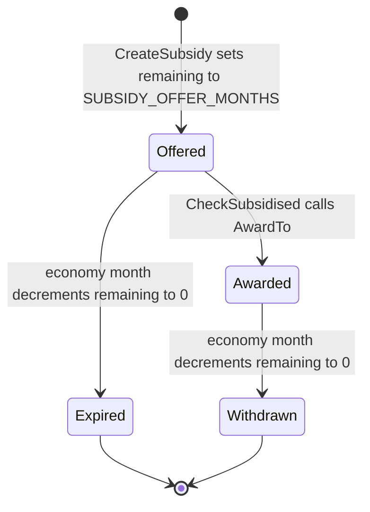

# Subsidies

A subsidy is a timed offer to carry one cargo from one source to one destination. Awarding it changes the profit of a later delivery. The multiplier itself is applied in `DeliverGoods` and is cited from [archi-economy.md](archi-economy.md). This file is the offer, the award test, and the month timer.

Industry production and station catchment stay in their own documents. Subsidy code only asks whether a source or destination is a town or an industry, and whether a station's `industries_near` or house catchment contains that destination.

## Record

```23:45:src/subsidy_base.h
struct Subsidy : SubsidyPool::PoolItem<&_subsidy_pool> {
	CargoType cargo_type = INVALID_CARGO;  ///< Cargo type involved in this subsidy, INVALID_CARGO for invalid subsidy
	uint16_t remaining = 0;    ///< Remaining months when this subsidy is valid
	CompanyID awarded = CompanyID::Invalid();   ///< Subsidy is awarded to this company; CompanyID::Invalid() if it's not awarded to anyone
	Source src{}; ///< Source of subsidised path
	Source dst{}; ///< Destination of subsidised path

	Subsidy(SubsidyID index, CargoType cargo_type = INVALID_CARGO, Source src = {}, Source dst = {}, uint16_t remaining = 0) :
		SubsidyPool::PoolItem<&_subsidy_pool>(index), cargo_type(cargo_type), remaining(remaining), src(src), dst(dst) {}

	/**
	 * (Empty) destructor has to be defined else operator delete might be called with nullptr parameter
	 */
	~Subsidy() { }

	/**
	 * Tests whether this subsidy has been awarded to someone
	 * @return is this subsidy awarded?
	 */
	inline bool IsAwarded() const
	{
		return this->awarded != CompanyID::Invalid();
	}
```

The pool is `SubsidyPool` with a minimum of 1 (`src/subsidy_base.h`). Constants next to the struct:

| Constant | Value | Use |
| --- | --- | --- |
| `SUBSIDY_OFFER_MONTHS` | 12 | `remaining` of a new offer |
| `SUBSIDY_PAX_MIN_POPULATION` | 400 | Town population for a passenger offer |
| `SUBSIDY_CARGO_MIN_POPULATION` | 900 | Town population for a town-cargo source |
| `SUBSIDY_MAX_PCT_TRANSPORTED` | 42 | Source must be at or below this percent transported |
| `SUBSIDY_MAX_DISTANCE` | 70 | Maximum Manhattan distance between source and destination tiles |
| `SUBSIDY_TOWN_CARGO_RADIUS` | 6 | Half-extent of the town tile scan for house production and acceptance |

`RebuildSubsidisedSourceAndDestinationCache` clears `part_of_subsidy` on every town and industry, then sets `PartOfSubsidy::Source` on each subsidy source and `PartOfSubsidy::Destination` on each subsidy destination (`src/subsidy.cpp` 103–113). `CheckSubsidised` uses those flags to return before scanning the pool when the cargo's source is not a subsidy source.

## Lifecycle



`CreateSubsidy` allocates the subsidy with `remaining = SUBSIDY_OFFER_MONTHS`, posts the offer news, sets the source and destination flags, and broadcasts `ScriptEventSubsidyOffer` (`src/subsidy.cpp` 173–186).

`AwardTo` requires the subsidy to be unawarded. It sets `awarded` and replaces `remaining` with `_settings_game.difficulty.subsidy_duration * CalendarTime::MONTHS_IN_YEAR` (`MONTHS_IN_YEAR` is 12, `src/timer/timer_game_common.h`). The offer's leftover months are discarded. It posts award news, broadcasts `ScriptEventSubsidyAwarded`, and invalidates the subsidy list (`src/subsidy.cpp` 69–86).

The economy-month timer decrements `remaining` first. Hitting 0 deletes the subsidy. An unawarded expiry posts offer-expired news and `ScriptEventSubsidyOfferExpired`. An awarded expiry posts withdrawn-service news for the local company and `ScriptEventSubsidyExpired` for everyone (`src/subsidy.cpp` 422–440). Any deletion rebuilds the source/destination cache.

`CmdCreateSubsidy` is a deity command (`CommandFlag::Deity`, `src/subsidy_cmd.h`). It checks the pool, requires `_current_company == OWNER_DEITY`, checks the cargo spec, and checks that source and destination are a valid town or industry. On execute it calls `CreateSubsidy`. The returned `CommandCost` is empty (`src/subsidy.cpp` 196–229).

`DeleteSubsidyWith` deletes every subsidy whose source or destination equals the given `Source`, then rebuilds the cache (`src/subsidy.cpp` 119–134). `ChangeOwnershipOfCompanyItems` deletes subsidies awarded to a company that is being removed, or retargets `awarded` when the company is taken over (`src/economy.cpp` 357–366).

## Monthly offers

```418:483:src/subsidy.cpp
static const IntervalTimer<TimerGameEconomy> _economy_subsidies_monthly({TimerGameEconomy::Trigger::Month, TimerGameEconomy::Priority::Subsidy}, [](auto)
{
	bool modified = false;

	for (Subsidy *s : Subsidy::Iterate()) {
		if (--s->remaining == 0) {
			if (!s->IsAwarded()) {
				const CargoSpec *cs = CargoSpec::Get(s->cargo_type);
				EncodedString headline = GetEncodedString(STR_NEWS_OFFER_OF_SUBSIDY_EXPIRED, cs->name, s->src.GetFormat(), s->src.id, s->dst.GetFormat(), s->dst.id);
				AddNewsItem(std::move(headline), NewsType::Subsidies, NewsStyle::Normal, {}, s->src.GetNewsReference(), s->dst.GetNewsReference());
				AI::BroadcastNewEvent(new ScriptEventSubsidyOfferExpired(s->index));
				Game::NewEvent(new ScriptEventSubsidyOfferExpired(s->index));
			} else {
				if (s->awarded == _local_company) {
					const CargoSpec *cs = CargoSpec::Get(s->cargo_type);
					EncodedString headline = GetEncodedString(STR_NEWS_SUBSIDY_WITHDRAWN_SERVICE, cs->name, s->src.GetFormat(), s->src.id, s->dst.GetFormat(), s->dst.id);
					AddNewsItem(std::move(headline), NewsType::Subsidies, NewsStyle::Normal, {}, s->src.GetNewsReference(), s->dst.GetNewsReference());
				}
				AI::BroadcastNewEvent(new ScriptEventSubsidyExpired(s->index));
				Game::NewEvent(new ScriptEventSubsidyExpired(s->index));
			}
			delete s;
			modified = true;
		}
	}

	if (modified) {
		RebuildSubsidisedSourceAndDestinationCache();
	} else if (_settings_game.difficulty.subsidy_duration == 0) {
		/* If subsidy duration is set to 0, subsidies are disabled, so bail out. */
		return;
	}

	bool passenger_subsidy = false;
	bool town_subsidy = false;
	bool industry_subsidy = false;

	int random_chance = RandomRange(16);

	if (random_chance < 2) {
		/* There is a 1/8 chance each month of generating a passenger subsidy. */
		int n = 1000;

		do {
			passenger_subsidy = FindSubsidyPassengerRoute();
		} while (!passenger_subsidy && n--);
	} else if (random_chance == 2) {
		/* Cargo subsidies with a town as a source have a 1/16 chance. */
		int n = 1000;

		do {
			town_subsidy = FindSubsidyTownCargoRoute();
		} while (!town_subsidy && n--);
	} else if (random_chance == 3) {
		/* Cargo subsidies with an industry as a source have a 1/16 chance. */
		int n = 1000;

		do {
			industry_subsidy = FindSubsidyIndustryCargoRoute();
		} while (!industry_subsidy && n--);
	}

	modified |= passenger_subsidy || town_subsidy || industry_subsidy;

	if (modified) InvalidateWindowData(WindowClass::SubsidyList, 0);
});
```

`RandomRange(16)` yields 0..15. Values 0 and 1 try a passenger route (the comment's 1/8). Value 2 tries a town cargo source (1/16). Value 3 tries an industry cargo source (1/16). Values 4..15 create nothing. Each attempt repeats until it creates a subsidy or the 1000-iteration counter expires.

When `subsidy_duration` is 0 and this month deleted nothing, the timer returns before the random draw. When this month did delete something, execution continues into the draw. `AwardTo` would set `remaining` from that same duration setting.

`FindSubsidyPassengerRoute` (`src/subsidy.cpp` 236–261):

- Returns false when the pool cannot allocate.
- Picks a random cargo from `CargoSpec::town_production_cargoes[TownProductionEffect::Passengers]`.
- Source town population must be at least `SUBSIDY_PAX_MIN_POPULATION`, and `GetPercentTransported` for that cargo must be at most `SUBSIDY_MAX_PCT_TRANSPORTED`.
- Destination is another random town with population at least `SUBSIDY_PAX_MIN_POPULATION`.
- Manhattan distance between town tiles must be at most `SUBSIDY_MAX_DISTANCE`.
- `CheckSubsidyDuplicate` rejects an existing subsidy with the same cargo, source, and destination.

`FindSubsidyTownCargoRoute` (`src/subsidy.cpp` 270–314) picks a random town of population at least `SUBSIDY_CARGO_MIN_POPULATION`, sums house production in a tile area of radius `SUBSIDY_TOWN_CARGO_RADIUS` via `AddProducedCargo`, zeroes every passenger-effect cargo, and picks a random remaining produced cargo. Percent transported must be at most 42. Destination search is `FindSubsidyCargoDestination`.

`FindSubsidyIndustryCargoRoute` (`src/subsidy.cpp` 320–353) picks a random industry, then a random produced cargo that is valid. It reads last month's `PctTransported` and `production` on that slot. Production must be non-zero and percent transported must be at most 42.

`FindSubsidyCargoDestination` (`src/subsidy.cpp` 361–415) chooses the destination type with `Chance16(1, 2)`, so town and industry are equally likely. A town destination must have house acceptance of at least 8 for the cargo inside the same radius-6 scan (`AddAcceptedCargo`). An industry destination must `IsCargoAccepted`. Source and destination must differ, `CheckSubsidyDistance` must pass, and the triple must not already exist. Distance for a town is `Town::xy`; for an industry it is `location.tile` (`CheckSubsidyDistance`, lines 159–165).

## Award on delivery

`DeliverGoods` calls `CheckSubsidised` with the cargo, the delivering company, the packet's `Source`, and the destination station (`src/economy.cpp` 1122). The packet source is `CargoPacket::GetSource`, documented as the source used for subsidies (`src/cargopacket.h` 192–195).

```493:558:src/subsidy.cpp
bool CheckSubsidised(CargoType cargo_type, CompanyID company, Source src, const Station *st)
{
	/* If the source isn't subsidised, don't continue */
	if (!src.IsValid()) return false;
	switch (src.type) {
		case SourceType::Industry:
			if (!Industry::Get(src.ToIndustryID())->part_of_subsidy.Test(PartOfSubsidy::Source)) return false;
			break;
		case SourceType::Town:
			if (!Town::Get(src.ToTownID())->cache.part_of_subsidy.Test(PartOfSubsidy::Source)) return false;
			break;
		default: return false;
	}

	/* Remember all towns near this station (at least one house in its catchment radius)
	 * which are destination of subsidised path. Do that only if needed */
	std::vector<const Town *> towns_near;
	if (!st->spread.IsEmpty()) {
		for (const Subsidy *s : Subsidy::Iterate()) {
			/* Don't create the cache if there is no applicable subsidy with town as destination */
			if (s->dst.type != SourceType::Town) continue;
			if (s->cargo_type != cargo_type || s->src != src) continue;
			if (s->IsAwarded() && s->awarded != company) continue;

			for (TileIndex tile : st->catchment_tiles) {
				if (!IsTileType(tile, TileType::House)) continue;
				const Town *t = Town::GetByTile(tile);
				if (t->cache.part_of_subsidy.Test(PartOfSubsidy::Destination)) include(towns_near, t);
			}
			break;
		}
	}

	bool subsidised = false;

	/* Check if there's a (new) subsidy that applies. There can be more subsidies triggered by this delivery!
	 * Think about the case that subsidies are A->B and A->C and station has both B and C in its catchment area */
	for (Subsidy *s : Subsidy::Iterate()) {
		if (s->cargo_type == cargo_type && s->src == src && (!s->IsAwarded() || s->awarded == company)) {
			switch (s->dst.type) {
				case SourceType::Industry:
					for (const auto &i : st->industries_near) {
						if (s->dst.ToIndustryID() == i.industry->index) {
							assert(i.industry->part_of_subsidy.Test(PartOfSubsidy::Destination));
							subsidised = true;
							if (!s->IsAwarded()) s->AwardTo(company);
						}
					}
					break;
				case SourceType::Town:
					for (const Town *tp : towns_near) {
						if (s->dst.ToTownID() == tp->index) {
							assert(tp->cache.part_of_subsidy.Test(PartOfSubsidy::Destination));
							subsidised = true;
							if (!s->IsAwarded()) s->AwardTo(company);
						}
					}
					break;
				default:
					NOT_REACHED();
			}
		}
	}

	return subsidised;
}
```

The early return is the cache: the cargo source must be a town or industry flagged `PartOfSubsidy::Source`. A subsidy matches when cargo and source match and it is either unawarded or already awarded to this company. An industry destination matches when that industry is in `st->industries_near`. A town destination matches when that town appears in `towns_near`. That vector is filled from house tiles in `st->catchment_tiles` when `st->spread` is non-empty, and only after the scan finds one subsidy with this cargo and source whose destination is a town and which is unawarded or awarded to this company. The house scan then keeps every catchment town flagged `PartOfSubsidy::Destination`, and the loop breaks so the scan runs once. Every matching unawarded subsidy is awarded inside the second loop. One delivery can award more than one subsidy. The return is true if any subsidy matched.

`DeliverGoods` applies `difficulty.subsidy_multiplier` once for that true result:

```1121:1129:src/economy.cpp
	if (CheckSubsidised(cargo_type, company->index, src, st))  {
		switch (_settings_game.difficulty.subsidy_multiplier) {
			case 0:  profit += profit >> 1; break;
			case 1:  profit *= 2; break;
			case 2:  profit *= 3; break;
			default: profit *= 4; break;
		}
	}
```

That profit is the value `PayFinalDelivery` adds to `route_profit`, so the company credit on leave includes the multiplier. `PayTransfer` never calls `DeliverGoods`, so the feeder credit is not multiplied.

## Code map

| Concern | Symbol | File | Lines |
| --- | --- | --- | --- |
| Subsidy fields and limits | `Subsidy`, `SUBSIDY_*` | `src/subsidy_base.h` | 23–56 |
| Offer | `CreateSubsidy` | `src/subsidy.cpp` | 173–186 |
| Award | `Subsidy::AwardTo` | `src/subsidy.cpp` | 69–86 |
| Deity command | `CmdCreateSubsidy` | `src/subsidy.cpp` | 196–229 |
| Month timer | `_economy_subsidies_monthly` | `src/subsidy.cpp` | 418–483 |
| Passenger candidate | `FindSubsidyPassengerRoute` | `src/subsidy.cpp` | 236–261 |
| Town-source candidate | `FindSubsidyTownCargoRoute` | `src/subsidy.cpp` | 270–314 |
| Industry-source candidate | `FindSubsidyIndustryCargoRoute` | `src/subsidy.cpp` | 320–353 |
| Destination candidate | `FindSubsidyCargoDestination` | `src/subsidy.cpp` | 361–415 |
| Delivery test and award | `CheckSubsidised` | `src/subsidy.cpp` | 493–558 |
| Profit multiplier | `DeliverGoods` | `src/economy.cpp` | 1121–1129 |
