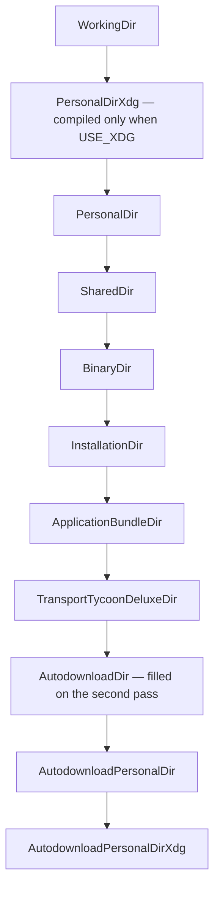
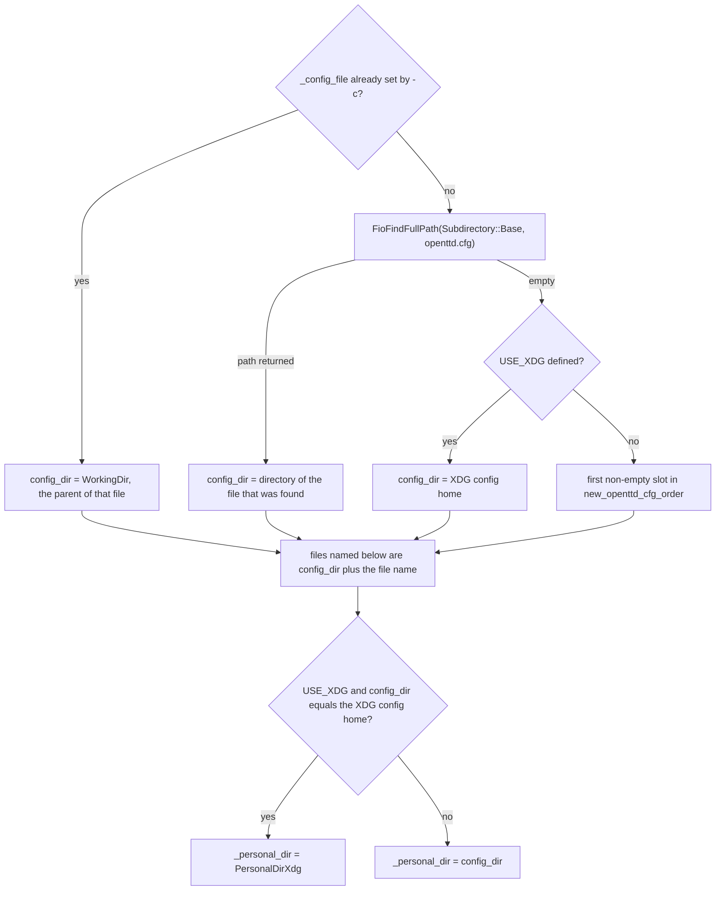

# Data directories, search paths, tar archives, and openttd.cfg

OpenTTD looks up data by walking a list of roots, then appending a subdirectory name from `_subdirs`. `DeterminePaths` fills the roots, chooses where `openttd.cfg` lives, and creates the personal folders. `FillValidSearchPaths` turns the filled roots into `_valid_searchpaths`, which is the list later lookups walk. Tar files are indexed separately and opened only after a real file of the same relative name is not found.

The user-facing note is `docs/directory_structure.md`. Paths below are the ones the functions actually build. The last section records where that note has fallen behind this tree.

## Who builds the list

`DeterminePaths` (`src/fileio.cpp`) is the single entry. `openttd.cpp` calls it with `arguments[0]` and with `only_local_path` set by `-X`.

1. `DetermineBasePaths(exe)` writes one string per `Searchpath` slot. An empty string means “this OS has no such root”. Windows implements this in `src/os/windows/win32.cpp`. Every other OS implements it in the `#else` branch of `src/fileio.cpp`.
2. `FillValidSearchPaths(only_local_path)` copies the non-empty slots into `_valid_searchpaths`.
3. The same function then resolves `openttd.cfg`, sets `_personal_dir`, creates directories, assigns `Searchpath::AutodownloadDir`, and calls `FillValidSearchPaths` again so the download root is included.

`_searchpaths` holds the raw slot strings. `_valid_searchpaths` is the ordered list. Duplicate path strings are dropped; the earlier slot in the enum keeps the path.



`FillValidSearchPaths` walks `Searchpath` from `WorkingDir` through `End` in that order (`src/fileio_type.h`). Empty slots are skipped. With `-X`, the walk keeps only `WorkingDir`, `BinaryDir`, and `AutodownloadDir`.

`_do_scan_working_directory` starts true. On non-Windows, and only when `-c` was not passed, `DetermineBasePaths` sets it from `DoScanWorkingDirectory`. That function returns false when `WorkingDir` is `/`, or when `WorkingDir` plus `PERSONAL_DIR` equals `PersonalDir` (the process was started with the home directory as cwd). `FileScanner::Scan` then skips `WorkingDir`. `FioFOpenFile`, `FioFindFullPath`, and `FioFindDirectory` do not consult the flag, so a direct open still searches that root. If the flag is false and the working-directory path was not already kept, `FillValidSearchPaths` inserts `WorkingDir` at the front of `_valid_searchpaths`.

Windows never calls `DoScanWorkingDirectory`, so the working directory stays in the scan.

The manual window does not use this list. `FindGameManualFilePath` (`src/help_gui.cpp`) tries `ApplicationBundleDir`, `InstallationDir`, `SharedDir`, `BinaryDir`, then `WorkingDir`.

## Personal, shared, binary, install

The four names in the legacy note are four slots. Two more roots matter at runtime: the working directory, and the autodownload directory. The application bundle and the Atari Transport Tycoon Deluxe `CD` folder are further slots that are empty on most builds.

Compile-time directory strings come from `set_directory_options` in `cmake/Options.cmake`, passed as `-D` flags from `CMakeLists.txt`:

| CMake cache | Default | Effect |
| --- | --- | --- |
| `PERSONAL_DIR` | macOS `Documents/OpenTTD`; Windows `OpenTTD`; other Unix `.<BINARY_NAME>` (`.openttd`) | `-DWITH_PERSONAL_DIR` and `-DPERSONAL_DIR=...`, unless the value is `(not set)` |
| `SHARED_DIR` | macOS `/Library/Application Support/OpenTTD`; Windows and other Unix `(not set)` | `-DWITH_SHARED_DIR` only when the value is not `(not set)` |
| `GLOBAL_DIR` | Unix `${CMAKE_INSTALL_FULL_DATADIR}/${BINARY_NAME}`; Windows and macOS `(not set)` | `-DGLOBAL_DATA_DIR=...` when set |

`CMakeLists.txt` sets `CMAKE_INSTALL_DATADIR` to `share/games` and `CMAKE_INSTALL_BINDIR` to `games` before `GNUInstallDirs`. The install prefix is CMake’s own prefix (`/usr/local` unless a packager changes it). `USE_XDG` is not a CMake option. `src/stdafx.h` defines it when `WITH_PERSONAL_DIR` is set and the build is `UNIX`, and not Apple, and not Emscripten.

### WorkingDir

Without `-c`, this is the process cwd (`getcwd` on Unix, `GetCurrentDirectory` on Windows), with a trailing separator.

With `-c`, both OS implementations replace it with the parent directory of the config file the user named. Unix uses `std::filesystem::weakly_canonical` on that parent. Windows uses `GetFullPathName`. A `-c` value with no separator stays in the cwd.

### PersonalDir and PersonalDirXdg

`PersonalDir` is the per-user OpenTTD folder.

- Windows (`win32.cpp`, inside `WITH_PERSONAL_DIR`): `SHGetFolderPath(CSIDL_PERSONAL)` plus `PERSONAL_DIR`. With the default cache value that is the user’s Documents folder plus `OpenTTD`. The same block also fills `AutodownloadPersonalDir` as that folder plus `content_download`.
- Other OS (`fileio.cpp`): `GetHomeDir()` plus a separator plus `PERSONAL_DIR`. `GetHomeDir` reads `HOME`, then `getpwuid`. On Haiku it uses `find_directory(B_USER_SETTINGS_DIRECTORY)` instead. Default macOS result: `~/Documents/OpenTTD`. Default Linux result: `~/.openttd`. `AutodownloadPersonalDir` is that folder plus `content_download`.

`PersonalDirXdg` exists in the enum only when `USE_XDG` is defined, so Linux has it and Windows, macOS, and Emscripten do not.

- If `XDG_DATA_HOME` is set: that directory, a separator, then `PERSONAL_DIR` with a leading `.` removed (`openttd`).
- Otherwise, if a home directory exists: `$HOME/.local/share/` plus the same stripped name.
- `AutodownloadPersonalDirXdg` is that folder plus `content_download`.

A Linux build therefore searches the XDG data directory and `~/.openttd`. The XDG slot is earlier in the enum.

### SharedDir

- Windows: `SHGetFolderPath(CSIDL_COMMON_DOCUMENTS)` plus `PERSONAL_DIR` (`OpenTTD` under the common Documents folder). This does not use the CMake `SHARED_DIR` string. The Windows default for that cache entry is `(not set)`, and `win32.cpp` never reads `SHARED_DIR`.
- Other OS: the literal `SHARED_DIR` when `WITH_SHARED_DIR` is defined. The macOS default is `/Library/Application Support/OpenTTD`. The Unix default leaves the slot empty.

### BinaryDir

The directory that contains the executable, as passed into `DeterminePaths` (`arguments[0]`).

- Windows: `GetFullPathName` of that path, then the parent directory. The slot is cleared if `GetModuleFileName` or `GetFullPathName` fails. `GetModuleFileName` is only a success check; the stored path is the `arguments[0]` parent.
- Other OS: `ChangeWorkingDirectoryToExecutable` `chdir`s to the executable’s parent, `getcwd` stores it, then the process `chdir`s back to the original cwd. On Cocoa, a path containing `.app` is cut at `.app` and the last component is removed, so `BinaryDir` is the directory that contains the `.app` bundle, not `Contents/MacOS`.

### InstallationDir

`GLOBAL_DATA_DIR` plus a separator, when that macro exists. Windows and the macOS default clear the slot. On Unix the default expands to `<prefix>/share/games/openttd` because of the `share/games` datadir default above. The running binary does not look up `/usr/games`; that string is only the default install bindir under a `/usr` prefix.

### ApplicationBundleDir

`CocoaSetApplicationBundleDir` (`src/os/macosx/macos.mm`) stores `CFBundleCopyResourcesDirectoryURL` of the main bundle (the bundle’s `Contents/Resources` directory). Every other OS clears the slot.

### TransportTycoonDeluxeDir

Original base-graphics files from the 2026 Atari re-release. The slot stays empty unless `installpath.ini` exists and the `CD` directory named inside it exists.

| OS | Where `installpath.ini` is read | What is appended |
| --- | --- | --- |
| Windows | `CSIDL_APPDATA` plus `Atari\Transport Tycoon Deluxe\installpath.ini` | `CD` and a separator |
| macOS | `CocoaGetAppSupportDir` (user Application Support) plus `Atari/Transport Tycoon Deluxe/installpath.ini` | `../Resources/CD` |
| Other OS | `GetHomeDir()` plus `.local/share/Atari/Transport Tycoon Deluxe/installpath.ini` | `CD` |

The non-Windows, non-macOS path is the literal `.local/share/` under the home directory. It does not read `XDG_DATA_HOME`.

`FioGetDirectory` has one special case: `TransportTycoonDeluxeDir` combined with `Subdirectory::Baseset` returns the `CD` path itself and does not append `baseset/`. The slot is still a normal member of `_valid_searchpaths`, so a scan of another subdirectory appends that subdirectory under `CD`.

### AutodownloadDir and `_personal_dir`

`_personal_dir` is where `DeterminePaths` creates the user’s folders and where `openttd.log` is written. It is not itself a `Searchpath` slot.

- When `USE_XDG` is set and the chosen config directory equals the XDG config home, `_personal_dir` is `PersonalDirXdg` (the data home). With `-X`, `WorkingDir` is also overwritten to that data home before the second `FillValidSearchPaths`, so the local-only list still sees it.
- Otherwise `_personal_dir` is the config directory.

`AutodownloadDir` is then `_personal_dir` plus `content_download` and a separator. `GetFullFilename` in `src/network/network_content.cpp` writes downloads there. The second `FillValidSearchPaths` deduplicates this against `AutodownloadPersonalDir` or `AutodownloadPersonalDirXdg` when they are the same string; the earlier enum slot wins.

## Subdirectories

`_subdirs` in `src/fileio.cpp` is the suffix appended by `FioGetDirectory`. `FioFOpenFile` joins `search root + suffix + relative name`.

| `Subdirectory` | Suffix | Created under `_personal_dir` | Created under `AutodownloadDir` |
| --- | --- | --- | --- |
| `Base` | *(empty)* | the directory itself | the `content_download` directory |
| `Save` | `save/` | yes | no |
| `Autosave` | `save/autosave/` | yes | no |
| `Scenario` | `scenario/` | yes | yes |
| `Heightmap` | `scenario/heightmap/` | yes | yes |
| `OldGm` | `gm/` | no | no |
| `OldData` | `data/` | no | no |
| `Baseset` | `baseset/` | yes | yes |
| `NewGrf` | `newgrf/` | yes | yes |
| `Lang` | `lang/` | no | no |
| `Ai` | `ai/` | yes | yes |
| `AiLibrary` | `ai/library/` | yes | yes |
| `Gs` | `game/` | yes | yes |
| `GsLibrary` | `game/library/` | yes | yes |
| `Screenshot` | `screenshot/` | yes | no |
| `SocialIntegration` | `social_integration/` | yes | yes |
| `Docs` | `docs/` | no | no |

`FioCreateDirectory` uses `std::filesystem::create_directories` and ignores errors.

`gm/` and `data/` remain live fallbacks. `FileScanner::Scan` of `Baseset` also scans `OldGm` and then `OldData`. A scan of `NewGrf` also scans `OldData`. `FioFOpenFile` repeats that fallback when the primary subdirectory misses, and for every other subdirectory it retries with `Subdirectory::None` (the caller’s string as a literal path).

Save, scenario, heightmap, and town-data dialogs remember a directory in a function-local static (`FiosGetSavegameList`, `FiosGetScenarioList`, `FiosGetHeightmapList`, `FiosGetTownDataList` in `src/fios.cpp`). The first call uses `FioFindDirectory`. Town data uses the heightmap subdirectory. Screenshots use `FiosGetScreenshotDir`, which also caches `FioFindDirectory(Subdirectory::Screenshot)`. Autosave names use `FioFindDirectory(Subdirectory::Autosave)` inside `FiosNumberedSaveName`.

`FioFindDirectory` returns the first existing directory of that suffix along `_valid_searchpaths`. If none exists it returns `_personal_dir` with no suffix appended. After a normal `DeterminePaths`, the suffix has been created under `_personal_dir`, and that root is on the search list, so the created folder is found unless an earlier root already contains the same suffix. With `-X` and without `USE_XDG`, `PersonalDir` is removed from the search list even though the folders were created there; the fallback is then `_personal_dir` itself unless `WorkingDir` or `BinaryDir` already has the suffix. The XDG plus `-X` path avoids that because `WorkingDir` was pointed at the data home.

## Tar archives

`TarScanner::DoScan` (`src/fileio.cpp`) indexes uncompressed `.tar` files. A BaNaNaS download arrives as `.tar.gz` and `GunzipFile` (`src/network/network_content.cpp`) writes the `.tar` beside it before a rescan. The scanner does not open `.tar.gz` itself.

Modes and the subdirectories they index:

| `TarScanner::Mode` | Subdirectories passed to `DoScan(Subdirectory)` |
| --- | --- |
| `Baseset` | `Baseset` (which also indexes `OldData`, because `DoScan(Subdirectory)` adds `OldData` for baseset and NewGRF) |
| `NewGRF` | `NewGrf` (and `OldData` the same way) |
| `AI` | `Ai`, `AiLibrary` |
| `Game` | `Gs`, `GsLibrary` |
| `Scenario` | `Scenario`, `Heightmap` |

`DoScan(Subdirectory)` clears `_tar_list[sd]` and `_tar_filelist[sd]`, then `FileScanner::Scan(".tar", sd, false)`. Nested tars are rejected (`assert` on a non-empty `tar_filename` in `TarScanner::AddFile`). The header must be ustar (`magic` `ustar`) or an old header that is zeros from `magic` onward. Hard and symbolic links are ignored. A directory entry (`typeflag` `'5'`) stores the first directory name seen into `_tar_list`. `ExtractTar` refuses an archive whose stored directory name is empty, and it extracts next to the archive under the tar’s path with `.tar` removed.

Each regular member is inserted into `_tar_filelist[subdir]` under this key:

`lowercase(tar filename only)` + path separator + `lowercase(member path)`

`SimplifyFileName` forces the lower case and rewrites `/` to `PATHSEPCHAR`. `std::map::insert` keeps the first key. Two archives with the same filename in different directories collide; the one scanned first stays. Two archives with different filenames do not collide, even when the member path inside them is the same. Scan order is `_valid_searchpaths` order; order inside one directory is the filesystem iterator’s order.

`FileScanner::Scan` of a content extension walks the real directories first (skipping `WorkingDir` when the scan flag is false), then walks the tar index for that subdirectory. For a real file, `AddFile` receives the full path and a `basepath_length` equal to the search directory prefix, so the relative name is the tail. For a tar member, `basepath_length` is 0 and the name is the index key (`archive.tar/path/inside`). `GRFFileScanner::AddFile` stores `filename.substr(basepath_length)`, so a tarred NewGRF’s identity includes the archive filename.

`FioFOpenFile` opens a real file by walking `_valid_searchpaths` first. On a read-mode miss it lowercases the requested name, collapses `.` and `..`, and looks that string up in `_tar_filelist[subdir]`. A real file hides a tar member only when the relative path equals that full key. A loose `path/file.grf` does not hide `archive.tar/path/file.grf`.

Graphics and sounds sets set `search_in_tars` to true (`src/base_media_graphics.h`, `src/base_media_sounds.h`). Music sets it to false (`BaseSetTraits<MusicSet>` in `src/base_media_music.h`), so `BaseMusic::FindSets` never asks the scanner to look inside tars. `MidiFile::LoadFile` still goes through `FioFOpenFile`, which can read a tar member. The path handed to an external player comes from `FioFindFullPath`, which only checks real files.

## openttd.cfg

`_config_file` starts empty (`src/settings.cpp`). `-c` in `openttd.cpp` assigns the user’s string before `DeterminePaths`. `-x` leaves `AfterNewGRFScan::save_config` false, so `_save_config` stays false and nothing is written.

Choosing the directory is entirely inside `DeterminePaths`:



`FioFindFullPath` walks `_valid_searchpaths` from the first `FillValidSearchPaths` and returns the first hit of `openttd.cfg` in the base of a root. It does not look inside tars. On that first pass `AutodownloadDir` is still empty, but `AutodownloadPersonalDir` and, when compiled, `AutodownloadPersonalDirXdg` are already filled, so a config file sitting in a `content_download` directory can win if no earlier root has one.

The XDG config home is `XDG_CONFIG_HOME` plus a separator plus `PERSONAL_DIR` with a leading `.` removed, or `$HOME/.config/` plus that same name. It is not inserted into `_searchpaths`. Data files for that case go to the XDG data home via `_personal_dir`.

`new_openttd_cfg_order` is `PersonalDir`, `BinaryDir`, `WorkingDir`, `SharedDir`, `InstallationDir`. That array runs only in the `#else` of `USE_XDG`. It is the order used to create a missing config, which is a different order from the enum walk used to find an existing one. `ApplicationBundleDir` and `TransportTycoonDeluxeDir` are not in it.

`_config_file` is set to `config_dir + "openttd.cfg"` only when `-c` was not passed. `-c` keeps the user’s string, and `ConfigIniFile` opens it with `Subdirectory::None`, so `FioFOpenFile` tries that path once and does not walk the roots.

Files placed in `config_dir` by `DeterminePaths`:

| Name | Variable |
| --- | --- |
| `openttd.cfg` | `_config_file` |
| `hs.dat` | `_highscore_file` |
| `hotkeys.cfg` | `_hotkeys_file` |
| `windows.cfg` | `_windows_file` |
| `private.cfg` | `_private_file` |
| `secrets.cfg` | `_secrets_file` |
| `favs.cfg` | `_favs_file` |

`openttd.log` is `_personal_dir + "openttd.log"`, so under the XDG split it sits in the data home, next to saves, while the cfg siblings stay in the config home.

`DeterminePaths` creates `config_dir` and does not write `openttd.cfg`. `ConfigIniFile`’s constructor calls `IniLoadFile::LoadFromDisk` (`src/ini_load.cpp`). A missing file returns immediately and leaves `groups` empty. The parser accepts `[group]` sections, `key = value` lines, double quotes around keys and values, and `#` or `;` comments. `ConfigIniFile` (`src/settings.cpp`) treats `bans`, `newgrf`, `servers`, `server_bind_addresses`, `server_authorized_keys`, `rcon_authorized_keys`, and `admin_authorized_keys` as list groups.

`LoadFromConfig(true)` is the bootstrap load: version, graphics-set selection, and the settings needed to start the blitter. The full `LoadFromConfig()` runs later from `AfterNewGRFScan::OnNewGRFsScanned` and also reads NewGRF, AI, and GameScript blocks, plus `favs.cfg` for picker favourites. `IniFileVersion` in `settings.cpp` drives migrations (private/secrets split, autosave interval units, and the rest of that enum). `SaveToConfig` writes all four ini files. `IniFile::SaveToDisk` (`src/ini.cpp`) writes `filename.new`, `fdatasync`s on POSIX when that API exists, then renames over the destination.

```mermaid
sequenceDiagram
  participant Main as openttd.cpp
  participant Paths as DeterminePaths
  participant Tar as TarScanner
  participant Cfg as LoadFromConfig
  participant Save as SaveToConfig
  Main->>Paths: arguments[0], only_local_path from -X
  Note over Paths: slots, _valid_searchpaths, config_dir, mkdir
  Main->>Tar: Mode::Baseset
  Main->>Cfg: LoadFromConfig(true)
  Note over Main: BaseGraphics::FindSets, then BaseSounds and BaseMusic
  Main->>Tar: ScanNewGRFFiles calls Mode::NewGRF
  Note over Main: AfterNewGRFScan::OnNewGRFsScanned
  Main->>Tar: Mode::Scenario
  Main->>Tar: AI::Initialize calls Mode::AI
  Main->>Tar: Game::Initialize calls Mode::Game
  Main->>Cfg: LoadFromConfig() with no argument
  Note over Main: high score, hotkeys, window placement; _save_config unless -x
  Main->>Save: PostMainLoop when _save_config
```

`IntSettingDesc::ChangeValue` also calls `SaveToConfig` once `_save_config` is true, so a setting change writes the file before exit. A session that never reaches `OnNewGRFsScanned` (help via `-h`, savegame query via `-q`, or `-x`) does not take the `PostMainLoop` write. `-h` and `-q` call `DeterminePaths` on their own early-exit paths; `-q` does not scan baseset tars first, `-h` does.

## Code map

| Concern | Symbol | File |
| --- | --- | --- |
| Slot enum and subdirectory enum | `Searchpath`, `Subdirectory` | `src/fileio_type.h` |
| Suffix table, path list, open, find, tar index | `_subdirs`, `_searchpaths`, `_valid_searchpaths`, `FillValidSearchPaths`, `FioGetDirectory`, `FioFindFullPath`, `FioFindDirectory`, `FioFOpenFile`, `FileScanner::Scan`, `TarScanner` | `src/fileio.cpp` |
| Non-Windows roots, home, cwd scan policy, config directory | `DetermineBasePaths`, `GetHomeDir`, `DoScanWorkingDirectory`, `DeterminePaths` | `src/fileio.cpp` |
| Windows roots | `DetermineBasePaths` | `src/os/windows/win32.cpp` |
| Bundle resources and macOS Application Support | `CocoaSetApplicationBundleDir`, `CocoaGetAppSupportDir` | `src/os/macosx/macos.mm` |
| `PERSONAL_DIR` fallback and `USE_XDG` | macros in `stdafx.h` | `src/stdafx.h` |
| Default personal, shared, and global strings; `share/games` | `set_directory_options`, `CMAKE_INSTALL_DATADIR` | `cmake/Options.cmake`, `CMakeLists.txt` |
| Tar entry types | `TarFileList`, `TarList` | `src/tar_type.h` |
| Music excluded from tar search | `BaseSetTraits<MusicSet>::search_in_tars` | `src/base_media_music.h` |
| Save, scenario, screenshot, autosave directories | `FiosGetSavegameList`, `FiosGetScenarioList`, `FiosGetScreenshotDir`, `FiosNumberedSaveName` | `src/fios.cpp` |
| Manual search order | `FindGameManualFilePath` | `src/help_gui.cpp` |
| Ini parse and atomic save | `IniLoadFile::LoadFromDisk`, `IniFile::SaveToDisk` | `src/ini_load.cpp`, `src/ini.cpp` |
| Load, migrate, and save cfg siblings | `ConfigIniFile`, `LoadFromConfig`, `SaveToConfig` | `src/settings.cpp` |
| `-c`, `-x`, `-X`, startup order, exit save | option switch, `AfterNewGRFScan`, `PostMainLoop` | `src/openttd.cpp` |
| NewGRF tar scan before the full cfg load | `DoScanNewGRFFiles` | `src/newgrf_config.cpp` |
| AI and GameScript tar scans | `AI::Initialize`, `Game::Initialize` | `src/ai/ai_core.cpp`, `src/game/game_core.cpp` |

## Stale claims in docs/directory_structure.md

| What the note says | What this tree does |
| --- | --- |
| Windows personal and shared folders are written out per OS version: `C:\My Documents\OpenTTD`, `Documents and Settings\...`, `C:\Users\...\Documents\OpenTTD`, and the matching All Users / Public Documents lines. | `DetermineBasePaths` in `win32.cpp` calls `SHGetFolderPath` for `CSIDL_PERSONAL`, `CSIDL_COMMON_DOCUMENTS`, and `CSIDL_APPDATA`. Those version strings are not in the source. |
| The binary directory is `C:\Program Files\OpenTTD` on Windows and `/usr/games` on Linux. The installation directory is `/usr/share/games/openttd`. | `BinaryDir` is the parent of `arguments[0]` at runtime. `InstallationDir` is the compiled `GLOBAL_DATA_DIR`. CMake’s default datadir is `share/games` and the default bindir is `games`, under whatever `CMAKE_INSTALL_PREFIX` is. `/usr/...` is that layout with prefix `/usr`, not a path the lookup code contains. |
| Linux personal data is `$XDG_DATA_HOME/openttd` when the binary was built with XDG support, and otherwise `~/.openttd`. | `USE_XDG` is defined for every `WITH_PERSONAL_DIR` Unix build that is not Apple and not Emscripten. There is no separate XDG build switch. `PersonalDirXdg` (`~/.local/share/openttd` or `$XDG_DATA_HOME/openttd`) and `PersonalDir` (`~/.openttd`) are both filled. The enum walks the XDG slot first. |
| On non-Windows, the working directory is not scanned when it is the personal directory, “i.e. `~/`”, or `/`. | `DoScanWorkingDirectory` suppresses `FileScanner` when cwd is `/` or when cwd is the home directory (`WorkingDir + PERSONAL_DIR` equals `PersonalDir`). The OpenTTD personal folder (`~/.openttd` or the XDG data directory) is still scanned. Direct opens still search a suppressed working directory. The check runs only when `-c` was not passed. |
| The Atari `installpath.ini` on Linux is under `$XDG_DATA_HOME`. | The non-Cocoa path in `DetermineBasePaths` appends `.local/share/` to `GetHomeDir()` and does not read `XDG_DATA_HOME`. |
| The numbered search order is also the NewGRF and `openttd.cfg` order, and the list stops at the Atari `CD` folder. | `FillValidSearchPaths` is the list. It inserts `PersonalDirXdg` when compiled, then the autodownload slots, and it drops duplicate path strings. `FileScanner` honours the working-directory scan flag; `FioFindFullPath` does not. |
| A missing `openttd.cfg` is created in order personal, binary, working, shared, installation. With XDG it is created in `$XDG_CONFIG_HOME/openttd`. | `new_openttd_cfg_order` is that personal-binary-working-shared-installation sequence, and it is compiled only when `USE_XDG` is absent (Windows and macOS in this tree). Linux always takes the config-home branch. The XDG config directory is not one of the search slots. |
| Saves follow the config file only when no earlier `save/` exists. Autosaves and screenshots always follow the config file. If the config file is in the XDG config home, everything else is stored under the XDG data home. | `FiosGetSavegameList`, `FiosGetScreenshotDir`, and `FiosNumberedSaveName` all call `FioFindDirectory`. The first existing suffix on `_valid_searchpaths` wins for saves, autosaves, and screenshots alike. `DeterminePaths` creates those suffixes under `_personal_dir`. The XDG split sets `_personal_dir` to `PersonalDirXdg` when `config_dir` equals the config home; an earlier root that already has the suffix still wins. |
| A tar is the root of the search path, so the same member path in two tars means one file cannot be opened. A loose file hides a tar member when the relative paths are equal. | The index key is `lowercase(tar basename) + separator + lowercase(member path)`. Different archive filenames do not hide each other. The same basename does, and the first `insert` wins. A loose file hides a member only when its relative path equals that full key. `FioFOpenFile` tries real files before the tar map. |
| The subdirectory table is the full set of data folders. | `_subdirs` also has `scenario/heightmap`, `gm`, `data`, `lang`, `social_integration`, and `docs`. `gm` and `data` are still scanned as baseset and NewGRF fallbacks. |

The note’s macOS personal path (`~/Documents/OpenTTD`), macOS shared path (`/Library/Application Support/OpenTTD`), empty default Linux shared slot, Windows Atari ini under `%APPDATA%`, macOS Atari ini under user Application Support, `content_download` as an internal directory, music sets left out of tar scans, and “`openttd.cfg` appears when the game closes” still match this tree. The close-time write is `PostMainLoop` calling `SaveToConfig` when `_save_config` is set. A setting change after that flag is set writes earlier, through `IntSettingDesc::ChangeValue`.

## Invariants

`DeterminePaths` is the only function that fills `_searchpaths`, chooses `config_dir`, assigns `_personal_dir`, and creates the personal and `content_download` folders. `FillValidSearchPaths` is the only function that builds `_valid_searchpaths`, and it emits `Searchpath` enum order after dropping empty slots, dropping duplicate path strings, applying the `-X` filter, and optionally putting a unique unscanned `WorkingDir` back at the front.

`FioGetDirectory` is the join of a slot and a `_subdirs` suffix, except `TransportTycoonDeluxeDir` plus `Baseset`, which returns the `CD` directory unchanged. `FioFOpenFile` walks `_valid_searchpaths` for a real file before it consults `_tar_filelist`. `FileScanner::Scan` walks real directories, then the tar index, and it is the lookup that honours `_do_scan_working_directory`.

A tar member’s key includes the archive’s filename. The first successful insert for a key in a given `Subdirectory` is the member that later opens. `TarScanner::DoScan(Subdirectory)` clears that subdirectory’s index before filling it. Music discovery does not scan tars (`search_in_tars` is false). Graphics and sounds do.

`openttd.cfg` is not created by `DeterminePaths`. `LoadFromConfig` reads it, and `SaveToConfig` writes it, via `IniFile::SaveToDisk`’s `*.new` rename. The path is either the `-c` string, the first `openttd.cfg` `FioFindFullPath` finds, the XDG config home when `USE_XDG` is defined and no file was found, or the first non-empty slot of `new_openttd_cfg_order` otherwise. Sibling ini files and `hs.dat` use that same `config_dir`. Saves, screenshots, autosaves, and `openttd.log` follow `_personal_dir` only when `FioFindDirectory` does not find the suffix on an earlier search root. When the config directory is the XDG config home, `_personal_dir` is the XDG data home.
