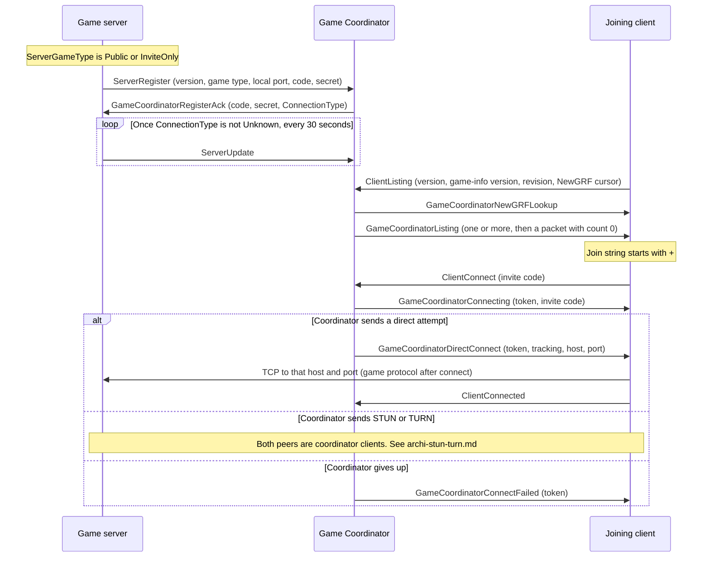

# Game Coordinator architecture

This document describes how the OpenTTD **game binary** talks to the Game Coordinator, and how that session is used to introduce two peers. The Game Coordinator process, the STUN process, and the TURN process are not in this repository. Anything they do beyond the bytes this client sends and the bytes this client accepts is called out as external.

NAT hole-punching versus relay is detailed in [archi-stun-turn.md](archi-stun-turn.md). The play session that starts after a socket has been introduced (join, password, map, lockstep) is the game TCP protocol in `src/network/core/tcp_game.h`. Player-facing steps stay in `docs/multiplayer.md`. This document does not restate them.

Wire names below are the enumerators in `PacketCoordinatorType`, `PacketStunType`, and `PacketTurnType`. The type byte on the wire is that enumerator’s ordinal. Each header says the order must not be changed (`src/network/core/tcp_coordinator.h` lines 25–26, `tcp_stun.h` lines 18–19, `tcp_turn.h` lines 18–19). Comment aliases such as `GC_LISTING` are listed only where a header uses them. They are not extra message types.

## Why the coordinator exists

A listening game server can already accept a TCP connection on its game port (`NETWORK_DEFAULT_PORT`, 3979, `src/network/core/config.h` line 23). That is enough on a LAN, and enough on the internet when the joiner already knows a reachable host and port. Three jobs still need a third party:

1. **Public listing.** A process that is not yet in a game can ask for the set of public servers and show them without opening a game connection to each one.
2. **Invite codes.** `Public` and `InviteOnly` servers register and receive a code. A joiner who has that code can ask the coordinator to introduce them, without knowing a reachable address. `Local` servers do not register.
3. **NAT introduction.** When the joiner cannot open a TCP connection straight to the server’s listen port, the coordinator can still drive a STUN hole-punch or a TURN relay. The result of that introduction is a TCP socket that then speaks the game protocol.

`ServerGameType` (`src/network/network_type.h` lines 36–40):

| Value | Enumerator | What this client does |
| --- | --- | --- |
| 0 | `Local` | Do not talk to the coordinator. An open coordinator session is closed. |
| 1 | `Public` | `Register()` at server start, and again if the setting changes to this. |
| 2 | `InviteOnly` | Same registration path as `Public`. |

Registration is `NetworkServerStart` when the type is not `Local` (`src/network/network.cpp` lines 959–961) and `NetworkUpdateServerGameType` (`src/network/network.cpp` lines 1059–1075). `SendReceive` also drops the session if a server is switched back to `Local` (`src/network/network_coordinator.cpp` lines 743–748).

LAN discovery is a different path: the server list’s “search LAN” button calls `NetworkUDPSearchGame()` (`src/network/network_gui.cpp` lines 743–745). That UDP exchange is not a coordinator packet.

## Where this sits beside the game TCP connection

The coordinator TCP session is a control connection. It is not the multiplayer session.

| Socket | Default port | Who chooses the host | Role |
| --- | --- | --- | --- |
| Coordinator | 3976 | `OTTD_COORDINATOR_CS`, else `coordinator.openttd.org` | Register, list, invite, and choose the next introduction attempt |
| STUN | 3975 | `OTTD_STUN_CS`, else `stun.openttd.org` | Outbound TCP used only to learn a local address and to hold a NAT mapping. Never becomes the game session |
| TURN | 3974 | Host string inside `GameCoordinatorTurnConnect`. No `OTTD_TURN_*` override in this tree | Relay TCP session. After `ServerConnected`, this same socket is the game session |
| Game listen / direct | 3979 unless the server port setting or the connection string says otherwise | Joiner, or the host and port inside `GameCoordinatorDirectConnect` | Game session for a direct connect, and the server’s normal accept path |

Ports and the coordinator protocol version (`NETWORK_COORDINATOR_VERSION` = 6) are `src/network/core/config.h` lines 19–21 and 48. Host defaults are `src/network/core/config.cpp` lines 21–33. TURN’s port is applied by `NetworkTurnConnecter` (`src/network/network_turn.cpp` line 29) to whatever connection string the coordinator sent.

Both the dedicated server and the joining client use one class, `ClientNetworkCoordinatorSocketHandler` (`_network_coordinator_client`). There is no second coordinator implementation for the server role. `NetworkBackgroundLoop` pumps it even when `_networking` is false, which is what makes the server list work from the menu (`src/network/network.cpp` lines 1107–1116).

A join string is parsed by `ServerAddress::Parse` (`src/network/core/address.cpp` lines 445–455):

- It starts with `+`: invite code (`ServerAddressType::InviteCode`). `TCPServerConnecter` does not open a game socket itself. It calls `ConnectToServer`, which sends `ClientConnect` (`src/network/core/tcp_connect.cpp` lines 43–51, `network_coordinator.cpp` lines 531–554). `ConnectToServer` asserts the leading `+`.
- Anything else: `hostname` or `hostname:port`, default port 3979. `TCPConnecter` connects straight to that game port. The coordinator is not asked to introduce the peers.

When an introduction succeeds, the socket that reached the peer is handed to the game protocol:

- Joining client: `TCPServerConnecter::SetConnected` (`src/network/core/tcp_connect.cpp` lines 434–444). The client connecter then constructs `ClientNetworkGameSocketHandler` (`src/network/network.cpp` lines 777–785).
- Game server, for a STUN or TURN socket that this process dialed: `ServerNetworkGameSocketHandler::ValidateClient` then `AcceptConnection` (`src/network/network_coordinator.cpp` lines 593–596, `network.cpp` lines 574–582). `ValidateClient` applies the ban list and the full-server check and may answer with `ServerBanned` or `ServerFull` before a client socket exists (`src/network/core/tcp_listen.h` lines 39–70).
- Game server, for a direct connect: the existing listen socket accepts the inbound TCP connection and reaches the same `AcceptConnection`. The server does not dial the joiner.

From that handoff onward the bytes are `PacketGameType` (`src/network/core/tcp_game.h`). The first ten of those types are the pre-join set (`ServerFull`, `ServerBanned`, `ClientJoin`, game-info, shutdown, and so on). Coordinator packet types stop. TURN’s own rule is the same: after `ServerConnected`, no further TURN packet is sent on that socket (`src/network/core/tcp_turn.h` lines 58–61).

`ClientConnected` is sent only by the joining client (`src/network/network_coordinator.cpp` lines 593–604). The server’s acceptance is not reported. The protocol comment on `ClientConnected` says the client disconnects from the coordinator next (`tcp_coordinator.h` lines 203–206). `ConnectSuccess` does not close the coordinator socket. A non-server coordinator session is closed later by the 60-second idle timeout (`IDLE_TIMEOUT`, `network_coordinator.h` line 80, checked at `network_coordinator.cpp` lines 791–793). A server keeps the coordinator socket and keeps sending `ServerUpdate`.

## Packet framing

Coordinator, STUN, TURN, and game sockets all use `Packet` (`src/network/core/packet.h` lines 18–19): a packet-size prefix, then a `uint8_t` type, then the fields. Multi-byte integers are little-endian (`packet.cpp` `Send_uint16` / `Send_uint32`, low byte first). A bool is a `uint8_t` of 0 or 1. A string is the bytes plus a trailing `'\0'`, with no length prefix (`packet.cpp` lines 166–174). The `Recv_string` argument is a maximum length, not a wire length.

`ServerUpdate` is built with limit `TCP_MTU` (32767). Other coordinator packets this client builds use the `Packet` default limit `COMPAT_MTU` (1460) (`config.h` lines 43–44, `network_coordinator.cpp` lines 497 and 474).

## Coordinator messages

`HandlePacket` dispatches every enumerator (`src/network/core/tcp_coordinator.cpp` lines 22–48). The base handlers treat a type this role does not implement as illegal. This client sends the `Server*` and `Client*` types and implements the `GameCoordinator*` receivers. Payloads below are the fields this client writes, or reads, which match the layout comments in `tcp_coordinator.h` except where a row says otherwise.

| Ordinal | Enumerator | Direction this client uses | Payload this client sends or reads |
| --- | --- | --- | --- |
| 0 | `GameCoordinatorError` | Coordinator → client | `uint8` `NetworkCoordinatorErrorType`, NUL string detail (max `NETWORK_ERROR_DETAIL_LENGTH`) |
| 1 | `ServerRegister` | Server → coordinator | `uint8` protocol version, `uint8` `ServerGameType`, `uint16` local game port, invite code, invite-code secret |
| 2 | `GameCoordinatorRegisterAck` | Coordinator → server | Invite code, secret, `uint8` `ConnectionType` |
| 3 | `ServerUpdate` | Server → coordinator | `uint8` protocol version, then `SerializeNetworkGameInfo` (that blob starts with `uint8` `NETWORK_GAME_INFO_VERSION`) |
| 4 | `ClientListing` | Client → coordinator | `uint8` protocol version, `uint8` game-info version, revision string, `uint32` NewGRF lookup cursor |
| 5 | `GameCoordinatorListing` | Coordinator → client | `uint16` server count, then per server a connection string and a `NetworkGameInfo` blob. Count 0 ends the list |
| 6 | `ClientConnect` | Client → coordinator | `uint8` protocol version, invite code |
| 7 | `GameCoordinatorConnecting` | Coordinator → joining client | Token, invite code |
| 8 | `ServerOrClientConnectFailed` | Either peer → coordinator | `uint8` protocol version, token, `uint8` tracking number |
| 9 | `GameCoordinatorConnectFailed` | Coordinator → peer | Token |
| 10 | `ClientConnected` | Joining client → coordinator | `uint8` protocol version, token |
| 11 | `GameCoordinatorDirectConnect` | Coordinator → joining client | Token, `uint8` tracking number, hostname, `uint16` port |
| 12 | `GameCoordinatorStunRequest` | Coordinator → either peer | Token |
| 13 | `ServerOrClientStunResult` | Either peer → coordinator | `uint8` protocol version, token, `uint8` family, `bool` success |
| 14 | `GameCoordinatorStunConnect` | Coordinator → either peer | Token, `uint8` tracking number, `uint8` family, peer host, `uint16` port |
| 15 | `GameCoordinatorNewGRFLookup` | Coordinator → listing client | `uint32` cursor, `uint16` count, then per NewGRF: `uint32` index, GRF id, 16-byte MD5, name |
| 16 | `GameCoordinatorTurnConnect` | Coordinator → either peer | Token, `uint8` tracking number, ticket, TURN connection string |

Field comments: `tcp_coordinator.h` lines 77–308. Send and receive sites: `network_coordinator.cpp` `Register` (474–484), `ReceiveGameCoordinatorRegisterAck` (183–185), `SendServerUpdate` (497–499), `GetListing` (516–520), `ReceiveGameCoordinatorListing` (240–258), `ConnectToServer` (549–551), `ReceiveGameCoordinatorConnecting` (273–274), `ConnectFailure` (567–570), `ReceiveGameCoordinatorConnectFailed` (293), `ConnectSuccess` (600–602), `ReceiveGameCoordinatorDirectConnect` (302–305), `ReceiveGameCoordinatorStunRequest` (320), `StunResult` (632–636), `ReceiveGameCoordinatorStunConnect` (330–334), `ReceiveGameCoordinatorNewGRFLookup` (364–370), `ReceiveGameCoordinatorTurnConnect` (377–380).

Lengths (`config.h` lines 66–69): invite code 64 bytes including `'\0'`, secret 80, token 64. The TURN ticket is read with `NETWORK_TOKEN_LENGTH` as its maximum (`network_coordinator.cpp` line 379).

`GameCoordinatorStunConnect` reads the peer host with maximum `NETWORK_HOSTNAME_PORT_LENGTH` (86), then a separate `uint16` port (`network_coordinator.cpp` lines 333–334). `GameCoordinatorDirectConnect` reads the hostname with maximum `NETWORK_HOSTNAME_LENGTH` (80), then a `uint16` port (lines 304–305). The layout comments say “host” and “port” and do not name those two maxima.

### Comment aliases that are not enumerators

`network_coordinator.h` lines 23–50 describe the same flow with short names. Most of them match the enumerator (`SERVER_REGISTER`, `GC_REGISTER_ACK`, `GC_LISTING`, `GC_STUN_REQUEST`, `GC_TURN_CONNECT`, `GC_CONNECT_FAILED`, `SERCLI_CONNECT_FAILED`). Two do not:

- Line 37 says `GC_CONNECT`. The enumerator is `GameCoordinatorDirectConnect`.
- Line 39 says `CLIENT_CONNECT_FAILED`. The packet this client sends on failure is `ServerOrClientConnectFailed`.

`GC_NEWGRF_LOOKUP` in the `ClientListing` comment (`tcp_coordinator.h` line 134) is `GameCoordinatorNewGRFLookup`.

### Error and connection-type enums

`NetworkCoordinatorErrorType` (`tcp_coordinator.h` lines 65–70), handled in `ReceiveGameCoordinatorError` (`network_coordinator.cpp` lines 127–175):

| Value | Enumerator | Client reaction |
| --- | --- | --- |
| 0 | `Unknown` | Close the coordinator connection |
| 1 | `RegistrationFailed` | Show an error, set `server_game_type` to `Local`, close |
| 2 | `InvalidInviteCode` | The detail string is looked up as an invite code. That pending connecter fails, and that game-list row is marked offline. The coordinator connection stays up |
| 3 | `ReuseOfInviteCode` | Show an error, set `server_game_type` to `Local`, close. This stops two local registrations fighting over one code |

`ConnectionType` (`tcp_coordinator.h` lines 54–60) is what registration learned about **this** server. It is not a switch the joining client uses to pick direct, STUN, or TURN. The joiner follows whichever introduction packet arrives.

| Value | Enumerator | Meaning in the header, and what this client does with it |
| --- | --- | --- |
| 0 | `Unknown` | Not acked yet. `ServerUpdate` is withheld while the type is `Unknown` (`network_coordinator.cpp` lines 787–788). `CloseConnection` sets the type back to `Unknown` |
| 1 | `Isolated` | Coordinator found no way in. The ack is still stored (invite code included) and an error is shown. Updates still run, because the guard is “not `Unknown`” |
| 2 | `Direct` | Coordinator can open a connection to this server |
| 3 | `Stun` | Introduction needs a STUN request |
| 4 | `Turn` | Introduction needs a relay |

Dedicated-server log lines map those four results to “Remote players can't connect”, “Public”, “Behind NAT”, and “Via relay” (`network_coordinator.cpp` lines 204–229).

## Advertise, list, and join

What this client does at each step:

**Register.** `Register` connects if needed, then queues `ServerRegister` (`network_coordinator.cpp` lines 465–487). If either the saved invite code or the saved secret is empty, both strings are sent empty so the coordinator assigns a pair. If both are set, both are sent so the same code can be reused. The ack writes the pair into `server_invite_code` and `server_invite_code_secret`, and copies the code to `_network_server_invite_code` (lines 183–200). The settings copies are what the next `ServerRegister` will offer. Changing the setting does not change the code already assigned for this process. The secret’s own comment is “proof we got this invite code from the Game Coordinator” (`src/settings_type.h` lines 414–415).

**Updates.** `NETWORK_COORDINATOR_DELAY_BETWEEN_UPDATES` is 30 seconds (line 29). The ack sets `next_update` to now, so the next pump sends the first update. `SerializeNetworkGameInfo` is called with `send_newgrf_names` true when `next_update` is not the zero time point (lines 497–499). After the ack, `next_update` is already non-zero, so updates from this client include NewGRF names (`NewGRFSerializationType::GrfIdMd5Name`). `NetworkGameInfo` has no invite-code field (`network_game_info.h` lines 94–113). The comment in `GetCurrentNetworkServerGameInfo` that lists `invite_code` as a member of `_network_game_info` (`network_game_info.cpp` lines 167–170) does not match the struct.

**Listing.** The internet-search button and a 30-second refresh call `GetListing` (`network_gui.cpp` lines 739–741 and 854–858). `GetListing` bumps `_network_game_list_version`, then sends the coordinator version, `NETWORK_GAME_INFO_VERSION` (7), the revision, and `newgrf_lookup_table_cursor` (lines 510–523). The protocol comment says the cursor field exists at coordinator protocol version 4 and up (`tcp_coordinator.h` lines 128–134). This client always sends it.

`GameCoordinatorNewGRFLookup` is specified to arrive after `ClientListing` and before `GameCoordinatorListing` (`tcp_coordinator.h` lines 273–289). Each update adds NewGRF rows (index, id, MD5, name via `DeserializeGRFIdentifierWithName`) and never removes them. The layout comment says the table belongs to that coordinator connection and is invalid after disconnect. `CloseConnection` does not clear `newgrf_lookup_table` or `newgrf_lookup_table_cursor` (`network_coordinator.cpp` lines 445–455). The same process therefore resends the old cursor on the next `ClientListing`. A new process starts at cursor 0 because that is the member’s initializer (`network_coordinator.h` line 63).

Each listing packet’s count is a `uint16` on the wire and is stored in a `uint8_t` (`network_coordinator.cpp` line 240). A count of 0 marks the end and calls `NetworkGameListRemoveExpired` (lines 243–246), which deletes rows that were not refreshed to the new list version, except rows marked `manually` (`network_gamelist.cpp` lines 65–68). A non-zero count adds rows keyed by the connection string. `NetworkGameListAddItem` runs that string through `ServerAddress::Parse` (`network_gamelist.cpp` lines 27–30), so a leading `+` stays an invite code and a bare hostname gains port 3979. The row is filled with `DeserializeNetworkGameInfo` using the lookup table, compatibility is checked, and the row is marked online (lines 249–264).

This client does not decide which servers are public. It asks for a listing and renders what comes back. An invite-only server still registers; whether it appears in `GameCoordinatorListing` is the coordinator’s choice. Joining an invite-only server is `ClientConnect` with the code, which is the same packet a public-server join uses when the connection string starts with `+`.

A later “refresh” on one row calls `NetworkQueryServer` (`network_gui.cpp` line 767), which opens a **game** TCP connection and sends `PacketGameType::ClientGameInfo` (`network_query.cpp` lines 83–88). That refresh is not a coordinator listing packet. If the row’s string is an invite code, getting that game socket still goes through introduction.

**Join by invite code.** `connecter_pre` is keyed by invite code until `GameCoordinatorConnecting` arrives with a token (`network_coordinator.cpp` lines 271–285). A second `ClientConnect` for an invite code that is already in `connecter_pre` fails the new connecter and sends nothing (lines 535–540). If `GameCoordinatorConnecting` names an invite code this process did not ask for, the client closes the whole coordinator connection (lines 278–281).

**Direct attempt.** `ReceiveGameCoordinatorDirectConnect` kills any in-flight `game_connecter` and starts `NetworkDirectConnecter` to the given host and port (lines 300–315). Success and failure are `ConnectSuccess` / `ConnectFailure`. The tracking number is echoed on failure and is not interpreted locally. One `game_connecter` exists at a time; a newer direct, STUN-reuse, or TURN attempt kills the previous one (same pattern at lines 309–311, 343–345, and 384–386).

**Failure does not end the token by itself.** `ConnectFailure` sends `ServerOrClientConnectFailed` and leaves the `TCPServerConnecter` alive so the coordinator can send another method (lines 562–576). `GameCoordinatorConnectFailed` and `CloseToken` are what fail that connecter and drop STUN and TURN state for the token (lines 291–296 and 692–703).

**Reconnect.** Only a server auto-reconnects. Backoff doubles from 1 second up to 32. The first chance to reconnect is skipped so a fleet of servers does not dial in the same tick after an outage (`network_coordinator.cpp` lines 751–780). Clients do not auto-reconnect; the next `GetListing` or `ConnectToServer` calls `Connect()` again.

## Direct connect versus relay

Three introduction methods are visible to this client. The client does not rank them. It reacts to `GameCoordinatorDirectConnect`, `GameCoordinatorStunRequest`, or `GameCoordinatorTurnConnect`.

**Direct.** The joining client dials the host and port from `GameCoordinatorDirectConnect`. The server accepts on the listen socket it opened at `NetworkServerStart` (`network.cpp` line 934). No STUN or TURN socket is involved. This is the same game TCP connection as typing `hostname:port` into the join UI, except the coordinator chose the address and the client reports `ClientConnected` or `ServerOrClientConnectFailed` against the token.

**STUN hole-punch.** Both peers dial the STUN server, report success or failure, then both dial each other’s observed address from the same local address. The TCP connection that completes is handed to the game protocol. The STUN sockets are discarded. See [archi-stun-turn.md](archi-stun-turn.md).

**TURN relay.** Both peers dial the TURN server with a ticket. When the TURN server says the socket is paired, that socket is handed to the game protocol. The relay stays on the path for the whole session. A joining client may refuse. The game server does not. See [archi-stun-turn.md](archi-stun-turn.md).

`ConnectionType` on the register ack is the coordinator’s summary of the **server’s** reachability. A later join can still receive more than one attempt: the overview comment says the coordinator tries direct, then STUN (including other family combinations), then TURN, and sends `GameCoordinatorConnectFailed` when it stops (`network_coordinator.h` lines 33–50). That order is not encoded in the client. The client will follow a STUN request even if this process’s own `ConnectionType` is `Direct`, because a joiner’s `ConnectionType` is the joiner’s registration state, not the remote server’s.

## Code map

| Concern | Symbol | File | Lines |
| --- | --- | --- | --- |
| Coordinator packet enum and payloads | `PacketCoordinatorType` | `src/network/core/tcp_coordinator.h` | 27–45, 77–308 |
| Dispatch | `NetworkCoordinatorSocketHandler::HandlePacket` | `src/network/core/tcp_coordinator.cpp` | 22–48 |
| Reachability result | `ConnectionType` | `src/network/core/tcp_coordinator.h` | 54–60 |
| Coordinator errors | `NetworkCoordinatorErrorType` | `src/network/core/tcp_coordinator.h` | 65–70 |
| Public / invite-only / local | `ServerGameType` | `src/network/network_type.h` | 36–40 |
| Client session, 30 s updates, 60 s idle | `ClientNetworkCoordinatorSocketHandler` | `src/network/network_coordinator.h` | 54–106 |
| Register, list, join, handoff | `Register`, `GetListing`, `ConnectToServer`, `ConnectSuccess` | `src/network/network_coordinator.cpp` | 465–618 |
| STUN packet enum (one type) | `PacketStunType` | `src/network/core/tcp_stun.h` | 21–23 |
| STUN dial, local address, no reads | `ClientNetworkStunSocketHandler` | `src/network/network_stun.cpp` | 75–155 |
| TURN packet enum | `PacketTurnType` | `src/network/core/tcp_turn.h` | 21–25 |
| TURN dial and socket handoff | `ClientNetworkTurnSocketHandler` | `src/network/network_turn.cpp` | 50–107 |
| Relay consent | `UseRelayService` | `src/settings_type.h` | 91–95 |
| Hosts and ports | `NetworkCoordinatorConnectionString`, `NETWORK_*_SERVER_PORT` | `src/network/core/config.cpp`, `config.h` | config.cpp 21–33; config.h 19–21, 48 |
| Invite code versus host:port | `ServerAddress::Parse` | `src/network/core/address.cpp` | 445–455 |
| Start coordinator join | `TCPServerConnecter::TCPServerConnecter` | `src/network/core/tcp_connect.cpp` | 40–55 |
| Give the socket to the game client | `TCPServerConnecter::SetConnected` | `src/network/core/tcp_connect.cpp` | 434–444 |
| Give the socket to the game server | `AcceptConnection` | `src/network/network.cpp` | 574–582 |
| When registration starts | `NetworkServerStart`, `NetworkUpdateServerGameType` | `src/network/network.cpp` | 959–961, 1059–1075 |
| Pump from the menu | `NetworkBackgroundLoop` | `src/network/network.cpp` | 1112–1116 |
| Game session packet enum | `PacketGameType` | `src/network/core/tcp_game.h` | 22–70 |
| Port reuse for the second connect | `SetReusePort` | `src/network/core/os_abstraction.cpp` | 167–177 |

## `docs/game_coordinator.md`

That file is the short service overview. Checked against this tree:

### Still matches

- Registration happens for invite-only and public, not for a purely local game (lines 6–7 of that doc; `NetworkServerStart` as cited above).
- The coordinator assigns an invite code, and a joiner presents that code (`GameCoordinatorRegisterAck`, `ClientConnect`).
- A direct attempt uses a host and port the coordinator supplies, and failure continues only if the coordinator sends another introduction packet.
- STUN is “both sides connect out, the public mapping is learned, both sides connect to that mapping from the same local address.” The client implements that shape. The sentence that the STUN server tells the coordinator itself, rather than returning a mapped address to the peer, matches this client: the STUN socket is never read, and `PacketStunType` has no reply (`network_stun.cpp` lines 138–145, `tcp_stun.h` lines 21–23).
- TURN is a relay, and the bytes it forwards are the peers’ traffic. After `ServerConnected` those bytes are the game protocol, so the relay is on the path for the session.
- The default STUN hostname in this tree is `stun.openttd.org` (`config.cpp` lines 31–33). The doc’s “normally” matches that default. `OTTD_STUN_CS` can replace it; the doc does not mention the override.

### Stale or not what this client does

| `docs/game_coordinator.md` | What the source does |
| --- | --- |
| Lines 18–20: the probe uses “the public IPv4 and IPv6, as announced by the server.” | `ServerRegister` sends the protocol version, `ServerGameType`, the **local** game port, the invite code, and the secret (`tcp_coordinator.h` lines 94–98, `network_coordinator.cpp` lines 474–484). It does not send public addresses. The coordinator can see the source address of the coordinator TCP session. This client never announces a public game address. |
| Lines 24–30: the client is asked for IPv4 only, IPv6 only, or one family and then the other, and the first family “strongly depends” on latency to the OpenTTD infrastructure. | Each `GameCoordinatorDirectConnect` carries one hostname and one port (`network_coordinator.cpp` lines 302–305). This client does not measure latency and does not choose a family. If that policy exists, it is inside the coordinator service, which is not in this tree. |
| Lines 57–60: once the peers can talk, “the connection to the STUN server can now safely be closed.” | The client marks the STUN handler closed **before** `connect()` to the peer, and the comment says the socket is kept up until `NetworkReuseStunConnecter` finishes so the NAT mapping is not dropped (`network_coordinator.cpp` lines 348–358). `closesocket` happens in `CloseStunHandler`, on reuse failure or when the token is closed after success. The doc’s moment (“after the bidirectional socket exists, closing is safe”) is not the sequence this client runs. |
| Lines 62–64: if STUN fails, “it is not possible to create a connection between the client and server.” | The same document’s TURN section, `ConnectionType::Turn`, and `GameCoordinatorTurnConnect` exist so a failed hole-punch can still be followed by a relay. A failed attempt reports `ServerOrClientConnectFailed` and waits. Only `GameCoordinatorConnectFailed` means the coordinator has stopped (`network_coordinator.h` lines 44–50). |
| Lines 72–73: TURN is likely to work because the peers can already reach the Game Coordinator. | TURN is a different host (the string in `GameCoordinatorTurnConnect`) on port 3974, not port 3976. The joining client can also refuse it (`UseRelayService::Never`, or “no” on the ask dialog; `network_coordinator.cpp` lines 399–410 and `network_gui.cpp` lines 2295–2301). |
| Lines 75–82: the openttd.org relay “only validates it is relaying valid OpenTTD packets and does no further inspection.” | No TURN server is in this repository, so that policy is not something this tree implements or checks. What this tree does show: after `ServerConnected`, the socket is the game session (`network_turn.cpp` lines 59–71, `tcp_turn.h` lines 58–61), so the relay forwards that byte stream for the life of the connection. |

### Omissions that change the picture

The doc does not mention public listing (`ClientListing` / `GameCoordinatorNewGRFLookup` / `GameCoordinatorListing`), the invite-code secret, `ConnectionType::Isolated`, tokens and tracking numbers, protocol version 6, the client’s right to refuse TURN, or a direct `hostname:port` join that never contacts the coordinator. Those are implemented and are part of the architecture above.

## Invariants

1. This repository implements the game’s side of three TCP protocols. It does not contain the coordinator, STUN, or TURN servers. Coordinator behavior past the packets listed above is external.
2. The type byte is the enumerator ordinal of `PacketCoordinatorType`, `PacketStunType`, or `PacketTurnType`. The headers forbid reordering. `GC_CONNECT` and `CLIENT_CONNECT_FAILED` in `network_coordinator.h` are comment names, not enumerators.
3. A join string that starts with `+` is an invite code and is the only path that sends `ClientConnect`. Any other join string dials the game port directly and does not ask the coordinator to introduce the peers.
4. `Local` does not stay registered. `Public` and `InviteOnly` both send `ServerRegister`. This client does not filter `GameCoordinatorListing`; the packet is the public list the coordinator chose to send.
5. Reuse of an invite code sends both the code and the secret, and only when both are non-empty. Otherwise both fields are empty and the coordinator assigns a new pair. `_network_server_invite_code` is the code in force. The settings strings are the pair offered on the next register.
6. `ServerUpdate` is sent only after `ConnectionType` leaves `Unknown`, including when the result is `Isolated`. The interval is 30 seconds. The game-info blob does not carry the invite code.
7. `GameCoordinatorListing` resolves `NewGRFSerializationType::LookupId` through `newgrf_lookup_table`. The layout comment says that table is invalid after disconnect and that `GameCoordinatorNewGRFLookup` arrives before the listing packets. `CloseConnection` leaves the table and the cursor in place, so the next `ClientListing` from this process repeats the previous cursor.
8. `GameCoordinatorListing`’s count is specified as `uint16` and read into a `uint8_t`. A count that does not fit in that `uint8_t` is not handled as the protocol comment describes. A count that arrives as 0 ends the list and drops non-manual rows from older list versions.
9. One introduction attempt is in flight per client (`game_connecter`). A new direct, STUN-reuse, or TURN attempt kills the previous dial. `ServerOrClientConnectFailed` does not fail the user’s connecter. `GameCoordinatorConnectFailed` does.
10. The joining client sends `ClientConnected`. The game server does not. Direct success on the server is the listen socket. STUN and TURN success on the server is `AcceptConnection` on the socket this process dialed.
11. STUN sockets are not read. The local address from that socket is what the peer dial binds. The STUN socket stays open until that peer dial completes or fails. The family byte is the platform `AF_INET` or `AF_INET6` value and is only an echo key back to that same peer’s handler map.
12. `ClientConnect` toward TURN carries the ticket from `GameCoordinatorTurnConnect`, not the coordinator token. The game server always dials TURN. A joining client dials only when `UseRelayService` is `Allow`, or when the ask dialog is accepted.
13. After the handoff, the socket speaks `PacketGameType`. Coordinator, STUN, and TURN messages are not the multiplayer session. Password, company choice, NewGRF check, map transfer, and lockstep happen on that game socket.
14. A non-server coordinator connection closes after 60 seconds without a received coordinator packet. A server keeps the connection, refreshes every 30 seconds, and reconnects with the skipped-first-attempt backoff. STUN and TURN handlers are pumped from the coordinator `SendReceive`, which does not reach them while the coordinator socket is down.
