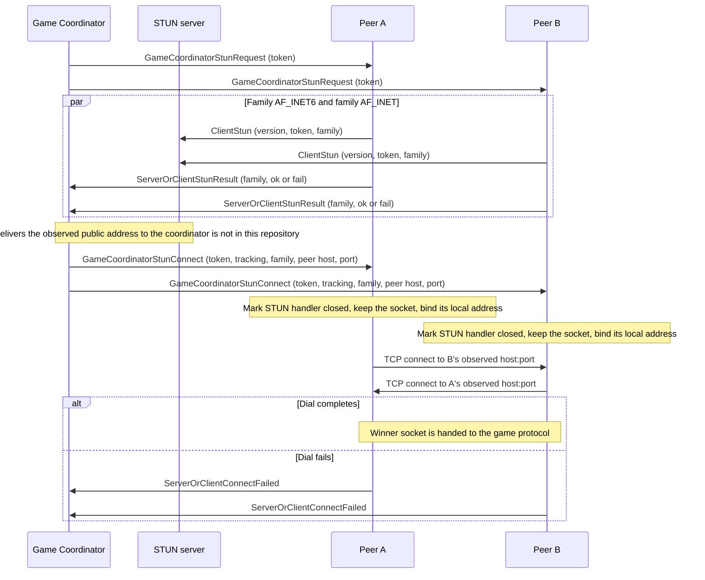
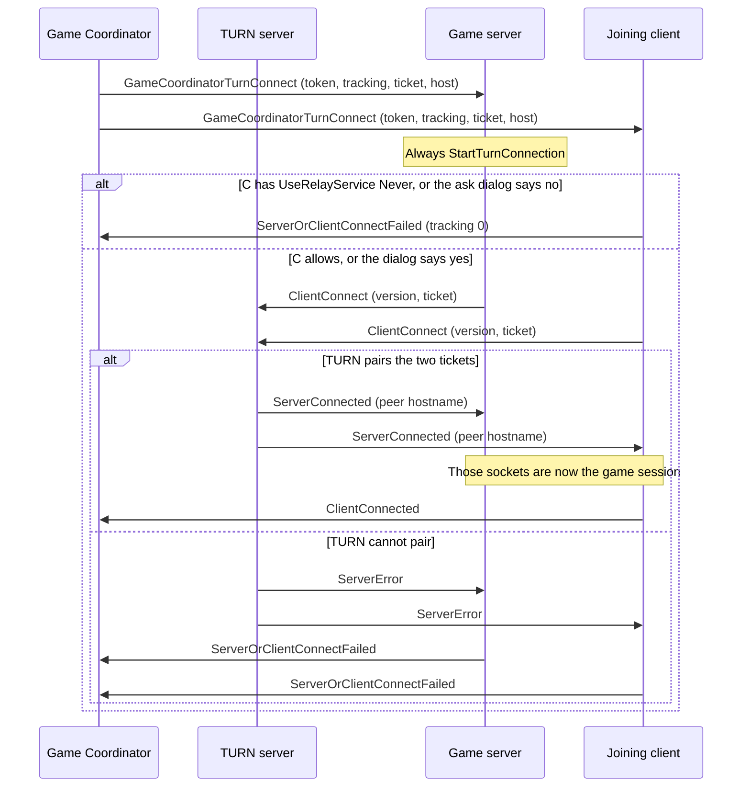

# STUN hole-punch and TURN relay

Companion to [archi-game-coordinator.md](archi-game-coordinator.md). This file is only the two NAT introduction methods the game binary implements. Both are custom TCP protocols in this tree. They are not RFC 5389 STUN and not RFC 5766 TURN. Each has its own packet enum, and those enums are short.

The coordinator decides when to send `GameCoordinatorStunRequest` or `GameCoordinatorTurnConnect`. This client does not fall through from STUN to TURN on its own. A failed dial reports `ServerOrClientConnectFailed` with the tracking number and leaves the invite-code connecter in place (`src/network/network_coordinator.cpp` lines 562–576).

## What each one actually produces

| | STUN path | TURN path |
| --- | --- | --- |
| Purpose | Make the two peers open a TCP connection to each other through NAT | Keep a third host in the middle and splice the two TCP connections |
| Extra server | `stun.openttd.org:3975` unless `OTTD_STUN_CS` is set | Host in `GameCoordinatorTurnConnect`, default port 3974. No environment override in this tree |
| Who dials | Both peers dial STUN, then both dial each other | Both peers dial TURN. Neither dials the other |
| Packet types | One: `ClientStun` (`src/network/core/tcp_stun.h` lines 21–23) | Three: `ServerError`, `ClientConnect`, `ServerConnected` (`src/network/core/tcp_turn.h` lines 21–25) |
| Does the helper socket become the game session? | No. The game socket is the later peer TCP connection | Yes. `ServerConnected` is the last TURN packet; the same socket is then the game session |
| Who can refuse | Neither side has a STUN opt-out | The joining client can refuse. The process that is the game server always dials |
| What the helper learns | Nothing is read from STUN. The useful result is the local address of that socket, plus whatever the STUN server tells the coordinator out of band | The TURN server returns the peer hostname on `ServerConnected`, then forwards the byte stream |

Ports: `src/network/core/config.h` lines 20–21. STUN host: `src/network/core/config.cpp` lines 31–33.

## Shared coordinator packets

These stay on the coordinator TCP session (port 3976). They are not STUN or TURN packets.

**STUN, coordinator side**

| Enumerator | Payload this client uses |
| --- | --- |
| `GameCoordinatorStunRequest` | Token (`network_coordinator.cpp` line 320) |
| `ServerOrClientStunResult` | Protocol version, token, family byte, bool (`lines 632–636`) |
| `GameCoordinatorStunConnect` | Token, tracking number, family, peer host, port (`lines 330–334`) |

**TURN, coordinator side**

| Enumerator | Payload this client uses |
| --- | --- |
| `GameCoordinatorTurnConnect` | Token, tracking number, ticket, TURN connection string (`lines 377–380`) |

On the coordinator connection, failure of either method is the same packet: `ServerOrClientConnectFailed` (version, token, tracking number). Success of either method, reported by the joining client only, is `ClientConnected` (version, token). `ConnectSuccess` is the shared handoff (`lines 586–618`).

The tracking number is an opaque `uint8_t` from the coordinator, echoed on failure so the coordinator can tell which attempt died. This client does not interpret it. When the client refuses TURN locally it reports tracking number 0, not the number from `GameCoordinatorTurnConnect` (`lines 399–401`).

## STUN

### Hole-punch sequence

`ReceiveGameCoordinatorStunRequest` always starts two handlers for the token, one `AF_INET6` and one `AF_INET` (`network_coordinator.cpp` lines 318–325). A missing family fails inside `NetworkStunConnecter::OnFailure`, which reports `StunResult(..., false)` and does not store a local address (`network_stun.cpp` lines 41–50). A family that connects reports success only after `ClientStun` has been fully written (`network_stun.cpp` lines 148–154), so the coordinator is likely to have seen the STUN packet before the result packet.

### What is on the STUN socket

`ClientStun` (`tcp_stun.h` lines 34–45, sent at `network_stun.cpp` lines 97–103):

1. `uint8` `NETWORK_COORDINATOR_VERSION`
2. NUL-terminated token
3. `uint8` family

The family is the platform value passed in (`AF_INET` or `AF_INET6`), not an OpenTTD enum. The coordinator is specified to relay that byte back (`tcp_stun.h` lines 40–41). `GameCoordinatorStunConnect` uses it as the key into `stun_handlers[token][family]` (`network_coordinator.cpp` lines 336–340). It only has to match on that same peer. It is not a stable cross-platform address-family id.

`ClientNetworkStunSocketHandler::SendReceive` never reads the socket (`network_stun.cpp` lines 138–145). The comment gives two reasons: the STUN server sends nothing back, and reading would make some operating systems deliver the later peer packets on the STUN socket instead of the reused one. `PacketStunType` has no server-to-client enumerator, and `NetworkStunSocketHandler` has no `ReceivePackets`.

The local address is `NetworkAddress::GetSockAddress` (`getsockname`) at connect time (`network_stun.cpp` lines 62–64, `address.cpp` lines 414–422). That address is the input to `NetworkReuseStunConnecter`, which constructs `TCPConnecter` with it as the bind address (`network_coordinator.cpp` lines 79–80 and 354–358). `TCPConnecter::Connect` binds only when that address’s port is greater than 0 (`src/network/core/tcp_connect.cpp` lines 100–106) and sets reuse: `SO_REUSEPORT`, or `SO_REUSEADDR` on Windows (`os_abstraction.cpp` lines 167–176).

### Why the STUN socket stays open

`ReceiveGameCoordinatorStunConnect` calls `CloseConnection(false)` on the STUN handler before dialing the peer (`network_coordinator.cpp` lines 348–352). The comment there is the mechanism: the handler is marked closed, and the socket is not closed yet, so the NAT does not drop the mapping while the second TCP connection is created from the same local address. `CloseStunHandler`, which does close the socket, runs if that second dial fails (`NetworkReuseStunConnecter::OnFailure`, lines 87–92) or when the token is finished (`CloseToken`, lines 694–695).

The mapped public address is not in any packet this client receives from STUN. `GameCoordinatorStunConnect` carries the peer’s host and port, which this client treats as the remote endpoint. The matching of “which family paired” is the coordinator’s, signaled by which `GameCoordinatorStunConnect` it sends. The overview comment says the coordinator tries another combination when one fails (`network_coordinator.h` lines 41–45). This client will run whatever family is named, provided that family’s handler is still in the map. An unknown token or family is ignored (lines 336–340).

### Who owns the resulting game socket

Both peers run the same `ConnectSuccess`:

- If `_network_server`: ban-check and full-check, then `AcceptConnection` on the outbound socket (`network_coordinator.cpp` lines 593–596). This is not the listen socket from `NetworkServerStart`.
- If this process is the joiner: send `ClientConnected`, then `SetConnected` so `TCPClientConnecter::OnConnect` builds `ClientNetworkGameSocketHandler` (`lines 598–613`, `network.cpp` lines 777–785).

Either direction of the simultaneous TCP connect can be the one that completes. The other dial is not a second session: there is only one `game_connecter`, and success closes the token, which closes the remaining STUN handlers.

## TURN

### Relay sequence

### Ticket versus token

`GameCoordinatorTurnConnect` has both:

- `token` — coordinator correlation, same role as on the STUN packets. It stays on the coordinator connection.
- `ticket` — what is handed to the TURN server. It is read with the same maximum length as a token (`NETWORK_TOKEN_LENGTH`, `network_coordinator.cpp` line 379) and stored only by being written into the queued `ClientConnect` packet.

`ClientNetworkTurnSocketHandler::Turn` builds `PacketTurnType::ClientConnect` with `NETWORK_COORDINATOR_VERSION` and the ticket (`network_turn.cpp` lines 100–105). The handler does not dial yet. `Connect()` is separate (`lines 78–83`, `network_turn.h` lines 87–89).

The layout comment on `ReceiveClientConnect` calls that string a token (`tcp_turn.h` lines 46–54). The bytes this client writes are the ticket from `GameCoordinatorTurnConnect`, not the coordinator token. The TURN server is expected to pair the two peers that present the same ticket. That pairing logic is not in this repository. `ServerError`’s comment gives the likely causes as an invalid token (here: ticket) or the other side not connecting in time (`tcp_turn.h` lines 36–39). `ReceiveServerError` ignores the body and calls `ConnectFailure` (`network_turn.cpp` lines 50–56).

### Relay consent

`ReceiveGameCoordinatorTurnConnect` stores the handler, then branches (`network_coordinator.cpp` lines 383–414):

| Process | `UseRelayService` | Action |
| --- | --- | --- |
| Game server (`_network_server`) | ignored | `StartTurnConnection` immediately |
| Joining client | `Never` (0) | `ConnectFailure(token, 0)` |
| Joining client | `Ask` (1) | `ShowNetworkAskRelay`. No dials until the dialog returns |
| Joining client | `Allow` (2) | `StartTurnConnection` |

The enum is `src/settings_type.h` lines 91–95. The dialog’s “no” sends `ConnectFailure` with tracking number 0. “Yes, once” dials. “Yes, always” sets `UseRelayService::Allow` and dials (`network_gui.cpp` lines 2292–2308). `CloseTurnHandler` closes that dialog (`network_coordinator.cpp` lines 673–675).

The server side has no equivalent prompt. A relayed game always has the server’s consent by virtue of being registered with a coordinator that may select TURN.

### Handoff

`ServerConnected` carries one NUL-terminated hostname, maximum `NETWORK_HOSTNAME_LENGTH` (`tcp_turn.h` lines 58–67, `network_turn.cpp` lines 59–71). The client then:

1. Takes the live socket and sets the handler’s socket to `INVALID_SOCKET`, so the TURN handler will not keep reading it.
2. Builds `NetworkAddress(hostname, NETWORK_DEFAULT_PORT)` — port 3979, not a port from the packet.
3. Calls `ConnectSuccess`, which ban-checks that address on the server, or sends `ClientConnected` and `SetConnected` on the joiner.

`ReceiveServerConnected` returns false, so the TURN receive loop does not keep parsing (`tcp_turn.cpp` lines 46–48). Later bytes on that socket are `PacketGameType`, read by the game handler that now owns the descriptor. The TURN comment says the hostname can be used to check bans (`tcp_turn.h` line 63). That matches `ValidateClient`, which compares `NetworkAddress` against `_network_ban_list` (`tcp_listen.h` lines 41–54). The port stuffed into the address is the default game port because `NetworkAddress` needs one; the ban check is the address, and the packet did not carry a port.

There is no second connection to the peer. If the TURN server only forwards bytes, it sees the game session, including whatever the game protocol sends before `ServerEnableEncryption`. Encryption is a game-protocol step (`PacketGameType` in `tcp_game.h`), not a TURN step. This tree does not implement a relay-side filter.

### Handler lifetime

`connect_started` is set when `Connect()` runs. `SendReceive` on the coordinator drops a TURN handler whose dial has finished and whose socket is gone (`network_coordinator.cpp` lines 810–816). That is how the object survives `ConnectSuccess` clearing the socket and is then destroyed on a later pump. `CloseTurnHandler` closes the socket but does not erase the map entry, because it can be called from inside the handler (`lines 683–685`).

## What the two methods do not share

- STUN’s success bool is about “the TCP connection to the STUN server came up and `ClientStun` was written.” It is not a mapped-address attribute. TURN’s success is `ServerConnected` from the relay.
- STUN must bind a specific local address and keep the first socket alive across the second `connect()`. TURN dials a normal outbound TCP connection and never binds the STUN local address.
- STUN can have two families in flight for one token. TURN has one handler per token (`turn_handlers` is a single pointer per token, `network_coordinator.h` line 60).
- A STUN peer dial targets the other player. A TURN dial targets the relay. Closing the coordinator session does not describe the relay path: the game bytes no longer go to port 3976.
- `ConnectionType::Stun` and `ConnectionType::Turn` on the register ack describe how the coordinator classified this server (`tcp_coordinator.h` lines 58–59). They do not suppress the other packet. A joiner still handles whichever introduction packet it is sent.
