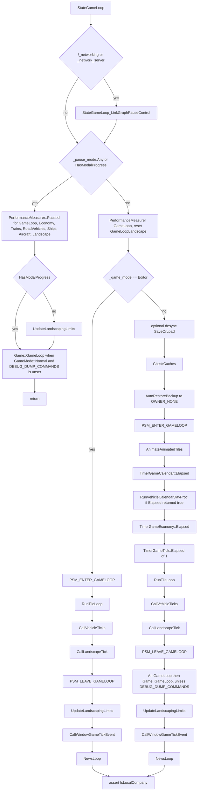

# Game loop

`openttd_main` boots the process. The video driver owns the frame clock and calls `GameLoop`. `GameLoop` handles mode switches, the realtime timer, and either the network frame or `StateGameLoop`. `StateGameLoop` is the simulation frame.

This matches `docs/zz-reach2/architecture/initial-inventory.md` section 7. The call order below is taken from the functions that were read. The normal-mode body of `StateGameLoop` is quoted so the order is the source order.

## Code map

| Symbol | Location | Role |
| --- | --- | --- |
| `openttd_main` | `src/openttd.cpp` lines 490–805 | Process entry. Ends in `VideoDriver::MainLoop` |
| `VideoDriver::GameLoop` | `src/video/video_driver.cpp` lines 30–43 | Advances the game-tick deadline, locks `game_state_mutex`, calls `::GameLoop` |
| `VideoDriver::GetGameInterval` | `src/video/video_driver.hpp` lines 309–325 | Tick spacing. `MILLISECONDS_PER_TICK` is 27 (`src/gfx_type.h` line 417) |
| `GameLoop` | `src/openttd.cpp` lines 1326–1386 | One game-thread turn: scan, realtime, mode switch, network or `StateGameLoop` |
| `StateGameLoop` | `src/openttd.cpp` lines 1201–1276 | One simulation frame. Comment at lines 1196–1199 |
| `StateGameLoop_LinkGraphPauseControl` | `src/linkgraph/linkgraphschedule.cpp` lines 169–184 | Posts `Commands::Pause` for `PauseMode::LinkGraph` |
| `AnimateAnimatedTiles` | `src/animated_tile.cpp` lines 75–101 | Walks `_animated_tiles` and calls `AnimateTile` |
| `RunVehicleCalendarDayProc` | `src/vehicle.cpp` lines 939–949 | Calendar ageing, spread by `TimerGameCalendar::date_fract` |
| `RunTileLoop` | `src/landscape.cpp` lines 805–843 | Visits a fraction of the map through the tile-loop LFSR |
| `CallVehicleTicks` | `src/vehicle.cpp` lines 986–1007 | Economy day proc, station load/unload, then `Vehicle::Tick` |
| `CallLandscapeTick` | `src/landscape.cpp` lines 1729–1742 | Town, trees, station, industry, companies, link graph |
| `AI::GameLoop` | `src/ai/ai_core.cpp` lines 82–106 | One step per AI company, on the server |
| `Game::GameLoop` | `src/game/game_core.cpp` lines 31–53 | One Game Script step, as `OWNER_DEITY`, on the server |
| `CallWindowGameTickEvent` | `src/window.cpp` lines 3364–3369 | `Window::OnGameTick` for every window |
| `NewsLoop` | `src/news_gui.cpp` lines 1109–1123 | Drops old news on a new economy month and advances the ticker |
| `UpdateLandscapingLimits` | `src/company_cmd.cpp` lines 364–372 | Refills per-company terraform, clear, tree, and object limits |
| `TimerManager<T>` | `src/timer/timer_manager.h` lines 26–123 | Singleton set of timers, sorted by period then pointer |
| `TimerGameCalendar` | `src/timer/timer_game_calendar.h`, `timer_game_calendar.cpp` | Player-visible date. `Elapsed` at `timer_game_calendar.cpp` lines 95–161 |
| `TimerGameEconomy` | `src/timer/timer_game_economy.h`, `timer_game_economy.cpp` | Economy date and `date_fract`. `Elapsed` at `timer_game_economy.cpp` lines 122–188 |
| `TimerGameTick` | `src/timer/timer_game_tick.h`, `timer_game_tick.cpp` | Monotonic `counter`. `Elapsed` at `timer_game_tick.cpp` lines 51–59 |
| `TimerGameRealtime` | `src/timer/timer_game_realtime.h` | Wall clock. `Elapsed` is called from `GameLoop`, line 1349 |
| `IntervalTimer` / `TimeoutTimer` | `src/timer/timer.h` | Register in their constructor, unregister in their destructor |
| `PauseMode` / `_pause_mode` | `src/openttd.h` lines 71–86 | Bitset. Any bit set skips the simulation body |

## `openttd_main`

`openttd_main` (`src/openttd.cpp` line 490) parses arguments, then brings the process up in this order:

1. `DeterminePaths` and `TarScanner::DoScan` for the baseset (lines 660–661).
2. `LoadFromConfig` (line 671).
3. Language packs, font caches, `InitWindowSystem` (lines 689–695).
4. Graphics set, `GfxInitPalettes`, blitter, video driver (lines 697–747).
5. `SocialIntegration::Initialize` and `NetworkStartUp` (lines 757–758).
6. `HandleBootstrap`. A false return shuts the game down and returns 0 (lines 760–763).
7. Sounds set, music set, sound driver, music driver (lines 767–793).
8. `GenerateWorld(GWM_EMPTY, 64, 64)` and `LoadIntroGame(false)` (lines 795–796).
9. `RequestNewGRFScan` (line 799). The scan itself runs later, on the game thread, from `GameLoop`.
10. `VideoDriver::GetInstance()->MainLoop()` (line 801), then `PostMainLoop` and return 0.

`MainLoop` pumps `VideoDriver::Tick` / the game thread. `VideoDriver::GameLoop` (lines 30–43) adds `GetGameInterval()` to `next_game_tick`, pulls a drifted deadline back to now, takes `game_state_mutex`, and calls `::GameLoop()`.

`GetGameInterval` uses a flat `27ms` while any pause bit is set. At non-zero `_game_speed` the interval is `MILLISECONDS_PER_TICK * 1000 * 100 / _game_speed` microseconds. `_game_speed == 0` and desync fast-forward use a zero interval.

## `GameLoop`

`GameLoop` (`src/openttd.cpp` lines 1326–1386) is one turn of the game thread. The calls are:

1. `GameMode::Bootstrap`: `NetworkBackgroundLoop` when `_network_available` is set, then return (lines 1328–1331).
2. A pending NewGRF scan: `ScanNewGRFFiles`, clear `_request_newgrf_scan`, return if `_exit_game` (lines 1334–1340).
3. `ProcessAsyncSaveFinish` (line 1342).
4. In `GameMode::Normal`, if the steady-clock delta is non-zero: `TimerManager<TimerGameRealtime>::Elapsed(delta_ms)` (lines 1344–1351).
5. If `_switch_mode` is not `SwitchMode::None` and no modal progress is open: `SwitchToMode`, clear `_switch_mode`, return if `_exit_game` (lines 1354–1359).
6. `IncreaseSpriteLRU` (line 1361).
7. `NetworkBackgroundLoop` when `_network_available` is set (lines 1363–1364).
8. `DebugSendRemoteMessages` (line 1366).
9. The simulation branch (lines 1368–1379):
   - `_networking` and no modal progress: `NetworkGameLoop`.
   - Otherwise: the reconnect countdown, then `StateGameLoop`.
10. When `_pause_mode` is empty and `DisplayOption::FullAnimation` is set: `DoPaletteAnimations` (line 1381).
11. `SoundDriver::GetInstance()->MainLoop`, `MusicLoop`, `SocialIntegration::RunCallbacks` (lines 1383–1385).

`NetworkGameLoop` (`src/network/network.cpp`) still reaches `StateGameLoop` on this thread. The server path calls `NetworkExecuteLocalCommandQueue` and then `StateGameLoop` (lines 1286–1289). The client path does the same inside `ClientNetworkGameSocketHandler::GameLoop` (`src/network/network_client.cpp` lines 223–229), once per frame it is allowed to catch up.

A modal progress window takes the non-network branch, so `StateGameLoop` runs directly and then returns from its pause test.

## One frame of `StateGameLoop`

The function comment (`src/openttd.cpp` lines 1196–1199) says the state must not be changed from anywhere but here, and that the check is enforced in the command path. The command side of that rule is documented in `docs/zz-reach2/architecture/commands/archi-commands.md`.

Link-graph pause control runs before the pause test, and only when this process is offline or is the server. Pause and modal progress return before any timer or world tick. The editor and a normal game then take different bodies.



### Verified source

`src/openttd.cpp` lines 1201–1276:

```cpp
void StateGameLoop()
{
	if (!_networking || _network_server) {
		StateGameLoop_LinkGraphPauseControl();
	}

	/* Don't execute the state loop during pause or when modal windows are open. */
	if (_pause_mode.Any() || HasModalProgress()) {
		PerformanceMeasurer::Paused(PerformanceElement::GameLoop);
		PerformanceMeasurer::Paused(PerformanceElement::GameLoopEconomy);
		PerformanceMeasurer::Paused(PerformanceElement::GameLoopTrains);
		PerformanceMeasurer::Paused(PerformanceElement::GameLoopRoadVehicles);
		PerformanceMeasurer::Paused(PerformanceElement::GameLoopShips);
		PerformanceMeasurer::Paused(PerformanceElement::GameLoopAircraft);
		PerformanceMeasurer::Paused(PerformanceElement::GameLoopLandscape);

		if (!HasModalProgress()) UpdateLandscapingLimits();
#ifndef DEBUG_DUMP_COMMANDS
		if (_game_mode == GameMode::Normal) Game::GameLoop();
#endif
		return;
	}

	PerformanceMeasurer framerate(PerformanceElement::GameLoop);
	PerformanceAccumulator::Reset(PerformanceElement::GameLoopLandscape);

	if (_game_mode == GameMode::Editor) {
		BasePersistentStorageArray::SwitchMode(PSM_ENTER_GAMELOOP);
		RunTileLoop();
		CallVehicleTicks();
		CallLandscapeTick();
		BasePersistentStorageArray::SwitchMode(PSM_LEAVE_GAMELOOP);
		UpdateLandscapingLimits();

		CallWindowGameTickEvent();
		NewsLoop();
	} else {
		if (IsVisibleSeverity(Facility::Desync, Severity::Error) && TimerGameEconomy::date_fract == 0 && (TimerGameEconomy::date.base() & 0x1F) == 0) {
			/* Save the desync savegame if needed. */
			std::string name = fmt::format("dmp_cmds_{:08x}_{:08x}.sav", _settings_game.game_creation.generation_seed, TimerGameEconomy::date);
			SaveOrLoad(name, SaveLoadOperation::Save, DetailedFileType::GameFile, Subdirectory::Autosave, false);
		}

		CheckCaches();

		/* All these actions has to be done from OWNER_NONE
		 *  for multiplayer compatibility */
		AutoRestoreBackup cur_company(_current_company, OWNER_NONE);

		BasePersistentStorageArray::SwitchMode(PSM_ENTER_GAMELOOP);
		AnimateAnimatedTiles();
		if (TimerManager<TimerGameCalendar>::Elapsed({})) {
			RunVehicleCalendarDayProc();
		}
		TimerManager<TimerGameEconomy>::Elapsed({});
		TimerManager<TimerGameTick>::Elapsed(1);
		RunTileLoop();
		CallVehicleTicks();
		CallLandscapeTick();
		BasePersistentStorageArray::SwitchMode(PSM_LEAVE_GAMELOOP);

#ifndef DEBUG_DUMP_COMMANDS
		{
			PerformanceMeasurer script_framerate(PerformanceElement::AllScripts);
			AI::GameLoop();
			Game::GameLoop();
		}
#endif
		UpdateLandscapingLimits();

		CallWindowGameTickEvent();
		NewsLoop();
	}

	assert(IsLocalCompany());
}
```

### Pause and modal progress

`_pause_mode` is a bitset of `PauseMode` (`src/openttd.h` lines 71–80): `Normal`, `SaveLoad`, `Join`, `Error`, `ActiveClients`, `GameScript`, `LinkGraph`, `CommandDuringPause`. `Any()` is true when one or more bits are set.

The test is `_pause_mode.Any() || HasModalProgress()` (line 1208). Either condition skips the editor body and the normal body. These calls do not run on that return: `AnimateAnimatedTiles`, every `TimerManager<TimerGameCalendar / TimerGameEconomy / TimerGameTick>::Elapsed`, `RunVehicleCalendarDayProc`, `RunTileLoop`, `CallVehicleTicks`, `CallLandscapeTick`, `AI::GameLoop`, `CallWindowGameTickEvent`, `NewsLoop`.

What does run, in this order (lines 1209–1221):

1. `PerformanceMeasurer::Paused` for `GameLoop`, `GameLoopEconomy`, `GameLoopTrains`, `GameLoopRoadVehicles`, `GameLoopShips`, `GameLoopAircraft`, `GameLoopLandscape`. Those names are profiler buckets. They are not a second simulation order.
2. `UpdateLandscapingLimits` when `HasModalProgress()` is false.
3. `Game::GameLoop` when `_game_mode == GameMode::Normal` and `DEBUG_DUMP_COMMANDS` is not defined.

The pause branch's script call is `Game::GameLoop`, under the `DEBUG_DUMP_COMMANDS` guard and only in `GameMode::Normal`. `Game::GameLoop`'s own client check is below. `AI::GameLoop` is called from the normal body.

### Editor

When the game is not paused and `_game_mode == GameMode::Editor`, the calls are lines 1228–1236:

1. `BasePersistentStorageArray::SwitchMode(PSM_ENTER_GAMELOOP)`
2. `RunTileLoop`
3. `CallVehicleTicks`
4. `CallLandscapeTick`
5. `BasePersistentStorageArray::SwitchMode(PSM_LEAVE_GAMELOOP)`
6. `UpdateLandscapingLimits`
7. `CallWindowGameTickEvent`
8. `NewsLoop`

Those eight calls are the whole editor body. Company is left as it was. `assert(IsLocalCompany())` still runs at line 1275.

### Normal mode, the order that was verified

When the game is not paused, modal progress is closed, and the mode is not the editor, the calls are lines 1238–1272:

1. Desync dump, only when desync logging is at error severity, `TimerGameEconomy::date_fract == 0`, and `(TimerGameEconomy::date.base() & 0x1F) == 0`. The file is `dmp_cmds_<seed>_<date>.sav` under the autosave directory (lines 1238–1241).
2. `CheckCaches` (line 1244).
3. `AutoRestoreBackup cur_company(_current_company, OWNER_NONE)` (line 1248). The comment says the following actions run as `OWNER_NONE` so every peer matches. The backup restores the previous company at the end of the `else` block.
4. `BasePersistentStorageArray::SwitchMode(PSM_ENTER_GAMELOOP)` (line 1250).
5. `AnimateAnimatedTiles` (line 1251).
6. `TimerManager<TimerGameCalendar>::Elapsed({})` (line 1252). `RunVehicleCalendarDayProc` runs only when that call returns true (lines 1252–1254).
7. `TimerManager<TimerGameEconomy>::Elapsed({})` (line 1255).
8. `TimerManager<TimerGameTick>::Elapsed(1)` (line 1256).
9. `RunTileLoop` (line 1257).
10. `CallVehicleTicks` (line 1258).
11. `CallLandscapeTick` (line 1259).
12. `BasePersistentStorageArray::SwitchMode(PSM_LEAVE_GAMELOOP)` (line 1260).
13. `AI::GameLoop` then `Game::GameLoop`, inside `PerformanceMeasurer(PerformanceElement::AllScripts)`, and only when `DEBUG_DUMP_COMMANDS` is not defined (lines 1262–1268).
14. `UpdateLandscapingLimits` (line 1269).
15. `CallWindowGameTickEvent` (line 1271).
16. `NewsLoop` (line 1272).

Line 1275 then `assert(IsLocalCompany())` for both the editor and the normal path.

World work sits between `PSM_ENTER_GAMELOOP` and `PSM_LEAVE_GAMELOOP`: animated tiles, the calendar test and its vehicle proc, the economy timer, the tick timer, the tile loop, vehicle ticks, the landscape tick. Scripts run after that storage mode is left. News runs after the window tick.

### One level into the calls

`AnimateAnimatedTiles` (`src/animated_tile.cpp` lines 75–101) walks `_animated_tiles`. A tile whose state is no longer `AnimatedTileState::Animated` is dropped. Every other tile gets `AnimateTile`. The call sits before `TimerGameCalendar::Elapsed` and `TimerGameEconomy::Elapsed`, so those dates still hold the values they had on entry to the frame.

`RunVehicleCalendarDayProc` (`src/vehicle.cpp` lines 939–949) returns immediately outside `GameMode::Normal`. Otherwise it calls `Vehicle::OnNewCalendarDay` for pool slots `date_fract, date_fract + DAY_TICKS, ...`. `Ticks::DAY_TICKS` is 74.

`RunTileLoop` (`src/landscape.cpp` lines 805–843) sets `count` to the map size divided by `TILE_UPDATE_FREQUENCY`. `_cur_tileloop_tile` is asserted non-zero because the LFSR state cannot be zero. When `TimerGameTick::counter % TILE_UPDATE_FREQUENCY == 0` it runs `tile_loop_proc` on tile 0 and decrements `count`. The `while (count--)` loop then runs `tile_loop_proc` on the current tile and steps a Galois LFSR. The last tile is stored back in `_cur_tileloop_tile`. `TimerGameTick::Elapsed(1)` has already run on this frame, so `counter` includes this tick.

`CallVehicleTicks` (`src/vehicle.cpp` lines 986–1007) does this, then continues into per-vehicle cargo ageing and running sounds:

1. Clear `_vehicles_to_autoreplace`.
2. `RunEconomyVehicleDayProc`. That walks pool slots selected by `TimerGameEconomy::date_fract` and calls `OnNewEconomyDay`. It therefore sees the `date_fract` the economy timer just stored on line 1255.
3. `LoadUnloadStation` for every station, timed as `PerformanceElement::GameLoopEconomy`.
4. Reset the accumulators `GameLoopTrains`, `GameLoopRoadVehicles`, `GameLoopShips`, `GameLoopAircraft`.
5. `Vehicle::Iterate`, and `v->Tick()` on each vehicle. One pool walk covers every vehicle type. `GameLoopTrains`, `GameLoopRoadVehicles`, `GameLoopShips`, and `GameLoopAircraft` are accumulators reset on the lines just above that walk.

`CallLandscapeTick` (`src/landscape.cpp` lines 1729–1742), in this order:

```cpp
void CallLandscapeTick()
{
	{
		PerformanceAccumulator framerate(PerformanceElement::GameLoopLandscape);

		OnTick_Town();
		OnTick_Trees();
		OnTick_Station();
		OnTick_Industry();
	}

	OnTick_Companies();
	OnTick_LinkGraph();
}
```

`OnTick_LinkGraph` is the landscape tick's last call. The link-graph schedule itself is a separate subsystem and is not documented here.

`AI::GameLoop` (`src/ai/ai_core.cpp` lines 82–106) returns immediately when `_networking` is set and this process is not the server, or when `ai_in_multiplayer` is off. It increments `AI::frame_counter` and returns early unless the low bits selected by `competitor_speed` are clear. Each AI company is then run with `_current_company` set to that company.

`Game::GameLoop` (`src/game/game_core.cpp` lines 31–53) returns immediately on a network client, and when `Game::instance` is null. Otherwise it increments `Game::frame_counter`, sets `_current_company` to `OWNER_DEITY`, and calls `Game::instance->GameLoop`. On the pause return this is the only script call, and only in `GameMode::Normal`.

`CallWindowGameTickEvent` calls `OnGameTick` on each `Window`. `NewsLoop` removes old items when `TimerGameEconomy::month` has changed since `_last_clean_month`, then moves the ticker and the news item forward when each is ready. Both run after the simulation body in the editor and in a normal game. Both are skipped on the pause return.

### Link-graph pause control

`StateGameLoop` calls `StateGameLoop_LinkGraphPauseControl` at lines 1203–1205 when `!_networking || _network_server`. Clients skip it. The call is before the pause test, so a game that is already paused still enters this function on the server and offline.

The function (`src/linkgraph/linkgraphschedule.cpp` lines 162–184) posts `Commands::Pause`. It does not edit `_pause_mode` itself:

- If `PauseMode::LinkGraph` is already set, and `LinkGraphSchedule::instance.IsJoinWithUnfinishedJobDue()` is false, it posts `Command<Commands::Pause>::Post(PauseMode::LinkGraph, false)`.
- If no pause bit is set, and `TimerGameEconomy::date_fract == LinkGraphSchedule::SPAWN_JOIN_TICK - 2`, and the economy date sits halfway through the link-graph recalc interval, and a join with an unfinished job is due, it posts `Command<Commands::Pause>::Post(PauseMode::LinkGraph, true)`.

The comment on the function says the check is two `TimerGameEconomy::date_fract` ticks early because a multiplayer `DoCommandP` (today `Command::Post`) runs after a delay of one `date_fract` tick. `Commands::Pause` is a `CommandFlag::Server` command (`src/misc_cmd.h`), so the post goes through the command pipeline documented with the commands.

`AfterLoad_LinkGraphPauseControl` and `OnTick_LinkGraph` live beside this function. They are not part of the `StateGameLoop` call quoted above, apart from `OnTick_LinkGraph` being the last call inside `CallLandscapeTick`.

## Timers

`TimerManager<TTimerType>` (`src/timer/timer_manager.h`) is a singleton. `GetTimers()` is a `std::set` ordered by `base_timer_sorter`: smaller `period` first, and for equal periods the pointer value. `IntervalTimer` and `TimeoutTimer` register in the `BaseTimer` constructor and unregister in the destructor. `Elapsed` on an interval or timeout is private; only `TimerManager` calls it.

Calendar and economy timers are transition timers (`src/timer/timer_game_common.h`). Their period is a `Trigger` plus a `Priority`. The sorter orders by trigger, then priority. `Priority::None` is the bucket whose callbacks must not consume the simulation random sequence. Every other priority may, and `Validate` (under `WITH_ASSERT`) rejects a second timer on the same trigger and priority. Tick timers use the same rule for `TimerGameTick::Priority`: one timer per non-`None` priority (`timer_game_tick.cpp` lines 62–75). That is what keeps callback order stable from one peer to the next.

`StateGameLoop` advances the three simulation timers only on the unpaused, non-editor path, and only in this order: calendar, economy, tick.

### `TimerGameCalendar`

Declared in `src/timer/timer_game_calendar.h`. Static state is `year`, `month`, `date`, `date_fract`, and `sub_date_fract`. The header describes the clock as 74 ticks per day. `Elapsed` (`timer_game_calendar.cpp` lines 95–161):

- Returns false in `GameMode::Menu`.
- Returns false when `minutes_per_calendar_year == CalendarTime::FROZEN_MINUTES_PER_YEAR` (0). `StateGameLoop` then skips `RunVehicleCalendarDayProc`.
- At a non-default minutes-per-year, adds `Ticks::DAY_TICKS` to `sub_date_fract` and returns false until `sub_date_fract` reaches `(minutes_per_calendar_year * DAY_TICKS) / DEF_MINUTES_PER_YEAR`.
- Increments `date_fract`. While `date_fract < Ticks::DAY_TICKS` (74) it returns true without a new day.
- On a new day, resets `date_fract` and `sub_date_fract`, increments `date`, updates `month` and `year`, then notifies timers: `Trigger::Day`, then `Trigger::Month` when the month changed, then `Trigger::Year` when the year changed. A copy of the timer set is taken first, so a callback may register or drop timers during the pass.
- When `year` reaches `CalendarTime::MAX_YEAR + 1`, decrements `year` and subtracts that year from `date`.

`Elapsed` returns true for a mid-day fract step as well as for a new day. `RunVehicleCalendarDayProc` is tied to that true result, so it runs on every calendar step that actually moved `date_fract`, using the new fract as the pool stride.

### `TimerGameEconomy`

Declared in `src/timer/timer_game_economy.h`. Static state is `year`, `month`, `date`, `date_fract`, and `days_since_last_month`. The same 74 ticks per day apply. Wallclock units (`TimekeepingUnits::Wallclock`) give months of `EconomyTime::DAYS_IN_ECONOMY_MONTH` (30) and years of `DAYS_IN_ECONOMY_YEAR` (360). Otherwise the economy date converts like the calendar.

`Elapsed` (`timer_game_economy.cpp` lines 122–188) ignores its argument and always takes one fract step:

- Returns false in `GameMode::Menu`.
- Increments `date_fract`. Returns true while it is still below 74.
- On a new day, zeroes `date_fract`, increments `date` and `days_since_last_month`, updates month and year, then notifies `Trigger::Day`.
- When `date.base() % 7 == 3`, notifies `Trigger::Week`.
- On a new month, notifies `Trigger::Month`, and when `month % 3 == 0` notifies `Trigger::Quarter`, then zeroes `days_since_last_month`.
- On a new year, notifies `Trigger::Year`.
- When `year` reaches `EconomyTime::MAX_YEAR + 1`, rewinds one year, subtracts that year's days from `date`, and calls `ShiftDates` on every `Vehicle` and every `LinkGraph`.

`StateGameLoop` calls this with `{}` after the calendar call. The argument is unused. One normal frame is one economy fract.

### `TimerGameTick`

`TimerGameTick::counter` is a `uint64_t` monotonic count (`timer_game_tick.h` lines 20–60). `Elapsed` (`timer_game_tick.cpp` lines 51–59) increments `counter` once, then calls `Elapsed(delta)` on each registered timer in set order. `StateGameLoop` passes `1`. The header states that callbacks run on the game thread and that the timer pauses when the game is paused: the pause return in `StateGameLoop` is what skips the call.

`Ticks::DAY_TICKS` is 74. The comment records the historical reason: `date_fract` used to be a `uint16_t` incremented by 885, and `65535 / 885 = 74`. One tick is `MILLISECONDS_PER_TICK` (27) on the video driver's normal interval, so a day is about two seconds when the machine keeps up.

### `TimerGameRealtime`

`TimerGameRealtime` is the wall clock (`src/timer/timer_game_realtime.h`). `GameLoop` feeds it the steady-clock delta, in `GameMode::Normal` only, and only when that delta is non-zero (lines 1344–1351). Its triggers are `Always`, `Unpaused`, and `Autosave`. The autosave interval next to `StateGameLoop` (`src/openttd.cpp` lines 1278–1293) is an `IntervalTimer<TimerGameRealtime>` with `Trigger::Autosave`. On fire it clears `PauseMode::CommandDuringPause`, sets `_do_autosave`, and calls `DoAutoOrNetsave`.

This clock follows the machine clock. The calendar, economy, and tick clocks follow the simulation frame.

## Invariants

Only `StateGameLoop` mutates high-level simulation state for a frame, and player-visible changes go through commands.

- The per-frame step for `TimerGameCalendar`, `TimerGameEconomy`, and `TimerGameTick` is `TimerManager<...>::Elapsed`. Those three calls are lines 1252–1256. `TimerGameRealtime::Elapsed` is the separate call in `GameLoop`. `SetDate` assigns a calendar or economy date outright (load, and the date commands); it is a different write from this per-frame step.
- Pause and modal progress return at line 1221. Those three timers, animated tiles, the tile loop, vehicle ticks, and the landscape tick stay where they were.
- GUI, script, and network code request a `Commands` proc (`Command::Post`, `ScriptObject::Command::Do`, `PostFromNet`). On a network game the queued commands run in `NetworkExecuteLocalCommandQueue` on this same thread, immediately before `StateGameLoop`. Nested `Post` is rejected inside the command helper. The details are in the commands document.

Timers must stay deterministic.

- Calendar, then economy, then tick, one step each, on every unpaused `GameMode::Normal` frame, in the order of lines 1252–1256.
- `TimerManager` notifies callbacks in set order: period, then pointer. For calendar and economy the period is trigger then priority. `Validate` allows a single timer on each non-`None` priority so that order cannot drift between builds that share the same registrations.
- Economy week, month, quarter, and year callbacks, and the calendar day, month, and year callbacks, run inside those `Elapsed` calls, still inside `PSM_ENTER_GAMELOOP`, still as `OWNER_NONE`, and still before `RunTileLoop`, `CallVehicleTicks`, and `CallLandscapeTick`.
- `TimerGameRealtime` stays on the wall clock in `GameLoop`. Autosave and other realtime callbacks are outside the lockstep trio. Simulation state that must match on every peer stays on calendar, economy, and tick.
