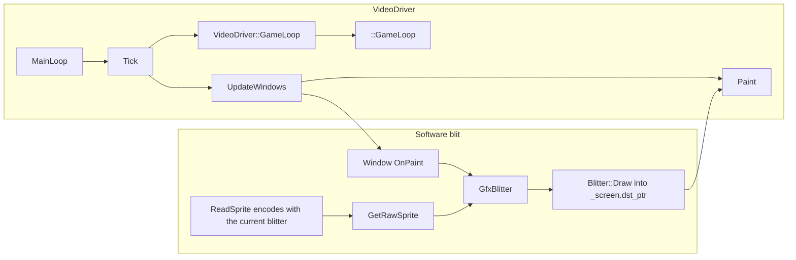

# Blitter and software rendering

The blitter is a strategy object that writes pixels. The video driver is a strategy object that owns the OS window, the frame clock, and the call that presents those pixels. Neither one advances the simulation except that the video driver invokes `::GameLoop` on a timer. Sprite bytes are cached already encoded for the active blitter.

Window retention and the draw-tick call into `OnPaint` are in [archi-gui.md](archi-gui.md). How a viewport decides which sprites to submit is in [archi-viewport.md](archi-viewport.md).

## Two strategies

`Driver` (`src/driver.h`) is the base for music, sound, and video. `Start`, `Stop`, and `GetName` are pure. `DriverFactoryBase` registers factories by type, name, and priority and keeps one active instance per `Driver::Type`.

`VideoDriver` (`src/video/video_driver.hpp`) extends `Driver`. The OS-facing hooks are pure: `MakeDirty`, `MainLoop`, `ChangeResolution`, `ToggleFullscreen`. `Paint`, `LockVideoBuffer`, `UnlockVideoBuffer`, `PollEvent`, and `InputLoop` default to empty and the concrete driver overrides the ones it needs. `HasGUI` is false for the null and dedicated drivers, which is how a headless server skips the draw tick.

`Blitter` (`src/blitter/base.hpp`) extends `SpriteEncoder`. It is the pixel format of the back buffer and the encoder used when a sprite is loaded into the cache. `BlitterFactory` (`src/blitter/factory.hpp`) registers every concrete blitter by name. `SelectBlitter` constructs one and stores it. `GetCurrentBlitter` returns that instance. The default name depends on the build:

| Build | Default blitter name |
| --- | --- |
| `DEDICATED` | `null` |
| `WITH_COCOA` | `32bpp-anim` |
| otherwise | `8bpp-optimized` |

`Blitter_32bppSimple` (`src/blitter/32bpp_simple.hpp`, `src/blitter/32bpp_simple.cpp`) is the straightforward 32-bit software blitter. A static `FBlitter_32bppSimple iFBlitter_32bppSimple` registers the factory name `32bpp-simple` at startup. Its `Draw` walks the sprite in `BlitterParams` and composites into a `Colour` buffer. `Blitter_8bppOptimized` is the usual default on non-Cocoa builds; it encodes sprites as streams and implements the same `Draw` contract. Palette animation is a blitter policy: `UsePaletteAnimation` returns `None`, `VideoBackend` (8 bpp, the driver updates the hardware palette), or `Blitter` (the blitter rewrites pixels in `PaletteAnimate`).

`BlitterMode` selects the composite: `Normal`, `ColourRemap`, `Transparent`, `TransparentRemap`, `CrashRemap`, `BlackRemap`. `GfxBlitter` in `src/gfx.cpp` picks the mode from the palette id before it calls `Draw`.

## What the blitter must implement

The pure surface on `Blitter` is the whole software renderer. Callers never switch on bit depth themselves.

| Hook | Role |
| --- | --- |
| `GetScreenDepth` | 8, 16, 24, or 32. The video driver sizes the surface from this |
| `Draw` | Blit one sprite from `BlitterParams` at a `ZoomLevel` |
| `DrawColourMappingRect` | Recolour a rectangle already in the buffer (transparency, newspaper grey) |
| `MoveTo` | Advance a buffer pointer by pixels, honouring pitch and bytes per pixel |
| `SetPixel`, `DrawRect`, `DrawLine` | Primitive fills used by widgets and overlays |
| `CopyFromBuffer`, `CopyToBuffer`, `CopyImageToBuffer` | Move rectangles between the screen and a shadow buffer |
| `ScrollBuffer` | Bit-scroll a rectangle when the viewport pans by whole pixels |
| `BufferSize` | Bytes for an offscreen image of the given size |
| `PaletteAnimate`, `UsePaletteAnimation` | Who recolours animated palette entries |
| `GetName` | The factory name |

`BlitterParams` is the draw call: pointer to encoded sprite bytes, remap table, source skip, source size, destination origin, destination pointer, and pitch. `Draw` is the one sprite path:

```67:73:src/blitter/base.hpp
	/**
	 * Draw an image to the screen, given an amount of params defined above.
	 * @param bp Parameters for the blitting of the image.
	 * @param mode The blitting mode to perform.
	 * @param zoom The zoom level to draw at.
	 */
	virtual void Draw(Blitter::BlitterParams *bp, BlitterMode mode, ZoomLevel zoom) = 0;
```

`Blitter_32bppSimple::Draw` starts at `src_line` offset by `skip_top` and `skip_left`, scaled by `ScaleByZoom(1, zoom)`, and writes `bp->height` rows of `bp->width` pixels. Each mode either composites RGBA (`ComposeColourRGBA`), looks up `bp->remap`, darkens, or writes black. The `m` channel is the remap index; a zero `m` keeps the sprite's own colour. A zero alpha skips the pixel.

`AfterBlitterChange` on the video driver runs after `SelectBlitter` swaps the instance. Sprites encoded for the previous blitter are dropped by `GfxClearSpriteCache`.

## Sprite cache

`src/spritecache.cpp` holds a `std::vector<SpriteCache> _spritecache`. `_sprite_cache_size` defaults to 4. `IncreaseSpriteLRU` turns that into a byte budget of `(_sprite_cache_size * bits_per_pixel / 8) * 1024 * 1024` using the current blitter's depth, then drops the coldest encoded sprites until the cache fits. Each `SpriteCache` (`src/spritecache_internal.h`) stores the encoded bytes (`ptr`), the file and file position they were loaded from, the byte length, an LRU stamp, and a `SpriteType` (`Normal`, `Font`, `Recolour`, `MapGen`).

`GetRawSprite` is the read path. A missing id or a type mismatch falls back to the red query sprite or the dark-blue remap. On the cache path (`allocator` and `encoder` both null) the LRU stamp is bumped and, when `ptr` is null, `ReadSprite` or `ReadRecolourSprite` fills it.

`ReadSprite` encodes with the current blitter when the caller does not pass an encoder:

```453:456:src/spritecache.cpp
static void *ReadSprite(const SpriteCache *sc, SpriteID id, SpriteType sprite_type, SpriteAllocator &allocator, SpriteEncoder *encoder)
{
	/* Use current blitter if no other sprite encoder is given. */
	if (encoder == nullptr) encoder = BlitterFactory::GetCurrentBlitter();
```

The encoder (`Blitter::Encode`, inherited from `SpriteEncoder`) turns the GRF bitmap into the layout `Draw` expects, including one stream per zoom level the blitter keeps. `IncreaseSpriteLRU`, called from `::GameLoop`, drops cold entries when the cache is over budget. `GfxClearSpriteCache` frees every `ptr` and calls `VideoDriver::ClearSystemSprites` so the next draw re-encodes for the active blitter. The file positions stay, so the cache forgets pixels and keeps locations.

## From sprite id to pixels

`DrawSprite` draws UI sprites at an explicit zoom. `DrawSpriteViewport` draws a viewport sprite whose `x` and `y` are already in virtual pixels. Both resolve the real sprite id, install a remap or transparency mode, and call `GetSprite`, which ends in `GetRawSprite`.

`GfxBlitter` (`src/gfx.cpp`) fills `BlitterParams`: clip to `_cur_dpi`, apply `SubSprite` cropping, reject empty results, then:

```1183:1183:src/gfx.cpp
	BlitterFactory::GetCurrentBlitter()->Draw(&bp, mode, zoom);
```

Widget chrome uses the same blitter through `DrawRect`, `DrawLine`, and `SetPixel`. `DrawOverlappedWindow` places `_cur_dpi->dst_ptr` with `MoveTo(_screen.dst_ptr, left, top)` before `OnPaint`, so every widget and viewport sprite in that repaint lands in the screen buffer.

## The frame that feeds the blitter

`VideoDriver::MainLoop` is the OS loop. `VideoDriver_Win32Base::MainLoop` and `VideoDriver_SDL_Base::MainLoop` start the game thread and call `Tick` until `_exit_game`.

`Tick` (`src/video/video_driver.cpp`) has two clocks. `GetGameInterval` follows `_game_speed`. `GetDrawInterval` follows the configured refresh rate, or returns a zero wait when vsync and hardware acceleration are both enabled.

The simulation entry point, under the game-state lock:

```30:42:src/video/video_driver.cpp
void VideoDriver::GameLoop()
{
	this->next_game_tick += this->GetGameInterval();

	/* Avoid next_game_tick getting behind more and more if it cannot keep up. */
	auto now = std::chrono::steady_clock::now();
	if (this->next_game_tick < now - ALLOWED_DRIFT * this->GetGameInterval()) this->next_game_tick = now;

	{
		std::lock_guard<std::mutex> lock(this->game_state_mutex);

		::GameLoop();
	}
}
```

`::GameLoop` (`src/openttd.cpp`) runs the simulation step (`StateGameLoop` or `NetworkGameLoop`) and ages the sprite cache. The game thread calls `VideoDriver::GameLoop` and sleeps until `next_game_tick`. On a draw tick the driver thread locks the video buffer first (vsync can block), then takes `game_state_mutex`, drains `QueueOnMainThread`, polls events, runs `::InputLoop` and `::UpdateWindows`, and only then calls `Paint`.

`UpdateWindows` is where the blitter runs: `DrawDirtyBlocks` repaints dirty rectangles through `OnPaint`, and viewport drawing calls `DrawSpriteViewport`. `Paint` does not walk sprites. `VideoDriver_SDL_Default::Paint` returns immediately when `dirty_rect` is empty and the local palette is clean. When the blitter reports `PaletteAnimation::Blitter` it calls `PaletteAnimate`; when it reports `PaletteAnimation::VideoBackend` it updates the SDL palette. The present step is the surface update:

```125:130:src/video/sdl2_default_v.cpp
	SDL_Rect r = { this->dirty_rect.left, this->dirty_rect.top, this->dirty_rect.right - this->dirty_rect.left, this->dirty_rect.bottom - this->dirty_rect.top };

	if (_sdl_surface != _sdl_real_surface) {
		SDL_BlitSurface(_sdl_surface, &r, _sdl_real_surface, &r);
	}
	SDL_UpdateWindowSurfaceRects(this->sdl_window, &r, 1);
```

`AllocateBackingStore` sizes that surface from `GetCurrentBlitter()->GetScreenDepth()` and publishes `_screen.dst_ptr`, `_screen.pitch`, width, and height. `RedrawScreenRect` marks the same rectangle with `VideoDriver::MakeDirty`, which is how `Paint` learns what to upload.

An OpenGL video driver still enters through `VideoDriver::Tick`. Its `Paint` uploads the buffer from `OpenGLBackend` (`src/video/opengl.h`). `OpenGLBackend` is itself a `SpriteEncoder`, so accelerated builds encode sprites for that backend. The software blitters remain the strategy for the windowed SDL, Win32 GDI, and Allegro paths, and for any draw that targets `_screen.dst_ptr` through `Blitter::Draw`.



## Code map

| Piece | File | What it owns |
| --- | --- | --- |
| `Driver`, `DriverFactoryBase` | `src/driver.h` | Driver kinds and the active-instance table |
| `VideoDriver` | `src/video/video_driver.hpp` | Frame clocks, locks, `Paint`, `MainLoop` |
| `Tick`, `GameLoop` | `src/video/video_driver.cpp` | Draw tick and the call to `::GameLoop` |
| OS loops | `src/video/win32_v.cpp`, `src/video/sdl2_v.cpp` | `MainLoop` calling `Tick` |
| SDL present and surface | `src/video/sdl2_default_v.cpp` | `Paint`, `AllocateBackingStore` |
| `Blitter`, `BlitterParams`, `BlitterMode` | `src/blitter/base.hpp` | The strategy surface |
| Factory and current instance | `src/blitter/factory.hpp` | `SelectBlitter`, `GetCurrentBlitter`, default names |
| 32 bpp software blitter | `src/blitter/32bpp_simple.hpp`, `src/blitter/32bpp_simple.cpp` | `Draw` pixel loop, factory registration |
| 8 bpp default | `src/blitter/8bpp_optimized.hpp` | Stream-encoded `Draw` used as the non-Cocoa default |
| Sprite records | `src/spritecache_internal.h` | `SpriteCache` |
| Cache, encode, LRU | `src/spritecache.cpp` | `GetRawSprite`, `ReadSprite`, `GfxClearSpriteCache` |
| Draw setup | `src/gfx.cpp` | `DrawSprite`, `DrawSpriteViewport`, `GfxBlitter` |
| Simulation step | `src/openttd.cpp` `GameLoop` | The body `VideoDriver::GameLoop` invokes |
| OpenGL encode and upload | `src/video/opengl.h` | `OpenGLBackend` as a `SpriteEncoder` with `Paint` |

## Invariants

- The blitter is a strategy, not the simulation. `Draw`, `Encode`, and `PaletteAnimate` write pixels or encoded sprite bytes. They do not change tiles, vehicles, companies, or the command queue.
- One `Blitter` is current. Every `Draw` and every cache fill goes through `BlitterFactory::GetCurrentBlitter`. Swapping it invalidates encoded sprites via `GfxClearSpriteCache`.
- The video driver owns the frame. `MainLoop` calls `Tick`. `Tick` calls `VideoDriver::GameLoop`, which locks `game_state_mutex` and calls `::GameLoop`. Sprite drawing happens later in the same draw tick, inside `UpdateWindows`, while that lock is held.
- `Paint` presents a buffer the blitter has already filled. SDL's `Paint` uploads `dirty_rect`. It does not walk sprites.
- The sprite cache stores blitter-encoded bytes. `GetRawSprite` returns those bytes; `ReadSprite` creates them with the active encoder. A `SpriteType` mismatch never returns the wrong kind of bytes as if it were a normal sprite.
