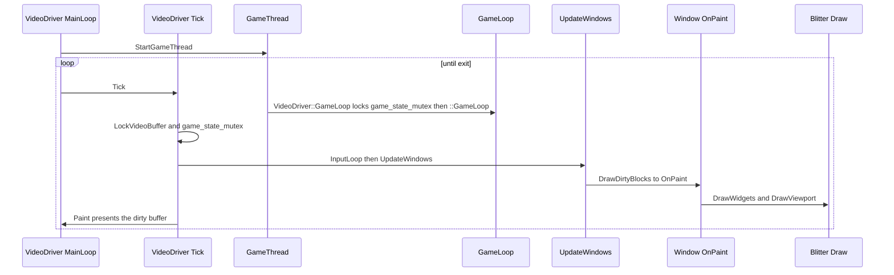

# GUI architecture

OpenTTD keeps a stack of live `Window` objects. Each window is built once from a `WindowDesc` and a flat nested-widget table, then stays in `_z_windows` until it is closed. Paint, click, and map-placement are virtual hooks on that retained object. The video driver owns the frame clock: its `MainLoop` calls `Tick`, which runs the simulation through `VideoDriver::GameLoop` and, on the draw tick, asks dirty windows to paint into a buffer the blitter fills.

Viewport projection and sprite ordering are in [archi-viewport.md](archi-viewport.md). The blitter strategy and sprite cache are in [archi-blitter.md](archi-blitter.md).

## Retained windows

`Window` is the live object (`src/window_gui.h`). `WindowDesc` is the static description: class, parent class, default position, ini key, default size, flags, the `nwid_parts` span, and hotkeys. User-preferred size and stickiness are stored back onto the description and written to `openttd.cfg`.

Construction inserts the window at the back of the z-list. The front of the list is the topmost window.

```1841:1843:src/window.cpp
Window::Window(WindowDesc &desc) : window_desc(desc), scale(_gui_scale), mouse_capture_widget(INVALID_WIDGET)
{
	this->z_position = _z_windows.insert(_z_windows.end(), this);
```

`_z_windows` is a `std::list<Window *>`. A closed window is nulled in place and destroyed later by `Window::DeleteClosedWindows`, which `InputLoop` calls before handling the mouse. `UnInitWindowSystem` closes every window and asserts the list is empty.

Identity is the pair `window_class` + `window_number`. Lookup, dirty marking, and invalidation all key off that pair (`SetWindowDirty`, `SetWindowWidgetDirty`, `SetWindowClassesDirty`). A window may own a `ViewportData`, a nested widget tree (`nested_root`), a `widget_lookup` map, edit boxes, and a parent pointer for modal children.

`WindowDefaultFlag` records construction windows (closed on company change), modal children, windows that refuse focus, and windows that refuse interactive close. `WindowFlag` records transient state: dragging, sizing, sticky, highlight, white border, timeout.

`InitNested` is the usual entry from a derived constructor:

1. `CreateNestedTree` turns `window_desc.nwid_parts` into `nested_root` and fills `widget_lookup`.
2. `FinishInitNested` scales padding, applies defaults, asks `OnInitialPosition` for a point, then `FindWindowPlacementAndResize`.

Hit-testing walks `Window::IterateFromFront` (`FindWindowFromPt`). Painting walks `Window::IterateFromBack` and clips.

## Widget tables

A window's layout is a flat `std::span<const NWidgetPart>`, written as a brace list of `NWidget(...)` parts. Containers (`NWID_HORIZONTAL`, `NWID_VERTICAL`, `NWID_MATRIX`, `NWID_SELECTION`, `NWID_LAYER`) open a scope; `EndContainer()` closes it. Attributes (`SetResize`, `SetFill`, `SetPadding`, `SetStringTip`, `SetSpriteTip`, `SetMinimalSize`, `SetPIP`) attach to the part that precedes them. The comment block above `NWidgetPart` in `src/widget_type.h` is the grammar.

`WidgetType` splits into three bands:

| Band | Examples | Role |
| --- | --- | --- |
| Leaf widgets `WWT_*` | `WWT_PANEL`, `WWT_TEXTBTN`, `WWT_CAPTION`, `WWT_CLOSEBOX`, `WWT_MATRIX`, `WWT_EDITBOX` | Paintable controls |
| Nested containers `NWID_*` | `NWID_HORIZONTAL`, `NWID_VERTICAL`, `NWID_SELECTION`, `NWID_VIEWPORT`, `NWID_VSCROLLBAR` | Layout, stacking, viewport, scroll |
| Part attributes `WPT_*` | `WPT_RESIZE`, `WPT_FILL`, `WPT_DATATIP`, `WPT_PADDING` | Data hung on the previous part |

`WWB_PUSHBUTTON` is or-ed onto a leaf type to make a momentary button (`WWT_PUSHTXTBTN`, `WWT_PUSHIMGBTN`) rather than a toggle.

Widget indices are enums in `src/widgets/*.h`, typed as `WidgetID`. They are the keys in `widget_lookup`, not a parallel C array of widgets. `StationViewWidgets` in `src/widgets/station_widget.h` is the station-view set (`WID_SV_CAPTION`, `WID_SV_WAITING`, `WID_SV_TRAINS`, and the rest). `ExtraViewportWidgets` in `src/widgets/viewport_widget.h` is the extra-viewport set, consumed by the part list `_nested_extra_viewport_widgets` in `src/viewport_gui.cpp`.

`MakeWindowNWidgetTree` (called from `Window::CreateNestedTree`) builds an `NWidgetBase` tree. `NWidgetBase` requires `SetupSmallestSize` and `AssignSizePosition`. After the smallest size is known, `Window::UpdateWidgetSize` may grow a widget from its real content. The resulting geometry obeys the invariant stated on `NWidgetBase`: `current_x = smallest_x + n * resize_x` and the same for `y`.

`Window::GetWidget<NWidgetCore>(id)` is the access path. Disabled, lowered, and highlighted are stored on the nested widget, and the `Window` helpers (`DisableWidget`, `LowerWidget`, `SetWidgetDirty`) forward to it.

## Paint, click, and place

`Window` declares the event surface. Empty defaults mean a window only overrides what it uses. The paint hooks are documented as draw-only:

```593:608:src/window_gui.h
	/**
	 * The window must be repainted.
	 * @note This method should not change any state, it should only use drawing functions.
	 */
	virtual void OnPaint()
	{
		this->DrawWidgets();
	}

	/**
	 * Draw the contents of a nested widget.
	 * @param r      Rectangle occupied by the widget.
	 * @param widget Number of the widget to draw.
	 * @note This method may not change any state, it may only use drawing functions.
	 */
	virtual void DrawWidget([[maybe_unused]] const Rect &r, [[maybe_unused]] WidgetID widget) const {}
```

`DrawWidgets` calls `nested_root->Draw(this)`. `NWidgetBackground::Draw` and `NWidgetLeaf::Draw` paint the chrome (frame, caption, button, matrix, scrollbar) and, when the widget index is valid, call `Window::DrawWidget` for the payload. `NWidgetViewport::Draw` calls `Window::DrawViewport`.

| Hook | Declared | Dispatched from | When |
| --- | --- | --- | --- |
| `OnPaint` | `window_gui.h` `OnPaint` | `DrawOverlappedWindow` | A dirty rectangle survives overlap clipping |
| `DrawWidget` | `window_gui.h` `DrawWidget` | `NWidgetBackground::Draw`, `NWidgetLeaf::Draw` | Chrome is done and the leaf has an index |
| `UpdateWidgetSize` | `window_gui.h` `UpdateWidgetSize` | Nested sizing | Content wants a larger minimum than the part table |
| `OnClick` | `window_gui.h` `OnClick` | `DispatchLeftClickEvent` | Left click on an enabled, indexed widget |
| `OnRightClick` | `window_gui.h` `OnRightClick` | `DispatchRightClickEvent` | Right click; a false return may close the window or show a tooltip |
| `OnPlaceObject` | `window_gui.h` `OnPlaceObject` | `PlaceObject` | Click on the map while a highlight mode is active |
| `OnPlaceDrag` | `window_gui.h` `OnPlaceDrag` | Viewport drag | Mouse moves during a tile drag |
| `OnPlaceMouseUp` | `window_gui.h` `OnPlaceMouseUp` | Viewport drag end | Drag released; `start_tile` and `end_tile` are set |
| `OnPlacePresize` | `window_gui.h` `OnPlacePresize` | `HandlePlacePresize` | `SpecialMouseMode::Presize` (dock highlight and similar) |
| `OnPlaceObjectAbort` | `window_gui.h` `OnPlaceObjectAbort` | Highlight cancelled | Tool cancelled |
| `OnInvalidateData` | `window_gui.h` `OnInvalidateData` | `ProcessScheduledInvalidations` | Some other system marked this window's data stale |

`DispatchLeftClickEvent` (`src/window.cpp`) resolves the leaf with `GetWidgetFromPos`, focuses the window, handles caption drag, close box, shade, sticky, resize, and scrollbar itself, then:

```761:761:src/window.cpp
	w->OnClick(pt, widget_index, click_count);
```

The repaint path marks blocks with `AddDirtyBlock` / `Window::SetDirty`. `UpdateWindows` calls `DrawDirtyBlocks`, which coalesces dirty blocks and calls `RedrawScreenRect`. That undraws the cursor if needed and calls `DrawOverlappedWindowForAll`. `DrawOverlappedWindow` splits the rectangle around every window in front, then sets up `_cur_dpi` with `Blitter::MoveTo` and calls the hook:

```934:943:src/window.cpp
	/* Setup blitter, and dispatch a repaint event to window *wz */
	DrawPixelInfo *dp = _cur_dpi;
	dp->width = right - left;
	dp->height = bottom - top;
	dp->left = left - w->left;
	dp->top = top - w->top;
	dp->pitch = _screen.pitch;
	dp->dst_ptr = BlitterFactory::GetCurrentBlitter()->MoveTo(_screen.dst_ptr, left, top);
	dp->zoom = ZoomLevel::Min;
	w->OnPaint();
```

`RedrawScreenRect` then calls `VideoDriver::MakeDirty` so the driver's `Paint` can present that rectangle.

Map placement is a mode on `TileHighlightData` (`_thd`), not a property of the widget under the cursor. `HandleViewportClicked` ends in `PlaceObject`, which resolves the tile under the cursor and calls the tool window:

```2492:2494:src/viewport.cpp
	w = _thd.GetCallbackWnd();
	if (w != nullptr) w->OnPlaceObject(pt, TileVirtXY(pt.x, pt.y));
```

The rail toolbar's `OnPlaceObject` (`src/rail_gui.cpp`) starts a sizing drag (`VpStartPlaceSizing`) or, for a finished gesture, the build path posts a command. `GenericPlaceRail` is the world-changing step:

```105:112:src/rail_gui.cpp
static void GenericPlaceRail(TileIndex tile, Track track)
{
	if (_remove_button_clicked) {
		Command<Commands::RemoveRail>::Post(STR_ERROR_CAN_T_REMOVE_RAILROAD_TRACK, CcPlaySound_CONSTRUCTION_RAIL,
				tile, track);
	} else {
		Command<Commands::BuildRail>::Post(STR_ERROR_CAN_T_BUILD_RAILROAD_TRACK, CcPlaySound_CONSTRUCTION_RAIL,
				tile, _cur_railtype, track, _settings_client.gui.auto_remove_signals);
	}
}
```

`Command<...>::Post` queues the action for the command executor inside the game loop. The window hook records the player's intent and sends that command. Company cash, tiles, and vehicles change when the command runs.

Other input hooks (`OnKeyPress`, `OnHotkey`, `OnMouseWheel`, `OnScroll`, `OnDropdownSelect`, `OnEditboxChanged`, `OnQueryTextFinished`, `OnGameTick`, `OnRealtimeTick`) follow the same shape: the window system dispatches, the derived window decides, and any world change leaves through the command queue.

## The video driver owns the frame

`Driver` (`src/driver.h`) is the common base for music, sound, and video. `Start`, `Stop`, and `GetName` are pure. `DriverFactoryBase` keeps one active instance per `Driver::Type` and selects it by name and priority.

`VideoDriver` adds the frame. `MainLoop`, `MakeDirty`, `ChangeResolution`, and `ToggleFullscreen` are pure. `Paint`, `LockVideoBuffer`, `PollEvent`, and `InputLoop` have empty defaults that concrete drivers override. Two concrete loops are the same shape:

- `VideoDriver_Win32Base::MainLoop` (`src/video/win32_v.cpp`) starts the game thread, then calls `Tick` and `SleepTillNextTick` until `_exit_game`.
- `VideoDriver_SDL_Base::MainLoop` (`src/video/sdl2_v.cpp`) does the same through `LoopOnce`, which calls `Tick`.

`Tick` (`src/video/video_driver.cpp`) is the frame body.

- When the game thread is off and `next_game_tick` is due, `Tick` calls `GameLoop` on the caller. A driver without a GUI (`HasGUI` is false for null and dedicated) also runs `InputLoop` and `UpdateWindows` there and skips the draw tick.
- When the driver has a GUI and `next_draw_tick` is due, `Tick` locks the video buffer, takes `game_state_mutex`, drains `QueueOnMainThread` work, polls OS events, runs the driver `InputLoop` and `::InputLoop`, calls `::UpdateWindows` unless a mode switch is in progress, populates system sprites, unlocks, runs palette animation, and calls `Paint`.

The simulation call is inside `VideoDriver::GameLoop`, under `game_state_mutex`:

```30:42:src/video/video_driver.cpp
void VideoDriver::GameLoop()
{
	this->next_game_tick += this->GetGameInterval();

	/* Avoid next_game_tick getting behind more and more if it cannot keep up. */
	auto now = std::chrono::steady_clock::now();
	if (this->next_game_tick < now - ALLOWED_DRIFT * this->GetGameInterval()) this->next_game_tick = now;

	{
		std::lock_guard<std::mutex> lock(this->game_state_mutex);

		::GameLoop();
	}
}
```

`::GameLoop` (`src/openttd.cpp`) is the simulation step: mode switches, sprite-cache LRU ageing, network or `StateGameLoop`. The game thread (`VideoDriver::GameThread`) calls `VideoDriver::GameLoop` in a loop and sleeps until `next_game_tick`. `GetGameInterval` follows `_game_speed` (paused play still uses `MILLISECONDS_PER_TICK`; speed 0 does not sleep). `GetDrawInterval` follows `_settings_client.gui.refresh_rate`, or yields to the display when vsync and hardware acceleration are both on.

`UpdateWindows` (`src/window.cpp`) is the draw-side window pass: window timers, `OnRealtimeTick`, scheduled resizes and invalidations, then `DrawDirtyBlocks` (which reaches `OnPaint`), then `UpdateViewportPosition` for every unshaded viewport, then the mouse cursor. Painting therefore happens on the draw tick, while the game-state lock is held, into the buffer the blitter addresses. `Paint` afterwards only presents pixels the blitter already wrote (`SDL_UpdateWindowSurfaceRects` on the default SDL driver).



## Code map

| Piece | File | What it owns |
| --- | --- | --- |
| `Window`, `WindowDesc`, event hooks | `src/window_gui.h` | Retained window type and the virtual surface |
| `_z_windows`, input, paint dispatch | `src/window.cpp` | Z-order, `InitNested`, `DispatchLeftClickEvent`, `DrawOverlappedWindow`, `UpdateWindows` |
| `NWidgetPart`, `WidgetType`, `NWidgetBase` | `src/widget_type.h` | The part-table grammar and the live widget base |
| Widget drawing and tree build | `src/widget.cpp` | `DrawWidgets`, `NWidgetLeaf::Draw`, `NWidgetViewport::Draw` |
| Per-window widget indices | `src/widgets/*.h` | `WidgetID` enums; `station_widget.h` is the station sample |
| Extra viewport window | `src/viewport_gui.cpp`, `src/widgets/viewport_widget.h` | A `Window` whose body is `NWID_VIEWPORT` |
| `Driver`, `DriverFactoryBase` | `src/driver.h` | Music, sound, and video driver selection |
| `VideoDriver::Tick`, `GameLoop` | `src/video/video_driver.hpp`, `src/video/video_driver.cpp` | Frame clock, game thread, draw tick |
| OS loops | `src/video/win32_v.cpp`, `src/video/sdl2_v.cpp` | `MainLoop` calling `Tick` |
| Present | `src/video/sdl2_default_v.cpp` | `Paint` uploads the dirty rectangle |
| Simulation step | `src/openttd.cpp` `GameLoop` | The function the video driver invokes |
| World change from a tool | `src/rail_gui.cpp` `GenericPlaceRail` | `Command<...>::Post` from a place gesture |
| Dirty rectangles | `src/gfx.cpp` `DrawDirtyBlocks`, `RedrawScreenRect` | Coalesce, clip, `MakeDirty` |

## Invariants

TBM player-flow acceptance (2026-10-09) is recorded in [R2TBMF ZB](../../../zz-rhr/upgrades/2026-10/tbm-fixes/r2tbmf-zb-final-notes.md). Native mouse dispatch opens the compact palette and actual project list, previews/extends the same machine, selects a compatible native hangar and releases settled work. Renderers and previews read geometry/material owners; synchronized commands alone publish work, paid portal handover and vehicle travel intent. The linked399 files continue through fifty cuts, local exit construction and public traffic with the cutter retained in B's magazine.

- A `Window` is a retained object. It is constructed into `_z_windows`, painted from the state it already holds, and destroyed only by `DeleteClosedWindows` after `Close`.
- `OnPaint` and `DrawWidget` only draw. The comments on both hooks forbid state changes inside the repaint.
- The GUI mutates the world by sending commands. Place and click handlers post `Command<...>::Post` (as `GenericPlaceRail` does). The command runs later inside the game loop, on the same path singleplayer and multiplayer share.
- The video driver owns the frame. Window code does not call `::GameLoop`. `VideoDriver::GameLoop` does, under `game_state_mutex`, and the draw tick paints only after that lock is held.
- Widget indices in `src/widgets/*.h` name nodes in the nested tree. Layout lives in the `NWidgetPart` table on the `WindowDesc`.
