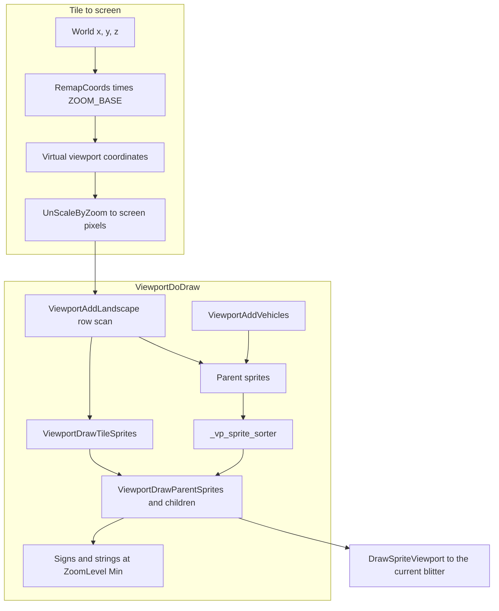

# Viewport architecture

A viewport is a `Window`-owned view of one rectangle of the isometric map. `Viewport` (`src/viewport_type.h`) stores the screen rectangle, the virtual origin and size at the current zoom, the `ZoomLevel`, and an optional link-graph overlay. `ViewportData` (`src/window_gui.h`) adds the scroll position actually shown (`scrollpos_x`, `scrollpos_y`), the position being scrolled toward (`dest_scrollpos_x`, `dest_scrollpos_y`), and `follow_vehicle` when the view tracks a vehicle.

The window system that hosts this view is in [archi-gui.md](archi-gui.md). The blitter that turns the resulting sprites into pixels is in [archi-blitter.md](archi-blitter.md).

Explicit rock-layer placement, canonical chamber previews and their executable evidence are owned by [R2MLVS7](../../upgrades/2026-10/r2mlvs7-underground-construction-and-fleet.md).

## Where a viewport lives

`Window::viewport` is empty until something calls `InitializeWindowViewport` (`src/viewport.cpp`). The usual caller is `NWidgetViewport::InitializeViewport` (`src/widget.cpp`), which passes the widget's position and size inside the window. `InitializeWindowViewport` clamps zoom to `_settings_client.gui.zoom_min` and `zoom_max`, sets `virtual_width` and `virtual_height` with `ScaleByZoom`, and centres the virtual origin on a tile or on a vehicle.

`ExtraViewportWindow` (`src/viewport_gui.cpp`) is the standalone case. Its part table is `_nested_extra_viewport_widgets`: a caption row, an `NWID_VIEWPORT` leaf (`WID_EV_VIEWPORT`), zoom buttons, and a resize box. `OnClick` calls `DoZoomInOutWindow` for `WID_EV_ZOOM_IN` and `WID_EV_ZOOM_OUT`. The main window owns the primary viewport the same way; this extra window is the same mechanism with its own `WindowNumber`.

`Window::DrawViewport` shifts `_cur_dpi` by the window origin and calls `ViewportDraw`, which clips to the viewport's screen rectangle and converts the edges into virtual coordinates before `ViewportDoDraw`.

## Tile to screen

World axes and screen axes are fixed by `RemapCoords` (`src/landscape.h`). World X runs southwest on screen, world Y runs southeast, and world Z runs toward the north edge. The scale factor `ZOOM_BASE` is `1 << ZoomLevel::Normal`.

```81:86:src/landscape.h
inline Point RemapCoords(int x, int y, int z)
{
	Point pt;
	pt.x = (y - x) * 2 * ZOOM_BASE;
	pt.y = (y + x - z) * ZOOM_BASE;
	return pt;
}
```

`InverseRemapCoords` is the reverse, assuming height 0. `InverseRemapCoords2` walks the height of the tile under the point, which is what a click needs. `RemapCoords2` reads Z from `GetSlopePixelZ`.

`MapXYZToViewport` runs `RemapCoords` and subtracts half the virtual size so the point becomes the top-left of a view centred on that world position. `ScrollWindowTo` uses it to set `dest_scrollpos_*`. `GetViewportStationMiddle` unscales the same mapping back to a screen point.

The painter walks tiles in screen order, not in `TileIndex` order. `ViewportAddLandscape` converts the dirty virtual rectangle's upper corners with `InverseRemapCoords`, then scans columns and rows:

- `column = y - x`
- `row = x + y`
- `x = (row - column) / 2`
- `y = (row + column) / 2`

Only pairs where `row + column` is even are real tiles. `GetViewportY` places a tile in the virtual Y axis: each step in tile X or tile Y moves down by half a tile (`TILE_PIXELS / 2`), then the tile's pixel height is subtracted, and the result is shifted by `ZOOM_BASE_SHIFT`. Rows continue until a whole row sits below the dirty rectangle, with extra span for bridges up to `max_bridge_height`. For each visible tile the code fills `_cur_ti` and calls `_tile_type_procs[tile_type]->draw_tile_proc`. That proc emits ground sprites and parent sprites; it does not write pixels itself.

Screen pixels become a tile through `TranslateXYToTileCoord`: reject points outside the viewport screen rect, scale the offset by the viewport zoom, add `virtual_left` and `virtual_top`, then `InverseRemapCoords2`. `GetTileBelowCursor` is that function at the cursor. `HandleViewportClicked` uses it for signs, vehicles, and `ClickTile`.

## What one draw collects

`ViewportDoDraw` (`src/viewport.cpp`) is one frame of one viewport rectangle.

1. Set `_vd.dpi` to the clipped virtual rectangle and to `vp.zoom`. The width, height, and origin are masked with `ScaleByZoom(-1, zoom)` so edges sit on a zoom-aligned pixel.
2. Point `dpi.dst_ptr` at the back buffer with `Blitter::MoveTo`, offset by the screen position of the virtual origin.
3. `ViewportAddLandscape` emits ground and building sprites for the visible tiles.
4. `ViewportAddVehicles` emits vehicle parent sprites.
5. `ViewportAddKdtreeSigns` emits town, station, and sign labels that the viewport sign k-d tree says are inside the rectangle. `RebuildViewportKdtree` rebuilds that index from towns, stations, and signs.
6. `DrawTextEffects` adds floating text.
7. `ViewportDrawTileSprites` draws the ground layer immediately, in the order the row scan produced it.
8. Parent sprites are sorted, then drawn with their child sprites.
9. The link-graph overlay and the string sprites are drawn after the zoom is forced back to `ZoomLevel::Min`, so text stays in screen pixels.

The queues live on the process-wide `ViewportDrawer _vd` and are cleared at the end of `ViewportDoDraw`. Ground sprites (`tile_sprites_to_draw`) are the foundations and flat ground. Parent sprites (`parent_sprites_to_draw`) are the objects that can overlap in X, Y, and Z: buildings, vehicles, and anything submitted through `AddSortableSpriteToDraw`. Child sprites (`child_screen_sprites_to_draw`) hang off a parent through `first_child` and are drawn in that parent's screen space (`AddChildSpriteScreen`).

## Sprite sort

`ParentSpriteToDraw` (`src/viewport_sprite_sorter.h`) carries a world bounding box (`xmin`, `ymin`, `zmin`, `xmax`, `ymax`, `zmax`) and the screen point (`x`, `y`) where the sprite is drawn. The box is the sort key. The screen point is only the destination.

`InitializeSpriteSorter` picks the first working sorter in `_vp_sprite_sorters`. When the build has SSE and `ViewportSortParentSpritesSSE41Checker` passes, that sorter is used. Otherwise `ViewportSortParentSprites` is used. Both fill the same contract: `VpSpriteSorter` reorders a `ParentSpriteToSortVector`.

The scalar sorter (`ViewportSortParentSprites`) assumes the input is already nearly in order. It keeps a stack and a list of sprites keyed by `xmin + ymin`. For the sprite on top of the stack it collects overlapping candidates whose `xmin + ymin` is at most the current sprite's far corner sum. A candidate precedes the current sprite when the boxes overlap in X, Y, and Z and the current sprite's corner-sum (`xmin + xmax + ymin + ymax + zmin + zmax`) is strictly larger. Those predecessors are pushed and emitted first. Sprites that do not overlap stay in their existing order.

`ViewportDoDraw` calls the chosen function and then draws:

```1843:1848:src/viewport.cpp
	for (auto &psd : _vd.parent_sprites_to_draw) {
		_vd.parent_sprites_to_sort.push_back(&psd);
	}

	_vp_sprite_sorter(&_vd.parent_sprites_to_sort);
	ViewportDrawParentSprites(&_vd.parent_sprites_to_sort, &_vd.child_screen_sprites_to_draw);
```

`ViewportDrawParentSprites` draws each parent with `DrawSpriteViewport`, then walks that parent's child list. A child with `relative` set is drawn at `parent.left + child.x`, `parent.top + child.y`. `DrawSpriteViewport` (`src/gfx.cpp`) resolves the sprite from the cache and calls the current blitter. Bounding-box and dirty-block debug overlays draw after the parents when those debug switches are on.

## Zoom

`ZoomLevel` (`src/zoom_type.h`) runs from `In4x` (0) through `Normal` (2) to `Out8x` (5). The stored value is a shift count.

```22:25:src/zoom_func.h
inline int ScaleByZoom(int value, ZoomLevel zoom)
{
	return value << to_underlying(zoom);
}
```

`UnScaleByZoom` shifts the other way and rounds up. `virtual_width = ScaleByZoom(width, zoom)` (`InitializeWindowViewport`), which matches the comment on `Viewport::virtual_width`: `width << zoom`. At `ZoomLevel::Min` the virtual rectangle matches screen pixels. At `ZoomLevel::Normal` it is four times larger (`ZOOM_BASE`). Zooming out makes one screen pixel cover more world.

`ViewportDraw` converts a screen edge into virtual space with `ScaleByZoom(screen_delta, vp.zoom) + virtual_origin` before `ViewportDoDraw`. Scrolling stores positions in that virtual space. `SetViewportPosition` converts the delta back with `UnScaleByZoomLower` before it bit-scrolls the screen, because rounding the top-left upward at zoom above normal leaves a one-pixel gap. `UpdateViewportPosition` eases `scrollpos_*` toward `dest_scrollpos_*` and recentres when `follow_vehicle` is set.

`ConstrainAllViewportsZoom` pulls every viewport back inside the settings range. Per-zoom sprite bitmaps are a blitter and sprite-cache concern: the viewport passes `vp.zoom` into `DrawSpriteViewport`, and the blitter skips source pixels by `ScaleByZoom(1, zoom)`.

## Clicks and placement

`HandleViewportClicked` (`src/viewport.cpp`) is the viewport's input switch:

1. `CheckClickOnVehicle`. If the highlight mode includes `HT_VEHICLE` and `VehicleClicked` accepts it, the click stops there.
2. If a drag-style place mode is active (`HT_DRAG_MASK`), `PlaceObject` runs and calls `Window::OnPlaceObject` on the tool window. The window then posts a command or starts a drag. The viewport does not change the tile.
3. Otherwise a sign click, then `CheckClickOnLandscape` (`ClickTile`), then the vehicle window (or start/stop when control is held).

`HandlePlacePresize` (`src/window.cpp`) is the move-without-click path for `SpecialMouseMode::Presize`. It calls `OnPlacePresize` with the tile under the cursor so a tool can preview a dock or a similar footprint. Highlight rectangles are drawn from `DrawTileSelection` inside the landscape walk, using `_thd`.

`OnPlaceObject` receives the world tile picked in the clicked viewport, including an extra view whose layer differs from the main view. Underground tools retain their explicit opening layer; they reject another layer's tile instead of changing command authority to match a camera. `SetViewportLayer`, tile centering and vehicle-follow navigation reset active placement when changing layers. A stale mouse release cannot commission a project after that cancellation. Order destinations follow the same cursor rule: choose the destination's layer before arming Go To. Connected functional tests exercise actual picking for construction and orders across both rock layers, main/extra views, full/split toolbars and keyboard/menu entry; they move floating dialogs beside the world so placement reaches the visible tile through the ordinary global cursor picker.

`src/construction_preview.h` supplies derived tile roles for the current cursor-owning window: floor, additional working space and uncovered floor. `SetConstructionPreview` consumes the canonical owner's world-tile geometry; `GetConstructionPreviewTile` is presentation only. Replacing or resetting placement clears it through `ClearConstructionPreview`. These vectors are neither terrain, reservation, project permission nor saved state; confirmation revalidates through the owning command. Preview/placement fixtures exercise actual picking and event dispatch without claiming final sprite or occlusion acceptance.

Viewport initialization derives virtual dimensions from the stored, settings-clamped `vp->zoom`. Using the caller's unclamped request would make drawing and inverse picking disagree before the first zoom adjustment.



## Code map

| Piece | File | What it owns |
| --- | --- | --- |
| `Viewport`, `ViewportSign` | `src/viewport_type.h` | Screen rect, virtual rect, zoom, overlay |
| `ViewportData` | `src/window_gui.h` | Scroll positions and `follow_vehicle` |
| `RemapCoords`, `InverseRemapCoords` | `src/landscape.h` | Isometric projection |
| `ZoomLevel`, `ScaleByZoom` | `src/zoom_type.h`, `src/zoom_func.h` | Shift-count zoom |
| Init, draw, click, scroll | `src/viewport.cpp` | `InitializeWindowViewport`, `ViewportDoDraw`, `HandleViewportClicked`, `ViewportAddLandscape` |
| Parent sprite record and sorter type | `src/viewport_sprite_sorter.h` | `ParentSpriteToDraw`, `VpSpriteSorter` |
| SSE sorter | `src/viewport_sprite_sorter_sse4.cpp` | `ViewportSortParentSpritesSSE41` |
| Sign index | `src/viewport.cpp` `RebuildViewportKdtree` | Town, station, and sign positions for label culling |
| Extra viewport window | `src/viewport_gui.cpp` | `ExtraViewportWindow` and its `NWidgetPart` table |
| Widget ids | `src/widgets/viewport_widget.h` | `WID_EV_*` |
| Nested viewport widget | `src/widget.cpp` `NWidgetViewport` | `Draw` calls `Window::DrawViewport`; `InitializeViewport` attaches `ViewportData` |
| Sprite pixels | `src/gfx.cpp` `DrawSpriteViewport` | Cache lookup and `Blitter::Draw` |

## Invariants

- A viewport reads the map and emits sprites. `ViewportAddLandscape`, the sorter, and `ViewportDoDraw` do not change tiles, vehicles, or companies.
- World mutation from a viewport click goes through the tool window's place hooks, which send commands. `PlaceObject` only calls `OnPlaceObject`.
- Sort order is a function of the parent bounding boxes collected for this rectangle. It is recomputed every `ViewportDoDraw` by `_vp_sprite_sorter`. Ground sprites stay in row-scan order and are drawn before the sorted parents.
- Zoom changes the virtual rectangle and which sprite mip the blitter reads. World coordinates and the simulation stay in tile space.
- `scrollpos_*` is the view shown this frame. `dest_scrollpos_*` is where `UpdateViewportPosition` is moving it. Following a vehicle overwrites the destination from the vehicle's world position.
- `Viewport::layer` selects one band of the stacked map. Drawing, picking, and labels use that band. Changing it is view state: commands and ticks do not read it. `SetViewportLayer` shifts the scroll by one band so the same plane position stays on screen.
