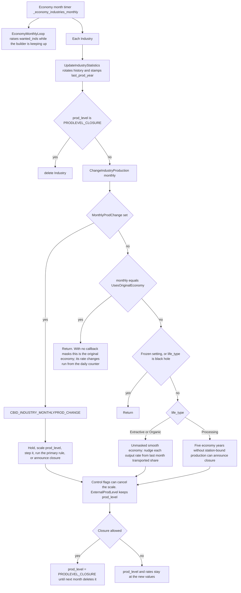
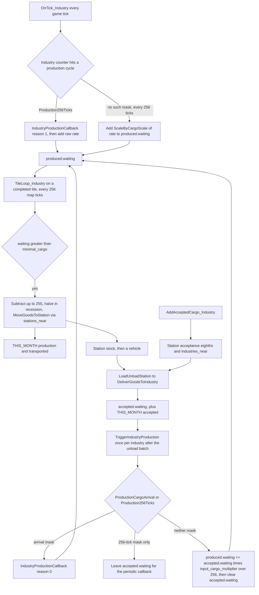

# Industries

An industry is a pooled map object (`Industry` in `src/industry.h`) whose tiles are `TileType::Industry`. The type (`IndustryType`, an index into `_industry_specs`) says which cargos exist and how production may change. A live industry stores the cargo slots, the current rates, and the nearby stations. Chains are whatever those specs contain after startup. This note describes that data and the functions that move cargo and change rates. Placement and the construction-stage counter are in [archi-industry-construction.md](archi-industry-construction.md).

## Pool and identity

`IndustryPool` is `Pool<Industry, IndustryID, 64>`. `IndustryID` is a `PoolID` with a max of 64000 and an invalid value of `0xFFFF`. `Industry::industries` is one `FlatSet<IndustryID>` per type, sized `NUM_INDUSTRYTYPES` (240).

`DoCreateNewIndustry` sets `owner` to `OWNER_NONE`. `founder` records who placed it (`OWNER_NONE` for random placement). `town` is the nearest town from `FindTownForIndustry`. `location` is the bounding `TileArea` of the layout, grown as each real tile is planted. `prod_level` starts at `PRODLEVEL_DEFAULT` (`0x10`). `counter` is 12 random bits and then counts down once per game tick.

| `prod_level` constant | Value | Meaning in the economy code |
| --- | --- | --- |
| `PRODLEVEL_CLOSURE` | `0x00` | Closure is announced. The next economy month deletes the industry |
| `PRODLEVEL_MINIMUM` | `0x04` | Lowest level the scaler will keep. A further decrease announces closure |
| `PRODLEVEL_DEFAULT` | `0x10` | Level at creation. Original-economy rates match the spec at this level |
| `PRODLEVEL_MAXIMUM` | `0x80` | Eight times the default level |

`IndustryControlFlags` (game script / deity) override that scaler: `NoProductionDecrease`, `NoProductionIncrease`, `NoClosure`, `ExternalProdLevel`.

## Type data

`ResetIndustries` copies `_origin_industry_specs` (`src/table/build_industry.h`, length `NEW_INDUSTRYOFFSET` = 37) into `_industry_specs` and disables types whose `climate_availability` misses the current landscape. Slots from 37 up to 240 stay empty until a NewGRF registers one. After GRF load, `FinaliseIndustriesArray` (`src/newgrf.cpp`) resolves any still-invalid `produced_cargo` / `accepts_cargo` from `produced_cargo_label` / `accepts_cargo_label` via `GetCargoTypeByLabel`.

`IndustrySpec` (`src/industrytype.h`) is the whole behaviour record:

- `layouts` — lists of `IndustryTileLayoutTile` (`ti` offset plus `IndustryGfx`). `GFX_WATERTILE_SPECIALCHECK` is a water check, not a tile.
- `produced_cargo[16]` and `production_rate[16]`. The original table fills two cargos; the arrays are 16 (`INDUSTRY_NUM_OUTPUTS`).
- `accepts_cargo[16]` and `input_cargo_multiplier[16][16]`. The original table fills three inputs. A multiplier is applied as `waiting * multiplier / 256` when cargo arrives (below).
- `minimal_cargo` — produced waiting must be **greater than** this before a tile will hand cargo to a station.
- `life_type` — `IndustryLifeType::Extractive`, `Organic`, `Processing`, or the empty set `INDUSTRYLIFE_BLACK_HOLE`.
- `behaviour` — `IndustryBehaviour` bits (plant fields, cut trees, water, town limits, year gates, closure of the last instance, and so on).
- `check_proc` — index into `_check_new_industry_procs` when the location callback is absent.
- `appear_creation` / `appear_ingame` — one byte per landscape.
- `callback_mask` — which industry callbacks the spec actually has. Hooks that this code calls are named below. The rest of the NewGRF machinery is out of scope.
- `cost_multiplier`, `removal_cost_multiplier`, `prospecting_chance`, `conflicting[3]`.

`IndustrySpec::IsRawIndustry` is extractive or organic. `IsProcessingIndustry` is processing without `IndustryBehaviour::CutTrees`. `UsesOriginalEconomy` is true when the economy setting is `EconomyType::Original`, or when the mask has any of `Production256Ticks`, `ProductionCargoArrival`, `MonthlyProdChange`, `ProductionChange`, `ProdChangeBuild`.

`IndustryTileSpec` is per graphics id (`_industry_tile_specs`, `NUM_INDUSTRYTILES` = 512). It carries the tile’s own `accepts_cargo` and signed `acceptance`, slope refusal, animation frame links, and `IndustryTileCallbackMask`. A tile accepts at most the spec array length; the comment on the struct says a tile accepts at most three cargos even when the industry accepts more. `GetIndustryGfx` translates the stored id through `grf_prop.override_id`.

The original table is the chain. The `MI(...)` rows store cargo **labels**, rates, and multipliers; they do not hard-code a second table of recipes. The first three rows, read from `_origin_industry_specs`, show the three shapes the runtime understands:

| Row | Life | Produced label / rate | Accepted label / multiplier |
| --- | --- | --- | --- |
| Coal mine | Extractive | `CT_COAL` / 15, second slot invalid / 0 | no accepted cargo (multipliers 256 on empty slots) |
| Power station | black hole | both produced slots invalid / 0 | `CT_COAL` / 256 |
| Sawmill | Processing | `CT_GOODS` / 0 | `CT_WOOD` / 256 |

A non-zero `production_rate` is periodic output. A non-zero `input_cargo_multiplier` turns delivered input into output at arrival. A black-hole row accepts input and has no produced slot, so the arrival loop discards the waiting input. Later rows and NewGRF properties are the same fields with different labels.

## Cargo slots on the instance

`DoCreateNewIndustry` copies spec slots up through the last valid cargo into `Industry::produced` and `Industry::accepted`. Empty tail slots are not kept. `TrimIndustryAcceptedProduced` repeats that trim.

`ProducedCargo`: `cargo`, `waiting` (stockpile not yet at a station), `rate` (units added each production cycle), and `history` of `production` / `transported` for this month and 24 previous months. `PctTransported` is `transported * 256 / production` (0 when production is 0).

`AcceptedCargo`: `cargo`, `waiting` (delivered, not yet consumed), `accumulated_waiting`, `last_accepted`, and a lazily created accepted/waiting history.

When `IndustryCallbackMask::InputCargoTypes` is set, creation clears `accepted` and refills from `CBID_INDUSTRY_INPUT_CARGO_TYPES` (one call per slot, stop on failure or `0xFF`). The cap is 3, or 16 when `IndustryBehaviour::CargoTypesUnlimited` is set. `OutputCargoTypes` / `CBID_INDUSTRY_OUTPUT_CARGO_TYPES` does the same for output, cap 2 or 16. Returned cargos must already be in the spec arrays.

If `UsesOriginalEconomy` is false, each initial `rate` is scaled by `(RandomRange(256) + 128) >> 8` (about half to one and a half times the spec rate). `RecomputeProductionMultipliers` is the original-economy scaler: `rate = ceil(spec.production_rate[slot] * prod_level / PRODLEVEL_DEFAULT)`, and it asserts `UsesOriginalEconomy()`.

## Periodic production

`OnTick_Industry` (`src/industry_cmd.cpp`) runs from the game tick. In the scenario editor it returns before any production. Otherwise, every industry gets `ProduceIndustryGoods`, and once per industry per economy day (`(TimerGameTick::counter + index) % DAY_TICKS == 0`, `DAY_TICKS` = 74) each accepted slot adds `waiting` into `accumulated_waiting`.

`ProduceIndustryGoods` decrements `Industry::counter` every call. `Ticks::INDUSTRY_PRODUCE_TICKS` is 256.

- Mask `IndustryCallbackMask::Production256Ticks`: when `counter % ScaleByInverseCargoScale(256)` is 0, call `IndustryProductionCallback(ind, 1)` and then `ProduceIndustryGoodsHelper(ind, false)`. The helper adds each slot’s raw `rate` with no cargo-scale multiply. The callback interval lengthens when `industry_cargo_scale` is below 100 and shortens when it is above (`ScaleByInverseCargoScale` in `src/economy_func.h`).
- Every 256 counter ticks, if that mask is clear, `ProduceIndustryGoodsHelper(ind, true)` adds `ScaleByCargoScale(rate)` instead. The same 256-tick edge always runs field planting, tree cutting, `IndustryRandomTrigger::IndustryTick`, and `IndustryAnimationTrigger::IndustryTick`, whether or not the callback mask is set.

`IndustryProductionCallback` (`src/newgrf_industries.cpp`) resolves an `IndustryProductionSpriteGroup`. `reason` 0 is cargo arrival. `reason` 1 is this periodic call. The group subtracts from accepted waiting and adds to produced waiting. Version 0/1 indexes industry slots; version 2 looks up cargos. `IndustryBehaviour::ProdMultiHandling` multiplies those amounts by `prod_level`. The loop stops when the group’s `again` field is 0, and it aborts after `0x10000` iterations.

On the same 256-tick edge:

- `IndustryBehaviour::PlantFields`: plant one random field on a 1/8 chance, unless `IndustryCallbackMask::SpecialEffect` is set, in which case `CBID_INDUSTRY_SPECIAL_EFFECT` with parameter 0 decides.
- `IndustryBehaviour::CutTrees`: cut on `counter % Ticks::INDUSTRY_CUT_TREE_TICKS` (`512`), unless the same callback with parameter 1 decides. `ChopLumberMillTrees` searches a 40-tile spiral for a grown tree, clears it, and adds `ScaleByCargoScale(45)` to the **first** produced slot. It does nothing until every tile of that industry is completed.

## Cargo out of an industry tile

Distribution is per completed tile, in `TileLoop_Industry`, which runs from `RunTileLoop` once every `TILE_UPDATE_FREQUENCY` (256) ticks for each map tile. An unfinished tile only advances construction and returns. In the editor, a finished tile returns before transport.

`TransportIndustryGoods` walks `produced`:

1. `cw = min(waiting, 255)`.
2. If `cw > minimal_cargo` and the cargo is valid, subtract `cw` from `waiting`.
3. In a recession (`EconomyIsInRecession`, `_economy.fluct <= 0`), replace `cw` with `(cw + 1) / 2`. The stockpile already lost the full amount.
4. Add `cw` to `history[THIS_MONTH].production`.
5. `MoveGoodsToStation(cargo, cw, source industry, stations_near, exclusive_consumer)` returns how much a station actually took. That quantity is added to `history[THIS_MONTH].transported`.

`stations_near` is filled by `PopulateStationsNearby` and by `Station::RecomputeCatchment`. If the industry has a neutral station and `serve_neutral_industries` is off, that station is the only entry. `exclusive_consumer` restricts who may take the cargo (`INVALID_OWNER` means any company).

A successful move can start the production animation (`IndustryTileSpec::anim_production`, or `IndustryAnimationTrigger::CargoDistributed`).

## Cargo into an industry

### What the tile tells the station

`AddAcceptedCargo_Industry` is the tile proc. Acceptance numbers are the eighths described on `AddAcceptedCargoProc`.

1. Start from the tile spec’s `accepts_cargo` and `acceptance`. Amounts `<= 0` are skipped.
2. `IndustryTileSpecialFlag::AcceptsAllCargo` copies every cargo the industry accepts and adds 8 to that slot’s acceptance.
3. Mask `IndustryTileCallbackMask::AcceptCargo` may replace the list via `CBID_INDTILE_ACCEPT_CARGO` (three 5-bit cargo indexes).
4. Mask `IndustryTileCallbackMask::CargoAcceptance` may replace the amounts via `CBID_INDTILE_CARGO_ACCEPTANCE` (three 4-bit values).
5. If the industry object does not itself accept that cargo, the station’s `always_accepted` bit is set.

Station catchment (`Station::RecomputeCatchment`) records the industry on `stations_near` and, when `IsCargoAccepted()` is true, on `Station::industries_near` ordered by `DistanceMax` from the station sign, then industry index. `DeliverGoodsToIndustry` walks that set in order.

### Delivery and conversion

Unloading calls `DeliverGoods` → `DeliverGoodsToIndustry` (`src/economy.cpp`). For each nearby industry that has the cargo slot, is not the cargo’s own source industry, is not refusing, and passes `exclusive_supplier`:

- Add as much as fits in `uint16_t` waiting.
- Record it on `AcceptedCargo` history (`GetOrCreateHistory()[THIS_MONTH].accepted`) and set `last_accepted`.
- Remember the industry in `_cargo_delivery_destinations`.

`IndustryTemporarilyRefusesCargo` is false unless mask `RefuseCargo` is set, in which case `CBID_INDUSTRY_REFUSE_CARGO` decides. The delivery comment lists three cases where the station still “accepts” while this function takes nothing: house acceptance, a stale catchment, or `CBID_INDUSTRY_REFUSE_CARGO` disagreeing with `CBID_INDTILE_CARGO_ACCEPTANCE`. Cargo the station accepted and no industry took is counted on the town.

After `LoadUnloadStation` finishes the vehicles that were due, it calls `TriggerIndustryProduction` for each destination, then clears the list.

`TriggerIndustryProduction` sets `was_cargo_delivered` and then:

- If mask `ProductionCargoArrival` or `Production256Ticks` is set: call `IndustryProductionCallback(ind, 0)` only when `ProductionCargoArrival` is set. With only `Production256Ticks`, waiting input stays until the periodic callback. The industry window treats either mask as stockpiling and shows accepted amounts (`UpdateIndustryProduction` / `DrawInfo` in `src/industry_gui.cpp`).
- Otherwise, for every accepted slot with waiting cargo, for every valid produced slot: `produced.waiting += accepted.waiting * input_cargo_multiplier[in][out] / 256`, then set that accepted `waiting` to 0. With no valid output slot the input is still cleared.

It also fires `IndustryRandomTrigger::CargoReceived` and `IndustryAnimationTrigger::CargoReceived`.

## Monthly production change

Cargo quantity is the tick and tile path above. The economy **month** changes rates, records history, and deletes industries that already announced closure. The timer is `_economy_industries_monthly` (`TimerGameEconomy::Trigger::Month`, priority `Industry`) in `src/industry_cmd.cpp`.

For each industry, in order:

1. `UpdateIndustryStatistics`. If `produced.history[THIS_MONTH].production != 0`, set `last_prod_year` to the current economy year. Rotate produced history. For accepted slots that already have a history, store the average of `accumulated_waiting` as this month’s waiting figure and rotate. That production figure is what `TransportIndustryGoods` added, so “last month produced” in the window is cargo handed toward stations.
2. If `prod_level == PRODLEVEL_CLOSURE`, `delete` the industry.
3. Otherwise `ChangeIndustryProduction(i, true)`.

`ChangeIndustryProduction(i, monthly)`:

- If the mask has `MonthlyProdChange` (monthly call) or `ProductionChange` (daily call), call `CBID_INDUSTRY_MONTHLYPROD_CHANGE` or `CBID_INDUSTRY_PRODUCTION_CHANGE`. A failed callback does nothing. The low nibble otherwise means: 0 hold, 1 halve `prod_level` (closure at the minimum), 2 double until the maximum, 3 announce closure, 4 run the standard primary change, 5–8 divide by 4/8/16/32, 9–12 multiply by 4/8/16/32, 13/14 step `prod_level` by one, 15 set `prod_level` from register `0x100`. Bit 7 suppresses news. Bit 8 takes a custom string.
- If the mask for **this** call is clear and `monthly == UsesOriginalEconomy()`, return. With no production callback masks, that means the original economy changes on the **daily** draw and the smooth economy changes on this **monthly** call.
- `UsesOriginalEconomy()` is also true when any production callback mask is set, including on a smooth or frozen setting. The unmasked branch then follows the original double/halve `prod_level` rule. The smooth per-cargo nudge runs only when `UsesOriginalEconomy()` is false and the setting is `EconomyType::Smooth`.
- If the mask is clear and `UsesOriginalEconomy()` is false, a frozen setting returns, and a black-hole `life_type` returns.
- Extractive or organic, when `UsesOriginalEconomy()` is true: with probability 1/3 (always, when `DontIncrProd` is set in the temperate climate), either double or halve `prod_level`. The transported share of **slot 0** last month decides the direction. Above `PERCENT_TRANSPORTED_60` (153/256) the chance to increase is 2/3; otherwise it is 1/3. Temperate `DontIncrProd` only halves.
- Extractive or organic, smooth setting, and `UsesOriginalEconomy()` false: about 1 in 22, each valid output rate moves by at least one unit and by roughly 10/256 to 59/256 of itself. Direction uses last month’s transported share of **that** cargo: at or below 60% the chance to rise is 1/3, at or below 80% (`PERCENT_TRANSPORTED_80` = 204/256) it is 2/3, above that it is 5/6. Rates clamp to 1..255. Passenger rates also clamp to at most 16 unless `NoPaxProdClamp` is set. A change of 10% or more posts smooth-economy news. Closure is announced when every valid output rate ends at 1, unless `NoClosure` or `NoProductionDecrease` is set.
- Processing, and only when no production-change callback is enabled: if `TimerGameEconomy::year - last_prod_year >= PROCESSING_INDUSTRY_ABANDONMENT_YEARS` (5) and a dice roll hits (1/2 on the original economy, 1/180 on smooth), announce closure.
- Applying a multiply or divide updates `prod_level` between minimum and maximum and sets the spec news text. `RecomputeProductionMultipliers` then rewrites `rate` from `prod_level`.
- Announced closure sets `prod_level` to `PRODLEVEL_CLOSURE` unless `CheckIndustryCloseDownProtection` or `NoClosure` blocks it. Protection is on when `CanCloseLastInstance` is clear and this type has at most one instance. Temperate `DontIncrProd` is never protected. The object stays until the next month’s step 2.

The daily scheduler `_economy_industries_daily` is what feeds the original-economy call (`ChangeIndustryProduction(i, false)`) and new construction. `StartupIndustryDailyChanges` sets `industry_daily_increment = (1 << (Map::LogX() + Map::LogY())) / 31`, so a 256×256 map accumulates about one event per month. The top 16 bits of `industry_daily_change_counter` are how many events run today. Each event builds an industry with probability 3% to 9% (`IndustryBuildData::TryBuildNewIndustry`; the percent rises while the count is behind `wanted_inds`) and otherwise picks `Industry::GetRandom()` for a production change.

`IndustryBuildData::EconomyMonthlyLoop` runs at the start of the monthly timer. Unless density is `FundedOnly`, it adds `Map::ScaleBySize(0x38000 / (10 * 12))` to `wanted_inds` when the live count is within `max_behind` of the target. The comment on that constant is 3.5 industries per decade, in 16.16 fixed point. `max_behind` is `1 + min(99, Map::ScaleBySize(3))`.

Deity commands in `src/industry_cmd.h`: `CmdIndustrySetFlags`, `CmdIndustrySetProduction` (sets `ExternalProdLevel`, assigns `prod_level`, recomputes multipliers), `CmdIndustrySetExclusivity`, `CmdIndustrySetText`. The industry view can also rewrite `prod_level` or `rate` when the editor or the `setup_prod` cheat allows it (`IsProductionAlterable`), then `UpdateIndustryProduction` refreshes `history[LAST_MONTH].production` from `8 * rate` scaled by cargo scale so the window has a figure before the next real month.

## Monthly production

## Cargo in and out of an industry tile

## Code map

| Symbol | File | Role |
| --- | --- | --- |
| `Industry`, `ProducedCargo`, `AcceptedCargo`, `IndustryBuildData` | `src/industry.h` | Instance, cargo slots, monthly build target |
| `IndustrySpec`, `IndustryTileSpec`, `IndustryLifeType`, `IndustryBehaviour` | `src/industrytype.h` | Type and tile spec |
| `IndustryID`, `NUM_INDUSTRYTYPES`, `INDUSTRY_NUM_INPUTS` / `OUTPUTS` | `src/industry_type.h` | Ids and slot caps |
| `MakeIndustry`, `GetIndustryConstructionStage`, gfx and animation accessors | `src/industry_map.h` | Tile storage |
| `_origin_industry_specs` | `src/table/build_industry.h` | Original 37 types, layouts, labels, rates, multipliers |
| `ResetIndustries`, `GetIndustrySpec` | `src/industry_cmd.cpp` | Copy specs, climate enable |
| `FinaliseIndustriesArray` | `src/newgrf.cpp` | Install NewGRF specs and resolve cargo labels |
| `OnTick_Industry`, `ProduceIndustryGoods`, `ProduceIndustryGoodsHelper` | `src/industry_cmd.cpp` | Tick production into `produced.waiting` |
| `IndustryProductionCallback` | `src/newgrf_industries.cpp` | Apply an `IndustryProductionSpriteGroup` |
| `IndustryProductionSpriteGroup` | `src/newgrf_spritegroup.h` | Callback payload: subtract input, add output, repeat |
| `TileLoop_Industry`, `TransportIndustryGoods` | `src/industry_cmd.cpp` | Per-tile handoff to stations |
| `AddAcceptedCargo_Industry` | `src/industry_cmd.cpp` | Tile acceptance eighths for the station |
| `DeliverGoodsToIndustry`, `TriggerIndustryProduction` | `src/economy.cpp` | Station unload into `accepted.waiting`, then convert |
| `Station::AddIndustryToDeliver`, `RecomputeCatchment` | `src/station.cpp` | Catchment lists |
| `_economy_industries_monthly`, `UpdateIndustryStatistics`, `ChangeIndustryProduction` | `src/industry_cmd.cpp` | Month: history, closure delete, rate change |
| `_economy_industries_daily`, `StartupIndustryDailyChanges` | `src/industry_cmd.cpp`, `src/economy.cpp` | Spread of random production changes and new builds |
| `IndustryBuildData::EconomyMonthlyLoop`, `TryBuildNewIndustry` | `src/industry_cmd.cpp` | Wanted count and gameplay construction attempts |
| `Industry::RecomputeProductionMultipliers` | `src/industry_cmd.cpp` | `prod_level` to `rate` for the original economy |
| `IndustrySpec::UsesOriginalEconomy` | `src/industry_cmd.cpp` | Original setting, or any production callback mask |
| `Ticks::INDUSTRY_PRODUCE_TICKS` | `src/timer/timer_game_tick.h` | 256 |
| `IndustryCallbackMask`, `CBID_INDUSTRY_*`, `CBID_INDTILE_CARGO_ACCEPTANCE`, `CBID_INDTILE_ACCEPT_CARGO` | `src/newgrf_callbacks.h` | Masks and callback ids this code tests |
| `IndustryViewWindow`, `UpdateIndustryProduction` | `src/industry_gui.cpp` | Window text, stockpile display, cheat edits |
| `CmdBuildIndustry`, `CmdIndustrySetProduction`, `CmdIndustrySetFlags`, `CmdIndustrySetExclusivity` | `src/industry_cmd.h`, `src/industry_cmd.cpp` | Deity and player commands |

## Invariants

- A map industry tile’s `m2` is the `IndustryID`. `Industry::GetByTile` loads that pool item. `TileBelongsToIndustry` requires both the tile type and that id.
- `owner` is `OWNER_NONE`. Service rights use `founder`, `exclusive_supplier`, and `exclusive_consumer`.
- Produced and accepted vectors contain a prefix of the spec (or of the input/output cargo callbacks), including internal invalid slots when an older callback skips a slot. Slots after the last valid cargo are absent.
- Periodic output adds to `produced.waiting` on the industry counter. Movement onto a station happens from a completed tile loop, at most 255 units of each cargo per tile visit, and only when waiting is greater than `minimal_cargo`.
- `history[THIS_MONTH].production` counts cargo the tile tried to move after the recession halve. `last_prod_year` updates from that figure. Accepted history exists only after something has been delivered.
- Without `ProductionCargoArrival` and `Production256Ticks`, delivered input is converted or discarded inside `TriggerIndustryProduction` before the function returns. With `Production256Ticks` and without `ProductionCargoArrival`, input stays in `accepted.waiting` until the periodic production callback.
- `input_cargo_multiplier` is only applied on that non-callback arrival path. The original table’s 256 means one output unit per input unit on the first output column.
- When `UsesOriginalEconomy()` is true, `rate` is `ceil(spec rate * prod_level / 16)` after every `prod_level` change. The unmasked smooth setting writes `rate` directly.
- `PRODLEVEL_CLOSURE` means the announcement already happened. The monthly loop deletes the object the following economy month, before it would change production again.
- The monthly callback and the daily callback are different masks (`MonthlyProdChange` / `ProductionChange`) and different ids (`CBID_INDUSTRY_MONTHLYPROD_CHANGE` / `CBID_INDUSTRY_PRODUCTION_CHANGE`). Each call tests only its own mask. With neither mask, the call whose `monthly` flag equals `UsesOriginalEconomy()` returns immediately, so the original setting changes on the daily draw and the smooth setting changes on the month.
- Any of `Production256Ticks`, `ProductionCargoArrival`, `MonthlyProdChange`, `ProductionChange`, or `ProdChangeBuild` makes `UsesOriginalEconomy()` true. The unmasked call then uses the original `prod_level` double/halve rule even when the economy setting is smooth. The smooth per-cargo nudge runs only when none of those masks are set.
- A frozen setting returns from the unmasked branch only when `UsesOriginalEconomy()` is false. Masks that make `UsesOriginalEconomy()` true still run their callbacks while the setting is frozen.
- Black-hole types skip the unmasked rate change. They still accept cargo, and with no produced slot the default arrival path clears `accepted.waiting`.
- Processing closure for lack of output uses five economy years since `last_prod_year`, and only when no production-change callback is enabled. Extractive and organic types use the transported-share scaler instead.
- The last instance of a type stays, unless `CanCloseLastInstance` is set or the type is temperate `DontIncrProd`. Gameplay `min_number` is 1 only for types that may close the last instance, so the builder tries to place a replacement when the count hits zero.
- Tile acceptance and industry acceptance are separate. A tile can advertise a cargo the industry object will not take; that sets the station `always_accepted` bit. Refusal callbacks can disagree with tile acceptance, and delivery then keeps the cargo off the industry.
- `RecomputeProductionMultipliers` is only valid when `UsesOriginalEconomy()` is true.
- Deleting an industry clears its tiles (water class kept), unlinks nearby stations, drops subsidies and in-flight cargo from that source, and forgets its persistent storage.
