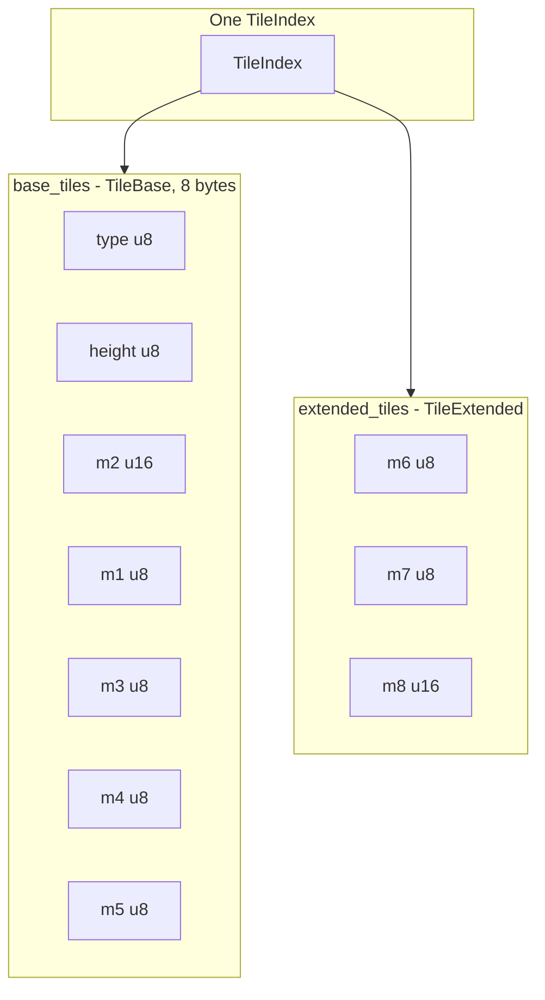
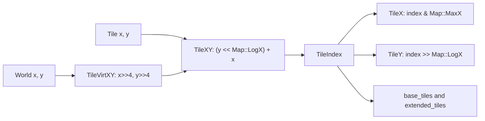
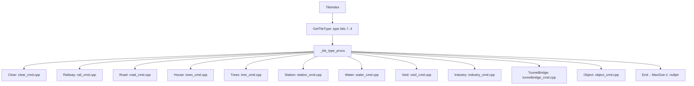

# Landscape and tile-map architecture

The map is a dense array of tiles. Each tile is a packed record: a type nibble, a northern-corner height, and eight general-purpose fields (`m1`–`m8`) whose meaning depends on `TileType`. Gameplay code reads and writes those fields through the `*_map.h` accessors. It does not poke the bytes itself.

Legacy descriptions live in `docs/landscape.html`, `docs/landscape_grid.html`, and `docs/landscape_externals.html`. Where those pages disagree with the headers below, the headers are the layout. Stale claims are collected at the end of this file and repeated in the family notes.

Bit positions in this set of notes use the same convention as `GB` / `SB` in `src/core/bitmath_func.hpp` (lines 32–35): bit 0 is the least significant bit, and `GB(x, s, n)` is `(x >> s)` masked to `n` bits.

Family layouts:

- [clear-tiles.md](clear-tiles.md) — `TileType::Clear`
- [rail-tiles.md](rail-tiles.md) — `TileType::Railway`
- [road-tiles.md](road-tiles.md) — `TileType::Road`
- [water-tiles.md](water-tiles.md) — `TileType::Water`
- [station-tiles.md](station-tiles.md) — `TileType::Station`
- [house-tiles.md](house-tiles.md) — `TileType::House`
- [industry-tiles.md](industry-tiles.md) — `TileType::Industry`
- [tree-tiles.md](tree-tiles.md) — `TileType::Trees`
- [tunnelbridge-tiles.md](tunnelbridge-tiles.md) — `TileType::TunnelBridge`
- [object-tiles.md](object-tiles.md) — `TileType::Object`

`TileType::Void` is covered here, because it is a map-edge rule more than a content family.

## Two arrays, ten logical fields

`Tile` in `src/map_func.h` (lines 26–56) is a handle, not the storage. Storage is two parallel arrays, both indexed by `TileIndex`:

| Array | Struct | Members, in memory order | Asserted size |
| --- | --- | --- | --- |
| `Tile::base_tiles` | `Tile::TileBase` | `type` `uint8`, `height` `uint8`, `m2` `uint16`, `m1` `uint8`, `m3` `uint8`, `m4` `uint8`, `m5` `uint8` | `sizeof == 8` (`src/map_func.h` lines 32–42) |
| `Tile::extended_tiles` | `Tile::TileExtended` | `m6` `uint8`, `m7` `uint8`, `m8` `uint16` | declared members only (`src/map_func.h` lines 48–52) |

`m2` sits between `height` and `m1` so the `uint16` is aligned inside the 8-byte base record. The logical field order used by the accessors and by the savegame is `type`, `height`, `m1`, `m2`, `m3`, `m4`, `m5`, `m6`, `m7`, `m8`. Comments on those members (`src/map_func.h` lines 33–51) give the usual roles: `type` holds the tile class, bridge-above bits, and tropic zone; `height` is the northern corner; `m1` is usually ownership; `m2` is usually an index into towns, industries, or stations; `m7` is the usual NewGRF / animation byte. Every other meaning is per `TileType` and lives in the family notes.

`Map::Allocate` (`src/map.cpp`) creates both arrays with `Map::Size()` elements. That count is every layer: `SizeX * SizeY * LayerCount`. `Map::IsInitialized` (`src/map_func.h`) is true once `base_tiles` is non-null.

The `type` byte is three independent fields:

| Bits | Width | Meaning | Accessor |
| --- | --- | --- | --- |
| 7..4 | 4 (`TILE_TYPE_BITS`) | `TileType` | `GetTileType` / `SetTileType`, `src/tile_map.h` lines 96–99 and 131–138 |
| 3..2 | 2 | Bridge middle above this tile. 0 means no bridge. Bit 2 is `Axis::X`, bit 3 is `Axis::Y` | `IsBridgeAbove`, `GetBridgeAxis`, `SetBridgeMiddle`, `src/bridge_map.h` lines 45–47, 68–71, 114–116 |
| 1..0 | 2 | `TropicZone` | `GetTropicZone` / `SetTropicZone`, `src/tile_map.h` lines 225–241 |

`TropicZone` (`src/tile_type.h` lines 81–85) is `Normal = 0`, `Desert = 1`, `Rainforest = 2`. The comment above the enum (lines 66–79) says the zone is not modified during gameplay and mainly affects tree growth, with desert tiles remaining visible. `SetTropicZone` refuses a non-normal zone on a void tile.

`TileType` (`src/tile_type.h` lines 39–62) uses 4 bits, so `TileType::MaxSize` is 16. The implemented values, in enum order, are:

| Value | Enumerator | What the tile holds |
| --- | --- | --- |
| 0 | `Clear` | Grass, rocks, fields, desert, snow overlay |
| 1 | `Railway` | Plain rail, signals, or a rail depot |
| 2 | `Road` | Road, tram, level crossing, or road depot. A rail+road crossing is a road tile (`src/tile_type.h` lines 43–46) |
| 3 | `House` | A town building |
| 4 | `Trees` | One to four trees |
| 5 | `Station` | Rail station, waypoint, road stop, airport, dock, buoy, oil rig |
| 6 | `Water` | Sea, canal, river, coast, lock, ship depot |
| 7 | `Void` | Invisible border |
| 8 | `Industry` | One tile of an industry |
| 9 | `TunnelBridge` | Tunnel mouth or bridge ramp |
| 10 | `Object` | Transmitter, owned land, and other objects |
| 11 | `LayerPortal` | One end of a pair of tiles that connect two map layers. See [archi-map-layers.md](../map-layers/archi-map-layers.md) |
| 12 | `End` | End marker, not a tile |
| 16 | `MaxSize` | `1 << TILE_TYPE_BITS` |

`_tile_type_procs` (`src/landscape.cpp`) has one `TileTypeProcs` pointer per value up to `MaxSize`. Slots 0 through 11 point at the per-family tables, including `LayerPortal`. The four slots after that are `nullptr`.

## Tile, TileIndex, and world scale

`TileIndex` (`src/tile_type.h` lines 92–100) is a `uint32_t` strong typedef, `sizeof` 4, and it is arithmetic-compatible with `int32_t` and `int64_t`. `INVALID_TILE` is `TileIndex{(uint32_t)-1}`.

`Tile` (`src/map_func.h` lines 64–76) wraps a `TileIndex` and converts back to it. Its `type()`, `height()`, and `m1()`–`m8()` methods return references into the two arrays.

World scale, from `src/tile_type.h` lines 15–30:

| Constant | Value | Role |
| --- | --- | --- |
| `TILE_SIZE` | 16 | Length of a tile edge in world coordinates |
| `TILE_UNIT_MASK` | 15 | Mask for the in-tile world coordinate |
| `TILE_PIXELS` | 32 | Pixel step between tile columns at `ZOOM_BASE` |
| `TILE_HEIGHT` | 8 | One height level, in world coordinates and in pixels at `ZOOM_BASE` |
| `MAX_TILE_HEIGHT` | 255 | Highest legal northern-corner height |
| `MIN_MAP_HEIGHT_LIMIT` | 15 | Lower bound of the construction height limit |
| `MAX_MAP_HEIGHT_LIMIT` | `MAX_TILE_HEIGHT` | Upper bound of that setting |

`TileHeight` (`src/tile_map.h` lines 29–32) returns `height()`: the northern corner only, in height levels, ignoring slope. `TilePixelHeight` multiplies that by `TILE_HEIGHT`. `SetTileHeight` (lines 57–61) rejects a height above `MAX_TILE_HEIGHT`.

Slope is not stored. `GetTileSlopeZ` (`src/tile_map.cpp` lines 55–67) reads four northern-corner heights: this tile (north), the tile to `+x` (west), the tile to `+y` (east), and the tile to `+x+y` (south), each clamped to the map edge. `GetTileSlopeGivenHeight` (lines 23–47) builds a `Slope` from which corners sit above the minimum, and sets the steep bit when the tallest corner is exactly two levels above the lowest. The comment there states the connectivity rule: the difference from the minimum is 0, 1, or 2, and at most one corner is two above the minimum.

`RemapCoords` in `src/landscape.h` (lines 81–87) turns world or tile `(x, y, z)` into the isometric viewport point. `z` for a ground point comes from `GetSlopePixelZ`, which is the sloped height in pixels.

## From a coordinate to a TileIndex

Both map axes are powers of two. `Map::LogX()` is `log2(SizeX)` (`src/map_func.h` lines 243–246, set in `src/map.cpp` lines 49–54).

`TileXY` is `src/map_func.h` lines 376–378. `TileX` / `TileY` are lines 419–431. `Map::MaxX()` is `SizeX() - 1` (lines 289–291), and because `SizeX` is a power of two that mask is the low `LogX` bits. `TileVirtXY` (lines 407–409) converts a world coordinate by shifting right 4, which divides by `TILE_SIZE` (16). `TileVirtXYClampedToMap` (`src/map.cpp` lines 83–85) does the same division and clamps onto the map.

Adding tiles uses `TileDiffXY` (`src/map_func.h` lines 392–398): `y * SizeX() + x`. `TileAddWrap` (`src/map.cpp` lines 119–120 and the comment above it) returns `INVALID_TILE` when the step would cross an edge. `AddTileIndexDiffCWrap` (`src/map_func.h` lines 519–525) does the same check in coordinate space. `Map::WrapToMap` (lines 320–322) masks with `tile_mask` (`Size() - 1`), which is why the map area itself must be a power of two.

## Map size, void tiles, and terraforming

Limits are in `src/map_type.h` lines 37–40:

| Constant | Value |
| --- | --- |
| `MIN_MAP_SIZE_BITS` | 6 |
| `MAX_MAP_SIZE_BITS` | 12 |
| `MIN_MAP_SIZE` | 64 |
| `MAX_MAP_SIZE` | 4096 |

Each axis is chosen independently inside that range, and both must be powers of two. `Map::Allocate` (`src/map.cpp` lines 38–45) calls `FatalError("Invalid map size")` otherwise. A 4096×4096 plane is `2^24` tiles. Three layers make `3 * 2^24` tiles, which still fits in a `uint32_t` `TileIndex`. `INVALID_TILE` stays outside that range. `TileY` is the stacked row across those layers. `TilePlaneY` is the row inside one plane. The void fence is repeated on every layer. Details are in [archi-map-layers.md](../map-layers/archi-map-layers.md).

`TileType::Void` is the border that stops algorithms from wrapping. `SetTileType` (`src/tile_map.h` lines 131–138) asserts that void tiles are exactly the non-inner tiles. `IsInnerTile` (lines 109–117) requires `x < MaxX` and `y < MaxY`. When `construction.freeform_edges` is set, it also requires `x > 0` and `y > 0`. So:

- The south-west column (`x == MaxX`) and the south-east row (`y == MaxY`) are always void.
- With freeform edges, the north edges (`x == 0` and `y == 0`) are void as well.

`InitializeLandscape` (`src/landscape.cpp` lines 845–857) fills the inner rectangle with grass at height 0 and tropic zone normal, then voids the `MaxX` column and the `MaxY` row. The original generator voids the north edges afterwards when freeform edges are on (`src/landscape.cpp` lines 1639–1641). The same north-edge voiding is in `src/tgp.cpp` (lines 1071–1073), `src/heightmap.cpp` (lines 363–365), and `src/genworld.cpp` (lines 129–131). `MakeVoid` (`src/void_map.h` lines 19–30) sets the type to void, height 0, and zeroes `m1`–`m8`.

`_tile_type_void_procs` (`src/void_cmd.cpp` lines 57–64) draws either flat water (freeform off) or black land (freeform on), and both its clear proc and its terraform proc return the off-edge error. `TileLoop_Void` still runs the water flood loop so the edge can stay wet.

Terraform edits the northern-corner heights, which changes the slopes of every tile that uses that corner. The commands are `CmdTerraformLand` and `CmdLevelLand` in `src/terraform_cmd.h` (lines 17–20), implemented in `src/terraform_cmd.cpp`. `CmdTerraformLand` (lines 172–205) raises or lowers the corner tiles selected by the slope bits (`+x` for west, `+y` for east, `+x+y` for south, the tile itself for north). `TerraformTileProc` (`src/tile_cmd.h` lines 181–197) runs on each affected tile before the height change: it may reject the edit or add a tile-specific cost, and on execute it performs tile-specific work such as clearing. The proc does not itself write the new height. The GUI is `src/terraform_gui.cpp` / `src/terraform_gui.h`. `LevelMode` (`src/map_type.h` lines 43–47) selects level, lower, or raise for `CmdLevelLand`.

Clearing land without changing height is a different command: `CmdLandscapeClear` and `CmdClearArea` in `src/landscape_cmd.h` (lines 15–19).

## Why the accessors exist

The same bytes mean different things on a rail tile and on a house tile. `GetTileOwner` (`src/tile_map.h` lines 178–184) reads `m1` bits 4..0, and it asserts the tile is valid and is neither a house nor an industry, because those types use `m1` for something else. A raw `m1` read would silently return a bogus owner.

The accessors also keep the savegame layout stable. Each field is stored in its own chunk (see below). A helper that shifts the wrong width, or that uses `m2` as an 8-bit index, would desync or corrupt a load. The family headers (`rail_map.h`, `road_map.h`, and the rest) are the only place that is supposed to know the shifts.

Shared fields that are not specific to one family:

| Field | Bits | Accessor | Where it applies |
| --- | --- | --- | --- |
| Owner | `m1` 4..0 | `GetTileOwner` / `SetTileOwner`, `src/tile_map.h` lines 178–204 | Every valid tile except `House` and `Industry` |
| Water class | `m1` 6..5 | `GetWaterClass`, `src/water_map.h` lines 105–131 | `Water`, `Station`, `Industry`, `Object`, `Trees` (`HasTileWaterClass`, lines 105–108) |
| Docking mark | `m1` bit 7 | `IsDockingTile`, `src/water_map.h` lines 367–380 | `Water`, `Railway`, `Station`, `TunnelBridge` |
| Animation frame | whole `m7` | `GetAnimationFrame`, `src/tile_map.h` lines 250–265 | `House`, `Object`, `Industry`, `Station` |
| Animated-tile state | `m6` 1..0 | `GetAnimatedTileState`, `src/animated_tile_map.h` lines 19–42 | `None = 0`, `Deleted = 1`, `Animated = 3` |

Owner values that fit in those 5 bits are in `src/company_type.h` lines 16–29. `CompanyID` ends at `0x0F`, so company owners are `0x00`–`0x0E`. Then `OWNER_TOWN` is `0x0F`, `OWNER_NONE` is `0x10`, `OWNER_WATER` is `0x11`, and `OWNER_DEITY` is `0x12`. `COMPANY_SPECTATOR` is `255` (line 21). That value does not fit in the 5-bit tile field.

Tram ownership is narrower and lives in the road accessors, not in `GetTileOwner`. See [road-tiles.md](road-tiles.md).

Water class (`src/water_map.h` lines 41–46) is `Sea = 0`, `Canal = 1`, `River = 2`, `Invalid = 3`. `Invalid` means there is no water on the tile.

## Dispatch

Drawing, clearing, the periodic loop, cargo, animation, foundations, and terraform all go through `TileTypeProcs` (`src/tile_cmd.h` lines 214–230). `GetTileType` selects the row.

The table is filled in `src/landscape.cpp` lines 53–89. Each `*_cmd.cpp` exports the `TileTypeProcs` row named in the [code map](#code-map).

`RunTileLoop` (`src/landscape.cpp` lines 800–842) calls `tile_loop_proc` for every tile once per `TILE_UPDATE_FREQUENCY` ticks. That constant is `1 << 8`, so 256 ticks (lines 97–98). The walk is a Galois LFSR sized from `Map::LogX() + Map::LogY()`, with tile 0 updated separately because the LFSR state cannot be zero. The feedback table is indexed for maps from 64×64 (12-bit) through 4096×4096 (24-bit).

## Savegame image of the tile bytes

`src/saveload/map_sl.cpp` writes one RIFF chunk per field, in tile order. The in-memory swap of `m1` and `m2` does not appear on disk: each chunk names one logical field.

| Chunk | Field | Width on current saves |
| --- | --- | --- |
| `MAPS` | `SizeX`, `SizeY` | two `uint32`s (lines 25–28, 30–52) |
| `MAPT` | `type` | `uint8` (lines 70–94) |
| `MAPH` | `height` | `uint8` (lines 97–121) |
| `MAPO` | `m1` | `uint8` (lines 124–148) |
| `MAP2` | `m2` | `uint16`; before `SaveLoadVersion::BigMap`, loaded as 8 bits into the `uint16` (lines 151–177) |
| `M3LO` | `m3` | `uint8` (lines 181–205) |
| `M3HI` | `m4` | `uint8` (lines 208–232). The chunk name is historical |
| `MAP5` | `m5` | `uint8` (lines 235–259) |
| `MAPE` | `m6` | `uint8`; before `SaveLoadVersion::BridgeWormhole`, four tiles share one byte, 2 bits each (lines 262–299) |
| `MAP7` | `m7` | `uint8` (lines 303–327) |
| `MAP8` | `m8` | `uint16` (lines 330–354) |

Changing a bit assignment is a savegame change. Old layouts are repaired in `src/saveload/afterload.cpp` (for example the former clear-ground value 4, snow, is rewritten there; see [clear-tiles.md](clear-tiles.md)).

## Code map

| Concern | File | What it owns |
| --- | --- | --- |
| `TileIndex`, `TileType`, `TropicZone`, `TILE_SIZE`, `TILE_HEIGHT` | `src/tile_type.h` | Identity of a tile and the world scale |
| Map limits, `LevelMode` | `src/map_type.h` | 64–4096, power-of-two axes |
| `Tile` / `Map`, `TileXY`, `TileX`, `TileY` | `src/map_func.h` | Storage layout and indexing |
| Allocation, wrap checks | `src/map.cpp` | `Map::Allocate` |
| Height, type, owner, tropic zone, animation frame | `src/tile_map.h` | Fields shared by every family |
| Slope from corner heights | `src/tile_map.cpp` | `GetTileSlopeZ` |
| Viewport mapping, snow line, tile loop, proc table | `src/landscape.h`, `src/landscape.cpp` | Landscape services on top of the arrays |
| Proc signatures, including terraform | `src/tile_cmd.h` | `TileTypeProcs` |
| Per-type behaviour | `src/clear_cmd.cpp`, `rail_cmd.cpp`, `road_cmd.cpp`, `town_cmd.cpp`, `tree_cmd.cpp`, `station_cmd.cpp`, `water_cmd.cpp`, `void_cmd.cpp`, `industry_cmd.cpp`, `tunnelbridge_cmd.cpp`, `object_cmd.cpp` | One `TileTypeProcs` row each |
| Bit layout | `src/clear_map.h`, `rail_map.h`, `road_map.h`, `water_map.h`, `station_map.h`, `town_map.h`, `industry_map.h`, `tree_map.h`, `tunnelbridge_map.h`, `bridge_map.h`, `tunnel_map.h`, `object_map.h`, `void_map.h`, `depot_map.h`, `animated_tile_map.h` | The only supported way to read `m1`–`m8` |
| Terraform commands | `src/terraform_cmd.h`, `src/terraform_cmd.cpp` | `CmdTerraformLand`, `CmdLevelLand` |
| Terraform UI | `src/terraform_gui.h`, `src/terraform_gui.cpp` | Toolbar |
| Clear commands | `src/landscape_cmd.h` | `CmdLandscapeClear`, `CmdClearArea` |
| Save / load | `src/saveload/map_sl.cpp` | `MAPS` through `MAP8` |
| Old-save repair | `src/saveload/afterload.cpp` | Bit moves, including snow-as-ground |
| Signal bit positions inside the rail nibble | `src/table/signal_data.h` | Which signal bit belongs to which trackdir |
| Electrified-rail sprite sheet | `docs/elrail.svg` | Drawing companion for catenary sprites. It is not a bit layout. See [rail-tiles.md](rail-tiles.md) |

## Stale claims in the legacy HTML

These are the disagreements that matter for the architecture. Family files list the bit-level ones.

| Legacy claim | Where | Current header |
| --- | --- | --- |
| "Nine attributes" hold a tile | `docs/landscape.html` (around the opening paragraphs) and `docs/landscape_grid.html` (opening paragraph). The grid then draws ten columns: `type`, `height`, `m1`–`m8` | Ten logical fields. `type` + `height` + `m1`–`m8`. `src/map_func.h` lines 32–52 |
| Void is only a one-tile border on the south edges | `docs/landscape.html`, class 7 | South edges always. North edges too when `freeform_edges` is set. `src/tile_map.h` lines 109–138, `src/landscape.cpp` lines 845–857 and 1639–1641 |
| Tile owner `0xFF` is the spectator | `docs/landscape.html`, ownership table | The tile field is 5 bits. Spectators are `COMPANY_SPECTATOR` (`255`) and are not stored there. `OWNER_DEITY` (`0x12`) is missing from that table. `src/tile_map.h` lines 178–184, `src/company_type.h` lines 21–28 |
| Periodic processing walks tiles with a stride of +256 | `docs/landscape.html`, the sentence before the class table | The period is 256 ticks. The walk is an LFSR in `RunTileLoop`. `src/landscape.cpp` lines 97–98 and 805–842 |
| Snow is clear-ground type 4 in `m5` | `docs/landscape.html`, class 0 | `ClearGround` has no snow enumerator. Snow is `m3` bit 4. Old saves are converted in `afterload.cpp`. See [clear-tiles.md](clear-tiles.md) |
| Water tile types stop at depot (values 0–3) | `docs/landscape.html` class 6, and the grid's water rows | `WaterTileType` adds `ClearRocks = 4` and `CoastRocks = 5`. See [water-tiles.md](water-tiles.md) |
| Rail type is only the four original values, stored as if the field were that closed set | `docs/landscape.html`, class 1 track-type table | The built-in labels are still 0–3, and the map field is 6 bits with `RAILTYPE_END = 64`. See [rail-tiles.md](rail-tiles.md) |
| Industry `m5` is a catalogue of original industry sprites (coal mine `00`–`06`, and so on, up to `1FF` for NewGRF) | `docs/landscape.html`, class 8 | The tile stores a 9-bit `IndustryGfx` (`m5` plus `m6` bit 2), then translates it. The catalogue is not the storage format. See [industry-tiles.md](industry-tiles.md) |
| House lift data and NewGRF processing time are different modes of `m6` / `m7`, selected by "newhouses" | `docs/landscape.html`, class 3 | Both sets of accessors use the same bits, and both are still called. See [house-tiles.md](house-tiles.md) |
| `docs/landscape_externals.html` is the house-type list for the tile | that file's table of original houses | It is a baseset catalogue. The tile stores a 12-bit `HouseID` (`NUM_HOUSES` is 4096, `NEW_HOUSE_OFFSET` is 110). See [house-tiles.md](house-tiles.md) |

The class numbers 0–10 in the HTML match `TileType` order. Bridge-above bits 3..2 and tropic bits 1..0 match `GetTileType` / `GetBridgeAxis` / `GetTropicZone`. The grid's per-bit pictures are the same document as `landscape.html`; the same stale rows apply there.

`docs/landscape.html` also says a tile in class `B`–`F` crashes the game. Those values are `TileType::End` through `MaxSize - 1`, and `_tile_type_procs` stores `nullptr` for them (`src/landscape.cpp` lines 83–88). Dispatch through that table has no proc to call.

## Invariants

1. **Packed layout.** Every tile is the ten logical fields above. `type` bits 7..4 are the `TileType`, bits 3..2 are the bridge-middle axis, bits 1..0 are the tropic zone. `height` is only the northern corner, in the range `0..MAX_TILE_HEIGHT`. Slope is derived from this corner and the three neighbouring corners. `m1`–`m8` are typed by `TileType`; a shift that is valid for rail is not valid for a house.
2. **Accessor discipline.** Callers use `tile_map.h` and the family `*_map.h` headers. Those functions are the bit layout. `Tile::m1()` and the other raw references exist so the accessors can write the bytes, and so the savegame can copy them. Gameplay code that masks the bytes itself will drift from the savegame and from the other readers.
3. **Savegame compatibility of tile bits.** The on-disk image is one chunk per field (`MAPT`, `MAPH`, `MAPO`, `MAP2`, `M3LO`, `M3HI`, `MAP5`, `MAPE`, `MAP7`, `MAP8`), in `TileIndex` order. Widening `m2` and widening `m6` already required loaders (`BigMap`, `BridgeWormhole`). Moving a bit, or reusing a bit that an old save stored, belongs in `afterload.cpp` together with a savegame version. The in-memory order of `TileBase` (where `m2` precedes `m1`) must stay consistent with `sizeof(TileBase) == 8`, and it must not be written out as a single struct blob.
