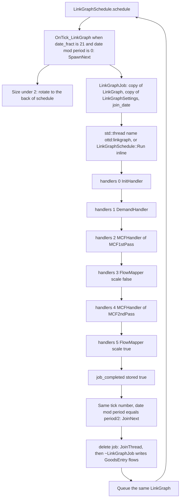
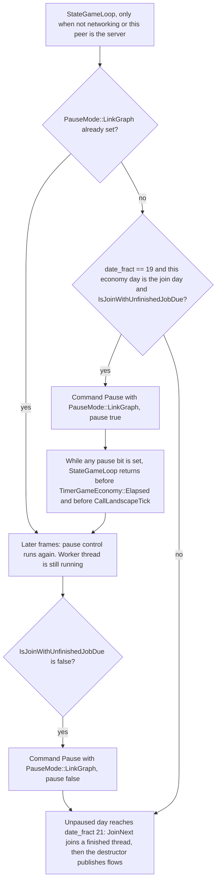

# Link graph (cargo distribution)

How OpenTTD turns stations, links, and acceptance into planned cargo flows. This note follows the current sources. The short legacy note is `docs/linkgraph.md`; what that note left out, and which of its claims no longer match the code, is at the end.

Companion notes in this directory:

- [jobs.md](jobs.md) — `LinkGraphJob`, the worker thread, the join deadline, and writing flows back
- [demands.md](demands.md) — `DemandCalculator`, `SymmetricScaler`, `AsymmetricScaler`
- [solver.md](solver.md) — `MCF1stPass`, `MCF2ndPass`, and `FlowMapper`

## What it is

Cargo distribution keeps, per cargo type, one or more **link graph components**. A component is a `LinkGraph`: a set of stations (nodes) and directed links (edges). A running calculation is a `LinkGraphJob`, which owns a **copy** of one component plus a **copy** of `LinkGraphSettings` taken when the job is created. The copy is what the worker reads. The live component keeps receiving supply, capacity, and link updates on the simulation thread while the job runs.

`LinkGraphSchedule` is a process-lifetime singleton (`LinkGraphSchedule::instance`, created at startup so the cargo-distribution threads do not race on first use). It holds two lists:

- `schedule` — components waiting to be calculated
- `running` — jobs whose worker has been started (or, if no thread could be started, jobs whose calculation already ran inline)

Each station’s `GoodsEntry` points at the component it belongs to (`link_graph`, `node`). The pool comment states that a station can sit in up to 32 link graphs. The pool itself is `LinkGraphPool _link_graph_pool` with a first chunk of 32. Jobs use `LinkGraphJobPool` the same way.

Splitting a component is intentionally not implemented. The comment on `LinkGraph` says the cost of tracking connectedness would outweigh smaller graphs, and that real networks mostly grow. Two components of the same cargo are **merged** when a vehicle link connects stations that currently live in different graphs (`IncreaseStats` in `src/station_cmd.cpp`). The smaller graph is merged into the larger one (`LinkGraph::Merge`), scaled by the ratio of their ages since last compression, and the merged graph is deleted. The schedule entry of the graph that is merged away is dequeued first.

## Stations, links, supply, demand

| Piece | Where it lives | Meaning in the code |
| --- | --- | --- |
| Node | `LinkGraph::BaseNode` | One station for this cargo: `station`, map `xy`, `supply`, `demand`, `last_update`, and a sorted vector of outgoing edges |
| Edge | `LinkGraph::BaseEdge` | One directed link: `capacity`, `usage`, `travel_time_sum`, `dest_node`, and two economy dates (`last_unrestricted_update`, `last_restricted_update`) |
| Demand annotation | `LinkGraphJob::DemandAnnotation` | Transport demand from one node to another, plus the part not yet satisfied by a path. This is **not** stored on the edge. Every node has a demand slot for every other node |
| Edge annotation | `LinkGraphJob::EdgeAnnotation` | The planned `flow` the solver has pushed onto one copied edge |
| Flow shares | `FlowStat` / `FlowStatMap` on `GoodsEntry::GoodsEntryData` | What the simulation routes with. Keyed by origin station. Each share is a next hop (`via`) with a weight. `GetVia` draws `RandomRange` over those weights on the simulation thread |

`AddNode` stores the station tile and sets the initial `demand` from `GoodsEntry::State::Acceptance` (the flag is 0 or 1). The comment above `AddNode` says distances to all other nodes are calculated there. The function body does not do that. Distances are computed later with `DistanceMaxPlusManhattan` inside `DemandCalculator` and `MultiCommodityFlow::Dijkstra`. Acceptance in cargo units is written by `UpdateStationAcceptance`: if the station’s link-graph id is valid, `SetDemand(amt / 8)`.

Supply is accumulated on the live node by `UpdateStationWaiting` → `BaseNode::UpdateSupply`, which adds the newly produced amount and sets `last_update` to `TimerGameEconomy::date`. A component is created and queued the first time cargo is produced at a station that has no graph yet, or the first time `IncreaseStats` needs a graph for a pair of stations.

Edges are created and updated in two ways:

- **Measured trip.** When a vehicle arrives, `Vehicle` calls `IncreaseStats` with the travel time from the previous loading station. Each vehicle part with `refit_cap > 0` adds that capacity and `min(refit_cap, cargo stored)` as usage, mode `EdgeUpdateMode::Increase`.
- **Predicted hop.** `LinkRefresher` walks the order list (including conditional branches, up to a hop set that stops repeat visits). For each cargo the consist can carry it calls `IncreaseStats` with mode `EdgeUpdateMode::Refresh` and a time estimate `DistanceManhattan * 4096 / display max speed`. A full-load stop (`economy.cpp`, `is_full_loading`) may instead **increase** capacity by an estimate based on `load_unload_ticks` and the order list’s total duration, using `RandomRange` on the simulation thread when the estimate is smaller than that duration.

`EdgeUpdateMode::Increase` adds capacity, usage, and travel time. `EdgeUpdateMode::Refresh` raises capacity and usage up to the given figures and does not add on top of a larger existing capacity. `Unrestricted` vs `Restricted` selects which timestamp is stamped. A link served with a no-load order is restricted (`RefreshStats`: load type `NoLoad` → `EdgeUpdateMode::Restricted`). Cargo that is only passing through may use a fully restricted link; cargo generated or transferring at the source may not. That rule is documented on `EdgeUpdateMode` in `linkgraph_type.h`. If one timestamp times out and the other is still valid, `DeleteStaleLinks` calls `BaseEdge::Restrict` or `Release`.

`DeleteStaleLinks` runs from `OnTick_Station` about once a week (`(TimerGameTick::counter + station index) % Ticks::STATION_LINKGRAPH_TICKS == 0`). A link whose last update is older than `MIN_TIMEOUT_DISTANCE + (Manhattan distance >> 3)` economy days (`MIN_TIMEOUT_DISTANCE` is 32) is refreshed from vehicles that have both stations in their orders, then removed if it is still stale. Vehicles that have been stopped in a depot for more than `STALE_LINK_DEPOT_TIMEOUT` (1024 economy days) are not used for that refresh. Removing the edge also deletes flows via that station and reroutes cargo (`RerouteCargo`).

Every `COMPRESSION_INTERVAL` (256 economy days) `LinkGraph::Compress` halves supply, capacity, and usage, and scales `travel_time_sum` with the new capacity (or halves it when capacity is at least `1 << 16`). `last_compression` becomes `(today + previous last_compression) / 2`. `LinkGraph::Monthly` scales a counter to a 30-day equivalent: `base * 30 / (today - last_compression + 1)`.

Average edge travel time is `travel_time_sum / capacity`, in ticks (`BaseEdge::TravelTime`).

## Schedule → job → flows

`OnTick_LinkGraph` (`src/linkgraph/linkgraphschedule.cpp`) is called from `CallLandscapeTick` after towns, trees, stations, industries, and companies. It returns immediately unless `TimerGameEconomy::date_fract == LinkGraphSchedule::SPAWN_JOIN_TICK` (21). An economy day is `Ticks::DAY_TICKS` (74) increments of `date_fract`. The comment on `SPAWN_JOIN_TICK` says this is a tick where not much else is happening, so a small lag might go unnoticed.

The period in economy days is `_settings_game.linkgraph.recalc_interval / EconomyTime::SECONDS_PER_DAY`. `SECONDS_PER_DAY` is 2 (`TimerGameConst`). With the default interval of 8 (see settings below) the period is 4 economy days.

- Offset 0: `SpawnNext`. One component is taken from the front of `schedule`. Components with `Size() < 2` are rotated to the back; if every queued component is that small, nothing is spawned. Otherwise `LinkGraphJob::Create` copies the graph, `SpawnThread` starts the worker, and the job is pushed onto `running`. If the job pool cannot allocate, `SpawnNext` hits `NOT_REACHED`.
- Offset `period / 2`: `JoinNext`. Only the **front** of `running` is considered, and only when `join_date <= TimerGameEconomy::date`. The job is popped and `delete`d. The destructor joins the thread and then writes flows. If the `LinkGraph` id is still valid, that component is dequeued (so a recycled id is not queued twice) and queued again.

`join_date` is `TimerGameEconomy::date + (recalc_time / EconomyTime::SECONDS_PER_DAY)` at construction. Default `recalc_time` is 32, so the stored deadline is 16 economy days after the spawn day. `JoinNext` still only runs on the half-period day, so the join that actually deletes the job is the first join slot on or after `join_date`. One spawn and one join happen per period, so a long queue waits additional periods.

Handler order is fixed in the `LinkGraphSchedule` constructor. `LinkGraphSchedule::Run` calls them in that order and returns early if `IsJobAborted()` is set between handlers. After the last handler it stores `job_completed` with `memory_order_release`. The comment there says other threads may observe a stale value, that the real synchronisation is the thread join, and that the worst case is the main thread pausing longer than necessary.

`InitHandler` calls `LinkGraphJob::Init`, which builds `NodeAnnotation`s from the copied nodes (undelivered supply starts equal to `BaseNode::supply`, demand slots are zero). `DemandHandler` runs `DemandCalculator` (see [demands.md](demands.md)). The two MCF passes and the two flow mappings are in [solver.md](solver.md). `DistributionType::Manual` makes `DemandCalculator` leave demands at zero, so the MCF loops have no unsatisfied demand to push. The enum comment on `Manual` says no link graph calculations are run; the schedule still spawns a job for a queued component, and the manual branch is the empty `default` in `DemandCalculator`.

## Pause control when the job overruns

`StateGameLoop` in `src/openttd.cpp` calls `StateGameLoop_LinkGraphPauseControl` only when `!_networking || _network_server`. Clients do not decide the pause themselves. The server posts `Commands::Pause`, which is an ordinary command (`CmdPause` in `src/misc_cmd.cpp` allows `PauseMode::LinkGraph`).

`IsJoinWithUnfinishedJobDue` is true when `running` is non-empty, the front job’s `join_date` has been reached, and `IsJobCompleted()` is false. The early check uses `date_fract == SPAWN_JOIN_TICK - 2` (19) on the join day (`date % period == period / 2`). The comment says the check is two `date_fract` steps early because multiplayer `DoCommandP` runs after a delay of one `date_fract` tick, so the pause lands before the join at tick 21.

The check also requires `_pause_mode.None()`. A game already paused for another reason does not gain `PauseMode::LinkGraph` from this path.

While `PauseMode::LinkGraph` is set, every subsequent `StateGameLoop` polls the same predicate and posts an unpause when it is false. `IsJobCompleted` is documented as allowed to return an incorrect value; `IsJobAborted` may spuriously return false and must not spuriously return true. The `Run` comment describes the practical failure as staying paused too long, because a stale `job_completed` is still false.

Paused `StateGameLoop` returns before `TimerManager<TimerGameEconomy>::Elapsed` and before `CallLandscapeTick`. Economy `date_fract` does not advance, so the join tick is not reached, and `OnTick_LinkGraph` does not call `JoinNext`, while this pause is held. The worker is a `std::thread` and keeps running. The status bar uses `STR_STATUSBAR_PAUSED_LINK_GRAPH` (“PAUSED (waiting for link graph update)”) when this bit is set. Network pause text uses `STR_NETWORK_SERVER_MESSAGE_GAME_REASON_LINK_GRAPH`.

`AfterLoad_LinkGraphPauseControl` sets the bit directly (no command) if a join is already due and the loaded job is not completed. `AfterLoadLinkGraphs` calls that only for the server or a non-network game, after `SpawnAll` restarts workers for jobs loaded from the save.

`JoinNext` itself still calls `thread.join()` inside `~LinkGraphJob`. If the completion flag is observed as true while the worker is still inside `Run`, or if this pause never fired, that join blocks the simulation thread until the worker returns. The help text for `linkgraph.recalc_time` still describes that stop as lag. The pause path is what the current loop does to avoid reaching that join early.

If `StartNewThread` fails, `SpawnThread` runs `LinkGraphSchedule::Run` on the calling thread (the comment says this will hang a bit) and the job is already completed before it is pushed to `running`. Flows are still unpublished until a later `JoinNext` deletes the job.

On the join tick, clients and the server both call `JoinNext`. The server and single-player games wrap it in `PerformanceMeasurer::SetInactive(PerformanceElement::GameLoopLinkGraph)`. Clients time it with `PerformanceMeasurer` for that element.

Tick order on a day that does join: `StateGameLoop` advances the economy date, runs vehicle ticks, then `CallLandscapeTick`, which calls `OnTick_Station` and only then `OnTick_LinkGraph`. Vehicle loading and stale-link cleanup on that tick therefore still see the previous flows. The destructor publishes new flows before `JoinNext` returns, so later ticks see them.

## What the player sees

The overlay is `LinkGraphOverlay` (`src/linkgraph/linkgraph_gui.cpp`).

- The main window creates one on the viewport (`src/main_gui.cpp`) with an empty cargo mask and an empty company mask, scale 2. An empty mask draws nothing. `LinkGraphLegendWindow` (`ShowLinkGraphLegend`, map menu `MapMenuEntries::ShowLinkGraph`) toggles cargoes and companies and writes those masks. The main window marks the overlay dirty every 7650 ms.
- The small map builds its own overlay (`src/smallmap_gui.cpp`) with the small map’s company mask.

`RebuildCache` walks stations, reads each selected cargo’s `LinkGraph`, and keeps links whose far station passes the company mask (neutral owners such as oil rigs are included even when the company filter would reject a normal owner) and whose line crosses the widget. For each edge it records monthly capacity, monthly usage, planned flow (`FlowStatMap::GetFlowVia` when the goods entry has flow data), and travel time in days (`TravelTime() / Ticks::DAY_TICKS`). `AddStats` keeps the cargo whose `max(usage, planned) * 32 / (capacity + 1)` is highest. `LinkProperties::Usage` is `max(usage, planned)`.

Lines are drawn in a 12-step palette (`LINK_COLOURS`, row chosen by the client setting `gui.linkgraph_colours`) from unused toward overloaded. The index is `min(capacity * 2 + 1, Usage()) * 12 / (capacity * 2 + 2)`. A grey line is drawn on top of the coloured one, offset so the colour stays visible. Links with an owner of `OWNER_NONE` on either end are dashed (`shared`). Station dots scale with monthly supply, capped at 200, and use the company colour. Hovering a line shows `STR_LINKGRAPH_STATS_TOOLTIP_MONTH`, or `STR_LINKGRAPH_STATS_TOOLTIP_MINUTE` when the economy uses wallclock units, including the return direction and average travel time when those exist.

The station window is separate from the overlay. Cargo ratings print `LinkGraph::Monthly` of the node’s supply (`STR_STATION_VIEW_CARGO_SUPPLY_RATING`). The planned cargo view is built from `FlowStatMap` (`StationViewWindow::BuildFlowList` in `src/station_gui.cpp`).

`~LinkGraphJob` calls `InvalidateWindowData(WindowClass::StationView, ...)` for each station whose flows it updates.

## Settings

Defined in `src/table/settings/linkgraph_settings.ini`, stored on `GameSettings::linkgraph` (`LinkGraphSettings` in `src/settings_type.h`). The GUI lists them from `src/settingentry_gui.cpp`. Values below are the `def` / `min` / `max` in that ini file.

The ini stores `recalc_interval` and `recalc_time` with `STR_CONFIG_SETTING_SECONDS_VALUE`. `LinkGraphSettings`’s comments still say “time (in days)”. The schedule divides both by `SECONDS_PER_DAY` (2) before using them as economy-day counts. Old saves and old configs are migrated by multiplying the previous day counts by `CalendarTime::SECONDS_PER_DAY` (`src/settings.cpp`, `src/saveload/afterload.cpp`, ini-file version note `LinkgraphSeconds`).

| Setting | Default | Range | What the code does with it |
| --- | --- | --- | --- |
| `linkgraph.recalc_interval` | 8 | 4–90 | Seconds in the ini. Period in economy days is `recalc_interval / 2`. Spawn on offset 0, join on offset `period / 2`. Help text: one component per recalculation, not the whole graph |
| `linkgraph.recalc_time` | 32 | 1–9000 | Seconds in the ini. Added, after division by 2, to the economy date to form `join_date`. This is the day budget before a job is eligible to be joined. Help text: the thread may run for this many seconds; if it is still running, the game stops until it finishes |
| `linkgraph.accuracy` | 16 | 2–64 | Chunk size in `MultiCommodityFlow::PushFlow` is `demand / accuracy` (at least 1). Also scales the distance divisor in `DemandCalculator`. Higher values assign smaller chunks and take more loops. `MCF1stPass`’s comment says lower accuracy assigns more flow per loop |
| `linkgraph.demand_distance` | 100 | 0–255, step 5 | `DemandCalculator::mod_dist`. Values above 100 are expanded: `100 + (over * over) / 12`. Zero skips the distance term |
| `linkgraph.demand_size` | 100 | 0–100, step 5 | Passed only into `SymmetricScaler`. Scales how much the remote station’s supply counts, and the reverse demand |
| `linkgraph.short_path_saturation` | 80 | 0–250, step 5 | Percent. `MCF1stPass` saturates edges only up to this fraction of capacity (`MultiCommodityFlow::max_saturation`). `MCF2ndPass` sets `max_saturation` to `UINT_MAX` and does not apply the cap |
| `linkgraph.distribution_pax` | Manual | Manual, Asymmetric, Symmetric | `GetDistributionType` for `CargoClass::Passengers` |
| `linkgraph.distribution_mail` | Manual | same three | `CargoClass::Mail` |
| `linkgraph.distribution_armoured` | Manual | same three | `CargoClass::Armoured` |
| `linkgraph.distribution_default` | Manual | Manual or Asymmetric (`max` is `DistributionType::MaxNonSymmetric`) | Every other cargo |

The job copies `_settings_game.linkgraph` into `LinkGraphJob::settings` at spawn. Handlers read `job.Settings()`, so a settings change does not alter a job that has already started. The destructor’s choice between invalidating leftover flows and deleting them reads **live** `_settings_game.linkgraph.GetDistributionType` at join time.

`DemandCalculator` runs `SymmetricScaler` or `AsymmetricScaler` from the copied distribution type. `Manual` and any other value hit the empty default.

## Save / load and shutting down

Chunks `LGRP` (link graphs), `LGRJ` (jobs), and the schedule’s two reference lists are in `src/saveload/linkgraph_sl.cpp`. A job saves `join_date`, the copied component (including its index), and the copied settings. It does not save path trees or demand annotations. `AfterLoadLinkGraphs` calls `SpawnAll`, which starts a thread per loaded running job. A load therefore recalculates from the saved snapshot.

`LinkGraphSchedule::Clear` (`InitializeGame` in `src/misc.cpp`, and `ShutdownGame` in `src/openttd.cpp`) sets `AbortJob` on each running job, then clears the two lists. It does not join. The following `PoolBase::Clean` destroys the job objects. `~LinkGraphJob` always `JoinThread()`s. If `CleaningPool()` is true it returns without writing flows. `AbortJob` makes `Run` and the MCF loops return early; the comment on `AbortJob` says that after it is called the job state is undefined and the only valid operation is to join and discard.

Date cheats call `LinkGraphSchedule::ShiftDates`, which shifts node and edge dates and each job’s `join_date`.

## Code map

| Path | Main types | Role |
| --- | --- | --- |
| `src/linkgraph/linkgraph.h`, `linkgraph.cpp` | `LinkGraph`, `BaseNode`, `BaseEdge` | Component pool, edges, compression, merge, node removal |
| `src/linkgraph/linkgraph_type.h` | `DistributionType`, `EdgeUpdateMode`, `NodeID`, `LinkGraphID` | Distribution mode and link-update flags |
| `src/linkgraph/linkgraph_base.h` | `Node`, `Edge` typedefs | Names used by the live graph |
| `src/linkgraph/linkgraphschedule.h`, `linkgraphschedule.cpp` | `LinkGraphSchedule`, `ComponentHandler` | Queue, handler list, spawn/join, pause control |
| `src/linkgraph/linkgraphjob.h`, `linkgraphjob.cpp` | `LinkGraphJob`, `Path` | Snapshot, thread, annotations, flow write-back |
| `src/linkgraph/linkgraphjob_base.h` | `Node`, `Edge` typedefs | Names used by handlers (the job annotations, not `BaseNode`) |
| `src/linkgraph/init.h` | `InitHandler` | Calls `LinkGraphJob::Init` |
| `src/linkgraph/demands.h`, `demands.cpp` | `DemandHandler`, `DemandCalculator`, `SymmetricScaler`, `AsymmetricScaler` | Pairwise demand from supply, acceptance, and distance |
| `src/linkgraph/mcf.h`, `mcf.cpp` | `MultiCommodityFlow`, `MCF1stPass`, `MCF2ndPass`, `MCFHandler` | Dijkstra path search and flow push |
| `src/linkgraph/flowmapper.h`, `flowmapper.cpp` | `FlowMapper` | Path trees → `FlowStatMap`, then optional monthly scale |
| `src/linkgraph/refresh.h`, `refresh.cpp` | `LinkRefresher` | Order-list prediction that refreshes edge capacity |
| `src/linkgraph/linkgraph_gui.h`, `linkgraph_gui.cpp` | `LinkGraphOverlay`, `LinkGraphLegendWindow` | Viewport and small-map overlay, legend |
| `src/station_base.h` | `FlowStat`, `FlowStatMap`, `GoodsEntry` | Next-hop shares and the station’s graph id |
| `src/station_cmd.cpp` | `IncreaseStats`, `DeleteStaleLinks`, `UpdateStationWaiting`, `UpdateStationAcceptance`, `RerouteCargo` | Live edge and supply updates, timeouts, routing fixes |
| `src/station.cpp` | `Station::~Station` | Remove the station’s node, delete an empty component |
| `src/vehicle.cpp` | arrival path that calls `IncreaseStats`; `Vehicle::LeaveStation` → `LinkRefresher::Run` | Measured capacity; refresh on departure |
| `src/economy.cpp` | full-load branch | `LinkRefresher::Run(front, true, true)` while still loading |
| `src/cargopacket.cpp` | `VehicleCargoList::Stage` | Chooses deliver / transfer / keep from `FlowStat::GetVia` |
| `src/openttd.cpp` | `StateGameLoop`, `ShutdownGame` | Calls pause control; clear on shutdown |
| `src/landscape.cpp` | `CallLandscapeTick` | Calls `OnTick_LinkGraph` |
| `src/misc.cpp` | `InitializeGame` | `LinkGraphSchedule::Clear` then pool clean |
| `src/settings_type.h`, `src/table/settings/linkgraph_settings.ini` | `LinkGraphSettings` | Accuracy, day budget, distribution modes |
| `src/saveload/linkgraph_sl.cpp` | `LGRP`, `LGRJ`, schedule | Save graphs and job snapshots; `SpawnAll` after load |
| `src/misc_cmd.cpp`, `src/statusbar_gui.cpp`, `src/network/network.cpp` | `CmdPause`, status strings | Link-graph pause bit and the player-visible reason |
| `src/main_gui.cpp`, `src/smallmap_gui.cpp`, `src/toolbar_gui.cpp` | overlay owners | Where the overlay is attached and how the legend is opened |

## What `docs/linkgraph.md` omitted

The legacy note covers thread join on game start, CPU cost, the recalculation-time setting, and accuracy. The code also does all of the following, which that note does not mention:

- Separate **components per cargo**, merge (and an explicit non-implementation of split), compression every 256 economy days, and stale-link removal with restricted vs unrestricted timestamps.
- A **queue** that spawns one component per period and joins one job per period, skipping components smaller than two nodes.
- A fixed handler pipeline: init, demand, first MCF pass, flow map, second MCF pass, monthly flow map. Class names: `InitHandler`, `DemandHandler`, `DemandCalculator`, `SymmetricScaler`, `AsymmetricScaler`, `MCFHandler<MCF1stPass>`, `MCFHandler<MCF2ndPass>`, `FlowMapper`.
- Settings beyond accuracy and recalc time: `recalc_interval`, `demand_distance`, `demand_size`, `short_path_saturation`, and four distribution modes.
- A copied settings blob and a copied graph so the worker does not read the live component.
- `PauseMode::LinkGraph` two `date_fract` ticks before the join, server-side only, instead of only blocking inside the join.
- The overlay (`LinkGraphOverlay`), the legend window, and the station window’s planned-flow view.
- Save/load of running jobs and `SpawnAll` after load.
- Next-hop selection by weighted `RandomRange` on the simulation thread (`FlowStat::GetVia`), after flows have been published.

### Stale claims in that note

- **`InitializeLinkGraphs`.** No such function exists under `src/`. Threads are joined from `~LinkGraphJob` during `PoolBase::Clean`, after `LinkGraphSchedule::Clear` has set `AbortJob`. `InitializeGame` is the caller that still matches the note’s “next game start” story. `Clear` itself does not join.
- **“If it hasn’t finished by then the game will hang.”** `JoinThread` can still block. The game loop now tries not to reach that join: `StateGameLoop_LinkGraphPauseControl` pauses with `PauseMode::LinkGraph` until `IsJobCompleted()` is true. The status bar text is a link-graph pause, not an unlabeled hang. The setting help text still calls the remaining stop “lag”.
- **Recalculation time as “X days”.** The ini and the help text store and describe **seconds**. The schedule converts with integer division by `SECONDS_PER_DAY` (2). Default 32 becomes a `join_date` 16 economy days after spawn. A value of 1 second becomes a 0-day offset because of that division; the job is then eligible at the next join slot, not after one second of economy time.
- **“NP-hard”.** The current `MCF1stPass` comment says the pass is exponential in the number of nodes with small constant factors. It does not say NP-hard. The same comment lists accuracy, `short_path_saturation`, and the recalculation interval as the ways to spend less CPU.

## Invariants

1. **The simulation does not read a job’s flows until the worker has been joined.** Handlers write `LinkGraphJob` annotations and `FlowStatMap`s inside the job. `GoodsEntry` flows are replaced only in `~LinkGraphJob`, and that destructor calls `JoinThread()` before any of those writes. `JoinNext` performs that delete on the simulation thread from `OnTick_LinkGraph`. While `PauseMode::LinkGraph` is set, `StateGameLoop` does not advance the economy date and does not call `OnTick_LinkGraph`, so the join tick is not entered while the pause bit is set. `CleaningPool()` destroys jobs after the join and does not publish flows. `AbortJob` exists so a discarded job can leave `Run` before that join.

2. **Peers are meant to compute the same flows from the same snapshot.** `ComponentHandler::Run` is documented to not read or write any data outside the job, because that would be a desync. The job holds its own `LinkGraph` and its own `LinkGraphSettings`. `DemandCalculator`, `MultiCommodityFlow`, and `FlowMapper` do not call `Random`. Dijkstra’s set order uses `Greater`, which breaks annotation ties by `NodeID`, so equal annotations do not depend on pointer identity. Push amounts and demand use integer arithmetic only. Both the server and clients execute `JoinNext` on the same economy-day offset; the server is the peer that posts the link-graph pause. A save stores the snapshot and `join_date`, not a half-finished path tree; `SpawnAll` runs the same handlers again. Next-hop **choice** for a cargo packet is a `RandomRange` draw inside `FlowStat::GetVia` on the simulation thread, after publication, so that draw follows the ordinary game RNG rather than the worker.

3. **A handler that sees `IsJobAborted()` must not be required to finish a consistent flow.** `Run` returns before `job_completed` is stored. The MCF passes also poll `IsJobAborted()` in their outer loops. The only supported follow-up, per `AbortJob`’s comment, is to join the thread and discard the job.
