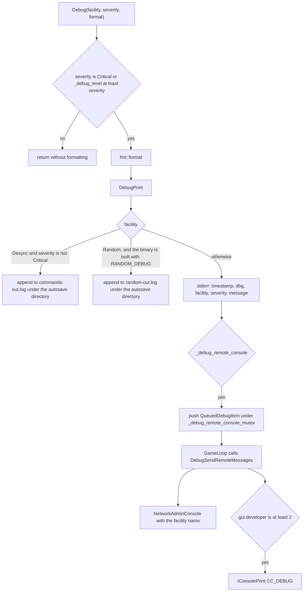
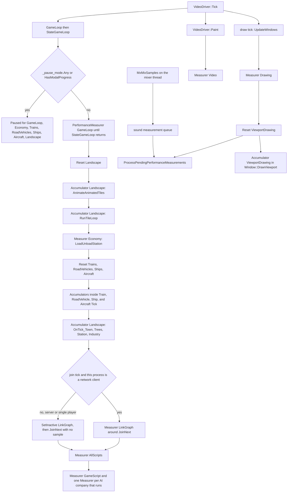

# Logging and performance metrics

Debug lines, the in-game console, the savegame gamelog, the frame-rate window, and NewGRF callback profiling. The older note is `docs/logging_and_performance_metrics.md`. Sentences that no longer match this tree are collected in [Stale claims](#stale-claims).

Two clocks already run apart. `VideoDriver::GetGameInterval` spaces simulation ticks. `VideoDriver::GetDrawInterval` spaces drawing. The frame-rate window reads both. A red or yellow duration means that element’s average used more of the 27 ms tick budget than the colour rule allows. Link-graph overruns on a server or in single player show up as a pause, not as that red row.

## Code map

| Symbol | Location | Role |
| --- | --- | --- |
| `Severity` | `src/debug_type.h` lines 14–25 | Message severity. No explicit values, so `Critical` is 0 and `Trace3` is 9 |
| `Facility` | `src/debug_type.h` lines 28–45 | Log category. `End` is the sentinel, not a category |
| `_debug_facilities` | `src/debug.cpp` lines 42–58 | Category names accepted by `-d` and `debug_level` |
| `_debug_level` | `src/debug.cpp` line 39 | Configured severity per `Facility`. Global, value-initialised, so every category starts at `Critical` |
| `Debug` | `src/debug.h` line 36 | Prints only for `Severity::Critical`, or when the category’s level is at least the message severity |
| `DebugPrint` | `src/debug.cpp` lines 87–112 | stderr, `commands-out.log`, or `random-out.log`, then the remote queue |
| `SetDebugString` | `src/debug.cpp` lines 121–164 | Parses a global integer and `name=integer` pairs. A parse error applies nothing |
| `DebugSendRemoteMessages` | `src/debug.cpp` lines 206–221 | Drains the queue onto the admin port and, when `gui.developer >= 2`, the console |
| `GameLoop` | `src/openttd.cpp` line 1366 | Calls `DebugSendRemoteMessages` once per game-thread turn, before the simulation branch |
| `IConsolePrint` | `src/console.cpp` lines 91–119 | Console buffer, optional log file, dedicated stdout, rcon or admin redirect |
| `IConsoleCmdExec` | `src/console.cpp` line 272 | Runs a console line |
| `ConDebugLevel` | `src/console_cmds.cpp` lines 1886–1902 | `debug_level` |
| `ConFramerate` / `ConFramerateWindow` | `src/console_cmds.cpp` lines 2768–2793 | `fps` and `fps_wnd` |
| `ConGamelogPrint` | `src/console_cmds.cpp` lines 2536–2544 | `gamelog` |
| `ConNewGRFProfile` | `src/console_cmds.cpp` lines 2630–2751 | `newgrf_profile` |
| `ConScript` | `src/console_cmds.cpp` lines 1300–1321 | `script`, the console log file |
| `IConsoleSwitch` | `src/console_gui.cpp` lines 430–444 | Opens or closes the console. Backtick does the same (line 272) |
| `Gamelog` / `_gamelog` | `src/gamelog.h` lines 51–101, `src/gamelog.cpp` | Savegame log of structural changes |
| `GamelogActionType` | `src/gamelog.h` lines 18–28 | Action kinds |
| `GamelogChangeType` | `src/gamelog.h` lines 31–45 | Change kinds inside an action |
| `PerformanceElement` | `src/framerate_type.h` lines 46–77 | What the frame-rate window can time |
| `PerformanceMeasurer` | `src/framerate_type.h` lines 90–99, `src/framerate_gui.cpp` lines 268–333 | One block, one sample, in the destructor |
| `PerformanceAccumulator` | `src/framerate_type.h` lines 112–119, `src/framerate_gui.cpp` lines 340–362 | Several blocks summed until `Reset` |
| `PerformanceData` / `_pf_data` | `src/framerate_gui.cpp` lines 53–246 | 512-point rings, rates, and the expected rates |
| `FramerateWindow` | `src/framerate_gui.cpp` lines 457–737 | The Frame Rate window |
| `ConPrintFramerate` | `src/framerate_gui.cpp` lines 1062–1121 | Text of the `fps` command |
| `ShowFramerateWindow` | `src/framerate_gui.cpp` lines 1046–1049 | Opens the window |
| `MenuClickHelp` | `src/toolbar_gui.cpp` lines 1174–1183 | Help-menu index 6 calls `ShowFramerateWindow` |
| `StateGameLoop` | `src/openttd.cpp` lines 1201–1276 | Owns the game-loop measurer and the pause gaps |
| `CallVehicleTicks` | `src/vehicle.cpp` lines 986–999 | Economy measurer and the vehicle-type resets |
| `OnTick_LinkGraph` | `src/linkgraph/linkgraphschedule.cpp` lines 202–217 | The only `GameLoopLinkGraph` sample |
| `UpdateWindows` | `src/window.cpp` lines 3160–3173 | Drawing measurer, viewport reset, sound-queue drain |
| `ProcessPendingPerformanceMeasurements` | `src/framerate_gui.cpp` lines 1130–1139 | Copies mixer samples into `_pf_data` |
| `NewGRFProfiler` | `src/newgrf_profiling.h` lines 21–55, `src/newgrf_profiling.cpp` | Callback CSV |
| `SpriteGroup::Resolve` | `src/newgrf_spritegroup.cpp` lines 34–51 | Starts and stops a profiler call |
| `MILLISECONDS_PER_TICK` | `src/gfx_type.h` line 417 | 27. Tick budget used to colour durations |
| `GetGameInterval` / `GetDrawInterval` | `src/video/video_driver.hpp` lines 309–334 | Simulation spacing and draw spacing |

## Log categories

`Facility` in `src/debug_type.h` is the category. The strings in `_debug_facilities` (`src/debug.cpp` lines 42–58) are the names `-d` and `debug_level` accept, in the same order as the enum:

| `Facility` | Name | Enum comment |
| --- | --- | --- |
| `Driver` | `driver` | Driver message facility |
| `Grf` | `grf` | Grf message facility |
| `Map` | `map` | Map message facility |
| `Misc` | `misc` | Misc message facility |
| `Net` | `net` | Net message facility |
| `Sprite` | `sprite` | Sprite message facility |
| `Oldloader` | `oldloader` | Oldloader message facility |
| `Yapf` | `yapf` | Yapf message facility |
| `Fontcache` | `fontcache` | Fontcache message facility |
| `Script` | `script` | Script message facility |
| `Sl` | `sl` | Saveload message facility |
| `Gamelog` | `gamelog` | Gamelog message facility |
| `Desync` | `desync` | Desync message facility |
| `Console` | `console` | Console message facility |
| `Random` | `random` | Random message facility |

There is no category named `ms`. The `debug_level` help text uses the example `net=5 ms=4` (`src/console_cmds.cpp` line 1890). `SetDebugString` treats `ms` as a category name, fails the lookup, and leaves every level unchanged.

`Severity` (`src/debug_type.h` lines 14–25), in source order:

| Enumerator | Value | Meaning in the enum comment |
| --- | --- | --- |
| `Critical` | 0 | Critical, user should know about this |
| `Error` | 1 | Error, but we are recovering |
| `Warning` | 2 | Warning, wrong but okay if you don't know |
| `Notice` | 3 | Notice |
| `Info` | 4 | Info, information you might care about |
| `Debug1` | 5 | Debug #1 - High level debug messages |
| `Debug2` | 6 | Debug #2 - Low level debug messages |
| `Trace1` | 7 | Trace information #1 |
| `Trace2` | 8 | Trace information #2 |
| `Trace3` | 9 | Trace information #3 |

`IsVisibleSeverity` is `_debug_level[facility] >= severity` (`src/debug.h` lines 24–28). A higher configured number shows more messages. `Debug` also prints when the message itself is `Severity::Critical`, even if the category is set lower (`src/debug.h` line 36). With the default array, only `Critical` lines appear.

`SetDebugString` (`src/debug.cpp` lines 121–164):

- A leading integer is stored into every category. `-D` uses this path with `net=4` (`src/openttd.cpp` line 532), which is `Severity::Info` for `net` only.
- After that, each `name=integer` updates one category. The name is a run of lowercase letters. The integer is cast to `Severity` with no range check.
- On an unknown name or a missing integer the error callback runs and the function returns before `_debug_level` is replaced.

`-d` is documented as `[[fac=]lvl[,...]]` (`src/openttd.cpp` line 162). On Windows, `-d` also opens a console (`src/openttd.cpp` lines 552–557). An empty `-d` does not raise any level. `ShowHelp` appends the facility names through `DumpDebugFacilityNames`.

The console command is `debug_level`. With no argument it prints `GetDebugString` (`name=value` pairs). With one argument it calls `SetDebugString`.

`gui.developer` defaults to 1, minimum 0, maximum 2 (`src/table/settings/gui_settings.ini` lines 807–815). It does not change `_debug_level`. It controls whether queued debug lines are copied into the in-game console. The post-callback calls `DebugReconsiderSendRemoteMessages`.

## From `Debug()` to output

`fmt::format` sits inside the `if` in the `Debug` macro, so a hidden message does not format its arguments.

`DebugPrint` (`src/debug.cpp` lines 87–112):

- `Facility::Desync` with any severity other than `Critical` goes to `commands-out.log` in `Subdirectory::Autosave`, with `GetLogPrefix(true)`, and returns. `Critical` desync lines fall through to stderr. Desync recording itself is described in `docs/zz-reach2/architecture/desync/archi-desync.md`.
- `Facility::Random` is diverted to `random-out.log` only inside `#ifdef RANDOM_DEBUG`. Otherwise it uses stderr.
- Every other line is `fmt::print` on stderr: `GetLogPrefix(true)`, then `dbg: [facility:severity] message`. `GetLogPrefix(true)` always includes the local timestamp (`src/debug.cpp` lines 190–196). The `show_date_in_logs` setting matters for callers that pass `force = false`, such as the console log file.

If `_debug_remote_console` is set, the formatted string is moved onto `_debug_remote_console_queue`. `DebugReconsiderSendRemoteMessages` sets that flag when `gui.developer >= 2` or any connected admin has `AdminUpdateType::Console` at `AdminUpdateFrequency::Automatic` (`src/debug.cpp` lines 230–241). `GameLoop` drains the queue on the game thread (`src/openttd.cpp` line 1366) so the admin packet queue and the console buffer are not touched from arbitrary threads. A line printed during `StateGameLoop` is already on stderr; the console and admin copies wait for the next `GameLoop`.

`NetworkAdminConsole` (`src/network/network_admin.cpp` lines 1063–1069) sends only to admins who still have automatic console updates. The in-game copy is `dbg: [facility] message` with no severity (`src/debug.cpp` line 217).

`TicToc` (`src/debug.h` lines 55–113) is a separate stopwatch. Its destructor adds microseconds to a thread-local `State`. `TicToc::Tick` prints each active state through `Debug(Facility::Misc, Severity::Critical, ...)`, which is always visible. `GetGameInterval` and `GetDrawInterval` call `TicToc::Tick`. With no live `TicToc::State`, that call prints nothing.

`ShowInfo` (`src/debug.h` line 116) is not `Debug`. Command-line parse errors for the debug string go to `ShowInfoI`, which writes stderr when a console exists (`src/os/windows/win32.cpp` lines 217–220).

## The console

The toolbar help menu entry `STR_ABOUT_MENU_TOGGLE_CONSOLE` ("Toggle console") and the backtick key call `IConsoleSwitch`. Enter runs `IConsoleCmdExec` on the line (`src/console_gui.cpp` lines 276–284).

`IConsolePrint` (`src/console.cpp` lines 91–119):

- A client rcon redirect (`_redirect_console_to_client`) sends the line and returns.
- An admin rcon redirect sends and returns.
- Otherwise the line is stripped of colour codes. A dedicated server prints it on stdout, notifies `NetworkAdminConsole("console", ...)`, and appends it to the console log file if one is open. A local GUI appends the log file and calls `IConsoleGUIPrint`.

`script <filename>` opens that log in append mode (`src/console_cmds.cpp` lines 1300–1321). `GetLogPrefix()` with `force` false prefixes those lines only when `gui.show_date_in_logs` is set. Calling `script` again closes the file.

Commands that belong to this subsystem:

| Command | What it does |
| --- | --- |
| `debug_level` | Print or replace `_debug_level` |
| `fps` | `ConPrintFramerate`. Works on a dedicated server |
| `fps_wnd` | `ShowFramerateWindow`. Refused when `_network_dedicated` is set |
| `gamelog` | `Gamelog::PrintConsole` |
| `newgrf_profile` | Callback profiling. Hidden unless `gui.newgrf_developer_tools` is set. Refused in `GameMode::Menu` and whenever `_networking` is set (`ConHookNewGRFDeveloperTool`, `src/console_cmds.cpp` lines 236–245) |

The help menu string `STR_ABOUT_MENU_SHOW_FRAMERATE` is "Show frame rate". `MenuClickHelp` index 6 opens the window (`src/toolbar_gui.cpp` lines 1086–1095 and 1183).

## Gamelog

`_gamelog` is a list of `LoggedAction` values, each with a `GamelogActionType`, the `TimerGameTick::counter` at the first change, and a vector of `LoggedChange` (`src/gamelog_internal.h` lines 246–255). It is a savegame chunk (`src/saveload/gamelog_sl.cpp`). `CrashLog::WriteSavegame` calls `_gamelog.Emergency()` and then saves `crash` plus a UTC timestamp plus `.sav` (`src/crashlog.cpp` lines 76–83 and 223–235). The crash survey JSON includes the same text under `gamelog` (`src/crashlog.cpp` lines 42–46 and 157).

`GamelogActionType` (`src/gamelog.h` lines 18–28): `Start`, `Load`, `GRF`, `Cheat`, `Setting`, `GRFBug`, `Emergency`, then `End` and `None`. The print strings are in `la_text` (`src/gamelog.cpp` lines 131–139). This tree calls `StartAction` for `Start` (`src/misc.cpp` line 166), `Load` (`src/saveload/saveload.cpp`), `GRF` (`src/newgrf_gui.cpp` line 1929), `Setting` (`src/settings.cpp` line 1643), `GRFBug` (`Gamelog::GRFBugReverse`), and `Emergency` (`Gamelog::Emergency`). No call site passes `GamelogActionType::Cheat`. `Gamelog::Mode` still accepts that action type (`src/gamelog.cpp` line 390).

`StopAction` prints the finished action at `Severity::Debug1` on facility `gamelog` (`src/gamelog.cpp` lines 75–84). `AfterLoadGame` prints the whole log at `Severity::Error` (`src/saveload/afterload.cpp` line 3434). Both are hidden at the default `Critical` level. `gamelog` on the console always prints, through `IConsolePrint(CC_WARNING, ...)` (`src/gamelog.cpp` lines 308–312).

Changes the log actually records:

- NewGRF add, remove, compatible replacement, parameter change, and order change (`Gamelog::GRFUpdate`, `src/gamelog.cpp`).
- Game mode and landscape (`Gamelog::Mode`).
- Revision text, savegame version, the modified-build flag, and `_openttd_newgrf_version` (`LoggedChangeRevision`).
- Loads that predate the gamelog, including TTO, TTD, and TTDPatch (`LoggedChangeOldVersion::FormatTo`).
- A setting whose flags include `SettingFlag::NoNetwork` or `SettingFlag::Sandbox` (`src/settings.cpp` lines 1642–1645). The stored fields are the setting name and the old and new `int32_t` values.
- `GRFBug::VehLength`, written by `Gamelog::GRFBugReverse`. `VehicleLengthChanged` uses the return value (`src/vehicle.cpp` lines 365–373).

The two comments on `GamelogChangeType::GRFAdd` and `GRFRem` (`src/gamelog.h` lines 36–37) say the opposite of the type names. `LoggedChangeGRFAdd::FormatTo` prints "Added NewGRF" and `LoggedChangeGRFRemoved::FormatTo` prints "Removed NewGRF" or "Missing NewGRF" (`src/gamelog.cpp` lines 228–247).

The change structs hold revision text, GRF ids, GRF checksums, setting names, integer setting values, mode, landscape, tick, and bug data (`src/gamelog_internal.h`). None of those fields is a player or company name.

## A frame’s performance accumulators

`PerformanceElement` (`src/framerate_type.h` lines 46–77), in enum order. The window shows a different order: scripts sit above link graph (`DISPLAY_ORDER_PFE`, `src/framerate_gui.cpp` lines 369–399).

| Element | How it is taken | Where |
| --- | --- | --- |
| `GameLoop` | `PerformanceMeasurer` around the unpaused body | `StateGameLoop`, `src/openttd.cpp` line 1224 |
| `GameLoopEconomy` | `PerformanceMeasurer` around `LoadUnloadStation` only | `CallVehicleTicks`, `src/vehicle.cpp` lines 993–995 |
| `GameLoopTrains` | `PerformanceAccumulator` around the front engine’s `TrainLocoHandler` calls | `Train::Tick`, `src/train_cmd.cpp` lines 4205–4214 |
| `GameLoopRoadVehicles` | `PerformanceAccumulator` around all of `RoadVehicle::Tick` | `src/roadveh_cmd.cpp` line 1660 |
| `GameLoopShips` | `PerformanceAccumulator` around all of `Ship::Tick` | `src/ship_cmd.cpp` line 809 |
| `GameLoopAircraft` | `PerformanceAccumulator` after the normal-aircraft check | `src/aircraft_cmd.cpp` lines 2144–2148 |
| `GameLoopLandscape` | `PerformanceAccumulator`, reset once per unpaused `StateGameLoop` | `AnimateAnimatedTiles`, `RunTileLoop`, and the town/tree/station/industry block of `CallLandscapeTick` |
| `GameLoopLinkGraph` | `PerformanceMeasurer` around `JoinNext` on a network client. `SetInactive` on the server and in single player | `OnTick_LinkGraph`, `src/linkgraph/linkgraphschedule.cpp` lines 209–215 |
| `Drawing` | `PerformanceMeasurer` for one `UpdateWindows` pass | `src/window.cpp` line 3170 |
| `ViewportDrawing` | `PerformanceAccumulator` inside `Window::DrawViewport` | `src/viewport.cpp` line 1908 |
| `Video` | `PerformanceMeasurer` in each driver’s `Paint` | SDL default, SDL OpenGL, Win32 GDI, Win32 OpenGL, Allegro, Cocoa, Cocoa OpenGL |
| `Sound` | `PerformanceMeasurer` in `MxMixSamples`, queued off the mixer thread | `src/mixer.cpp` line 127 |
| `AllScripts` | `PerformanceMeasurer` around `AI::GameLoop` and `Game::GameLoop` | `src/openttd.cpp` lines 1264–1266 |
| `GameScript` | `PerformanceMeasurer` around the instance `GameLoop` | `src/game/game_core.cpp` line 42 |
| `AI0` … `AI14` | `PerformanceMeasurer` per AI company | `src/ai/ai_core.cpp` lines 77–94 |

`_pf_data` holds one `PerformanceData` per element (`src/framerate_gui.cpp` lines 216–246). Each ring is `NUM_FRAMERATE_POINTS` (512) durations and timestamps, in microseconds (`TIMESTAMP_PRECISION` is 1000000). `GetPerformanceTimer` reads `std::chrono::high_resolution_clock`.

A `PerformanceMeasurer` stores one sample in its destructor (`Add`). A `PerformanceAccumulator` adds to `acc_duration` in its destructor. `Reset` calls `BeginAccumulate`, which first commits the previous sum as one ring sample and then zeroes the sum (`src/framerate_gui.cpp` lines 102–112 and 359–361). The number on screen is the previous commit, not the block still running. `Reset` has to run once per cycle or the ring never advances. Vehicle types are reset at the start of `CallVehicleTicks`. Landscape is reset at the start of the unpaused `StateGameLoop`. Viewport drawing is reset at the start of `UpdateWindows`.

`PerformanceElement::Sound` must not touch `_pf_data` on the mixer thread. The destructor pushes the start and end times into `_sound_perf_measurements` and sets `_sound_perf_pending`. `UpdateWindows` calls `ProcessPendingPerformanceMeasurements` before it draws (`src/window.cpp` line 3173). The queue stops accepting pairs once it holds `512 * 2` measurements.

`OnTick_Companies` and `OnTick_LinkGraph` sit outside the landscape accumulator (`src/landscape.cpp` lines 1729–1741). Industry production (`ProduceIndustryGoods` in `OnTick_Industry`) is inside it. Station ratings run from `OnTick_Station` (`UpdateStationRating` in `StationHandleSmallTick`), so they are inside world ticks.

`AI::GameLoop` returns immediately unless `competitor_speed` lets this tick through (`src/ai/ai_core.cpp` lines 87–90). Skipped ticks add no AI sample and do not clear the old ones. `AllScripts` still records the cheap call. Its average can therefore sit below the sum of the AI rows. The `AllScripts` destructor drops the sample when `GameScript` and every `AI0`–`AI14` slot have `num_valid == 0` (`src/framerate_gui.cpp` lines 279–286).

While paused, `StateGameLoop` still calls `Game::GameLoop` when the game is not in a modal progress window (`src/openttd.cpp` lines 1217–1220). That records `GameScript` without recording `AllScripts`.

## The performance window

`FramerateWindow::UpdateData` runs every 100 ms (`src/framerate_gui.cpp` lines 505–533).

Three rate lines:

- Simulation rate is `GameLoop.GetRate()`, coloured against `expected_rate`. That expected rate is `GL_RATE`, `1000.0 / MILLISECONDS_PER_TICK`, with `MILLISECONDS_PER_TICK` equal to 27 (`src/framerate_gui.cpp` lines 209 and 217, `src/gfx_type.h` line 417).
- Graphics frame rate is `Drawing.GetRate()`, coloured against `gui.refresh_rate` (default 60, `src/table/settings/gui_settings.ini` lines 870–876).
- Game speed factor is simulation rate divided by `GL_RATE`, coloured against 1.0. `_game_speed` is 100 at normal speed and `gui.fast_forward_speed_limit` while fast-forward is held (`src/gfx.cpp` lines 40 and 1875–1880). The interval is `MILLISECONDS_PER_TICK * 1000 * 100 / _game_speed` microseconds (`src/video/video_driver.hpp` lines 319–324). The factor is how far the measured tick rate sits from one tick per 27 ms.

Rate colours (`CachedDecimal::SetRate`, lines 465–470): light blue above `target * 0.95` (`STR_FRAMERATE_FPS_GOOD`), red below `target * 2 / 3` (`STR_FRAMERATE_FPS_BAD`), yellow between them (`STR_FRAMERATE_FPS_WARN`).

The lower grid is one row per element with `num_valid > 0`, in `DISPLAY_ORDER_PFE`. The English labels start at `STR_FRAMERATE_GAMELOOP` (`src/lang/english.txt` lines 3352–3366): "Game loop total", "Cargo handling", "Train ticks", "Road vehicle ticks", "Ship ticks", "Aircraft ticks", "World ticks", "Link graph delay", then graphics, viewports, video, sound, "GS/AI total", and "Game script". AI rows use `STR_FRAMERATE_AI` with the company index plus one and the AI name.

Duration colours (`SetTime`, lines 473–478), for every row including vehicles and link graph. The target passed in is `MILLISECONDS_PER_TICK` (27), not the element’s `expected_rate`:

- Light blue (`STR_FRAMERATE_MS_GOOD`) when the average is below `27 / 3` milliseconds (9 ms).
- Yellow (`STR_FRAMERATE_MS_WARN`) from 9 ms through 27 ms.
- Red (`STR_FRAMERATE_MS_BAD`) when the average is above 27 ms.

"Current" is the mean of the last 8 ring samples. "Average" is the mean of up to 512 (`src/framerate_gui.cpp` lines 521–522). Invalid pause gaps are left out of the mean. The `expected_rate` stored as `1` for economy, vehicles, landscape, link graph, and scripts is not what paints those colours.

The Memory column is filled for `GameScript` (`Game::GetInstance()->GetAllocatedMemory()`), each AI (`ai_instance->GetAllocatedMemory()`), and `Sound` (`GetSoundPoolAllocatedMemory()`). Other rows leave the cell empty (`src/framerate_gui.cpp` lines 634–663).

A click on the name, Current, or Average column opens `FrametimeGraphWindow` for that element (lines 706–726). The graph plots the ring and marks a peak. It does not draw the 9 ms or 27 ms budget. The Memory column is not a click target.

A shaded window skips the grid and puts the simulation rate and the speed factor in the caption (`STR_FRAMERATE_CAPTION_SMALL`, lines 515 and 539–543).

`fps` prints three duration windows, not the GUI’s 8 and 512: `512/8`, `512/4`, and `512/1`, which are 64, 128, and 512 points (`src/framerate_gui.cpp` lines 1064–1066 and 1110–1114). It also prints rates for `GameLoop`, `Drawing`, and `Video` against each element’s `expected_rate`. The console names for the vehicle and link-graph rows are "GL train ticks", "GL road vehicle ticks", "GL ship ticks", "GL aircraft ticks", and "GL link graph delays" (lines 1070–1078).

Drawing is not once per simulation tick. `VideoDriver::Tick` runs `UpdateWindows` when the draw deadline is due, and `GetDrawInterval` is `1000000 / gui.refresh_rate` microseconds, or zero when vsync owns the hardware-accelerated driver (`src/video/video_driver.hpp` lines 327–333, `src/video/video_driver.cpp` lines 117–153). `StateGameLoop` runs on the game interval. `Video` is `Paint`, after `UpdateWindows` has released the game-state lock.

### Vehicles over budget

Read the Train ticks, Road vehicle ticks, Ship ticks, and Aircraft ticks rows.

- Red on Current means the last 8 committed samples average more than 27 ms. Red on Average means the long ring does.
- Yellow means that average is at least 9 ms and at most 27 ms.
- Light blue means it is under 9 ms.

Those four rows are pieces of the game-loop measurer, not a partition of it. Train ticks include only the front engine’s two `TrainLocoHandler` calls. Road and ship ticks include every vehicle of that type, front or not. Aircraft ticks include only normal aircraft. Pathfinding that those handlers call is inside the row; station loading is the Cargo handling row, not the vehicle rows.

`fps` answers the same question with the 64, 128, and 512 point means. A dedicated server has `fps` and does not have the window (`fps_wnd` returns an error).

### Link graph over budget

`JoinNext` pops the oldest running job and `delete`s it, which joins the worker (`src/linkgraph/linkgraphschedule.cpp` lines 68–80). That wait is the delay the enum comment describes: "Time spent waiting for link graph background jobs".

`OnTick_LinkGraph` records it only when `_networking` is set and this process is not the server. The sample is one `PerformanceMeasurer` around `JoinNext`. Colour it with the same 9 ms and 27 ms rule. A red Link graph delay row means the client’s join waited longer than one 27 ms tick, on average over the column you are looking at.

On the server and in single player the same function calls `PerformanceMeasurer::SetInactive`, which zeroes `num_valid`, and then joins with no timer. The row stays hidden. A late job is handled earlier by `StateGameLoop_LinkGraphPauseControl` (`src/linkgraph/linkgraphschedule.cpp` lines 169–183): if the next join is two economy-date-fraction ticks away and `IsJoinWithUnfinishedJobDue` is true, it posts `Commands::Pause` with `PauseMode::LinkGraph`. The status bar then uses `STR_STATUSBAR_PAUSED_LINK_GRAPH`: "PAUSED (waiting for link graph update)" (`src/statusbar_gui.cpp` line 138, `src/lang/english.txt` line 856). The pause bit makes `StateGameLoop` take the gap path, so the simulation rate collapses until the job finishes and the pause is cleared. The join itself is described in `docs/zz-reach2/architecture/linkgraph/jobs.md`.

## NewGRF callback profiling

`newgrf_profile` selects GRFs, then `start` calls `NewGRFProfiler::Start`. An optional tick count arms a `TimeoutTimer<TimerGameTick>` (`src/newgrf_profiling.cpp` lines 185–191). The help text says there are 74 ticks in a calendar day; `Ticks::DAY_TICKS` is 74 (`src/timer/timer_game_tick.h` line 75). `stop` and the timer call `FinishAll`. `abort` discards the calls.

While a profiler is active, `SpriteGroup::Resolve` calls `BeginResolve` / `EndResolve` for a top-level resolve of that GRF, and `RecursiveResolve` for a nested one (`src/newgrf_spritegroup.cpp` lines 38–50). `Finish` writes a CSV under the screenshot directory, named `grfprofile-YYYYMMDD-HHMM-<grfid>.csv` (`src/newgrf_profiling.cpp` lines 131–154).

The header is `Tick,Sprite,Feature,Item,CallbackID,Microseconds,Depth,Result`.

| Column | Source |
| --- | --- |
| Tick | `TimerGameTick::counter` stored in `Call::tick` (`uint64_t`) |
| Sprite | `resolver.root_spritegroup->nfo_line` |
| Feature | `resolver.GetFeature()`, printed as hex. `GrfSpecFeature::Invalid` is `0xFF` (`src/newgrf.h` line 110). The default `ResolverObject::GetFeature` returns that |
| Item | `resolver.GetDebugID()`. Cargo, rail, road, and tram resolvers return `FlattenNewGRFLabel` of the type label (`src/newgrf_cargo.cpp` lines 31–34, `src/newgrf_railtype.cpp` lines 77–80, `src/newgrf_roadtype.cpp` lines 123–126) |
| CallbackID | `resolver.callback`. `CBID_NO_CALLBACK` is `0x00`, "Set when using the callback resolve system, but not to resolve a callback" (`src/newgrf_callbacks.h` lines 23–24) |
| Microseconds | `high_resolution_clock` difference taken in `EndResolve` |
| Depth | `Call::subs`, incremented by `RecursiveResolve`. Zero means the resolve did not enter another group |
| Result | `CallbackResult` for a numeric callback; `GetSpriteLocalID` of the result sprite for a `ResultSpriteGroup`; `nfo_line` for a tile layout or industry production group; 0 for `std::monostate` (`src/newgrf_profiling.cpp` lines 68–90) |

AI purchase selection sets `generic_scope.feature` to the feature argument of `GetAiPurchaseCallbackResult` (`src/newgrf_generic.cpp` line 227). Ambient sound sets it to `GrfSpecFeature::SoundEffects` (line 249). Neither path leaves the feature at `Invalid`.

## Stale claims

From `docs/logging_and_performance_metrics.md`.

| Legacy sentence | What this tree does |
| --- | --- |
| The target tick is 30 ms and the expected rate is 33.33 frames/second | `MILLISECONDS_PER_TICK` is 27. `GL_RATE` is `1000.0 / 27`. The speed factor divides by that |
| Simulation rate and graphics rate are usually identical, and split rates might exist in the future | `GetGameInterval` and `GetDrawInterval` are already separate. Drawing is coloured against `gui.refresh_rate` (default 60), not against the simulation rate |
| Cargo handling includes industries and towns sending and retrieving cargo | `GameLoopEconomy` times only `LoadUnloadStation`. `ProduceIndustryGoods` runs under the landscape accumulator in `OnTick_Industry` |
| Link graph delay counts background overruns in general | A sample is recorded only around `JoinNext` on a network client. Server and single player call `SetInactive` and leave the row empty. The late-job signal there is `PauseMode::LinkGraph` and the status text "PAUSED (waiting for link graph update)" |
| Video output and sound mixing are "usually" 0–3 ms, and a slow mixer means switching to the NoSound set | No 3 ms constant exists. Every duration row, including video and sound, turns yellow at 9 ms and red above 27 ms |
| `fps` is a summary of the same statistics | `fps` prints 64, 128, and 512 point means. The window’s Current column is 8 points and its Average column is 512 |
| The gamelog is shown by running OpenTTD in debug mode | Automatic prints use `Severity::Error` after load and `Severity::Debug1` when an action stops. The default category level is `Critical`, so both stay hidden. `-d` with no level does not raise them. The console command `gamelog` always prints |
| The log is stored in `crash.sav` | `WriteSavegame` uses `crash` plus a UTC timestamp plus `.sav`, after `_gamelog.Emergency()`. The JSON crash log embeds the printed gamelog |
| Logged settings are the ones that affect NewGRF behaviour | The gate is `SettingFlag::NoNetwork` or `SettingFlag::Sandbox` |
| CSV Feature is `0xFF` for AI purchase selection and ambient sound | AI purchase stores the feature it was called with. Ambient sound stores `GrfSpecFeature::SoundEffects`. `0xFF` is `GrfSpecFeature::Invalid`, the default of `ResolverObject::GetFeature` |
| The Tick column may wrap to zero during a recording | `Call::tick` and `TimerGameTick::TickCounter` are `uint64_t` |
| A sprite Result is the index of the base Action 2 | A `ResultSpriteGroup` result is `GetSpriteLocalID` of the result sprite ("GRF-local sprite id", `src/spritecache.cpp` lines 159–166). Tile layout and industry production results are `nfo_line`. The Sprite column, not Result, is the root group’s `nfo_line` |
| `newgrf_profile` needs the developer tools and a game or the editor | It also returns `ConsoleHookResult::Disallow` whenever `_networking` is set |

These parts of the old note still match:

- The help menu opens the frame-rate window, and `fps` prints a text summary, including on a dedicated server.
- A shaded window’s caption carries the simulation rate and the speed factor.
- Pausing takes the simulation through `PerformanceMeasurer::Paused` for the game-loop elements, which clears their sample history.
- Current is a short average. AI rows can outlast `AllScripts` because a low `competitor_speed` skips ticks without clearing the AI samples.
- World ticks cover animated tiles, the tile loop, and the town, tree, station, and industry on-tick calls, including station ratings.
- Clicking a duration row opens the graph.
- The gamelog records NewGRF add, remove, reorder, parameters, and compatible loads, mode and landscape changes, foreign and older saves, a modified build, `NoNetwork` / `Sandbox` settings, and the vehicle-length NewGRF bug. The console command is `gamelog`.
- `newgrf_profile` writes one CSV row per measured sprite-group resolve, with the header above, and refuses to run from the main menu.

## Invariants

Logging and the performance rings must not change simulation results.

- `Debug` and `DebugPrint` format a string and write stderr, a log file, or the remote queue. They do not call the game `Randomizer` and they do not write tiles, vehicles, companies, or settings. Arguments of a hidden `Debug` are not evaluated. A call site that writes game state inside those arguments would start doing so as soon as the category level is raised. Keep the arguments to values that are already computed.
- `PerformanceMeasurer`, `PerformanceAccumulator`, and `NewGRFProfiler` read `high_resolution_clock` into process-local buffers. `_pf_data` is not a savegame chunk. The mixer queue is applied on the draw path. Nothing in those types branches vehicle movement, economy, or the link-graph job. `SetInactive` only clears a ring.
- `TicToc` prints through `Debug(Facility::Misc, Severity::Critical)` and resets its own counters. It is not a game-state input.
- The one debug-level gate inside `StateGameLoop` is the desync dump: when `Facility::Desync` is visible at `Severity::Error` and the economy date matches the mask, it calls `SaveOrLoad` (`src/openttd.cpp` lines 1238–1241). That writes a file because the level is raised. It is not a `Debug` print. Do not add further simulation writes next to a log line.
- `_gamelog` is saved state. Appending an action changes the savegame. `GRFBugReverse` is a deliberate read of that log, and `VehicleLengthChanged` uses it to decide on a warning and a pause. New log entries stay out of economy and movement code unless a call site is added for that purpose and reviewed as simulation.
- `fps` and the frame-rate window only read `_pf_data`, `_game_speed`, and `gui.refresh_rate`. Painting a row red does not pause the game. The link-graph pause comes from `IsJoinWithUnfinishedJobDue`, not from the duration colour.
- `newgrf_profile` times `SpriteGroup::Resolve` and then returns that function’s `ResolverResult`. The profiler must not replace the result, the callback id, or the random bits the resolver consumes.
