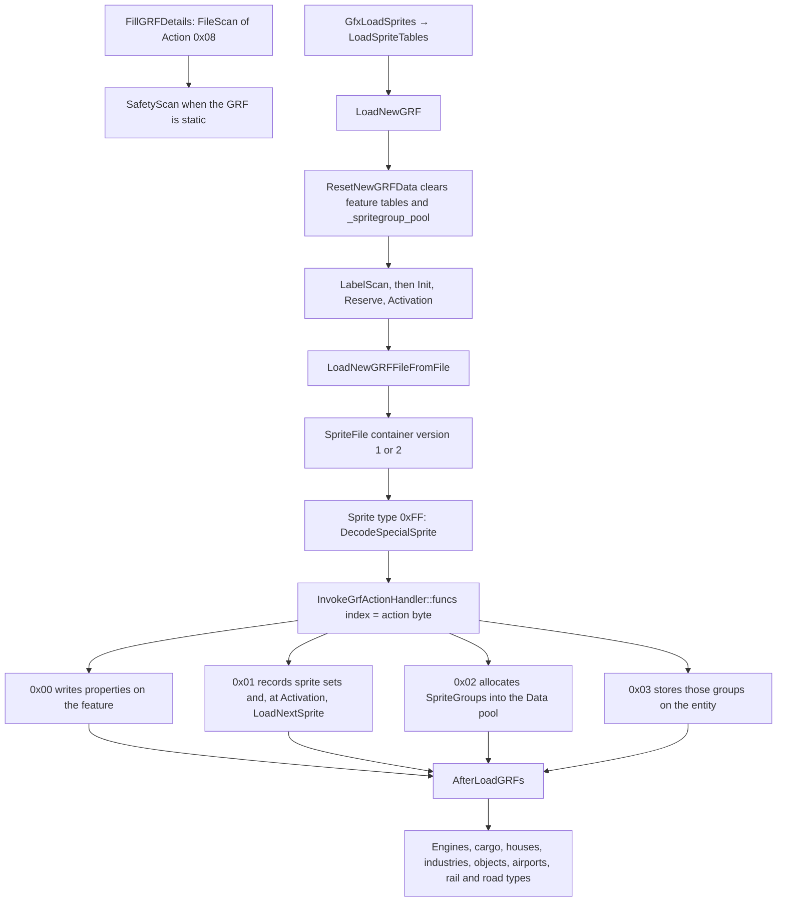
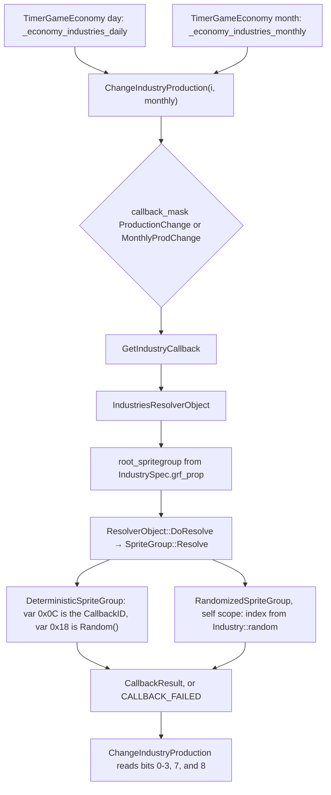

# NewGRF interpreter

NewGRF is the GRF container OpenTTD uses to replace and extend vehicles, industries, houses, stations, cargo, and graphics. The interpreter lives in `src/newgrf.cpp`, `src/newgrf.h`, `src/newgrf/`, and the feature modules beside them (`src/newgrf_engine.cpp`, `src/newgrf_industries.cpp`, `src/newgrf_spritegroup.*`, `src/newgrf_commons.*`). Sprite bytes are read by `src/spriteloader/sprite_file.cpp` and `src/spritecache.cpp`. Active GRFs are recorded by `src/saveload/newgrf_sl.cpp`.

There is no `Action` enum. Each action is a `uint8_t` and a `GrfActionHandler<TAction>` specialization. The legal values are the template arguments in `InvokeGrfActionHandler::funcs` (`src/newgrf.cpp` lines 1230–1233): `0x00` through `0x14`, in that order. Callback identifiers are the `CallbackID` enum in `src/newgrf_callbacks.h`.

Companion notes: [features.md](features.md), [sprite-groups.md](sprite-groups.md), [callbacks.md](callbacks.md).

## What a loaded GRF becomes

`GRFConfig` (`src/newgrf_config.h` lines 154–198) is the list entry: filename, `GRFIdentifier` (`grfid` plus MD5), parameters, palette, status, and flags. The live list is `_grfconfig` (line 212).

`GRFFile` (`src/newgrf.h` lines 125–188) is the activated file: `grfid`, `grf_version`, parameters, cargo/rail/road/tram translation tables, per-feature spec vectors (stations, houses, industries, objects, airports, road stops), and the Action `0x10` label list. Loaded files sit in the vector `_grf_files` (`src/newgrf.cpp` line 64). `ResetNewGRF` reserves that vector to `_grfconfig.size()` so pointers to `GRFFile` stay valid across the multi-stage load (lines 393–396).

Feature behaviour is not stored as a second copy of the file. Action `0x00` writes properties into engine, house, industry, and similar specs. Action `0x03` stores `SpriteGroup` pointers on those specs (`GRFFilePropsBase` / `StandardGRFFileProps` in `src/newgrf_commons.h` lines 310–394). `AfterLoadGRFs` (`src/newgrf.cpp` lines 1633–1752) then moves industry, house, object, and airport specs into the global arrays through each feature's `OverrideManager`.

## GRF container

`SpriteFile` detects the container in `GetGRFContainerVersion` (`src/spriteloader/sprite_file.cpp` lines 22–38):

- The first word is `0`, and the next eight bytes are `_grf_cont_v2_sig` (`'G'`, `'R'`, `'F'`, `0x82`, `0x0D`, `0x0A`, `0x1A`, `0x0A`, line 15). That file is container version 2.
- The first word is not `0`. The reader rewinds. That file is container version 1 (no header).
- The version-2 signature does not match. The function returns `0`, and `LoadNewGRFFileFromFile` rejects the file (`src/newgrf.cpp` lines 1304–1307).

`LoadNewGRFFileFromFile` (lines 1297–1382) then walks sprites. A length is a dword on version 2 and a word on version 1.

Version 2 starts with a sprite-section offset. `ReadGRFSpriteOffsets` (`src/spritecache.cpp` lines 556–600) seeks there during `GrfLoadingStage::Init` and `GrfLoadingStage::Activation`, because sounds and real sprites need those offsets. Other stages only skip the dword (lines 1310–1316). The next byte is compression; any value other than `0` aborts the file (lines 1319–1325).

The first sprite must have length 4 and type byte `0xFF`, followed by a dword the loader ignores (lines 1328–1336). The loop then reads sprites until length 0 (line 1343):

| Type byte | Meaning in this loader |
| --- | --- |
| `0xFF` | Pseudo-sprite. `DecodeSpecialSprite` reads it (or an Action `0x06` override of the same bytes) and dispatches on the first content byte. |
| `0xFD` and container version ≥ 2 | Reference into the sprite section. The bytes are skipped (lines 1372–1374). |
| anything else | Real sprite. If `skip_sprites` is 0 the GRF is disabled (`STR_NEWGRF_ERROR_UNEXPECTED_SPRITE`). Otherwise the sprite is skipped and the skip count drops (lines 1365–1381). |

Inside a pseudo-sprite, `DecodeSpecialSprite` (lines 1254–1288) reads one action byte:

- `0xFF` is logged as an unexpected data block and skipped.
- `0xFE` is logged as an unexpected import block and skipped.
- any other value is `InvokeGrfActionHandler::Invoke`. An index past `funcs` is logged and skipped (lines 1236–1244).

Actions that introduce real sprites do not leave those sprites for the outer loop. On `GrfLoadingStage::Activation`, Action `0x01` calls `LoadNextSprite` once per sprite (`src/newgrf/newgrf_act1.cpp` lines 59–61). On earlier stages the same action sets `_cur_gps.skip_sprites` so the outer loop skips them (`SkipAct1`, lines 79–81). Action `0x05` and Action `0x0A` follow the same pattern. Action `0x07` / `0x09` set `skip_sprites` to a count, or to `-1` to stop the file (`src/newgrf/newgrf_act7_9.cpp` lines 344–349).

Pseudo-sprites larger than 1 MiB disable the GRF (lines 1349–1353). A read past the pseudo-sprite disables it with `STR_NEWGRF_ERROR_READ_BOUNDS` (lines 1285–1287). The loader treats GRF bytes as trusted input (`src/newgrf.cpp` lines 1248–1253).

## Loading stages

`GrfLoadingStage` (`src/newgrf.h` lines 55–63):

| Stage | Role |
| --- | --- |
| `FileScan` | Action `0x08` only: GRF version, GRFID, name (`ScanInfo` in `src/newgrf/newgrf_act8.cpp`). `FillGRFDetails` runs this (`src/newgrf_config.cpp` line 299). |
| `SafetyScan` | Static GRFs. Action `0x00` / `0x03` / `0x0F` / `0x11` that are not on the safe list call `GRFUnsafe` and set `GRFConfigFlag::Unsafe`. |
| `LabelScan` | Action `0x10` records goto labels (`DefineGotoLabel`). `InitNewGRFFile` creates the `GRFFile`. |
| `Init` | Parameters (Action `0x0D`), sounds, names, errors, and Action `0x09` skips. Action `0x07` does nothing in this stage. |
| `Reserve` | Action `0x00` handlers that need to claim IDs (cargo, rail types, road types, global variables). `GRFConfigFlag::Reserved` is set afterwards. |
| `Activation` | Properties, sprite sets, sprite groups, graphics, and the Action `0x03` binding. |
| `End` | Sentinel. `LoadNewGRF` iterates `EnumRange(LabelScan, End)`, so `End` itself is not a pass. |

`LoadNewGRF` (`src/newgrf.cpp` lines 1759–1880) is called from `LoadSpriteTables` (`src/gfxinit.cpp` line 215), which `GfxLoadSprites` runs. Before the stage loop it calls `ResetNewGRFData`. Between Reserve and Activation it sets every `GRFStatus::Activated` file back to `GRFStatus::Initialised` so Action `0x07` / `0x09` conditions `0x06`–`0x0A` see the right "will be active" state (lines 1810–1814). Non-static, non-system files stop being loaded once `NETWORK_MAX_GRF_COUNT` is reached (lines 1844–1850).

`AfterLoadGRFs` finalises strings, badges, cargo, engines, canals, houses, industries, objects, airports, rail types, road types, and price multipliers. Industry and object specs are installed only here, because Action `0x00` can touch them at any point in the file (`FinaliseIndustriesArray`, lines 1114–1115).

## Action dispatch

`InvokeGrfActionHandler::funcs` (`src/newgrf.cpp` lines 1230–1233). Empty specializations are omitted from the "does work" column; the file still defines all six stages.

| Action | Source | Stage that does the work |
| --- | --- | --- |
| `0x00` | `src/newgrf/newgrf_act0.cpp` plus `newgrf_act0_*.cpp` | SafetyScan `SafeChangeInfo`; Reserve `ReserveChangeInfo`; Activation `FeatureChangeInfo` |
| `0x01` | `src/newgrf/newgrf_act1.cpp` | Earlier stages `SkipAct1`; Activation `NewSpriteSet` |
| `0x02` | `src/newgrf/newgrf_act2.cpp` | Activation `NewSpriteGroup` |
| `0x03` | `src/newgrf/newgrf_act3.cpp` | SafetyScan marks the file unsafe; Activation `FeatureMapSpriteGroup` |
| `0x04` | `src/newgrf/newgrf_act4.cpp` | Activation `FeatureNewName` |
| `0x05` | `src/newgrf/newgrf_act5.cpp` | Earlier stages `SkipAct5`; Activation `GraphicsNew`. Block kinds are `Action5BlockType` (`src/newgrf_act5.h` lines 16–20) |
| `0x06` | `src/newgrf/newgrf_act6.cpp` | Init, Reserve, Activation `CfgApply`: patch the next pseudo-sprite from GRF parameters |
| `0x07` | `src/newgrf/newgrf_act7_9.cpp` | Reserve and Activation `SkipIf`. Init is empty |
| `0x08` | `src/newgrf/newgrf_act8.cpp` | FileScan `ScanInfo`; Init, Reserve, Activation `GRFInfo`. Version must be 2..8 (lines 30–33) |
| `0x09` | `src/newgrf/newgrf_act7_9.cpp` | Init, Reserve, and Activation `SkipIf` |
| `0x0A` | `src/newgrf/newgrf_acta.cpp` | Earlier stages `SkipActA`; Activation `SpriteReplace` |
| `0x0B` | `src/newgrf/newgrf_actb.cpp` | Init, Reserve, Activation `GRFLoadError` |
| `0x0C` | `src/newgrf/newgrf_actc.cpp` | Init and Activation `GRFComment` |
| `0x0D` | `src/newgrf/newgrf_actd.cpp` | SafetyScan `SafeParamSet`; Init, Reserve, Activation `ParamSet` |
| `0x0E` | `src/newgrf/newgrf_acte.cpp` | SafetyScan `SafeGRFInhibit`; Init, Reserve, Activation `GRFInhibit` |
| `0x0F` | `src/newgrf/newgrf_actf.cpp` | SafetyScan marks unsafe; Init `FeatureTownName` |
| `0x10` | `src/newgrf/newgrf_act10.cpp` | LabelScan `DefineGotoLabel` |
| `0x11` | `src/newgrf/newgrf_act11.cpp` | SafetyScan marks unsafe; Init and Activation `GRFSound`; other stages skip |
| `0x12` | `src/newgrf/newgrf_act12.cpp` | Activation `LoadFontGlyph`; other stages skip |
| `0x13` | `src/newgrf/newgrf_act13.cpp` | Activation `TranslateGRFStrings` |
| `0x14` | `src/newgrf/newgrf_act14.cpp` | FileScan `StaticGRFInfo` (translated name, parameter metadata) |

A file counts as active once its Action `0x08` has run, which an Action `0x07` skip can prevent (`src/newgrf.cpp` lines 1396–1401). The comment there also says activation carries out actions `0x00`, `0x01`, `0x02`, `0x03`, `0x04`, `0x05`, `0x07`, `0x08`, `0x09`, `0x0A`, and `0x0B`. The specializations above also run `0x06`, `0x0C`, `0x0D`, `0x0E`, `0x11`, `0x12`, and `0x13` during Activation; `0x0F`, `0x10`, and `0x14` do not.

## Why sprite groups survive a game reset

`PoolType::Data` is "NewGRF or other data, that is not reset together with normal pools" (`src/core/pool_type.hpp` lines 16–21). `SpriteGroupPool` is `Pool<SpriteGroup, SpriteGroupID, 1024, PoolType::Data>` (`src/newgrf_spritegroup.h` lines 39–41). A search of `src/` shows that this is the only `PoolType::Data` pool.

`InitializeGame` cleans `PoolType::Normal` only (`src/misc.cpp` line 125). Vehicles, towns, and `PersistentStorage` (default pool type, `src/newgrf_storage.h` line 193) go away. Sprite groups stay, because they are content definitions, not world objects. The same function then calls `ResetPersistentNewGRFData` (line 131), which resets the house, industry, industry-tile, airport, airport-tile, and engine override maps (`src/newgrf.cpp` lines 510–518). Those maps are how a save's entity IDs find a GRF; they are rebuilt when the game's GRFs load.

`ResetNewGRFData` (lines 413–505) is the explicit wipe: it restores original engines, bridges, rail and road types, houses, industries, objects, and cargo, then calls `_spritegroup_pool.CleanPool()`. `LoadNewGRF` calls it before reading files again (line 1791). `ShutdownGame` cleans every pool type, including `Data`, and then calls `ResetNewGRFData` when the mode is not `GameMode::Bootstrap` (`src/openttd.cpp` lines 303–306).

## How a savegame records active GRFs

Chunk `NGRF` is `NGRFChunkHandler` (`src/saveload/newgrf_sl.cpp` lines 65–151). `Save` walks `_grfconfig` and skips entries with `GRFConfigFlag::Static` or `GRFConfigFlag::InitOnly` (line 96). Each remaining `GRFConfig` is written with `description` (lines 71–79):

| Field | Source |
| --- | --- |
| `filename` | `GRFConfig::filename` |
| `ident.grfid` | `GRFConfig::ident.grfid` |
| `ident.md5sum` | `GRFConfig::ident.md5sum` (`MD5_HASH_BYTES`) |
| `version` | `GRFConfig::version`, from `SaveLoadVersion::StoreNewGRFVersion` |
| `param` | a fixed `GRFConfig::MAX_NUM_PARAMS` (`0x80`) array, unused slots zeroed |
| `num_params` | size of `GRFConfig::param` |
| `palette` | `GRFConfig::palette`, from `SaveLoadVersion::NewGRFPalette` |

`Load` fills `_grfconfig`. In `GameMode::Menu` a non-empty list is corrupt ("The intro game must not use NewGRF") and intro GRFs are activated with `ResetGRFConfig(false)` (lines 128–133). Otherwise `AppendStaticGRFConfigs` adds the static set (line 136). `LoadCheck` stores the same records in `_load_check_data.grfconfig` (lines 140–143).

The chunk does not store sprite groups or properties. Those are rebuilt by loading the named files. What the save does store, so a GRF can be missing or reordered, is the entity-id map: `grfid`, local `entity_id`, and `substitute_id` (`_newgrf_mapping_desc`, lines 22–28), written by `NewGRFMappingChunkHandler`.

| Chunk | Manager | File |
| --- | --- | --- |
| `NGRF` | `_grfconfig` list | `src/saveload/newgrf_sl.cpp` |
| `EIDS` | `_engine_mngr` (`EngineIDMapping`: `grfid`, `internal_id`, `type`, `substitute_id`) | `src/saveload/engine_sl.cpp` lines 157–165 |
| `HIDS` | `_house_mngr` | `src/saveload/town_sl.cpp` |
| `IIDS` | `_industry_mngr` | `src/saveload/industry_sl.cpp` |
| `TIDS` | `_industile_mngr` | `src/saveload/industry_sl.cpp` |
| `OBID` | `_object_mngr` | `src/saveload/object_sl.cpp` |
| `APID` | `_airport_mngr` | `src/saveload/airport_sl.cpp` |
| `ATID` | `_airporttile_mngr` | `src/saveload/airport_sl.cpp` |

`Industry::random` is saved on the industry (`src/saveload/industry_sl.cpp` line 205). `Vehicle::random_bits` is saved on the vehicle (`src/saveload/vehicle_sl.cpp` lines 771–772). Randomized sprite groups index those stored bits.

## Callback resolution (industry production)

Traced from the economy timer through `GetIndustryCallback`. The daily and monthly industry timers are `IntervalTimer<TimerGameEconomy>` (`src/industry_cmd.cpp` lines 3084 and 3125). They call `ChangeIndustryProduction` (lines 3114 and 3136).

`ChangeIndustryProduction` (lines 2874–2891) tests `IndustryCallbackMask::ProductionChange` or `IndustryCallbackMask::MonthlyProdChange`, then calls `GetIndustryCallback` with `CBID_INDUSTRY_PRODUCTION_CHANGE` (`0x29`) or `CBID_INDUSTRY_MONTHLYPROD_CHANGE` (`0x35`). Parameter 2 is `Random()`, the shared game RNG. `GetIndustryCallback` (`src/newgrf_industries.cpp` lines 528–531) builds an `IndustriesResolverObject`.

The constructor (lines 478–483) sets `root_spritegroup` from `GetIndustrySpec(type)->grf_prop.GetSpriteGroup(...)`. That selects `StandardSpriteGroup::Purchase` when the industry index is invalid, otherwise `StandardSpriteGroup::Default` (`src/newgrf_commons.h` lines 391–394). Action `0x03` is what stored those pointers.

`ResolveCallback` (`src/newgrf_spritegroup.h` lines 423–431) calls `DoResolve`, which calls `SpriteGroup::Resolve` on the root group (`src/newgrf_spritegroup.cpp` lines 34–51). A `DeterministicSpriteGroup` reads variables — including variable `0x0C`, which is the callback id (line 57) — applies the adjust chain, and either returns the low 15 bits or follows another group (lines 190–249). A `RandomizedSpriteGroup` in self scope indexes its group list with `IndustriesScopeResolver::GetRandomBits`, which returns `Industry::random` (`src/newgrf_industries.cpp` lines 430–432, `src/newgrf_spritegroup.cpp` lines 267–268). Parent scope is the town (`src/newgrf_industries.h` lines 55–57). `TownScopeResolver` does not override `GetRandomBits`, so that scope uses the base implementation, which returns 0. The walk ends as a `CallbackResult`, or `ResolveCallback` returns `CALLBACK_FAILED` (`0xFFFF`, `src/newgrf_callbacks.h` line 459) when the variant is not a callback result.

`ChangeIndustryProduction` treats `CALLBACK_FAILED` as "do nothing" (line 2892) and otherwise interprets the low 4 bits plus bits 7 and 8.

Vehicle callbacks use the same `ResolveCallback` walk. `GetVehicleCallback` (`src/newgrf_engine.cpp` lines 1211–1214) builds a `VehicleResolverObject` whose root group comes from the engine's `grf_prop`, including wagon overrides (constructor, lines 1086–1115). `VehicleScopeResolver::GetRandomBits` returns `Vehicle::random_bits` (lines 312–314).

## Code map

| Role | Path | Types |
| --- | --- | --- |
| Load loop, stages, reset | `src/newgrf.cpp`, `src/newgrf.h` | `GRFFile`, `GrfLoadingStage`, `GrfSpecFeature`, `LoadNewGRF` |
| Per-action handlers | `src/newgrf/newgrf_act*.cpp`, `src/newgrf/newgrf_act0_*.cpp` | `GrfActionHandler<TAction>`, `GrfChangeInfoHandler<TFeature>` |
| Byte cursor and load state | `src/newgrf/newgrf_bytereader.h`, `src/newgrf/newgrf_internal.h` | `ByteReader`, `GrfProcessingState` |
| Container version | `src/spriteloader/sprite_file.cpp` | `SpriteFile`, `GetGRFContainerVersion` |
| Sprite-section offsets and real sprites | `src/spritecache.cpp`, `src/spriteloader/grf.cpp` | `ReadGRFSpriteOffsets`, `LoadNextSprite` |
| Config list and scan | `src/newgrf_config.h`, `src/newgrf_config.cpp` | `GRFConfig`, `GRFIdentifier`, `_grfconfig` |
| Sprite groups and resolve | `src/newgrf_spritegroup.h`, `src/newgrf_spritegroup.cpp` | `SpriteGroup`, `ResolverObject`, `DeterministicSpriteGroup`, `RandomizedSpriteGroup` |
| ID maps | `src/newgrf_commons.h`, `src/newgrf_commons.cpp` | `EntityIDMapping`, `OverrideManagerBase`, `GRFFilePropsBase` |
| Callback ids | `src/newgrf_callbacks.h` | `CallbackID`, feature callback masks |
| Vehicles | `src/newgrf_engine.cpp` | `VehicleResolverObject`, `GetVehicleCallback` |
| Industries | `src/newgrf_industries.cpp`, `src/industry_cmd.cpp` | `IndustriesResolverObject`, `GetIndustryCallback` |
| Persistent registers | `src/newgrf_storage.h` | `PersistentStorage` (normal pool) |
| Save | `src/saveload/newgrf_sl.cpp` | `NGRFChunkHandler`, `NewGRFMappingChunkHandler` |

## Invariants

Peers resolve a NewGRF the same way when they share the GRF bytes, the parameter vector, the entity maps, and the simulated world those groups read.

- `LoadNewGRF`, when `_networking` is set, copies the game's starting year into the calendar and economy dates, zeroes the date fractions and `TimerGameTick::counter`, and resets `_display_opt` before any action runs (`src/newgrf.cpp` lines 1761–1787). Action `0x07` / `0x09` and Action `0x0D` therefore see the same date and display snapshot on every peer. The previous values are restored when the function returns.
- A static GRF that influences a non-static GRF is disabled with `STR_NEWGRF_ERROR_STATIC_GRF_CAUSES_DESYNC` (`DisableStaticNewGRFInfluencingNonStaticNewGRFs`, lines 163–175). Duplicate static entries are removed because their parameters can differ from the non-static copy (`RemoveDuplicatesFromGRFConfigList`, `src/newgrf_config.cpp` lines 359–365).
- Global variable `0x11` (current rail tool) returns `0`, and variable `0x1B` (display options) returns `0x3F`, each commented as a constant used to avoid desync (`src/newgrf/newgrf_act0_globalvar.cpp` lines 486–487 and 504–505). Variable `0x1F` is left unimplemented for the same reason (line 523).
- Vehicle variables `0x28` and `0x29` return `0`. The comment names `cur_image` as a desync source when Action `0x01` comes from a static NewGRF (`src/newgrf_engine.cpp` lines 832–833). `LiveryHelper` uses dual company colours regardless of GUI settings and is commented desync-safe (lines 369–372).
- `RandomizedSpriteGroup::Resolve` does not call `Random()`. It masks `ScopeResolver::GetRandomBits()` (`src/newgrf_spritegroup.cpp` lines 267–268). For a vehicle that is `Vehicle::random_bits` (`src/newgrf_engine.cpp` lines 312–314). For an industry in self scope it is `Industry::random`. Both fields are saved. New vehicle bits are written in `DoTriggerVehicleRandomisation`, which calls `Random()` and stores the result (lines 1288–1291). Industry production passes `Random()` in as callback parameter 2 from the economy day and month timers (`src/industry_cmd.cpp` line 2891), which run as part of the shared economy tick.
- `DeterministicSpriteGroup::Resolve` is a function of the adjust list, the callback id, the callback parameters, GRF parameters (`variable 0x7F`), and the feature `GetVariable` implementation. Shift, rotate, and compare widths are masked so the arithmetic matches across architectures (`src/newgrf_spritegroup.cpp` lines 174–179).
