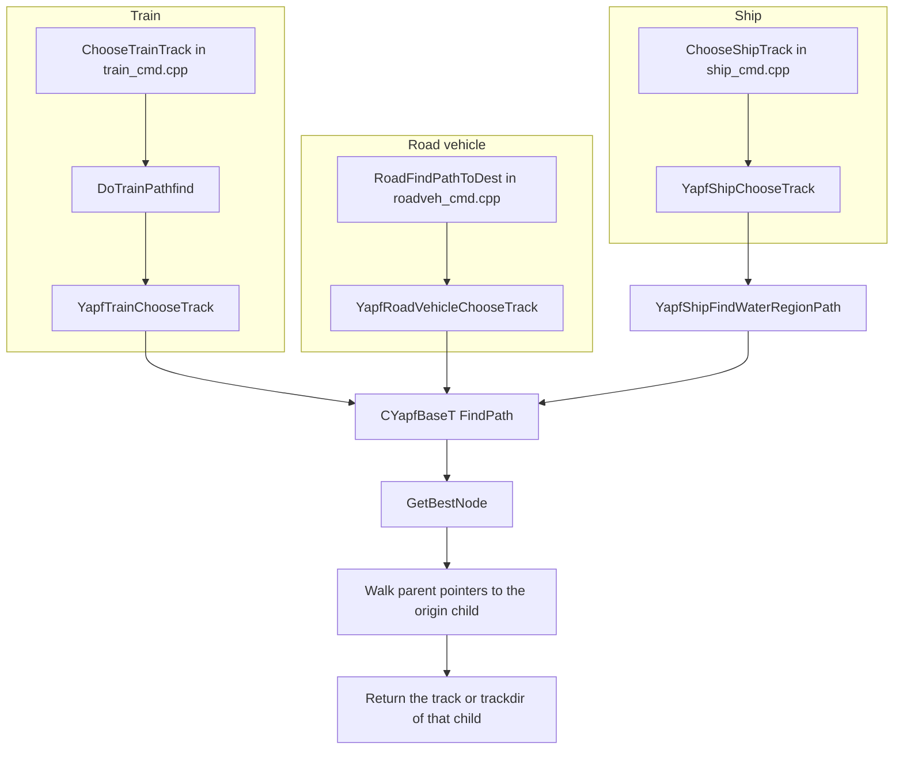
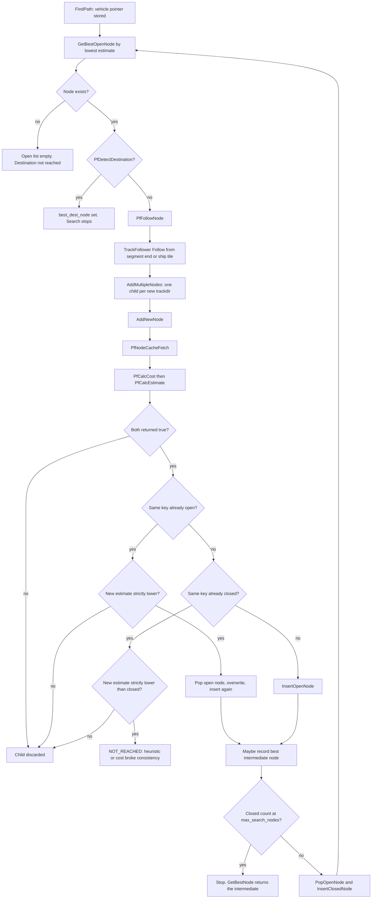

# YAPF pathfinding

YAPF (Yet Another Path Finder) is the A* search trains, road vehicles, and ships use to pick a track. The public entry points are declared in `src/pathfinder/yapf/yapf.h`. Each call builds a stack instance of a transport-specific class, runs `CYapfBaseT::FindPath`, and walks the parent chain of the best node back to the first step.

Aircraft do not call YAPF. Map generation uses the same template to place rivers (`YapfBuildRiver` in `src/pathfinder/yapf/yapf_river_builder.cpp`); that user is outside the vehicle path request described here.

Mode-specific cost, destination, and cache behaviour:

- [Rail](archi-pathfinder-rail.md)
- [Road](archi-pathfinder-road.md)
- [Ship](archi-pathfinder-ship.md)
- [Water regions](archi-pathfinder-water-regions.md) (the coarse graph the ship search plans over)

## Template shape

`CYapfT` (`src/pathfinder/yapf/yapf_common.hpp`) is a multiple-inheritance bundle. A `Types` struct names six roles, and the concrete pathfinder inherits all of them:

| Role | Base | Job |
| --- | --- | --- |
| `PfBase` | `CYapfBaseT` | Open/closed search loop, `AddNewNode`, best-node bookkeeping |
| `PfCost` | per transport | `PfCalcCost`: g-cost of a node |
| `PfCache` | global segment cache, or the empty provider | `PfNodeCacheFetch` |
| `PfOrigin` | one tile, or a forward tile plus a reverse tile | Seeds the open list |
| `PfDestination` | per transport | `PfDetectDestination`, `PfCalcEstimate` (heuristic) |
| `PfFollow` | per transport | `PfFollowNode`: step onto the next tile and emit children |

`CYapfBaseT` is parameterized by `Types` and recovers the most-derived object with `Yapf()` (`static_cast<Tpf *>(this)`). Every role does the same cast, so a cost provider can call the destination detector on the same instance. The required callbacks are declared as aliases at the top of `CYapfBaseT` (`src/pathfinder/yapf/yapf_base.hpp`):

- `PfFollowNode(Node &)`
- `PfCalcCost(Node &, const TrackFollower *)`
- `PfCalcEstimate(Node &)`
- `PfDetectDestination(Node &)` and `PfDetectDestination(TileIndex, Trackdir)`
- `TransportTypeChar()` — debug tag: `t` rail, `r` road, `w` ship, `^` water-region search

Settings come from `_settings_game.pf.yapf` (`YAPFSettings` in `src/settings_type.h`). The base constructor stores that pointer and copies `max_search_nodes` (`src/pathfinder/yapf/yapf_base.hpp`). The default node budget is 10000 (`src/table/settings/pathfinding_settings.ini`, `pf.yapf.max_search_nodes`). Ship and water-region searches overwrite `max_search_nodes` in their own constructors.

`CYapfBaseT` holds the vehicle pointer for the duration of `FindPath`, the destination node, and the best intermediate node (used when the node budget runs out).

## Code map

| Piece | File | What it is |
| --- | --- | --- |
| Public API | `src/pathfinder/yapf/yapf.h` | `YapfTrainChooseTrack`, `YapfRoadVehicleChooseTrack`, `YapfShipChooseTrack`, depot and reverse helpers |
| Include umbrella | `src/pathfinder/yapf/yapf.hpp` | Pulls the template, followers, and caches into each `.cpp` |
| Search loop | `src/pathfinder/yapf/yapf_base.hpp` | `FindPath`, `AddStartupNode`, `AddNewNode`, `AddMultipleNodes` |
| Node | `src/pathfinder/yapf/yapf_node.hpp` | `CYapfNodeT`: key, parent, `cost`, `estimate`, `is_choice` |
| Node keys | `src/pathfinder/yapf/yapf_node.hpp` | `CYapfNodeKeyExitDir` (tile + exit direction), `CYapfNodeKeyTrackDir` (tile + trackdir) |
| Open/closed lists | `src/pathfinder/yapf/nodelist.hpp` | `NodeList`: deque storage, two hash tables, binary heap |
| Bundle | `src/pathfinder/yapf/yapf_common.hpp` | `CYapfT`, `CYapfOriginTileT`, `CYapfOriginTileTwoWayT`, `OctileDistanceCost` |
| Segment end reasons | `src/pathfinder/yapf/yapf_type.hpp` | `EndSegmentReason` bitset used by the rail cost walk |
| Empty cost cache | `src/pathfinder/yapf/yapf_costcache.hpp` | `CYapfSegmentCostCacheNoneT` |
| Rail segment cache | `src/pathfinder/yapf/yapf_costcache.hpp` | `CYapfSegmentCostCacheGlobalT`, `CSegmentCostCacheBase::s_rail_change_counter` |
| Cache flush entry | `src/pathfinder/yapf/yapf_cache.h`, `yapf_rail.cpp` | `YapfNotifyTrackLayoutChange` |
| Slope test shared by costs | `src/pathfinder/yapf/yapf_costbase.hpp` | `CYapfCostBase::stSlopeCost` |
| Track stepping | `src/pathfinder/follow_track.hpp` | `CFollowTrackT` and the rail/road/water typedefs |
| Tile length units | `src/pathfinder/pathfinder_type.h` | `YAPF_TILE_LENGTH`, `YAPF_TILE_CORNER_LENGTH`, `YAPF_INFINITE_PENALTY` |
| Rail assembly | `src/pathfinder/yapf/yapf_rail.cpp`, `yapf_costrail.hpp`, `yapf_destrail.hpp`, `yapf_node_rail.hpp` | Six rail pathfinder types |
| Road assembly | `src/pathfinder/yapf/yapf_road.cpp`, `yapf_node_road.hpp` | `CYapfRoad`, `CYapfRoadAnyDepot` |
| Ship assembly | `src/pathfinder/yapf/yapf_ship.cpp`, `yapf_node_ship.hpp` | `CYapfShip` |
| Region-level ship search | `src/pathfinder/yapf/yapf_ship_regions.cpp` | `YapfShipRegions` |
| Water region map | `src/pathfinder/water_regions.cpp`, `water_regions.h` | 16×16 patches, invalidation, neighbour walk |

## Node

`CYapfNodeT` stores:

- `key` — identity in the open and closed sets
- `parent` — previous node; null on a startup node
- `cost` — g, cost from the origin
- `estimate` — f = g + h; the heap orders nodes by `estimate` (`operator<` in `yapf_node.hpp`)
- `is_choice` — the follower offered more than one trackdir on the tile where this node was created
- `hash_next` — intrusive hash-bucket link

Two key types share the file:

- `CYapfNodeKeyExitDir` compares tile and exit direction. Hash is `exitdir | (tile << 2)`. Road nodes and ship nodes use this key, so every trackdir that leaves a tile through the same side is one graph vertex.
- `CYapfNodeKeyTrackDir` compares tile and full trackdir. Hash is `trackdir | (tile << 4)`. Rail nodes use this key, because signals, reservations, and 45° geometry depend on the track piece, not only the side the train leaves through.

Rail, road, and ship each subclass the node (`yapf_node_rail.hpp`, `yapf_node_road.hpp`, `yapf_node_ship.hpp`). The water-region search uses its own key (a patch descriptor) and still derives from `CYapfNodeT`.

A rail or road node stands for a **segment**: a run of tiles with a single successor, folded inside `PfCalcCost`. The node's key is the first tile of that run. The rail node keeps the far end in a `CYapfRailSegment`; the road node keeps it in `segment_last_tile` / `segment_last_td`. A ship node is one tile. The follower steps one tile, and `PfCalcCost` prices that step only.

## Open list

`NodeList` (`nodelist.hpp`) is four containers:

- `std::deque` of node values. `CreateNewNode` emplaces one slot and reuses it until the node is actually inserted (`new_node`).
- `open_nodes` — hash table of nodes still waiting, sized by a template bit-count.
- `closed_nodes` — hash table of expanded nodes, with its own bit-count.
- `open_queue` — `CBinaryHeapT` seeded with room for 2048 pointers. `GetBestOpenNode` returns the pointer at the front of that heap.

Hash widths used by the vehicle searches: rail and road `NodeList<…, 8, 10>` (open bits, closed bits); ship `NodeList<…, 10, 12>`.

`InsertOpenNode` pushes the hash table and includes the node in the heap. `PopOpenNode` removes both. Replacing a worse open node is pop, overwrite, insert — the heap is rebuilt for that index via `Remove` + `Include`, not an in-place decrease-key.

## Why the pathfinder is split by transport type

The loop in `FindPath` is shared. The graph, the legal steps, and the cost are not.

`CFollowTrackT` (`follow_track.hpp`) is parameterized by transport type, whether 90° turns are allowed, and whether reserved rail tracks are masked out. The typedefs at the bottom of that file are the followers the pathfinders actually name:

| Typedef | Transport | 90° turns | Mask reserved tracks |
| --- | --- | --- | --- |
| `CFollowTrackRail` | rail | allowed | no |
| `CFollowTrackRailNo90` | rail | disallowed | no |
| `CFollowTrackFreeRail` / `CFollowTrackFreeRailNo90` | rail | allowed / disallowed | yes |
| `CFollowTrackRoad` | road | allowed | no |
| `CFollowTrackWater` | water | allowed | no |

`Follow` leaves the current tile, jumps a tunnel or bridge (`tiles_skipped` becomes the length), and for rail stations jumps to the far end of the platform (`tiles_skipped = length - 1`). It then rejects the step for owner, rail or road type, sharp turn, depot facing, or (when masking) an existing reservation. Road vehicles can reverse at the end of a road; rail and road depots and bay stops and single tram bits can force a reverse on the same tile.

Those rules are different products. A train node also carries signal state and a cached segment. A road node prices stops and level crossings. A ship node prices water class, locks, and a preferred-direction bias, and it refuses to expand outside a corridor of water-region patches. One node type and one cost function would have to ignore most of its fields on every call, and the rail segment cache key (tile + trackdir) does not match the road/ship key (tile + exit direction).

The split is the `Types` struct in each `.cpp`: it binds `Tpf`, `TrackFollower`, `NodeList`, `VehicleType`, and the six role classes. `CYapfRail_TypesT` is itself parameterized so the 90° setting, the destination (order tile, any depot, any safe tile), and the follower can vary without copying `FindPath`.

## How a vehicle asks for a path

### Train — `src/train_cmd.cpp`

`ChooseTrainTrack` extends an existing reservation with `ExtendTrainReservation`. When that walk hits a junction or a possible target that is not yet a safe waiting tile, it calls `DoTrainPathfind`, which returns `YapfTrainChooseTrack` (`train_cmd.cpp` `DoTrainPathfind`, around the call in `ChooseTrainTrack`). Arguments are the consist, the tile about to be entered, the enter direction, the usable `TrackBits`, whether to reserve, and out-parameters for the reservation target and the final tile.

`YapfTrainChooseTrack` (`yapf_rail.cpp`) picks `CYapfRail` or `CYapfRailNo90` from `_settings_game.pf.forbid_90_deg`. The origin is the end of the current reservation (`FollowTrainReservation`): `SetOrigin` is called with that tile and trackdir and with an invalid reverse tile, so only one startup node is inserted. `SetDestination` reads the current order. `FindPath` runs. The result is the trackdir of the node directly under the origin. If that trackdir is invalid, the caller substitutes `FindFirstTrack(tracks)`.

Other train entry points, same file:

- `CheckReverseTrain` → `YapfTrainCheckReverse`. Both ends of the consist are origins; the winning origin's `cost` distinguishes forward from reverse.
- `FindClosestTrainDepot` → `YapfTrainFindNearestDepot`.
- `TryReserveSafeTrack` → `YapfTrainFindNearestSafeTile`, used when the order path cannot be reserved.

### Road — `src/roadveh_cmd.cpp`

`RoadFindPathToDest` is called from the road movement loop (the two call sites in `roadveh_cmd.cpp`). It filters the tile (depot owner and facing, bay-stop type, free bay when queueing is off, red signals), then:

- no destination: a random reachable trackdir (`RandomRange`), no YAPF call
- one reachable trackdir: that trackdir
- a `RoadVehPathCache` hit whose tile is this choice point and whose trackdir is still present: pop it
- otherwise `YapfRoadVehicleChooseTrack`

`YapfRoadVehicleChooseTrack` (`yapf_road.cpp`) builds `CYapfRoad`, sets the origin to every trackdir on `tile` reachable from `enterdir`, sets the destination from the order, and returns the origin child's trackdir. An invalid result is replaced by the first bit in the candidate set.

`RoadVehicle::FindClosestDepot` → `FindClosestRoadDepot` → `YapfRoadVehicleFindNearestDepot` (`CYapfRoadAnyDepot`).

### Ship — `src/ship_cmd.cpp`

`ChooseShipTrack` (movement, `ship_cmd.cpp`) returns early when `dest_tile` is invalid. Otherwise it pops `Ship::path` when the cached trackdir is still in the available set. On a miss it calls `YapfShipChooseTrack`.

`YapfShipChooseTrack` (`yapf_ship.cpp`) asks `YapfShipFindWaterRegionPath` for a patch corridor, then runs `CYapfShip::FindPath` on tiles. The returned value is a `Track`. `Track::Invalid` means the best first step is a reverse. Leaving a depot calls `YapfShipCheckReverse` via `CheckReverseShip`.

Nearest-depot for ships does not use this A* loop. `FindClosestShipDepot` (`ship_cmd.cpp`) breadth-first searches water-region patches, then picks the closest owned ship depot inside that set. The distance cap is `maximum_go_to_depot_penalty / YAPF_TILE_LENGTH`.

## Node expansion

`FindPath` (`yapf_base.hpp`) repeats until the best open node is the destination, the open list is empty, or `nodes.ClosedCount()` reaches `max_search_nodes` (the check is skipped when the budget is 0). The node is expanded **before** it moves from open to closed, so children can be linked to it. After the follow, it is popped and inserted into the closed set.

`AddNewNode` refuses a child when `PfCalcCost` or `PfCalcEstimate` returns false (dead end, path longer than the depot radius, incompatible rail type, and the other `EndSegmentReason` abort bits on rail). A duplicate open key is kept only when the new `estimate` is strictly smaller. A duplicate closed key with a strictly smaller `estimate` hits `NOT_REACHED`. The comment there names the three ways to cause that: the heuristic is too large, the step cost is too small, or a cost bonus made a step negative.

While `max_search_nodes > 0`, a child that is actually inserted (or that replaces an open node) can become `best_intermediate_node` when its remaining heuristic (`estimate - cost`) is smaller than the current intermediate's. `GetBestNode` returns `best_dest_node` when the destination was reached, and that intermediate otherwise. Callers treat a missing destination with a non-null best node as a guessed path: `path_found` stays false, and the first step toward the intermediate is still returned.

Startup nodes take a shorter path. `AddStartupNode` only fetches the cache and inserts the node when that key is not already open. It does not price or estimate them. Their `cost` stays 0 unless the caller wrote a reverse penalty into the node first (`CYapfOriginTileTwoWayT`). Their `estimate` stays 0, so they come off the heap first and their children receive real costs.

The heuristic for an order destination is `OctileDistanceCost` (`yapf_common.hpp`): from the exit side of the current tile to the destination tile, `dmin * YAPF_TILE_CORNER_LENGTH + (dxy - 1) * (YAPF_TILE_LENGTH / 2)`. Depot and safe-tile searches set `estimate = cost`, so the heap order is Dijkstra on g. Rail and road order-searches assert `estimate >= parent->estimate` after the octile add. The ship tile search asserts the same. The water-region search does not.

Tile length constants (`src/pathfinder/pathfinder_type.h`):

- `YAPF_TILE_LENGTH` is 100 (line 16). Diagonal steps add this.
- `YAPF_TILE_CORNER_LENGTH` is 71 (line 19). Non-diagonal steps add this.
- `YAPF_INFINITE_PENALTY` is `1000 * YAPF_TILE_LENGTH` (line 27). The comment describes it as the stand-in for an infinite penalty that must still lose to any finite route. Rail depot search passes it as the reverse-origin penalty.

Every other penalty is a `YAPFSettings` field or a literal in one cost provider. Those are listed in the mode documents, each with the line that defines it. Defaults live in `src/table/settings/pathfinding_settings.ini` and can be changed per game; the running value is `_settings_game.pf.yapf`.

## Segment cost cache

Two providers implement `PfNodeCacheFetch`:

- `CYapfSegmentCostCacheNoneT` returns false and stores nothing. Road, ship, the water-region search, and the river builder use it.
- `CYapfSegmentCostCacheGlobalT` is what every rail `Types` struct binds. It is a process-lifetime hash map of `CYapfRailSegment` (key: tile and trackdir of the segment start; payload: end tile, end trackdir, segment cost, last signal, `EndSegmentReason`). `HASH_BITS` is 14 (`yapf_costcache.hpp`).

`CanUseGlobalCache` is decided by the cost provider. On rail it is false for the origin node, when the caller has disabled the cache, and while the parent has still passed fewer signals than the look-ahead window. Inside that window the segment cost depends on how many signals the path has already seen, so it cannot be shared. Past the window, the next `PfNodeCacheFetch` reuses a segment computed for any train.

On a hit, `PfCalcCost` still adds the **entry** transition (curve and slip from the parent) locally. The cached number is the cost inside the segment. The last signal's red/green state is read again from the map; earlier signal costs stay as they were when the segment was stored.

This is a different cache from `RoadVehicle::path` and `Ship::path`. Those store the next choice points of one vehicle so the next junction can skip A*. Rail has no equivalent vehicle path vector; it re-runs YAPF and then reserves tiles.

### Invalidation

`CSegmentCostCacheBase::s_rail_change_counter` starts at 0 (`yapf_rail.cpp`). `YapfNotifyTrackLayoutChange` increments it and ignores the tile and track arguments (`NotifyTrackLayoutChange` in `yapf_costcache.hpp`). The next rail pathfinder to touch the cache calls `stGetGlobalCache`. That function keeps a static cache and a static copy of the counter; when they differ it `Flush`es the hash map and the deque.

Call sites that bump the counter:

- rail build and remove (`src/rail_cmd.cpp`)
- removing a level crossing (`src/road_cmd.cpp`, the crossing branch that calls `YapfNotifyTrackLayoutChange`)
- station and waypoint rail changes (`src/station_cmd.cpp`, `src/waypoint_cmd.cpp`)
- tunnel and bridge build and remove (`src/tunnelbridge_cmd.cpp`)
- savegame load (`src/saveload/afterload.cpp`, `YapfNotifyTrackLayoutChange(INVALID_TILE, Track::Invalid)`)
- a successful path reservation whose target node was itself eligible for the global cache (`CYapfReserveTrack::TryReservePath` in `yapf_rail.cpp`). Reservation rewrites signal state that may already be baked into segment costs, so the counter is bumped and the next search rebuilds the cache.

The flush happens on the next cache access, not inside the notify call. Tile identity is not stored; any notified edit drops the whole rail segment cache.

Water-region data has its own invalidation, `InvalidateWaterRegion`, documented in [archi-pathfinder-water-regions.md](archi-pathfinder-water-regions.md). Road and ship have no segment-cost cache to flush. Their per-vehicle path vectors are dropped at the next junction when the stored tile or trackdir is no longer legal (`RoadFindPathToDest`, `ChooseShipTrack`).

## Invariants

**Path costs are deterministic.** `PfCalcCost` and `PfCalcEstimate` are integer functions of the map, the vehicle (length, speed, current order, compatible rail or road types, ship ocean/canal fractions), and `YAPFSettings`. They do not call `RandomRange`. The open heap orders by `CYapfNodeT::operator<`, which is strict `<` on `estimate`. `CBinaryHeapT` only swaps when that comparison is true (`HeapifyUp` / `HeapifyDown` in `src/misc/binaryheap.hpp`), so two nodes with the same estimate stay in the order the heap already built. Follower trackdir bits are iterated in bitset order.

The rail segment cache is required to return the same first step as a search with the cache disabled. When desync logging is on, `stChooseRailTrack`, `stCheckReverseTrain`, `stFindNearestDepotTwoWay`, and `stFindNearestSafeTile` run a second instance with `DisableCache(true)` and warn if the results differ (`yapf_rail.cpp`). Two guards exist because a cached segment can disagree with a fresh walk:

- Speed-limit extras on rail are added only while `num_signals_passed` is still inside the look-ahead array. The comment in `PfCalcCost` says applying them outside that radius would desynchronise multiplayer (`yapf_costrail.hpp`, the block that starts `Apply min/max speed penalties only when inside the look-ahead radius`).
- Depot search passes a maximum path cost. If that maximum is non-zero, `stFindNearestDepotTwoWay` disables the cache. The comment says a distance-limited search with caching does not match the uncached result in every case and that mismatch causes desyncs (`yapf_rail.cpp`, `stFindNearestDepotTwoWay`).

`AddNewNode` treats a closed node that is reached more cheaply as a broken cost or heuristic (`NOT_REACHED` in `yapf_base.hpp`). That is the consistency check: once a key is closed, no later path may price it lower. Negative step bonuses are called out there as a way to break it.

Two vehicle fallbacks do use the game RNG, and they are not node costs. A road vehicle with `dest_tile == INVALID_TILE` picks a random legal trackdir in `RoadFindPathToDest`. A ship whose region search or tile search fails, or whose cached path is empty at the destination, builds a short random walk in `CreateRandomPath` (`yapf_ship.cpp`). Both depend on `RandomRange` and on the current path cache, so they are outside the A* cost invariant.

**The rail segment cache is invalidated when the track layout changes.** `YapfNotifyTrackLayoutChange` increments `s_rail_change_counter`. `CYapfSegmentCostCacheGlobalT::stGetGlobalCache` compares that counter with `last_rail_change_counter` and `Flush`es the static map when they differ (`yapf_costcache.hpp`). The same counter is incremented after a reservation that used a globally cacheable node, so signal and reservation edits that never moved a track piece still drop the cache. Water regions invalidate separately, by clearing a per-region valid bit (`InvalidateWaterRegion` in `water_regions.cpp`); the next lookup rebuilds that square.
