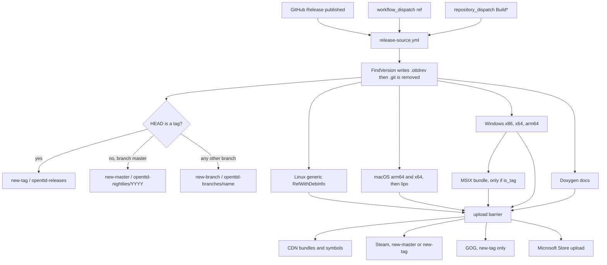
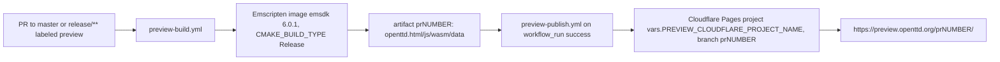

# Release architecture

How OpenTTD builds get a version string, and how the GitHub Actions release train publishes them. Symbol files and crash dumps are in [archi-symbol-server.md](archi-symbol-server.md).

Sources read for this note: `docs/releasing_openttd.md`, `cmake/scripts/FindVersion.cmake`, `CMakeLists.txt` (`VERSION 16.0`), `src/rev.cpp.in`, `.github/changelog.py`, and the workflows named in the map below. Store and CDN folder names below are copied from those files.

`docs/releasing_openttd.md` is the maintainer checklist (branch, changelog, website, GitHub Release, then store follow-up). The workflows do not read that checklist. They classify a build from git state after someone starts `.github/workflows/release.yml`.

## Version string

`CMakeLists.txt` sets the project version. In this tree that line is `VERSION 16.0`, so `PROJECT_VERSION_MAJOR` is 16 and `PROJECT_VERSION_MINOR` is 0. Every build runs `cmake/scripts/FindVersion.cmake` through the `find_version` target and passes those two numbers as `REV_MAJOR` and `REV_MINOR`.

The releasing guide's numeric examples are procedure samples, not the rule in force:

> Update the version in `CMakeLists.txt` in the master branch, heading for the next major release, e.g. from 14.0 to 15.0.

> If this is a maintenance release, update the version in `CMakeLists.txt` in the release branch, e.g. from 14.0 to 14.1.

`FindVersion.cmake` is the check that actually fails a build. With a git checkout it takes the tag from `git name-rev --name-only --tags --no-undefined HEAD` and strips a trailing `^0`. If that tag is non-empty, `REV_VERSION` is the tag. A tag is stable when it matches `^[0-9.]+$` (the whole string is digits and dots). For a stable tag the script then requires:

```
REV_VERSION STREQUAL "${REV_MAJOR}.${REV_MINOR}"
```

Otherwise CMake stops with `Tag (${REV_VERSION}) doesn't match internal version (${REV_MAJOR}.${REV_MINOR})`. With the current `VERSION 16.0`, the only stable tag that passes is `16.0`. A tag such as `16.0.1` is still "stable" by the regex and fails the equality. A tag such as `16.0-beta4` or `16.0-RC1` does not match `^[0-9.]+$`, so `REV_ISSTABLETAG` is 0, the equality check is skipped, and the version string is the tag text.

`changelog.md` in this tree starts with `## 16.x` and `### 16.0-beta4 (2026-09-20)`. `.github/changelog.py` (used for tagged releases) assumes headings of the form `## <major>.x` and `### <major>.<minor>[-<suffix>] …`. Its own comments use `15.x` / `15.0` as format examples. The script checks that the first `### ` heading is the version being released, then copies lines until a different stable heading or a different `## <major>.x` heading.

When HEAD is not a tag, `FindVersion.cmake` sets:

```
REV_VERSION = "${REV_ISODATE}-${BRANCH}${HASHPREFIX}${SHORTHASH}"
```

- `REV_ISODATE` is the HEAD commit date in UTC, `YYYYMMDD` (`git show -s --date=iso-local`, `TZ=UTC0`).
- `BRANCH` is the last path component of `git symbolic-ref -q HEAD`. `master` is included. A master nightly looks like `20261002-master-g0123456789`.
- `SHORTHASH` is the first 10 characters of `git rev-parse --verify HEAD`.
- `HASHPREFIX` is `-g` when `git diff-index HEAD` is empty (`REV_MODIFIED` 0), `-m` when it is not (`REV_MODIFIED` 2). The script also has `-u` for any other `REV_MODIFIED` value; the git path only assigns 0 or 2.

If there is no `.git` directory and `.ottdrev` exists, the script reads that file and does not recompute the string. If neither exists, the version is `norev0000` and the script warns that the build will not be network compatible.

The stable-tag equality check is skipped when `GENERATE_OTTDREV` is set (the source job uses that to write `.ottdrev`). It runs again when a later job configures the real binaries.

`src/rev.cpp.in` bakes the result into the binary: `_openttd_revision`, `_openttd_revision_hash`, `_openttd_revision_modified`, `_openttd_revision_tagged`, `_openttd_content_version` (`${REV_MAJOR}.${REV_MINOR}`), and `_openttd_newgrf_version` (stable bit is `REV_ISSTABLETAG` at bit 19). The comment block in `rev.cpp.in` describes a different shape than `FindVersion.cmake` produces. See stale claims.

The release source job freezes this before any platform compile:

1. `cmake -DGENERATE_OTTDREV=1 -P cmake/scripts/FindVersion.cmake` writes `.ottdrev`.
2. `.version` is field 1 of that file. `is_tag` is true when field 5 is `1` (any tag, including beta and RC).
3. `rm -rf .git`, then the tree is packed as `source.tar.gz` for the other jobs.

Platform jobs unpack that tarball. Their `find_version` run sees `.ottdrev` and no `.git`, so every OS binary in that workflow shares one version string.

## What the three trains are

| Train | What it is in this repo |
| --- | --- |
| Stable (and any other tag: beta, RC) | A published GitHub Release. `release.yml` runs because of `on.release.types: [published]`. Any tag is `trigger_type=new-tag`, CDN folder `openttd-releases`. Pre-release vs final is not a separate workflow type. |
| Nightly | A `release.yml` run whose branch name is `master` and whose HEAD is not a tag. `release-source.yml` sets `NIGHTLIES_BRANCH: master`, `trigger_type=new-master`, CDN folder `openttd-nightlies/<year>` where `<year>` is `date +%Y` on the runner. |
| Preview | Not `release.yml`. A pull request to `master` or `release/**` with the label `preview`. Emscripten build, published to Cloudflare Pages. |

This repo does not contain a cron that publishes nightlies. `.github/workflows/ci-nightly.yml` is scheduled `0 3 * * *` and only runs the macOS and MinGW CI workflows, then an annotation check. A nightly binary exists when something starts `release.yml` on `master` without a tag. The workflow accepts three starts: a published GitHub Release, `workflow_dispatch` with input `ref`, or `repository_dispatch` whose type matches `Build*` and whose `client_payload.ref` is the checkout ref. The dispatcher that fires `Build*` on a schedule is not in this repository.

`docs/eints.md` says translations sync shortly before the nightly build. That timing is outside these workflows.

## Release pipeline



`upload` is an empty job. CDN, Steam, and GOG wait for it, and they also require `source` to have succeeded. The Windows Store package job is skipped unless `is_tag` is true; the barrier treats that skip as success (`needs.windows-store.result == 'skipped'`).

Platform game builds use `RelWithDebInfo` and compile `OPTION_SURVEY_KEY` from `https://survey-participate.openttd.org/create-survey-key/` when the `SURVEY_TYPE` repo variable is set. Forks without that variable pass an empty key. Survey keys are not part of the version string.

### CDN folders and trigger types

From `release-source.yml`:

| Git state | `trigger_type` | CDN folder |
| --- | --- | --- |
| Any tag | `new-tag` | `openttd-releases` |
| Branch `master`, not a tag | `new-master` | `openttd-nightlies/` plus `date +%Y` |
| Any other branch, not a tag | `new-branch` | `openttd-branches/` plus the branch name |

The year in the nightly folder is the runner clock at the metadata step. The date inside the version string is the commit's UTC date. They are different clocks.

`upload-cdn.yml` publishes bundles through `OpenTTD/actions/.github/workflows/rw-cdn-upload.yml@v7` (signing secret `CDN_SIGNING_KEY`). Checksums written beside each bundle are MD5, SHA-1, and SHA-256 (`openssl dgst`). Windows Store packages sit under an `internal/` directory in that upload. The same workflow publishes symbols; see the symbol-server note.

Only `new-master` then dispatches `publish-docs` to `OpenTTD/workflows` with the version and folder. Tagged releases still build and upload the docs tarballs with the other bundles. The extra docs dispatch is the nightly path.

### Artifacts

| Job | Artifact name | What is inside |
| --- | --- | --- |
| Source | `openttd-source` | `openttd-<version>-source.tar.xz`, `.zip`, `changelog.md`, `released.txt`, `README.md` |
| Source | `internal-source` | `source.tar.gz` consumed by the other jobs (1 day retention) |
| Linux | `openttd-linux-generic` | CPack bundles from the manylinux_2_28 x86_64 container, dependencies packaged (`OPTION_PACKAGE_DEPENDENCIES`) |
| macOS | `openttd-macos-universal` | Universal binary (`lipo` of arm64 and x86_64), bundle plus zip. Deployment target env in the workflow is `MACOSX_DEPLOYMENT_TARGET: 10.13` |
| Windows | `openttd-windows-x86`, `openttd-windows-x64`, `openttd-windows-arm64` | Zip bundles. NSIS installer and installer signing only when `is_tag` is true |
| Windows Store | `openttd-windows-store` | `internal/openttd-<version>-windows-store.msixbundle` (and a `.pfx` under `internal/`) |
| Docs | `openttd-docs` | `openttd-<version>-docs.tar.xz`, `-docs-ai`, `-docs-gs` |

Bundle file names come from `cmake/InstallAndPackage.cmake` (`openttd-#CPACK_PACKAGE_VERSION#-…`). Windows artifact names use the matrix arch (`x86`, `x64`, `arm64`). The Steam and GOG jobs unzip `openttd-*-windows-win32.zip` and `openttd-*-windows-win64.zip` from the x86 and x64 artifacts.

### Stores

Steam (`upload-steam.yml`), only for `new-master` or `new-tag`. `os/steam/release.vdf` is uploaded with `steamcmd`. `SetLive` is `testing` when `trigger_type` is `new-tag`, and `nightly` otherwise. AppID in that VDF is `1536610`. Depots: `1536613` (win32), `1536612` (win64), `1536614` (macos), `1536615` (linux). The releasing guide's remaining Steam step is manual: set the `testing` branch live on `default` in Steamworks. The workflow does not do that promotion.

GOG (`upload-gog.yml`), only for `new-tag`. `GOGGalaxyPipelineBuilder build-game` runs three times, always with `--branch Testing`, using `os/gog/windows.json`, `macos.json`, and `linux.json`. Those JSON files name the product `OpenTTD`. The workflow also unpacks OpenGFX2 Classic 0.8, OpenMSX 0.4.2, and OpenSFX 1.0.3 from `cdn.openttd.org` into the GOG depots. The releasing guide then says to publish the uploaded builds to `Master`, `GOG-use only`, and `Testing`. That publish is not a workflow step. The workflow stops after the `Testing` branch upload.

Microsoft Store. The package job builds an MSIX with `makeappx` / `SignTool` and the identity strings in `release-windows-store.yml` (`CN=78024DA8-4BE4-4C77-B12E-547BBF7359D2`, `57420OpenTTDDevelopers.OpenTTDofficial`). `upload-windows-store.yml` is named `Upload (Windows Store)`, uses `microsoft/microsoft-store-apppublisher`, and runs `msstore publish` on `openttd-windows-store/internal/openttd-*.msixbundle` with product id `9NCJG5RVRR1C`. Its `if` is `needs.source.outputs.is_tag == 'true' && !contains(needs.source.outputs.version, '-')`, so a tag whose version contains a hyphen (the beta and RC form in `changelog.md`) does not take this job. See the wiring note under stale claims.

## Preview pipeline



`preview.yml` listens for `labeled` and `synchronize` on pull requests targeting `master` or `release/**`. The job runs only when the label is `preview`. Concurrency group is the workflow plus the PR number, and a new push cancels the previous run.

The build checks out `github.event.pull_request.head.sha` and then `git checkout -b pr<number>`, so `FindVersion` sees branch `pr<number>` and a non-tag version string. The binary is the Emscripten `openttd` target. Preview does not call `dump_syms`, does not upload to the CDN folders above, and does not publish Breakpad symbols.

`preview-publish.yml` runs when that workflow completes successfully for a `pull_request` event. It creates a GitHub deployment environment named `preview`, deploys with `cloudflare/wrangler-action` (`pages deploy public`), and sets the environment URL to `https://preview.openttd.org/pr<number>/`.

## Maintainer checklist versus the workflow

Still done by a person, from `docs/releasing_openttd.md`:

- Step 0. Beta: skip. RC1: branch `release/nn`, bump `CMakeLists.txt` on master, update AI/Game script API version lists, regression info, compatibility scripts, and the saveload note. Later RC or final: backport. Maintenance: bump `CMakeLists.txt` on the release branch. The workflow does not create branches.
- Step 1. Changelog PR. Tagged builds copy from `changelog.md` via `changelog.py`. Nightly and branch builds ignore that file and write a seven-day `git log` instead.
- Step 2. Website post in `OpenTTD/website`, left unmerged until after the binaries exist. Store-page and social copy is prepared there. The workflow does not post announcements.
- Step 3.1–3.3. Confirm `CMakeLists.txt`, create the GitHub Release tag (pre-release flag for beta or RC), wait for `release.yml`. Creating that release is what starts the workflow (`release: published`).
- Step 3.4 Steam and GOG follow-up, as described under Stores.
- Step 4. Merge the website PR and post to the channels listed in the guide (TT-Forums, Twitter, Reddit, Fosstodon, Discord, and the store pages).

## Workflow and code map

| Path | Role |
| --- | --- |
| `docs/releasing_openttd.md` | Human release checklist |
| `cmake/scripts/FindVersion.cmake` | Version string and stable-tag equality check |
| `CMakeLists.txt` | `VERSION 16.0`; `find_version` target |
| `src/rev.cpp.in` | Strings compiled into the binary. Comment is stale; see below |
| `.github/changelog.py` | Changelog slice for tagged releases |
| `.github/workflows/release.yml` | Orchestrator |
| `.github/workflows/release-source.yml` | Version, folder, trigger type, source tarball |
| `.github/workflows/release-linux.yml` | Linux generic build and Breakpad symbols |
| `.github/workflows/release-macos.yml` | Universal macOS build and Breakpad symbols |
| `.github/workflows/release-windows.yml` | Windows x86/x64/arm64, NSIS on tags, PDB and Breakpad symbols |
| `.github/workflows/release-windows-store.yml` | MSIX, only when `is_tag` |
| `.github/workflows/release-docs.yml` | Doxygen bundles |
| `.github/workflows/upload-cdn.yml` | Checksums, CDN upload, symbol upload, nightly docs dispatch |
| `.github/workflows/upload-steam.yml` | Steam `testing` or `nightly` |
| `.github/workflows/upload-gog.yml` | GOG branch `Testing` |
| `.github/workflows/upload-windows-store.yml` | `msstore publish` |
| `.github/workflows/preview.yml` | Label gate |
| `.github/workflows/preview-build.yml` | Emscripten preview |
| `.github/workflows/preview-publish.yml` | Cloudflare Pages |
| `.github/workflows/ci-nightly.yml` | Scheduled compile of macOS and MinGW. Does not publish a nightly |
| `os/steam/release.vdf` | Steam app, depots, `SetLive` placeholder |
| `os/gog/*.json` | GOG Galaxy build definitions |

## Stale or mismatched claims

| Claim | What the tree does |
| --- | --- |
| `src/rev.cpp.in` says a master build is `<commitdate>-g<shorthash><modified>`, other branches insert `-<branch>`, and a modified tree appends `M`. It also describes tags as `<major>.<minor>.<build>[-RC<rc>]`. | `FindVersion.cmake` always inserts the branch, including `master`. Modified trees change the prefix from `-g` to `-m`. There is no trailing `M`. The tag string is whatever `git name-rev` returned. Stable means `^[0-9.]+$` and equality with `${REV_MAJOR}.${REV_MINOR}`. |
| Releasing guide, Microsoft Store: "ask orudge to publish the new release." | `upload-windows-store.yml` runs `msstore publish` itself for a tag whose version string contains no `-`. |
| `upload-windows-store.yml` `if` reads `needs.source.outputs`, and the comment on the other upload jobs says those outputs have to be listed in `needs`. | This job's `needs` list is only `upload`. Steam, GOG, and CDN list `source` as well. The condition is not wired the same way as the jobs that successfully read `trigger_type`. |
| Guide examples `14.0` / `15.0` / `14.1`, and the `15.x` samples in the `changelog.py` docstring. | Current project version is `16.0`. Current changelog headings are `## 16.x` and `### 16.0-beta4`. The equality rule is unchanged; the sample numbers are not this tree. |
| `ci-nightly.yml` is named "CI - Nightly" and is cron-scheduled. | It does not build or upload the nightly CDN folder. Nightly binaries are `release.yml` with `trigger_type=new-master`. |

Steam `testing` → `default`, and GOG publish to `Master` / `GOG-use only` / `Testing`, are still manual steps on top of the workflow. They are not stale; the workflows stop at Steam `SetLive` `testing` (or `nightly`) and GOG `--branch Testing`.

## Invariants

The version string of every platform binary in one `release.yml` run is the `.ottdrev` written by the source job before `.git` is deleted. A git rebuild of the same commit reproduces that string: tag name if HEAD is tagged, otherwise `YYYYMMDD-<branch>-g<10 hex>` on a clean tree and `-m` on a dirty tree. A stable tag is published only when that tag equals `CMakeLists.txt`'s `MAJOR.MINOR` (`16.0` in this tree). `_openttd_revision` in the binary is that string, and the crash survey copies it to `info.openttd.version.revision`.

Symbols for that binary are produced in the same job, from that build's `openttd` or `openttd.pdb`, and uploaded with a marker file named with the same version. The match between dump and symbol file is described in [archi-symbol-server.md](archi-symbol-server.md).
