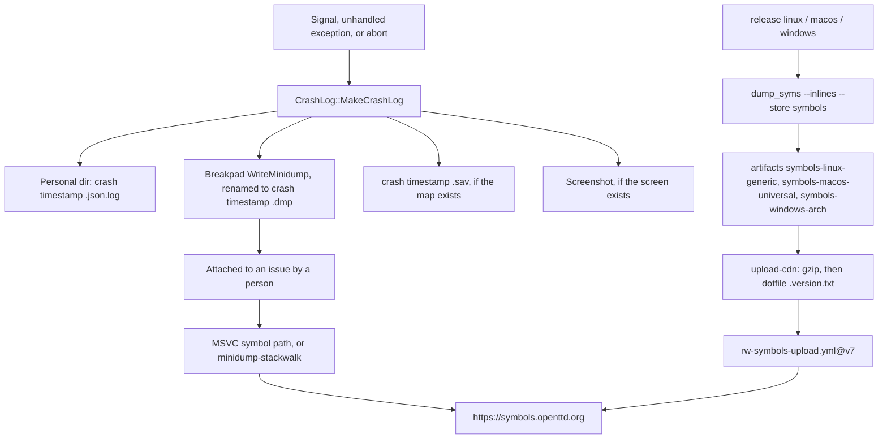

# Symbol server and crash dumps

What a crash produces on the client, and how official build jobs publish symbols for those dumps. The release trains that produce the binaries are in [archi-release.md](archi-release.md).

Sources: `docs/symbol_server.md`, `src/crashlog.h`, `src/crashlog.cpp`, the three `crashlog_*.cpp` handlers, `CMakeLists.txt`, `cmake/LinkPackage.cmake`, `vcpkg.json`, and the release workflows that run `dump_syms`.

## What the symbol server is for

`docs/symbol_server.md` states the purpose:

> For all official releases, OpenTTD collects the Breakpad Symbols (SYM-files) and Microsoft's Symbols (PDB-files), and publishes them on our own Symbol Server (https://symbols.openttd.org).
>
> These symbol files are needed to analyze `crash.dmp` files as attached to issues by users.

A minidump stores addresses. The SYM (and, on Windows, the PDB and a copy of `openttd.exe`) turn those addresses into function names for the build that crashed. The client does not upload the dump. Someone attaches `crash<timestamp>.dmp` to an issue, and a developer resolves it against the server.

The public URL in that doc is `https://symbols.openttd.org`. Analysis commands from the same doc:

- MSVC: add that URL as a symbol server and open the `.dmp`.
- Other platforms: `minidump-stackwalk <crash.dmp> --symbols-url https://symbols.openttd.org` (`cargo install --locked minidump-stackwalk`).

This repository does not implement the HTTP server. Upload leaves via `OpenTTD/actions/.github/workflows/rw-symbols-upload.yml@v7` with artifact `cdn-symbols`, `repository: OpenTTD`, and secret `SYMBOLS_SIGNING_KEY`. The Mozilla fallback described in `docs/symbol_server.md` (the server answering for `libc`, `kernel32.dll`, and similar) is not present in this tree.

"Official releases" in the doc is narrower than the workflow. `publish-symbols` has no `trigger_type` filter, so every successful `release.yml` upload publishes symbols: tags (`new-tag`), master nightlies (`new-master`), and other branches (`new-branch`). Preview builds do not.

## Crash dump path

`CrashLog::MakeCrashLog` runs once per process (`crashlogged` guard). Order: fill a JSON survey (schema `CRASHLOG_SURVEY_VERSION` is 1), print a summary, write the log, write the dump, write a savegame, write a screenshot, then `SendSurvey` when the game mode is normal.

`CreateFileName` uses one UTC timestamp for the whole crash: `crash` plus `%Y%m%d%H%M%S`. Extensions used by the writers:

| Product | Name |
| --- | --- |
| JSON survey | `crash<timestamp>.json.log` |
| Minidump | `crash<timestamp>.dmp` |
| Savegame | `crash<timestamp>.sav` |

The survey's `info.openttd.version` includes `revision` (`_openttd_revision`), `hash`, `modified`, `tagged`, `newgrf`, and `content`. That revision is the string from [archi-release.md](archi-release.md), so a dump's log names the build whose symbols should be on the server.

Handlers, all installed from `InitialiseCrashLog` in the OS `main`:

| Platform | File | Trigger | Minidump |
| --- | --- | --- | --- |
| Unix | `src/os/unix/crashlog_unix.cpp` | `SIGSEGV`, `SIGABRT`, `SIGFPE`, `SIGBUS`, `SIGILL`, `SIGQUIT` | `google_breakpad::ExceptionHandler::WriteMinidump` into the personal directory, then `rename` to `crash<timestamp>.dmp` |
| macOS | `src/os/macosx/crashlog_osx.cpp` | Same signal set | Same Breakpad call and rename. A GUI crash dialog follows `MakeCrashLog` |
| Windows | `src/os/windows/crashlog_win.cpp` | Unhandled exception filter, plus a vectored handler for heap corruption `0xC0000374`, stack overflow, and custom abort `0xE1212012`. `SIGABRT` is turned into that abort exception | Same Breakpad call. The callback renames `<dump_dir>/<minidump_id>.dmp` |

Breakpad is compiled in only when CMake finds the package. `CMakeLists.txt` skips `find_package(unofficial-breakpad)` on Emscripten. `link_package(unofficial-breakpad …)` defines `WITH_UNOFFICIAL_BREAKPAD` (the package name, uppercased, dash replaced with underscore) and links `unofficial::breakpad::libbreakpad_client`. Each handler wraps `WriteCrashDump` in that macro. Without it, the base `CrashLog::WriteCrashDump` prints `No method to create a crash.dmp available.` and the JSON log, savegame, and screenshot still run.

`vcpkg.json` depends on `breakpad` with platform `!(windows & arm)`. An arm64 Windows build from that manifest does not get the Breakpad client. The Windows release job still runs `dump_syms` on `openttd.pdb` for every matrix arch, including `arm64`.

No dump is written when the crash handler sees an emergency savegame (`_gamelog.TestEmergency()`) or a save that failed to load because NewGRFs are missing. A second fault while a crash is already being logged exits without another report.

The JSON log's stack is a text backtrace (`backtrace_symbols` on glibc and macOS, the Windows stack walk in `crashlog_win.cpp`). That text is independent of the symbol server. The `.dmp` is the file the server is for.

## How symbols are produced

Each desktop release job installs `dump_syms` with `cargo install --locked dump_syms` and runs it after the `RelWithDebInfo` link, before CPack.

| Workflow | Command | Artifact |
| --- | --- | --- |
| `release-linux.yml` | `dump_syms ./openttd --inlines --store symbols` in the build directory | `symbols-linux-generic` |
| `release-windows.yml` | `dump_syms openttd.pdb --inlines --store symbols`, then copy `openttd.pdb` into the symbol directory `find` returns, and copy `openttd.exe` into `symbols/openttd.exe/<CODE_ID>` where `CODE_ID` is field 3 of the `INFO CODE_ID` line in `openttd.sym` | `symbols-windows-x86`, `symbols-windows-x64`, `symbols-windows-arm64` |
| `release-macos.yml` | `dsymutil` on the arm64 `openttd` and on the x86_64 `openttd`, then `dump_syms` of each dSYM into `build-x64/symbols`. `lipo` of the universal binary happens after that | `symbols-macos-universal` |

`upload-cdn.yml` then:

1. Copies every `symbols-*` artifact into one `symbols/` tree.
2. Gzip-compresses every file at `find symbols -mindepth 2 -type f`.
3. In every directory at the same depth, `touch`es `.<version>.txt`, using the version input from the source job.
4. Uploads the tree as artifact `cdn-symbols` and calls `rw-symbols-upload.yml@v7`.

Linux symbols are taken from the same `./openttd` that CPack packages. Windows symbols are taken from the `openttd.pdb` just linked, and the exe copied into the symbol tree is that same build's `openttd.exe`, placed under the code id written in the SYM. macOS symbols are taken from each architecture's binary before `lipo`. The shipped file is the universal binary built from those two inputs. The workflow does not run `dump_syms` on the universal file; each slice was recorded on its own.

Preview (`preview-build.yml`) is Emscripten, `CMAKE_BUILD_TYPE=Release`, and has no `dump_syms` step. Emscripten never links Breakpad.

## Code and workflow map

| Path | Role |
| --- | --- |
| `docs/symbol_server.md` | Public URL and the two analysis recipes. Filename `crash.log` is stale; see below |
| `src/crashlog.h`, `src/crashlog.cpp` | Survey, filenames, orchestration. Base dump writer is a no-op message |
| `src/os/unix/crashlog_unix.cpp` | Unix signals and Breakpad |
| `src/os/macosx/crashlog_osx.cpp` | macOS signals, Breakpad, crash dialog |
| `src/os/windows/crashlog_win.cpp` | Windows exceptions and Breakpad |
| `src/survey.cpp` | `SurveyOpenTTD` writes revision, hash, modified, tagged into the crash JSON |
| `CMakeLists.txt` | Breakpad find/link, skipped on Emscripten |
| `cmake/LinkPackage.cmake` | `-DWITH_<PACKAGE>` |
| `vcpkg.json` | `breakpad` except `windows & arm` |
| `.github/workflows/release-linux.yml` | `dump_syms` on `./openttd` |
| `.github/workflows/release-macos.yml` | `dsymutil` plus `dump_syms` per arch, then `lipo` |
| `.github/workflows/release-windows.yml` | `dump_syms` on `openttd.pdb`; PDB and exe copied into the symbol tree |
| `.github/workflows/upload-cdn.yml` | Merge, gzip, `.<version>.txt`, `rw-symbols-upload.yml@v7` |
| `OpenTTD/actions` `rw-symbols-upload.yml@v7` | External upload. Not in this repo |
| `.github/workflows/preview-build.yml` | No symbols |

`cmake/InstallAndPackage.cmake` installs `docs/symbol_server.md` into the docs component, so the analysis note ships inside release bundles.

## Stale or unverified claims

| Claim | What the tree does |
| --- | --- |
| `docs/symbol_server.md`: a `crash.dmp` "combined with the `crash.log`". | The log writer uses `CreateFileName(".json.log")`. The file next to the dump is `crash<timestamp>.json.log`. |
| Same doc: symbols are published "for all official releases". | `publish-symbols` runs for every successful `release.yml` CDN upload, including nightlies and `openttd-branches` builds. It does not run for preview. |
| Same doc: the symbol server also answers from Mozilla's symbol server for libraries other than OpenTTD. | No workflow or source file in this repo implements that fallback. It is a property of the server behind `rw-symbols-upload.yml`, which is outside this tree. |
| `COMPILING.md` calls breakpad encouraged. | `link_package(unofficial-breakpad)` does not pass `ENCOURAGED`, so a missing package is silent and the binary simply has no `WriteCrashDump`. `vcpkg.json` omits breakpad on Windows ARM. |

## Invariants

The SYM (and on Windows the PDB and `openttd.exe` stored beside it) must come from the binary a user is running. The release jobs keep that by running `dump_syms` on the just-linked `openttd` or `openttd.pdb` in the same job that packages the artifact, then stamping each symbol directory with `.<version>.txt` for the `.ottdrev` version of that run. A `crash<timestamp>.json.log` from that binary carries the same revision string and the git hash, which is the lookup key a developer has when the dump's code id is missing or ambiguous. A dump from a build that did not go through these jobs (local compile, preview wasm, Windows arm64 without the Breakpad client) has no matching upload from this pipeline.
