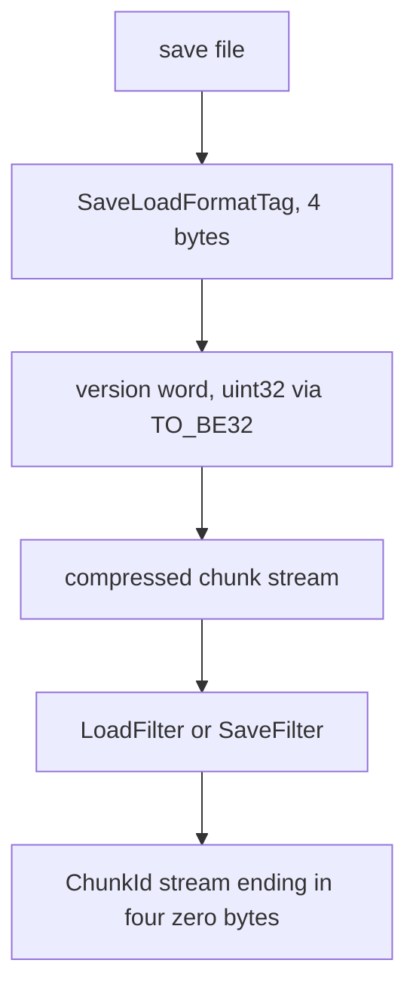
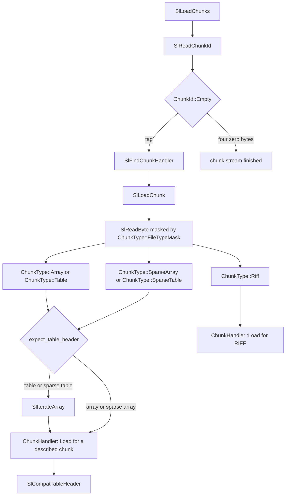
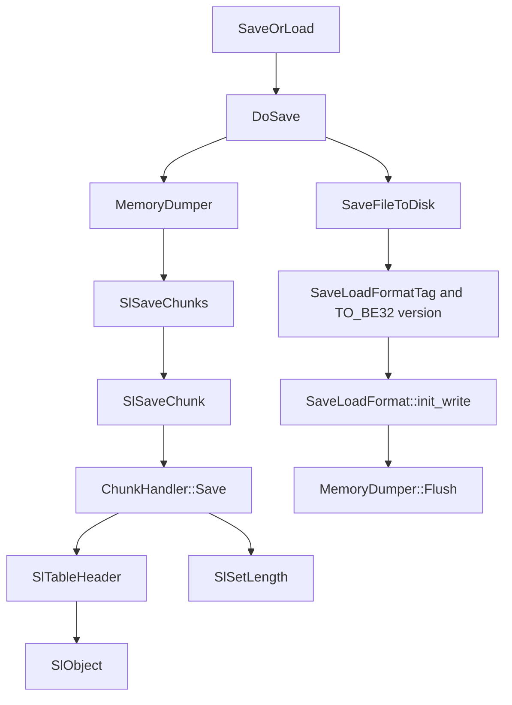
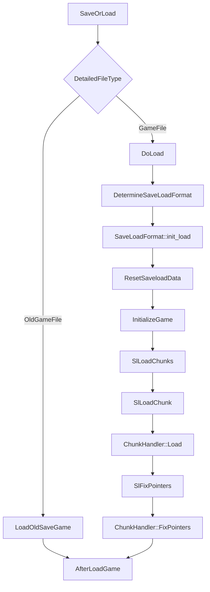

# Savegame subsystem

## One save system

Updated 2026-10-28 ([m2o28 Group 22B](../../upgrades/2026-10/m2o28-1-merge-oct28.md)). The game has one multi-layer map and one save system covering the surface, the underground layers and Space. There is one writer, one current schema and one loader. Older files are imported through a bounded table of historical formats. Nothing in the format, the loader or the player-facing messages refers to how the code was developed.

- **Writer.** Every save is version 446 (`SaveLoadVersion::SpaceMiningLifecycle`). It carries the 8-byte MLLN marker (`MLN1`, schema 2, writer 446) and the complete set of 128 chunk families, empty ones included, frozen by `src/tests/fixtures/saveload/merged-446-family-set.json` on top of the 441 contract it extends. Two saves of the same paused world are byte-identical.
- **Schema.** Features are `SaveCapability` values of a file's format family, never version numbers. `SaveLoad::WithCapability` gates a field on its capability, so the writer emits exactly the fields its own format holds, and a reader takes exactly the fields the file's format holds.
- **Loader.** `InspectSaveWireFacts` reads bounded facts from the file's own bytes before anything is initialized. `ClassifySaveFormat` names its family (`SaveFormat`) from those facts, plus an exact-digest hint only where the bytes are ambiguous. The load is then bound to that result for its whole lifetime. Refusals before initialization keep the open world; a failure after native adoption returns `ReInit` and every owner revokes its staged state in the null pass.

| Format family | Versions | Identified by | Holds |
| --- | --- | --- | --- |
| `Base` | up to 424 | version | The common multi-layer format: four-layer map, geology, excavation, TBM and early Space |
| `Orbital` | 425-440 | version, or an exact-digest hint at 425-434 | Orbital and Space manufacturing, heavy miners, orbital recipes, the fixed RIFF supply book |
| `Geothermal` | 425-434 | version, or an exact-digest hint at 425-434 | Geothermal generators, heat conversion, Tube geothermal power, the TABLE supply book with SSOH |
| `Unified` | 441 | MLLN schema 1 | Everything above, the tagged supply book and widened CAPA links; no typed asteroid origins |
| `Unified` | 446 | MLLN schema 2 | The 441 contents plus typed asteroid cargo origins, the asteroid field lifecycle, mining policy and contained intent, and legacy and survey departures (the five Space capabilities) |

Refused: any file above 446 (too new); markerless 441-445 files written by a development build (their own message, STR_GAME_SAVELOAD_ERROR_DEVELOPMENT_SAVEGAME); an unmarked 446; any marker other than exactly (441, 1) or (446, 2); and 425-434 files whose bytes cannot tell the two families apart and come without a matching digest hint ("Unrecognised savegame format").

The sections below are dated records of how each family's fields arrived. They keep the names of their time: "A" is the Orbital family, "B" the Geothermal family, and "merged" or "441" the Unified family.

**Current merged qualification,2026-10-25.** Writer441and its explicit lineage/capability dispatch are delivered. Exact shared403/A438–440/B434originals, merged full/copy/reload/second-save boundaries and128-family comparisons are qualified through the [four-plan handoff](../../upgrades/2026-10/m2o23-4-come-space-b-integration-handoff.md). TaggedNative/LegacyBSSORand widenedCAPAretain one supply/custody owner. Real peers and isolated current native/ordinary restores are separate actual observations. Original Space seals remain unchanged; [historical storage/reconstruction](../archi-historical-debug.md) owns their durable/current evidence roles. Dated older-version sections below remain compatibility history rather than a current writer selection.

TBM update,2026-10-09: versions395/396 extend the existing TBMP phase byte for resumable parking and deferred final release. Earlier phase values and394 work-rate migration remain intact; preview/full readers reject phases newer than the file's version. Cancellation now preserves accepted work and claims until physical withdrawal and real cargo settlement. Released machines remain ordinary saved native vehicles after their controller is removed. Actual395 parking and396 pending/released/connected files, including same-machine reuse, are recorded in [R2TBMF P](../../../zz-rhr/upgrades/2026-10/tbm-fixes/r2tbmf-p-parking-notes.md) and [R2TBMF R](../../../zz-rhr/upgrades/2026-10/tbm-fixes/r2tbmf-r-release-notes.md#group7b-closure). Cargo quantities remain whole units.

This is the architecture of OpenTTD's on-disk game format, written for someone who is about to change it. The implementation lives in `src/saveload/`. The 2021 note `docs/savegame_format.md` is the older field guide; where it and the code disagree, this page follows the code and records the disagreement at the end.

Further TBM updates through399:397 registers portal magazines in the actual Depot pool/map fields and retains selected native depot orders.398 extends existing work phases/reasons for explicit ordinary-list control; full load validates depot/pair/job references in both directions, including partially excavated reused starter pockets.399 adds only the regional hardness algorithm/seed to GEOS wire2 as documented below. Native packets remain whole units. [Final integrated files](../../../zz-rhr/upgrades/2026-10/tbm-fixes/r2tbmf-zb-final-notes.md) preserve one actual machine from accepted work through exit B construction, selected parking, safe release and ordinary public freight. Earlier malformed and migration evidence remains linked in Plans4/15; broader master families are not implied complete.

Updated against the current fork on 2026-10-08 through save version 385, including four-layer storage, sealed portals/Deep rail, profile metadata and bounded geology/job/pass/work, TBM/exchange/spoil-receiver, finite mine/processor and electrical-owner descriptors. [Map-layer architecture](../map-layers/archi-map-layers.md) explains gameplay/addressing. [Save-game working notes](../save-game.md) retain inspection helpers. [R2MLVS1 Content Freeze](../../../zz-rhr/upgrades/2026-10/r2mlvs1-g-content-freeze.md), [R2MLVS15 Schema Foundation](../../../zz-rhr/upgrades/2026-10/r2mlvs15-a-schema-foundation.md) and [R2MLVS2 execution](../../upgrades/2026-10/r2mlvs2-geology-and-excavation.md) own their contracts and evidence.

A save is a small uncompressed header, a compressed blob, and inside that blob a sequence of tagged chunks. Multi-byte integers in the OpenTTD blob are big-endian on every host. Each gameplay feature has a `*_sl.cpp` description of its fields. Saves written by an older OpenTTD are read by the same description, gated on `SaveLoadVersion`, and then repaired in memory by `AfterLoadGame`. A save newer than this binary is rejected.

There is a second, separate loader for the original Transport Tycoon games. It is not this container. It is covered below because `SaveOrLoad` still sends those files through `AfterLoadGame`.

## Detached historical-format inspection (dated record)

The2026-10 merge adds `src/saveload/save_envelope.h/.cpp` beside the pure
`save_lineage.h/.cpp` policy. `InspectSaveWireFacts` accepts the original rewindable
raw LoadFilter, independently bounds raw/decoded work and nested table framing,
and returns same-file facts plus whole-original SHA256. It neither initializes a
world nor dispatches gameplay handlers. `save_framing.h` shares native gamma,
RIFF/row boundaries and table type bits. `core/sha256.hpp` also supplies the existing
immutable test catalogue adapter. Exact-digest origin hints can resolve compatible
ambiguous historical transport; filenames and current owners supply no evidence.

Inspection reconstructs native load codecs with an explicit detached error policy;
ordinary SlError can null native pointers and is never an inspection exception
helper. The original raw source is retained, rewound and checked for changes across
identity/scanning; replay needs a new codec and ReadBuffer. Native FileReader and
`network/core/packet_reader.h` supply the actual file/buffered-network reset paths.
Merged441 marker validation cannot substitute for the complete canonical supply/cargo transports. Native DoLoad now runs this boundary before stateful format selection or world
initialization, verifies replayed envelope identity, then recreates codec/ReadBuffer.
Explicit origin hints belong to one SaveOrLoad/LoadWithFilter call. Scoped accepted
capabilities survive through afterload and clear on every exit; failed native
pointer cleanup revokes the original dialect before its synthetic current schema.
Lineage, input-open and framing refusal return Error without SlError pointer cleanup;
ordinary later full-load failures retain native ReInit semantics. Copied preview
and preflight refusal are nonmutating; full loading has no new rollback transaction.
Ancient headerless LZO remains explicit native version0 compatibility. [Merge Plan3](../../upgrades/2026-10/m2o23-3-come-space.md)
Group40now maps A425-440enum names to explicit original capabilities for scalar
gates and both candidate descriptor interval endpoints. SaveLoad.WithCapability
adds an exact A/B requirement, including empty TABLE headers. Native
SlIsObjectValidInSavegame owns that admission; SlIsObjectCurrentlyValid remains
the separate numeric current-writer predicate used by settings/survey. Native
TBMP AwaitFaceTransfer and Magma cold-site ceilings require their B features.
The [three-part audit](../../upgrades/2026-10/m2o23-3-come-space-b-capability-audit.md)
records current routing and exact future B descriptor requirements. Four focused
native cases/12048assertions verify actual bound scalar/descriptor decisions across
all27originals. Groups41-44 still own branch-specific native readers and writer
activation; the gate proof stops before not-yet-imported gameplay chunk handlers. Current focused proof is15cases/2704assertions, including27
retained originals,6 negative originals and actual successive A425/B425/A440 copied
native replay, recorded in the [execution notes](../../upgrades/2026-10/m2o23-3-come-space-a-execution.md#group39---verified-native-entry-and-attempt-lifetime).


Groups41/41B implement one SSOR dispatcher for original A440RIFF and B426+TABLE,
plus one read-only SSOH header. Original DATE/MAPS/company/station evidence precedes
detached conversion and the shared complete custody check. B CAPA retains its
original U32order and literal departure byte. Its linked invalid-Industry purpose
is projected read-only during custody, then normalized to CompanySupply with
unavailable buyer only after the entire native candidate passes. Copied checking
never mutates packets or borrows the open world's definitions. Pre-CDIM B meanings
come from the saved profile/climate/exact NGRF identity and a projection emitted by
the original content package producer; modern configured meanings remain original
CDIM evidence. The same copied owner traversal includes ordinary freight, station
queues, Space compartments and contained jobs. Current26cases/3963assertions include
genuine B426full native loading compared to its independent copied book, packet
scalars and wallets. Rebuildable focused evidence is documented in Merge Plan3;
Group44subsequently replaces the current writer with explicit441, retaining those original readers.

Group43adds native read-only GPGH/GPGD, UCVH/UCVD and TGSH/TGSD adapters.
Original B427-434capabilities also govern utility town/feed and TUVD provider
columns. Raw fields, complete presence and same-file geometry validate before
adoption. Conversion metadata joins the existing utility candidate; it never owns
another energy balance. Initial utility adoption defers only the reverse native
feed-to-generator reference; final afterload validates it after plant adoption,
then admits original geothermal sources and capsules before any tick. Metadata
allows either original provider family and retains retired source history.
Seventeen focused cases/209640assertions include full reconstruction and23both-reader
malformed refusals. Original townless428and compact-slot433transport prototypes
retain their ordinary physical refusal boundaries; their exact roles and the later
shipped-slot433original are recorded in the [Group43evidence](../../upgrades/2026-10/m2o23-3-come-space-a-execution.md#group43-completion).
Group44now activates their single canonical writers under explicit441.

The441contract requires one8-byte MLLNRIFF(network-order U32MLN1magic,
U16schema1,U16writer441), CDIM/SPRCand complete GPG/UCV/TGSfamilies even when
empty. Original A440SSORand B426SSOH/TABLEare unchanged. New SSORis a separate
network-order SSM1tagged RIFF:20-byte header(U32magic,U16schema,U64issuer,
I32economy date,U16count); Native tag1uses54-byte rows and LegacyBtag2uses39.
Both preserve common original identity/owner/station/label/quantity/economy date.
Native retains payer, coordinates, charge, inflation, year, buyer, settlement and
issuance; LegacyBretains only actual tariff/calendar/refund/dispatch/closed facts.
Bounds precede allocation, tags and literal booleans are closed, and detached
inspection walks scalars without retaining raw payloads or a record collection.
CAPA441uses U64order and U8departure; original B U32/Bool ends before441.
Metadata bits23-26reflect canonical history, including unfinished generator rows
that do not yet participate in an operating interval. No legacy runtime book,
packet inventory or energy balance is serialized twice. Full/copy/second-save
migration proof and20malformed merged refusals are recorded in [Group44evidence](../../upgrades/2026-10/m2o23-3-come-space-a-execution.md#group44-completion).
This is a new format; original executables are not claimed to read it.

Group45tightens candidate disposal: copied native exceptions and unreadable-file
refusals clear all partial/preceding preview rows, retaining localized errors and
parser details. Native Null cleanup revokes partly adopted SSORand generator/
external-inlet/geothermal-inlet/capsule rights through their existing handlers.
Successful full loading still accepts each canonical owner in dependency order;
a later failure returns ordinary ReInit and requires explicit valid reload.
[Dependency/reset ownership](../../upgrades/2026-10/m2o23-3-come-space-c-candidate-lifecycle.md)
records the joins, circular utility completion and two focused cases/25192assertions
covering actual alternating worlds, copied RNG/cargo/accounts/camera isolation and
late-refusal recovery. There is no arbitrary full-load rollback guarantee.

## Finite mine and native processor state

[R2MLVS6](../../upgrades/2026-10/r2mlvs6-mines-and-resource-chains.md) appends save
versions 379 (`LayerMines`) and 380 (`LayerProcessors`) after the existing TBM,
spoil receiver and wagon exchange families. Metadata feature bits 256 and 512
advertise actual mine and processor owners; mines also require existing geology.
Each current-format save writes mandatory headers and tables even when empty.

| Family | Transport and ownership |
| --- | --- |
| `LMNH` / `LMNR` | Version/count header and ordered mine bindings: actual IndustryID, GeologyDepositID, company, active/depleted/abandoned phase, bounded rational/rate work, extracted/dispatched totals and revision. No reserve/output is copied into these rows. |
| `LPCH` / `LPCR` / `LPCC` | Version/scalar/counter count header, ordered processor choice/controller/work/revision/dispatch rows and ordered owner/category/label historical keys. Explicit zero keys preserve non-allocating batch commits; unknown/missing/duplicate meanings are refused. |

Full load parses bounded unpublished transport. Fixup requires exact family
presence/count/feature consistency. At the end of `AfterLoadGame`, once actual
industries, cargo meanings, geology and companies are rebuilt, the owner accepts
only a complete valid family: mines still touch excavated machinery/seams and
retain their exact claim; processors retain exact frozen role unions and batch
arithmetic. Historical output minus actual dispatch equals physical stock.
Old family absence remains valid for worlds that have no corresponding native
owner; a native industry without its saved binding/history cannot be activated
from guessed defaults. Unknown or inconsistent references refuse the candidate
and ordinary world reinitialization clears all staging.

Preview uses independent per-file header/table/count fields and clears them
between files. It never publishes live claims, controls or stock. Existing
geology/industry/station/vehicle/cargo-packet chunks remain the sole reserve and
cargo owners. Transient station tickets, inventory proposals and borrowed
definition/participant pointers are never serialized. Original cargo-vector
encoding is retained; layer-distance projection needs no packet migration.

Canonical diagnostics append mine and processor roots without renumbering
existing kinds; stable label/ID ordering and explicit integer bytes exclude
pointer/padding/presentation state. Actual game round trips cover construction,
partial/exhausted mine reserve, missing processor input, full output and output
aboard an existing original wagon, including exact stock/history digests and
packet provenance. Missing families, wrong counts/companies, foreign recipes
and forged product counters refuse without saving; source hashes are preserved.
The native freight, utility/tube, final-art and multiplayer integrations still
retain their producer gates in the owning plan.

## Electrical ownership and current ground continuation

`utility_power_sl.cpp` transports `UPLH` revision5 (96 bytes) and `UPLD` (25 fields,
104-byte rows) at `SaveLoadVersion::UtilityCompanyLifecycle` (385). Utility metadata
bit1024 advertises the family. The existing consumer active scalar now records
retirement; genuine381..384 consumers migrate as active after the old reserved-zero
check. Meter carry, original-source shares, grants/use/release, directed links,
operation sequence and real town associations remain owned by this ledger.

`ChangeOwnershipOfCompanyItems` calls `ChangeUtilityPowerCompanyOwnership` before
physical ownership and company IDs change. Takeover transfers the current live
account/source lineage; routes retire and unused imported shares expire without a
refund. Removal retains inactive IDs and lifetime settlement, clears town effects
and expires unused energy. Reused company IDs cannot revive retired accounts or
rewrite a former incarnation's tombstones. The field-wise utility digest includes
consumer liveness; borrowed tickets are transient and their operation sequence
must still match before commit.

Full loading stages numeric rows, then validates actual company/profile/map/portal/
town references after ordinary reconstruction. Preview is independent. Read-time
and fixup-time refusals run actual `Null` cleanup without publishing a candidate
ledger. [Useful Power handoff](../../../zz-rhr/upgrades/2026-10/portal-tbm/r2mlvs3mp-x-useful-power-handoff.md)
and [Plan15 company/native evidence](../../upgrades/2026-10/r2mlvs15-savegame-determinism-and-lifecycle.md#group-15b---complete-delivered-electrical-company-ownership)
retain genuine old-format readers, ordinary-game round trips and corruption cases.

Current385 physical ground saves cover partial bends, loaded capacity waits,
cross-layer spanning, lost-origin recovery and cancelled retreat through final
Surface disposal/empty return. The strict reader compares48 actual owner families
plus clocks/RNG across repeated loads and subsequent legal transitions. A historical
380 fixture's initial acceleration48 differs from current16; that exact-physics
comparison remains failed and the input stays immutable. Local file/replay proof
does not establish a real peer join. [Final audit](../../../zz-rhr/upgrades/2026-10/portal-tbm/r2mlvs3mp-z-b-final-closure-audit.md)
records network, bootstrap, performance and absent tube/thermal exceptions.

## The container

`SaveFileToDisk` writes the file. `DoLoad` reads it. The uncompressed header is eight bytes, then the compressor's payload.



On save, `DoSave` does not compress as it goes. It builds the chunk stream in a `MemoryDumper` (128 KiB blocks, `MEMORY_CHUNK_SIZE`). `SaveFileToDisk` then writes the tag and the version word straight to the file, wraps the file in the compressor (`SaveLoadFormat::init_write`), and flushes the dumper through that filter. The tag and the version sit outside the compressed bytes.

On load, `DoLoad` reads four bytes into a `SaveLoadFormatTag` and four bytes into a raw `uint32_t`. `DetermineSaveLoadFormat` picks the `SaveLoadFormat`. `init_load` wraps the file reader. A `ReadBuffer` pulls decompressed bytes through `SlReadByte`.

The four tags are the `SaveLoadFormatTag` constants in `saveload.cpp`:

| Tag | `SaveLoadFormat` name | Filter types | Default level |
| --- | --- | --- | --- |
| `OTTD` | `lzo` | `LZOLoadFilter`, `LZOSaveFilter` | 0 |
| `OTTN` | `none` | `NoCompLoadFilter`, `NoCompSaveFilter` | 0 |
| `OTTZ` | `zlib` | `ZlibLoadFilter`, `ZlibSaveFilter` | 6 (range 0–9) |
| `OTTX` | `lzma` | `LZMALoadFilter`, `LZMASaveFilter` | 2 (range 0–9) |

`GetSavegameFormat` chooses what a new save uses. The setting string is `_savegame_format` (`saveload_func.h`). It may be a bare name (`lzma`) or a name plus a level (`zlib:6`). An empty string, or a name this build cannot write, falls through to the default. The default is the last entry in `_saveload_formats` whose `init_write` is non-null. The array order is LZO, then none, then zlib, then LZMA, so a build with liblzma writes `OTTX` unless the setting says otherwise. The comment on the LZMA entry says the tag is `OTTX` because liblzma belongs to xz-utils.

Each format is compiled out by leaving `init_load` and `init_write` null (`WITH_LZO`, `WITH_ZLIB`, `WITH_LIBLZMA`). A file whose tag is known but whose loader was not compiled fails with the string `"Loader for '…' is not available."` A full game build needs the compressor that the files it must read were written with.

If the four bytes are not one of those tags, `DetermineSaveLoadFormat` treats the file as an ancient LZO save: it resets the reader, forces `SaveLoadVersion::MinVersion`, and uses the `OTTD` format. `LZOLoadFilter` is the reason that version matters. For every version above `MinVersion` it byte-swaps the LZO block header with `TO_BE32`. At `MinVersion` it uses the header bytes as stored. That is the "buggy format" branch in `DetermineSaveLoadFormat`.

LZO block headers are part of the compressor, not of the chunk stream. After decompression, chunk bytes look the same for every tag.

## Why the numbers are big-endian

The chunk stream does not trust the host's endianness. `SlReadUint16` reads the high byte first, then the low byte. `SlReadUint32` and `SlReadUint64` are built from that. `SlWriteUint16` writes `GB(v, 8, 8)` then `GB(v, 0, 8)`, and the 32- and 64-bit writers do the same high-part first. `SlSaveLoadConv` goes through those helpers on purpose. Its load-side comment says the values written into memory are endian-safe: the file order has already been turned into a host integer by `WriteValue`.

The eight-byte header uses a different helper for the same rule. `SaveFileToDisk` stores

```cpp
uint32_t version = TO_BE32(to_underlying(SAVEGAME_VERSION) << 16);
```

`TO_BE32` in `src/core/endian_func.hpp` byte-swaps unless the host is already big-endian. `DetermineSaveLoadFormat` reverses it with `TO_BE32(raw_version)` before shifting the major version out. A little-endian machine and a big-endian machine therefore write the same header and the same multi-byte chunk fields.

Single bytes (`SlReadByte`, `SlWriteByte`, gamma lead bytes, chunk tags as four raw bytes) have no endianness. `SlCopyBytes` copies them in order. `StringID` is a `uint16_t` on disk (`SlCalcConvFileLen`) even when the memory type is wider.

One deliberate exception: a `VarTypes::LABEL` (`GrfID` and similar `BaseLabel` values) is written last byte first. `SlSaveLoadConv` says labels stay reversed because that is how GrfIDs used to be written, and external tools already depend on it. Road and rail type labels that were stored forwards are repaired in their own loaders, not by changing this rule.

The original Transport Tycoon loader does the opposite. `ReadUint16` in `oldloader.h` takes the low byte first. That format is little-endian and RLE-compressed (`ReadByte` in `oldloader.cpp`). It never enters `SlReadUint16`. Keeping the OpenTTD path big-endian is what makes an `.sav` portable; mixing the two conventions inside one chunk corrupts every integer wider than a byte.

## Version word

The four bytes after the tag are one big-endian `uint32_t`, not a free-standing `uint16_t` plus padding that readers may skip.

`DetermineSaveLoadFormat` unpacks them as:

- bits 31–16: `_sl_version`, the `SaveLoadVersion` major number
- bits 15–8: `_sl_minor_version`
- bits 7–0: written as zero today

`SaveFileToDisk` shifts `SAVEGAME_VERSION` left by 16, so a current save stores minor 0 and a zero low byte. The minor is still loaded. `IsSavegameVersionBefore(major, minor)` compares it when the major matches and the caller passes a non-zero minor. That matters below `SaveLoadVersion::RemoveMinorVersion` (the header comment records that as saveload version 18). The comment in `DetermineSaveLoadFormat` says the minor is no longer saved as a meaningful value, and that the four historical cases that still need it cannot simply be deleted. `IsSavegameVersionBefore` with the default minor argument ignores `_sl_minor_version`.

`SAVEGAME_VERSION` is `to_underlying(SaveLoadVersion::MaxVersion) - 1` (`saveload.cpp`). Today the enumerator immediately before `MaxVersion` is `SpaceMiningLifecycle`, version 446, after `MergedLineage` (441); 442-445 are never allocated, and two `static_assert`s tie the writer to `CURRENT_MERGED_SAVE_VERSION`. When this section was first written it was `LayerPortalWork`, version 375, following frozen passes (374), sparse jobs (373), geology (372), metadata (371), Deep Underground (370) and Map Layers (369). [R2MLVS2](../../upgrades/2026-10/r2mlvs2-geology-and-excavation.md) owns the tested geological descriptors and evidence. Adding a format revision means inserting a new enumerator immediately before `MaxVersion`. Existing numeric values must not be reordered.

`DetermineSaveLoadFormat` then rejects two ranges:

- `_sl_version > SAVEGAME_VERSION` raises "too new". This binary will not load a save from a newer OpenTTD.
- `_sl_version` from `SaveLoadVersion::StartPatchpacks` through `EndPatchpacks` (comments: 220 through 286) raises a patchpack error. Those numbers were used by third-party patch packs. The comment in `saveload.h` asks future patch packs to mask their version with `0x8000` and to store the real version in their own chunk. A masked value above `SAVEGAME_VERSION` hits the "too new" check first, because that check runs before the patchpack range check.

Every other major version from `MinVersion` up to `SAVEGAME_VERSION` is accepted and handed to the same chunk loop. That is the compatibility mechanism: one loader, version gates inside the field tables, then `AfterLoadGame`. It is not a promise that a damaged file, a missing compressor, or a multiplayer NewGRF mismatch will succeed. Those fail later, on purpose.

While saving, `_sl_version` is set to `SAVEGAME_VERSION`. While loading, it is the file's major version. `SlIsObjectValidInSavegame` keeps a `SaveLoad` field when `version_from <= _sl_version < version_to`. Both ends are `SaveLoadVersion` enumerators. `version_from` is inclusive and `version_to` is exclusive. `SaveLoadVersion::MaxVersion` as `version_to` means "still saved". `SlIsObjectCurrentlyValid` is the same test against `SAVEGAME_VERSION`, used when the question is "does the current writer still emit this field?"

`IsSavegameVersionBeforeOrAt` is the hook for a repair that does not need a new enumerator. The comment on it says to use it when existing saves contain data that new saves will not corrupt again, and a version bump would be ceremony.

## Portal work state (375)

[R2MLVS3](../../upgrades/2026-10/r2mlvs3-sealed-portals-and-deep-rail.md) appends save version 375 (`LayerPortalWork`) and metadata bit 16. `layer_portal_work_sl.cpp` writes LPWH's eight-byte format/count header and LPWK's seven mandatory fields, exact 26-byte canonical rows, bounded to 4,096 Native pairs. Lower physical key, phase, company, actual geological job/train/optional Surface station and revision are stored once; pockets, track visibility and reservations remain derived or existing map-owned fields.

New saves require both chunks even empty and bit 16 exactly when records exist. Independent preview validates bounded copied transport without publishing it. Full fixups validate reciprocal topology, phases, owners and typed references against the actual map and validated staged geology; accepted work publishes only after content/geological acceptance. Connected saved phases must already have open foundations/approaches; migration creates no cavity. Classic legacy pairs allocate no records. Older Native absence migrates retained usable geometry to Connected, other geometry to Sealed, and ownerless road housing to explicitly unassigned Sealed state. Company Invalid is accepted only for that validated ownerless-road exception.

Canonical diagnostics append `PortalWorkRoot` after existing kind IDs. Sealed/Connected repeated actual files retain exact LPWH/LPWK and geological families; public copied-state tests also cover actual Commissioning references. Actual TBM/wagon occupied files and spanning-consist/network acceptance remain pending their controller/exchange producers. The supplied original version-370 save remains byte-exact; separate authored version-370 rail/road/elevator topology is clearly labelled as fixture evidence.

## Gameplay-profile metadata (371)

`src/saveload/multilayer_sl.cpp` owns the `MLMD` table: exactly one row and ten mandatory fields. Schema revision 1 stores profile ID/version, checked legacy/editor policy bits, exact required GRFID/MD5/package version, feature flags and two independent seed roots. The fixed row has 50 scalar/array bytes plus the MD5 array-length byte. Profile version, package version and save schema version are separate compatibility boundaries. Only the delivered geology/vent/job/pass/portal-work flags are recognized; metadata does not contain those pools or grant authority to absent descriptors.

`InitializeGame` clears load staging and initializes Classic/legacy policy. `Load` parses a validated snapshot; it does not publish that policy. `AfterLoadGame` checks exact resolved content before ordinary network compatibility and sprite activation, then validates the activated cargo registry and accepts the saved policy before engine/industry fixups. A version-371 file without metadata refuses. Older files without it retain Classic and their original content configuration, even when the pending new-game selector is Multilayer. Unknown policy bits, schema/profile versions, missing packages and compatible-but-different packages refuse explicitly. Every registered `FixPointers` handler runs even when its chunk was absent, so `MLMD` permits absent staging there and enforces new-version presence at acceptance.

Preview records schema/profile fields only in `_load_check_data` and checks the resolved package identity without touching live policy, cargo slots, seed roots or staging. The live profile has one owner in `multilayer_content.cpp`; saved snapshots are transport. `multilayer_state.cpp` supplies read-only reference hooks and an explicit ordered integer digest for desync diagnostics. Feature owners must extend descriptors, references, deletion rules and digest records when their actual state exists. Current fixtures cover metadata/editor round trips, exact-content/corrupt-metadata refusal and supplied Surface/369/370 saves; feature-phase saves and multiplayer acceptance remain future work.

## Independent Space content and typed orders (410)

`multilayer_sl.cpp` adds mandatory `SDEF`: a10-byte RIFF payload containing a
U16 Space content revision and U64 exact definition signature. Selected worlds
use revision2 from `multilayer_space_content.h`; Classic uses zero/zero. Ground
profile1, required cargo package1 and `MLMD` schema1 retain their identities.
Older absence upgrades only definitions, preserving paid objects and packets;
changed/unknown content and missing new-version families refuse load/preview.

`space_order_sl.cpp` owns mandatory `SPOR`, with a9-byte next-generation/count
header, at most64 native Vehicle rows,22 fixed bytes per row and14 bytes per
typed order in the410 era (15 from443, adding the per-Mine policy), capped at32 orders per craft. Rows store VehicleID/generation,
queue/index, started/block reason and timer/work. Body targets retain32-bit IDs
with generation0; pool targets carry nonzero generations. `SpaceVehicle` owns
the sole live queue. Existing `VEHS` and `CAPA` retain mission/packet ownership;
genuine older craft receive empty queues and generation=`VehicleID+1`, with no
change to their paid body, legacy mission, work, inventory or operating carry.

Independent preview checks presence, content identity and bounded transport
without consulting live vehicles, centers or field state. Full acceptance also
checks actual native Vehicle/Engine category, complete row coverage and roles.
Missing targets block with cargo intact; unsupported scan/build/descent/service
producers grant no progress. Vehicle/queue and retired identity cursors join the
native diagnostic digest. Both configurations pass exact native continuation,
ordinary resave, malformed full loads and valid/corrupt/valid previews; evidence
is in `logs/space-content-orders-verification.json`. Whole-plan network/art and
all unfinished business-action acceptance remain pending in Plans8-16.

## Asteroid origins, lifecycle and continuation (Unified 446)

Since m2o28 Group 22 these fields are the five Space capabilities of the Unified 446 format: `AsteroidCargoOrigins`, `AsteroidFieldLifecycle`, `SpaceMiningContinuation`, `SpaceLegacyDeparture` and `SpaceSurveyDeparture`. The development build that first wrote them numbered them 441-445 without a marker; this build refuses those files rather than reading them. The paragraphs below record the contents under their original era numbers.


[R2SFF1](../../upgrades/2026-10/r2sff1-space-fixes-features-1.md) keeps the original
ASTR/SPKN, CAPA, VEHS and SPOR owners.441 adds full32-bit immutable asteroid
origin/mineral columns to native packets. Older natural sources qualify from
their same-file body, independently in preview; unrelated station/Industry
sources retain their domains. Body0 is valid, UINT32_MAX is invalid, and retired
origins remain history rather than resolving to a new live body.

442 adds ASTR lifecycle revision1, sparse monotonic issuance, cumulative exits,
weighted credit/latest metadata, countdown and both complete timer/candidate RNG
streams. Wire rows sort by stable body ID rather than compact-vector position.
Live disclosures reference surviving bodies; no retired-body catalogue is saved.
Genuine older fields adopt zero exit history and seeded independent streams
without changing their original IDs, signed velocities, finite stock or paid
owners. Loading never regenerates from density or refills a field. Classic's
absent field/renewal remains absent, preserving its original stored map layers.

443 adds per-Mine policy to SPOR and contained intent to native VEHS: mineral,
previous body, effective typed target, departure, retry and bounded travel state.
Old instructions adopt LegacyReturn/inert defaults.444 admits explicit local
departure for an actual unordered legacy miner;445 admits ownerless survey
Return/Waiting with no live target. Existing ASTR body/survey row widths remain
unchanged by445. These additions do not create another Vehicle/cargo registry.

Preview validates complete same-file identities and cross-owner joins before
publication, retaining the open world on refusal. Full load additionally checks
actual paid native hulls, leases, cargo custody and target incarnations. No-op
transport compares complete owner rows; elapsed replay compares recorded actual
next decisions. [Current compatibility](../../upgrades/2026-10/r2sff1-z-k-native-compatibility.md)
and [lifecycle continuation](../../upgrades/2026-10/r2sff1-z-j-native-lifecycle.md)
cover ordinary older/current loads, both full private streams and current445
saves. Paid permits, service parts, descent work and company costs remain native.

## Paid Surface hull assembly (411)

`space_production_sl.cpp` adds mandatory `SVST` and `LCOP` RIFF families, including
empty Classic worlds. `SVST` has a one-byte count and at most64 rows of48 bytes:
VehicleID/generation, placement, current/original center references, Surface
tile, remaining work, content revision, model, capital receipt and paused flag.
The native `SpaceVehicle` owns this state; no second craft pool or inventory is
created. Legacy absence retains existing paid craft with default orbital state
and grants no assembly work, hulls, stock or operational reservations.

`LCOP` has a one-byte count and at most64 center rows, each35 fixed bytes plus
12 bytes per queued craft, capped at8. It stores generation-checked workshop,
service and pad-queue references. Service must be empty until its real producer
exists. Native station goods remain the sole supply/storage packet owner.
Assembly consumes delivered Steel/Goods once and ordinary command accounting
charges capital once. A missing center leaves the original paid hull and work
paused at its saved Surface site; a reused StationID grants no ownership.

Independent preview validates copied receipts and cross-family references
against this file's `SPOR` and `LCTR` identities. Full acceptance also checks the
actual native vehicle/engine, company, position, complete row coverage and zone
assignment. Loading never repairs a corrupt position by moving the craft.
Flight, deployment, pods, descent and paid service remain separate unfinished
producer obligations. Plan9 Groups2B/8B own verification of this increment.

## Connected launch logistics (412, working tree; partial verification)

The consolidated batch adds mandatory bounded native-owner families,
including empty families for Classic worlds. RelWithDebInfo compilation and
the supply/pod/service and flight save/replay/refusal suites passed on2026-10-13;
Debug and complete descent acceptance remain pending. Evidence and the two
uncompiled fixture corrections are indexed by
`logs/launch-logistics-verification.json`.
`SPSU` holds actual Vehicle-owned fuel/service packet references,
age/work fractions, preserved partial service, paid return allowances and linked
passenger/pod custody. Its fixed row is64 bytes plus10 per pod reference and6 per
packet/hop reference. Old absence creates no supplies, pods or service allowance;
new paid assembly grants its initial allowance once at construction.

`SPOD` owns passive hardware through a native pool rather than another routed
vehicle. Its10-byte header carries the monotonic incarnation cursor and bounded
count; each65-byte row preserves the paid material/capital receipt, owner,
custodian, retained site/position and unfinished work. `SPFL` preserves the same
native rocket's preparation, layer transition, single fuel-burn/deployment
events, recovery and fractional pad costs: one count byte plus84 bytes per row.
Preview checks copied cross-family links; full acceptance also checks native
packet owners, vehicles, engines, companies, positions and reservations.

Version412 `SVST` appends a deployment receipt to each row, giving49 bytes;
`LCOP` appends pod-workshop and active-pad references, giving57 fixed bytes plus
12 per queued craft. Earlier411 decoding retains48/35-byte rows and refuses new
placements/reservations. `SPDJ` has a10-byte cursor/count header and57 fixed bytes
plus6 per packet/hop reference per descent. The paid pod owns actual packets;
the sender reserves one of its return allowances until completion. Copied
preview links check pod/supply custody, target geometry and pending allowances;
full acceptance also checks native packet owners and quantities. Descent's
explicit travel-vector rebase preserves horizontal history without paying for
the stacked map offset. The413 survey/order batch incorporated the deferred
paid-canal fixture correction. Native descent/service now passes in both
configurations, including seventeen exact owner families, fifteen malformed
full loads and fourteen independent copied-preview rejections. Service work and
upkeep derive from current state, avoiding an unsaved previous-tick flag at
reload. Full-plan integrated/network acceptance remains separate.

## Native survey knowledge (413, working tree; native reloads verified)

`SPKN` persists sparse completed-scan receipts beside the existing `ASTR` body
authority. Its two-byte count precedes12-byte rows: U32 body ID and U64 company
mask. Rows are sorted, unique, nonempty and bounded by the copied field's actual
body count; bits outside native company IDs or referring to absent companies
refuse. Empty Classic/new worlds still write the family. Old absence grants no
knowledge, including worlds with ownerless survey previews. Full restoration
uses the loaded native Company pool; preview uses only copied `PLYR` companies
and `ASTR` body count. Company takeover transfers bits; removal clears them
before native ID reuse. Knowledge contributes to the asteroid diagnostic digest
only when nonempty, preserving the legacy empty-knowledge stream.

`SPOR` retains its wire layout but permits1..147 partial working ticks only on a
started Survey order with a valid body and a remaining frozen approach budget,
or a saved timeout. Earlier versions reject nonzero work. Completion grants
knowledge and clears work atomically; cancellation/editing grants none. The
inspector's company-aware disclosure query controls quantity rendering. The
native fixture verifies concurrent mining, exact partial/complete reloads,
company isolation/reuse and fourteen full/preview corruptions in both builds.
The inspector uses role-specific native default names while preserving existing
saved0x6000 string IDs. Current source, build, binary and report identities are
indexed by `logs/space-survey-verification.json`. The complete Debug regression
pass, fresh profiles and retained underground/Space continuations passed;
current RelWithDebInfo passed the affected native suites and rocket refresh.
Construction, resupply, final art and full integrated/network acceptance remain
open.

## Native orbital resupply (414)

`SPFL` keeps its84-byte row and appends a separate resupply receipt in flag bit3;
deployment bit2 retains its meaning. Craft targets append kind4 to the shared
Body/Structure/Blueprint/LaunchCenter union and retain a32-bit native VehicleID
plus nonzero64-bit incarnation. New receiver waits append after the old flight
blocks; Mine budget waits append after the old order blocks. Earlier versions
refuse all these new values. A missing/reused receiver remains a stale target;
it cannot bind to a replacement. Full validation checks native owners, complete
payload custody, fuel and the new receipt; copied preview obtains actual native
owner/position fields from `VEHS` and the incarnation cursor from `SPOR` without
allocating a vehicle or borrowing the running world. `SPSU` and production row
layouts remain unchanged. Ordinary old-save loading supplies no parts, pods,
allowances or replacement hulls. Both configurations compile and pass713
contract assertions in17 cases, native same-probe paid repeat/resupply, Goods
delivery, blocked/lost receiver continuation and ten full/preview corruptions.
Eight genuine413 checkpoints migrate to414 with17 checked owner families
unchanged. Current source, binaries, reports and compatibility outcomes are
indexed by `logs/space-resupply-verification.json`. The launch-center fixture
keeps its generated `launch-center-413.sav` filename while independent header
checks require414; one shared helper path correction needed no rebuild.
Construction, processing, final art and integrated/network acceptance remain
pending. Further Plan9/10 work pauses after this verified batch at user request.

## Geology, sparse jobs and frozen passes (372-374)

Save399 (`GeologyRegionalHardness`) extends only the GEOS header to wire2: the existing29 bytes are followed by a U16 hardness algorithm and U64 immutable hardness seed before the packed terrain. Wire1 remains required for preceding saves; those load algorithm0/seed0, preserving measured legacy layer defaults and saved deposit hardness through subsequent399 resaves. Current new worlds select algorithm1. Unknown algorithms, a nonzero seed under algorithm0, regional fields under inactive geology, wrong wire versions and short/excess payloads refuse in both preview and full load. The regional fields join the existing geology digest only when active, preserving legacy diagnostic streams. Actual390/399/resaved files and ten preview/full-load corruptions are verified in [R2TBMF Z](../../../zz-rhr/upgrades/2026-10/tbm-fixes/r2tbmf-z-geology-notes.md); cargo remains ordinary whole units.

`geology_sl.cpp` owns GEOS/GDEP/GSPN/GVNT; `excavation_sl.cpp` owns EXJS/XJOB/XJRT/XJTL/XPAS. Fixed headers and exact child counts bound allocation. Combined restoration validates finite reserves, typed parents, real company/optional vehicle/station references, packed terrain and exclusive unfinished claims before staged publication. Rebuilt spatial/claim lookups are absent from saves. Metadata feature bits 1/2/4/8 represent geology, vents, job history and frozen pass input, with explicit dependency checks.

Version 373's scalar job row remains 71 bytes. Version 374 adds XPAS: an eight-byte version/count header followed by 32-byte job/capacity/fingerprint/count records and bounded U32 exchange-path cells/U16 whole-cut return prefixes. These static limits do not serialize another cargo inventory. Tampered capacity proofs, missing families and orphan pass parents refuse. Real preview copies bounded transport and never publishes it into the current world.

Predecessor absence preserves legacy terrain or unvalidated historical jobs; old jobs without a frozen pass cannot commit a cut. New versions require their complete families even when empty. `SlIsFixingPointers` distinguishes reference completion from failure cleanup. After activated content/profile acceptance, geological authority publishes once and contributes an explicit canonical digest to diagnostics. [Execution evidence](../../../zz-rhr/upgrades/2026-10/r2mlvs2-b-execution-notes.md) includes repeated actual saves, targeted corruptions and preserved predecessor hashes.

## Chunk stream

After decompression, `SlLoadChunks` reads `ChunkId` values until one is empty. `ChunkId` is a `Label` of four bytes (`label_type.hpp`). `Empty()` is true when all four are zero. `SlSaveChunks` ends the stream with `SlWriteUint32(0)`.

Each live chunk is:

1. Four identifier bytes, in the order stored in the `ChunkHandler` (`"PLYR"`, `"MAPT"`, …).
2. A type nibble in the low four bits of the next byte (`ChunkType::FileTypeMask` is `0xf`). For `ChunkType::Riff` that nibble shares its byte with the length; for the other types the byte is only the type.
3. A payload whose layout depends on the type.
4. For array-like types, a terminating gamma 0.

`SlFindChunkHandler` looks the id up in the global handler list. An id with no handler is `SlErrorCorrupt("Unknown chunk type")`. The loader does not skip unknown chunks. A new chunk id has to ship in the same binary that will read it, or it has to stay out of files that older binaries must open. Older binaries also reject the file earlier if the version word was bumped.

Dispatch is by id, so a chunk does not have to sit at a fixed file offset. Some `Load` implementations still assume an earlier chunk in that file has already run. `MAPSChunkHandler::Load` records how many planes the file contains, then calls `Map::Allocate` for all four current layers. Map-plane loaders consume only the stored tiles, using `MapFileTileCount()`; `AfterLoadGame` initializes missing planes. Writers use `Map::Size()` and save every allocated tile. The distinction is necessary when a one-plane or three-plane file loads into a four-plane world. The field and upgrade rules are detailed below.

`SlSaveChunks` writes handlers in the order `ChunkHandlers()` concatenates them, and `map_sl.cpp` lists `MAPS` before `MAPT`, `MAPH`, `MAPO`, `MAP2`, `M3LO`, `M3HI`, `MAP5`, `MAPE`, `MAP7`, `MAP8`. A new save keeps that order because the table does. An old save keeps whatever order that binary wrote. Reordering the master table changes every new file and will break a `Load` that assumes the historical predecessor has already executed.

`ChunkType::ReadOnly` is never passed to `SlSaveChunk`'s writer (`SlSaveChunk` returns immediately). The handler stays registered so an old file that still contains the id can load. `WaterRegionChunkHandler` (`"WRGN"`) is the documented case: the comment in `water_regions_sl.cpp` says the data is unused and the handler exists so old saves do not fail the unknown-chunk check. Its `Load` reads a table header and calls `SlSkipArray`.

`ChunkHandlers()` walks feature tables in this order: gamelog, map, misc, names, cheats, settings, vehicles, waypoints, depots, orders, industries, economy, subsidies, cargo monitors, goals, story pages, leagues, engines, towns, signs, stations, companies, AI, game script, animated tiles, NewGRF, groups, cargo packets, autoreplace, label maps, link graph, airports, objects, persistent storage, water regions, script randomizers. That concatenation is the order `SlSaveChunks` considers. `SlSaveChunk` skips `ChunkType::ReadOnly`, so a new file omits `NAME`, `OPTS`, `CHKP`, `STNS`, `ORDR`, `ENGS`, `PRIC`, `CAPR`, and `WRGN` even though those handlers sit in the list for old files.

Each feature table can contain more than one id. Companies are only `PLYR`. Map, in `map_sl.cpp`, is `MAPS` then the RIFF planes. Exact tags are the `ChunkHandler` constructors in each `*_sl.cpp`.

Current constructors use three writeable types:

- `ChunkType::Table` for almost every feature, including `PLYR`.
- `ChunkType::SparseTable` for `VEHS` (vehicles).
- `ChunkType::Riff` for `MAPT`, `MAPH`, `MAPO`, `MAP2`, `M3LO`, `M3HI`, `MAP5`, `MAPE`, `MAP7`, and `MAP8`. `MAPS` itself is `ChunkType::Table`.

`ChunkType::Array` and `ChunkType::SparseArray` still have full read and write paths in `SlLoadChunk` and `SlSaveChunk`. No current handler is constructed with them. They remain so files from before `SaveLoadVersion::TableChunks` (comment: version 295) still load. `SaveLoadVersion::RiffToArray` (comment: version 294) is the step that turned many old RIFF chunks into arrays, immediately before tables existed.

## Gamma lengths

Lengths that are not a fixed-width integer use `SlWriteSimpleGamma` / `SlReadSimpleGamma`. The encoding is a prefix of high bits that counts the extra bytes:

```
0xxxxxxx
10xxxxxx xxxxxxxx
110xxxxx xxxxxxxx xxxxxxxx
1110xxxx xxxxxxxx xxxxxxxx xxxxxxxx
11110000 xxxxxxxx xxxxxxxx xxxxxxxx xxxxxxxx
```

`SlReadSimpleGamma` stops at five bytes. If bit 3 of the first byte is set (a prefix longer than `11110`), it raises `"Unsupported gamma"`. `SlWriteSimpleGamma` asserts the value fits in 32 bits and, for values at least `1 << 28`, writes `0xF0` and then four payload bytes. The three bits after the `11110` prefix are zero. `SlGetGammaLength` is `1 + (i >= 1<<7) + (i >= 1<<14) + (i >= 1<<21) + (i >= 1<<28)`.

The same encoding is reused under several names: `SlReadArrayLength`, `SlReadSparseIndex`, string lengths inside `SlStdString`, and list lengths inside `SlSetStructListLength`. Those callers do not all add one. A string gamma is the byte count. A struct-list gamma is the element count. The per-record length inside an array-like chunk is `byteCount + 1`, because gamma 0 is reserved as the end-of-chunk marker (`SlIterateArray` returns -1). `SlIterateArray` does `--length` after that zero check. An empty slot in a dense array is a stored length of 1, which becomes a byte count of 0, and the iterator skips it (`if (length != 0) return index`). A sparse record's stored length also includes the gamma that holds the index (`length + 1 + SlGetArrayLength(index)` in `SlSetLength`).

## Chunk types

`SlLoadChunk` reads one type byte, masks it with `ChunkType::FileTypeMask`, and branches.



### RIFF

`ChunkType::Riff` is a single blob with a 28-bit length. `SlSaveChunk` does not write a separate type byte. The first `SlSetLength` inside `Save` writes a big-endian `uint32_t`:

```text
(length & 0xFFFFFF) | ((length >> 24) << 28)
```

The low 24 bits are the low 24 bits of the length. Bits 24–27 of that word are zero. Bits 28–31 are length bits 24–27. On disk the first byte is that top byte, so its low nibble is the chunk type (`Riff` is 0) and its high nibble is the top of the length. `SlLoadChunk` rebuilds it as `(SlReadByte() << 16) | ((m >> 4) << 24)` plus `SlReadUint16()`. `SlSetLength` asserts the length is below `1 << 28`.

`Load` must consume exactly those bytes. `SlLoadChunk` compares the reader position with `start + length` and otherwise raises `"Invalid chunk size in RIFF"`. Map-plane writers call `SlSetLength` with `Map::Size()` or `Map::Size() * sizeof(uint16_t)`, then `SlCopy` of the tile bytes. Their loaders use `MapFileTileCount()` to read the file's planes rather than all allocated planes. `MAP2ChunkHandler::Load` still accepts a `uint8_t` file type when `IsSavegameVersionBefore(SaveLoadVersion::BigMap)`.

### Array and sparse array

`SlSaveChunk` writes the type byte (`1` or `2`), calls `Save`, then writes gamma 0.

`SlIterateArray` is the reader. It reads a gamma length, treats 0 as the terminator, and subtracts one to get the payload size. It records the absolute end position in `_next_offs`. The next iteration checks that the reader actually arrived there (`"Invalid chunk size iterating array"`).

`ChunkType::Array` assigns indices itself, starting at 0 (`_sl.array_index++`). `ChunkType::SparseArray` reads the index with `SlReadSparseIndex` (another gamma) from the front of the payload. On write, `SlSetLength` for a sparse chunk stores `length + 1 + SlGetArrayLength(index)` so the size gamma covers the index bytes that follow, then writes the index.

Dense writes that jump the index emit a gamma 1 (empty element) for each hole. `SlSetLength` asserts `_sl.last_array_index <= _sl.array_index`, so a dense chunk must be saved in non-decreasing index order. That assert is why a huge sparse pool wants `SparseTable` instead of a table full of holes.

### Table and sparse table

`SaveLoadVersion::TableChunks` introduced `ChunkType::Table` (3) and `ChunkType::SparseTable` (4). They are the dense and sparse arrays with a header record in front. The header is what makes field order on disk independent of field order in the C++ table.

`SlSaveChunk` sets `expect_table_header` and `NeedLength::WantLength`, writes the type byte, and calls `Save`. The handler's first call is `SlTableHeader`. That call hits `SlSetLength` while the header is still expected, which writes one gamma (`headerByteCount + 1`) and clears the flag. The header bytes follow. Later `SlSetArrayIndex` / `SlObject` calls write the records the same way as an array or a sparse array, and gamma 0 ends the chunk.

On load, `SlLoadChunk` sees the flag, calls `SlIterateArray` once, and requires the special return `INT32_MAX` (`"Table chunk without header"` otherwise). That call consumes the header's length gamma and arms `_next_offs`. `ChunkHandler::Load` then calls `SlCompatTableHeader`, which calls `SlTableHeader` because the chunk type is a table. `SlTableHeader` parses the header body. The following `SlIterateArray` checks that the parse ended on `_next_offs`.

`SlTableHeader` while loading:

- Builds a name-to-`SaveLoad` map from fields that pass `SlIsObjectValidInSavegame`.
- Reads a `uint8_t` type, then a gamma-prefixed UTF-8 key (`SlStdString`).
- Type 0 ends the list. No key follows. `SavegameFileType::IsEnd` is that zero.
- A key this binary does not know becomes a skip entry: `VarMemType::Null`, and a `SlSkipHandler` when the file type is `VarFileType::Struct`. The debug line is `"Field '…' of type 0x… not found, skipping"`. The bytes are still consumed, so the record stays aligned.
- A key this binary does know must have the same `SavegameFileType` byte `GetSavegameFileType` would write. A mismatch is `"Field type is different than expected"` and a corrupt-file error. The comment above that check says the savegame version should have been bumped, and this is the reminder.
- After the list, each struct field's handler receives a nested header via another `SlTableHeader` call, depth-first. The legacy note's `substruct1` / `substruct3` / `substruct2` example matches this loop.

While saving, `SlTableHeader` writes `(type byte, gamma length, key bytes)` for every field valid in this version, a zero type byte, then the nested struct headers. Empty key names assert. `SlCalcTableHeader` is the measure used when `NeedLength` is still calculating.

`SlCompatTableHeader` is the switch between the two worlds. For `ChunkType::Table` and `ChunkType::SparseTable` it returns `SlTableHeader`. For an older array or RIFF chunk it walks the `SaveLoadCompat` list instead of the file header. That is why handlers which existed before version 295 call `SlCompatTableHeader` even though today's `Save` calls `SlTableHeader`. A chunk that was born as a table can call `SlTableHeader` directly. The comment on `SlCompatTableHeader` says so.

### File types inside a table

The low four bits of the header type byte are `VarFileType`. The comment in `saveload.h` says these values are stored in the file, and that 0 is reserved as the end marker. The values match the numeric list in the 2021 note:

| Value | `VarFileType` | On disk |
| --- | --- | --- |
| 1 | `I8` (`Bool` is the same value) | one byte |
| 2 | `U8` | one byte |
| 3 | `I16` | `SlWriteUint16` |
| 4 | `U16` | `SlWriteUint16` |
| 5 | `I32` | `SlWriteUint32` |
| 6 | `U32` (`Label` is this file type) | `SlWriteUint32`, or reversed bytes for a `BaseLabel` |
| 7 | `I64` | `SlWriteUint64` |
| 8 | `U64` | `SlWriteUint64` |
| 9 | `StringID` | `uint16_t`, remapped through `RemapOldStringID` on load |
| 10 | `String` | gamma byte-count, then raw bytes |
| 11 | `Struct` | nested header, then a gamma element count |

Bit `SavegameFileType::HAS_FIELD_LENGTH_BIT` (`0x10`) means "a gamma count precedes the elements". `GetSavegameFileType` sets it for `SaveLoadType::String`, `Array`, `Vector`, `ReferenceList`, `ReferenceVector`, `Struct`, and `StructList`. Strings and structs therefore always have the bit, and so do the list-shaped commands. A plain `SaveLoadType::Variable` does not.

References are not their own file type. `GetSavegameFileType` stores a `SaveLoadType::Reference` as `VarFileType::U16` before `SaveLoadVersion::MoreCargoPackets` and as `VarFileType::U32` afterwards. Reference lists get the length bit on top of that.

`SaveLoadType::Struct` writes a gamma 0 or 1 (`SlGetStructListLength(1)` on load) from `SaveLoadVersion::SaveloadListLength` onward, so a struct field can be absent. `SaveLoadType::StructList` writes the element count, then one object per element. `VectorSaveLoadHandler` is the helper that does this for a `std::vector`.

## The `*_sl.cpp` pattern

Each feature file owns three things: a `SaveLoad` table (the fields as they exist in memory, with version ranges), a `ChunkHandler` subclass (how the chunk is walked), and a `ChunkHandlerTable` exported under a name `ChunkHandlers()` already lists.

`PLYRChunkHandler` in `company_sl.cpp` is the usual shape. The chunk id is `"PLYR"` and the type is `ChunkType::Table`. `Save` calls `SlTableHeader(_company_desc)`, then for each `Company` calls `SlSetArrayIndex(c->index)` and `SlObject(c, _company_desc)`. `Load` calls `SlCompatTableHeader(_company_desc, _company_sl_compat)` and `SlIterateArray` until -1, and `Company::CreateAtIndex` for each index. `FixPointers` walks the pool again and calls `SlObject` so reference fields become real pointers. `LoadCheck` is the preview path: it fills `_load_check_data` and does not touch the live pools.

`VEHSChunkHandler` is the same idea with `ChunkType::SparseTable`, because vehicle indices are sparse. The first field is `SaveLoad::SaveByte("type", …)`. On save, `SlObjectMember` writes that byte. On load, `SaveByte` does not read it; `VEHSChunkHandler::Load` calls `SlReadByte` itself and constructs a `Train`, `RoadVehicle`, `Ship`, `Aircraft`, `EffectVehicle`, or `DisasterVehicle` before `SlObject` fills the rest. The per-type bodies are `SaveLoad::Struct<SlVehicleTrain>` and its siblings, each a `DefaultSaveLoadHandler` that no-ops unless `v->type` matches.

Field lines are the `SaveLoad::Variable`, `String`, `Array`, `Vector`, `Struct`, `StructList`, `Reference`, `ReferenceList`, and `ReferenceVector` factories. The address is `SLE_OBJECT_ADDRESS(Class, member)` or `SLE_GLOBAL_ADDRESS(var)`. The factories compute `VarMemType` from the C++ type at compile time, so a `bool` cannot be declared as a string. Two entries may share a name when their version ranges do not overlap. `PLYR` does this for `money`: `VarFileType::I32` until `SaveLoadVersion::BigCurrency`, then `VarFileType::I64`. During a table load the key lookup only contains the entry valid for the file's `_sl_version`.

`SlObject` is the walker. If `NeedLength` is set it measures and writes a length gamma first (`SlCalcObjLength`). Otherwise it runs `SlObjectMember` for each entry. `SlAutolength` is the escape hatch when the length is "whatever this callback emits". It runs the callback under `NeedLength::CalcLength`, writes the measured length, runs the callback again, and checks the byte counts match. `AIPLChunkHandler::Save` uses it around `SaveReal_AIPL`.

A handler that saves pointers overrides `FixPointers`. Pointers are not pointers in the file. `ReferenceToInt` writes `poolIndex + 1`, and 0 means null. `IntToReference` runs only when `_sl.action` is `SaveLoadAction::Ptrs`, subtracts one, and calls `Pool::Get`. `SlFixPointers` sets that action and calls every handler, after every chunk has been read, so the target pool already exists. During `SaveLoadAction::Load`, a reference field holds an integer. Code in `Load` that dereferences it is using an index as an address. On a hard error mid-load, `SlError` calls `SlNullPointers`, which runs `FixPointers` under `SaveLoadAction::Null` so those index-shaped values become null before pools are cleared.

`SaveLoadAction` is the phase flag inside `SaveLoadParams`: `Load`, `Save`, `Ptrs`, `Null`, `LoadCheck`.

## Layered maps and road elevator state

The map field table `_map_desc` stores `dim_x` and `dim_y` as `U32`, and adds `layers` as `U8` from `SaveLoadVersion::MapLayers`. Dimensions describe one horizontal plane, not the stacked world height. The current writer records `Map::LayerCount()`, normally four.

| File version | Layer representation | Current load behavior |
| --- | --- | --- |
| Before 369 (`MapLayers`) | No `layers` field; one Surface plane. | Read the Surface data and initialize missing Underground, Space and Deep Underground planes. |
| 369 (`MapLayers`) | Explicit count, at most three planes: Surface, Underground and Space. | Preserve stored planes and initialize missing planes, including Deep Underground. |
| 370 (`DeepUnderground`) | Explicit count, up to four planes; road vehicles can store `elevator_wait`. | Preserve stored planes and road elevator counters; initialize any absent planes. |

Layer IDs and tile storage order remain Surface 0, Underground 1, Space 2, Deep Underground 3. The dropdown's display order puts Deep Underground before Outer Space, but never changes saved indices. Tiles, vehicle tile references and world Y coordinates retain the existing stacked addressing. Portal kind is derived from transport and endpoint layers; no extra saved portal-kind field was added.

The ten RIFF map chunks concatenate all stored layers in ascending `TileIndex` order. `MAP2` and `MAP8` store two bytes per tile in current files; the other eight store one byte per tile. If `P = dim_x * dim_y` and the file contains `L` planes, their current payload sizes are `2 * P * L` and `P * L` respectively. Each chunk remains below the RIFF 28-bit length limit for four 4096 x 4096 planes. Historical width/layout gates still apply to older files.

`MAPSChunkHandler::Load` defaults the count to one before reading its fields, validates 1..4, and rejects a file before version 370 claiming four layers with `"Invalid map layer count"`. It sets `_map_file_layers` and allocates `MAX_MAP_LAYERS`. `MapFileTileCount()` returns `Map::PlaneSize() * _map_file_layers`, preventing reads beyond the planes actually present. `Map::Allocate` validates dimensions on a real load. `LoadCheck` validates the layer count and version restriction too, and records dimensions/count in `_load_check_data` without allocating the live map or running afterload.

At the start of `AfterLoadGame`, missing planes are filled with `MultiLayerMap::InitialiseLayer`, after settings such as freeform edges are available and before tile loops can read them. Legacy single-plane map conversions then operate on Surface. This initialization does not consume simulation random numbers. The original Transport Tycoon loader also records one stored plane and enters the same missing-plane initialization path.

In `vehicle_sl.cpp`, `SlVehicleRoadVeh::description` adds `SaveLoad::Variable<VarFileType::U16>("elevator_wait", ...)` from version 370 inside the road-vehicle body of `VEHS`. The two-byte counter is big-endian like other `U16` fields. Zero means no active ride, values above one count remaining simulation ticks, and one means ready to cross while an occupied exit may still block movement. The counter resumes after loading rather than starting a new ride. Older files omit it and retain the road vehicle's zero default; existing Surface/Underground road portals derive as tunnels rather than timed elevators.

## Saved camera and selected layer

The `VIEW` chunk in `misc_sl.cpp` continues to store camera coordinates and zoom through the existing fields. The selected viewport layer is client state and has no saved field. Loading starts the main view on Surface.

`SaveViewportBeforeSaveGame` subtracts the isometric projection of `layer * Map::SizeY() * TILE_SIZE` from the main camera's stacked scroll coordinates. This stores the same plane position in Surface coordinates even when saving from Underground, Deep Underground or Space. `ResetViewportAfterLoadGame` restores that position and zoom, subject to zoom limits. A headless save with no main camera retains `INT_MAX` coordinate sentinels and `ZoomLevel::End`.

The normalization corrects the values written to existing `VIEW` fields; it added no field and required no version bump. It does not alter map chunks, simulation state or portal waits, and does not retroactively repair camera offsets saved by earlier builds. Verification records for non-Surface camera saves and paused map-chunk round trips are linked from [map-layer architecture](../map-layers/archi-map-layers.md).

## Compat headers

`src/saveload/compat/*_sl_compat.h` is the field order from before table headers. `SaveLoadCompat` is a name, an optional `null_length`, and a version range. `SLC_VAR("money")` means "the `SaveLoad` entries named money, in the order they appear in the live table". `SLC_NULL(n, from, to)` means "n bytes that old files contain and current memory does not want", implemented as `SaveLoadType::Null`.

`SlCompatTableHeader` requires every non-empty compat name to exist in the `SaveLoad` table. A rename that updates one list and not the other fails the load with `"Internal error with savegame compatibility"` and a debug line naming the missing field. Several `SaveLoad` rows with the same name are all pushed, and `SlIsObjectValidInSavegame` drops the ones outside the file's version while `SlObject` runs.

`_company_sl_compat` shows both uses: `SLC_VAR("money")` keeps a pre-295 company field aligned with the live row, and `SLC_NULL` rows cover bytes the current table does not store. Nested tables in the same header do the same for sub-objects (`_company_economy_compat` names `"income"`, `_company_settings_compat` names `"settings.engine_renew"`). `SLC_NULL` rows in `_company_old_ai_compat` cover the deleted AI block so the stream does not shift. Nested handlers supply their own compat tables through `GetCompatDescription`. `DefaultSaveLoadHandler` returns the `compat_description` member of the impl class.

Compat is a layout shim. It does not rebuild caches, rewrite map bits, or start scripts. That is `AfterLoadGame`.

## Save sequence



Table and sparse-table handlers start `Save` with `SlTableHeader` and then `SlObject`. RIFF handlers start with `SlSetLength` and then copy bytes. Both go through `SlSaveChunk`.

`SaveOrLoad` waits for any in-flight save (`WaitTillSaved`). `DoSave` sets `_sl_version` to `SAVEGAME_VERSION`, calls `SaveViewportBeforeSaveGame`, then `SlSaveChunks`. Compression and the file write happen in `SaveFileToDisk`. When threaded saves are allowed, that function runs on the `ottd:savegame` thread and the UI is released via `SetAsyncSaveFinish`. `_settings_client.gui.threaded_saves` forces the single-threaded path. A second overlapping save is refused while `_sl.saveinprogress` is set.

`SlSaveChunk` writes the id, then the payload described above, and refuses `ChunkType::ReadOnly`.

## Load sequence



`SaveLoadOperation::Check` uses the same `DoLoad` with `load_check` set. The action becomes `SaveLoadAction::LoadCheck`, chunks go through `SlLoadCheckChunk` / `ChunkHandler::LoadCheck`, and both `SlFixPointers` and `AfterLoadGame` are skipped. The preview only copies the GRF compatibility result out of what a normal afterload would have decided.

For a real load, `ResetSaveloadData` clears temporary old-order and engine data and calls `ResetSettings`, so a setting missing from the file becomes the default rather than whatever the last game left in `_settings_game`. `InitializeGame(256, 256, true, true)` runs before chunks because maps older than the `MAPS` chunk were fixed at 256 by 256. The comment in `DoLoad` also clears the NewGRF list when the version is before `SaveLoadVersion::TownTolerancePauseMode`, for the same reason: NewGRFs did not exist yet, and applying the main-menu set would crash those files.

`SlLoadChunks` then `SlFixPointers` rebuild the pools. `_savegame_type` becomes `SavegameType::OTTD`. `_gamelog.StartAction(GamelogActionType::Load)` wraps `AfterLoadGame`. A false return from `AfterLoadGame` becomes `SaveLoadResult::ReInit`, which tells the caller to drop the half-loaded game. `SlError` throws `std::exception`; `SaveOrLoad` catches it and returns `ReInit` for a load.

`SaveLoadOperation::Load` combined with `DetailedFileType::OldGameFile` does not call `DoLoad`. `SaveOrLoad` still calls `ResetSaveloadData` and `InitializeGame(256, 256, true, true)` first, then `LoadOldSaveGame`. On success it forces `_sl_version` to `MinVersion` and calls the same `AfterLoadGame`. The chunk handlers never see these files.

## Old Transport Tycoon files

`oldloader.cpp` recognises those files by a title checksum (`VerifyOldNameChecksum`), not by an `OTTD` tag. `TTO_HEADER_SIZE` is 41 and `TTD_HEADER_SIZE` is 49, including a two-byte checksum. `LoadTTOMain` and `LoadTTDMain` walk `OldChunks` tables. Multi-byte fields use `ReadUint16` / `ReadUint32`, low byte first. The payload is RLE: a negative length byte repeats the next byte.

`SavegameType::TTDP1` and `TTDP2` are refined later inside `oldloader_sl.cpp` when the map's extra chunk shows TTDPatch data. They still finish in `AfterLoadGame`. Because `_sl_version` is `MinVersion` there, every `IsSavegameVersionBefore` test inside `AfterLoadGame` treats the file as older than that version. The `*_sl.cpp` chunk readers do not run.

## Script data inside `AIPL` and `GSDT`

`AIPL` (company AI) and `GSDT` (game script) are ordinary `ChunkType::Table` chunks. Their `SaveLoad` rows store the script name, settings string, and version. After those rows, `AI::Save` / `Game::Save` call `ScriptInstance::Save`, which writes a private blob into the same record.

The first byte of that blob is a presence flag: `SaveEmpty` writes 0, a successful `Save` writes 1 and then a tree. `Load` / `LoadEmpty` read that byte through the one-byte `SaveLoad` `_script_byte`. The tree's tags are `ScriptInstance::SQSaveLoadType` in `script_instance.hpp`:

| Value | Tag | Payload |
| --- | --- | --- |
| `0x00` | `SQSL_INT` | one integer, `VarTypes::I64`; `VarFileType::I32` when `IsSavegameVersionBefore(SaveLoadVersion::ScriptInt64)` |
| `0x01` | `SQSL_STRING` | one length byte, then that many `I8` bytes, no trailing NUL; lengths above 255 are refused |
| `0x02` | `SQSL_ARRAY` | elements, then `SQSL_ARRAY_TABLE_END` |
| `0x03` | `SQSL_TABLE` | key, value, key, value, …, then `SQSL_ARRAY_TABLE_END` |
| `0x04` | `SQSL_BOOL` | one byte, 0 or 1 |
| `0x05` | `SQSL_NULL` | no payload |
| `0x06` | `SQSL_INSTANCE` | a class-name string and a value, written by `ScriptObject::SaveObject` |
| `0xFF` | `SQSL_ARRAY_TABLE_END` | ends an array or table |

`SaveObject` requires the script's `Save` method to return a table, so the first tag after a presence byte of 1 is `SQSL_TABLE` on a successful save. Nesting stops at `SQUIRREL_MAX_DEPTH` (25). Anything the walker cannot store logs an error and the instance writes an empty blob instead, via `SaveEmpty`.

`SQSL_INSTANCE` is `SaveLoadVersion::ScriptSaveInstances` (the header comment records version 352). The 2021 format note does not list it. The block comment in `script_instance.cpp` that introduces this blob, directly above `_script_sl_byte`, is behind `SaveObject`: the function writes an `int64_t` and a counted string, while that comment still says `int32_t` and a 0-terminated C string.

## `AfterLoadGame`

`AfterLoadGame` in `afterload.cpp` runs once the chunks (or the old-game loader) have filled the pools and `SlFixPointers` has turned indices into pointers. Its comment describes the job: a large amount of conversion so older saves load, plus filling caches the file never stored.

The function is a long sequence of `IsSavegameVersionBefore` / `IsSavegameVersionBeforeOrAt` blocks, then work that runs for every version. Early examples, all in this function:

- A zero `_cur_tileloop_tile` is forced off zero because the tile-loop LFSR cannot have an all-zero state.
- Missing map planes are initialized using `_map_file_layers` after settings are loaded. Version-gated single-plane map conversions operate on Surface.
- Pause flags are collapsed for saves before `SaveLoadVersion::PauseModes`. A dedicated server whose file is paused with `PauseMode::Error` refuses the load.
- Saves before `SaveLoadVersion::MaxBridgeMapHeight` unpack height from the old map type bits.
- Saves before `SaveLoadVersion::ReplaceCustomNameArray` copy names out of the old string-id table via `CopyFromOldName`, then `ResetOldNames` drops that table.
- NewGRF presence is checked. In a network game a mismatch sets `STR_NETWORK_ERROR_CLIENT_NEWGRF_MISMATCH` and returns false.
- `GfxLoadSprites`, `CopyTempEngineData`, `ConnectMultiheadedTrains`, and `CargoPacket::AfterLoad` run before vehicle repair. The comment on the cargo-packet call says the caches have to be right before stations and vehicles run their own afterload, or a later cache fill can desync.
- `AfterLoadVehiclesPhase1` runs here. `AfterLoadStations` runs further down the same function. Feature files declare those helpers in `saveload_internal.h` (`AfterLoadVehiclesPhase2`, `AfterLoadRoadStops`, `AfterLoadLabelMaps`, `AfterLoadStoryBook`, `AfterLoadLinkGraphs`, `AfterLoadCompanyStats`, and others).

Near the end, still inside `AfterLoadGame`: `AfterLoadLabelMaps`, `AfterLoadCompanyStats`, `AfterLoadStoryBook`, `InitializeWindowsAndCaches`, `AfterLoadLinkGraphs`, `CheckGroundVehiclesAtCorrectZ`, then `StartScripts`. The comment on `StartScripts` says scripts start after everything else except the possible creation of the human company that follows. `StartScripts` starts each company AI and then the game script. A normal or non-dedicated game with no playable company gets `DoStartupNewCompany`.

`AfterLoadGame` returns false for a small set of hard failures (no town in a normal game, NewGRF mismatch in multiplayer, the dedicated-server error pause, and similar `SetSaveLoadError` paths). It returns true after conversion. `ReloadNewGRFData` is a shorter cousin used when GRFs are reloaded in a running game; it is not the save path.

Version-gated work belongs here when the bytes can already be read into some field and the meaning has to change afterwards: moved map bits, invented caches, renamed counters, objects that must be rebuilt from other objects. A byte-layout change belongs in the `SaveLoad` table and, for pre-295 files, in the compat list. Putting a layout change only in `AfterLoadGame` desynchronises `SlIterateArray`.

## Changing the format

Use the smallest mechanism that keeps old files readable.

**New field on an existing table chunk.** Add a `SaveLoad` row with `version_from` set to a new `SaveLoadVersion` enumerator inserted immediately before `MaxVersion`. Give it a stable key. Old files do not contain that key; `SlTableHeader` simply never loads it, and the member keeps whatever the constructor or `ResetSettings` stored. Bump the version in the same change. The header comment on `SaveLoadVersion` says not to reorder the enum. `docs/releasing_openttd.md` says a release branch notes which savegame version it uses, in this same header.

**Widened or retargeted field.** Leave the old row in place with `version_to` set to the new enumerator, and add the new row with `version_from` at that enumerator. `PLYR`'s `money` pair is the pattern. Reusing the same key with a different `VarFileType` in a single row makes `SlTableHeader` reject the file.

**Renaming a key.** Table loads match strings. A renamed key is an unknown field: the old bytes are skipped, the new member stays default. That is silent data loss on every save from the previous version. Keep the old key until a version gate reads it, or keep the name.

**Bytes that disappeared before tables existed.** Add `SLC_NULL` (or keep an `SLC_VAR` aimed at a real row) in the compat list for that version range. Deleting a name from the `SaveLoad` table while a compat row still uses it trips the internal compatibility error.

**New chunk.** A new `ChunkHandler`, registered in the feature table that `ChunkHandlers()` already pulls in, or a new table added there. Unknown ids are fatal, so the version bump and the handler ship together. Place it where `Load` methods that need earlier state still see that state. `ReadOnly` is the retirement state: stop writing, keep `Load` so old files that contain the id still pass `SlFindChunkHandler`.

**Cross-object repair.** An `IsSavegameVersionBefore` block in `AfterLoadGame` or a helper it calls. `IsSavegameVersionBeforeOrAt` when the repair must also cover saves that already used the new enumerator and a bump would be empty.

**Patch-pack field that vanilla should tolerate.** The 2021 note's prefix advice matches the skip path in `SlTableHeader`: an unknown key is ignored, so a field named so it will not collide (`__` plus a short pack id, in that note's example) round-trips through a vanilla loader of the same version. Vanilla will still refuse the file if the version word is above `SAVEGAME_VERSION` or inside the patchpack window. Skipping is also how a mistake disappears, so a vanilla change that should be kept uses a versioned `SaveLoad` row, not an unknown key.

**What not to do.** Do not write host-endian integers. Do not add a fifth chunk type under a new nibble without teaching `SlLoadChunk`, `SlSaveChunk`, and `SlIterateArray`. Do not reorder `SaveLoadVersion`. Do not remove a handler for an id that existing files still contain. Do not require `FixPointers` to have run while `Load` is still walking a chunk.

## Code map

| File | Role |
| --- | --- |
| `src/saveload/saveload.h` | `SaveLoadVersion`, `ChunkType`, `ChunkHandler`, `SaveLoad`, `SaveLoadCompat`, `VarFileType`, `SLRefType`, `IsSavegameVersionBefore` |
| `src/saveload/saveload.cpp` | Header, gamma, chunk loop, reference fixup, compression filters, `SaveOrLoad`, `DoLoad`, `DoSave` |
| `src/saveload/saveload_func.h` | Public entry points: `SaveOrLoad`, `SaveWithFilter`, `LoadWithFilter`, `_savegame_format` |
| `src/saveload/saveload_internal.h` | Shared afterload helpers (`AfterLoadVehiclesPhase1`, `AfterLoadStations`, …) and old-name utilities |
| `src/saveload/saveload_filter.h` | `LoadFilter` / `SaveFilter` chain used by the compressors |
| `src/saveload/saveload_type.h` | `SaveLoadResult`, `SaveLoadTable` |
| `src/saveload/afterload.cpp` | `AfterLoadGame` |
| `src/saveload/oldloader.h`, `oldloader.cpp`, `oldloader_sl.cpp` | TTO / TTD / TTDPatch loader, little-endian, RLE |
| `src/saveload/compat/*_sl_compat.h` | Pre-`TableChunks` field order for `SlCompatTableHeader` |
| `src/saveload/*_sl.cpp` | One feature's `SaveLoad` table and `ChunkHandler` |
| `src/saveload/company_sl.cpp` | `PLYR`, the dense table pattern, versioned `money` |
| `src/saveload/vehicle_sl.cpp` | `VEHS`, `ChunkType::SparseTable`, `SaveByte` type tag and road `elevator_wait` |
| `src/saveload/map_sl.cpp` | `MAPS` dimensions/layer count, `MapFileTileCount` and RIFF map planes |
| `src/saveload/misc_sl.cpp` | `VIEW`, camera normalization and restoration |
| `src/map_layer_type.h`, `src/map_layer.h`, `src/map_layer.cpp` | Stable layer IDs, count validation and missing-plane initialization |
| `src/saveload/ai_sl.cpp`, `game_sl.cpp` | `AIPL` and `GSDT`, then the script blob |
| `src/saveload/water_regions_sl.cpp` | `WRGN`, `ChunkType::ReadOnly` kept so old files load |
| `src/script/script_instance.hpp`, `script_instance.cpp` | `SQSaveLoadType` tree inside the script chunks |
| `src/core/endian_func.hpp` | `TO_BE32` for the version word and the modern LZO block header |
| `src/core/label_type.hpp` | Four-byte `ChunkId`; `Empty()` is four zero bytes |
| `docs/savegame_format.md` | 2021 field note. Stale where the next section says so |
| [save-game.md](../save-game.md) | Retained inspection/capture helpers, commands and corrected local test saves |
| [archi-map-layers.md](../map-layers/archi-map-layers.md) | Layer addressing, portals, view state and validation evidence |

## Where `docs/savegame_format.md` is stale

Checked against `src/saveload/saveload.cpp`, `saveload.h`, `map_sl.cpp`, and `src/script/script_instance.cpp`.

The note says bytes `[6..7]` "can be ignored, and were only used in really old savegames." `DetermineSaveLoadFormat` still loads bits 15–8 of the version word into `_sl_minor_version`. `IsSavegameVersionBefore(major, minor)` still reads it for saves at major versions before `RemoveMinorVersion`. Current saves write that byte as 0, because the stored word is `SAVEGAME_VERSION << 16`. Byte 7 is the low byte of that word and is written as 0. The orientation paragraph in `docs/zz-reach2/architecture/initial-inventory.md` (section 10) says the header is a 4-byte tag, a 2-byte version, then the compressed blob. The code writes four version bytes before the compressed payload.

The note says that from version 295, `ChunkType::Riff` is only used for MAP-chunks of per-tile bits. `map_sl.cpp` uses `ChunkType::Riff` for `MAPT`, `MAPH`, `MAPO`, `MAP2`, `M3LO`, `M3HI`, `MAP5`, `MAPE`, `MAP7`, and `MAP8`. `MAPS` is `ChunkType::Table` and holds `dim_x`, `dim_y` and, from version 369, `layers`, not a tile plane. No other current handler constructs `ChunkType::Riff`. "Only map planes" matches the code. "MAP-chunks" as a group does not, because `MAPS` is a table.

The note says `ChunkType::Array` and `ChunkType::SparseArray` are "no longer in use" since version 295. No current `ChunkHandler` is constructed with those types. `SlLoadChunk` and `SlSaveChunk` still implement them, which is how older files load. The gamma diagrams, the `0x10` length bit, the depth-first struct headers, and the `VarFileType` numbers 1–11 match `SlWriteSimpleGamma` and `GetSavegameFileType`. The note's `SLE_FILE_*` macro names are not the names in `saveload.h`; the stored numbers are the `VarFileType` enumerators.

The note's script section lists types 0–5 and says the first data type is always `SQSL_TABLE`. `SQSaveLoadType` also has `SQSL_INSTANCE` (`0x06`). A successful script save does start the tree with `SQSL_TABLE`, after a presence byte of 1. The integer and counted-string layouts in the note match `SaveObject` / `LoadObjects` (including the pre-`ScriptInt64` 32-bit integer). The block comment above `_script_sl_byte` in `script_instance.cpp` does not: it still describes a 32-bit integer and a 0-terminated string.

The note's LZO line calls `OTTD` deprecated and only of interest for very old files. The tag is still a writable format when the binary is built `WITH_LZO`. New saves prefer the last compiled writer, which is `OTTX` when liblzma is present.

The inventory's sentence that each subsystem has a `*_sl.cpp` writer and a `compat` reader "when the format moved" is only half the mechanism. Compat headers are the pre-table field order consumed by `SlCompatTableHeader`. Semantic repair is `AfterLoadGame`.

## Invariants a change must not break

- Multi-byte integers in the OpenTTD chunk stream stay big-endian, written by `SlWriteUint16`, `SlWriteUint32`, and `SlWriteUint64`. The version word stays a `TO_BE32` quantity. `BaseLabel` values stay byte-reversed. The TTO/TTD loader stays little-endian in its own functions and does not start calling `SlReadUint16`.
- The uncompressed header stays a 4-byte `SaveLoadFormatTag` plus a 4-byte version word, and the compressed payload starts after those eight bytes. Chunk parsers never see the tag.
- `SaveLoadVersion` enumerators keep their numeric values. New revisions are inserted immediately before `MaxVersion`. `SAVEGAME_VERSION` remains `MaxVersion` minus one, which is what `SaveFileToDisk` writes.
- A file with `_sl_version` less than or equal to `SAVEGAME_VERSION`, and outside `StartPatchpacks`…`EndPatchpacks`, still reaches `SlLoadChunks` and `AfterLoadGame`. Bumping the version is allowed. Rejecting an older major version is not. Newer files remain "too new".
- Gamma layout stays compatible with `SlReadSimpleGamma`, including the 32-bit ceiling and the stored-length-plus-one convention. Gamma 0 still terminates an array-like chunk.
- Chunk ids that already exist in saves keep a handler. Unknown ids stay fatal. `ChunkType::ReadOnly` is how a chunk stops being written without becoming unknown.
- `ChunkHandlers()` order for a new save still satisfies loaders that assume an earlier chunk has run, in particular `MAPS` before the RIFF map planes. Load itself selects handlers by id.
- Map-plane reads use the file's validated count through `MapFileTileCount()`, while writes use every allocated tile. Missing planes are initialized after settings load; storage layer IDs are never reordered to match menu order.
- Road elevator waits remain a version-370 `U16` simulation counter in `VEHS`; loading must preserve an in-progress or exit-blocked ride.
- Camera saves normalize existing `VIEW` coordinates to Surface; the selected client layer does not become simulation data.
- Table header type bytes stay `VarFileType` in the low nibble and `HAS_FIELD_LENGTH_BIT` where `GetSavegameFileType` sets it. A type change under an existing key is a version bump plus a second `SaveLoad` row. Pre-295 chunks keep a `SaveLoadCompat` list whose names exist in the live table.
- References stay `pool index + 1`, with 0 as null, and are resolved only in `SlFixPointers` after every chunk has loaded.
- `AfterLoadGame` remains the pass that turns an older memory image into a current one, including saves that arrived through `LoadOldSaveGame` at `SaveLoadVersion::MinVersion`. Script startup stays after that conversion (`StartScripts`).
