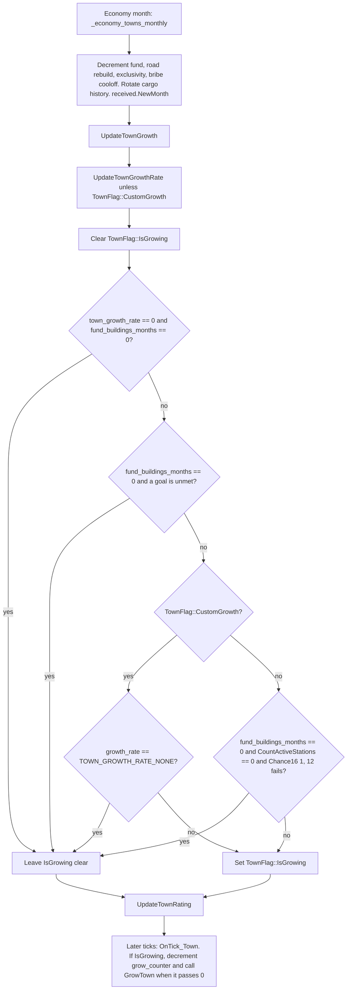

# Towns

A town is a pooled world object (`Town` in `src/town.h`) plus the house and town-owned road tiles that point back at it. Population, local-authority rating, and growth are cached or updated on the `Town`. Houses are not a second pool: they are `TileType::House` tiles. There is no `src/town.cpp` and no `src/house_cmd.cpp` in this tree. Town commands, the house tile callbacks, and growth all live in `src/town_cmd.cpp`. External town lists are loaded by `LoadTownData` in `src/genworld.cpp`.

Detail: [town-growth.md](town-growth.md), [town-import.md](town-import.md).

## Pool and identity

`TownID` is `PoolID<uint16_t, …, 64000, 0xFFFF>` (`src/town_type.h`). The pool is `Pool<Town, TownID, 64>` (`src/town.h`), so it grows in steps of 64 and `TownPool::MAX_SIZE` is 64000. `TownID::Invalid()` is `0xFFFF`. The live pool is `_town_pool` in `src/town_cmd.cpp`.

`GenerateTowns` clamps its target count with `Clamp<uint>(total, 1, TownPool::MAX_SIZE)`. `CUSTOM_TOWN_MAX_NUMBER` (5000) is only the cap for the custom “number of towns” setting (`src/town.h`), separate from the pool cap.

Each town stores a centre tile `xy`. Two k-d trees index centres by tile X/Y (`src/town_kdtree.h`):

| Tree | Defined in | Role |
| --- | --- | --- |
| `_town_kdtree` | `src/town_cmd.cpp` | Nearest town. Rebuilt by `RebuildTownKdtree` after random generation and on load |
| `_town_local_authority_kdtree` | `src/town_gui.cpp` | Viewport highlight of the local-authority zone |

`CalcClosestTownFromTile` asks `_town_kdtree` and then applies a Manhattan threshold. `ClosestTownFromTile` prefers the town index stored on a house tile or on a non-town-owned road tile.

## Houses are tiles

`MakeHouseTile` (`src/town_map.h`) turns a clear tile into `TileType::House`. Map field `m2` is the `TownID` (same accessor for town roads that are not depots). The house type is 12 bits of `m8` (`GetCleanHouseType`); NewGRF overrides go through `GetTranslatedHouseID`. Construction stage and age share `m5`. Completed houses set a bit in `m3` (`IsHouseCompleted`).

`HouseSpec` (`src/house.h`) is the catalogue: up to `NUM_HOUSES` (4096) specs, NewGRF houses from `NEW_HOUSE_OFFSET` (110). A spec’s `population` is added to `Town::cache.population` when the house is completed (`AdvanceSingleHouseConstruction` / `BuildTownHouse` in `src/town_cmd.cpp`) and removed in `ClearTownHouse`. The field comment on `HouseSpec::population` says other tiles of a multi-tile house are zero. `cache.num_houses` counts buildings, incremented once in `BuildTownHouse` and decremented once in `ClearTownHouse`.

Sizes are `BuildingFlag` bits: 1×1, 2×1, 1×2, 2×2. One church and one stadium per town (`TownFlag::HasChurch`, `TownFlag::HasStadium`). Zones are five concentric rings (`HouseZone` in `src/house.h`). `UpdateTownRadius` fills `cache.squared_town_zone_radius` from house count. Quoted in [town-growth.md](town-growth.md).

## Names

A town shows `Town::name` when that string is non-empty. Otherwise `GetTownName` (`src/townname.cpp`) expands `townnamegrfid`, `townnametype`, and `townnameparts`. `cached_name` is a non-saved cache of the generated string. `MAX_LENGTH_TOWN_NAME_CHARS` is 32, and `Utf8StringLength` must be strictly below that (`src/town_type.h`).

`GenerateTownName` draws up to 1000 random seeds and keeps the first value that `VerifyTownName` accepts. Builtin styles come from `src/table/townname.h`. A NewGRF style is used when the town-name setting is at or past `BUILTIN_TOWNNAME_GENERATOR_COUNT` (`src/townname_type.h`). If the town’s GRF is missing, `TownNameParams::TownNameParams(const Town *)` falls back to the first builtin style (English).

JSON import writes the custom `name` and passes `townnameparts = 0` (`TryGenerateNamedTownAroundTile`). Uniqueness for that path is `IsUniqueTownName`, which compares only other custom names. Generated-name uniqueness is a different check (`VerifyTownName`).

## Local authority and cargo

Per-company opinion is `Town::ratings` (`int16_t`, initialised to `RATING_INITIAL` = 500) and `have_ratings`. Bounds are `RATING_MINIMUM` (−1000) through `RATING_MAXIMUM` (1000) in `src/town_type.h`. The monthly timer calls `UpdateTownRating`. Removing houses, roads, tunnels, and bridges calls `ChangeTownRating`. New stations inside the local-authority distance are refused when the rating is not above `RATING_VERYPOOR`, unless the council attitude is permissive (`CheckIfAuthorityAllowsNewStation`).

Cargo that arrives at a station is counted on that station’s town in `DeliverGoods` (`src/economy.cpp`):

```1107:1112:src/economy.cpp
	/* Increase town's counter for town effects */
	const CargoSpec *cs = CargoSpec::Get(cargo_type);
	st->town->received[cs->town_acceptance_effect].new_act += accepted_total;
	if (accepted_total - accepted_ind > 0) {
		/* Cargo not delivered to an industry must go to the town. */
		st->town->GetOrCreateCargoAccepted(cargo_type).history[THIS_MONTH].accepted += accepted_total - accepted_ind;
```

`received` is indexed by `TownAcceptanceEffect` (`src/cargotype.h`): none, passengers, mail, goods, water, food. The month timer copies `new_act` to `old_act` via `TransportedCargoStat::NewMonth`. Growth reads `old_act` against `Town::goal`. Temperate towns leave goals at 0, so that comparison does not block them. Arctic and tropic set the special goals in `DoCreateTown` (quoted in [town-growth.md](town-growth.md)). A deity command `CmdTownCargoGoal` can replace any goal.

Houses also *produce* passengers and mail on the house tile loop (`TownGenerateCargoOriginal` / `TownGenerateCargoBinomial`). That updates `Town::supplied` and moves cargo to stations. It is a separate path from `received`.

## Monthly growth decision

Growth permission is decided once per economy month. Placement happens later, on game ticks, and only while `TownFlag::IsGrowing` is set. `OnTick_Town` returns immediately in the scenario editor, so editor expansion is `CmdExpandTown`, not the tick handler.

`UpdateTownGrowth` (`src/town_cmd.cpp`) always clears `IsGrowing` first. It then returns without setting the flag when the economy growth setting is 0 and the town is not in a “fund buildings” period. That return happens before the custom-growth branch, so `TownFlag::CustomGrowth` does not override a growth setting of none unless buildings are being funded. Cargo goals are checked only when `fund_buildings_months == 0`. The custom-growth branch then either sets `IsGrowing` (when `growth_rate != TOWN_GROWTH_RATE_NONE`) or leaves it clear. Otherwise an unfunded town with no active station grows only when `Chance16(1, 12)` succeeds (`src/core/random_func.hpp`).



The rate number itself is `GetNormalGrowthRate`, quoted in [town-growth.md](town-growth.md). It is stored in game ticks (`TownTicksToGameTicks`). `TOWN_GROWTH_RATE_NONE` (`0xFFFF`) disables growth for a custom rate.

## Import pipeline

Scenario Editor’s Found Town window (`WID_TF_LOAD_FROM_FILE` in `src/town_gui.cpp`) is the only UI. Outside the editor, `FoundTownWindow::OnInit` hides that button stack. The file list is `*.json` under the heightmap subdirectory (`scenario/heightmap/`, `Subdirectory::Heightmap`). `LoadTownData` reads `_file_to_saveload`, parses a JSON array, founds each town at `TownSize::Small`, and posts `Commands::ExpandTown` until `cache.population` reaches the target or the loop limits trip.

```mermaid
flowchart TD
  ui["Found Town window, editor only: Load from file"] --> dialog["Save/load dialog, AbstractFileType::TownData"]
  dialog --> list["FiosGetTownDataList: .json under Subdirectory::Heightmap"]
  list --> click["File selected: set _file_to_saveload, LoadTownData"]
  click --> read["FioFOpenFile binary read into a string"]
  read --> parse["ParseTownData: nlohmann::json array of objects"]
  parse --> bad{"JSON, types, or coordinates invalid?"}
  bad -->|yes| abort["Error dialog. Return no towns. Nothing is founded"]
  bad -->|no| each["For each ParsedTown"]
  each --> place["TryGenerateNamedTownAroundTile at TownSize::Small, layout from economy.town_layout"]
  place --> miss{"Town pointer is null?"}
  miss -->|yes| sign["PlaceSign at target_tile. Count a failure"]
  miss -->|no| keep["Remember town and target population"]
  sign --> next["Next town"]
  keep --> next
  next --> grow["For each founded town: ExpandTown by 10 houses until population >= target, or try_limit / fail_limit"]
  grow --> warn["If any founding failed: warning with the failure count"]
```

Coordinate conversion, the expand loop, and where `docs/importing_town_data.md` drifts from this path are in [town-import.md](town-import.md).

## Code map

| Path | What it owns |
| --- | --- |
| `src/town.h` | `Town`, `TownPool`, `TownFlag`, growth-rate sentinels, `TownTicksToGameTicks` |
| `src/town_type.h` | `TownID`, `TownSize`, rating constants, `TownLayout`, `TownExpandMode`, cargo-gen mode |
| `src/town_cmd.h` | Found, rename, expand, delete, growth rate, rating, cargo goal, place-house commands |
| `src/town_cmd.cpp` | Pool, k-d tree rebuild, house tile callbacks, `GrowTown`, ratings, monthly and yearly timers, `OnTick_Town` |
| `src/town_map.h` | House/road town index, house type, construction, `MakeHouseTile` |
| `src/town_kdtree.h` | `TownKdtree` and the two tree declarations |
| `src/town_gui.cpp` | Town view, authority window, directory, Found Town window, load-from-file button, authority k-d tree |
| `src/townname.cpp`, `src/townname_type.h`, `src/townname_func.h`, `src/table/townname.h` | Generated names |
| `src/house.h`, `src/house_type.h` | `HouseSpec`, zones, building flags. No `house_cmd.cpp` |
| `src/newgrf_house.cpp`, `src/newgrf/newgrf_act0_houses.cpp` | NewGRF house callbacks and Action 0 |
| `src/table/town_land.h` | Original house draw data |
| `src/genworld.cpp` | `ParseTownData`, `LoadTownData`, `TranslateCoordinates` |
| `src/genworld.h` | `LoadTownData` declaration |
| `src/fios.cpp`, `src/fios_gui.cpp`, `src/fileio_type.h` | `.json` picker, `Subdirectory::Heightmap` |
| `src/economy.cpp` | `DeliverGoods` writes `Town::received` |
| `src/cargotype.h`, `src/table/cargo_const.h` | `TownAcceptanceEffect`, `TownProductionEffect` |
| `src/saveload/town_sl.cpp` | Save/load of towns and cargo history |
| `src/script/api/script_town.cpp` | Deity growth-rate and goal access |
| `docs/importing_town_data.md` | Player-facing JSON workflow. Stale spots below |

Absent from this tree: `src/town.cpp`, `src/house_cmd.cpp`.

## Stale or incomplete claims in `docs/importing_town_data.md`

| Legacy text | What the code does |
| --- | --- |
| London example, “Town data values”: `726 / 1024 = 0.7998046875` and `1638 / 2048 = 0.708984375` | Those quotients are swapped. `726/1024` is `0.708984375` and `1638/2048` is `0.7998046875`. The sample object’s `"x": 0.7998046875`, `"y": 0.708984375` matches the later instruction to swap axes, so the JSON sample and the division sentence disagree with each other |
| Coordinates are “between 0 and 1” | `TranslateCoordinates` rejects `x <= 0`, `y <= 0`, `x >= 1`, and `y >= 1` (`src/genworld.cpp`). The endpoints are a hard error for the whole file |
| Proportion “of the total map dimension” | Clockwise placement is `TileXY(x * Map::MaxX(), y * Map::MaxY())`. `Map::MaxX()` is `Map::SizeX() - 1` (`src/map_func.h`). The multiplier is the last valid tile coordinate, and the `float` is passed into `TileXY(uint, uint)`, which truncates |
| “a flat tile can’t be found with a 16-tile radius” | The search is `SpiralTileSequence(target_tile, 16, 0, 0)` (`src/town_cmd.cpp`). The radius constructor treats its tile as north of a centre hole (`src/tilearea_spiral.h`); the first visited tile is `TileX(start) + 1`, not `target_tile` itself (`src/tilearea_spiral.cpp`). `IsEnd` is true once `cur_radius == max_radius`, so the loop stops when the radius counter reaches 16. `TownCanBePlacedHere(tile, false)` also requires a clear or tree tile, a flat slope, Manhattan distance at least `economy.town_min_distance` from the nearest town, and `DistanceFromEdge >= 12`. Ocean and slope are two of those failures |
| Population “is scaled down for use in OpenTTD” as if the game rescaled it | The engine stores the JSON number with `get_to` into `uint` and treats it as a target. It does not divide by a scale factor. Author advice to pick a smaller number is outside the parser. A fractional value such as the sample `217.16` is a JSON number (`is_number()`), then `nlohmann` `from_json` `static_cast`s it to the `uint` (`src/3rdparty/nlohmann/json.hpp`). The fraction is not kept |
| Towns are expanded “until the population is greater than the player-defined target” | The loop condition is `t->cache.population < population` (`LoadTownData`). It stops once population is greater than or equal to the target. The loop is a `do`/`while`, so it always posts one `ExpandTown` of 10 houses even when the small town is already at the target. Caps: `try_limit` 1000, `fail_limit` 10 |
| “Town Generation window” | The control is the Found Town window, widget `WID_TF_LOAD_FROM_FILE`. It is hidden when the game mode is not the editor |
| A failed town gets a sign | That part matches `Commands::PlaceSign`. The same paragraph does not say that one bad JSON object aborts the entire file before any town is founded, or that a duplicate custom name, the map edge, or `town_min_distance` also take the sign path |
| Struct-comment defaults are not in the doc, and they are not in the parser either | `ParsedTown` comments say a blank population defaults to 0 and a blank city to false. `ParseTownData` requires `name` (string), `population` (number), `city` (boolean), `x` and `y` (numbers). A missing field is `STR_TOWN_DATA_ERROR_TOWN_FORMATTED_INCORRECTLY` and the function returns an empty list |

Claims that still match the code: the file is a JSON array of objects with `name`, `population`, `city`, `x`, `y`; the picker starts in `scenario/heightmap` (`Subdirectory::Heightmap` in `src/fileio.cpp`); clockwise heightmap rotation uses the JSON axes as tile X/Y, and counter-clockwise uses `TileXY((1 - y) * Map::MaxX(), x * Map::MaxY())`; a town that cannot be founded gets a sign on the target tile; house NewGRFs are whatever is loaded when the towns are built, not a field in the JSON.

## Invariants

- A live town occupies one `TownPool` slot. House tiles and non-depot town roads store that `TownID` in map field `m2`. Destroying a town asserts, in debug builds, that no house, town-owned road, or town-owned bridge still references it (`Town::~Town`).
- `cache.population` changes by `HouseSpec::population` of a house when that house completes or is cleared. `cache.num_houses` changes by one per building, including multi-tile buildings.
- `cache.squared_town_zone_radius` is a function of `cache.num_houses` only (`UpdateTownRadius`). `GetTownRadiusGroup` compares squared Euclidean distance to those entries.
- `TownFlag::IsGrowing` is recomputed from scratch every economy month. Ticks never set it. Ticks only decrement `grow_counter` while it is set, and never run in the editor.
- `growth_rate` for normal towns is the result of `GetNormalGrowthRate` → `TownTicksToGameTicks`. `TownFlag::CustomGrowth` freezes that recalculation. `TOWN_GROWTH_RATE_NONE` means custom growth is off.
- A growth setting of 0 with `fund_buildings_months == 0` leaves the town not growing, including towns with `TownFlag::CustomGrowth`.
- Cargo goals block growth only when the town is not in a fund-buildings period. Goal `0` does not block. `TOWN_GROWTH_WINTER` and `TOWN_GROWTH_DESERT` block only in the matching climate band, above the population checks in `UpdateTownGrowth`, and only when `old_act == 0`.
- `received[].new_act` counts every unit `DeliverGoods` accepts at the station, including units that went to an industry. The month rollover is what growth observes (`old_act`).
- Ratings stay inside `[RATING_MINIMUM, RATING_MAXIMUM]` after `UpdateTownRating`. `ChangeTownRating` also clamps a single change to the `max` argument. Test mode (`SetTownRatingTestMode`) writes a side map instead of `Town::ratings`.
- An imported file is all-or-nothing at parse time. Placement failures skip one town, leave a sign, and continue. The population field is a target for `CmdExpandTown`, not a value written into `cache.population`.
- Custom import names must be unique among custom names and shorter than 32 UTF-8 characters. They do not go through `VerifyTownName`.
