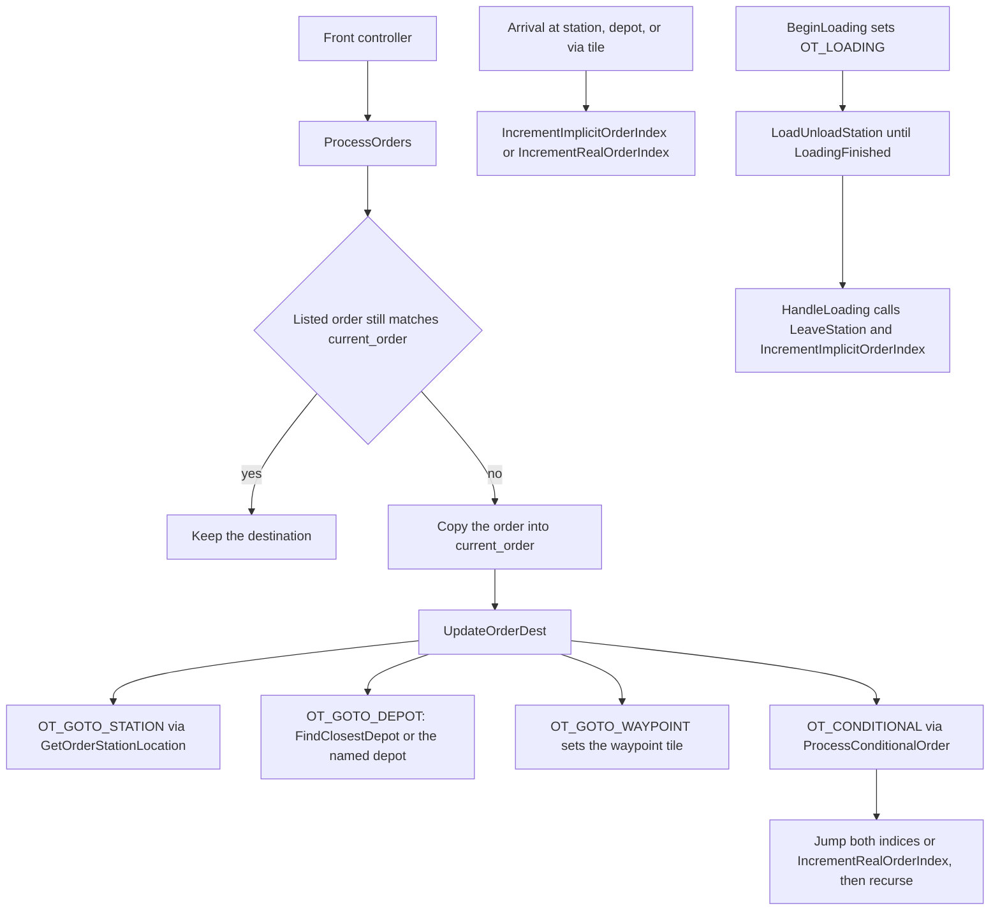

# Vehicles

Native underground construction and conventional freight are specified by [R2MLVS7](../../upgrades/2026-10/r2mlvs7-underground-construction-and-fleet.md); this page records their delivered vehicle ownership and save boundaries.

TBM ownership,2026-10-09: the native Train, Order/OrderList and Depot pool own machinery, ordinary travel and selected hangar identity. The geological job retains its immutable commissioning anchor, accepted geometry and work; the exchange owner retains actual wagon custody and the original haulage origin. Player return/service or Follow order suspends new cutting after the atomic operation. Resume work rejoins the retained face through the real working bay. Missing work targets wait rather than falling into ordinary no-order movement. Final release requires the whole stored cutter and settled, vacated logistics; it retains the machine and permits paid support conversion/public traffic. Shared orders do not duplicate assignments. [R2TBMF W](../../../zz-rhr/upgrades/2026-10/tbm-fixes/r2tbmf-w-order-control-notes.md#group8-closure) and [ZB](../../../zz-rhr/upgrades/2026-10/tbm-fixes/r2tbmf-zb-final-notes.md) retain physical service/reuse, remote storage and A-to-B traffic evidence.

Company vehicles are pool items of type `Vehicle` (`src/vehicle_base.h`). Trains, road vehicles, ships, aircraft and native Space vehicles each override `Tick`. Effect vehicles and disaster vehicles share the same pool and the same walk; their handlers live in `src/effectvehicle.cpp` and `src/disaster_vehicle.cpp` and are outside the movement described here.

`StateGameLoop` calls `CallVehicleTicks` once per simulation frame. The frame order is in [the game loop](../game-loop/archi-game-loop.md). Player actions that buy, sell, start, stop, refit, or send a vehicle to a depot are commands in `src/vehicle_cmd.cpp`. Order-list edits are commands in `src/order_cmd.cpp`. The command pipeline is in [commands](../commands/archi-commands.md).

What differs by mode:

- [Trains](trains.md)
- [Road vehicles](road-vehicles.md)
- [Ships](ships.md)
- [Aircraft](aircraft.md)

Path choice for trains, road vehicles, and ships is YAPF. This page names the call. The search itself is in [pathfinding](../pathfinder/archi-pathfinder.md).

## Code map

| Piece | File | What it is |
| --- | --- | --- |
| `Vehicle` | `src/vehicle_base.h` | Pool item, chain, position, cargo, orders, breakdown counters, `Tick` |
| `VehicleType` | `src/vehicle_type.h` | `Train`, `Road`, `Ship`, `Aircraft`, `Effect`, `Disaster`, then append-only `Space` |
| `BaseConsist` | `src/base_consist.h` | `cur_real_order_index`, `cur_implicit_order_index`, `VehicleFlag` |
| `Order` / `OrderType` | `src/order_type.h`, `src/order_base.h` | Order kinds and load, unload, depot, and conditional flags |
| `SpecializedVehicle` | `src/vehicle_base.h` | Typed `First` / `Next` for one `VehicleType` |
| `GroundVehicle` | `src/ground_vehicle.hpp` | Shared speed update for trains and road vehicles |
| Tick walk | `src/vehicle.cpp` `CallVehicleTicks` | Economy day, station load/unload, `Tick`, depot autoreplace |
| Orders | `src/order_cmd.cpp` | Insert, delete, skip, modify, clone; `ProcessOrders`, `UpdateOrderDest` |
| Cargo exchange | `src/economy.cpp` | `PrepareUnload`, `LoadUnloadVehicle`, `LoadUnloadStation` |
| Commands | `src/vehicle_cmd.cpp` | Sell, start/stop, refit, send to depot, rename, service interval |
| Train | `src/train.h`, `src/train_cmd.cpp` | `Train::Tick`, `TrainLocoHandler`, `TrainController` |
| Road | `src/roadveh.h`, `src/roadveh_cmd.cpp` | `RoadVehicle::Tick`, `RoadVehController` |
| Ship | `src/ship.h`, `src/ship_cmd.cpp` | `Ship::Tick`, `ShipController` |
| Aircraft | `src/aircraft.h`, `src/aircraft_cmd.cpp` | `Aircraft::Tick`, airport state machine |

## Native underground conventional fleet

`src/underground_vehicle.h` resolves immutable profile models through the existing engine/EIDS mapping. Models 2/3 reuse the Earth/Rock hopper definitions from the TBM owner; models 4-8 add a diesel freight locomotive, mineral wagon, sealed wagon, bulk truck and sealed carrier in the pinned package's reserved local range. Logical model IDs are never vehicle or engine pool IDs. Loading reconstructs real engine identities through `SetupEngines` and the accepted package. Native startup uses the catalogue's exact calendar dates; ordinary engine introduction retains its existing behavior.

`CheckUndergroundVehicleCapability` applies the accepted profile/version, current calendar, allocated operation layer, Deep unlock and exact cargo-label policy. Engine availability, depot purchase lists, refit lists and actual buy/refit/clone/renew commands consult that same predicate before allocating vehicles or temporary replacement chains. A global list can omit location, but an owning command checks its actual depot or vehicle layer. Sealed designs provide the published Uranium/Rare Earth cargo options. Original engines retain their ordinary checks, and paid TBM support does not provide electrical compatibility to an unpowered railtype.

These are ordinary `Train` and `RoadVehicle` pool items with existing costs, groups, service, cargo packets, station/depot orders and loading. Project haulers use the TBM exchange owner's actual association; their ordinary vehicle caption reads that project and the vehicle's world layer. Logical tube designs have no ordinary engine registration or delivered runtime controls here. Connected visible workflows physically deliver Coal in the bulk truck and Deep Rare minerals in the sealed carrier to their actual Surface receivers; finite reserve, stocks, packets and intake receipts reconcile. Final native directional/load sprites remain pending in R2MLVS13.

`GetTBMCutterSteeringTarget` derives the cutter's live work-face or exchange-bay destination from its existing project/job. YAPF recognizes that plain paid support as an uncached target, and the train releases reservations when its cached goal changes; ordinary saved orders remain with their existing owner. `CheckTBMSupportRailTurns` refuses a commissioned support path that the actual rail turn rule forbids. Shared `GetDefaultTBMConsist(MapLayer)` supplies two Earth/four Rock hoppers for Deep's first complete Hard cut, retaining two/two on Underground; actual capacity, length and purchase checks remain authoritative.

The focused native save fixture writes actual purchased and physically loaded vehicles with station/service orders and an active hauler association. The real game-loader round trip preserves EIDS, VEHS, ORDL and project/exchange descriptors exactly and resolves all seven conventional mappings. `dump_info underground_fleet` reads those loaded owners for evidence; it creates no replacement registry. See R2MLVS7 Group 10B for commands and retained input/output saves.

## Native launch and orbital cargo ownership

[Plan9](../../upgrades/2026-10/r2mlvs9-launch-centers-and-rockets.md) and the
[current423 runtime handoff](../../../zz-rhr/upgrades/2026-10/r2mlsp-q-runtime-handoff.md)
own the delivered launch/recovery contract. SpaceVehicle uses the ordinary
Vehicle pool for paid rocket/miner/survey/builder roles14/15/19/20, with exact
saved incarnations. SpaceManifest owns actual supplies, freight and reciprocal
carried-body/pod bindings; SpaceTransition retains the same rocket's paid
preparation/ascent/delivery/return/turnaround and once-only receipts. Ordinary
station/depot/train commands supply the actual Surface delivery leg; mineral-
only trucks do not acquire Goods capability to satisfy a test scenario.

A purchased SpacePod becomes the sole SpaceDescentJob packet owner at actual
current-position release. It targets an explicitly selected owned launch
center's inclusive20-tile Q16 circle and preserves packets when capacity or
identity is lost. Native loaded recall stops inside that circle, Visit retains
precise arrival, and Unload invokes the real release boundary. Space orders
cannot replace it with a proxy warehouse or payment. Direct full-load module
freight uses the actual operational Core/Storage/Dock's shared admitted berth
and sole inventory; current builder Craft resupply admits actual STEL/GOOD.

SurfaceHandlingJob owns a native StationCargoList between the real center and
an exclusive generation-qualified Surface member. Shared8-unit throughput,
capacity reservations and mass fees preserve source/routing/feeder/recorded-age
history through packet splits/merges. Pickup history is the per-cargo filter;
automatic allocation currently requires Asteroid-origin stock, and compatible
reverse supplies/processed Goods use explicit jobs. Active deliberate unlink
refuses; native station range/removal changes settle remaining assignments.
Handling expenses use canonical yearly Other; no final income arises merely
from changing layers or neutral routing. GetDistance requires in-vehicle
custody; the stored travel vector is verified through canonical CAPA transport.

Manual/bankruptcy company deletion refuses unsettled Space custody before
ordinary vehicle destruction; real ownership transfer retains original packet
and target generations. Last-facility launch retirement retains/refuses stored
cargo according to surviving ordinary freight facilities. Every new Vehicle
body initializes its saved round-trip duration, including wagons without
orders.26 owner families match current ordinary/replayed saves in both builds.
That423 handoff is a dated producer boundary. The later438 runtime below
records delivered mining, manufacturing/hauler consumers and joined mining
socket replay. Plan10's final authored/packed Space families are now verified
below; Plan11's broader presentation and acceptance remain separate.

## Native moving-target mining and runtime evidence

[Plan10](../../upgrades/2026-10/r2mlvs10-asteroids-and-mining-probes.md)
and its [current438 handoff](../../../zz-rhr/upgrades/2026-10/r2mlsp-z-z-p-probe-runtime-handoff.md)
retain one actual Vehicle-pool hull and incarnation through Approach, Mining,
Return and Holding. Stable asteroid IDs resolve directly to the original
finite body; matching native leases alone permit attached motion/work.
Body motion/index publication and all attached transforms precede native
craft decisions. `CommitSpaceMiningExtraction` emits a whole admitted native
CargoPacket batch and debits only its finite body; refusal keeps the last
partial interval and all material. Model15 earns two units per74 working
opportunities into its20-unit hold. Rendering earns no opportunities.

Final Space art,2026-10-17: [Plan10's accepted runtime review](../../../../logs/space-art-final-verification.json)
binds seven original-derived families at native3599..5166, both actual decoded
payload boundaries,95,743 focused assertions per configuration and34 ordinary
game captures. `space_sprite.h/.cpp` reads existing role/work/cargo/custody;
`SpaceVehicle::GetImage` uses physical facing without changing saved headings.
Afterload refreshes only sprite sequences and viewport bounds after native
orders, manifests, leases and sites restore, so paused hulls show the correct
saved state. Paused construction grants no new work; its constructing pose is
verified after genuine ordinary-loop progress. All originals and native
attachment offsets remain unchanged. Rocket/hauler/heavy and launch-facility
art retain their later Plan9/11 owners.

`CmdSetSpaceMissionChecked` binds assignment/Recall to the player's selected
generation at agreed execution; old generation-free arguments/IDs remain
offline-compatible and refuse multiplayer. Recall retains the last body as
nonactionable departure/history, releases its lease/uncommitted work and
preserves emitted cargo. The shared clear homeward exit precedes actual
owned20-tile circle entry. Original shells, manifest allowance, descent,
paid148-tick service and linked Surface freight/payment remain their native
owners. Actual three-resource missions, repeated batches and train/lorry
refinery delivery are accepted without another cargo registry or grant.

Company scan receipts alone authorize inspector quantities. Actual typed
survey/construction/ReturnService state uses original work/inventory owners.
Plan10's joined TCP client issues assignment and shell release, with six
matching frame/tick/elapsed checkpoints and55 physical families between peers;
visible/hidden/local/queued missions also agree. This verifies mining replay,
while Plan11's remaining broader network/end-to-end gates stay explicit.

Group21 measures exact10/160/10,240/14,336 populations, clustered drift and
narrow maps. Each body takes one motion and one native index update per
opportunity; target lookup is direct. Existing shared arbitration is bounded
by64 hulls and probe/slot pairs. Local bucket queries copy and sort their real
candidates, including the entire14,336-body cluster. Opt-in thread-local
work counters have no persistent or command authority; their timings do not
claim whole-game FPS or paid performance-world commissioning. Final Space
family sources, packed loading and ordinary-game art review remain pending.

## Pool and chain

`Vehicle` is `VehiclePool::PoolItem` (`src/vehicle_base.h`). The pool comment sizes it for a little over a million vehicles; the slot type is `VehicleID` in `src/vehicle_type.h`. `InitializeVehicles` resets the pool, the tile hash, and the viewport hash (`src/vehicle.cpp`).

A consist is a doubly linked chain: `next`, `previous`, `first`, `last`. `previous`, `first`, and `last` are `NOSAVE` and rebuilt on load. Articulated parts are extra vehicles in that chain, marked with `GroundVehicleSubtypeFlags::GVSF_ARTICULATED_PART`. `GetNextVehicle` skips those parts. `IsPrimaryVehicle` is false on the base class. Trains, road vehicles, ships, and aircraft override it so the front engine, the ship, or the normal aircraft is the primary.

Vehicles that share an order list point `orders` at the same `OrderList` and are linked by `next_shared` / `previous_shared`. `FirstShared` is the head of that list. The two order indices live on the vehicle (`BaseConsist`), so each shared vehicle has its own place in the list.

Position is `x_pos`, `y_pos`, `z_pos`, `tile`, and `direction`. `progress` is how far the vehicle has already crossed the current step. `cur_speed` is the current speed and `subspeed` is the fractional part. `TILE_AXIAL_DISTANCE` is 192 and `TILE_CORNER_DISTANCE` is 128 (`src/vehicle_base.h`). Those two constants are the step lengths `GetAdvanceDistance` returns.

`vehstatus` is a bitset of `VehState`: hidden, stopped by the player, unclickable, default palette, train slowing, shadow, aircraft broken, crashed.

## One simulation tick

```mermaid
flowchart TD
  frame[StateGameLoop] --> call[CallVehicleTicks]
  call --> econ[RunEconomyVehicleDayProc]
  call --> cargo[LoadUnloadStation for every station]
  call --> walk[Vehicle::Iterate and Vehicle::Tick]
  walk --> train[Train::Tick]
  walk --> road[RoadVehicle::Tick]
  walk --> ship[Ship::Tick]
  walk --> air[Aircraft::Tick]
  walk --> other[EffectVehicle::Tick and DisasterVehicle::Tick]
  call --> renew[Autoreplace vehicles that entered a depot this tick]
```

`CallVehicleTicks` (`src/vehicle.cpp`) does four things, in this order:

1. Clear `_vehicles_to_autoreplace`.
2. `RunEconomyVehicleDayProc`. Outside `GameMode::Normal` it returns. Otherwise it visits pool slots `date_fract`, `date_fract + DAY_TICKS`, and so on. `Ticks::DAY_TICKS` is 74 (`src/timer/timer_game_tick.h`). A vehicle whose `day_counter` low five bits are clear and that has an engine type receives NewGRF callback 32. Every visited vehicle then gets `OnNewEconomyDay`.
3. `LoadUnloadStation` for every station, timed as `PerformanceElement::GameLoopEconomy`.
4. Reset the train, road, ship, and aircraft performance accumulators, then `Vehicle::Iterate` and `v->Tick()`.

The base `Vehicle::Tick` returns true and does nothing (`src/vehicle_base.h`). A `Tick` that returns false has deleted the vehicle. `CallVehicleTicks` asserts the pool slot is empty in that case and continues. After a surviving company vehicle, the same walk ages cargo when `cached_cargo_age_period` is non-zero, and it may play a running sound from `motion_counter` and `tick_counter`. Crashed, hidden, and stopped vehicles skip the sound. Trains still count as moving for sound when `cur_speed > 0` even if `VehState::Stopped` is set.

After the walk, every vehicle recorded by `VehicleEnteredDepotThisTick` may be autoreplaced. The vehicle was forced to `VehState::Stopped` on depot entry so it cannot reserve a path out before replacement. If the map entry says it should restart, the stopped bit is cleared, then `Commands::AutoreplaceVehicle` runs as the owner.

`RunVehicleCalendarDayProc` is separate. The game loop calls it when the calendar timer elapses. It ages vehicles on the same `DAY_TICKS` stride, using `TimerGameCalendar::date_fract`, through `OnNewCalendarDay` and `AgeVehicle`.

Each mode's economy-day handler charges running cost as `GetRunningCost() * running_ticks / (DAYS_IN_YEAR * DAY_TICKS)`, subtracts that from `profit_this_year`, and pays the company through `SubtractMoneyFromCompanyFract`. `running_ticks` counts ticks the vehicle was not stopped, then resets. The expense types are `TrainRun`, `RoadVehRun`, `ShipRun`, and `AircraftRun`.

## Orders

An `OrderList` holds the timetable the player (or a script) wrote, plus implicit orders the simulation inserts. `current_order` is the order the vehicle is executing right now, including the transient states `OT_LOADING`, `OT_LEAVESTATION`, and `OT_DUMMY`.

`OrderType` (`src/order_type.h`):

| Value | Meaning |
| --- | --- |
| `OT_NOTHING` | No order |
| `OT_GOTO_STATION` | Go to a station |
| `OT_GOTO_DEPOT` | Go to a depot or hangar |
| `OT_LOADING` | Stopped and exchanging cargo. This is `current_order` only |
| `OT_LEAVESTATION` | Just left the platform. One tick of departure |
| `OT_DUMMY` | Placeholder while the real index is being resolved |
| `OT_GOTO_WAYPOINT` | Pass a waypoint or buoy |
| `OT_CONDITIONAL` | Jump to another order when a comparison matches |
| `OT_IMPLICIT` | Station the vehicle stopped at without a manual order |

`OrderLoadType` is load-if-possible, full load, full load of any one cargo, or no load. `OrderUnloadType` is unload-if-accepted, force unload, transfer, or no unload. `OrderNonStopFlag::NonStop` skips intermediate stations. `OrderNonStopFlag::GoVia` means the destination is a via-stop: the vehicle passes it and does not load. `OrderDepotTypeFlag` records service versus a listed order. `OrderDepotActionFlag` records halt, nearest depot, and unbunch.

Two indices (`src/base_consist.h`):

- `cur_real_order_index` points at the next manual order. Implicit orders are skipped.
- `cur_implicit_order_index` points at the order the vehicle is working through, including implicit stops.

`SkipToNextRealOrderIndex` advances the real index past implicit orders, wrapping to 0 (`src/vehicle_base.h`). `IncrementImplicitOrderIndex` advances the implicit index, and advances the real index as well when the two were equal. `IncrementRealOrderIndex` advances both when they are equal, and advances only the real index when implicit orders still sit between them. `UpdateRealOrderIndex` repairs a real index that landed on an implicit order. None of these four rewrite `current_order`. `InvalidateVehicleOrder` marks the order window dirty.

`ProcessOrders` (`src/order_cmd.cpp`) is what a moving front calls when it needs a destination.

- A depot order that is not `PartOfOrders` returns false, so a service diversion is left alone.
- `OT_LOADING` returns false.
- `OT_LEAVESTATION` returns false for trains, road vehicles, and ships. Aircraft fall through.
- A via-station or waypoint whose tile the moving front is already on deletes unreached implicit orders, records `last_station_visited`, updates the timetable, and calls `IncrementImplicitOrderIndex`.
- `UpdateRealOrderIndex` then selects the listed order. An all-implicit list is treated as no order. Aircraft with no valid goto order call `HandleMissingAircraftOrders` and return false. Other types clear `current_order` and `dest_tile`.
- If the listed order already equals `current_order` and the destination is still usable, the function returns false. Ships re-check that a station order still has a ship station.
- Otherwise `current_order` is replaced and `UpdateOrderDest` runs. The return value is true when that order is a reason to reverse, and only when `current_order` was `OT_NOTHING` on entry (the comment: reversing after an order change is allowed just after leaving a station).

`UpdateOrderDest` writes `dest_tile` from the order, with a recursion limit of `GetNumOrders` so a conditional loop cannot run forever.

- `OT_GOTO_STATION` calls the virtual `GetOrderStationLocation`.
- `OT_GOTO_DEPOT` with the service flag, when `NeedsServicing` is false, updates the timetable and `IncrementRealOrderIndex`, then continues with the next order. Nearest-depot orders call `FindClosestDepot`. A failed search spreads retries with `date_fract != (index % DAY_TICKS)`. A found depot stores the tile and destination. A train whose depot is behind it executes `Commands::ReverseTrainDirection` immediately. Aircraft heading for a different hangar call `AircraftNextAirportPos_and_Order`. No depot at all skips the order the same way a finished service order does. A depot named in the order uses `Depot::Get` for the tile, except aircraft, which use `GetOrderStationLocation`.
- `OT_GOTO_WAYPOINT` sets `dest_tile` to the waypoint tile.
- `OT_CONDITIONAL` calls `ProcessConditionalOrder`. A match sets both indices to the skip target, calls `UpdateRealOrderIndex`, and sets `GroundVehicleFlag::SuppressImplicitOrders` on ground vehicles so later implicit inserts do not have to retarget the conditional. A miss calls `IncrementRealOrderIndex`. Either way the function recurses.

`ProcessConditionalOrder` compares load percent (`CalcPercentVehicleFilled`), reliability, max reliability, display max speed, age, `NeedsServicing`, remaining lifetime, or driving-backwards-without-a-lead-capable-front. `Unconditionally` always jumps. Comparators are the eight `OrderConditionComparator` values.



Order commands mutate the list: `CmdInsertOrder`, `CmdDeleteOrder`, `CmdSkipToOrder`, `CmdMoveOrder`, `CmdModifyOrder`, `CmdCloneOrder`, `CmdOrderRefit`. `InsertOrder` and `DeleteOrder` adjust the indices. `DeleteVehicleOrders` drops the list, clears unbunching data, and can reset both indices and cancel a load. `CheckOrders` warns about broken orders; each mode calls it from `OnNewEconomyDay`.

`Order::ShouldStopAtStation` is true when the vehicle has not just visited that station, the order is not an unlisted depot diversion, and the non-stop flag for that station kind is clear. `CanLoadOrUnload` requires a station or implicit order that is not via, with a load or unload action. `CanLeaveWithCargo` is true when the order loads, or when the vehicle already has cargo and is not forced to unload or transfer everything.

## Cargo loading

Arrival calls `Vehicle::BeginLoading` (`src/vehicle.cpp`). The precondition is a station tile under the moving front, or a ship. `cur_speed` is set to 0.

If `current_order` is already `OT_GOTO_STATION` for `last_station_visited`, unreached implicit orders are deleted, `current_order` becomes `OT_LOADING` with `MakeLoading(true)`, the timetable is updated, and both non-stop flags are set so later code can tell this was the scheduled stop. Otherwise a ground vehicle may insert an `OT_IMPLICIT` order for `last_station_visited`, unless implicit orders are suppressed, a duplicate already sits next to this index, or the list is full (`MAX_VEH_ORDER_ID`). The search prefers an existing implicit order for that station and deletes the implicit orders in between. `IMPLICIT_ORDER_ONLY_CAP` is 32. `current_order` then becomes `OT_LOADING` with `MakeLoading(false)`.

`PrepareUnload` (`src/economy.cpp`) pushes the vehicle onto `station->loading_vehicles`, clears `VehicleFlag::LoadingFinished`, sets `load_unload_ticks` to 1, allocates a `CargoPayment`, and `Stage`s each cargo packet for deliver, transfer, or keep. Parts with cargo to unload get `VehicleFlag::CargoUnloading`. Travel time since `last_loading_tick` is reported through `IncreaseStats` when the previous loading station differs and this stop loads or unloads.

`LoadUnloadStation` runs before any `Tick`. It decrements `load_unload_ticks` on vehicles that are not stopped or crashed. If none reach zero, it returns. Otherwise it calls `LoadUnloadVehicle` up through the last vehicle that reached zero, in the order they entered the station. Delivered cargo can trigger industry production through `_cargo_delivery_destinations`.

`LoadUnloadVehicle` requires `OT_LOADING`. A train whose moving front is no longer on that station (it reversed away) sets `LoadingFinished` and a one-tick wait, then returns. Each part with capacity unloads first while `CargoUnloading` is set and the order unloads. Gradual loading limits one slice to `GetLoadAmount`; otherwise the whole unload count moves. `VehicleCargoList::Unload` pays through the `CargoPayment`. Loading is skipped for `OrderLoadType::NoLoad` and for `VehicleFlag::StopLoading`. A refit order can `HandleStationRefit` on the first cargo-carrying articulated part. Station cargo is then loaded up to free capacity, again sliced by `GetLoadAmount` when gradual loading is on.

When something moved, gradual loading replaces the tick count with a fixed wait by vehicle type: 40 train, 20 road, 10 ship, 20 aircraft (the array in `LoadUnloadVehicle`, noted as the TTDPatch values). If the vehicle loaded less than a full slice, nothing is reserved, the order is not full-load, and the timetabled wait has elapsed, `StopLoading` is set. When nothing moved, the wait is 20 ticks and `LoadingFinished` is set, unless a full-load order still has space (`FullLoadAny` finishes when any cargo type is full, with an extra passenger check for aircraft). A full-load vehicle that is not finished runs `LinkRefresher::Run` so cargo can be routed onto links it has not proved yet.

`Vehicle::HandleLoading` runs from the mode controller, after `ProcessOrders`. On `OT_LOADING` it returns while `mode` is true (the second call of this tick), while `LoadingFinished` is clear, or while `current_order_time` is still below the timetabled wait minus lateness. Otherwise it plays the leave-station sound, calls `LeaveStation`, and, when the implicit order is this station, falls through to `IncrementImplicitOrderIndex`. `OT_DUMMY` also advances. Every other type returns.

`LeaveStation` deletes the `CargoPayment`, updates the timetable when the order carried a non-stop flag, sets `last_loading_station` when the vehicle may leave with cargo, or clears it when the vehicle must leave empty. `current_order` becomes `OT_LEAVESTATION`. Reservations are returned to the station, the vehicle is removed from `loading_vehicles`, and `trip_occupancy` is `CalcPercentVehicleFilled`. Trains set `VehicleRailFlag::LeavingStation` and trigger station animation. Road vehicles trigger road-stop animation.

`current_order_time` is incremented by the mode controller, once per tick, on the front vehicle. That counter is what `HandleLoading` compares with the timetabled wait.

## Depots and servicing

`NeedsServicing` is false for stopped or crashed vehicles. A percent interval compares reliability with the engine reliability scaled by the interval. A wallclock interval uses economy months. A day interval uses economy days since `date_of_last_service`. When breakdowns are off and `no_servicing_if_no_breakdowns` is set, the function returns true only when an autoreplace is pending and the company can pay for it. `NeedsAutomaticServicing` is that test, and it is false when the list already contains a depot order, while loading, or while already heading to a depot that is not a plain service order.

Each mode's `OnNewEconomyDay` calls a `CheckIf*NeedsService` helper when the company service interval for that type is non-zero. A vehicle already in the depot is serviced in place. Otherwise the helper looks for a depot inside `pf.yapf.maximum_go_to_depot_penalty` (ships convert that penalty to tiles). A depot that is close enough replaces `current_order` with `MakeGoToDepot` and sets `SuppressImplicitOrders` on ground vehicles. A depot that has moved out of range turns an existing goto-depot order into a dummy.

`Vehicle::SendToDepot` is the body of `CmdSendVehicleToDepot`. It rejects a crashed vehicle and a vehicle already stopped in a depot, and it clears unbunching data. An existing goto-depot order is either retargeted between service and halt, or cancelled (`IncrementRealOrderIndex` when the depot order is part of the list, then `MakeDummy`). A new order uses `FindClosestDepot`. While loading, the vehicle `LeaveStation`s first. Trains may execute `Commands::ReverseTrainDirection` when the depot is behind them.

`VehicleEnterDepot` always runs on the front. It hides the vehicle, zeroes `cur_speed`, calls `VehicleServiceInDepot`, and records the vehicle in `_vehicles_to_autoreplace` via `VehicleEnteredDepotThisTick`, which also sets `VehState::Stopped`. `VehicleServiceInDepot` stamps both service dates, clears `breakdowns_since_last_service`, restores engine reliability, and divides `breakdown_chance` by 4 (or zeroes it under reduced breakdowns) for every part that has an engine type. A depot-order refit executes `Commands::RefitVehicle`. A listed depot order deletes unreached implicit orders, updates the timetable, and calls `IncrementImplicitOrderIndex`. `OrderDepotActionFlag::Halt` leaves the vehicle stopped, clears `last_loading_station` and unbunching data, and posts waiting news. `OrderDepotActionFlag::Unbunch` stores a smoothed `round_trip_time` from `TimerGameTick::counter` minus `depot_unbunching_last_departure`. `current_order` then becomes a dummy.

`IsWaitingForUnbunching` is true inside a depot when the order list is shared, there is more than one order, the previous order is an unbunch depot, and `depot_unbunching_next_departure` is still in the future. `LeaveUnbunchingDepot` records the departure tick, zeroes lateness, and sets the next departure of every shared vehicle to now plus the average round trip divided by the number of running shared vehicles, at least one tick.

Leaving the depot is mode-specific. The shared piece is `VehicleServiceInDepot` again on the way out, `LeaveUnbunchingDepot`, and `PlayLeaveStationSound`.

## Breakdowns

`CheckVehicleBreakdown` (`src/vehicle.cpp`) runs from each mode's `OnNewEconomyDay`, on the primary vehicle. It returns in the menu, and when breakdowns are `None` and servicing-without-breakdowns is disabled. Reduced breakdowns skip reliability loss while `current_order` is `OT_LOADING`. Reliability then falls by `reliability_spd_dec`, clamped to the engine's current reliability.

No breakdown is rolled when breakdowns are `None`, when `breakdown_ctr` is already non-zero, when `cur_speed < 5`, or when the vehicle is manually stopped. Otherwise `Random` increases `breakdown_chance` (an extra 25 on a 1-in-25 roll). The chance table `_breakdown_chance` is indexed by reliability shifted down 10 bits. Ships add `0x6666` to reliability before that index. Reduced breakdowns add the same offset. A hit sets `breakdown_ctr` from bits 16–21 of the random word plus `0x3F`, `breakdown_delay` from bits 24–30 plus `0x80`, and clears `breakdown_chance`.

`HandleBreakdown` interprets `breakdown_ctr`:

| Value | State |
| --- | --- |
| 0 | Running. Returns false |
| greater than 2 | Counting down, unless the vehicle is loading. Returns false |
| 2 | The breakdown starts. Becomes 1. Speed is zeroed, except aircraft, which only set `VehState::AircraftBroken`. Smoke and a breakdown sound are spawned when the engine allows it |
| 1 | Broken. `breakdown_delay` decrements when `tick_counter` matches a mask, then `breakdown_ctr` returns to 0. The function returns true, so the controller does not move the vehicle |

The mask is 3 for trains and 1 for other types. Trains call `HandleBreakdown` twice per tick, from the two `TrainLocoHandler` passes, so the wider mask keeps the delay falling at half the rate of a vehicle that is called once. Aircraft always return false: the comment on the function says they never stop for a breakdown. Their speed cap is applied later in `UpdateAircraftSpeed`.

`AgeVehicle` doubles `reliability_spd_dec` at each of the first five years past `max_age` for a primary vehicle (and for train engines that are not primary).

## Ground movement shared by trains and road vehicles

`GroundVehicle::DoUpdateSpeed` (`src/ground_vehicle.hpp`) adds `accel` into `subspeed`, carries the high byte into `cur_speed`, and clamps to `min_speed` and a ceiling. When `cur_speed` is already above `max_speed`, the ceiling for this tick is `cur_speed - cur_speed / 10 - 1`, and never below `max_speed`. The returned distance is `GetAdvanceSpeed(cur_speed) + progress`. `progress` is cleared here and written back by the controller with whatever distance was not consumed.

`GetAdvanceSpeed` scales speed by 3/4 (`src/vehicle_base.h`). `GetAdvanceDistance` is `TILE_AXIAL_DISTANCE` (192) on a diagonal and `TILE_CORNER_DISTANCE * 2` (256) otherwise, so a cardinal step costs more progress than a diagonal step. `GetOldAdvanceSpeed` is the older scaling, still used by aircraft: diagonal speed is unchanged and a cardinal heading uses `speed * 3 / 4`. The comment on `GetAdvanceSpeed` says the newer pair avoids rescaling leftover progress when the direction changes.

`Train::UpdateSpeed` and `RoadVehicle::UpdateSpeed` choose `AccelerationModel::Original` or `Realistic` and pass different `accel` and `min_speed` into `DoUpdateSpeed`. The formulas are in the mode pages. Both controllers then subtract `GetAdvanceDistance` from that distance in a loop and step the vehicle once per subtraction.

`Vehicle::HandlePathfindingResult` sets or clears `VehicleFlag::PathfinderLost` and the lost-vehicle news. Road vehicles and ships call it after a YAPF choice. A lost vehicle also clears unbunching data.

## Commands

These run through the command executor. They change the vehicle. They do not step it along the map.

| Command | Role |
| --- | --- |
| `CmdStartStopVehicle` | Toggles `VehState::Stopped` on a primary company vehicle. Rejects a crashed vehicle, a train with `cached_power == 0`, and an aircraft in flight (`state` from `STARTTAKEOFF` up to `TERM7`, or `VehicleAirFlag::HelicopterDirectDescent`). NewGRF start/stop callback can veto |
| `CmdMassStartStopVehicle` | Starts or stops a vehicle list |
| `CmdSendVehicleToDepot` | One vehicle, or every vehicle in a list when `DepotCommandFlag::MassSend` is set. Body is `Vehicle::SendToDepot` |
| `CmdSellVehicle` | Sells one vehicle or a chain |
| `CmdRefitVehicle` / `RefitVehicle` | Changes cargo type and capacity. Depot entry can call this for an order refit |
| `CmdRenameVehicle` | Sets the custom name |
| `CmdChangeServiceInt` | Sets the service interval, custom flag, and percent flag |
| `CmdDepotSellAllVehicles`, `CmdDepotMassAutoReplace` | Depot-window bulk actions |

`VehState::Stopped` is the player stop. A stopped train may still be moving until `cur_speed` reaches 0; `Train::Tick` still counts `running_ticks` in that case. Road vehicles, ships, and aircraft return from their controller as soon as the bit is set, after breakdown handling for road vehicles and ships.

## Invariants

- Vehicle motion is deterministic. `CallVehicleTicks` walks the pool in index order. Speed, `progress`, tile, order indices, and cargo exchange follow from the vehicle, the map, the order list, and the simulation RNG (`Random` in `CheckVehicleBreakdown`, and the random draws the mode controllers already use). Two peers that enter the tick with the same state leave it with the same vehicle state.
- Commands mutate. Ticks simulate. Selling, starting, stopping, refitting, renaming, editing orders, and sending a vehicle to a depot are commands. `Tick` reads the resulting `current_order` and moves the vehicle. A few tick paths call `Command<...>::Do` inline: train reverse toward a nearest depot, refit on depot entry, `SendVehicleToDepot` for an aircraft with no airport, and autoreplace after the tick walk. Those calls still go through the command functions. The movement itself stays in `TrainLocoHandler`, `RoadVehController`, `ShipController`, and `AircraftEventHandler`.
