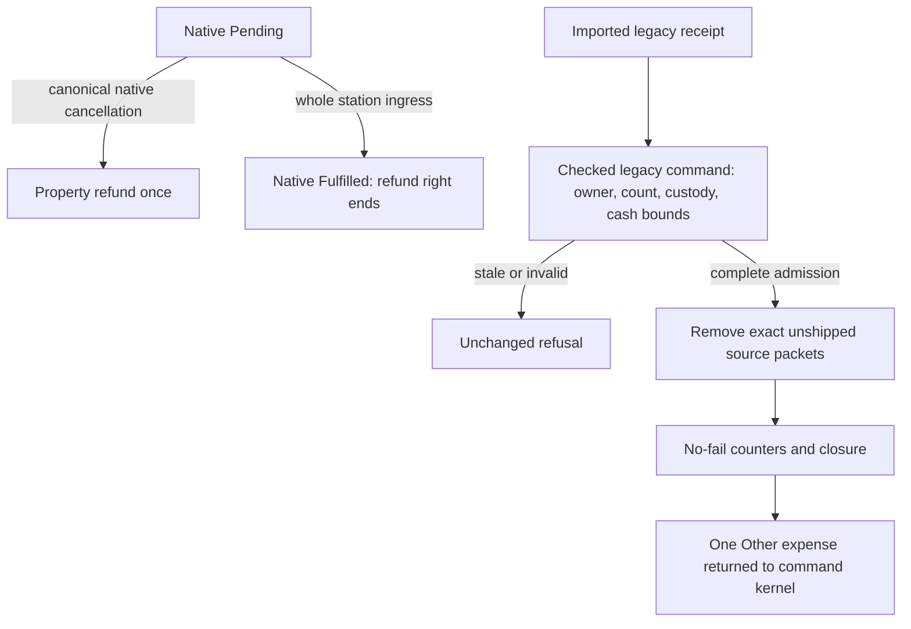

# M2O23-1 — Tagged supply receipt and cancellation contract

Owner: [Part 1, Group 6](m2o23-1-come-space.md#group-6---specify-a-lossless-legacy-receipt-within-the-single-order-owner). Architecture: [map-layer ownership invariants](../../architecture/map-layers/archi-map-layers.md#invariants). This handoff fixes the representation for Groups 10-16; it introduces no live book, stock, payment, writer or second supply catalogue.

## One book and two truthful receipts

Keep `SurfaceSupplyOrderID = uint64_t`, `SurfaceSupplyOrderRecord`, `SurfaceSupplyOrderSnapshot`, `GetSurfaceSupplyOrder` and `CaptureSurfaceSupplyOrders` in their existing public owners. The sorted vector and its one monotonic `next_id` remain the only order history. Queries retain IDs, not pointers across mutation. Group10 has implemented this contract; the live public header and executable tests are authoritative, and the sketch below explains its evidence boundary.

Group10 implementation now represents unknown/unsupported receipt tags with an explicit invalid `std::monostate` alternative. `Native()` and `Legacy()` return a pointer only for their actual evidence variant; validators refuse the invalid alternative. The default newly authored record selects native evidence, but it still needs valid identity, quantity, price and candidate references before admission. `FindSurfaceSupplyOrderRecord` is the shared exact uint64 search used by the live owner and detached consumers.

```cpp
/** Frozen A purchase evidence and its native commitment state; never cargo stock. */
struct NativeSupplyReceipt {
    CompanyID purchaser;                    ///< Actual original payer, even after takeover.
    uint16_t origin_x, origin_y;             ///< Original Surface-local station anchor.
    Money cost;                             ///< Frozen whole charge, validated using original Q16 factor.
    uint64_t inflation_prices;              ///< Actual original native Q16 price factor.
    TimerGameCalendar::Year purchase_year;   ///< Recorded native introduction-year evidence.
    SourceID packet_buyer;                   ///< Original buyer or explicitly retired sentinel.
    SurfaceSupplyOrderState state;           ///< Existing Pending/Fulfilled/Cancelled/Lost meanings.
    CargoPacketID issued_packet;             ///< Historical issuance only; never a current packet claim.
};

/** Exact B history; missing A provenance is absent structurally, not represented by guessed zeros. */
struct LegacyBSupplyReceipt {
    Money unit_price;          ///< Actual saved positive per-unit tariff.
    int32_t calendar_date;     ///< Original saved calendar date, distinct from economy-day cap.
    uint16_t refunded;         ///< Units already physically removed and credited.
    uint16_t dispatched;       ///< Units whose first departure already ended legacy refund rights.
    bool closed;               ///< Original closure/loss; never equivalent to A Pending.
};

/** One canonical historical receipt; native cargo containers exclusively own material. */
struct SurfaceSupplyOrderRecord {
    SurfaceSupplyOrderID id;                    ///< Exact original ID, losslessly widened from B.
    CompanyID owner;                            ///< Actual current owner or original loss sentinel.
    StationID origin;                           ///< Original pickup or legacy source-loss sentinel.
    CargoLabel label;                           ///< Existing canonical cargo meaning.
    uint16_t quantity;                          ///< Whole original purchase, never remaining stock.
    TimerGameEconomy::Date purchase_day;         ///< Actual original cap day.
    std::variant<std::monostate, NativeSupplyReceipt, LegacyBSupplyReceipt> receipt; ///< Invalid/unknown, native, or legacy provenance.
};
```

Native validation remains as strict as today's `ValidateSurfaceSupplyRecords`: exact frozen price, known original payer/anchor, source bounds, state and historical issuance. B validation uses its original positive unit tariff, full calendar date, counters and closure rules. Never derive B inflation from price, copy its current owner into an unknown original payer, recover lost station coordinates from a reused pool slot, or invent an issuance packet. B's actual CAPA/container records remain available separately for custody joins.

## Conversion and identity boundaries

The source `SurfaceSupplyState` must satisfy `next_order == orders.size() + 1`, dense IDs `1..count`, count at most65535, exact required fields and original scalar/reference validators before conversion. Widen every B ID and its original cursor exactly; do not renumber packet references. Conversion operates on one replacement world's complete candidate, not a merge of two active worlds, so there is no cross-world ID-offset scheme. Canonical lookups use sorted IDs, never `id - 1`.

Because legacy rows are retained for life, their original dense prefix must remain complete in a mixed book too; later native records follow it and may contain ordinary retired-ID gaps. The canonical validator checks this conservation invariant after reading the explicit receipt tag. Identity arithmetic never chooses lineage or supplies absent receipt fields. Native receipt count stays at most16384, while complete mixed retained history stays at most65535.

A440 records project to native variants without changing their original14/53-byte wire representation. B426-434 records project to legacy variants without stock creation, pending dispatch, financial settlement, current price lookup or allowance restoration. The future merged writer in [Plan3 Group44](m2o23-3-come-space.md#group-44---publish-one-explicit-merged-format-and-round-trip-contract) has a new explicit receipt tag; unknown tags refuse. Never infer receipt origin from the numeric save version, order ID, state, price or source path.

Validate B dates against its actual calendar/economy ranges and original introduction date. Require `refunded <= quantity`, `dispatched <= quantity - refunded`, positive bounded tariff and `refunded != 0 => closed`. Invalid owner or invalid source requires closure; invalid owner also requires invalid source. A retained non-invalid source must join the candidate's actual owned Surface station, including a station that has lost its freight berth. Do not impose native A's historical anchor/issued-packet requirements on a legacy row.

## Bounds, cap usage and retirement

Freeze two distinct limits in the existing order header when Group10 implements the model: `MAX_SURFACE_SUPPLY_RECORDS = 16384` remains **new-purchase admission policy**, and `MAX_LEGACY_SURFACE_SUPPLY_RECORDS = 65535` is the **complete detached/canonical retained-history hard bound**. The old A440 decoder still enforces its original16384-record bound. The B decoder and new merged validator may admit65535 legitimate retained rows; no new purchase receives that larger policy limit.

At new-order admission count every row that must remain after safe native retirement, regardless of variant. Refuse before charging when that count is already16384. A valid imported book above that size loads intact and refuses additional purchases; never truncate it or reject valid paid history merely to fit A's admission limit. Maximum detached cap summation fits `uint32_t`:65535×65535 =4294836225 <4294967295. Keep the checked whole purchase/cap comparison and refuse malformed inputs before summing.

For the queried current owner, label and economy day, native Pending/Fulfilled rows count their original quantity; native Cancelled/Lost retain A's existing exclusion. Every legacy row counts its original quantity regardless of refund, closure or shipment. A takeover may combine two previously valid caps above today's allowance; keep the history and refuse more purchases rather than rewriting yesterday's payment.

Preserve A's old terminal-row retirement only when no new permanent order reference depends on that row. Legacy rows are retained for the world's lifetime in this integration, matching B's complete-history policy and avoiding a new garbage-collection authority. This is deliberately stricter than the minimum of keeping rows while packets or entitlements depend on them. No retired ID is reused. Native paid purpose can survive without optional order provenance; legacy packets must retain their exact canonical original-order reference while present.

## Cancellation and irreversible custody

New purchases produce only NativeSupplyReceipt. Pending cancellation returns the original negative `Property` expense through the command kernel. Actual station ingress changes Pending to Fulfilled and permanently ends its refund rights. No legacy API may accept a native receipt, including a new Fulfilled order.

For legacy receipts, `eligible` is the exact never-shipped physical quantity still in the original source goods queue, excluding reserved, carried, returned, hub/job and consumed units. Require `eligible <= quantity - refunded - dispatched`, matching original owner/label/source and a still-open receipt. Use the saved `unit_price`, checked multiplication and positive-wallet overflow protection. Remove exactly those units through native list/cache helpers before updating `refunded` and `closed`; return one negative `ExpensesType::Other` expense to the command kernel. Do not call the donor's direct `SubtractMoneyFromCompany` path. A valid zero-unit cancellation closes the receipt with zero credit.

The donor command `CmdCancelSurfaceSupply(order, expected_quantity)` refuses when its recaptured count differs from the UI/queued command. A's existing `CmdCancelSurfaceSupplyOrder(intent)` payload cannot express that safeguard. Group7 must append `Commands::CancelLegacySurfaceSupplyOrder` and declare `CmdCancelLegacySurfaceSupplyOrder(flags, uint64 intent, uint16 expected_quantity)` in the existing `surface_supply_cmd.h`; Group15 implements it in `surface_supply_order_runtime.cpp`. It is a checked command entry into the same book and transaction owner, not another service or live balance. Keep A's existing native command numeric identity and tuple unchanged; it must refuse legacy receipts rather than bypass their count check. Both estimate and execution recapture actual receipt/custody and compare `expected_quantity`. Group37 uses the correct command for the displayed receipt tag.



Source deletion closes legacy rights and invalidates the original station without an automatic refund; native Pending source-loss behavior remains A's policy. Takeover changes current owner, never unknown original payer facts or historical date/tariff. Company loss invalidates owner and source and closes legacy rights, while surviving physical packets keep their non-paying purpose. Reservation/first departure permanently marks shipped once and increments original dispatched history once; returning cargo cannot reverse it.

## Independent conversion and refusal examples

All quantity100 examples use RFMT (capacity128 per company/day), an admitted calendar date and same-file references unless the row explicitly breaks them. Group11 verifies scalar-only conversion; Groups12-16 verify actual custody, refunds and lifecycle. `q/r/d` means original quantity/refunded/dispatched, not separate stock.

| Original facts | Conversion and subsequent expected behavior |
| --- | --- |
| B ID7, cursor8, q100/r0/d0, unit tariff25, open, source has100 never-shipped units | Preserve ID7/cursor8 and every scalar; create zero packets or money. Checked cancellation of100 returns Other−2500 after removing100, closes, increments refunded100. Same-day usage remains100. |
| B q100/r0/d40, source has60 never-shipped, carrier has40 shipped | Preserve both history and packet purpose. Eligible60; expected60 yields Other−1500. Post-cancel r60/d40/closed. Carrier40 remains non-paying and cannot refund. |
| B q100/r0/d40, source contains60 never-shipped plus40 returned-shipped | Eligible60, not100. Returned40 cannot reset dispatched history or refund rights. A cancellation carrying expected100 refuses unchanged. |
| B q100/r0/d100, no unshipped stock, open | Checked expected0 closes with no money. Consumed or returned units never create new entitlement. |
| B closed source-loss row, invalid station, valid current owner, q100/r0/d40 | Preserve missing source as invalid and all history; no invented anchor or automatic refund. Still counts100 on its original cap day. |
| B source-loss row with invalid station but open | Refuse original corruption; do not silently close/repair during conversion. |
| B takeover: current owner2, original payer unknown, same-day quantities100 and100 inherited from two companies | Preserve owner2 and both rows; no guessed purchaser. Count200 and refuse additional purchases if over today's limit. Original dates/tariffs do not change. |
| B company loss: invalid owner, invalid station, closed; orphaned-owner native queue still holds units | Preserve history and non-paying purpose; no new company-slot refund rights. Actual custody join still requires one real container per packet. |
| B q100/r20/d81, or nonzero refunded while open | Refuse inconsistent finite history before any stock/account mutation. |
| B tariff greater than INT64_MAX/quantity, or refund would overflow positive wallet | Refuse at original scalar validation or current cancellation preflight, respectively. |
| B valid65535-row dense original, cursor65536 | Convert all rows and IDs intact; refuse any new purchase under16384 admission policy. Do not rewrite cursor, enlarge cap or truncate history. |
| A440 Fulfilled record with valid historical issued packet but no surviving packet | Preserve native provenance and fulfilled state; no packet recreation, refund or requirement that the old packet index still exists. |
| Native Pending record retries with identical intent/tuple, or a new Fulfilled record requests legacy cancellation | Preserve A's zero-additional-charge retry; refuse the legacy cancellation. Unknown variants and stale/reused source IDs always refuse. |

## Implementation handoff and authority

Groups10-11 have implemented the types/bounds, detached validation and pure old-wire projections in the existing order owners. `ConvertLegacyBSupply` and `ConvertLegacyASupply` consume `SurfaceSupplyRecordContext`; their live public declarations in `surface_supply_order_wire.h` retain the caller's framing/clock/custody prerequisites. Groups12/12B/12C and13 own packet evidence, first departure, exact refund selection and complete native custody joins; Groups14-16 own command-kernel settlement, lifecycle and day accounting. Part2 Groups41/44 own dialect-specific decoding and tagged merged serialization. No forward group may quietly duplicate these owners.

This design was checked against [A record validation](../../../../src/surface_supply_order.cpp), [A command/retirement owner](../../../../src/surface_supply_order_runtime.cpp), [B original validation and lifecycle](../../../../../OpenTTD3/src/surface_supply.cpp), [B checked command codec](../../../../../OpenTTD3/src/surface_supply_cmd.h), [B command implementation](../../../../../OpenTTD3/src/surface_supply_cmd.cpp) and [B original transport](../../../../../OpenTTD3/src/saveload/surface_supply_sl.cpp). Named live symbols and exact original bytes take precedence over navigation hints. No runtime behavior or native compatibility result is claimed by this Group6 handoff.
