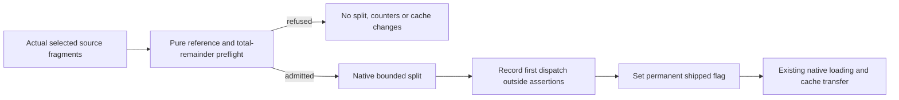
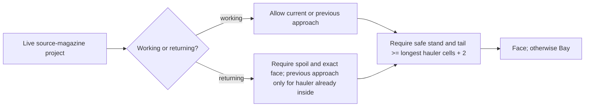
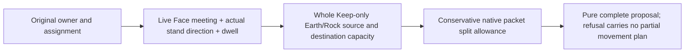

# M2O23-1 ? Completed canonical foundation (Groups 1-22D)

## Global Mandatory Reading

> **Execution protocol**
>
> - Read this Global Mandatory Reading section before the first task and again
>   after every context compaction.
> - Before starting or resuming a task group, read the nearest preceding Area
>   Mandatory Reading block whose `Applies to` label includes that group. Area
>   blocks appear immediately before the first group they govern.
> - A referenced heading or exported symbol is authoritative. Global navigation
>   hints and Area line ranges are for navigation only; if they drift, relocate
>   the named section or symbol rather than expanding to the whole file.
> - Mandatory reading is non-transitive. Do not preload a linked file's own
>   Mandatory Reading, Consult on Demand, or Planning Provenance entries unless
>   this plan names them directly for the current area.
> - Do not read Consult on Demand or Planning Provenance merely because those
>   sources are listed. Use a Consult on Demand source only when its trigger
>   occurs.
> - No created source file, test file or JSON file should start with same prefix as a planning MD file (such as r2). Only MD files can have that prefix. No MD file should be created anywhere in source directories unless specifically asked.
> - After EVERY CONTEXT COMPACTION, you must add a note above the task group
>   which is currently in execution. The note will say: "Context has compacted
>   X times while executing this group.". If the compaction occurs before any
>   meaningful work was done (this can happen when there is a lot of baggage
>   from the previous compaction), then and ONLY then you can skip this step.
> - When exceeding 3 context compactions, YOU MUST ask yourself if you're not  
>   chewing more than we can handle :). Heck, plans change! :). In such a case,  
>   the way out is to split the group on the spot,
>   in the plan, into more groups,
>   by appending B, C, D as a suffixes to those groups (splitting sub-groups  
>   themselves is also allowed). When you do this, create Local Mandatory
>   Reading areas so you can optimize your context only for the
>   ACTUAL task at hand.
>   Before starting or resuming a task group, read the nearest preceding Area
>   Mandatory Reading block whose `Applies to` label includes that group. Area
>   blocks appear immediately before the first group they govern.

| File name | Line Ranges | Description |
| --- | --- | --- |
| [Destination map-layer architecture](../../architecture/map-layers/archi-map-layers.md) | 20-37; 272-282 | `Storage, coordinates and distance`, `Initialization and simulation`, and `Invariants` define stacked addressing, physical ownership and view-independent simulation. Every imported feature must preserve these boundaries; camera state must never choose command ownership, stop simulation or consume simulation RNG. |
| [Native layer controller](../../../../src/map_layer.h) | 96-104; 204-235 | `MultiLayerMap::DecodeStoredTile`, `IsTileInLayer`, `TileInLayer` and `ProjectToSurface` are the live geometry boundary used across gameplay and save validation. Decode candidate saves using their own dimensions; neither duplicate layer arithmetic nor consult the running world's geometry as a fallback. |
| [Required cleanup/layout contract](r2fc-file-cleanup3.md) | 85-103 | `End-state storage contract` defines original media, independent fixtures, retained saves, generated review/runtime products and the sole recipe/materialization boundary. This user-designated contract is globally necessary: imports must fit these owners, routine generation cannot publish canonical assets, and historical hashes never certify a current executable. |
| [Destination cleanup completion](r2fc2-file-cleanup3.md) | 44-61 | `Checkpoint and resume point` records completed cleanup, the actual Space successor, closed cash/tick boundaries and the provisional Tube checkpoint. This prevents a merge agent from replaying closed Space work, treating cleanup as gameplay authorization or silently promoting the destination's unfinished fleet. |
| [Donor technical closure](../../../zz-rhr/imports/openttd3-75ea75718f/docs/zz-reach2/upgrades/2026-10/r2mlvs16-b-performance.md) | 9-16 | `Current technical finalization,2026-10-20` distinguishes delivered Plan 3/4 behavior and selected performance acceptance from pending human art/demo feedback and the unresolved version 424 save alias. This is the other half of the architecture handoff: preserve delivered underground behavior without copying blanket completion or deletion claims. |

## Four-plan execution scope

The user requested this four-plan partition on2026-10-23 after completion of22D. Stable global group/task IDs and every existing checkbox state are preserved. Suffix batches remain part of their original numbered group.

| Plan | Owned groups | Current state |
| --- | --- | --- |
| [M2O23-1](m2o23-1-come-space.md) | 1-22D, including completed suffix batches | Complete:40 groups,160/160 tasks. |
| [M2O23-2](m2o23-2-come-space.md) | 23-36 | Open:14 groups,0/60 tasks. |
| [M2O23-3](m2o23-3-come-space.md) | 37-53 | Open:17 groups,0/74 tasks. |
| [M2O23-4](m2o23-4-come-space.md) | 54-72 | Open:19 groups,0/82 tasks. |

The former second plan was renamed by the user to M2O23-3 before this partition; its Groups54-72 now continue in M2O23-4. Finish each plan's owned groups and public handoff before its successor. Completion of Plan1 is the completed foundation checkpoint; the full merge requires Plans2-4 and the final Completion Conditions in Plan4. Splitting documentation performs no gameplay task and authorizes no additional saved-world ticks or spending.

## Completed checkpoint and successor boundary

**Plan1 is complete:** all160 owned tasks through22D have their recorded evidence. [The execution record](m2o23-1-come-space-a-execution.md) and [thread handover](m2o23-1-come-space-i-handover.md) identify live public interfaces, focused results and exact limits. Execution stopped at the user's request after22D; Group23 has no implementation changes.

The next implementation task is [Plan2 Group23](m2o23-2-come-space.md#group-23---reconcile-saved-work-transitions-and-settlement), after a user-directed resume. `AwaitFaceTransfer` has identity20 but the native validator still refuses installation; full driven face-wait and visible/hidden equality remain explicit Group23 acceptance. Generators/providers and common utility scheduling remain Plan2. Save integration, assets and final runtime qualification remain Plans3-4. Completion here does not assert any of those deferred outcomes.

## Recommendation and execution boundary

**Bring OpenTTD3 into this repository.** Hereafter **A** is `D:/Codez/Sandbox/OpenTTD`, the destination; **B** is `D:/Codez/Sandbox/OpenTTD3`, the read-only donor. Paths without a donor label mean A. Links containing `OpenTTD3` deliberately resolve to B; verify the pinned donor before using them. Once sources are relocated, update links to their documented destination, preserving their original identity.

This is a semantic integration based on the common ancestor, not a directory overlay or a sequence of whole-commit cherry-picks. Keep A's storage/rebuild system, current Space implementation and public ownership boundaries. Bring across B's delivered underground features and their meaningful tests, original art and evidence. Reconcile shared owners once. A larger file count alone is not a feature count, but moving A into B would additionally require transplanting the completed preservation/reconstruction foundation and substantially more Space code.

Planning performed no merge, checkout, staging, commit, fetch, reset, source import, build, gameplay execution or deletion. **Implementation was authorized on 2026-10-23** and completed through22D before the user-requested stop; Git writes/checkouts still require an explicit human request. Never run destructive Git commands or recursive deletion, including through an existing cleaner or test helper. Individual deletion is unnecessary for this integration; if it later becomes necessary, the user's limit is ten project-local files before asking again. Preserve `OpenTTD-baseline/`, `!kit`, both repositories and hosting storage. Historical cleanup instructions do not override these rules. Execution evidence and discoveries are recorded in [the implementation record](m2o23-1-come-space-a-execution.md).

**Human decision, 2026-10-23:** new purchases use A's rule: cancellation refunds only a **Pending** order; delivery into station custody ends refund rights. B's existing saved refundable stock must retain its original, finite entitlement through a migration adapter in the single canonical owner. This exception is not a second purchase API or permission to refund new fulfilled orders.

Use difficulty batches to assign implementation work. Groups are in dependency order, not a ranking of topics. Every group has one difficulty and at most eight tasks. A task is complete only with its stated observable result. Feature-specific acceptance remains in its existing owner plans; this plan owns their integration, compatibility and preservation, not a replacement feature specification.

## Investigated snapshot and chronology

Inspected on **2026-10-23, Europe/Stockholm**. Both branches are named `mlm-mlv`. Comparing the two read-only `rev-list` histories identifies common ancestor **`9a47768ae3e4455661264f2c49febde972538e49`**, committed 2026-10-15 10:34:58 +02:00. Neither tip contains the other. Each has eight subsequent commits. Both worktrees initially reported only an untracked, empty copy of this plan path; B's copy remains untouched.

| Repository | Commit time (+02:00) | Commit | Delivered change or investigation significance |
| --- | --- | --- | --- |
| B | 2026-10-15 19:50:26 | `e65d8a2b19` | Broad checkpoint labelled `JUNK COMMIT`; includes assets and evidence. The label is not a safe exclusion rule, nor is the whole commit an appropriate import unit. |
| B | 2026-10-15 20:13:59 | `12d4d158ce` | Split demo/interface/movement work from face-exchange acceptance. |
| B | 2026-10-16 09:34:34 | `588a8b1fa9` | Demo fixes and native hauler meeting at the face. |
| B | 2026-10-16 10:33:11 | `113702c96e` | Underground continuation checkpoint. |
| A | 2026-10-17 14:29:33 | `50ab2f8d87` | Further Space runtime and final art packing. |
| A | 2026-10-17 14:36:41 | `dd6491c48e` | Move execution ledgers to `docs/zz-rhr` and repair links. |
| B | 2026-10-17 20:55:06 | `3129c29afb` | Selected ground art, paid supplies and geothermal/tube integration. |
| A | 2026-10-18 10:26:15 | `5d250ceaca` | Orbital art and paid Surface-supply work. |
| A | 2026-10-18 11:15:52 | `94f906c1b3` | Space walkthrough and retained gameplay tours. |
| B | 2026-10-18 21:03:02 | `7301ef0800` | Selected tube runtime, operating geothermal lifecycle and runtime art bindings. |
| A | 2026-10-19 10:37:32 | `32cf62eec8` | Genuine Surface supply progression and operational Core. |
| B | 2026-10-19 15:57:55 | `c58f48a04c` | Paid underground final use, lifecycle and actual peer verification. |
| A | 2026-10-21 12:52:45 | `395103b567` | Space progression, ground art and partial tube work. |
| A | 2026-10-22 08:11:56 | `8fba0ee4c1` | Durable cleanup inputs and artifact reconstruction. |
| A | 2026-10-23 09:19:49 | **`cfeff84db5`** | Completed cleanup and qualified Space Goods-capacity query; destination tip. |
| B | 2026-10-23 10:57:03 | **`75ea75718f`** | Underground acceptance/performance closure; donor tip. |

Plan discovery used Markdown modification-date order, then each relevant file's last commit time and its internal handoff date. Bulk archival/reformatting makes mtime and last-touch commit insufficient proof of feature completion. For example, B's latest commit contains technical returns dated October20; A's latest commit touches older plans while migrating evidence paths. Live code/tests take precedence over unchecked or stale prose.

The base-to-tip path inventory without rename folding is **12,470 paths in A** (12,090 additions,263 modifications,117 deletions) and **2,453 in B** (2,205 additions,246 modifications,2 deletions). A's117 deletions are paired as renames with rename detection. **115 paths changed on both sides;114 have different final blobs, including47 production-code paths.** These are overlap counts, not an asserted number of textual merge conflicts. Many additional donor files collide semantically with differently named destination owners. No actual Git merge was attempted.

| Source family | Retain from A | Bring/reconcile from B | Scope limit |
| --- | --- | --- | --- |
| Space | Orbital manufacturing/recipes, clone/replacement, heavy miner, ordered actions, cargo dimensions, Surface progression, final Space/orbital/launch graphics and current Goods query. | Shared cargo/utility/lifecycle hooks must remain compatible with B's underground consumers. | B's older Space files must not replace A's newer behavior or reset its current task. |
| Ground/TBM | Current geology, paid work, supply/cargo invariants and any destination-specific fixes. | Face exchange, continued planning, portal/PBS fixes, ordinary start, real paid Standard/Deep/irregular final use and tested lifecycle. | Face meeting is conditional: source-magazine projects use it; underground-depot projects retain bay meeting to avoid deadlock. |
| Tubes/geothermal | Completed terminal history, geometry contracts and preserved provisional work. | Five delivered capsule definitions, paid external/geothermal control, actual powered routes, generator/conversion/town/local-feed lifecycle and art. | B's qualified tuning supersedes A's provisional fleet tuning after compatibility tests; do not retain two installers or assume human approval. |
| Infrastructure/evidence | `RunContext`, retained inputs, source epochs, portable builds, sole recipe catalogue, original and successor Space seals. | Donor-only tests, source art, genuine worlds and necessary ignored evidence. | A's cleanup implementation stays authoritative; importing B does not authorize running cleanup. |

## Conflict decisions and safeguards

| Conflict | Observed evidence | Resolution to implement |
| --- | --- | --- |
| Save version collision | A uses 425-440 for later Space/supply work; B uses 425-434 for TBM face transfer, supplies, geothermal and utility work. Both still use metadata schema 1. | Introduce explicit merged-format lineage/capabilities, preserve both legacy interpretations and allocate the next unused merged writer version after the snapshot is refreshed. Numeric `>=425` tests alone cannot identify a feature. Do not renumber old bytes or globally lie about `_sl_version`. |
| Same chunk, different wire format | A `surface_supply_order_sl.cpp` uses `SSOR` RIFF; B `surface_supply_sl.cpp` uses `SSOH` RIFF plus `SSOR` TABLE. | One dispatcher decodes the exact legacy family into the canonical order owner. Validate complete presence, type, dimensions, day and references in full and copied readers. Reject contradictory or genuinely ambiguous files without changing originals. |
| Supply ownership and payment | A has uint64 intent IDs, pending/fulfilled records and command-kernel settlement; B has uint32 strong IDs, immediate stock, packet order/shipped fields and producer self-debit. | Keep A's owner and new-purchase policy. Adapt B UI/commands to it; widen donor IDs losslessly; convert old order/packet history without double debit, refund or quota restoration. Preserve legacy refund rights explicitly, never by pretending delivered stock is Pending. |
| Supply purpose/cargo capacity | A uses `SourceType::CompanySupply` and `GetTubeStationTransferRoom`; B uses permanent packet order/shipped purpose, custody traversal and `GetTubeInterchangeTransferRoom`. | One permanent non-paying purpose plus optional original-order provenance; one capacity calculation with adapters for callers. Test split/merge, reservation, hub/launch/orbital ownership, station loss and original pickup refunds. |
| Commands/network identity | Both append different commands after `EvacuateOrbitalModule`. | Preserve A's assigned values and append genuinely new donor commands; route duplicate supply actions to the canonical command. Verify codecs and reject mixed-build network peers. Old numeric command logs need explicit lineage or an explicit refusal. |
| Capsule identities and balance | Both implement models 9-13 in EIDS `0x8000 + model`; A's fleet is provisional. B's delivered capacities are 60/40/48/24/80; A proposes 60/40/40/24/96, with other speed/weight/power differences. | Use B's delivered definitions as the merged new-game baseline; preserve model 9 identity and A's useful geometry/preflight constraints. Loaded consists must conserve cargo and refuse unsafe capacity loss. Keep provisional source history, not a second runtime catalogue. |
| Sprite namespace | A's M1 ends at 3588, preview occupies 3588-3598, Space 3599-5166, orbital 5167-6142, launch 6143-7790, ground through 22044. B expands M1 to 17847 while preserving the preview gap. | Preserve A's shipped ranges and allocate/remap only donor-only families into nonoverlapping space; resolve duplicate logical families once. Regenerate headers/NFO/GRF/hash/manifests together. Never select one binary GRF wholesale or shift Space by changing M1 count. |
| Shared simulation/utility | B extends utility conversion, generator feeding, geothermal bindings and scheduling; A also has Space, orbital and ground consumers. | Combine at original utility/tick owners with one allocation/settlement and deterministic ordering. Heat and electricity retain units, lineage, loss and once-only spending. Hidden-layer execution must remain equivalent. |
| Renderer and UI overlap | Both alter stations, vehicles, sprites, English strings and windows; B adds tube/geothermal native consumers and demo controls. | Integrate by actual render/command owner, preserving A's Space/click bounds and B's layer-aware ground behavior. Add/remove visibility hooks once, with no fallback to preview art for qualified runtime families. |
| Relocation and proof conflict | B still has archived-plan copies and essential inputs under `docs/.../assets`, `logs`, review and build trees. A has migrated owners and stronger source/receipt checks. | Build an explicit path/hash/role map. Preserve historical receipts unchanged and publish relocation adapters/new proof separately. Port new consumers into the existing catalogue; never restore old caches as runtime authority or rewrite old receipts to appear current. |

The exact A original seal (`checkpoint.json`,5818 bytes) has SHA256 `5083a1e8c64359f06eb3f9913032ad8b25b7ba5fea73d2c5ad16519985928df9`. The selected GZVEEI continuation foundation has SHA256 `8cc7f8743c2922537d49b1745641049692a3c297a1e1d72208526748c76a1f6e` (182252 bytes). B's target-completion receipt (639653 bytes), genuine-bootstrap receipt (9311 bytes), and selected-guidance receipt (5765 bytes) were found and hashed; they match the handoffs: `bedac682c11c0c0187afada549718c5f08602f783a5a3a3506f0bb39d68472e2`, `acf7837bcf2d0f5dd9506cde1f393abcee8a12d37631a05d2a127f6316711846`, and `799dfe322bf03fc3e2e9238dee4a6cbd3ee5283a8bcb149e8f8eb436355c253e`. Hash agreement confirms these recorded artifacts, not acceptance of a merged executable.

## Implementation tasks

All40 owned difficulty batches and160 tasks below are complete. Their checkboxes and evidence remain the historical implementation record.

Code sketches are conceptual unless labelled as existing exports. Proposed helpers belong to the named existing owner. Verify prior exports before dependent work; an absent prerequisite stops only its dependent tasks, with safe independent work and forbidden shortcuts stated by the Area entry gate. Mandatory reading is non-transitive; do not preload future Areas. Native checks genuinely deferred until the merged target is buildable must be recorded and closed in [Plan4 Group60](m2o23-4-come-space.md#group-60---run-focused-domain-decoder-and-ordinary-world-checks). Existing focused native passes remain evidence and must not be relabelled as deferred.

Group9's [reviewed path map](../../../../src/tests/fixtures/cleanup/merge-path-dispositions.json) assigns deferred imports to `owner_groups`. Each producing group must import/adapt its selected source rows before declaring its public contract implemented. Read only matching rows, not the complete inventory. Global group IDs still resolve after the four-plan partition.

### Area Mandatory Reading - Inventory, retained inputs and layout architecture

_Applies to Groups 1-3._

Entry gate: Both pinned trees and A's original/current Space seals must be readable. Verify HEAD/status and recorded hashes before copying. Stop affected imports if an epoch changed; read-only enumeration may continue. Do not substitute another worktree, an old build, or the latest-looking review directory.

| File name | Line Ranges | Description |
| --- | --- | --- |
| [Cleanup storage contract](../../../../docs/zz-reach2/upgrades/2026-10/r2fc-file-cleanup3.md) | 85-103; 118-126 | `End-state storage contract` and `Implementation standards and test budget` fix original-media, fixture, retained-save, review/runtime and diagnostic owners. Apply these destinations to every incoming artifact; archive/export does not authorize deletion. |
| [Existing architecture owner](../../../../docs/zz-reach2/architecture/archi-historical-debug.md) | 30-53; 55-128; 226-279 | `Storage ownership`, `Parallel-repository originals`, `Graphics candidates, expectations and publication`, and `Historical facts and current proof` define the verified donor placement and lifecycle rules delivered by Group 3. Keep this existing owner authoritative; do not create a second asset-layout architecture. |
| [Retention APIs](../../../../src/tests/multilayer/support/save_retention.py) | 117-155; 266-289 | `plan_save_exports` and `verify_save_exports` observe original bytes and aliases. Preserve undecodable originals too; do not invoke deleting wrappers. |
| [Recipe selection](../../../../src/tests/multilayer/support/artifact_recipes.py) | 134-174 | `load_catalogue` and `validate_selection` define the sole producer dependency selection. The import manifest is an audit record, not a replacement runtime catalogue. |

### Group 1 - Freeze the comparison and classify incoming paths

Completed 2026-10-23. [Execution evidence](m2o23-1-come-space-a-execution.md#group-1--pinned-inventory-2026-10-23) records exact histories, all donor dispositions, 47 shared production routes, same-purpose collisions and protected input hashes. The regenerated inventory is disposable under `test-cache/merge-inventory/`; no source import or Git write occurred.

{{SIMPLE}}
- [X] 1.1 Recheck both HEADs, status, merge base and plan modification/commit chronology; record drift without fetching, staging, checking out or modifying B.
- [X] 1.2 Build the base/A/B path-and-blob inventory with rename mappings; separately enumerate relevant ignored and untracked donor originals.
- [X] 1.3 Assign each donor delta an owner and disposition: import, semantic adaptation, equivalent, historical relocation, rebuildable product or unresolved. Include both donor deletions without applying them.
- [X] 1.4 Record the 47 differing shared production paths and same-purpose/different-path collisions; route each to a later batch and separate comment-only differences.
- [X] 1.5 Record hashes for A's Space seals, canonical assets and producer inputs and B's selected receipts; include source paths and aliases.

### Group 2 - Preserve exact donor inputs and map their destination roles

**ASSUMPTION: this was already built previously. If not, re-asses at runtime**

Required prior output: Group 1's complete source/path identities.

Completed 2026-10-23. [Retention evidence](m2o23-1-come-space-a-execution.md#group-2--exact-donor-inputs-and-separate-aliases-2026-10-23) records 7,547 exact inputs, separate version384/version424 aliases and current donor-default drift. The direct verifier passes; the sole catalogue declares its recipe disabled until Group 58 supplies the stage adapter.

{{MEDIUM}}
- [X] 2.1 Map donor selected/raw art, palettes and source contracts into existing `media/` owners; map independent expected pixels/worlds into purpose-named fixtures. Never preserve a generated gallery as a substitute for its originals.
- [X] 2.2 Copy required original saves, scenarios, configs and unique source epochs into declared fixture/checkpoint or retained-save owners, verifying size/hash and complete aliases. B remains read-only.
- [X] 2.3 Compare A's version 384 and B's version 424 `ground-connected.sav` originals and their consumers; preserve both exact payloads under distinct aliases. The initial plan's description of both files as version 424 was stale; direct `OTTX` header inspection is authoritative.
- [X] 2.4 Trace nested dependencies of the selected donor receipts. Classify required transcripts as evidence, optional diagnostics as logs, and generated atlases/payloads as reconstructible outputs.
- [X] 2.5 Extend existing input aliases and recipe declarations without replacing A's checkpoint keys; verify selected original inputs resolve when B's generated folders are unavailable.

### Group 3 - Document the canonical import layout in existing architecture

**ASSUMPTION: this was already built previously. If not, re-asses at runtime**

Required prior output: Group 2's role map and exact retained identities; update existing architecture files rather than creating a new source-directory Markdown file.

The architecture records these roles and the selected existing producers; it does not become a second asset identity catalogue. Confirm exact family paths against current media before copying.

| Donor material | Destination authority | Generated counterpart |
| --- | --- | --- |
| Approved/raw selected art and generation provenance | Existing `media/multilayer/source/{ground,m1,space,legacy}/` family owner | Run-local converted rasters/atlases in `data/` or `images/` |
| Geometry/source contracts and palette originals | Existing `media/multilayer/contracts/` and `palettes/` | Derived packing reports in `reports/` |
| Accepted shipping PNG/NFO/GRF/hash bundle | Existing canonical `media/` owner, via explicit publication | Candidate bundle stays in selected run `data/` |
| Independent original pixel/world expectations | Purpose-named `src/tests/fixtures/` owner | Per-run expectation payload generated from those inputs |
| Continuation saves and compact contracts | `src/tests/fixtures/checkpoints/{space,underground}/` | New qualification reports/evidence in the current run |
| Other unique saves/scenarios | `savegames/retained/`, with full aliases | Runtime/review copies remain disposable after export |
| Required native terminal/capture proof | Current run `evidence/` and typed reports; compact historical facts retained separately | Optional diagnostics alone use `logs/` |
| Config templates and unique source epochs | Existing config/cleanup fixture owners | Isolated `mlm/runtime/`, build and `test-cache/` products |

These are ownership mappings, not instructions to copy all donor directories or to delete any source.

Completed 2026-10-23. The existing architecture now records actual retained donor owners, separate alias namespaces and the graphics candidate/native/publication boundary. Pending adapters remain labelled planned. Two retired log links were replaced with dated handoff references; mandatory navigation ranges were refreshed.

{{SIMPLE}}
- [X] 3.1 Update `archi-historical-debug.md` → `Storage ownership` with the verified donor-to-destination role map from Group 2: authored media, independent fixtures, checkpoints, other retained saves, source epochs and generated products.
- [X] 3.2 Document the graphics flow `retained originals → pure candidate generation → independent expectations → native observation → explicit publication`, including which existing functions own each boundary. Label planned adapters as planned until their implementation passes.
- [X] 3.3 State that normal recipes use `mlm/reviews/.../{images,data,reports,evidence,scratch}`, isolated `mlm/runtime/...`, optional `logs`, and disposable `test-cache`; `savegames/retained` is never a generic artifact store.
- [X] 3.4 Add a narrow cross-link from `archi-map-layers.md` → `Generated graphics and drawing` to this storage contract and identify the sole `mlm/review-producers.json` authority. Record only ownership here; gameplay and sprite geometry remain with their existing owners.
- [X] 3.5 Validate links and a representative imported artifact from each role. Later Group 71 must replace planned status with actual paths and receipts; do not claim this documentation proves asset migration.

### Area Mandatory Reading - Save facts and pure lineage classification

_Applies to Groups 4-5._

Entry gate: The exact originals and hashes from Group 2 must exist. Inspect actual save envelopes and source enums; stop classification implementation if the originals are unavailable. Enum comparison and negative-case design may continue. File names, directory locations and active-world state are forbidden lineage evidence.

Group 5 additionally requires Group 4's completed `Required families and metadata`, `Ambiguity and refusal rules`, and `Detached classifier handoff`, plus hash-verified observations in `lineage-originals.json`. Verify the named sections and rehash the selected samples; stop Group 5 if they are absent or contradictory. Group 4's source-enum/framing investigation may continue. Do not bypass this gate using active-world metadata, donor caches, a fabricated downgraded save or a guessed branch from its pathname. A439 has no retained original; its source-defined capability may be tested as detached facts, with no claim of native fixture acceptance.

| File name | Line Ranges | Description |
| --- | --- | --- |
| [Competing version meanings](../../../../src/saveload/saveload.h) | 489-506 | Individual `SaveLoadVersion` entries from `OrbitalAssemblyFacilities` through `SurfaceSupplyOrders` define A's425-440 capabilities. Preserve their historical meanings. |
| [Donor version meanings](../../../../../OpenTTD3/src/saveload/saveload.h) | 488-499 | `TBMFaceTransfer` through `TubeGeothermalBindings` define B's 425-434 meanings. Metadata schema 1 and the number 425 alone cannot distinguish the branches. |
| [Actual load entry](../../../../src/saveload/saveload.cpp) | 3293-3451 | `DoLoad` creates the decompressor and calls `InitializeGame` before full chunk dispatch. Classification must precede that destructive-to-live-world initialization boundary; do not promise transactionality that the existing full loader does not provide. |
| [Actual chunk framing](../../../../src/saveload/saveload.cpp) | 2294-2340; 2347-2391; 2457-2478 | `SlLoadChunk`, `SlLoadCheckChunk`, `SlLoadChunks` and `SlLoadCheckChunks` interpret real wire type and then call one handler per ID. The future inspector must understand framing without invoking gameplay handlers. |
| [Audited lineage handoff](m2o23-1-come-space-b-save-lineage.md) | 13-70 | Group 4 produces `Required families and metadata`, `Ambiguity and refusal rules`, and `Detached classifier handoff`. Group 5 consumes the complete family/type matrix, conservative ambiguity boundary and reserved merged marker contract; this document does not replace live feature validators. |
| [Retained original observations](../../../../src/tests/fixtures/saveload/lineage-originals.json) | Live definitions; no fixed range | Group 4 produces schema1 `observations`, `negative_examples` and `gaps`. Exact source hashes and detached framing constrain Group 5 tests; provenance labels are never runtime classifier inputs. |

### Group 4 - Tabulate observable legacy format evidence

**ASSUMPTION: this was already built previously. If not, re-asses at runtime**

Required prior output: Groups 1-2 preserved the original fixtures and their provenance.

Starting collision matrix from the inspected enum tails; verify against refreshed originals before using it as classifier evidence. These numbers describe historical bytes, not new merged assignments.

| Original version | A meaning | B meaning |
| --- | --- | --- |
| 425 | OrbitalAssemblyFacilities | TBMFaceTransfer |
| 426 | OrbitalManufacturingReservations | SurfaceSupplyOrders |
| 427 | OrbitalManufacturingMaterialization | GeothermalGenerators |
| 428 | OrbitalManufacturingClones | UtilityHeatConversion |
| 429 | SpaceReplacementSettlement | GeothermalGeneratorOperation |
| 430 | SpaceOrderedActions | GeothermalMagmaLoop |
| 431 | SpaceHeavyMinerCommissioning | UtilityTownService |
| 432 | SpaceHeavyMinerMissions | UtilityLocalElectricalFeed |
| 433 | SpaceHeavyMinerSupplies | TubeGeothermalSources |
| 434 | SpaceHeavyMinerDescents | TubeGeothermalBindings |

A continues435-440; a high number still needs the appropriate complete format evidence.

Completed 2026-10-23. [The audited handoff](m2o23-1-come-space-b-save-lineage.md) covers every requested version and reserves the future merged marker without enabling writes. Twenty-seven representative originals and six negative inputs are retained as detached observations; no A439 original was found. Ambiguity also exists in common-layout A426-430 worlds, not only425.

{{MEDIUM}}
- [X] 4.1 Record a row for every overlapping numeric version 425-434, plus 424, 435-440 and the future merged writer. List mandatory chunk IDs, wire kinds, relevant CAPA columns, feature flags and known original fixture hashes.
- [X] 4.2 Confirm A `SSOR` RIFF versus B `SSOH` RIFF plus `SSOR` TABLE using original bytes. Record later B `GPGH/GPGD`, `UCVH/UCVD`, `TGSH/TGSD` only where their version makes them required.
- [X] 4.3 List ambiguous examples explicitly, including425 worlds with no distinguishing active owner. Absence of a feature is not proof of the other branch; malformed/truncated B must not be relabelled A.
- [X] 4.4 Define compatibility facts as read-only transport evidence. Keep numeric file version unchanged and record an explicit-origin override only when bound to the exact original digest and not contradictory to the wire.

Context has compacted 1 times while executing this group.

### Group 5 - Implement a pure lineage classifier and capability table

**ASSUMPTION: this was already built previously. If not, re-asses at runtime**

Required prior output: Group 4's audited evidence matrix. These proposed helpers must exist before reader integration later.

Implemented boundary: `src/saveload/save_lineage.h`, re-exported by `saveload.h`, now declares `SaveDialect`, `SaveWireFacts`, `ClassifySaveDialect` and `HasSaveCapability`. The classifier does not scan files and never initializes a world. The sketch below records its decision order, not a separate API.

```cpp
// Conceptual decision order, not a replacement save parser.
if (facts.explicit_merged_marker) return ValidateMergedFacts(facts);
if (facts.HasContradictoryLegacyEvidence()) return Corrupt;
const auto candidates = CompatibleLegacyDialects(facts);
if (candidates.size() == 1) return candidates.front();
if (origin && origin->MatchesExactDigest(facts.source_digest) &&
    candidates.contains(origin->dialect)) return origin->dialect;
return Ambiguous; // no guessed enum renumbering or current-world fallback
```

Completed 2026-10-23: five isolated C++ test cases passed 831 assertions, with explicit named source-enum expectations independent of capability ordinals. MSVC `/W4 /WX` compilation passed. Full scanner/loader integration, ordinary CMake registration and writer activation remain their later groups; no save bytes or live world changed.

{{HARD}}
- [X] 5.1 Add the proposed `SaveDialect`, `SaveWireFacts`, `ClassifySaveDialect` and `HasSaveCapability` boundary under the existing saveload owner. Inputs are detached facts; outputs are a dialect/capability set or an explicit ambiguous/corrupt result.
- [X] 5.2 Implement the decision order in the sketch: verified merged marker first, complete consistent legacy evidence next, exact-digest origin only for genuinely ambiguous originals, otherwise refuse. A contradictory marker or malformed required family must never fall through.
- [X] 5.3 Represent each affected feature as `(dialect, original version) → capability`; keep generic pre-fork version behavior. Do not globally replace `_sl_version` or compare one branch's enum value against the other branch.
- [X] 5.4 Add pure tests for consistent A/B, ambiguous425, missing required B families, contradictory SSOR kind, forged marker, wrong origin digest and unknown future capabilities. No game pools or filesystem writes are needed.

### Area Mandatory Reading - Supply, command and asset identity contracts

_Applies to Groups 6-8._

Entry gate: Group 5 must expose its detached classification result and Group 3 must state canonical artifact placement. Verify their declarations/decisions before freezing imports. Pure donor comparisons may continue if absent; do not invent saved provenance, select a newer-looking asset, or register duplicate runtime owners.

| File name | Line Ranges | Description |
| --- | --- | --- |
| [A order representation](../../../../src/surface_supply_order.h) | 18-51; 75-89 | `SurfaceSupplyOrderRecord`, snapshot, bound and validation APIs require original price/inflation/payer/geometry facts. Some are absent from B; define a tagged legacy receipt rather than fabricating them. |
| [B order representation](../../../../../OpenTTD3/src/surface_supply.h) | 24-80 | `SurfaceSupplyOrder`, `SurfaceSupplyState` and cancellation retain unit tariff, refunded/dispatched counts and closed status. They are the lossless legacy import boundary. |
| [A command append tail](../../../../src/command_type.h) | 436-450 | Individual command entries ending `PlaceSurfaceSupplyOrder`/`CancelSurfaceSupplyOrder` constrain preserved A numeric values. |
| [B command append tail](../../../../../OpenTTD3/src/command_type.h) | 436-456 | `ChangeTBMWork`, tube, supply and geothermal commands require an explicit merged allocation and parameter mapping. |
| [Asset range selector](../../../../media/multilayer/pack_m1_art.py) | 66-157 | `selected_ranges` refuses modified preserved ranges, changed counts, overlap and omitted published families. Inventory logical family/pose identity before allocating donor offsets. |

### Group 6 - Specify a lossless legacy receipt within the single order owner

**ASSUMPTION: this was already built previously. If not, re-asses at runtime**

Required prior output: Group 4 identifies which decoder supplies each receipt; the human's Pending-only rule governs all new orders.

```cpp
// Proposed contained model: one book, two truthful receipt formats.
struct SurfaceSupplyOrderRecord {
    SurfaceSupplyOrderID id; // canonical uint64; zero is invalid
    // Common identity/label/quantity/day fields, as verified by conversion.
    std::variant<NativeSupplyReceipt, LegacyBSupplyReceipt> receipt;
};
// LegacyBSupplyReceipt retains B's saved facts; it does not own cargo.
// Native Pending -> Fulfilled permanently removes new-order refund rights.
```

| Property | Native/new A receipt | Imported B receipt |
| --- | --- | --- |
| ID | Canonical uint64 | Lossless widening of original uint32 |
| Frozen price evidence | Whole cost plus Q16 inflation | Positive saved unit tariff; do not reverse-engineer inflation |
| Refund cutoff | Station dispatch changes Pending to Fulfilled | Finite original never-shipped pickup entitlement |
| Refund expense category | Property | Original Other category |
| Cancelled order in same-day usage | Preserve A's existing state-based rule | Original quantity still counts |
| Historical payer/anchor/issued packet | Retain original recorded fields | Preserve unavailable facts as unavailable; do not guess |
| Packet stock | Native containers only | Native containers only |

Completed 2026-10-23. [The receipt handoff](m2o23-1-come-space-c-supply-receipts.md) freezes exact variants, limits, cap/retirement rules and thirteen conversion/refusal examples. It also preserves B's expected-count cancellation safeguard through an append-only checked entry into the existing owner; no live receipt model or refund path is activated by this design group.

{{HARD}}
- [X] 6.1 Freeze a tagged receipt design inside the existing `SurfaceSupplyOrderRecord`/snapshot owner: native A receipt versus imported B receipt. Common ID/label/quantity/day fields may be shared; provenance-dependent fields must retain their original variant.
- [X] 6.2 For B retain frozen unit price, original calendar date, dispatched/refunded counts, source station/current owner and closed flag. Do not invent an original payer, inflation factor, station coordinates after station loss, or historic issued packet ID.
- [X] 6.3 Specify daily-cap and retirement rules per receipt origin: A's current cancelled-order behavior remains; B's refunded/closed purchase still counts its original quantity that day. Keep B rows while packets/entitlements depend on them.
- [X] 6.4 Separate the hard legacy import bound65535 from new-order admission's existing16384 policy. An oversized valid legacy history may refuse additional purchases, but must neither truncate paid history nor gain an enlarged daily quota.
- [X] 6.5 Define example conversions and refusal inputs for intact source stock, partial dispatch, returned packets, source loss and takeover. Preserve B's original `ExpensesType::Other` refund category while native new purchases use A's command-kernel `Property` settlement.

### Group 7 - Freeze append-only command and fleet identities

**ASSUMPTION: this was already built previously. If not, re-asses at runtime**

Required prior output: Groups 5 and 6 have fixed dialect and order semantics.

Completed 2026-10-23. [The identity handoff](m2o23-1-come-space-d-identities.md) and independent223-command fixture preserve all A values, verify204 common tuples and allocate the donor tail plus checked legacy cancellation through222. Original heads were refreshed; merged441 remains reserved, feature/digest tags are declared without runtime publication, and all five delivered capsule coefficient changes are explicit.

{{MEDIUM}}
- [X] 7.1 Produce a command map containing old A/B numeric value, merged value, argument tuple and owning implementation. Preserve A values; append donor-only commands and route supply actions to A's canonical owner. Preserve A's native command tuples; append `CancelLegacySurfaceSupplyOrder(uint64 intent, uint16 expected_quantity)` to retain B's stale-count guard without a second refund owner.
- [X] 7.2 Verify station IDs, big-endian cargo-label bytes, uint64 intent IDs and B's old uint32 strong IDs at the transport boundary. Define explicit refusal for old numeric replay logs without a verified lineage mapping.
- [X] 7.3 Allocate the next unused merged save version/marker and canonical feature/digest tags after refreshing HEADs. Record these constants once under the existing save/state owners; do not create a second feature registry.
- [X] 7.4 Freeze B's delivered models 9-13 tuning and EIDS `0x8000 + model` mapping. Record every differing A coefficient, loaded-capacity handling and the stable model 9 prototype identity.

### Group 8 - Freeze logical asset ownership before allocating offsets

**ASSUMPTION: this was already built previously. If not, re-asses at runtime**

Required prior output: Groups 2 and 3 preserved and located originals; do not use old review output as authored source.

Completed 2026-10-23. [The asset handoff](m2o23-1-come-space-e-asset-families.md) and frozen148-family audit map every logical pose domain, original hash and existing producer/native binding. No donor-only family exists; A's full0-22044 prefix stays protected. Battery/Electronics source choices are bounded holds for Group48, not permission to overwrite canonical art or stop independent imports.

{{MEDIUM}}
- [X] 8.1 Build a per-family mapping from B to A by logical `asset_id` and pose key `(state, frame, direction, tile, part)`, not source filename or numeric sprite offset.
- [X] 8.2 Classify each family as identical, A-owned with donor fixes, donor-only append, or unresolved geometry/source conflict. Record original hashes and actual native renderer for each.
- [X] 8.3 List protected A ranges including M1, preview 3588-3598, Space, orbital, launch and ground through 22044. Include unselected published families; a missing selection does not free their slots.
- [X] 8.4 Record which existing converter/packer will own each accepted family and the retained input/generated output roles required by the cleanup architecture. Stop only unresolved families with concrete differing pose/anchor examples.

### Area Mandatory Reading - Mechanical import and registration

_Applies to Groups 9-9B._

Entry gate: The disposition map and identity decisions must be recorded by Groups 1-8. Verify them before copying shared paths. Read-only comparison can continue for unresolved entries; never overlay a directory, copy B's older cleaner, or select a complete donor GRF to bypass reconciliation.

| File name | Line Ranges | Description |
| --- | --- | --- |
| [Canonical destinations](../../../../docs/zz-reach2/upgrades/2026-10/r2fc-file-cleanup3.md) | 85-103 | `End-state storage contract` is required again at copying: original art remains media, independent fixtures remain durable and generated artifacts stay in run owners. |
| [Reviewed asset and storage disposition](m2o23-1-come-space-e-asset-families.md) | 5-64 | `Complete family comparison`, `Two bounded source conflicts`, `Protected destination ranges` and `Existing producers and R2FC placement` define the imported family roles. Keep both processor source alternatives, retain A's complete packed prefix and use existing pure producers; unresolved art choices do not authorize source overlays. |
| [Frozen command and save identities](m2o23-1-come-space-d-identities.md) | 5-66 | `Pinned allocation and command map`, `Payload conversion and replay refusal`, and `Save and canonical-state allocations` fix append-only IDs and prohibit raw donor payload reuse. Register only ready implementations and keep the existing canonical owners. |
| [Complete command expectations](../../../../src/tests/fixtures/multilayer/merge-command-identity.json) | Live definitions; no fixed range | Group7 produces schema1 `commands`, original A/B declarations/owners, `merged_value`, `merged_arguments` and `merged_end`. Compare actual registration to this independent expected map; this fixture must never become a dispatch registry. |
| [Recipe roles and explicit selection](../../../../src/tests/multilayer/support/artifact_recipes.py) | 134-174 | `load_catalogue`/`validate_selection` keep registrations in the existing producer owner. Disable unimplemented recipes explicitly rather than claiming fictional targets work. |

### Group 9 - Freeze ready imports and explicit semantic deferrals

**ASSUMPTION: this was already built previously. If not, re-asses at runtime**

Required prior output: The classified import and artifact-role map plus Groups 6-8's identity decisions.

The initial five tasks concealed1,041 candidate paths and several different ownership transitions. Split before copying into Groups9/9B/9C/9D on2026-10-23. These suffix batches remain between Groups8 and10; downstream numeric group identities are unchanged. A new filename is not evidence that its API or helper is ready to import unchanged.

Completed 2026-10-23. [The reviewed import handoff](m2o23-1-come-space-f-import-routing.md) assigns all2453 paths. Only the existing-startup declaration header is ready for an unchanged active copy;499 other new code candidates retain exact source identities for their semantic groups. All544 fixture routes keep their namespaced original hashes. No dormant helper, second owner or old packed asset was activated.

{{MEDIUM}}
- [X] 9.1 Refine the pinned path inventory into an exact ready/reuse/defer map. Give every deferred implementation/test/tool an explicit producing group and reason, including shared paths initially labelled generic Group9 work.
- [X] 9.2 Verify candidate headers/functions against the destination's public contracts and required commenting standards. Separate exact retained originals from files intended for active compilation/execution; do not activate copied dormant APIs by implication.
- [X] 9.3 Copy only the reviewed ready files, preserving licenses and documented APIs. Keep incompatible supply/custody/renderer/helper implementations for their semantic groups, with exact retained source identities and no dropped scope.
- [X] 9.4 Verify copied bytes and retained fixture aliases. Existing saved worlds already retained by Group2 must not be duplicated or rebound merely to restore a donor-relative cache path.

### Group 9B - Register only implemented public boundaries

**ASSUMPTION: this was already built previously. If not, re-asses at runtime**

Required prior output: Group9's ready/deferred map and Groups5/7's pure lineage and identity contracts.

Completed 2026-10-23. Existing CMake owners register the lineage source/header/test and startup declaration once. The standalone MSVC `/W4 /WX` target again passes5 cases/831 assertions. New command traits remain assigned to their supplying groups and the donor recipe remains disabled; no full native build is claimed.

{{MEDIUM}}
- [X] 9B.1 Add the implemented pure lineage source/header and focused test leaf to the existing CMake owners. Keep native precompiled-header conventions compatible with the standalone focused target.
- [X] 9B.2 Apply only ready append-only command/source registrations from the frozen map. Record future command traits with their supplying groups instead of registering missing implementations; keep unimplemented reconstruction recipes explicitly disabled.
- [X] 9B.3 Run bounded source/registration checks and the focused pure classifier target. Record native build checks deferred to Group60; no broad regression or game startup is needed for registration alone.

### Area Mandatory Reading - Imported documentation routing

_Applies to Group 9C._

Entry gate: Groups1/2/9 must record exact donor path/blob identities, existing A equivalents and the ready/deferred ownership map. Verify those records before relocating prose. Stop an affected document if its identity or destination role is ambiguous; read-only link comparison may continue. Do not replace A's active completed/paused plans with B's status, revive removed root-plan copies, or use historical reports as current proof.

| File name | Line Ranges | Description |
| --- | --- | --- |
| [Existing documentation and original owners](../../architecture/archi-historical-debug.md) | 30-88; 226-248 | `Storage ownership`, `Parallel-repository originals`, and the opening `Historical facts and current proof` contracts preserve durable originals and distinguish historical receipt roles. Reconcile donor prose into A's established docs hierarchy without making dated claims current authority. |
| [Pinned disposition record](m2o23-1-come-space-a-execution.md) | `Group 1 — Pinned inventory, 2026-10-23`; `Same-purpose boundaries not detected by a same-path merge` | Exact source epochs, existing equivalent paths and the two explicitly unresolved donor deletions constrain documentation routing. Neither deletion is authorized. |

### Group 9C - Reconcile historical and active documentation paths

**ASSUMPTION: this was already built previously. If not, re-asses at runtime**

Required prior output: Group9 records exact identities and excludes unresolved semantic sources from blind copying.

Completed 2026-10-23. [The dated documentation handoff](m2o23-1-come-space-g-document-routing.md) records127 archived donor documents, one exact A-history reuse and the A-owned review README deferred to9D. All4351 reference dispositions and archive hashes were checked; current merge citations use the dated A copies where available, while active A plans remain authoritative.

{{MEDIUM}}
- [X] 9C.1 Map each incoming Markdown to an exact existing A equivalent, a dated historical import in `docs/zz-rhr`, or a necessary active handoff in `docs/zz-reach2`. Preserve A's current feature-plan authority and both unresolved donor-deleted documents.
- [X] 9C.2 Relocate only necessary unmatched prose, retaining original source identity and dated completion limits. Reuse existing exact equivalents and retained originals rather than producing duplicate navigation trees.
- [X] 9C.3 Repair links in changed import/routing documents to actual canonical or retained destinations. A missing historical generated artifact must stay explicitly historical, not trigger restoration of old cache ownership.
- [X] 9C.4 Verify changed local links and record the downstream Group71 reconciliation boundary; do not claim every old plan or human art/demo gate is complete.

### Area Mandatory Reading - Entry-point safety and output routing

_Applies to Group 9D._

Entry gate: Group9 must identify every actually imported executable helper and its current readiness. Verify that list before invoking any helper. Stop execution of a helper with deletion, source publication or undeclared-input behavior; static review and fixes may continue. Never run either cleaner, use recursive deletion, restore donor caches, or overwrite immutable source fixtures to test an entry point.

| File name | Line Ranges | Description |
| --- | --- | --- |
| [Native run-output boundary](../../../../src/tests/test_artifact_paths.h) | 17-41; 68-74 | `TestArtifactPaths::Output` and `GetTestCaseArtifactPaths` route new saves into the explicit invocation; immutable fixture paths are never output destinations. |
| [Corrected immutable-input boundary](../../../../src/tests/acceptance_ground_fixture.cpp) | 27-65 | `Acceptance fixture connects Surface Underground and Deep through actual owned portal commands` now routes its save through `GetTestCaseArtifactPaths(...).Output`. Keep the isolated-fixture disclosure and preserve A's exact version384 input; actual native execution remains Group60. |
| [Required generated destinations](r2fc-file-cleanup3.md) | 85-103 | `End-state storage contract` governs selective launcher/config/ignore changes and all new output. Historical cleaner instructions never authorize deletion. |

### Group 9D - Reconcile launchers and make imported helpers safe to invoke

**ASSUMPTION: this was already built previously. If not, re-asses at runtime**

Required prior output: Groups9-9C identify selected files, canonical aliases and current versus historical roles.

Completed 2026-10-23. A's launcher/portable runtime/review routing is retained; B425 demo selection is explicitly gated by Plan4 task63.6. The only unchanged active donor copy is a declaration header. The connected-fixture writer now uses the live run-output API, and its original384 input hash is unchanged. Native fixture execution remains a focused Group60 check.

{{MEDIUM}}
- [X] 9D.1 Compare `.gitignore`, `play.ps1`, relevant configuration and routing notes; carry only necessary incoming behavior while preserving A's runtime/save/build owners. Do not execute either cleaner or apply donor deletions.
- [X] 9D.2 Audit every actually imported executable helper for recursive deletion, source publication, hard-coded donor roots, undeclared cache reads and required comments. Keep unadapted helpers assigned to Groups54-58 and explicitly unavailable for execution.
- [X] 9D.3 Port `acceptance_ground_fixture.cpp` to `GetTestCaseArtifactPaths(...).Output("saves", ...)` and preserve its isolated-fixture disclosure. Verify the original384 save hash is unchanged without running the game merely to inspect this path fix.
- [X] 9D.4 Record safe invocation boundaries and reproduction/output locations. Defer native execution until its supplying dependencies and current-source contracts exist, then close focused deferred checks at Group60.

### Area Mandatory Reading - Detached supply records and lossless conversion

_Applies to Groups 10-11._

Entry gate: Group 6's receipt variants and Group 7's ID map must exist as explicit contracts. Verify examples against originals before coding. Stop conversion if a fact cannot be represented; current-A characterization may continue. Do not guess inflation/original payer, copy B's live store, or turn delivered B stock into A Pending orders.

Group11 additionally requires Group10's implemented receipt variants, shared validators and exact-ID lookup, with its focused tests passing. Verify those declarations and results before conversion; stop Group11 if absent. Read-only source/wire characterization may continue. Do not bypass the gate through a private B store, flat fabricated A fields, current-world defaults or an unvalidated decoder candidate.

| File name | Line Ranges | Description |
| --- | --- | --- |
| [Frozen receipt contract](m2o23-1-come-space-c-supply-receipts.md) | 5-86; 88-106 | `One book and two truthful receipts`, `Conversion and identity boundaries`, `Bounds, cap usage and retirement`, `Cancellation and irreversible custody`, and `Independent conversion and refusal examples` are Group6's exact representation and behavioral handoff. Keep unavailable B facts structurally absent and preserve source-specific cap/settlement policy. |
| [Origin-specific detached validation](../../../../src/surface_supply_order.cpp) | 12-166 | `ValidateNativeReceipt`, `ValidateLegacyReceipt`, `ValidateReceiptKinds`, `ValidateSurfaceSupplyRecords` and `CountSurfaceSupplyDayUsage` preserve distinct native price/payer/anchor rules and original legacy tariff/date/counters, complete legacy-prefix history and day-cap policy. Group11 must use these validators rather than relaxing native checks or consulting the live world. |
| [Canonical receipt and lookup boundary](../../../../src/surface_supply_order.h) | 20-85; 87-137 | Group10 produces `NativeSupplyReceipt`, `LegacyBSupplyReceipt`, `SurfaceSupplyOrderRecord`, `SurfaceSupplyOrderSnapshot`, `SurfaceSupplyRecordContext` and both `FindSurfaceSupplyOrderRecord` overloads. Unknown tags have no native evidence; converters retain original uint64 identities through the one sorted-book lookup and use only candidate-owned reference facts. |
| [Original B validation](../../../../../OpenTTD3/src/surface_supply.cpp) | 164-246 | `ValidateSurfaceSupplyState` checks contiguous original IDs, date/tariff bounds, custody and dispatched/refunded inequalities. Decode and validate this format before converting to the sparse canonical book. |
| [Native wire contract](../../../../src/surface_supply_order_wire.h) | 10-30 | `SURFACE_SUPPLY_WIRE_HEADER_SIZE`, `SURFACE_SUPPLY_WIRE_RECORD_SIZE`, `EncodeSurfaceSupplyOrders` and `DecodeSurfaceSupplyOrders` fix the existing 14/53-byte little-endian format. New receipt fields require a new writer format, not retroactive changes to version 440. |

Context has compacted 1 times while executing this group.

### Group 10 - Implement tagged receipts and origin-specific validation

**ASSUMPTION: this was already built previously. If not, re-asses at runtime**

Required prior output: Group 6 fixes the exact field/provenance distinction; Group 7 fixes IDs.

{{HARD}}
- [X] 10.1 Implement Group 6's tagged receipt within the existing snapshot/vector owner and public header. Keep a single canonical uint64 ID lookup; remove assumptions that canonical rows can be addressed by `id - 1`.
- [X] 10.2 Retain native A validation of whole frozen charge, Q16 inflation, purchaser, map anchor and Pending/Fulfilled state. Add a separate legacy validator for B's actual unit tariff/date/count/closed fields.
- [X] 10.3 Define old-wire adapter values without altering A's440 byte layout. A field absent from B must remain explicitly unavailable, not copied from current company/price/map state.
- [X] 10.4 Add detached cases for invalid variant tags, foreign IDs, zero quantities, overflow, retired-owner sentinels and a valid65535-row legacy history. Verify the validator allocates no packets and changes no accounts.

### Group 11 - Convert old records without creating stock or money

**ASSUMPTION: this was already built previously. If not, re-asses at runtime**

Required prior output: Group 10 provides `SurfaceSupplyOrderRecord`, origin-specific validators and uint64 lookup.

```cpp
// The existing detached reference owner is reused; no second candidate registry.
std::optional<SurfaceSupplyOrderSnapshot> ConvertLegacyBSupply(
    const LegacyBSupplyTransport &original,
    const SurfaceSupplyRecordContext &same_file);
// Failure: no installed state changed.
// Success: historical receipts only; CAPA and its containers still own stock.
```

{{HARD}}
- [X] 11.1 Implement a pure B-to-canonical converter accepting validated B rows plus same-file reference facts. Widen IDs exactly, retain the original issuance frontier and tag every imported receipt as legacy.
- [X] 11.2 Check B's original contiguous-ID/cursor relation before conversion, then use canonical ID lookup thereafter. Preserve source-loss and takeover sentinels and all dispatched/refunded/closed history.
- [X] 11.3 Add the corresponding A version 440 adapter as a native receipt projection so existing price and pending-right semantics survive unchanged.
- [X] 11.4 Use examples with missing station, changed company owner, partial shipment and old-price refunds to prove no current-world fallback. Compare all preserved scalars and require zero new packets, charges, refunds or daily allowance.
- [X] 11.5 Return a detached complete candidate or a bounded error; do not publish the book here. Native custody joins and wire dispatch arrive in later groups.

### Area Mandatory Reading - Permanent packet purpose and evidence

_Applies to Group 12._

Entry gate: Groups 10-11 must provide the canonical receipt and legacy provenance model. Verify the header and converter cases; stop packet-reference integration if absent. Ordinary packet characterization can continue. Never infer purchased purpose from cargo label alone or infer a container from membership in the packet pool.

| File name | Line Ranges | Description |
| --- | --- | --- |
| [Permanent non-paying purpose](../../../../src/source_type.h) | 21-28; 62-74 | `SourceType::CompanySupply`, `MakeInvalid` and `IsCompanySupply` keep purpose after buyer retirement. Legacy order linkage must not replace this invariant. |
| [Live canonical receipt model](../../../../src/surface_supply_order.h) | 20-85 | Groups10-11 produce `SurfaceSupplyOrderID`, `NativeSupplyReceipt`, `LegacyBSupplyReceipt` and the sole tagged `SurfaceSupplyOrderRecord`/`SurfaceSupplyOrderSnapshot`. Optional packet links mean original legacy provenance, never a second supply book or a reason to make unlinked A cargo pay. |

### Group 12 - Preserve packet evidence through construction, split and merge

**ASSUMPTION: this was already built previously. If not, re-asses at runtime**

Required prior output: The sole order lookup and legacy historical counters from Groups 10-11.

Execution refinement,2026-10-23: the former five tasks are distributed across12/12B/12C without dropping packet, accounting or refund-selection requirements. One-time original metadata restoration is distinct from recording a new departure. The current native installer still refuses legacy books until Group13's complete join; actual successful legacy departure through that installer is tested in13D.2-13D.3, not through a test-only backdoor.

{{MEDIUM}}
- [X] 12.1 Add optional uint64 legacy order linkage and original shipped evidence to `CargoPacket`, with default zero/false. Keep `SourceType::CompanySupply` authoritative for non-paying purpose; existing A supply without a link remains valid and non-refundable.
- [X] 12.2 Preserve both fields through the actual split/copy constructor and require equality in both native merge guards. Keep A's ordinary source/age/geometry and MAX_COUNT checks and its purpose-based abandoned-offer protection.
- [X] 12.3 Provide `CargoPacket::RestoreCompanySupplyOrder` as a checked one-time original-metadata restoration boundary for detached/loading components: reject zero links, relinking and ordinary-paying sources. This is not dispatch accounting or live-book admission; unknown IDs are resolved only by the later complete custody join.
- [X] 12.4 Add focused ordinary/native/legacy cases for uint64 linkage, original shipped fragments, source retirement, distinct orders/states and saturated native merges. Do not activate old CAPA encoding or claim successful legacy runtime admission.

### Area Mandatory Reading - First departure and exact source selection

_Applies to Groups 12B and 12C._

Entry gate: Group12 must supply `GetCompanySupplyOrder`, `HasCompanySupplyShipped` and `RestoreCompanySupplyOrder` with passing split/merge cases; Group10 must supply exact `FindSurfaceSupplyOrderRecord` lookup and tagged legacy counters. Before12C, also verify12B's `CanMarkCompanySupplyShipped`/`MarkCompanySupplyShipped` and canonical `CanRecordSurfaceSupplyDispatch`/`RecordSurfaceSupplyDispatch` plus their focused cases. Stop dependent packet/counter mutation or physical removal if these prerequisites are absent; native call-site characterization and pure selection examples can continue. Successful linked runtime adoption remains blocked until13B/13C's complete custody join. Do not bypass that boundary with a private donor/test book, a permissive installer or fabricated native receipts.

| File name | Line Ranges | Description |
| --- | --- | --- |
| [Preserved packet evidence](../../../../src/cargopacket.h) | 69-97 | Group12 produces `GetCompanySupplyOrder`, `HasCompanySupplyShipped` and `RestoreCompanySupplyOrder`;12B adds `CanMarkCompanySupplyShipped`/`MarkCompanySupplyShipped`, required by12C. Original restoration never records a new departure; hooks cannot clear the permanent flag, and refund selection cannot count a shipped fragment as new source stock. |
| [Canonical finite history](../../../../src/surface_supply_order.h) | 46-85; 116-128; 139-154 | `LegacyBSupplyReceipt`, the sole snapshot and exact-ID lookup constrain counter mutation to one original retained receipt. Group12B produces `CanRecordSurfaceSupplyDispatch`/`RecordSurfaceSupplyDispatch`;12C may select/remove physical stock but cannot use those functions to alter shipment history or settle a refund. No ordinal indexing or native Pending reinterpretation is allowed. |
| [Original dispatch accounting](../../../../../OpenTTD3/src/surface_supply.cpp) | 385-399 | `RecordSurfaceSupplyDispatch` checks original finite remainder and permits a final departure after loss/closure without recreating refund rights. Adapt this behavior to the canonical uint64 book and execute it outside assertions. |
| [Native split and movement order](../../../../src/cargoaction.cpp) | 17-33; 126-177 | `CargoMovement::Preprocess`, `CargoLoad::operator()` and `CargoReservation::operator()` split/consume movement budget before changing caches. New refusal must precede those effects; already-reserved return must retain first-departure evidence. |
| [Native whole hub movement](../../../../src/hub_cargo.cpp) | 11-64 | Station-list `HubCargoTransfer::CanMove`/`Move` promise whole admission before the first split. Aggregate selected unshipped units per original order during that preflight so a late fragment cannot overdraw history after earlier fragments moved. |
| [Exact original refund selection](../../../../../OpenTTD3/src/cargopacket.cpp) | 930-962 | `CountUnshippedCompanySupply` and `RemoveUnshippedCompanySupply` select actual same-order never-shipped routing fragments and maintain native caches. Preserve A's permanent purpose and widen the link; selection/removal never settles money. |

### Group 12B - Record first departure through the sole canonical book

**ASSUMPTION: this was already built previously. If not, re-asses at runtime**

Required prior output: Group12 provides preserved packet metadata; Group10 provides exact-ID lookup and legacy counters. The current native loader still excludes legacy until13. Entry gate: verify those live types and focused tests. If absent, stop departure mutation; read-only call-site characterization may continue. No private test/donor order store, early legacy installation or fabricated native receipt may substitute for the missing join.

```cpp
// Proposed model operation, used by the one installed-owner wrapper too.
bool RecordSurfaceSupplyDispatch(SurfaceSupplyOrderSnapshot &book,
    SurfaceSupplyOrderID id, uint16_t quantity);
// Resolve the exact ID; require Legacy(), nonzero quantity and checked
// quantity <= purchased - refunded - dispatched before changing one counter.
```

Native `CargoMovement::Preprocess` already splits and consumes its movement budget. `StationCargoList::Load`/`Reserve` must report the actual waiting-cache decrease, because halting traversal by zeroing its remaining budget otherwise falsely reports a successful move; leave generic rerouting return semantics unchanged. Therefore a new `CanMarkCompanySupplyShipped(selected_quantity)` predicate must run **before** that call; refusal sets the action's remaining movement to zero without splitting or changing caches. The split fragment then performs the actual checked accounting outside assertions before `UpdateLoadingTile`/cache transfer. A defensive unexpected refusal must reunite an uncommitted split and stop; it must never move unpaid/unrecorded units. For a whole hub move, preflight every selected fragment and aggregate the selected never-shipped quantity per linked order before the first split, so two individually valid fragments cannot jointly exceed one historical remainder. These are temporary admission totals over actual packets, not another inventory or order store.



{{HARD}}
- [X] 12B.1 Implement the checked counter transition against an explicit canonical snapshot, plus a thin installed-owner wrapper. Reject unknown/native IDs, zero units and every subtraction/finite-history overflow before mutation; original closed/company-loss history may still record a legitimate final departure.
- [X] 12B.2 Adapt `MarkCompanySupplyShipped` to this sole wrapper. Record actual first departure outside assertions in Debug and optimized builds; only then set the permanent packet flag. Ordinary and unlinked native supplies remain unchanged, and already-shipped fragments do not increment again.
- [X] 12B.3 Trace native reservation/loading and station-to-job/hub transfer before inserting the departure hooks. Preserve native cache/packet atomicity on refusal; do not allow a failed accounting transition to move an unshipped fragment, or count both its original and split copy.
- [X] 12B.4 Add detached counter cases for partial/complete departure, refunded remainder, unknown IDs and closed loss history, plus native ordinary/unlinked no-op checks. Record the exact successful linked-runtime cases deferred to13D.2-13D.3 until full custody admission exists; no weakened installer or test-only live store.

### Group 12C - Select and remove only exact legacy refund stock

**ASSUMPTION: this was already built previously. If not, re-asses at runtime**

Required prior output: Groups12/12B preserve the original order link and irreversible departure state. Verify their declarations and focused results before adding removal. If absent, stop physical removal; pure selection examples may continue. No aggregate same-label queue count, packet-pool membership or detached quantity may stand in for the original queue's eligible fragments.

{{MEDIUM}}
- [X] 12C.1 Port `CountUnshippedCompanySupply` with uint64 exact IDs over actual native routing buckets. Require permanent CompanySupply purpose, matching original link and never-shipped state; zero never selects ordinary freight.
- [X] 12C.2 Port `RemoveUnshippedCompanySupply` with complete expected-count recapture before any removal, preserving the native count/age caches and actual list ownership. Returned, reserved, unrelated-order and unlinked A stock cannot be selected.
- [X] 12C.3 Test fragmented multi-bucket selection, stale expected counts, returned-shipped stock, zero eligible closure and unchanged unrelated caches/RNG/stock. Removal itself produces no money; Group15 alone settles the admitted refund through the command kernel.

### Area Mandatory Reading - Actual native packet owners

_Applies to Group 13._

Entry gate: Groups10-12C must provide tagged receipt validation, exact uint64 lookup and permanent packet evidence with focused results. Verify the public definitions and latest test records. Stop dependent receipt integration if absent; the read-only owner inventory can continue. Legacy adoption remains disabled until13B/13C establish the complete join. No pool-only custody inference, private donor book, guessed container or test-only installer may bypass that boundary.

| File name | Line Ranges | Description |
| --- | --- | --- |
| [Physical owner handoff](m2o23-1-come-space-h-cargo-custody.md) | 5-25 | The exact native fields distinguish station goods, reserved vehicle stock, handling, manifest supplies, descent, construction, module stock, both services and manufacturing from non-owning metadata/references. Consume this inventory to visit actual owners once, not copied records or cache totals. |
| [Donor visitor boundary](../../../../../OpenTTD3/src/cargo_custody.h) | 18-27 | `NativeCargoPacketVisitor` and `VisitNativeCargoPackets` define a read-only callback carrying actual packet, cargo and original station-queue identity. Jobs and compartments use invalid StationID. |
| [Current asteroid policy](../../../../src/space_vehicle.cpp) | 516-543 | This existing full native walk must consume the shared visitor while retaining its natural-source/layer/first-station/label/duplicate/orphan rules. Group13 closes the former manufacturing omission; preserve the original policy without duplicating the full traversal. |
| [A's contained manufacturing and processing distinction](../../../../src/orbital_station.h) | 90-93; 108-129 | `OrbitalManufactureJob`, `OrbitalModule::stock`, `manufacture`, `processing` and `GetServiceJobs` are the actual lifetime boundaries. Manufacturing owns four possible inputs; processing metadata owns none beyond stock. |
| [Immutable cargo-role lookup](../../../../src/multilayer_space_content.h) | 79-80 | `GetSpaceVehicleConstruction` resolves each manufacturing input from the real immutable model recipe. Unknown models or nonempty unused input slots must not acquire an invented cargo label. |

### Group 13 - Inventory and implement one complete native packet traversal

**ASSUMPTION: this was already built previously. If not, re-asses at runtime**

Required prior output: Groups10-12C preserve receipt/packet meaning; native station/Space containers remain their original physical owners. Execution refinement: the former combined Group13 is now13/13B/13C/13D. Its inventory, shared validation, publication and cross-owner acceptance requirements remain mandatory, with native installation deferred until the complete policy exists.

{{HARD}}
- [X] 13.1 Record A's actual station goods, reserved vehicle stock, launch handling, spacecraft freight/supplies, descent, construction, module stock, both service berths and manufacturing inputs in the narrow ownership handoff. Identify non-owning pod references, copied rows and processing metadata explicitly.
- [X] 13.2 Implement `NativeCargoPacketVisitor`/`VisitNativeCargoPackets` in the existing donor-named native boundary, including all four possible A manufacture slots. Visit real containers without creating data; reject null references, unsupported nonempty cargo meanings, unresolved recipes and nonempty unused slots. Pass a station ID only for an actual goods queue.
- [X] 13.3 Factor A's full `ValidateAsteroidPacketCustody` walk through this visitor while preserving its source-specific checks and final orphan scan. Keep the separate bounded `InsertOrbitalPacketOwners` helper in its original subset role; replacing it with a global walk would duplicate its caller's already-observed owners.
- [X] 13.4 Add focused real-container traversal cases for every family, both service berths and every heavy manufacturing input, plus empty observer/refusal and invalid-definition controls. Prove original packet IDs, labels, queue identity, counts, RNG and owner allocation stay unchanged; register the observer and focused test leaf in existing CMake owners.

### Area Mandatory Reading - Shared detached receipt custody policy

_Applies to Group 13B._

Entry gate: Group13 must provide `VisitNativeCargoPackets` and its actual-owner coverage. Groups10-11 must provide exact-ID lookup and truthful legacy receipts. Verify declarations and focused tests; stop native policy integration if missing, while pure scalar refusal examples may continue. Do not introduce a second packet inventory, donor order vector, active-world fallback or a test-only publisher.

| File name | Line Ranges | Description |
| --- | --- | --- |
| [Canonical receipt types and lookup](../../../../src/surface_supply_order.h) | 20-85; 87-102; 116-128 | `NativeSupplyReceipt`, `LegacyBSupplyReceipt`, `SurfaceSupplyOrderSnapshot`, `SurfaceSupplyRecordContext` and `FindSurfaceSupplyOrderRecord` define exact identities, original station references and distinct evidence. Native issuance indices are historical, not live packet links. |
| [Original finite custody rules](../../../../../OpenTTD3/src/surface_supply.cpp) | 203-246 | The `ValidateSurfaceSupplyState` callback bounds actual outstanding, unshipped and dispatched units and preserves the original owner-loss exception; the final pool pass only detects missing paid ownership. Replace `id - 1` with exact canonical lookup. |
| [Shared physical visitor](../../../../src/cargo_custody.h) | Live definitions; no fixed range | Group13 produces `NativeCargoPacketVisitor`/`VisitNativeCargoPackets`. Actual owner callbacks supply cargo and queue facts; pool membership cannot supply either. |
| [Custody/publication handoff](m2o23-1-come-space-h-cargo-custody.md) | 27-43 | Separates detached streaming validation from full native publication and later copied-file adaptation. Ordinary source validation and unrelated legacy orphan policy remain with their original native owners. |

### Group 13B - Implement one streaming canonical custody checker

**ASSUMPTION: this was already built previously. If not, re-asses at runtime**

Required prior output: Group13's callback reaches every real owner. Groups10-11 supply validated canonical history. The checker must accept explicit original packet lookup facts so full and later copied readers use the same policy, without copying the complete inventory or borrowing the running world.

```cpp
// Proposed detached boundary; exact exported definitions are produced here.
SurfaceSupplyCustodyCheck check(snapshot, same_file_references,
    same_candidate_packet_lookup, original_allocated_count);
check.AddOwned(packet_id, actual_container_label, original_queue_or_invalid);
// Only after every real container was visited:
check.ObserveAllocated(packet_id); // original pool/table iteration; never invents an owner
return check.Valid();
```

{{HARD}}
- [X] 13B.1 Define bounded original packet facts and `SurfaceSupplyCustodyCheck` in the existing canonical supply model. Reuse `SurfaceSupplyRecordContext`/`ValidateSurfaceSupplyRecords` for shared scalar and original-station admission. Resolve all owned/allocated observations through the same explicit candidate lookup; missing rows and contradictory references cannot borrow live defaults. Keep a transient uniqueness index and per-receipt totals, not another live inventory or order book.
- [X] 13B.2 Validate exact legacy link, original label, non-paying purpose, positive units and source-queue eligibility. Check subtraction bounds first, then `outstanding <= quantity-refunded`, `unshipped <= quantity-refunded-dispatched`, and `outstanding-unshipped <= dispatched`. Preserve the actual owner-loss exception without granting a reused company new rights.
- [X] 13B.3 Make refusals sticky and require the final allocated-row pass to account for actual paid observations and unsupported shipped-without-link flags. Reject duplicated physical ownership and paid orphans; explicitly retain ordinary-source/orphan checks in their existing native owners rather than inventing ordinary stock from the pool.
- [X] 13B.4 Add independent pure cases for duplicate/missing rows, unknown/native links, wrong labels, malformed purpose, returned-unshipped stock, counter overflow and owner loss, alongside valid ordinary and unlinked A CompanySupply. Assert input history and original packet facts are unchanged on every result.

### Area Mandatory Reading - Native adoption and cross-owner acceptance

_Applies to Groups 13C and 13D._

Entry gate: Groups13/13B must supply the complete real-owner visitor and tested `SurfaceSupplyCustodyCheck`/packet facts. Verify public declarations and negative cases before removing the temporary legacy installation refusal. If absent, stop adoption and linked-runtime acceptance; independent fixture-owner characterization may continue. No permissive test installer, guessed native receipt, ordinal lookup, current-world substitute for DATE/MAPS or private donor store is allowed.

| File name | Line Ranges | Description |
| --- | --- | --- |
| [Shared receipt checker](../../../../src/surface_supply_order.h) | Live definitions; no fixed range | Group13B produces `SurfaceSupplyPacketFacts`, `SurfaceSupplyPacketLookup` and `SurfaceSupplyCustodyCheck`. Native and copied adapters must supply their own original facts and consume the same finite-history/uniqueness policy. |
| [Real owner traversal](../../../../src/cargo_custody.h) | Live definitions; no fixed range | Group13's `VisitNativeCargoPackets` supplies actual native container cargo/source identities. This is the only full native walk; native pool iteration is only the final orphan/completeness pass. |
| [Sole native adoption boundary](../../../../src/surface_supply_order_runtime.h) | 99-127 | `StageLoadedSurfaceSupplyOrders`, same-file DATE/MAPS observers and `AcceptLoadedSurfaceSupplyOrders` publish one complete candidate only after dependencies agree. Do not weaken same-file evidence or introduce a second live installer for tests. |
| [Original projections](../../../../src/surface_supply_order_wire.h) | 56-71 | `ConvertLegacyBSupply`/`ConvertLegacyASupply` produce detached validated receipts, never material. Their framing/date prerequisites still apply; this group does not activate B wire decoding or merged serialization. |
| [First-departure and selection boundary](../../../../src/cargopacket.h) | Live definitions; no fixed range | Groups12-12C produce `RestoreCompanySupplyOrder`, `CanMarkCompanySupplyShipped`, `MarkCompanySupplyShipped`, `CountUnshippedCompanySupply` and `RemoveUnshippedCompanySupply`. Original restoration is not a dispatch event; reserved/carried/returned stock cannot regain source eligibility. |

Context has compacted 1 times while executing this group.

### Group 13C - Join native candidates before enabling legacy adoption

**ASSUMPTION: this was already built previously. If not, re-asses at runtime**

Required prior output: The full visitor and detached checker pass their scoped tests. All native packet-bearing owners must already exist before staged receipt adoption; receipt installation creates no stock.

{{HARD}}
- [X] 13C.1 Feed actual native packet facts, real visited cargo labels and source queue IDs into the shared checker after scalar/reference validation. Perform the final native pool scan only after traversal, and expose complete custody validation through the existing order runtime boundary.
- [X] 13C.2 Remove the temporary native-only installation refusal only after the complete check succeeds. Widen complete-history staging to65535 while preserving16384 native/new-order policy and A440's decoder bound. Keep exact DATE/MAPS agreement and unchanged installed history on failure.
- [X] 13C.3 Add normal staged-adoption cases for valid legacy source stock, full retained history, missing/duplicate physical ownership, absent references and malformed source evidence. Use the actual existing loader boundary with explicit component DATE/MAPS facts; never a private/test-only live store.
- [X] 13C.4 Verify failed adoption changes no packet, wallet, current book or cap and successful adoption creates no packet or payment. Keep original native receipt adoption/pending behavior passing; real original-save compatibility remains Plans3-4 qualification.

### Group 13D - Verify legacy stock across actual Space owners and first departure

**ASSUMPTION: this was already built previously. If not, re-asses at runtime**

Required prior output: Group13C's complete staged adoption accepts a canonical candidate only after actual custody agrees. These fixtures must use that boundary; native object/stock setup is explicitly declared component input, never a genuine paid-world predecessor.

{{HARD}}
- [X] 13D.1 Place valid linked legacy material in each applicable actual handling, spacecraft freight/supply, descent, construction, module stock, service and manufacture owner. Resolve cargo from its real role; impossible paid-label/compartment combinations are negative cases, not invented fixtures. Keep ordinary and unlinked A controls beside them.
- [X] 13D.2 Prove real first reservation/loading/hub departure, partial split and repeated departure against the installed canonical book: only newly departing units increment original dispatched history, with unchanged cash/cap and correct native caches in both source and destination.
- [X] 13D.3 Return previously shipped stock to its original queue and prove it remains non-paying, non-refundable and excluded from exact unshipped selection. Include a never-shipped remainder and stale expected-count refusal without closing or crediting the receipt here.
- [X] 13D.4 Publish the exact owner/test/export handoff, including all successful linked-runtime cases deferred by12B. Keep the merged decoder/writer and original-file acceptance gates explicitly open; update architecture navigation for the shared full visitor without duplicating its ownership authority.

### Area Mandatory Reading - Native command and dispatch preservation

_Applies to Group 14._

Entry gate: The tagged book, packet helpers and custody join from Groups 10-13 must exist. Verify their focused cases before adding refunds. Stop dependent commands on absence; pure UI labels and ordinary quote tests may continue. Do not call B's self-debit producer or grant legacy rights to newly placed orders.

| File name | Line Ranges | Description |
| --- | --- | --- |
| [Canonical synchronized commands](../../../../src/surface_supply_order_runtime.cpp) | Live definitions; no fixed range | `CmdPlaceSurfaceSupplyOrder` and `CmdCancelSurfaceSupplyOrder` return command-kernel expenses; exact retries and Pending cancellation cannot be combined with B's producer self-debit. |
| [Dispatch owner](../../../../src/surface_supply_order_runtime.cpp) | Live definitions; no fixed range | `DispatchPendingSurfaceSupplyOrders` performs ordered real station ingress and then marks Fulfilled. That is the confirmed new-order refund cutoff. |
| [Existing native proof](../../../../src/tests/surface_supply_order_owner.cpp) | 85-196; 267-332 | Named paid dispatch, facility/anchor loss, estimate/execute and changed-intent cases constrain native preservation. Extend only missing coverage; UI construction is the following area. |
| [Live consolidated book](../../../../src/surface_supply_order_runtime.h) | Live definitions; no fixed range | Groups 10-13 must retain `GetSurfaceSupplyOrder`, `CaptureSurfaceSupplyOrders` and complete custody validation. These public owners, not loader-local storage, authorize every command below. |

### Group 14 - Keep new orders on A's existing command and dispatch path

**ASSUMPTION: this was already built previously. If not, re-asses at runtime**

Required prior output: Groups 12-13 preserve packet/custody invariants; the native receipt semantics from Group 10 are implemented.

{{MEDIUM}}
- [X] 14.1 Adapt caller signatures to the canonical uint64 intent and cargo-label wire form; preserve exact retry acknowledgement and changed-payload refusal.
- [X] 14.2 Keep new records native-only and Pending until actual station ingress succeeds. A full receiver leaves the whole paid order pending without another charge or partial packet.
- [X] 14.3 Ensure placement/cancellation returns the original command-kernel `Property` expense and never calls the donor's `SubtractMoneyFromCompany` path.
- [X] 14.4 Add or retain focused new-order cases for estimate purity, retry, source loss, full receiver, successful dispatch and refused post-dispatch refund. Notify existing station windows only after actual command/dispatch mutation; observing a quote never dirties gameplay state.

### Area Mandatory Reading - Native station supply controls

_Applies to Groups 14B and 14C._

Entry gate: Group14 must retain the exact uint64 canonical command tuple and native Pending-only settlement. Verify declarations and focused command/dispatch cases. Stop posting and cancellation controls if absent; layout and translated labels may continue. Group15's legacy cancellation does not yet exist: show truthful legacy history but disable its cancellation until that public command is implemented. Never call B's self-debit producer, truncate an order ID to a dropdown int or use a test/private live store to bypass either gate.

| File name | Line Ranges | Description |
| --- | --- | --- |
| [Canonical command tuples](../../../../src/surface_supply_cmd.h) | 13-28 | `CmdPlaceSurfaceSupplyOrder` takes the canonical label value and exact uint64 intent; `CmdCancelSurfaceSupplyOrder` grants only Pending native refunds. UI code must not transplant B's different tuple or settlement. |
| [Canonical observation](../../../../src/surface_supply_order_runtime.h) | Live definitions; no fixed range | `GetSurfaceSupplyOrder`, `CaptureSurfaceSupplyOrders`, `GetNextSurfaceSupplyOrderID` and `GetSurfaceSupplyOrderDayUsage` are the sole history/cap owners. Group14 produces their command preservation proof; menu state owns only drafts and exact selected IDs. |
| [Donor component shape](../../../../../OpenTTD3/src/surface_supply_gui.h) | 17-51 | `SurfaceSupplyControls` defines composition into the ordinary StationView. Preserve quantity-query routing, owned Surface visibility and transient selection; replace donor-specific quote/history APIs. |
| [Donor event and text adapter](../../../../../OpenTTD3/src/surface_supply_gui.cpp) | 90-166; 168-258 | `Refresh`, `OnClick`, `OnDropdownSelect`, `OnQueryTextFinished` and `GetWidgetText` provide the existing interaction shape. Int-cast order IDs and donor refund/cap rules are incompatible and must be adapted explicitly. |
| [Existing native station parent](../../../../src/station_gui.cpp) | Live definitions; no fixed range | `_nested_station_view_widgets` and `StationViewWindow` own all existing cargo, launch-hub, assembly and selection behavior. Insert the new component without replacing those handlers or changing gameplay from paint/layout. |

### Group 14B - Adapt the transient supply controller to exact canonical identities

**ASSUMPTION: this was already built previously. If not, re-asses at runtime**

Required prior output: Group14's preserved command/quote boundary. Execution refinement separates the former14.4 UI task into controller and native-window acceptance batches because A currently has no supply controls and B's controller assumes a different order type, refund rule and int-sized menu identity.

```cpp
// A dropdown transports a temporary option index, never a narrowed receipt ID.
std::vector<SurfaceSupplyOrderID> offered_ids;
// Build from current same-station/same-player canonical rows.
// On callback: bounds-check the option, resolve offered_ids[index] again,
// then recheck current origin/owner. No row pointer survives a command.
```

{{MEDIUM}}
- [X] 14B.1 Add/adapt `SurfaceSupplyControls` in the donor-named native GUI boundary, with documented transient draft/selection state. Use canonical receipt records and actual same-station/local-player lookup.
- [X] 14B.2 Obtain pure purchase admission from the existing canonical command/quote owners and post its exact cargo-label value, quantity and uint64 frontier. Native cancellation posts only the unchanged Pending command tuple; actual command execution remains authoritative.
- [X] 14B.3 Map dropdown option indices to exact uint64 IDs and revalidate delayed callbacks. Handle malformed/zero/overflow quantity text without buying a previous valid quantity; keep the normal station rename query independent.
- [X] 14B.4 Render native Pending/Fulfilled/Cancelled/Lost and original legacy dispatched/refunded/closed history truthfully. Read company-day usage from the canonical owner, and explain delivery-ending native refund rights in translated text. Keep legacy cancellation unavailable until Group15's real public boundary exists.
- [X] 14B.5 Register the controller and required strings/widgets in their existing owners; build the selected target. Do not add a second supply catalogue, finance path or receipt store.

### Group 14C - Compose and verify the ordinary StationView controls

**ASSUMPTION: this was already built previously. If not, re-asses at runtime**

Required prior output: Group14B produces `SurfaceSupplyControls::{Configure,Refresh,OnClick,OnDropdownSelect,OnQueryTextFinished,GetWidgetText}`. Verify those live declarations in `src/surface_supply_gui.h` before integration; missing methods stop parent event wiring, while independent widget-layout inspection may continue. No fallback donor command/store is allowed.

{{MEDIUM}}
- [X] 14C.1 Add the supply foldout to A's existing station layout and compose the controller into constructor, paint/text, click, dropdown and query callbacks. Preserve A's launch-hub/assembly controls and original unrelated station handlers.
- [X] 14C.2 Ensure real place/cancel/dispatch changes refresh visible history/admission; repeated paint, sizing, quote and text queries change no packet, book, wallet, tick or RNG. Recheck station/local-player visibility after takeover or delayed callbacks.
- [X] 14C.3 Add focused native-window component cases for exact IDs above32 bits, stale/foreign selections, quantity errors, foldout visibility, Pending versus Fulfilled cancellation and history display. Test actual parent callback delegation alongside preserved launch controls where feasible.
- [X] 14C.4 Run only the affected controller/window and command cases, publish exact evidence and update the GUI architecture boundary. Legacy refund controls remain explicitly gated until15; no current original-save or paid-world acceptance is implied.

### Area Mandatory Reading - Sequential native command registration

_Applies to Group 14D._

| File name | Line Ranges | Description |
| --- | --- | --- |
| [Native dispatch generation](../../../../src/command.cpp) | 87-102 | `CommandFromTrait`, `MakeCommandsFromTraits` and `_command_table` instantiate every value below `Commands::End`. The implementation order must produce a contiguous complete command prefix; no empty trait or placeholder command may bypass missing bodies. |
| [Native network generation](../../../../src/network/network_command.cpp) | 169-182 | `MakeUnpackNetworkCommand`, `MakeDispatchTable` and `_cmd_dispatch` likewise instantiate every command in the prefix. A native-only placeholder or gap cannot satisfy the network ABI. |
| [Selected allocation revision](m2o23-1-come-space-d-identities.md) | 92-98 | `Sequential allocation revision, 2026-10-23` records the dependency conflict, protected original IDs and new producing-group order. This changes only unpublished planned identities; original wire tuples and immutable prior evidence remain authoritative for their source epochs. |
| [Current append oracle](../../../../src/tests/fixtures/multilayer/merge-command-identity-sequential.json) | 2-10; 4364-4369 | `allocation_revision`, `prior_allocation` and source epochs identify the independent revision2 expectation. The read-only audit compares `commands[]` source-labelled facts and explicit `merged_value` fields, preserving the historical oracle hash and original A/B facts; never regenerate expected IDs from current implementation. |

### Group 14D - Reconcile unpublished IDs with sequential command activation

{{MEDIUM}}
- [X] 14D.1 Verify that both native dispatch and network serialization require a complete command prefix, and that none of the planned new IDs has yet been registered or published.
- [X] 14D.2 Revise only the unpublished merged tail into producing-group order, preserving every original A/B value and tuple. Retain the original Group7 oracle verbatim and record its digest in the separate revised expectation; do not add stub command bodies or sparse runtime dispatch.
- [X] 14D.3 Verify223 unique final identities, unchanged A0-210/common prefix and original B facts. Update downstream registration/transport tasks to the revision2 contract and record that native activation still belongs to each producing group.

### Area Mandatory Reading - Legacy refund and lifecycle settlement

_Applies to Groups 15-16._

Entry gate: Groups10-14C must provide the canonical book, full custody join, exact source selection and native UI/command preservation. Verify public declarations and focused cases before enabling refunds. Stop legacy command posting or lifecycle mutation if absent; pure tariff examples may continue. Never call B's self-credit implementation, ordinal-index a receipt, create a second balance or infer native Pending rights from legacy history.

| File name | Line Ranges | Description |
| --- | --- | --- |
| [Legacy original behavior](../../../../../OpenTTD3/src/surface_supply.cpp) | 300-399 | `PrepareSurfaceSupplyCancellation`, `CancelSurfaceSupplyOrder`, `ForgetSurfaceSupplyStation`, `ChangeSurfaceSupplyOwnership` and `RecordSurfaceSupplyDispatch` define original finite entitlements and owner loss. Reuse their behavior through A's command kernel, never the donor vector or direct debit/credit. |
| [Published versus future command identities](m2o23-1-come-space-d-identities.md) | 92-98 | Group14D's `Sequential allocation revision, 2026-10-23` assigns this area's checked legacy command211 while preserving native209/210. Append only its actual implemented trait; all later new commands wait for their producing groups. |
| [Sole native settlement owner](../../../../src/surface_supply_order_runtime.cpp) | Live definitions; no fixed range | `CmdPlaceSurfaceSupplyOrder`, `CmdCancelSurfaceSupplyOrder`, `ReconcileSurfaceSupplyStation` and `ChangeSurfaceSupplyOrderCompanyOwnership` preserve A's lifecycle. Extend only explicit legacy variants while retaining native Property settlement and historical original-payer rules. |
| [Exact physical selection](../../../../src/cargopacket.h) | 660-672 | `CountUnshippedCompanySupply` and `RemoveUnshippedCompanySupply` select exact never-shipped native waiting stock, recapture its count and maintain original caches. Returned or carrier-reserved units cannot be credited. |
| [Shared validation and UI](../../../../src/surface_supply_order_runtime.h), [controller](../../../../src/surface_supply_gui.h) | Live definitions; no fixed range | Groups13C/14B/14C produce complete `ValidateSurfaceSupplyOrderBook`, exact `GetSurfaceSupplyOrder` and the native `SurfaceSupplyControls` boundary. Extend these public owners after legacy quote/command implementation; no loader-local or UI-owned refund authority. |

### Group 15 - Implement the bounded legacy refund transaction

**ASSUMPTION: this was already built previously. If not, re-asses at runtime**

Required prior output: Group 14 preserves new-order behavior; Groups 12-13 provide the exact eligible-set helpers.

```cpp
// Conceptual execution sequence inside the existing command boundary.
auto q = PrepareLegacySurfaceSupplyCancellation(id); // recapture complete custody, saved tariff and wallet bound
if (!q || q->quantity != expected_quantity) return CMD_ERROR;
if (flags.Test(DoCommandFlag::Execute)) {
    if (!RemoveExactUnshippedPackets(q)) return CMD_ERROR; // unchanged refusal
    CloseLegacyReceiptNoFail(q); // no allocation, no direct cash mutation
}
return CommandCost(ExpensesType::Other, -q.refund);
```

{{HARD}}
- [X] 15.1 Implement Group7's checked `CmdCancelLegacySurfaceSupplyOrder` entry in the existing canonical owner, preserving A's native cancellation tuple and refusing legacy receipts there. Recheck `expected_quantity` in estimate and execution. Validate current authorized owner, original Surface source, still-open receipt and exact never-shipped eligible count.
- [X] 15.2 Compute refund from the saved B unit tariff with checked multiplication; bound eligible units by original quantity minus refunded and dispatched. Preserve valid zero-unit closure without creating a positive refund.
- [X] 15.3 Revalidate the exact eligible set before removing packets through native cargo-list cache helpers, then close/update the receipt and return the frozen `Other` refund expense to the command kernel. Remove donor self-credit to prevent double settlement.
- [X] 15.4 Guarantee every fallible check/allocation precedes packet removal; after removal, receipt mutation and command expense return must be no-fail. Do not use a second live refund balance.
- [X] 15.5 Test stale quote, partial source leftovers, returned/reserved packets, wallet overflow, closed retry, an explicitly reconstructed transferred legacy entitlement and an ordinary new Fulfilled order. Native receipts must always refuse the legacy path. Actual company-event/takeover-followed-by-refund proof belongs to16.5, after that lifecycle hook exists; no test-only mutation of the live book may stand in for it.
- [X] 15.6 Expose the pure exact legacy cancellation quote from the canonical owner and enable the Group14B controller's legacy path only through it and `CmdCancelLegacySurfaceSupplyOrder`. Show saved-tariff/eligible-unit refunds without mixing native Pending policy; add focused stale-quote UI coverage.

Context has compacted 1 times while executing this group.

### Group 16 - Preserve daily caps, retirement and owner-loss rules

**ASSUMPTION: this was already built previously. If not, re-asses at runtime**

Required prior output: Groups 14 and 15 own the two legitimate settlement paths inside one book.

{{HARD}}
- [X] 16.1 Dispatch daily usage by receipt origin: legacy original quantity counts despite cancellation; native usage retains A's existing Pending/Fulfilled policy. Combining takeover histories may exhaust admission but is not corrupt history.
- [X] 16.2 Keep separate import capacity and new-admission bounds; refuse a new order when mandatory retained rows exceed policy. Never truncate a legacy history to 16384.
- [X] 16.3 Allow retirement only when no current-day cap, pending right, legacy entitlement or linked packet needs the row. Use canonical ID lookup after sparse retirement; never reopen issued IDs.
- [X] 16.4 Reconcile station partial removal, deletion, company takeover/bankruptcy and pool-slot reuse once, retaining A's launch-center/hub generation and station-membership notifications. Native Pending rights retain A's settlement behavior; legacy station loss closes rights without automatic new refund.
- [X] 16.5 Test day rollover, above-cap takeover, ownerless retained packets, removed source coordinates and repeated cleanup notifications without changing ordinary cargo ownership. Close15.5's actual company-event deferral with native takeover followed by the canonical legacy refund, preserving exact original buyer absence and current-owner settlement.

### Area Mandatory Reading - Cargo delivery and tube transfer admission

_Applies to Groups 17-19._

Entry gate: Groups 12-16 must supply permanent purpose and single-owner settlement. Verify exports and negative cases. Stop purchased-cargo integration if absent; ordinary delivery characterization may continue. Do not add a parallel stock/capacity counter or treat packet-pool presence as physical custody.

| File name | Line Ranges | Description |
| --- | --- | --- |
| [Donor payment regressions](../../../../../OpenTTD3/src/tests/surface_supply.cpp) | 124-238; 253-273 | Rating protection, non-paying useful delivery, positive ordinary payment and command cases define observable accounting; retain receiver admission/statistics as well as bank balances. |
| [Unified live tube room](../../../../src/transport_tube_cargo.h) | 22-44 | `TUBE_TERMINAL_TRANSFER_CAPACITY`, `GetTubeStationTransferRoom` and `GetTubeInterchangeTransferRoom` are the sole public1024-unit capacity boundary. Group18 produces the exact-destination adapter; Group19 must verify it exists and consume it, never import the donor65535-unit calculation. Staging includes real pending transfers; physical unload excludes them from repeated counting. |
| [B exact-destination room](../../../../../OpenTTD3/src/transport_tube_stock.cpp) | 19-37 | `GetTubeInterchangeTransferRoom` distinguishes actual queue destination and non-tube applicability. Preserve that distinction in the unified adapter. |
| [B partial-delivery correction](../../../../../OpenTTD3/src/cargopacket.cpp) | 583-613 | `VehicleCargoList::Reassign<Deliver, Transfer>` splits only the excess over the existing transfer prefix plus requested amount. This delivered donor fix must survive the packet-owner reconciliation; neither A's older sign error nor B's whole-file removal of A tube-room behavior is authoritative. |
| [Live packet/custody interface](../../../../src/cargopacket.h) | Live definitions; no fixed range | Groups 12-13 supply `CargoPacket::GetCompanySupplyOrder`, `HasCompanySupplyShipped` and `StationCargoList::CountUnshippedCompanySupply` beside permanent purpose. Delivery/capacity callers consume their actual implemented semantics. |

### Group 17 - Join purchased and ordinary delivery behavior

**ASSUMPTION: this was already built previously. If not, re-asses at runtime**

Required prior output: Groups 12, 13 and 16 define purpose and lifecycle.

{{MEDIUM}}
- [X] 17.1 Reconcile `economy`, `cargopacket`, hub transfer, station rating and subsidy paths so both native and migrated purchased material remain permanently non-paying.
- [X] 17.2 Keep actual accepted quantities, receiver/recipe admission and statistics intact; suppress purchased feeder/final/subsidy revenue without an early return that skips useful delivery.
- [X] 17.3 Verify loading reservations, hub moves, Space service/recipe intake and buyer invalidation cannot erase permanent purpose.
- [X] 17.4 Run the adapted focused rating/payment/ordinary-positive controls when the selected component target is buildable; record any deferred native execution explicitly.
- [X] 17.5 Preserve B's partial Deliver-to-Transfer correction: split `sum - (transfer_count + max_move)`, not A's `sum - transfer_count + max_move`. An eight-unit Deliver packet with no preceding Transfer and a three-unit request must leave five Deliver and three Transfer, preserving quantities, purpose, feeder shares and action counts. Add this independent partial case plus pool-exhaustion refusal; do not overwrite A's adjacent tube-capacity hooks while importing the fix.

### Group 18 - Consolidate transfer room through one calculation

**ASSUMPTION: this was already built previously. If not, re-asses at runtime**

Required prior output: Group 13 identifies actual containers; Group 17 preserves ordinary delivery behavior.

{{HARD}}
- [X] 18.1 Define one read-only room calculation and adapters preserving A's pending-handling flag and B's actual-destination applicability. Distinguish not-a-tube destination from a tube with zero room.
- [X] 18.2 Account for real queued, reserved and pending transfer stock once, using widened checked arithmetic before subtraction and clamp-to-zero behavior on saturation.
- [X] 18.3 Route native Stage/Unload and donor interchange call sites through that calculation; do not impose tube limits on conventional stations.
- [X] 18.4 Test empty/partial/full queues, queued reservations, late capacity loss, another station's cargo list and a conventional rail/road final-payment control.

### Group 19 - Close the adapted supply and cargo component boundary

**ASSUMPTION: this was already built previously. If not, re-asses at runtime**

Required prior output: Groups 10-18 are implemented with one owner per boundary.

{{MEDIUM}}
- [X] 19.1 Register focused tests for both receipt origins, permanent purpose, exact refunds, station/company lifecycle and transfer-room behavior in the existing test/CMake owners.
- [X] 19.2 Add a cross-owner scenario that moves legacy purchased cargo through conventional transport, tube interchange and launch/orbital handling without duplicate payment or refunded usable cargo.
- [X] 19.3 Verify canonical API callers no longer reach B's order vector/self-debit producer or an old duplicate capacity implementation.
- [X] 19.4 Publish a component handoff listing implemented exports, tested cases and any execution deferred until the consolidated build. Do not claim ordinary-save compatibility before the later reader groups.

### Area Mandatory Reading - Derived TBM geometry

_Applies to Groups 20-20C._

Entry gate: Group 12 must preserve native CargoList split/merge/Shift behavior; confirm its definitions. Meeting-geometry characterization may proceed independently. Stop transfer integration if cargo invariants are absent; do not swap wagon ownership, save a second meeting position, or generalize source-magazine rules to underground depots.

| File name | Line Ranges | Description |
| --- | --- | --- |
| [Narrowed face contract](../../../zz-rhr/imports/openttd3-75ea75718f/docs/zz-reach2/upgrades/2026-10/r2df2-a-face-exchange-design.md) | 9-13; 17-48 | D9 and complete F1-F3 invariants distinguish face/bay geometry, breakpoint waits and whole-packet transfer. The underground-depot exception is required. |
| [Derived meeting selection](../../../../../OpenTTD3/src/tbm_support.cpp) | 499-550 | `FindTBMFaceStand`, `GetTBMMeetingKind` and `IsTBMReadyForFaceTransfer` derive state from actual path/consists. Early route, returning and insufficient-tail-space cases must retain Bay fallback. |
| [Native reference predicates](../../../../src/tbm_project.cpp) | Live definitions; no fixed range | `GetLiveTBMCutter` and `GetLiveTBMJob` already define native company/model/binding/housing validity. Group20 exposes these exact owners without relaxing them; derived geometry must not create a second reference validator. |
| [Donor corridor observations](../../../../../OpenTTD3/src/tbm_exchange.cpp) | 866-875; 1398-1440 | `GetTBMHaulerRoomCells`, `IsTrainInTBMCorridor`, `IsTBMHaulerInCorridor` and `FindTBMHaulerInCorridor` consume actual assignments, train lengths, running parts and portal endpoints. These read-only prerequisites precede meeting policy; stored depot/magazine parts do not hold a return. |
| [Donor native stand geometry](../../../../../OpenTTD3/src/tbm_support.cpp) | 213-234; 323-498 | `GetTBMPathPieceTrackdir`, `TBMConsistOnPath`, `LocateTBMConsistOnPath`, `IsTBMHaulerCellClear`, `HasTBMFaceApproach` and `GetTBMFaceStandBehind` preserve actual directed rail and whole-body clearance, including folded chambers. Group20B ports only these observations; the canonical saved work path remains with its native owner. |
| [Live native packet movement](../../../../src/cargopacket.h) | Live definitions; no fixed range | Group 12 preserves `CargoPacket::Split`, `CargoPacket::Merge` and `VehicleCargoList::Shift` with purpose/link metadata. Face transfer consumes these native operations and must not recreate packets or wagon ownership. |

### Group 20 - Expose live TBM reference and corridor observations

**ASSUMPTION: this was already built previously. If not, re-asses at runtime**

Required prior output: native project/job/assignment stores remain authoritative. Inspection found the live-reference predicates still private and no face-query prerequisites implemented; this refinement replaces the former broad20.1-20.4 with20/20B/20C/20D without dropping geometry or acceptance scope.

{{MEDIUM}}
- [X] 20.1 Expose existing `GetLiveTBMCutter` and `GetLiveTBMJob` through `tbm.h` without changing their original company/model/front/binding/housing checks. Append the donor's `AwaitFaceTransfer` phase identity20 and pure `IsTBMAwaitingFaceTransfer` predicate, preserving all original0-19 values; do not activate controller transitions or broaden save admission here.
- [X] 20.2 Port `IsTBMHaulerInCorridor` and `FindTBMHaulerInCorridor` over actual assigned native trains and the existing sorted work corridor. Count either portal end while a part is running; exclude parts stored with `Track::Depot`. Lowest actual vehicle ID wins deterministically.
- [X] 20.3 Port `GetTBMHaulerRoomCells` over current assigned haulers' native cached lengths with ceiling division by TILE_SIZE. No cached meeting position, new assignment registry or train mutation is permitted.
- [X] 20.4 Add focused reference/corridor/length observation cases, unchanged native digest checks and explicit old/new phase identity checks. Build through an existing selected native component target; exercise invalid/foreign references and stored-versus-running portal parts.

### Group 20B - Derive a safe stand from actual rail and cutter geometry

**ASSUMPTION: this was already built previously. If not, re-asses at runtime**

Required prior output: Group20 exports `GetLiveTBMCutter`, `GetLiveTBMJob`, `FindTBMHaulerInCorridor` and `GetTBMHaulerRoomCells`. Verify the declarations and focused result; stop dependent stand work if absent, with no donor private-store or copied-location fallback.

```cpp
// Derived only: no saved stand or rewritten work geometry.
auto located = LocateTBMConsistOnPath(*cutter, *job);
// Search the last part_count + 2 path cells; every actual part must belong.
// Candidate index = tail - 2; one clear physical tile separates both trains.
auto stand = GetTBMFaceStandBehind(*cutter, *located, *job);
// A folded path additionally needs an actual directed paid-rail approach.
```

{{HARD}}
- [X] 20B.1 Add documented `TBMFaceStand` and the pure public `FindTBMFaceStand`/`GetTBMFaceStandTrackdirs` contracts. Port bounded whole-consist placement and exact laid-piece trackdir selection using existing `GetTBMWorkRailPath`; never save another geometry or change steering in this batch.
- [X] 20B.2 Preserve actual same-layer body clearance and next-cut swept-cell refusal. For a folded canonical prefix, port the bounded native follower search through the paid corridor, respecting the current90-degree-turn setting and exact ownership/support classes; unrelated rails cannot lend a route.
- [X] 20B.3 Adapt stand-only donor fixture/helpers and focused cases for short/housing/off-path placement, straight and corner pieces, physically folded body obstruction and alternate valid paid approach. Clearly label fixture placements; no driven-route claim follows from them.

### Group 20C - Apply and verify source-only Face versus Bay policy

**ASSUMPTION: this was already built previously. If not, re-asses at runtime**

Required prior output: Group20B provides validated pure stands; Group20 provides actual corridor and hauler-length observations. Verify these live `tbm.h`/`tbm_exchange.h` exports before policy implementation. Stop meeting policy if absent; independent expectation tables may continue, but no raw tile shortcut or saved meeting position may replace them.



{{MEDIUM}}
- [X] 20C.1 Port `TBMMeetingKind`, `GetTBMMeetingKind` and `IsTBMReadyForFaceTransfer`; real underground-depot bays always stay Bay. Refuse invalid references and missing stands without changing project/train/camera/RNG state.
- [X] 20C.2 Preserve working-phase previous-approach allowance, exact-face returning behavior, already-in-corridor held return and `tail >= hauler room + 2` clearance. A returning cutter whose spoil has cleared must not invite another hauler.
- [X] 20C.3 Adapt donor meeting tests for early/later cuts, Standard lengths, corner stands, source/depot distinction, all phase queries and cleared return. Actual Deep commissioning/length characterization is the explicitly retained Group20D gate before21. Only geometry/access observations belong here; native portal entry/turn-holder/steering/PBS activation and their face-access tests remain explicitly Group22.

### Area Mandatory Reading - TBM layer-size characterization

_Applies to Group 20D._

Entry gate: Groups20B/20C must provide tested `FindTBMFaceStand`, `GetTBMMeetingKind` and `IsTBMReadyForFaceTransfer`, and native `CmdCommissionTBM` must still acquire model1 at an Underground-to-Deep source. Verify declarations, the selected tests and a successful actual command estimate. Stop Deep pose/meeting qualification if absent; independent geometry expectations may continue. Do not relabel a Standard hull, alter its cached length, fabricate a model ID, relax Deep year/ground admission or load a protected continuation to bypass the prerequisite.

| File name | Line Ranges | Description |
| --- | --- | --- |
| [Live pure meeting interface](../../../../src/tbm.h) | Live definitions; no fixed range | Groups20B/20C produce `TBMFaceStand`, `TBMMeetingKind`, `FindTBMFaceStand`, `GetTBMMeetingKind` and `IsTBMReadyForFaceTransfer`. These exports alone determine the observed answer; this area adds no movement or saved-state policy. |
| [Native Deep commissioning component](../../../../src/tests/tbm_commission.cpp) | 187-237 | `TBMDeepCommissionRig` documents genuine model1 purchase, the open upper3x3 assembly floor, solid Deep housing and native hopper admission. Reuse those explicit setup facts; a shortened or relabelled Standard consist cannot stand in for Deep. |
| [Native work component](../../../../src/tests/tbm_fixture.h) | Live definitions; no fixed range | `TBMWorkRig::BoreOneCut`, `ExchangeAndReturn` and `Reload` show actual fixed-point cutting and explicit component emptying through native owners/staged restoration. Any equivalent selected-Deep helper must disclose pose/emptying inputs and preserve actual paid cuts, public native stores and production work rates. |

### Group 20D - Qualify actual Standard and Deep clearance sizes

**ASSUMPTION: this was already built previously. If not, re-asses at runtime**

Required prior output:20C's policy is compiled and tested. This group closes original20.4's Deep-size scope using genuine native machinery; it is a component geometry qualification, not whole driven workflow acceptance.

{{HARD}}
- [X] 20D.1 Build or reuse a focused Deep component with actual `CmdCommissionTBM` model1 acquisition, native permanent parts/hoppers and an admitted Underground-to-Deep source. Keep initial cash, upper floor and later pose/emptying boundaries explicit; do not mutate model or length caches.
- [X] 20D.2 Earn sufficient native support cuts through the real work owner, then compare early Bay and later Face with the actual longest assigned hauler and complete Deep cutter. Verify just-insufficient versus exact `tail >= hauler cells + 2` clearance with unchanged query digests; retain Standard's earlier independent coverage.
- [X] 20D.3 Run only the selected layer-size cases, record actual parts/lengths and proof limits, and close the public meeting handoff before21. Keep operational controller/portal/steering/PBS behavior in22-23 and full native route acceptance in Plan4.

### Area Mandatory Reading - Whole native face cargo transfer

_Applies to Groups 21-21B._

Entry gate: Groups20/20B/20C/20D must export tested `FindTBMFaceStand`, `GetTBMFaceStandTrackdirs`, `GetTBMMeetingKind`, `IsTBMReadyForFaceTransfer`, `GetLiveTBMCutter` and `GetLiveTBMJob`; Group12 must preserve native packet Split/Merge/Shift. Verify public definitions and focused results. Stop face transfer mutation if absent; independent capacity/refusal examples may continue. Do not use donor private vectors, raw saved pose, detached wagons or a second cargo owner to bypass these prerequisites.

| File name | Line Ranges | Description |
| --- | --- | --- |
| [Live meeting boundary](../../../../src/tbm.h), [assignment observations](../../../../src/tbm_exchange.h) | Live definitions; no fixed range | Groups20-20C produce the exact named stand/meeting/reference exports and `GetTBMHaulerRoomCells`; these are the sole read-only admission facts for transfer. Named definitions must exist before this area starts. |
| [Donor transfer contract](../../../zz-rhr/imports/openttd3-75ea75718f/docs/zz-reach2/upgrades/2026-10/r2df2-a-face-exchange-design.md) | 41-48 | F3 preserves whole-load capacity, actual stand trackdir and dwell, original wagons and the finite split-allocation bound; it constrains this area's atomic refusal and commit. |
| [Transfer preflight and execution](../../../../../OpenTTD3/src/tbm_exchange.cpp) | 663-674; 700-864 | `IsTBMHaulerFacingStand`, `RefreshTBMTrainCargo`, `DescribeTBMFaceTransfer`, `ValidateTBMFaceTransfer` and `ExecuteTBMFaceTransfer` require whole actual capacity and update both native train caches after original packet movement. |
| [Live packet movement](../../../../src/cargopacket.h) | Live definitions; no fixed range | `CargoPacket::Split`, `Merge` and `VehicleCargoList::Shift` preserve Group12 evidence and native cache ownership. Transfer consumes these exact operations; native allocation refusal cannot be treated as a successful whole move. |

### Group 21 - Preflight the complete native face transfer

**ASSUMPTION: this was already built previously. If not, re-asses at runtime**

Required prior output: Groups20/20B/20C/20D supply tested pure meeting rules and Group12 preserves packet movement. Group23 has **not** activated native `AwaitFaceTransfer` restoration/controller edges. Use an admitted existing loaded-return phase (such as `ReturnToPark`) for this area's native components, then repeat the installed face-wait-specific case at23. Never widen the phase validator early or create a test-only live-state installer.



{{HARD}}
- [X] 21.1 Add `TBM_FACE_TRANSFER_TICKS`, `DescribeTBMFaceTransfer` and `ValidateTBMFaceTransfer` in the existing exchange/header owners. Port actual moving-front stand orientation and ordered owner/project/assignment/phase/dwell checks; invalid inputs must return the first precise refusal with empty proposal chains.
- [X] 21.2 Preflight all actual Keep-only source parts, exact hauler-set membership/emptiness and complete separate Earth/Rock capacity. Bound required pool space conservatively by source plus destination part count before any packet/cache/assignment mutation; never infer physical stock from set metadata.
- [X] 21.3 Adapt the read-only proposal/refusal fixture to a supported loaded-return phase, test actual orientation, missing/foreign references, insufficient capacity and scoped allocation-admission exhaustion, and prove exact unchanged native packet/train/bookkeeping snapshots. Do not activate execution from a partial successful prefix.

### Group 21B - Commit original packets and refresh both trains

**ASSUMPTION: this was already built previously. If not, re-asses at runtime**

Required prior output:21 exports tested `DescribeTBMFaceTransfer`/`ValidateTBMFaceTransfer` through `tbm_exchange.h`. Verify them before mutation; stop transfer execution if absent. Stable-order destination enumeration may be inspected independently, but do not bypass preflight through raw packet pointers, detached wagons, a donor vector or a second inventory.

```cpp
// Prepare all destination vectors before the first actual packet movement.
auto proposal = ValidateTBMFaceTransfer(request);
if (proposal.error != TBMExchangeError::None) return proposal;
// Each admitted native Shift empties a source part or fills a matching hopper.
// Then CargoChanged/UpdateAcceleration/dirty notifications refresh both fronts.
// Only afterwards update the actual hauler set and assignment counters once.
```

{{HARD}}
- [X] 21B.1 Implement `ExecuteTBMFaceTransfer` through `VehicleCargoList::Shift` into the hauler's existing matching hoppers in stable set/part order. Prepare all destination vectors before mutation; no physical wagon may change train and no packet may be recreated as replacement inventory.
- [X] 21B.2 Refresh both fronts' cargo mass, acceleration and dirty views through the native callbacks. Preserve every original source/loading/age/feeder/purpose/link fact under permitted splits and merges.
- [X] 21B.3 Update only the actual hauler set/assignment: Loaded, `visited_origin=false`, CollectLoaded, cleared wait/timer and single revision/exchange increments. The cutter keeps its original permanent/spoil wagon chain and ownership.
- [X] 21B.4 Test whole-load conservation, exact source/destination packet totals and both physical train caches, stable ordering, retry refusal and no mutation on failed preflight. Keep the installed AwaitFaceTransfer replay explicitly at23; close this admitted loaded-return component handoff before22.

### Area Mandatory Reading - Native face-turn eligibility

_Applies to Group 22._

Entry gate:20-21B must provide the tested live stand/meeting/corridor observations and complete transfer. Check `tbm.h`/`tbm_exchange.h` definitions and the scoped proof before adding turn eligibility. Stop dependent entry/stand predicates if absent; independent eligibility tables may continue. Do not use a second assignment queue, saved stand, raw caller pose or donor private vector to bypass the native owners.

| File name | Line Ranges | Description |
| --- | --- | --- |
| [Live original assignment and transfer owner](../../../../src/tbm_exchange.h) | Live definitions; no fixed range | `TBMExchangeAssignment`, `TBMWagonSet`, `GetTBMExchangeAssignmentForHauler`, `GetTBMWagonSet` and21/21B's complete transfer APIs are the sole current stores/contracts. Turn selection must be a read-only projection over these exact identities. |
| [Native meeting observations](../../../../src/tbm.h) | Live definitions; no fixed range | `GetTBMMeetingKind`, `FindTBMFaceStand`, `GetTBMFaceStandTrackdirs`, `IsTBMHaulerInCorridor` and `FindTBMHaulerInCorridor` preserve20-20D's Source-only actual geometry; no new meeting/occupancy authority is allowed. |
| [Donor candidate and turn predicates](../../../../../OpenTTD3/src/tbm_exchange.cpp) | 1442-1525 | `IsTBMFaceCandidate`, `IsTBMFaceTurnHolder`, `IsTBMHaulerAdmittedThroughPortal` and `IsTBMHaulerFaceStand` distinguish lowest eligible assignment from lowest physical vehicle occupant, whole frozen-pass capacity, outbound clearance and exact safe-wait direction. Port only their observations in this batch. |
| [Donor beyond-key distinction](../../../../../OpenTTD3/src/tbm_exchange.cpp) | 645-661 | `IsTBMHaulerBeyondKey` excludes a queued Source key but preserves a part already in the housing/corridor; it constrains safe outbound eligibility after work ends. |

### Group 22 - Derive one stable face turn and exact entry eligibility

**ASSUMPTION: this was already built previously. If not, re-asses at runtime**

Required prior output:20-21B supply live pure meeting and complete packet transfer. The former22.1-22.4 now expands into22/22B/22C/22D; native callback integration follows the pure contract instead of being mixed into it.

{{HARD}}
- [X] 22.1 Port `IsTBMFaceCandidate` and public `IsTBMFaceTurnHolder` in the existing exchange owner: eligible empty-return/wait phase, allowed current hold, actual complete empty set covering frozen Earth/Rock pass terms, lowest assignment ID, and no other assigned running corridor occupant. This is not a new queue or a claim that a face exists.
- [X] 22.2 Add documented `IsTBMHaulerAdmittedThroughPortal` and `IsTBMHaulerFaceStand` queries, including the original beyond-key distinction. Inbound requires the actual own-pair face turn; a hauler already beyond the key may clear outbound even after work ends. No native portal/PBS callback is wired yet.
- [X] 22.3 Add focused query cases for a short lower-ID assignment, two eligible haulers, loaded/held candidates, another occupied corridor, depot-stored parts, foreign pairs and wrong stand directions. Verify unchanged native digests/assignments and distinguish assignment-order priority from actual vehicle-ID occupancy ordering.

### Area Mandatory Reading - Native rail consumers and movement cycle

_Applies to Groups 22B-22D._

Entry gate:22 must export tested `IsTBMFaceTurnHolder`, `IsTBMHaulerAdmittedThroughPortal` and `IsTBMHaulerFaceStand`, while21B supplies complete `ExecuteTBMFaceTransfer`. Verify the live header and focused query results. Stop steering/portal/PBS/stepper integration if absent; isolated source-diff/caller inventories may continue. Never bypass native track followers, reserve through a foreign/occupied corridor, teleport a runtime train, relink wagons or widen saved face-phase admission to make a test pass.

| File name | Line Ranges | Description |
| --- | --- | --- |
| [Live turn and transfer API](../../../../src/tbm_exchange.h) | Live definitions; no fixed range | Group22 produces the three exact turn/entry/stand exports;21B owns complete packet commit. Rail consumers must use those owners and the same stand trackdir set instead of recomputing eligibility. |
| [Donor steering and holds](../../../../../OpenTTD3/src/tbm_exchange.cpp) | 1071-1161 | `IsTBMHaulerHeld`, `MayTBMTrainLeaveMagazine`, `IsTBMWaitingAtLineEnd` and `GetTBMHaulerSteeringTarget` distinguish a real face/bay target from ordinary loaded/finished travel. Preserve exact arrival directions and whole-chain departure. |
| [Native rail search](../../../../src/pathfinder/yapf/yapf_rail.cpp), [destination](../../../../src/pathfinder/yapf/yapf_destrail.hpp), [cost](../../../../src/pathfinder/yapf/yapf_costrail.hpp), [PBS](../../../../src/pbs.cpp), [portal work](../../../../src/layer_portal_work.cpp) | Live definitions; no fixed range | Current hauler/cutter YAPF target/cost handling, `IsSafeWaitingPosition`, `GetLayerPortalMagazineExit` and `GetLayerPortalAdmittedTrackdirs` are the live rail/portal ownership boundary. Inspect exact callers before the22B return-type change; these owners retain their ordinary rail and paired-layer checks. |
| [Donor cycle and withdrawal](../../../../../OpenTTD3/src/tbm_exchange.cpp) | Live definitions; no fixed range | `ObserveTBMHaulerInputs`, `StepTBMHaulerPhase`, `AdvanceTBMHauler`, `TurnTBMHaulerAtStand` and whole-chain stored/moving predicates connect the existing assignment phase to native movement/transfer. No alternate stepper may be created. |
| [Native hauler backing contract](../../../../../OpenTTD3/src/train_cmd.h) | Live definitions; no fixed range | `BackUpTBMHauler` extends the existing native reversal owner without reversing a partly stored chain.22D must preserve its flags, complete-body preconditions and normal follower movement. |
| [Live cutter work corridor](../../../../src/tbm_support.cpp), [native physical hold](../../../../src/tbm_work.cpp) | Live definitions; no fixed range | `GetTBMTravelHoldReason`, `IsTBMHoldingTrain`, `MayTBMSupportCarry` and `CheckTBMExitHandover` must retain exact owned support, physical body clearance and outstanding-hauler withdrawal. The paid work path remains the sole geometry producer. |
| [Native signal boundaries](../../../../src/signal.cpp), [train motion](../../../../src/train_cmd.cpp) | Live definitions; no fixed range | `ExploreSegment`, `UpdateLayerPortalSignals`, `CheckTrainStayInMagazine` and `TrainController` consume the same `IsLayerPortalOpenToNetwork` boundary as ordinary track status.22C integrates local block occupancy, whole-chain storage arrival/departure and actual shaft-step notifications;22D adds backing without replacing these owners. |

Context has compacted 1 times while executing this group.

### Group 22B - Migrate directed steering targets and pathfinder consumers

**ASSUMPTION: this was already built previously. If not, re-asses at runtime**

Required prior output:22's pure turn/entry predicates exist. Inventory all A callers before changing `GetTBMHaulerSteeringTarget`; compile the return-type migration and every consumer together.

```cpp
// Derived only; never written into a native order or a saved stand cache.
struct TBMHaulerSteeringTarget {
    TileIndex tile;
    TrackdirBits trackdirs;
};
// A face turn uses the stand's real allowed arrival pieces; queued haulers
// use their own validated bay door. A loaded/finished leg keeps player orders.
```

{{HARD}}
- [X] 22B.1 Replace the tile-only hauler steering view with the donor's optional directed target in the existing public header/owner. Preserve original origin orders and stop overriding them when work is stored/finished or the leg is loaded.
- [X] 22B.2 Update every actual YAPF destination/cost and line-end consumer in the same build so all use the exact tile/allowed-trackdir pair. Keep native cutter steering and conventional rail behavior; inventory and eliminate stale tile-only comparisons.
- [X] 22B.3 Adapt focused steering tests for face versus queued Source/depot, wrong-direction arrival, loaded/empty legs and finished work with a part still on the key. Observation and pathfinding may not write orders, phase, cargo or simulation RNG.

### Group 22C - Join portal, support and PBS admission to the same turn

**ASSUMPTION: this was already built previously. If not, re-asses at runtime**

Required prior output:22/22B provide stable eligibility and the directed steering contract. Original native portal/PBS owners remain authoritative; no standalone rail-access framework is permitted.

{{HARD}}
- [X] 22C.1 Port the exact own-pair inbound/outbound and magazine-exit callbacks in existing portal work/command owners. Keep full-consist storage orientation until the last part has entered/left; changing the meeting point must not redirect half a chain.
- [X] 22C.2 Connect native support admission, cutter travel/work holds and exit handover to actual assigned hauler/body occupancy. Preserve released-support ownership, safe withdrawal and ordinary service orders; add only required native refusal strings alongside their implemented owner.
- [X] 22C.3 Join PBS safe waiting and paired signal boundaries to the same stand tile/trackdir and winning assignment. Do not weaken ordinary reservation, ownership, opposite-end or occupied-block guards.
- [X] 22C.4 Adapt native callback tests for Source/depot occupancy, exact/diagonal stand pieces, two-hauler contention, foreign traffic, whole-chain magazine orientation and the blocked-return/body-clearance case. Keep installed face-wait workflow acceptance explicitly at23.

### Group 22D - Connect the existing hauler cycle and physical return

**ASSUMPTION: this was already built previously. If not, re-asses at runtime**

Required prior output:22C's actual portal/support/PBS callbacks and21B's complete packet transfer pass their focused checks. `AwaitFaceTransfer` still cannot be installed until23; use a supported already-loaded return for earlier component execution.

{{HARD}}
- [X] 22D.1 Adapt the existing hauler observation/step/action owner to use a real face encounter, the complete transfer, original origin visit and empty return. Preserve deterministic turn/cycle selection; do not add a second controller or call transfer from rendering.
- [X] 22D.2 Port native backing and full-consist magazine-clearance rules for loaded/empty departure. Keep an already-inside hauler clear before the cutter withdraws, and stop inviting haulers after its spoil clears; no follower may reverse while still trapped in the key.
- [X] 22D.3 Run focused supported loaded-return/empty-clearance components and callback consistency cases with the camera hidden, then publish implemented exports and exact activation limits. Group23.1 must close the full actually installed face-wait loaded/empty cycle and hidden-view comparison before claiming this feature's integrated operation; no component pose substitutes for that proof.

## Consult on Demand

| Trigger | File name | Start at | Expand only when | Consultation purpose |
| --- | --- | --- | --- | --- |
| A migrated supply case cannot be reconciled with actual quote/refund behavior. | [B paid Surface execution notes](../../../zz-rhr/imports/openttd3-75ea75718f/docs/zz-reach2/upgrades/2026-10/r2mlvs6-b-paid-surface-supplies.md) | `Remaining design obligations`, lines31-37 | Current B code/tests and original save fields do not explain the entitlement in question. | Explain original cap, custody and refund intent. This historical note cannot override the confirmed A rule for new purchases or create missing provenance. |
| Face transfer deadlocks, reverses unsafely or admits more than one hauler. | [B face-exchange design](../../../zz-rhr/imports/openttd3-75ea75718f/docs/zz-reach2/upgrades/2026-10/r2df2-a-face-exchange-design.md) | `F4 Hauler cycle unchanged` and `F5 One hauler in the corridor` | The failing stand/trackdir/turn-holder case requires return/cancellation rules beyond F4/F5. | Recover delivered movement rationale and the narrowed depot exception; live native tests remain behavioral authority. |
| A retained donor original or publication dependency is absent after relocation. | [B normal-start handoff](../../../zz-rhr/imports/openttd3-75ea75718f/docs/zz-reach2/upgrades/2026-10/r2mlvs16-a-normal-start.md) | `Exact current files and operation harness`, lines53-60 | The named original/receipt's direct references fail to identify the missing input. | Find the exact original producer/alias. No cache search result may silently replace its hash identity. |
| A Space regression proposes more paid work or a replay of closed earning windows. | [A launch-center source handoff](r2mlsp-z-z-z-z-z-q-launch-center-source.md) | `Current boundary` | The precise next-task/closed-policy contract cannot be resolved from that section and the retained foundation. | Resolve existing Space progression limits; a merge/test failure does not grant further spending or change the chosen task. |
| Reconstruction requests a removed old image, log or source epoch. | [A cleanup execution record](r2fc-file-cleanup3-a-execution.md) | `Group12 - Typed completed qualification and current-build boundaries`, lines585-641 | The live role/capability failure specifically requires an earlier migration disposition. | Recover why a dependency is historical, retained or generated. Do not rebuild the old cache hierarchy or weaken current-source checks. |

## Planning Provenance

This is **not an execution reading queue** and must **not be preloaded after context compaction**. It is **non-transitive**. Ranges record planning use rather than runtime authority. These retained rows document the original decomposition relevant to this file; the four-plan partition preserves that design and moves no feature authority.

| File name | Sections or Line Ranges used while planning | Planning contribution |
| --- | --- | --- |
| [A cleanup continuation](r2fc2-file-cleanup3.md) | `Checkpoint and resume point`,44-61; Group37 result,908-938 | Established the destination's completed preservation/reconstruction investment and exact resumed Space boundary; justified direction and early donor-input preservation. |
| [A cleanup execution record](r2fc-file-cleanup3-a-execution.md) | Heading inventory; `Checkpoint: paused after Group20BB`,2828-2853 | Located the staged historical source/art work and distinguished paused provisional underground material from completed current proof. |
| [A storage architecture](../../architecture/archi-historical-debug.md) | `Delivery boundary`,10-28; `Storage ownership`,30-76; `Historical facts and current proof`,151-164; `Checkpoints, cleanup and transfer`,317-349 | Defined retained/generated ownership, catalogue authority, immutable seals and the current Goods-query continuation used throughout sequencing. |
| [A tube plan](r2mlvs17-underground-transport-tubes.md) | `Checkpoint handover`,354-374; Group10,375-386 | Established that A's five-model work is provisional, allowing delivered B definitions to be selected without discarding A's history or geometry. |
| [B performance handoff](../../../zz-rhr/imports/openttd3-75ea75718f/docs/zz-reach2/upgrades/2026-10/r2mlvs16-b-performance.md) | `Current technical finalization`,5-12; `Earlier same-day technical snapshot`,13-20 | Established delivered technical closure, actual receipt identities, pending human feedback and the version 424 alias discrepancy. Prevented copying stale intermediate blocker claims. |
| [B face-exchange design](../../../zz-rhr/imports/openttd3-75ea75718f/docs/zz-reach2/upgrades/2026-10/r2df2-a-face-exchange-design.md) | D9/narrowing,3-9; F1-F4,13-49 | Established the source-magazine/depot exception, derived meeting geometry, exact packet transfer and native steering risks. |
| [B paid-supply notes](../../../zz-rhr/imports/openttd3-75ea75718f/docs/zz-reach2/upgrades/2026-10/r2mlvs6-b-paid-surface-supplies.md) | Initial implementation/obligations,11-39; command codec correction,43-45 | Explained B's immediate-stock/self-debit/refund semantics and permanent packet purpose; prompted the human decision and the explicit migration-right design. |
| [A save enum](../../../../src/saveload/saveload.h), [B save enum](../../../../../OpenTTD3/src/saveload/saveload.h), [A order wire](../../../../src/saveload/surface_supply_order_sl.cpp), [B order wire](../../../../../OpenTTD3/src/saveload/surface_supply_sl.cpp) | Enum tails488-505/A,488-499/B; `SSORChunkHandler`; `SSOHChunkHandler` | Proved reused save numbers and incompatible same-ID chunk shapes; drove the separate compatibility-design and implementation batches. |
| [A fleet tuning](../../../../src/transport_tube_fleet.cpp), [B engine definitions](../../../../../OpenTTD3/src/transport_tube_engine.cpp), [A Space sprite bounds](../../../../src/table/space_sprite_assets.h), [B sprite bounds](../../../../../OpenTTD3/src/table/multilayer_sprite_assets.h) | A tuning rows21-25; B definition rows30-37; A sprite bounds32-33; B bounds118-120 | Demonstrated real balance and sprite-allocation collisions even where filenames differ; prevented whole-file/binary replacement recommendations. |
| [Cleanup layout and candidate contract](r2fc-file-cleanup3.md) | `End-state storage contract`,85-103; implementation limits,118-126; Groups4/6,230-271; source candidates,503-519; Ground/expectation/native-input boundaries,744-800 | The user's explicit follow-up made artifact placement and pure generation versus canonical publication a first-class integration contract. Added a dedicated existing-architecture update and split candidate generation, expectations, native proof and publication. |
| [A order validator](../../../../src/surface_supply_order.cpp) and [B legacy supply owner](../../../../../OpenTTD3/src/surface_supply.cpp) | `ValidateSurfaceSupplyRecords`/`CountSurfaceSupplyDayUsage`,12-82; B `ValidateSurfaceSupplyState`,164-246; refund/lifecycle/dispatch,300-399 | Identified absent B inflation/payer/anchor facts, different cap/retirement rules and original refund expense semantics; motivated a tagged receipt within one owner and separated packet/custody/settlement work. |
| [B TBM support](../../../../../OpenTTD3/src/tbm_support.cpp) and [B exchange implementation](../../../../../OpenTTD3/src/tbm_exchange.cpp) | Meeting helpers,500-550; transfer preflight/execution,701-864; turn holder,1474-1495 | Grounded smaller geometry, packet-transfer, movement and replanning batches in existing derived native state and ordered transfer behavior. |

Read-only Git histories/path/blob inventories supplied the original chronology. The user's planning format, no-Git-write/no-recursive-delete rules, supply-policy answer and four-plan partition govern execution; they add no transitive reading queue.

## Completion Conditions

**Complete on2026-10-23.** All Groups1-22D tasks have `[X]` and their scoped evidence is recorded in the execution ledger and public architecture handoff. Native supply/refund/custody and TBM geometry/transfer/movement contracts are implemented within A's existing owners; retained originals and protected Space seals remain preserved.

Completion is scoped to these160 tasks. Group23's actual installed face wait, all remaining domain/scheduler work, original-lineage decoding, merged writing, canonical asset publication and final native acceptance are owned by [Plan2](m2o23-2-come-space.md), [Plan3](m2o23-3-come-space.md) and [Plan4](m2o23-4-come-space.md). No additional gameplay work or test was executed by this partition.
