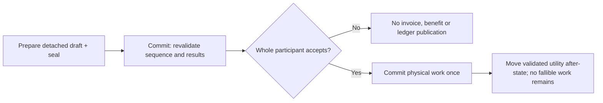
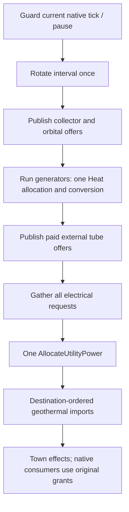

# M2O23-2 ? TBM activation, generators and utility integration (Groups 23-36)

Architecture owner: [map layers](../../architecture/map-layers/archi-map-layers.md).

## Global Mandatory Reading

> **Execution protocol**
>
> - Read this Global Mandatory Reading section before the first task and again
>   after every context compaction.
> - Before starting or resuming a task group, read the nearest preceding Area
>   Mandatory Reading block whose `Applies to` label includes that group. Area
>   blocks appear immediately before the first group they govern.
> - A referenced heading or exported symbol is authoritative. Global navigation
>   hints and Area line ranges are for navigation only; if they drift, relocate
>   the named section or symbol rather than expanding to the whole file.
> - Mandatory reading is non-transitive. Do not preload a linked file's own
>   Mandatory Reading, Consult on Demand, or Planning Provenance entries unless
>   this plan names them directly for the current area.
> - Do not read Consult on Demand or Planning Provenance merely because those
>   sources are listed. Use a Consult on Demand source only when its trigger
>   occurs.
> - No created source file, test file or JSON file should start with same prefix as a planning MD file (such as r2). Only MD files can have that prefix. No MD file should be created anywhere in source directories unless specifically asked.
> - After EVERY CONTEXT COMPACTION, you must add a note above the task group
>   which is currently in execution. The note will say: "Context has compacted
>   X times while executing this group.". If the compaction occurs before any
>   meaningful work was done (this can happen when there is a lot of baggage
>   from the previous compaction), then and ONLY then you can skip this step.
> - When exceeding 3 context compactions, YOU MUST ask yourself if you're not  
>   chewing more than we can handle :). Heck, plans change! :). In such a case,  
>   the way out is to split the group on the spot,
>   in the plan, into more groups,
>   by appending B, C, D as a suffixes to those groups (splitting sub-groups  
>   themselves is also allowed). When you do this, create Local Mandatory
>   Reading areas so you can optimize your context only for the
>   ACTUAL task at hand.
>   Before starting or resuming a task group, read the nearest preceding Area
>   Mandatory Reading block whose `Applies to` label includes that group. Area
>   blocks appear immediately before the first group they govern.

| File name | Line Ranges | Description |
| --- | --- | --- |
| [Destination map-layer architecture](../../architecture/map-layers/archi-map-layers.md) | 20-37; 272-282 | `Storage, coordinates and distance`, `Initialization and simulation`, and `Invariants` define stacked addressing, physical ownership and view-independent simulation. Every imported feature must preserve these boundaries; camera state must never choose command ownership, stop simulation or consume simulation RNG. |
| [Native layer controller](../../../../src/map_layer.h) | 96-104; 204-235 | `MultiLayerMap::DecodeStoredTile`, `IsTileInLayer`, `TileInLayer` and `ProjectToSurface` are the live geometry boundary used across gameplay and save validation. Decode candidate saves using their own dimensions; neither duplicate layer arithmetic nor consult the running world's geometry as a fallback. |
| [Required cleanup/layout contract](r2fc-file-cleanup3.md) | 85-103 | `End-state storage contract` defines original media, independent fixtures, retained saves, generated review/runtime products and the sole recipe/materialization boundary. This user-designated contract is globally necessary: imports must fit these owners, routine generation cannot publish canonical assets, and historical hashes never certify a current executable. |
| [Destination cleanup completion](r2fc2-file-cleanup3.md) | 44-61 | `Checkpoint and resume point` records completed cleanup, the actual Space successor, closed cash/tick boundaries and the provisional Tube checkpoint. This prevents a merge agent from replaying closed Space work, treating cleanup as gameplay authorization or silently promoting the destination's unfinished fleet. |
| [Donor technical closure](../../../zz-rhr/imports/openttd3-75ea75718f/docs/zz-reach2/upgrades/2026-10/r2mlvs16-b-performance.md) | 9-16 | `Current technical finalization,2026-10-20` distinguishes delivered Plan 3/4 behavior and selected performance acceptance from pending human art/demo feedback and the unresolved version 424 save alias. This is the other half of the architecture handoff: preserve delivered underground behavior without copying blanket completion or deletion claims. |

## Four-plan execution scope

The user requested this four-plan partition on2026-10-23 after completion of22D. Stable global group/task IDs and every existing checkbox state are preserved. Suffix batches remain part of their original numbered group.

| Plan | Owned groups | Current state |
| --- | --- | --- |
| [M2O23-1](m2o23-1-come-space.md) | 1-22D, including completed suffix batches | Complete:40 groups,160/160 tasks. |
| [M2O23-2](m2o23-2-come-space.md) | 23-36 | Open:18 groups,0/61 tasks (Group23 split into23-23E). |
| [M2O23-3](m2o23-3-come-space.md) | 37-53 | Open:17 groups,0/74 tasks. |
| [M2O23-4](m2o23-4-come-space.md) | 54-72 | Open:19 groups,0/82 tasks. |

The former second plan was renamed by the user to M2O23-3 before this partition; its Groups54-72 now continue in M2O23-4. Finish each plan's owned groups and public handoff before its successor. Completion of Plan1 is the completed foundation checkpoint; the full merge requires Plans2-4 and the final Completion Conditions in Plan4. Splitting documentation performs no gameplay task and authorizes no additional saved-world ticks or spending.

## Continuation boundary and prerequisite handoff

This file owns the61 tasks (including the explicit23B driven-acceptance split) in Groups23-36 moved from [completed Plan1](m2o23-1-come-space.md). Continue at23.1 after a user-directed resume. [The22D handover](m2o23-1-come-space-i-handover.md) identifies tested movement/hold/transfer contracts and fixture traps. Group23 is refined into sequential23,23B,23C,23D and23E batches: phase activation, driven acceptance, replanning, lifecycle settlement and regressions. The split preserves every original obligation and performs no implementation task.

**ASSUMPTION: this was already built previously. If not, re-asses at runtime**

Entry gate: Plan1 must provide its completed evidence plus live `GetTBMMeetingKind`, `IsTBMReadyForFaceTransfer`, `ExecuteTBMFaceTransfer`, directed `GetTBMHaulerSteeringTarget`, portal/support/PBS callbacks, native hauler step/backing, `CmdPlaceSurfaceSupplyOrder`, `CmdCancelLegacySurfaceSupplyOrder` and native cargo custody. Verify exact public declarations and relevant focused results, then apply each Area's narrower gate. Stop dependent phase/purchase/provider mutation if a contract is absent; read-only source/argument comparison may continue. Never bypass the existing phase validator, native followers, canonical receipt book or utility allocator with fixture placement, a private donor store or invented stock.

The new phase remains uninstalled at entry. Completed loaded-return components are not a fully driven installed wait/disposal loop or visible/hidden equality proof. Keep those Group23 obligations intact. Finish36's public interface handoff before starting [Plan3 Group37](m2o23-3-come-space.md#group-37---wire-canonical-supply-geothermal-and-tube-controls).

## Execution boundaries

**A** is `D:/Codez/Sandbox/OpenTTD`, the destination; **B** is `D:/Codez/Sandbox/OpenTTD3`, the read-only donor. Unlabelled paths mean A. Pinned A HEAD is `cfeff84db52f8a3753a43c2a770a6363c62b2c67`; B HEAD is `75ea75718fa7d14632bf795105721df1e390f753`; common ancestor is `9a47768ae3e4455661264f2c49febde972538e49`. Verify pins before consuming donor links. Existing working changes are the implementation, not disposable state. [The original chronology](m2o23-1-come-space.md#investigated-snapshot-and-chronology) and [execution record](m2o23-1-come-space-a-execution.md) retain historical evidence; consult exact entries only on observed drift.

No Git writes, staging, checkout, reset or recursive filesystem deletion is authorized. Preserve both repositories, `OpenTTD-baseline/` and `!kit`; no individual deletion is needed. Work sequentially without subagents. The user directed implementation of this plan on2026-10-23. Synthetic focused native execution is authorized; closed original Space gameplay/cash boundaries remain unchanged.

New supply purchases use A's Pending-only refund rule; station delivery ends refund rights. Migrated B stock retains only its original finite unshipped entitlement in the same canonical receipt owner. Protect closed Space cash/tick boundaries and the actual chosen continuation; historical art/demo status and component cases are not current runtime approval.

Use R2FC-3's existing durable-input, fixture and materialization owners. Test/tool source belongs beside tests; generated diagnostics belong in `test-cache/`, `logs/` or declared `mlm/reviews/` runs. No new source/test/JSON planning prefixes or Markdown in source directories. Auxiliary Markdown for this plan belongs beside it and extends its own filename prefix with `-a-...`, then `-b-...` as needed. Never duplicate canonical supply, profile, compiler, catalogue or materialization authority.

## Conflict decisions and safeguards

The original comparison remains in [Plan1](m2o23-1-come-space.md#conflict-decisions-and-safeguards). The following existing decisions constrain this file; live code and focused evidence take precedence over historical status.

| Conflict | Observed evidence | Resolution to implement |
| --- | --- | --- |
| Supply ownership and payment | A has uint64 intent IDs, pending/fulfilled records and command-kernel settlement; B has uint32 strong IDs, immediate stock, packet order/shipped fields and producer self-debit. | Keep A's owner and new-purchase policy. Adapt B UI/commands to it; widen donor IDs losslessly; convert old order/packet history without double debit, refund or quota restoration. Preserve legacy refund rights explicitly, never by pretending delivered stock is Pending. |
| Supply purpose/cargo capacity | A uses `SourceType::CompanySupply` and `GetTubeStationTransferRoom`; B uses permanent packet order/shipped purpose, custody traversal and `GetTubeInterchangeTransferRoom`. | One permanent non-paying purpose plus optional original-order provenance; one capacity calculation with adapters for callers. Test split/merge, reservation, hub/launch/orbital ownership, station loss and original pickup refunds. |
| Commands/network identity | Both append different commands after `EvacuateOrbitalModule`. | Preserve A's assigned values and append genuinely new donor commands; route duplicate supply actions to the canonical command. Verify codecs and reject mixed-build network peers. Old numeric command logs need explicit lineage or an explicit refusal. |
| Capsule identities and balance | Both implement models 9-13 in EIDS `0x8000 + model`; A's fleet is provisional. B's delivered capacities are 60/40/48/24/80; A proposes 60/40/40/24/96, with other speed/weight/power differences. | Use B's delivered definitions as the merged new-game baseline; preserve model 9 identity and A's useful geometry/preflight constraints. Loaded consists must conserve cargo and refuse unsafe capacity loss. Keep provisional source history, not a second runtime catalogue. |
| Shared simulation/utility | B extends utility conversion, generator feeding, geothermal bindings and scheduling; A also has Space, orbital and ground consumers. | Combine at original utility/tick owners with one allocation/settlement and deterministic ordering. Heat and electricity retain units, lineage, loss and once-only spending. Hidden-layer execution must remain equivalent. |
| Renderer and UI overlap | Both alter stations, vehicles, sprites, English strings and windows; B adds tube/geothermal native consumers and demo controls. | Integrate by actual render/command owner, preserving A's Space/click bounds and B's layer-aware ground behavior. Add/remove visibility hooks once, with no fallback to preview art for qualified runtime families. |
| Relocation and proof conflict | B still has archived-plan copies and essential inputs under `docs/.../assets`, `logs`, review and build trees. A has migrated owners and stronger source/receipt checks. | Build an explicit path/hash/role map. Preserve historical receipts unchanged and publish relocation adapters/new proof separately. Port new consumers into the existing catalogue; never restore old caches as runtime authority or rewrite old receipts to appear current. |

## Implementation tasks

The refined plan has18 difficulty batches and61 tasks. Checkboxes and the execution record track current evidence.

Code sketches are conceptual unless labelled as existing exports. Proposed helpers belong to the named existing owner. Verify prior exports before dependent work; an absent prerequisite stops only its dependent tasks, with safe independent work and forbidden shortcuts stated by the Area entry gate. Mandatory reading is non-transitive; do not preload future Areas. Native checks genuinely deferred until the merged target is buildable must be recorded and closed in [Plan4 Group60](m2o23-4-come-space.md#group-60---run-focused-domain-decoder-and-ordinary-world-checks). Existing focused native passes remain evidence and must not be relabelled as deferred.

Group9's [reviewed path map](../../../../src/tests/fixtures/cleanup/merge-path-dispositions.json) assigns deferred imports to `owner_groups`. Each producing group must import/adapt its selected source rows before declaring its public contract implemented. Read only matching rows, not the complete inventory. Global group IDs still resolve after the four-plan partition.

### Area Mandatory Reading - TBM lifecycle, replanning and player controls

_Applies to Groups 23-23B._

Entry gate:22D must publish tested native movement/hold/transfer contracts. Verify scoped proof and live `tbm.h`/`tbm_exchange.h` exports before activating the new phase. Stop phase or replanning mutation if absent; independent UI layout inspection may continue. Do not bypass PBS, move runtime trains by fixture placement, release occupied claims or fabricate a completed cut.

| File name | Line Ranges | Description |
| --- | --- | --- |
| [Live work and transfer owners](../../../../src/tbm.h), [exchange owner](../../../../src/tbm_exchange.h) | Live definitions; no fixed range |20-22D provide exact meeting, turn, whole transfer and movement contracts. `TBMPhase::AwaitFaceTransfer` is identity20 but its actual native activation/replay belongs here; do not confuse declaration with delivered transitions. |
| [Native controller](../../../../src/tbm_project.cpp) | Live definitions; no fixed range | `ValidateTBMProject`, `StepTBMProjectPhase`, `AdvanceTBMWork` and original park/release/hangar owners constrain runtime phase activation and safe withdrawal. New edges must preserve the original geological job/cargo/accounting owners. |
| [Sequential command identities](m2o23-1-come-space-d-identities.md) | 92-98 | The unpublished revision2 tail allocates `ChangeTBMWork`212 after implemented legacy cancellation211. Register only its complete actual body and exact donor tuple here; later generator/provider commands remain unregistered. |
| [Derived player control view](../../../../../OpenTTD3/src/tbm_controls.h) | 22-78 | `TBMPlayerStep` and `TBMPairControls` expose the real project lifecycle. Presentation owns no independent work state, material, phase timer or route. |

### Group 23 - Reconcile saved work transitions and settlement

**ASSUMPTION: this was already built previously. If not, re-asses at runtime**

Required prior output: Groups22-22D make the native movement/hold/transfer contract consistent.

{{HARD}}
- [ ] 23.1 Integrate `AwaitFaceTransfer` edges in the existing phase machine: exchange due chooses Face/Bay, transferred cutter advances onto new support before boring, and invalidated stands return safely. Repeat21/21B's transfer case through an actually installed native face-wait phase; component placement does not close Group23B's driven acceptance.

### Group 23B - Drive installed face-wait logistics

**ASSUMPTION: this was already built previously. If not, re-asses at runtime**

Required prior output:23.1 activates and validates the original controller phase.

{{HARD}}
- [ ] 23B.1 Close22D's full loaded/empty face-wait cycle and hidden-camera comparison through actual native transitions, origin delivery and empty return. Port the donor controller-loop observations without substituting fixture placement for runtime motion.

### Local Mandatory Reading - Unfinished work replanning

_Applies to Group23C._ Read the Global section and only the current local owners after compaction.

- `src/tbm_project.cpp`: live `ValidateTBMProject`, extension/replanning quotes and command commit; compare donor `ChangeTBMWork` at the pinned B checkout.
- `src/tbm_replanning.h`, `src/tbm_support.cpp`: actual support ownership and unfinished-route admission.
- [Sequential command identities](m2o23-1-come-space-d-identities.md#sequential-allocation-revision-2026-10-23): command212 follows implemented211; register only its complete body.

Entry gate:23B's driven loop must pass before replanning mutation. Preserve paid completed cuts, original geology and material custody.

### Group 23C - Replan only unfinished work

**ASSUMPTION: this was already built previously. If not, re-asses at runtime**

{{HARD}}
- [ ] 23.2 Port `ChangeTBMWork`, area/route obstruction and unfinished-remainder planning without altering paid completed cuts, geology or consumed materials.

### Local Mandatory Reading - Lifecycle and regression closure

_Applies to Groups23D-23E._ Read the Global section and only the current local owners after compaction.

- `src/tbm_project.cpp`: `StepTBMProjectPhase`, `AdvanceTBMWork` and cancel/park/release owners.
- `src/tbm_hangar.cpp`, `src/tbm_exchange.cpp`: native service/withdrawal, hauler holds and final spoil settlement.
- `src/tbm.h`, `src/tbm_exchange.h`: current lifecycle and transfer exports; donor focused lifecycle/source-loss tests selected by Group9's path map.

Entry gate:23C must expose the complete replanning command. Claims remain occupied until actual withdrawal and final haulage settlement; save dialect activation remains later work.

### Group 23D - Settle interrupted work and held haulers

**ASSUMPTION: this was already built previously. If not, re-asses at runtime**

{{HARD}}
- [ ] 23.3 Reconcile cancel/park/hangar/service requests with held haulers and final spoil settlement; claims retire only after actual withdrawal and haulage completion.

### Group 23E - Close affected logistics regressions

**ASSUMPTION: this was already built previously. If not, re-asses at runtime**

{{HARD}}
- [ ] 23.4 Port focused source-loss, replan, occupied-file and recurring logistics cases; persistence for the new phase is deliberately handled by later dialect groups.

### Local Mandatory Reading - Native player controls

_Applies to Group24._ Read the Global section and only the current local owners after compaction.

- `src/tbm_controls.h`, `src/tbm_controls.cpp` and pinned B `src/tbm_controls.h`: `TBMPlayerStep` and `TBMPairControls` derive the actual lifecycle.
- `src/tbm.h`, `src/tbm_exchange.h`: completed23-23E interfaces; presentation owns no work state, stock, timer or route.

Entry gate:23E's actual controller behavior must be complete before UI integration; preserve Space navigation and view-independent simulation.

### Group 24 - Bring bounded demo and map-interface fixes

**ASSUMPTION: this was already built previously. If not, re-asses at runtime**

Required prior output: Groups 20-23 provide the actual controller behavior shown by the UI.

{{MEDIUM}}
- [ ] 24.1 Port layer-aware minimap, portal/construction preview, toolbar/default TBM selection while retaining A's Space navigation and inspection.
- [ ] 24.2 Reconcile hotkey/window toggling, order-problem guidance and planning feedback using native controller views; view changes cannot advance work.
- [ ] 24.3 Port new-game settings synchronization and profile/date-aware availability. Classic/disabled worlds must not acquire underground content implicitly.
- [ ] 24.4 Merge widget/string registrations without duplicate keys and adapt focused GUI/planning/feedback checks.
- [ ] 24.5 Update the underground walkthrough to actual controls and mark visual feedback as pending until the later native gallery review.

### Area Mandatory Reading - Generator machinery and original lifecycle

_Applies to Groups 25-26._

Entry gate: Groups 10-19 must expose canonical paid supply/cargo paths. Check `CmdPlaceSurfaceSupplyOrder`, `DispatchPendingSurfaceSupplyOrders` and custody definitions. Stop paid generator integration if absent; cold geometry/definition work may continue. No donor self-debit stock injection, second utility store or prepared stock may masquerade as paid construction.

| File name | Line Ranges | Description |
| --- | --- | --- |
| [Generator public owner](../../../../../OpenTTD3/src/geothermal_generator.h) | 50-110 | Construction/admission, material receipt, operating/lifecycle/staging APIs and `ComputeGeothermalGeneratorDigest` divide physical machinery from shared energy. |
| [Generator component tests](../../../../../OpenTTD3/src/tests/geothermal_generator.cpp) | 30-138 | Funding/refusal, whole592-tick bill, locked work and staged machinery checks distinguish installed definitions from paid operational machinery. |
| [Live canonical supply interface](../../../../src/surface_supply_cmd.h) | Live definitions; no fixed range | Group 14 retains `CmdPlaceSurfaceSupplyOrder` and `CmdCancelSurfaceSupplyOrder`; generator consumers use this canonical settlement boundary. |

### Group 25 - Port cold claims and paid native generator construction

**ASSUMPTION: this was already built previously. If not, re-asses at runtime**

Required prior output: Canonical supply and cargo APIs from Groups 14-19.

{{HARD}}
- [ ] 25.1 Import generator definitions and site/service command declarations using the revision2 identities; keep canonical content/date/model ownership. Register complete implemented generator/site command bodies213-215 in their selected order as they land in25-26; declaration of the later town-service command does not register its trait before30.
- [ ] 25.2 Port cold geometry reservation and actual Industry binding with whole owner/claim/material preflight. Include the delivered dated magma variant.
- [ ] 25.3 Connect generator input room and receipt to native Industry stock and canonical purchased delivery; retain full material bill, paid construction opportunities and no output before completion.
- [ ] 25.4 Add targeted funding/estimate/refusal/locked-work tests with real native owners; defer operating conversion to its own later batch.

### Group 26 - Preserve generator removal and reference history

**ASSUMPTION: this was already built previously. If not, re-asses at runtime**

Required prior output: Group 25 owns actual machinery and input stock.

{{MEDIUM}}
- [ ] 26.1 Port cold-site cancellation, Industry clear/removal and company lifecycle notifications without refunding consumed construction or restoring depleted geology.
- [ ] 26.2 Keep shared utility IDs and natural-source claims retired on loss; validate source/industry/pool reuse against original ownership.
- [ ] 26.3 Import detached generator capture/staging/validation helpers and component refusal tests. Do not yet interpret conflicting save numbers.
- [ ] 26.4 Document the exact generator exports ready for conversion/scheduling and the later persistence obligations.

### Area Mandatory Reading - Pure heat conversion and atomic settlement

_Applies to Groups 27-28._

Entry gate: Group 25 must supply physical machinery references; A's `UtilityMutationParticipant` contract must remain intact. Verify the actual symbols and component fixtures. Stop transaction wiring on absence; pure arithmetic/record tests may continue. Never create an auxiliary energy ledger or publish electrical output before original heat debit succeeds.

| File name | Line Ranges | Description |
| --- | --- | --- |
| [Conversion draft](../../../../../OpenTTD3/src/utility_power.cpp) | 2435-2504 | `UtilityHeatConversionDraft`, `GetExactUtilityConversionRate` and `BuildUtilityHeatConversionDraft` validate a detached after-state, exact source slices, carry and limits before participant mutation. |
| [Conversion seal and transaction](../../../../../OpenTTD3/src/utility_power.cpp) | 2506-2554 | `SealUtilityHeatConversion`, `PrepareUtilityHeatConversion` and `CommitUtilityHeatConversion` revalidate owner/sequence/result and commit a no-fail prepared ledger only after the physical participant succeeds. |
| [A participant contract](../../../../src/utility_power.h) | 174-202; 261-285 | `UtilityMutationParticipant` and `CommitUtilityMutation` constrain reentrancy, whole participant behavior and existing Space consumers. Preserve those invariants when adding conversion. |

### Group 27 - Port pure heat-to-electricity draft construction

**ASSUMPTION: this was already built previously. If not, re-asses at runtime**

Required prior output: Group 26 provides generator references; existing shared utility state remains the sole balance owner.

{{HARD}}
- [ ] 27.1 Port conversion-specific fields/roles into the existing `UtilityPowerState` and immutable producer definition; retain original IDs and bounded original-source attribution.
- [ ] 27.2 Implement exact integer heat→electricity calculation with remainder, rate ceiling, lifetime overflow and source-domain checks using the existing arithmetic helpers.
- [ ] 27.3 Build the detached after-state and acquire all necessary vector storage before any physical participant invoice/work. Preserve consumed/reserved/transferred slice accounting.
- [ ] 27.4 Add pure refusal cases for wrong role/owner, stale interval, insufficient grant, output already published, output allocation already closed, invalid duration and attribution bound exhaustion.

### Group 28 - Port the sealed whole conversion transaction

**ASSUMPTION: this was already built previously. If not, re-asses at runtime**

Required prior output: Group 27 provides a fully validated, allocated draft before physical mutation.



{{HARD}}
- [ ] 28.1 Port the field-wise seal and exact proposal-result comparison; no raw struct hashing, pointer identity or padding enters the seal.
- [ ] 28.2 Rebuild the draft at commit and recheck owner, operation sequence, heat input, electric output, loss and carry. Reject duplicate/reentrant/stale use unchanged.
- [ ] 28.3 Validate participant domain/role and its complete invoice/work admission; call its noexcept whole commit once, then move the already allocated after-state into the original utility owner.
- [ ] 28.4 Test participant refusal, recursive mutation attempt, stale proposal and repeated commit; compare both energy domains, money, service counters and operation sequence.
- [ ] 28.5 Retain the existing APIs `PrepareUtilityHeatConversion`/`CommitUtilityHeatConversion` for runtime callers; no alternate conversion entry point owns stock.

### Area Mandatory Reading - Operating generators and paid utility service paths

_Applies to Groups 29-30._

Entry gate: Group 28 must expose the conversion transaction and Group 26 must own real machinery. Verify the public exports and component cases before activating service. Pure control descriptions may continue if missing; do not replace installed-path constraints with proximity, a numeric portal shortcut or a fabricated energy source.

| File name | Line Ranges | Description |
| --- | --- | --- |
| [Generator operating interval](../../../../../OpenTTD3/src/geothermal_generator.cpp) | 434-486 | `RunGeothermalGenerators` gathers feasible generator demands, closes Heat once and commits actual generators in stable identity order. It must not initialize a thermal domain for an unrelated orbital-only world. |
| [Paid service boundary](../../../../../OpenTTD3/src/utility_power.h) | 327-370 | `BindUtilityTownService`, `ConnectGeothermalTownService`, request collection and `RunUtilityTownServices` connect real terminals/paths to shared energy; they are not independent account owners. |
| [Live conversion exports](../../../../src/utility_power.h) | Live definitions; no fixed range | Groups 27-28 supply `PrepareUtilityHeatConversion` and `CommitUtilityHeatConversion`. Current source definitions are required before importing their callers. |

### Group 29 - Connect generator demand and operating participants

**ASSUMPTION: this was already built previously. If not, re-asses at runtime**

Required prior output: Groups 26 and 28 provide real machinery and atomic conversion.

{{HARD}}
- [ ] 29.1 Port generator demand/participant acquisition and service-money checks, issuing original heat-consumer/output identities once in native Industry order.
- [ ] 29.2 Integrate `RunGeothermalGenerators` so absent Heat/generators is a no-op, repeated closed intervals refuse and participant storage stays stable while demand records hold references.
- [ ] 29.3 Keep generator conversion in its original shared participant path, preserving partial registration retry, service fraction and real material/finance ownership.
- [ ] 29.4 Add service-shortage, incomplete original port, registered-input/missing-output retry and no-Heat orbital-only cases. Global scheduler wiring remains later.

### Group 30 - Connect operating generators and real service paths

**ASSUMPTION: this was already built previously. If not, re-asses at runtime**

Required prior output: Groups 28 and 29 provide real operating sources and atomic conversion.

{{HARD}}
- [ ] 30.1 Port paid same-layer electrical feed registration with exact real generator, local-cell, port, company and source-domain preflight.
- [ ] 30.2 Port riser/town terminal connection and forwarding-root APIs while keeping original link/utility identities and town/custom-GS policy.
- [ ] 30.3 Reconcile link removal, terminal loss and original machinery references without proximity fallback, free service or duplicate energy accounts.
- [ ] 30.4 Add pure admission/command/lifecycle cases for absent cable, changed owner, source loss and suspended town effect; do not wire a second tick driver.

### Area Mandatory Reading - Fleet definitions and provider bindings

_Applies to Groups 31-33._

Entry gate: Group 7 must fix model/EIDS decisions and Groups 18/30 must expose capacity and physical power APIs. Verify public symbols before dependent integration. Pure model comparison may continue on absence; no provisional second installer, cross-repository call or cloned energy source may bypass the gate.

| File name | Line Ranges | Description |
| --- | --- | --- |
| [Selected coefficient and identity contract](m2o23-1-come-space-d-identities.md) | 68-84 | `Delivered capsule coefficients and one installer` records every A-to-B coefficient change, exact EIDS identity and retained loaded-capacity boundary. Groups31-33 implement this decision through existing native owners, without a second installer or cargo loss. |
| [Delivered model and admission interface](../../../../../OpenTTD3/src/transport_tube_model.h) | 51-87 | `TubeVehicleDefinition`, `GetTubeVehicleDefinition`, `CheckTubeVehicleCargoChange` and `InitialiseTubeContentDefinitions` keep definition/availability/loaded-stock admission separate. |
| [Whole-family installer](../../../../../OpenTTD3/src/transport_tube_engine.cpp) | 157-208 | `InitialiseTubeEngineDefinitions` preflights all mappings/cargos, fills persisted holes before fresh allocation and configures five models. Preserve its two allocation passes. |
| [Geothermal binding transitions](../../../../../OpenTTD3/src/transport_tube_runtime.cpp) | 141-167; 186-215 | `BindTubeGeothermalPowerVehicle` and `ReconnectTubeGeothermalPowerVehicle` bind original providers and retire old rights. Keep actual vehicle/owner/hold admission. |
| [Live utility boundary](../../../../src/utility_power.h) | Live definitions; no fixed range | Groups 28-30 provide conversion and real local-feed/town service APIs through this owner; loaded balances are never recreated in the tube module. |

### Group 31 - Consolidate model definitions and EIDS allocation

**ASSUMPTION: this was already built previously. If not, re-asses at runtime**

Required prior output: Group 7 froze the canonical model map and Group 9 registered the source family.

{{HARD}}
- [ ] 31.1 Choose one native definition/installer implementation from the Group 7 decision; keep A's useful geometry checks and remove duplicate activation paths from CMake/callers.
- [ ] 31.2 Preflight all five models, cargo labels, package identity, duplicate persisted slots and pool capacity before creating any engine.
- [ ] 31.3 Fill already reserved missing EngineIDs before allocating fresh IDs, then configure the models in deterministic catalogue order. Keep model 9/local `0x8009` unchanged.
- [ ] 31.4 Adapt the five-model, late-missing-cargo, duplicate-EIDS and persisted-hole tests; retain provisional A sources as dated evidence rather than active tuning. Record any required definition-only EIDS append on legacy loads; existing engine/vehicle IDs, cargo and RNG must remain unchanged.

### Group 32 - Integrate purchase, refit and replacement admission

**ASSUMPTION: this was already built previously. If not, re-asses at runtime**

Required prior output: Group 31 supplies complete EIDS definitions and Group 18 supplies stock admission.

{{HARD}}
- [ ] 32.1 Route build/refit/autoreplace/train callers through the single capability and cargo-change APIs, keeping canonical profile/date/layer and tube-versus-ordinary-rail rules.
- [ ] 32.2 Check actual retained cargo label and operation-specific target capacity before temporary vehicles, charge or truncation. A loaded provisional 96-capacity carrier cannot silently shrink to 80 and discard units.
- [ ] 32.3 Preserve native engine introduction/restoration and consist cache updates after successful changes; registration alone grants no powered movement.
- [ ] 32.4 Add loaded/empty refit, replacement refusal, saved model 9 identity, late-date and hidden-layer admission cases.

### Group 33 - Port geothermal sources and explicit provider switching

**ASSUMPTION: this was already built previously. If not, re-asses at runtime**

Required prior output: Groups 30 and 32 provide real machinery paths and capsule admission.

{{HARD}}
- [ ] 33.1 Port the original geothermal inlet/source owner and paid path admission, retaining generator/root/port/cable identities without stored duplicate energy quantities.
- [ ] 33.2 Integrate initial external/geothermal binds and explicit reconnect/switch commands for real held capsules. Preflight the new path before retiring the old usable binding. Append the implemented external trio217-219 before the geothermal trio220-222 from the revision2 contract; preserve all earlier command values and register every actual body exactly once.
- [ ] 33.3 Preserve consumed history and release only original unused rights; switching or failed reconnect cannot reset fractional demand carry or grant a free invoice.
- [ ] 33.4 Add missing-generator/path, foreign-owner, stale-source, manual-stop and repeated-switch cases. Expose ready binding APIs before the common scheduler is edited.

### Area Mandatory Reading - One synchronized publication and allocation pass

_Applies to Groups 34-36._

Entry gate: Groups 28, 30 and 33 must provide the conversion/generator/provider interfaces, and A's orbital manufacturing/recipe appenders must remain present. Verify definitions and focused contracts; stop scheduler activation if absent. Static ordering analysis may continue. Do not call two tick drivers, close Heat twice, omit A's newer appenders or add a private consumer allocation.

| File name | Line Ranges | Description |
| --- | --- | --- |
| [A scheduler and Space appenders](../../../../src/transport_tube_runtime.cpp) | 173-228 | `PrepareTubePowerTick` currently appends orbital utility, construction, manufacturing and recipe demand. A's placeholder empty Heat allocation must be replaced by the actual generator owner, not retained alongside it. |
| [B provider-aware scheduler](../../../../../OpenTTD3/src/transport_tube_runtime.cpp) | 265-355 | `PrepareTubePowerTick` includes generator publication, geothermal forwarding-root sums, destination-sorted imports and town settlement. Combine these with A's newer request appenders in one pass. |
| [Live generator interface](../../../../../OpenTTD3/src/geothermal_generator.h) | 76-84 | `PrepareGeothermalGeneratorDemand`, `ConvertGeothermalGeneratorHeat`, `RunGeothermalGenerators` and `HasGeothermalGenerators` define the expected runtime contract imported by Group 29. |
| [Live shared mutation owner](../../../../src/utility_power.h) | Live definitions; no fixed range | Groups 28-30 provide `CommitUtilityHeatConversion` and town service requests; Group 33 consumes the original utility owner. Verify these live contracts before scheduler wiring. |

### Group 34 - Reconcile tick guards and source publication

**ASSUMPTION: this was already built previously. If not, re-asses at runtime**

Required prior output: Group 33 supplies all provider records; Groups 28-30 supply the Heat owner.



{{HARD}}
- [ ] 34.1 Keep one `PrepareTubePowerTick` entry with existing executing/prepared-tick/pause/game-mode guards and the portable orbital construction opportunity.
- [ ] 34.2 Extend the no-work fast path to include retained generator/town service state so source-loss recovery still runs; preserve orbital-only worlds without initializing an unwanted Heat domain.
- [ ] 34.3 Rotate the utility interval once; set the prepared-tick guard only after successful rotation. Publish collector/orbital offers and run generators before electrical allocation.
- [ ] 34.4 Remove A's old empty `AllocateUtilityHeat(interval,{})` placeholder once `RunGeothermalGenerators` owns the Heat closure; publish each installed external tube source once under its real company.
- [ ] 34.5 Add duplicate-call, paused, source-free, failed-rotation, orbital-only and completed-generator-without-capsules cases.

### Group 35 - Merge demand and deterministic downstream settlement

**ASSUMPTION: this was already built previously. If not, re-asses at runtime**

Required prior output: Group 34 publishes exactly one prepared interval; Group 33 exposes provider paths.

```cpp
// Merge point inside the existing driver; all are current public owners.
AppendUtilityTownServiceRequests(requests);
AppendOrbitalUtilityRequests(requests);
AppendOrbitalConstructionRequests(requests);
AppendOrbitalManufacturingRequests(requests); // preserve A-only addition
AppendOrbitalRecipeRequests(requests);        // preserve A-only addition
if (AllocateUtilityPower(interval, requests) != UtilityPowerError::None) return;
// Existing B path imports follow in destination order, then town effects.
```

{{HARD}}
- [ ] 35.1 Gather actual capsule demand without moving cargo, updating work or clearing manual stops. Sum geothermal forwarding-root demand once per source with checked capacity limits.
- [ ] 35.2 Append town, orbital service, orbital construction, orbital manufacturing and orbital recipe requests before the single electrical allocation. Preserve A's idle/full-buffer no-demand checks.
- [ ] 35.3 After successful allocation, sort original geothermal path imports by destination ConsumerID, perform whole transfers through existing lineage APIs, then run town services once.
- [ ] 35.4 Retain original native `AdvanceTubePowerTick`/participant settlement and fractional carry; neither provider mode may duplicate an already executed tick.
- [ ] 35.5 Add short-grant/path-capacity contention with tube, town and orbital work; compare exact joules, cash, work and operation counters under reordered transport rows.

### Group 36 - Close provider loss, topology and deterministic state coverage

**ASSUMPTION: this was already built previously. If not, re-asses at runtime**

Required prior output: Groups 34-35 supply the final single-pass execution order.

{{HARD}}
- [ ] 36.1 Reconcile link/riser/portal/source removal and company transitions across external tubes, geothermal tubes, town services and A's orbital users.
- [ ] 36.2 Invalidate only affected physical paths, preserve consumed/original-source history and retire nonreused references. Auto power waits remain distinct from manual player stops.
- [ ] 36.3 Extend existing canonical state/reference/digest exports with generator/conversion/provider fields in fixed field/identity order; never hash pointers or transport insertion order.
- [ ] 36.4 Add power loss/reconnect, depletion, owner reuse and visible/hidden interval equivalence cases. Keep load-dialect interpretation for the save batches.

## Plan2 handoff

Group 36 hands the same canonical owners to [Plan3 Group37](m2o23-3-come-space.md#group-37---wire-canonical-supply-geothermal-and-tube-controls). Record actual declarations, focused results and deferred native checks in this plan's execution record. Required outputs are the tagged supply/refund and packet-custody APIs, append-only command/model identities, generator/conversion/provider interfaces, single tick ordering and deterministic state exports. Plan3 verifies these contracts rather than creating replacements.

Save preflight/load/writer activation, renderer integration, asset publication, real-peer and final original-world qualification remain Plans3-4 work. No Plan2 checkbox or historical receipt certifies those later outcomes. Immutable originals, the protected Space seals and the sole recipe/materialization boundary must remain intact across the handoff.

## Consult on Demand

| Trigger | File name | Start at | Expand only when | Consultation purpose |
| --- | --- | --- | --- | --- |
| A migrated supply case cannot be reconciled with actual quote/refund behavior. | [B paid Surface execution notes](../../../zz-rhr/imports/openttd3-75ea75718f/docs/zz-reach2/upgrades/2026-10/r2mlvs6-b-paid-surface-supplies.md) | `Remaining design obligations`, lines31-37 | Current B code/tests and original save fields do not explain the entitlement in question. | Explain original cap, custody and refund intent. This historical note cannot override the confirmed A rule for new purchases or create missing provenance. |
| Face transfer deadlocks, reverses unsafely or admits more than one hauler. | [B face-exchange design](../../../zz-rhr/imports/openttd3-75ea75718f/docs/zz-reach2/upgrades/2026-10/r2df2-a-face-exchange-design.md) | `F4 Hauler cycle unchanged` and `F5 One hauler in the corridor` | The failing stand/trackdir/turn-holder case requires return/cancellation rules beyond F4/F5. | Recover delivered movement rationale and the narrowed depot exception; live native tests remain behavioral authority. |
| A migrated tube model fails cargo/date or useful-route admission despite intact EIDS identity. | [B tube runtime handoff](../../../zz-rhr/imports/openttd3-75ea75718f/docs/zz-reach2/upgrades/2026-10/r2mlvs17-e-tube-runtime.md) | `Completed15FEE actual Forge raster and five-model closure`, lines15-34 | The public model/terminal/readiness APIs do not explain the observed refusal. | Identify the original model/route prerequisite, not a substitute registry or permission to relax admission. |
| Geothermal source-switch or local service loses conserved lineage. | [B local electrical-feed handoff](../../../zz-rhr/imports/openttd3-75ea75718f/docs/zz-reach2/upgrades/2026-10/r2mlvs12-d-local-electrical-feed.md) | `Group9C closure and return to Plan21-10BB.2,2030-14-17`, lines9-16 | The live conversion/link tests leave an unresolved physical-path ownership question. | Explain original same-layer feed versus riser/town ownership; shared utility accounts stay authoritative. |
| A Space regression proposes more paid work or a replay of closed earning windows. | [A launch-center source handoff](r2mlsp-z-z-z-z-z-q-launch-center-source.md) | `Current boundary` | The precise next-task/closed-policy contract cannot be resolved from that section and the retained foundation. | Resolve existing Space progression limits; a merge/test failure does not grant further spending or change the chosen task. |

## Planning Provenance

This is **not an execution reading queue** and must **not be preloaded after context compaction**. It is **non-transitive**. Ranges record planning use rather than runtime authority. These retained rows document the original decomposition relevant to this file; the four-plan partition preserves that design and moves no feature authority.

| File name | Sections or Line Ranges used while planning | Planning contribution |
| --- | --- | --- |
| [A storage architecture](../../architecture/archi-historical-debug.md) | `Delivery boundary`,10-28; `Storage ownership`,30-76; `Historical facts and current proof`,151-164; `Checkpoints, cleanup and transfer`,317-349 | Defined retained/generated ownership, catalogue authority, immutable seals and the current Goods-query continuation used throughout sequencing. |
| [A tube plan](r2mlvs17-underground-transport-tubes.md) | `Checkpoint handover`,354-374; Group10,375-386 | Established that A's five-model work is provisional, allowing delivered B definitions to be selected without discarding A's history or geometry. |
| [B underground master](../../../zz-rhr/imports/openttd3-75ea75718f/docs/zz-reach2/upgrades/2026-10/r2mlvs3mp-master-plan.md) | Group/area heading inventory,431-720; latest linked technical returns | Located the tube/plant/runtime/lifecycle/ground acceptance progression and decomposed the incoming feature families. Status comes from current code and bounded returns, not the entire master's checkbox count. |
| [B face-exchange design](../../../zz-rhr/imports/openttd3-75ea75718f/docs/zz-reach2/upgrades/2026-10/r2df2-a-face-exchange-design.md) | D9/narrowing,3-9; F1-F4,13-49 | Established the source-magazine/depot exception, derived meeting geometry, exact packet transfer and native steering risks. |
| [B paid-supply notes](../../../zz-rhr/imports/openttd3-75ea75718f/docs/zz-reach2/upgrades/2026-10/r2mlvs6-b-paid-surface-supplies.md) | Initial implementation/obligations,11-39; command codec correction,43-45 | Explained B's immediate-stock/self-debit/refund semantics and permanent packet purpose; prompted the human decision and the explicit migration-right design. |
| [A fleet tuning](../../../../src/transport_tube_fleet.cpp), [B engine definitions](../../../../../OpenTTD3/src/transport_tube_engine.cpp), [A Space sprite bounds](../../../../src/table/space_sprite_assets.h), [B sprite bounds](../../../../../OpenTTD3/src/table/multilayer_sprite_assets.h) | A tuning rows21-25; B definition rows30-37; A sprite bounds32-33; B bounds118-120 | Demonstrated real balance and sprite-allocation collisions even where filenames differ; prevented whole-file/binary replacement recommendations. |
| [Cleanup layout and candidate contract](r2fc-file-cleanup3.md) | `End-state storage contract`,85-103; implementation limits,118-126; Groups4/6,230-271; source candidates,503-519; Ground/expectation/native-input boundaries,744-800 | The user's explicit follow-up made artifact placement and pure generation versus canonical publication a first-class integration contract. Added a dedicated existing-architecture update and split candidate generation, expectations, native proof and publication. |
| [B conversion transaction](../../../../../OpenTTD3/src/utility_power.cpp), [A scheduler](../../../../src/transport_tube_runtime.cpp), [B scheduler](../../../../../OpenTTD3/src/transport_tube_runtime.cpp) | Draft/seal/prepare/commit,2435-2554; A `PrepareTubePowerTick`,173-228; B equivalent,265-355 | Established the no-fail transaction boundary, single Heat closure, destination-ordered imports and A-only manufacturing/recipe request appenders; split atomic conversion from interval integration. |
| [B TBM support](../../../../../OpenTTD3/src/tbm_support.cpp) and [B exchange implementation](../../../../../OpenTTD3/src/tbm_exchange.cpp) | Meeting helpers,500-550; transfer preflight/execution,701-864; turn holder,1474-1495 | Grounded smaller geometry, packet-transfer, movement and replanning batches in existing derived native state and ordered transfer behavior. |

Read-only Git histories/path/blob inventories supplied the original chronology. The user's planning format, no-Git-write/no-recursive-delete rules, supply-policy answer and four-plan partition govern execution; they add no transitive reading queue.

## Completion Conditions

This part is complete only when all Groups23-36 tasks have their stated current evidence. Group23 must close actual native phase activation and driven loaded/empty face-wait operation, including visible/hidden comparison; component poses cannot substitute. Generator/service/provider owners, delivered capsule definitions and one deterministic utility publication/allocation pass must preserve actual stock, money, claims and lineage.

Record implemented public interfaces and precise deferred checks in this plan's execution record before [Plan3 Group37](m2o23-3-come-space.md#group-37---wire-canonical-supply-geothermal-and-tube-controls). The next plan consumes these contracts rather than creating replacement owners. Plans3-4 retain save, asset, reconstruction and final qualification authority. Protected original hashes, Space policies and R2FC-3 storage/materialization boundaries remain intact.
