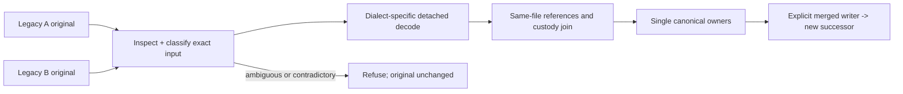

# M2O23-3 ? Controls, save compatibility and candidate assets (Groups 37-53)

## Global Mandatory Reading

> **Execution protocol**
>
> - Read this Global Mandatory Reading section before the first task and again
>   after every context compaction.
> - Before starting or resuming a task group, read the nearest preceding Area
>   Mandatory Reading block whose `Applies to` label includes that group. Area
>   blocks appear immediately before the first group they govern.
> - A referenced heading or exported symbol is authoritative. Global navigation
>   hints and Area line ranges are for navigation only; if they drift, relocate
>   the named section or symbol rather than expanding to the whole file.
> - Mandatory reading is non-transitive. Do not preload a linked file's own
>   Mandatory Reading, Consult on Demand, or Planning Provenance entries unless
>   this plan names them directly for the current area.
> - Do not read Consult on Demand or Planning Provenance merely because those
>   sources are listed. Use a Consult on Demand source only when its trigger
>   occurs.
> - No created source file, test file or JSON file should start with same prefix as a planning MD file (such as r2). Only MD files can have that prefix. No MD file should be created anywhere in source directories unless specifically asked.
> - After EVERY CONTEXT COMPACTION, you must add a note above the task group
>   which is currently in execution. The note will say: "Context has compacted
>   X times while executing this group.". If the compaction occurs before any
>   meaningful work was done (this can happen when there is a lot of baggage
>   from the previous compaction), then and ONLY then you can skip this step.
> - When exceeding 3 context compactions, YOU MUST ask yourself if you're not  
>   chewing more than we can handle :). Heck, plans change! :). In such a case,  
>   the way out is to split the group on the spot,
>   in the plan, into more groups,
>   by appending B, C, D as a suffixes to those groups (splitting sub-groups  
>   themselves is also allowed). When you do this, create Local Mandatory
>   Reading areas so you can optimize your context only for the
>   ACTUAL task at hand.
>   Before starting or resuming a task group, read the nearest preceding Area
>   Mandatory Reading block whose `Applies to` label includes that group. Area
>   blocks appear immediately before the first group they govern.

| File name | Line Ranges | Description |
| --- | --- | --- |
| [Destination map-layer architecture](../../architecture/map-layers/archi-map-layers.md) | 20-37; 272-282 | `Storage, coordinates and distance`, `Initialization and simulation`, and `Invariants` define stacked addressing, physical ownership and view-independent simulation. Every imported feature must preserve these boundaries; camera state must never choose command ownership, stop simulation or consume simulation RNG. |
| [Native layer controller](../../../../src/map_layer.h) | 96-104; 204-235 | `MultiLayerMap::DecodeStoredTile`, `IsTileInLayer`, `TileInLayer` and `ProjectToSurface` are the live geometry boundary used across gameplay and save validation. Decode candidate saves using their own dimensions; neither duplicate layer arithmetic nor consult the running world's geometry as a fallback. |
| [Required cleanup/layout contract](r2fc-file-cleanup3.md) | 85-103 | `End-state storage contract` defines original media, independent fixtures, retained saves, generated review/runtime products and the sole recipe/materialization boundary. This user-designated contract is globally necessary: imports must fit these owners, routine generation cannot publish canonical assets, and historical hashes never certify a current executable. |
| [Destination cleanup completion](r2fc2-file-cleanup3.md) | 44-61 | `Checkpoint and resume point` records completed cleanup, the actual Space successor, closed cash/tick boundaries and the provisional Tube checkpoint. This prevents a merge agent from replaying closed Space work, treating cleanup as gameplay authorization or silently promoting the destination's unfinished fleet. |
| [Donor technical closure](../../../zz-rhr/imports/openttd3-75ea75718f/docs/zz-reach2/upgrades/2026-10/r2mlvs16-b-performance.md) | 9-16 | `Current technical finalization,2026-10-20` distinguishes delivered Plan 3/4 behavior and selected performance acceptance from pending human art/demo feedback and the unresolved version 424 save alias. This is the other half of the architecture handoff: preserve delivered underground behavior without copying blanket completion or deletion claims. |

## Four-plan execution scope

The user requested this four-plan partition on2026-10-23 after completion of22D. Stable global group/task IDs and every existing checkbox state are preserved. Suffix batches remain part of their original numbered group.

| Plan | Owned groups | Current state |
| --- | --- | --- |
| [M2O23-1](m2o23-1-come-space.md) | 1-22D, including completed suffix batches | Complete:40 groups,160/160 tasks. |
| [M2O23-2](m2o23-2-come-space.md) | 23-36 | Open:14 groups,0/60 tasks. |
| [M2O23-3](m2o23-3-come-space.md) | 37-53 | Open:17 groups,0/74 tasks. |
| [M2O23-4](m2o23-4-come-space.md) | 54-72 | Open:19 groups,0/82 tasks. |

The former second plan was renamed by the user to M2O23-3 before this partition; its Groups54-72 now continue in M2O23-4. Finish each plan's owned groups and public handoff before its successor. Completion of Plan1 is the completed foundation checkpoint; the full merge requires Plans2-4 and the final Completion Conditions in Plan4. Splitting documentation performs no gameplay task and authorizes no additional saved-world ticks or spending.

## Continuation boundary and prerequisite handoff

This file owns Groups37-53 from the user's renamed former second plan. [Plan1](m2o23-1-come-space.md) owns completed Groups1-22D; [Plan2](m2o23-2-come-space.md) owns23-36. This file implements canonical controls, explicit save compatibility/writing, asset-family/range reconciliation and pure candidate/expectation preparation. [Plan4](m2o23-4-come-space.md) owns54-72: harness/reconstruction adapters, build/publication and final qualification.

**ASSUMPTION: this was already built previously. If not, re-asses at runtime**

Entry gate: Groups1-36 across Plans1-2 must provide the exact original-input inventory, pure `ClassifySaveDialect`/`HasSaveCapability` boundary, one tagged `SurfaceSupplyOrderRecord` book and cancellation owner, append-only command/model identities, original generator/conversion/provider owners and one `PrepareTubePowerTick` including A's orbital manufacturing/recipe requests. Verify producing groups' completed tasks, relevant focused evidence and live declarations before dependent implementation. If absent, stop dependent tasks and return the gap to its producer; static source/argument comparisons may continue. Do not bypass this with B's private supply store, another utility allocator, an alternate asset catalogue, cached reports or direct money mutation.

Complete53's candidate/independent-expectation handoff before [Plan4 Group54](m2o23-4-come-space.md#group-54---adapt-native-runners-and-build-memory-guards). Routine candidate generation cannot publish canonical assets; publication remains62. Original identity fixtures containing the historical filename `m2o23-2-come-space.md` retain their exact bytes: resolve their group IDs through this four-plan routing map, not by rewriting preserved planning evidence.

## Execution boundaries

**A** is `D:/Codez/Sandbox/OpenTTD`, the destination; **B** is `D:/Codez/Sandbox/OpenTTD3`, the read-only donor. Unlabelled paths mean A. Pinned A HEAD is `cfeff84db52f8a3753a43c2a770a6363c62b2c67`; B HEAD is `75ea75718fa7d14632bf795105721df1e390f753`; common ancestor is `9a47768ae3e4455661264f2c49febde972538e49`. Verify pins before consuming donor links. Existing working changes are the implementation, not disposable state. [The original chronology](m2o23-1-come-space.md#investigated-snapshot-and-chronology) and [execution record](m2o23-1-come-space-a-execution.md) retain historical evidence; consult exact entries only on observed drift.

No Git writes, staging, checkout, reset or recursive filesystem deletion is authorized. Preserve both repositories, `OpenTTD-baseline/` and `!kit`; no individual deletion is needed. Work sequentially without subagents. Gameplay execution remains paused after22D; the present request authorizes this document partition. Resume implementation only when the user directs it.

New supply purchases use A's Pending-only refund rule; station delivery ends refund rights. Migrated B stock retains only its original finite unshipped entitlement in the same canonical receipt owner. Protect closed Space cash/tick boundaries and the actual chosen continuation; historical art/demo status and component cases are not current runtime approval.

Use R2FC-3's existing durable-input, fixture and materialization owners. Test/tool source belongs beside tests; generated diagnostics belong in `test-cache/`, `logs/` or declared `mlm/reviews/` runs. No new source/test/JSON planning prefixes or Markdown in source directories. Auxiliary Markdown for this plan belongs beside it and extends its own filename prefix with `-a-...`, then `-b-...` as needed. Never duplicate canonical supply, profile, compiler, catalogue or materialization authority.

## Conflict decisions and safeguards

The original comparison remains in [Plan1](m2o23-1-come-space.md#conflict-decisions-and-safeguards). The following existing decisions constrain this file; live code and focused evidence take precedence over historical status.

| Conflict | Observed evidence | Resolution to implement |
| --- | --- | --- |
| Save version collision | A uses 425-440 for later Space/supply work; B uses 425-434 for TBM face transfer, supplies, geothermal and utility work. Both still use metadata schema 1. | Introduce explicit merged-format lineage/capabilities, preserve both legacy interpretations and allocate the next unused merged writer version after the snapshot is refreshed. Numeric `>=425` tests alone cannot identify a feature. Do not renumber old bytes or globally lie about `_sl_version`. |
| Same chunk, different wire format | A `surface_supply_order_sl.cpp` uses `SSOR` RIFF; B `surface_supply_sl.cpp` uses `SSOH` RIFF plus `SSOR` TABLE. | One dispatcher decodes the exact legacy family into the canonical order owner. Validate complete presence, type, dimensions, day and references in full and copied readers. Reject contradictory or genuinely ambiguous files without changing originals. |
| Supply ownership and payment | A has uint64 intent IDs, pending/fulfilled records and command-kernel settlement; B has uint32 strong IDs, immediate stock, packet order/shipped fields and producer self-debit. | Keep A's owner and new-purchase policy. Adapt B UI/commands to it; widen donor IDs losslessly; convert old order/packet history without double debit, refund or quota restoration. Preserve legacy refund rights explicitly, never by pretending delivered stock is Pending. |
| Supply purpose/cargo capacity | A uses `SourceType::CompanySupply` and `GetTubeStationTransferRoom`; B uses permanent packet order/shipped purpose, custody traversal and `GetTubeInterchangeTransferRoom`. | One permanent non-paying purpose plus optional original-order provenance; one capacity calculation with adapters for callers. Test split/merge, reservation, hub/launch/orbital ownership, station loss and original pickup refunds. |
| Commands/network identity | Both append different commands after `EvacuateOrbitalModule`. | Preserve A's assigned values and append genuinely new donor commands; route duplicate supply actions to the canonical command. Verify codecs and reject mixed-build network peers. Old numeric command logs need explicit lineage or an explicit refusal. |
| Capsule identities and balance | Both implement models 9-13 in EIDS `0x8000 + model`; A's fleet is provisional. B's delivered capacities are 60/40/48/24/80; A proposes 60/40/40/24/96, with other speed/weight/power differences. | Use B's delivered definitions as the merged new-game baseline; preserve model 9 identity and A's useful geometry/preflight constraints. Loaded consists must conserve cargo and refuse unsafe capacity loss. Keep provisional source history, not a second runtime catalogue. |
| Sprite namespace | A's M1 ends at 3588, preview occupies 3588-3598, Space 3599-5166, orbital 5167-6142, launch 6143-7790, ground through 22044. B expands M1 to 17847 while preserving the preview gap. | Preserve A's shipped ranges and allocate/remap only donor-only families into nonoverlapping space; resolve duplicate logical families once. Regenerate headers/NFO/GRF/hash/manifests together. Never select one binary GRF wholesale or shift Space by changing M1 count. |
| Renderer and UI overlap | Both alter stations, vehicles, sprites, English strings and windows; B adds tube/geothermal native consumers and demo controls. | Integrate by actual render/command owner, preserving A's Space/click bounds and B's layer-aware ground behavior. Add/remove visibility hooks once, with no fallback to preview art for qualified runtime families. |
| Relocation and proof conflict | B still has archived-plan copies and essential inputs under `docs/.../assets`, `logs`, review and build trees. A has migrated owners and stronger source/receipt checks. | Build an explicit path/hash/role map. Preserve historical receipts unchanged and publish relocation adapters/new proof separately. Port new consumers into the existing catalogue; never restore old caches as runtime authority or rewrite old receipts to appear current. |

## Implementation tasks

All17 difficulty batches and74 tasks below remain unchecked.

Code sketches are conceptual unless labelled as existing exports. Proposed helpers belong to the named existing owner. Verify prior exports before dependent work; an absent prerequisite stops only its dependent tasks, with safe independent work and forbidden shortcuts stated by the Area entry gate. Mandatory reading is non-transitive; do not preload future Areas. Native checks genuinely deferred until the merged target is buildable must be recorded and closed in [Plan4 Group60](m2o23-4-come-space.md#group-60---run-focused-domain-decoder-and-ordinary-world-checks). Existing focused native passes remain evidence and must not be relabelled as deferred.

### Area Mandatory Reading - Canonical command controls

_Applies to Group 37._

Entry gate: Groups 7/9 must provide the merged command traits and argument codecs; Groups 14-15 must provide `CmdPlaceSurfaceSupplyOrder` and `CmdCancelSurfaceSupplyOrder` for native receipts and `CmdCancelLegacySurfaceSupplyOrder` for eligible legacy receipts with expected-count checking. Groups 25/30/33/36 must provide the geothermal site, town-service and tube-provider command owners listed below. Verify declarations, sole definitions/traits and the producing groups' focused results. Stop all Group 37 control wiring if an affected command or owner is absent; static widget/argument comparison may continue. Do not call B's private order store, self-debit/refund helpers, a renderer mutation hook or a private provider allocator to bypass the missing contract.

| File name | Line Ranges | Description |
| --- | --- | --- |
| [Canonical supply commands](../../../../src/surface_supply_cmd.h) | Live definitions; no fixed range | Groups 14-15 adapt `CmdPlaceSurfaceSupplyOrder` and `CmdCancelSurfaceSupplyOrder` and implement the checked `CmdCancelLegacySurfaceSupplyOrder` in one synchronized owner. Controls use uint64 intents and the confirmed Pending-only new-order policy; the checked legacy command alone decides migrated eligibility and compares the expected stock count. |
| [Canonical order queries](../../../../src/surface_supply_order_runtime.h) | Live definitions; no fixed range | `CaptureSurfaceSupplyOrders` and `GetSurfaceSupplyOrder`, extended by Groups 10-15, expose read-only tagged receipts. UI retains IDs, not pointers or independent spending/custody authority. |
| [Tube command source contract](../../../../../OpenTTD3/src/transport_tube_cmd.h) | 99-132 | `CmdConnectTubeGeothermalPower`, `CmdCloseTubeGeothermalPower`, `CmdSetTubeVehicleGeothermalPower` and all six `DEF_CMD_TRAIT` entries identify explicit physical source/provider selections. Groups 9/33 must expose these symbols in A's `src/transport_tube_cmd.h` public header through the merged command map; donor declarations explain argument intent, not permission to invoke donor owners. |
| [Cold-site commands](../../../../../OpenTTD3/src/geothermal_site_cmd.h) | 12-36 | `CmdPlanGeothermalSite`, `CmdCancelGeothermalSite` and their traits constrain explicit site/vent selection. Groups 9/25 produce their A `src/geothermal_site_cmd.h` public boundary; execution revalidates selected IDs through its paid owner. |
| [Town-service command](../../../../../OpenTTD3/src/geothermal_service_cmd.h) | 12-27 | `CmdConnectGeothermalTownService` and its trait constrain generator/riser/town arguments. Groups 9/30 produce the corresponding A `src/geothermal_service_cmd.h` contract; GUI/inspection must not publish service or mutate money. |

### Group 37 - Wire canonical supply, geothermal and tube controls

**ASSUMPTION: this was already built previously. If not, re-asses at runtime**

Required prior output: Groups 14, 15 and 36 provide the simulation behavior exposed by controls.

{{MEDIUM}}
- [ ] 37.1 Wire donor tube construction and both provider controls through merged command traits; recapture stale source/plant selections at execution.
- [ ] 37.2 Wire geothermal cold-site/generator/riser/town actions through the paid physical owner; no rendering or inspection callback mutates simulation.
- [ ] 37.3 Verify the existing Groups14B/14C/15.6 supply controller still distinguishes Pending-only native cancellation from eligible migrated legacy stock after the remaining controls are integrated. Reuse its exact-ID menu and Group15 canonical refund entry; do not rebuild the station supply UI or call the donor self-debit API.
- [ ] 37.4 Reconcile station/depot/build windows, widgets, strings and refresh notifications with A's launch/Space windows; register each command once in local/network dispatch.
- [ ] 37.5 Add focused argument-codec/estimate-purity/control-state cases; actual pixel review remains in the art acceptance batches.

### Area Mandatory Reading - Preflight framing and load-entry integration

_Applies to Groups 38-40._

Entry gate: Group 5 must provide pure `ClassifySaveDialect`/`HasSaveCapability` and Group 7 must fix the merged marker/version. Verify them before opening native loading. Stop integration if absent; malformed-envelope unit fixtures may continue. Do not invoke gameplay chunk handlers to discover lineage, initialize a world speculatively, or reset an already-used decompressor and assume its internal state rewound.

| File name | Line Ranges | Description |
| --- | --- | --- |
| [Read/filter boundary](../../../../src/saveload/saveload_filter.h) | 14-44 | `LoadFilter::Read/Reset` is the raw-reader contract. Recreate decompression and ReadBuffer state after reset; resetting a chained raw reader alone does not reset codec buffers. |
| [Real raw readers](../../../../src/saveload/saveload.cpp) | 2495-2530 | `FileReader` provides the source-file reset; retain that raw reader before wrapping it in a codec. |
| [Network raw reader](../../../../src/network/network_client.cpp) | 43-85 | `PacketReader::Reset` rewinds the already received map buffer. Network loading must pass the same preflight boundary without requiring a filesystem path. |
| [Chunk skipping and framing](../../../../src/saveload/saveload.cpp) | 2271-2391; 2457-2478 | `ChunkHandler::LoadCheck`, `SlLoadChunk`, `SlLoadCheckChunk` and chunk loops define RIFF/table/array framing. Reuse/factor byte rules into an inspector rather than calling stateful handlers. |
| [Load entry and error semantics](../../../../src/saveload/saveload.cpp) | 3293-3451; 3458-3467 | `DoLoad` and `LoadWithFilter` determine the before-InitializeGame insertion point and existing full-load failure behavior. Classification refusal is pre-mutation; arbitrary later full-load failure is not promised to roll back the whole game. |
| [Live pure lineage boundary](../../../../src/saveload/saveload.h) | Live definitions; no fixed range | Group 5 must introduce `SaveWireFacts`, `SaveDialect`, `ClassifySaveDialect` and `HasSaveCapability`. Verify these exact detached exports before implementing scanning; they cannot consult the live world. |

### Group 38 - Implement a bounded nonmutating envelope inspector

**ASSUMPTION: this was already built previously. If not, re-asses at runtime**

Required prior output: Group 5 supplies detached fact types; Group 4 names the exact evidence needed.

{{HARD}}
- [ ] 38.1 Implement the proposed `InspectSaveWireFacts` over a detached reader/context using factored existing RIFF/array/table framing. Collect only classifier-required IDs, kinds, columns/marker and source identity.
- [ ] 38.2 Skip unneeded payloads without allocating gameplay pools; bound counts, lengths, nested headers and arithmetic before allocation or skip. Reject duplicates, truncation and contradictory marker evidence.
- [ ] 38.3 Keep the original raw reader available and reconstruct codec/ReadBuffer state for replay; cover file-backed and already-buffered network readers separately.
- [ ] 38.4 Add byte-level cases for RIFF/table/sparse-array framing, compression variants, repeated IDs and malformed headers. Assert no command, InitializeGame or native chunk handler is called.

### Group 39 - Insert lineage preflight before world initialization

**ASSUMPTION: this was already built previously. If not, re-asses at runtime**

Required prior output: Group 38 provides a bounded inspector and rewind tests; Group 5 supplies classification.

```cpp
// Proposed placement in DoLoad; helper names below are introduced by these groups.
auto facts = InspectSaveWireFacts(raw_reader);
auto caps = ClassifySaveDialect(facts, verified_origin);
if (!caps) return ReportLineageRefusal(); // before InitializeGame
RecreateDecoderFromRawStart(raw_reader); // fresh codec + ReadBuffer
BindCapabilitiesForThisLoad(caps);
// Existing full-load initialization/dispatch, or isolated LoadCheck, follows.
```

{{HARD}}
- [ ] 39.1 Wire inspector/classifier into `DoLoad` after readable format/version determination but before `ResetSaveloadData`/`InitializeGame`. Accept a verified origin override only when bound to the same exact original digest.
- [ ] 39.2 Rewind the raw input and recreate the decompressor/buffer before normal dispatch; bind the chosen capabilities to this load attempt, not a process-global sticky selection.
- [ ] 39.3 Pass the same result into copied LoadCheck and `LoadWithFilter`/network paths. Verify replayed format evidence still agrees and report a changed/malformed input through existing load-error handling.
- [ ] 39.4 Clear per-attempt lineage on success/refusal/error and test two successive loads of different branches plus an ambiguous refusal while a live world remains intact.
- [ ] 39.5 Document the precise guarantee: preflight lineage rejection and copied preview are nonmutating; after normal full load starts, retain existing OpenTTD failure/reinitialization semantics rather than claiming a new whole-world rollback transaction.

### Group 40 - Route version-sensitive gates through explicit capabilities

**ASSUMPTION: this was already built previously. If not, re-asses at runtime**

Required prior output: Group 39 binds a non-sticky load capability context before dispatch.

{{HARD}}
- [ ] 40.1 Expose the proposed `GetLoadCapabilities()` accessor through the existing saveload public boundary for full/copy handlers; keep original file version available for unaffected pre-fork formats.
- [ ] 40.2 Audit explicit `IsSavegameVersionBefore` uses and `SaveLoad::Variable` version_from/version_to descriptors. A capability fix only in if-statements is insufficient if the table descriptor still omits or misreads a field.
- [ ] 40.3 Split the audit into TBMP/CAPA/supply, geothermal/utility/tube, and later A Space families; record every changed gate and its old/new meaning.
- [ ] 40.4 Add boundary tests showing the same numeric 425-434 chooses different legal fields by lineage, plus unaffected 424 and A 435-440 behavior. Unknown capabilities refuse; they never enable defaults.

### Area Mandatory Reading - Legacy wire adapters and the merged writer

_Applies to Groups 41-44._

Entry gate: Groups 39-40 must provide bound per-load capabilities, and the supply/utility/tube owner groups must be implemented. Verify live exports and detached fixtures. Stop publication if any owner or decoder prerequisite is missing; pure malformed-wire tests may continue. No current-world station fallback, duplicate SSOR handler, second energy store or in-place rewrite of an original save is allowed.

| File name | Line Ranges | Description |
| --- | --- | --- |
| [A fixed order wire](../../../../src/saveload/surface_supply_order_sl.cpp) | 18-100 | `ReadSurfaceSupplyOrderFamily`, `ValidateSurfaceSupplyOrderLoadPreview` and `SSORChunkHandler` encode/decode native fixed RIFF and join candidate DATE/MAPS/company/station facts. |
| [B order wire pair](../../../../../OpenTTD3/src/saveload/surface_supply_sl.cpp) | 84-177 | `SSOHChunkHandler` and `SSORChunkHandler` enforce header/table presence, exact fields and ordinal rows. Dispatch this legacy TABLE interpretation through one merged handler. |
| [Detached legacy projections](../../../../src/surface_supply_order_wire.h) | 32-71 | Group11 produces `LegacyBSupplyOrderWire`, `LegacyBSupplyTransport`, `ConvertLegacyBSupply` and `ConvertLegacyASupply`. Reuse these exact scalar/reference adapters after checking original framing and required columns. They grant no custody or publication, and A's `saved_day` must still join the independent same-file DATE; do not duplicate conversion inside handlers. |
| [B original packet-purpose creation](../../../../../OpenTTD3/src/surface_supply.cpp) | 132-158 | `PlaceSurfaceSupplyOrder` creates original paid packets with `Source{Invalid, Industry}` and a separate nonzero order link; B has no A CompanySupply source tag. During verified B CAPA conversion, establish non-paying purpose from the original link and complete receipt/custody join, normalize to CompanySupply with unavailable buyer, and never invent the payer from current ownership. This is provenance evidence only; its self-debit producer must not be imported. |
| [Live canonical order publication](../../../../src/surface_supply_order_runtime.h) | Live definitions; no fixed range | Groups 10-16 supply `StageLoadedSurfaceSupplyOrders` and `AcceptLoadedSurfaceSupplyOrders` with tagged receipts and custody checks; no handler-private live book. |
| [Live utility and provider state](../../../../src/utility_power.h) | Live definitions; no fixed range | Groups 28-36 extend `CaptureUtilityPowerState`, `AcceptLoadedUtilityPowerState` and `ComputeUtilityPowerDigest`. Validate one complete candidate before granting loaded work. |
| [Save emission order](../../../../src/saveload/saveload.cpp) | 2434-2442 | `SlSaveChunks` invokes the single chunk list. The merged marker must have one reserved ID and deliberate early emission; do not accidentally register it twice. |
| [Live bound load capability API](../../../../src/saveload/saveload.h) | Live definitions; no fixed range | Groups 39-40 produce per-attempt `GetLoadCapabilities()` and `HasSaveCapability` access. Each handler consumes the selected original dialect; original file version is never globally renumbered. |

### Group 41 - Implement both legacy supply transports and custody joins

**ASSUMPTION: this was already built previously. If not, re-asses at runtime**

Required prior output: Group 40 selects the format; Groups 11 and 13 supply conversion and complete custody.

{{HARD}}
- [ ] 41.1 Use one SSOR dispatch handler selected by actual wire kind plus admitted dialect: A fixed14-byte header/53-byte record RIFF versus B SSOH+SSOR TABLE. Validate mismatches instead of coercing type.
- [ ] 41.2 Decode original bytes with their original bounds/endianness and invoke Group 11's detached adapters. Require same-file DATE/MAPS/company/station context; closed/lost B sentinels must remain representable.
- [ ] 41.3 Decode CAPA source purpose and optional legacy order/shipped fields consistently with the order dialect; validate actual container ownership through the shared full/copy join. B originally creates linked paid packets as `Source{Invalid, Industry}`: after validating original fields/link and same-file legacy receipt, normalize that proven paid purpose to `Source{Invalid, CompanySupply}`, then retain the exact widened order and shipped flag. Do not upgrade ordinary same-label packets or invent an original buyer from today's receipt owner. Preserve A's existing linked/unlinked CompanySupply meanings and reject contradictory purpose evidence.
- [ ] 41.4 Add missing-header/table, duplicate-column/row, wrong count, price overflow, invalid packet link and original440 round-trip cases. Staging success alone does not publish refund rights.

### Group 42 - Preserve A's later Space semantics under legacy-B loads

**ASSUMPTION: this was already built previously. If not, re-asses at runtime**

Required prior output: Groups 39-40 supply per-lineage feature decisions; A Space owners remain intact.

{{HARD}}
- [ ] 42.1 Audit A's425-440 orbital assembly/manufacturing/clone/replacement, ordered-action, heavy-miner, cargo-dimension and recipe readers against the capability table.
- [ ] 42.2 Prevent a B 425-434 file from enabling an identically numbered A feature, while preserving legitimate shared pre-fork Space objects already present in B.
- [ ] 42.3 Retain A's full/copy cargo-dimension, original-source and retired craft/service receipt checks; no missing new Space field may be manufactured from the running world's content.
- [ ] 42.4 Add representative A manufacturing/heavy/recipe originals and B worlds with shared Space content to the boundary reader matrix.

### Group 43 - Integrate donor geothermal, conversion and tube save families

**ASSUMPTION: this was already built previously. If not, re-asses at runtime**

Required prior output: Groups 26-36 provide the actual owners and Group 40 provides correct legacy interpretation.

{{HARD}}
- [ ] 43.1 Port GPGH/GPGD, UCVH/UCVD and TGSH/TGSD plus existing utility/tube binding extensions through their allocated capability gates and one chunk registration per ID.
- [ ] 43.2 Preserve original producer/consumer/site/provider identities, conversion numerator/carry and once-only service/dispatch history. Genuine older absence may initialize only the specified empty/default form.
- [ ] 43.3 Require complete required-family presence and validate cross-references after candidate rows are decoded; missing new families remain errors rather than free machinery or grants.
- [ ] 43.4 Add original427-434 boundary cases, legacy external-only tube defaults, duplicate family and mismatched plant/root/source cases in full and copied readers.

### Group 44 - Publish one explicit merged format and round-trip contract

**ASSUMPTION: this was already built previously. If not, re-asses at runtime**

Required prior output: Groups 41-43 decode all component families into canonical owners.



{{HARD}}
- [ ] 44.1 Emit the allocated merged lineage/capability marker and new version, preserving pre-fork and original A/B readers. Keep source era information on legacy receipts where it affects semantics.
- [ ] 44.2 Specify and implement the merged tagged supply wire separately from A version 440's fixed transport. Bound counts and fields before allocation; new fields must not silently extend old byte lengths.
- [ ] 44.3 Save only canonical owner state, never duplicate legacy stores or a second copy of packet/energy quantities. Keep new saved discriminants and feature flags append-only.
- [ ] 44.4 Load original inputs into working copies and write new merged successors with migration receipts; originals remain byte-identical.
- [ ] 44.5 Add merged save→full load→save and copied-preview comparisons plus wrong-marker/version/capability rejection. Do not claim old executables can read new files.

### Area Mandatory Reading - Candidate acceptance, reset and deterministic recovery

_Applies to Groups 45-47._

Entry gate: Groups 41-44 must decode all component families and Group 36 must expose complete canonical state. Verify live owner exports and transport cases. Stop adoption/replay if a family is missing; pure diagnostic-schema comparisons may continue. Do not publish private handler stores, compare only a convenient subset of owners or claim arbitrary full-load failure rolls back the running world.

| File name | Line Ranges | Description |
| --- | --- | --- |
| [Candidate schema acceptance](../../../../src/multilayer_state.h) | 99-117; 161-173 | Staging/acceptance APIs and `ComputeMultiLayerStateDigest` separate candidate checks from installed state. Extend the existing canonical record schema, not a merge-specific parallel hash. |
| [Current order staging](../../../../src/surface_supply_order_runtime.h) | 99-127 | Load staging, same-file map/date observation and `AcceptLoadedSurfaceSupplyOrders` constrain order publication after all dependencies are known. |
| [Live capsule state](../../../../src/transport_tube.h) | Live definitions; no fixed range | Groups 33-36 must expose `CaptureTubePowerVehicles`, `AcceptLoadedTubePowerVehicles` and `ComputeTubePowerVehicleDigest` with both providers. Verify actual A definitions. |

### Group 45 - Reconcile staging reset and dependency acceptance order

**ASSUMPTION: this was already built previously. If not, re-asses at runtime**

Required prior output: Groups 39-44 supply all adapters and the merged writer.

{{HARD}}
- [ ] 45.1 List each new candidate owner and its dependencies; order validation of schema/map/company/station/engine/industry/packet/utility references before the dependent owner grants rights.
- [ ] 45.2 Reconcile new-world reset, copied-preview cleanup and failed-attempt clearing. Keep candidate lineage/book/utility fields out of the live world during LoadCheck.
- [ ] 45.3 Ensure incomplete or duplicated staged families cannot leave a valid-looking supply refund or power binding. Preserve existing full-load error/reinitialization behavior after initialization.
- [ ] 45.4 Add repeated-preview, cross-lineage consecutive-load and failed-then-valid cases with exact checks on live RNG, cargo, accounts and camera state.

### Group 46 - Complete canonical state coverage and first-tick checks

**ASSUMPTION: this was already built previously. If not, re-asses at runtime**

Required prior output: Group 45 provides clean whole-candidate acceptance; Group 36 supplies deterministic owner fields.

{{HARD}}
- [ ] 46.1 Extend existing canonical records/digests for tagged supply receipts, packet provenance, generator conversion and provider bindings while retaining A's manufacturing/recipe fields.
- [ ] 46.2 Define the merged complete-family set explicitly. Keep A's 121/B's 126 counts as historical facts, not success thresholds for merged readers. Specify each permitted structural normalization (new format metadata or deterministic native-definition append) from original IDs and frozen catalogue facts; never derive expected changes from the new actual save or exclude a whole owner.
- [ ] 46.3 Add save/reload/first-resumed-tick cases for face/bay phases, legacy partial dispatch, conversion carry and queued provider waits beside Space orders/manufacturing.
- [ ] 46.4 Validate company/station/industry/portal loss and pool-slot reuse through original references; no retired identity may attach to a new unrelated owner.

### Group 47 - Verify command ABI and incompatible-peer refusal

**ASSUMPTION: this was already built previously. If not, re-asses at runtime**

Required prior output: Groups 7 and 44 define the merged ABI/format; Group 46 defines complete state comparisons.

{{MEDIUM}}
- [ ] 47.1 Verify every merged command trait's serialized arguments against the Group7 map as revised by14D and `merge-command-identity-sequential.json`, including uint64 supply intents and donor cargo-label codecs. Verify the retained original oracle digest and unchanged A/B source facts independently; do not use its superseded unpublished tail values as live expectations.
- [ ] 47.2 Make engine/content/version identity checks reject incompatible original A/B peers before mixed command execution; do not promise numeric command-log compatibility without explicit mapping.
- [ ] 47.3 Add codec round trips, stale identity/refusal and post-load estimate-purity cases. Actual peer joining remains a separately staged acceptance batch.
- [ ] 47.4 Document exactly which current exported APIs are ready for native migration/peer testing and which historical replay formats intentionally refuse.

### Area Mandatory Reading - Authored art and logical family reconciliation

_Applies to Groups 48-49._

Entry gate: Groups 2, 3 and 8 must preserve original selected pixels and assign family ownership. Verify hashes and the canonical role map. Stop an affected family if its original or geometry contract is absent; independent family analysis may continue. Do not regenerate approved art from prompts, use a gallery as source, or add a second asset identity catalogue.

| File name | Line Ranges | Description |
| --- | --- | --- |
| [Reviewed family/range handoff](m2o23-1-come-space-e-asset-families.md) | 5-64 | `Complete family comparison`, `Two bounded source conflicts`, `Protected destination ranges` and `Existing producers and R2FC placement` are Group8's exact148-family disposition. Battery/Electronics each have512 matching pose keys but different originals; resolve those specific pixel choices before publication while preserving A's complete0-22044 prefix. |
| [Per-family observed identities](../../../../src/tests/fixtures/graphics/merge-asset-families.json) | Selected `families` entries only; no fixed range | Group8 produces source hashes/retained paths, `geometry_differences`, pose comparisons, A/B bindings and actual native draw contracts. Read only affected asset IDs; this frozen audit is neither a runtime catalogue nor new pixel approval. |
| [Required original/generated separation](../../../../docs/zz-reach2/upgrades/2026-10/r2fc-file-cleanup3.md) | 85-103; 230-237 | `End-state storage contract` and Group 4's source/derived/proof-cycle rules distinguish authored originals, candidate products, independent expectations and publication. This is the required placement boundary for donor art. |
| [Preserved range validation](../../../../media/multilayer/pack_m1_art.py) | 66-157 | `selected_ranges` freezes published family extent, native offset, route and omitted-but-published slots. A different pose matrix cannot overwrite a preserved family silently. |
| [Donor physical anchors](../../../../../OpenTTD3/media/multilayer/pack_m1_art.py) | 84-99; 136-235 | `physical_anchor` and `selected_ranges` retain signed physical anchor/part semantics and donor append layout. Carry geometry, not numeric donor offsets. |

### Group 48 - Resolve duplicate families by complete pose and geometry facts

**ASSUMPTION: this was already built previously. If not, re-asses at runtime**

Required prior output: Group 8 has the reviewed family disposition and Group 2 preserved each original.

{{HARD}}
- [ ] 48.1 For each accepted family compare required pose keys, source images, crop/anchor, palette/company indices, absent parts and actual renderer. Produce a bounded per-family discrepancy record.
- [ ] 48.2 Reuse an A family only when B's required pose/geometry contract is representable without changing its preserved extent. Apply compatible donor corrections through the existing source owner.
- [ ] 48.3 For donor-only or incompatible expanded coverage, assign an explicit new append family/variant through the existing manifest with one selected runtime consumer; retain the original family/range as required history/compatibility.
- [ ] 48.4 Escalate unresolved visual/geometry intent with exact differing images/pose keys. Do not silently choose the larger atlas, widen masks or make preview art count as delivered runtime art.

### Group 49 - Allocate one nonoverlapping merged sprite layout

**ASSUMPTION: this was already built previously. If not, re-asses at runtime**

Required prior output: Group 48 fixes each family and pose count; Group 8 lists all protected ranges.

```python
# Conceptual allocator inside the existing packing owner, not a new catalogue.
occupied = intervals_from_all_published_ranges(public, scopes)
cursor = max(end for start, end in occupied)
for family in ordered_donor_only_families:
    count = len(required_keys(family))
    reject_if_overlap_or_out_of_range(cursor, count, occupied)
    assign_existing_manifest_binding(family, cursor, count)
    occupied.add((cursor, cursor + count))
    cursor += count
# Offsets used at runtime come from generated existing headers/manifests.
```

{{HARD}}
- [ ] 49.1 Derive the protected occupied set from existing public packing scopes/manifests and generated range contracts, including unselected published families and the original preview gap.
- [ ] 49.2 Append accepted donor-only families in deterministic declared order after the protected A space; use their complete required pose count and enforce native uint16/Action5 limits.
- [ ] 49.3 Write final family route/native_offset/count values through the existing manifest/scope owner; avoid a second runtime remap catalogue. Keep historic B offsets only in migration/provenance records.
- [ ] 49.4 Generate and review C++ range/header candidates. Apply required generated source-header changes as explicit implementation edits; routine derive/test recipes still must not publish canonical media.
- [ ] 49.5 Test overlap, omitted preserved family, changed extent, signed-anchor preservation, stable repeated order and limit exhaustion before any GRF publication.

### Area Mandatory Reading - Native renderer binding

_Applies to Groups 50-51._

Entry gate: Groups 48-49 must provide one accepted family/range map and generated source definitions. Verify header entries and pure range checks. Stop renderer activation if absent; per-consumer code comparison may continue. Do not call a donor GRF wholesale, use duplicate renderers for one owner, or shift Space preview IDs by changing a generic M1 count.

| File name | Line Ranges | Description |
| --- | --- | --- |
| [A complete protected bounds](../../../../src/table/space_sprite_assets.h) | 32-33 | `SPACE_SPRITE_START/END` remain fixed; corresponding orbital/launch/ground scopes in the prior range inventory are also protected. |
| [A ground packing geometry](../../../../media/multilayer/pack_ground_art.py) | 116-203 | `derive` consumes explicit current source reports and independent facts, preserving actual geometry and candidate-only outputs. New renderer bindings must use those same source facts. |
| [Donor native binding checks](../../../../../OpenTTD3/media/multilayer/activate_m1_art.py) | 206-229 | `validate_native_binding` checks actual selected native consumer/source relationships. Port the guarantee without historical log-path dependence. |
| [Live generated family contract](../../../../src/table/multilayer_sprite_assets.h) | Live definitions; no fixed range | Group 49 produces the reconciled `MultiLayerSpriteAsset`, `_multilayer_m1_sprite_ranges` and related generated bounds. These compiled mappings, with the other existing family headers, are authoritative for selectors; a donor numeric offset is not. |

### Group 50 - Reconcile shared ground, station and vehicle drawing

**ASSUMPTION: this was already built previously. If not, re-asses at runtime**

Required prior output: Group 49 supplies the merged generated source layout.

{{HARD}}
- [ ] 50.1 Select one native draw path per conventional ground family; retain A's qualified mine/processor/station/road/train consumers and integrate only the needed donor geometry/state fixes.
- [ ] 50.2 Reconcile station, vehicle, Industry and viewport hooks so depth/occlusion, back/front parts and physical click bounds agree with the actual owner.
- [ ] 50.3 Retain A Space/orbital/launch visibility and selection paths; no broad replacement of shared `multilayer_sprite`, `station_cmd` or `vehicle.cpp`.
- [ ] 50.4 Add per-consumer sprite-selection/geometry cases covering foreground vehicles, hidden parts and camera-layer changes.

### Group 51 - Bind imported tube and geothermal consumers

**ASSUMPTION: this was already built previously. If not, re-asses at runtime**

Required prior output: Groups 50 and 49 established shared hooks and final range definitions.

{{HARD}}
- [ ] 51.1 Port tube conduit/facility/capsule and geothermal/riser native renderers to accepted families/ranges; use actual construction, working, service and unavailable states.
- [ ] 51.2 Reconcile `SPR_SPACE_PREVIEW_ASTEROID/PROBE`, final `MAP_LAYER_SPRITE_COUNT`, NewGRF loading bounds and all enum consumers with the final range map.
- [ ] 51.3 Check each active logical family has one native consumer and each consumer has complete admitted pose/part coverage; keep future/unqualified families explicit.
- [ ] 51.4 Add selection tests for all five models, provider changes, collector/generator construction and riser state while preserving Space representatives.

### Area Mandatory Reading - Pure asset generation and independent expected payloads

_Applies to Groups 52-53._

Entry gate: Groups 49-51 must define the candidate layout/consumers, and Group 3 must state storage roles. Inspect selected recipes and exact original hashes before generation. Stop missing-root generation; source-only diagnosis may continue. Never invoke `publish` from a regression recipe, use an earlier workstation run as an undeclared input or replace expected pixels with the decoder's own output.

| File name | Line Ranges | Description |
| --- | --- | --- |
| [Cleanup source-candidate boundary](../../../../docs/zz-reach2/upgrades/2026-10/r2fc-file-cleanup3.md) | 503-519; 744-761; 763-783 | Completed source-candidate, Ground packing and independent expectation tasks require actual original roots, current report inputs and generated outputs without canonical publication. |
| [Pure and publishing seams](../../../../media/multilayer/pack_m1_art.py) | 437-525 | `derive` returns candidate bytes; `publish` writes canonical files/public manifest. Routine generation must call the former and leave the latter to the explicit publication batch. |
| [Current evidence selection](../../../../media/multilayer/evidence.py) | 203-217; 256-312 | `EvidenceSet.selected`, `output`, `validate_capture` bind selected run, source/frames and output locations. Use explicit invocation owners, not diagnostics as identity roots. |
| [Native expected-payload binding](../../../../src/tests/multilayer/support/sprite_native_inputs.py) | 17-75 | `bind_expected_payload`/`observe_expected_payload` bind source-derived expectation files and configuration to a run. This does not by itself bind a candidate GRF; that separate actual input must be recorded. |

### Group 52 - Generate selected candidate assets without publication

**ASSUMPTION: this was already built previously. If not, re-asses at runtime**

Required prior output: Groups 2 and 49 preserved originals and fixed the accepted layout.

```python
# Conceptual orchestration; use each existing family's actual signature.
report, files = derive(source_manifests=selected_sources, context=context)
write_candidates_inside(context.data, files)
assert canonical_source_hashes() == before
# No publish(report, files) here. Reports reference this run's candidate bytes.
```

{{MEDIUM}}
- [ ] 52.1 Port donor conversion helpers and preserved authoring contracts into existing media tooling. Extend the original selected recipes rather than introducing a private pipeline.
- [ ] 52.2 Run `derive`/existing cache-only or publish_source=False boundaries with explicit current source reports and RunContext outputs; produce candidate PNG/NFO/header/GRF/hash artifacts under the run's data/images/reports owners.
- [ ] 52.3 Assert authored originals, canonical media/public manifests and existing shipping GRF remain byte-identical during routine generation; generated C++ implementation header edits belong to Group 49.
- [ ] 52.4 Check deterministic repeated candidate output and missing/foreign source, encoder, geometry, palette and absent-part refusals.
- [ ] 52.5 Record candidate source/layout/tool identities and keep optional diagnostics separate from required transcripts/evidence.

### Group 53 - Prepare independent pixel and geometry expectations

**ASSUMPTION: this was already built previously. If not, re-asses at runtime**

Required prior output: Group 52 supplies current candidate products and retained original-source identities.

{{MEDIUM}}
- [ ] 53.1 Adapt source-based M1/Space/orbital/launch/Ground expectation producers to the selected candidate/source inputs and explicit generated payload destinations.
- [ ] 53.2 Keep expectations derived from independent originals/contracts, not the actual native decoder output. Preserve approved pixel truth while documenting intentional numeric relocation.
- [ ] 53.3 Bind expected payload family/configuration/hash via existing `sprite_native_inputs` and record required native terminal/source-policy evidence separately from optional logs.
- [ ] 53.4 Extend recipe dependencies so selecting one native decoder leaf prepares only its necessary source/packing/expectation leaves; missing prerequisites name the exact supplier.
- [ ] 53.5 Add wrong-family/config/run, changed source/payload and missing required-evidence refusal cases without canonical publication.

## Consult on Demand

| Trigger | File name | Start at | Expand only when | Consultation purpose |
| --- | --- | --- | --- | --- |
| A migrated supply case cannot be reconciled with actual quote/refund behavior. | [B paid Surface execution notes](../../../zz-rhr/imports/openttd3-75ea75718f/docs/zz-reach2/upgrades/2026-10/r2mlvs6-b-paid-surface-supplies.md) | `Remaining design obligations`, lines31-37 | Current B code/tests and original save fields do not explain the entitlement in question. | Explain original cap, custody and refund intent. This historical note cannot override the confirmed A rule for new purchases or create missing provenance. |
| A migrated tube model fails cargo/date or useful-route admission despite intact EIDS identity. | [B tube runtime handoff](../../../zz-rhr/imports/openttd3-75ea75718f/docs/zz-reach2/upgrades/2026-10/r2mlvs17-e-tube-runtime.md) | `Completed15FEE actual Forge raster and five-model closure`, lines15-34 | The public model/terminal/readiness APIs do not explain the observed refusal. | Identify the original model/route prerequisite, not a substitute registry or permission to relax admission. |
| A retained donor original or publication dependency is absent after relocation. | [B normal-start handoff](../../../zz-rhr/imports/openttd3-75ea75718f/docs/zz-reach2/upgrades/2026-10/r2mlvs16-a-normal-start.md) | `Exact current files and operation harness`, lines53-60 | The named original/receipt's direct references fail to identify the missing input. | Find the exact original producer/alias. No cache search result may silently replace its hash identity. |
| A Space regression proposes more paid work or a replay of closed earning windows. | [A launch-center source handoff](r2mlsp-z-z-z-z-z-q-launch-center-source.md) | `Current boundary` | The precise next-task/closed-policy contract cannot be resolved from that section and the retained foundation. | Resolve existing Space progression limits; a merge/test failure does not grant further spending or change the chosen task. |

## Planning Provenance

This is **not an execution reading queue** and must **not be preloaded after context compaction**. It is **non-transitive**. Ranges record planning use rather than runtime authority. These retained rows document the original decomposition relevant to this file; the four-plan partition preserves that design and moves no feature authority.

| File name | Sections or Line Ranges used while planning | Planning contribution |
| --- | --- | --- |
| [A storage architecture](../../architecture/archi-historical-debug.md) | `Delivery boundary`,10-28; `Storage ownership`,30-76; `Historical facts and current proof`,151-164; `Checkpoints, cleanup and transfer`,317-349 | Defined retained/generated ownership, catalogue authority, immutable seals and the current Goods-query continuation used throughout sequencing. |
| [B selected-runtime handoff](../../../zz-rhr/imports/openttd3-75ea75718f/docs/zz-reach2/upgrades/2026-10/r2mlvs14-b-selected-runtime-integration.md) | Current84E and completed84D,5-20; heading inventory | Established current selected art, protected source/range fields and the need to port publication guarantees without reviving historical cache ownership. |
| [B paid-supply notes](../../../zz-rhr/imports/openttd3-75ea75718f/docs/zz-reach2/upgrades/2026-10/r2mlvs6-b-paid-surface-supplies.md) | Initial implementation/obligations,11-39; command codec correction,43-45 | Explained B's immediate-stock/self-debit/refund semantics and permanent packet purpose; prompted the human decision and the explicit migration-right design. |
| [A save enum](../../../../src/saveload/saveload.h), [B save enum](../../../../../OpenTTD3/src/saveload/saveload.h), [A order wire](../../../../src/saveload/surface_supply_order_sl.cpp), [B order wire](../../../../../OpenTTD3/src/saveload/surface_supply_sl.cpp) | Enum tails488-505/A,488-499/B; `SSORChunkHandler`; `SSOHChunkHandler` | Proved reused save numbers and incompatible same-ID chunk shapes; drove the separate compatibility-design and implementation batches. |
| [A fleet tuning](../../../../src/transport_tube_fleet.cpp), [B engine definitions](../../../../../OpenTTD3/src/transport_tube_engine.cpp), [A Space sprite bounds](../../../../src/table/space_sprite_assets.h), [B sprite bounds](../../../../../OpenTTD3/src/table/multilayer_sprite_assets.h) | A tuning rows21-25; B definition rows30-37; A sprite bounds32-33; B bounds118-120 | Demonstrated real balance and sprite-allocation collisions even where filenames differ; prevented whole-file/binary replacement recommendations. |
| [Cleanup layout and candidate contract](r2fc-file-cleanup3.md) | `End-state storage contract`,85-103; implementation limits,118-126; Groups4/6,230-271; source candidates,503-519; Ground/expectation/native-input boundaries,744-800 | The user's explicit follow-up made artifact placement and pure generation versus canonical publication a first-class integration contract. Added a dedicated existing-architecture update and split candidate generation, expectations, native proof and publication. |
| [A native loader](../../../../src/saveload/saveload.cpp) and [network reader](../../../../src/network/network_client.cpp) | `SlLoadChunk`,2294-2340; `SlLoadCheckChunk`,2347-2391; `FileReader`,2495-2530; `DoLoad`,3293-3451; `PacketReader`,43-85 | Located pre-InitializeGame classification, raw-reader reset versus codec recreation, and copied/full failure boundaries. Replaced broad compatibility work with separate framing, entry, capabilities and family batches. |
| [A order validator](../../../../src/surface_supply_order.cpp) and [B legacy supply owner](../../../../../OpenTTD3/src/surface_supply.cpp) | `ValidateSurfaceSupplyRecords`/`CountSurfaceSupplyDayUsage`,12-82; B `ValidateSurfaceSupplyState`,164-246; refund/lifecycle/dispatch,300-399 | Identified absent B inflation/payer/anchor facts, different cap/retirement rules and original refund expense semantics; motivated a tagged receipt within one owner and separated packet/custody/settlement work. |
| [Pure/public packing seams](../../../../media/multilayer/pack_m1_art.py), [evidence selector](../../../../media/multilayer/evidence.py), [native payload binder](../../../../src/tests/multilayer/support/sprite_native_inputs.py) | `selected_ranges`,66-157; `derive/publish`,437-525; `selected`,203-217; `output/validate_capture`,256-312; binding/observation,17-75 | Established protected ranges and the distinction between expected-payload identity and actual candidate GRF identity. Added isolated candidate runtime binding and separate explicit canonical publication. |

Read-only Git histories/path/blob inventories supplied the original chronology. The user's planning format, no-Git-write/no-recursive-delete rules, supply-policy answer and four-plan partition govern execution; they add no transitive reading queue.

## Completion Conditions

This part is complete only when Groups37-53 have current scoped evidence: canonical controls invoke the existing command owners, both original wire families follow explicit lineage/capabilities, staged full/copied owners and merged writing preserve their exact facts, complete canonical state is represented and command identity/refusal rules are verified at the applicable component boundary.

The reconciled logical family/range map and actual renderer consumers must produce pure candidate products and independent expectations through existing producers. Record their exact retained roots, generated identities, public interfaces, selected prerequisites and remaining native checks for [Plan4](m2o23-4-come-space.md). Do not publish canonical assets during routine generation or claim final original-world, real-peer, art or cold-recovery acceptance. Those remain Groups54-72 and Plan4's final Completion Conditions.
