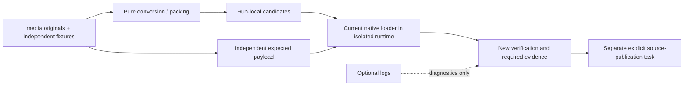

# M2O23-4 ? Reconstruction, publication and final qualification (Groups 54-72)

## Global Mandatory Reading

> **Execution protocol**
>
> - Read this Global Mandatory Reading section before the first task and again
>   after every context compaction.
> - Before starting or resuming a task group, read the nearest preceding Area
>   Mandatory Reading block whose `Applies to` label includes that group. Area
>   blocks appear immediately before the first group they govern.
> - A referenced heading or exported symbol is authoritative. Global navigation
>   hints and Area line ranges are for navigation only; if they drift, relocate
>   the named section or symbol rather than expanding to the whole file.
> - Mandatory reading is non-transitive. Do not preload a linked file's own
>   Mandatory Reading, Consult on Demand, or Planning Provenance entries unless
>   this plan names them directly for the current area.
> - Do not read Consult on Demand or Planning Provenance merely because those
>   sources are listed. Use a Consult on Demand source only when its trigger
>   occurs.
> - No created source file, test file or JSON file should start with same prefix as a planning MD file (such as r2). Only MD files can have that prefix. No MD file should be created anywhere in source directories unless specifically asked.
> - After EVERY CONTEXT COMPACTION, you must add a note above the task group
>   which is currently in execution. The note will say: "Context has compacted
>   X times while executing this group.". If the compaction occurs before any
>   meaningful work was done (this can happen when there is a lot of baggage
>   from the previous compaction), then and ONLY then you can skip this step.
> - When exceeding 3 context compactions, YOU MUST ask yourself if you're not  
>   chewing more than we can handle :). Heck, plans change! :). In such a case,  
>   the way out is to split the group on the spot,
>   in the plan, into more groups,
>   by appending B, C, D as a suffixes to those groups (splitting sub-groups  
>   themselves is also allowed). When you do this, create Local Mandatory
>   Reading areas so you can optimize your context only for the
>   ACTUAL task at hand.
>   Before starting or resuming a task group, read the nearest preceding Area
>   Mandatory Reading block whose `Applies to` label includes that group. Area
>   blocks appear immediately before the first group they govern.

| File name | Line Ranges | Description |
| --- | --- | --- |
| [Destination map-layer architecture](../../architecture/map-layers/archi-map-layers.md) | 20-37; 272-282 | `Storage, coordinates and distance`, `Initialization and simulation`, and `Invariants` define stacked addressing, physical ownership and view-independent simulation. Every imported feature must preserve these boundaries; camera state must never choose command ownership, stop simulation or consume simulation RNG. |
| [Native layer controller](../../../../src/map_layer.h) | 96-104; 204-235 | `MultiLayerMap::DecodeStoredTile`, `IsTileInLayer`, `TileInLayer` and `ProjectToSurface` are the live geometry boundary used across gameplay and save validation. Decode candidate saves using their own dimensions; neither duplicate layer arithmetic nor consult the running world's geometry as a fallback. |
| [Required cleanup/layout contract](r2fc-file-cleanup3.md) | 85-103 | `End-state storage contract` defines original media, independent fixtures, retained saves, generated review/runtime products and the sole recipe/materialization boundary. This user-designated contract is globally necessary: imports must fit these owners, routine generation cannot publish canonical assets, and historical hashes never certify a current executable. |
| [Destination cleanup completion](r2fc2-file-cleanup3.md) | 44-61 | `Checkpoint and resume point` records completed cleanup, the actual Space successor, closed cash/tick boundaries and the provisional Tube checkpoint. This prevents a merge agent from replaying closed Space work, treating cleanup as gameplay authorization or silently promoting the destination's unfinished fleet. |
| [Donor technical closure](../../../zz-rhr/imports/openttd3-75ea75718f/docs/zz-reach2/upgrades/2026-10/r2mlvs16-b-performance.md) | 9-16 | `Current technical finalization,2026-10-20` distinguishes delivered Plan 3/4 behavior and selected performance acceptance from pending human art/demo feedback and the unresolved version 424 save alias. This is the other half of the architecture handoff: preserve delivered underground behavior without copying blanket completion or deletion claims. |

## Four-plan execution scope

The user requested this four-plan partition on2026-10-23 after completion of22D. Stable global group/task IDs and every existing checkbox state are preserved. Suffix batches remain part of their original numbered group.

| Plan | Owned groups | Current state |
| --- | --- | --- |
| [M2O23-1](m2o23-1-come-space.md) | 1-22D, including completed suffix batches | Complete:40 groups,160/160 tasks. |
| [M2O23-2](m2o23-2-come-space.md) | 23-36 | Open:14 groups,0/60 tasks. |
| [M2O23-3](m2o23-3-come-space.md) | 37-53 | Open:17 groups,0/74 tasks. |
| [M2O23-4](m2o23-4-come-space.md) | 54-72 | Open:19 groups,0/82 tasks. |

The former second plan was renamed by the user to M2O23-3 before this partition; its Groups54-72 now continue in M2O23-4. Finish each plan's owned groups and public handoff before its successor. Completion of Plan1 is the completed foundation checkpoint; the full merge requires Plans2-4 and the final Completion Conditions in Plan4. Splitting documentation performs no gameplay task and authorizes no additional saved-world ticks or spending.

## Continuation boundary and prerequisite handoff

This file owns Groups54-72 moved from the user's renamed [Plan3](m2o23-3-come-space.md). It continues [Plan1](m2o23-1-come-space.md) Groups1-22D, [Plan2](m2o23-2-come-space.md)23-36 and Plan3's37-53. It owns typed process/evidence adapters and reconstruction, the consolidated current build, explicit canonical publication, genuine legacy/Space/paid-world/peer qualification, performance/art/recovery and final architecture/preservation handoff.

**ASSUMPTION: this was already built previously. If not, re-asses at runtime**

Entry gate: Plans1-3 must expose the implemented canonical domain/command owners, Group46's complete `MultiLayerCanonicalRecord`/`ComputeMultiLayerStateDigest` contract and Groups52-53's selected pure candidate products with independent expectations and retained-root identities. Verify live declarations, producing-group evidence and the exact candidate/recipe roles before dependent native preparation. Stop native preparation/qualification whose contract is absent; pure typed-reader/source/argument comparisons may continue under their Area gates. Never substitute an old executable, donor cache, mutable prior receipt, alternate worktree, duplicate provider/store/catalogue or candidate-derived expected baseline for a missing prerequisite. A complete native graph and current source/image identities, not prior completion labels, authorize later qualification claims.

The final Completion Conditions here cover all four plans. Preserve the historical branch receipts and exact originals while publishing separate current evidence. Canonical publication remains the explicit62 boundary; no regression recipe or native preparation helper may silently publish source assets.

## Execution boundaries

**A** is `D:/Codez/Sandbox/OpenTTD`, the destination; **B** is `D:/Codez/Sandbox/OpenTTD3`, the read-only donor. Unlabelled paths mean A. Pinned A HEAD is `cfeff84db52f8a3753a43c2a770a6363c62b2c67`; B HEAD is `75ea75718fa7d14632bf795105721df1e390f753`; common ancestor is `9a47768ae3e4455661264f2c49febde972538e49`. Verify pins before consuming donor links. Existing working changes are the implementation, not disposable state. [The original chronology](m2o23-1-come-space.md#investigated-snapshot-and-chronology) and [execution record](m2o23-1-come-space-a-execution.md) retain historical evidence; consult exact entries only on observed drift.

No Git writes, staging, checkout, reset or recursive filesystem deletion is authorized. Preserve both repositories, `OpenTTD-baseline/` and `!kit`; no individual deletion is needed. Work sequentially without subagents. Gameplay execution remains paused after22D; the present request authorizes this document partition. Resume implementation only when the user directs it.

New supply purchases use A's Pending-only refund rule; station delivery ends refund rights. Migrated B stock retains only its original finite unshipped entitlement in the same canonical receipt owner. Protect closed Space cash/tick boundaries and the actual chosen continuation; historical art/demo status and component cases are not current runtime approval.

Use R2FC-3's existing durable-input, fixture and materialization owners. Test/tool source belongs beside tests; generated diagnostics belong in `test-cache/`, `logs/` or declared `mlm/reviews/` runs. No new source/test/JSON planning prefixes or Markdown in source directories. Auxiliary Markdown for this plan belongs beside it and extends its own filename prefix with `-a-...`, then `-b-...` as needed. Never duplicate canonical supply, profile, compiler, catalogue or materialization authority.

## Conflict decisions and safeguards

The original comparison remains in [Plan1](m2o23-1-come-space.md#conflict-decisions-and-safeguards). The following existing decisions constrain this file; live code and focused evidence take precedence over historical status.

| Conflict | Observed evidence | Resolution to implement |
| --- | --- | --- |
| Save version collision | A uses 425-440 for later Space/supply work; B uses 425-434 for TBM face transfer, supplies, geothermal and utility work. Both still use metadata schema 1. | Introduce explicit merged-format lineage/capabilities, preserve both legacy interpretations and allocate the next unused merged writer version after the snapshot is refreshed. Numeric `>=425` tests alone cannot identify a feature. Do not renumber old bytes or globally lie about `_sl_version`. |
| Same chunk, different wire format | A `surface_supply_order_sl.cpp` uses `SSOR` RIFF; B `surface_supply_sl.cpp` uses `SSOH` RIFF plus `SSOR` TABLE. | One dispatcher decodes the exact legacy family into the canonical order owner. Validate complete presence, type, dimensions, day and references in full and copied readers. Reject contradictory or genuinely ambiguous files without changing originals. |
| Supply ownership and payment | A has uint64 intent IDs, pending/fulfilled records and command-kernel settlement; B has uint32 strong IDs, immediate stock, packet order/shipped fields and producer self-debit. | Keep A's owner and new-purchase policy. Adapt B UI/commands to it; widen donor IDs losslessly; convert old order/packet history without double debit, refund or quota restoration. Preserve legacy refund rights explicitly, never by pretending delivered stock is Pending. |
| Sprite namespace | A's M1 ends at 3588, preview occupies 3588-3598, Space 3599-5166, orbital 5167-6142, launch 6143-7790, ground through 22044. B expands M1 to 17847 while preserving the preview gap. | Preserve A's shipped ranges and allocate/remap only donor-only families into nonoverlapping space; resolve duplicate logical families once. Regenerate headers/NFO/GRF/hash/manifests together. Never select one binary GRF wholesale or shift Space by changing M1 count. |
| Shared simulation/utility | B extends utility conversion, generator feeding, geothermal bindings and scheduling; A also has Space, orbital and ground consumers. | Combine at original utility/tick owners with one allocation/settlement and deterministic ordering. Heat and electricity retain units, lineage, loss and once-only spending. Hidden-layer execution must remain equivalent. |
| Renderer and UI overlap | Both alter stations, vehicles, sprites, English strings and windows; B adds tube/geothermal native consumers and demo controls. | Integrate by actual render/command owner, preserving A's Space/click bounds and B's layer-aware ground behavior. Add/remove visibility hooks once, with no fallback to preview art for qualified runtime families. |
| Relocation and proof conflict | B still has archived-plan copies and essential inputs under `docs/.../assets`, `logs`, review and build trees. A has migrated owners and stronger source/receipt checks. | Build an explicit path/hash/role map. Preserve historical receipts unchanged and publish relocation adapters/new proof separately. Port new consumers into the existing catalogue; never restore old caches as runtime authority or rewrite old receipts to appear current. |

## Implementation tasks

All19 difficulty batches and82 tasks below remain unchecked.

Code sketches are conceptual unless labelled as existing exports. Proposed helpers belong to the named existing owner. Verify prior exports before dependent work; an absent prerequisite stops only its dependent tasks, with safe independent work and forbidden shortcuts stated by the Area entry gate. Mandatory reading is non-transitive; do not preload future Areas. Native checks genuinely deferred until the merged target is buildable must be recorded and closed in [Plan4 Group60](m2o23-4-come-space.md#group-60---run-focused-domain-decoder-and-ordinary-world-checks). Existing focused native passes remain evidence and must not be relabelled as deferred.

### Area Mandatory Reading - Process harness and typed evidence adapters

_Applies to Groups 54-58._

Entry gate: Implemented domain owners, Group 46's complete state contract and Groups 52-53's candidate products must exist. Verify public definitions and role declarations before native preparation. Pure reader adaptation can continue if native prerequisites are absent. Never use an old executable, mutable prior receipt, alternate worktree or a second producer catalogue to make a missing dependency pass.

| File name | Line Ranges | Description |
| --- | --- | --- |
| [Shared run/input APIs](../../../../src/tests/multilayer/support/artifact_paths.py) | 371-396; 418-457 | `create_run_context`/`resolve_input_path` own contained outputs and retained input aliases; donor code must consume these existing boundaries. |
| [Current build identity](../../../../src/tests/multilayer/support/native_build.py) | 273-284; 381-437 | `verify_source_epoch`/`build_selected` reject added/removed/changed source inventory and publish exact selected executables. |
| [Memory guard](../../../../../OpenTTD3/src/tests/multilayer/guarded_native_build.py) | 52-99 | `build` limits one project, one worker default/two maximum, 6 GiB physical/8 GiB commit reserve and owned-process termination/reaping. |
| [Typed reference graph](../../../../src/tests/multilayer/support/artifact_recipes.py) | 19-131; 144-174 | `check_reference_roles` and `validate_selection` separate historical facts from live retained/generated/current-source/executable roles and reject undeclared dependencies. |
| [Live complete canonical records](../../../../src/multilayer_state.h) | Live definitions; no fixed range | Group 46 extends `MultiLayerCanonicalRecord` and `ComputeMultiLayerStateDigest` with the declared merged family set. Report adapters must compare that live complete contract rather than a historical121/126-family subset. |

### Group 54 - Adapt native runners and build memory guards

**ASSUMPTION: this was already built previously. If not, re-asses at runtime**

Required prior output: Group 3 fixes paths and Group 9 audited incoming executable helpers.

{{HARD}}
- [ ] 54.1 Port donor runner/test-main integration through A's RunContext, isolated process homes, current-input observation and current executable identity checks.
- [ ] 54.2 Integrate the donor one/two-worker and memory-reserve watchdog into A's existing selected-build owner; do not create a competing build entry point.
- [ ] 54.3 Ensure timeout/failure reaps only owned children, keeps required transcripts and reports blocked prerequisites. Do not run native evidence during compilation or source edits during a native case.
- [ ] 54.4 Test wrong-root/runtime escape, stale source inventory, reserved-memory crossing and child reaping using bounded focused fixtures; audit helpers for prohibited deletion first.

### Group 55 - Translate historical and current evidence roles explicitly

**ASSUMPTION: this was already built previously. If not, re-asses at runtime**

Required prior output: Group 54 provides the current process provenance boundary.

```json
{
  "role": "generated_prerequisite",
  "path": "mlm/reviews/<feature>/<scenario>/<run>/data/<candidate>",
  "sha256": "<verified actual bytes>"
}
```

The live `check_reference_roles` also requires this exact path/hash in the supplied `generated_inputs` and the selected run in the path; annotation alone is not a prepared dependency. Use the existing result/catalogue schema for recipe/configuration metadata.

{{HARD}}
- [ ] 55.1 Adapt donor normal-start, lifecycle, useful-route and performance readers using retained aliases plus explicit current-run inputs/outputs.
- [ ] 55.2 Keep sealed historical receipts unchanged. Publish relocation observations as separate records, then fresh merged proof with actual current source/image identities.
- [ ] 55.3 Require explicit generated-prerequisite recipe/run/configuration binding; diagnostic absence is allowed, required evidence absence is not.
- [ ] 55.4 Add wrong alias/hash, stale executable, undeclared previous-run read and historical-as-current refusal cases. Do not weaken source/hash checks wholesale.
- [ ] 55.5 Register disabled recipes for incomplete providers and enable only when their real APIs/inputs are supplied.

### Group 56 - Join legacy readers and complete canonical ledgers

**ASSUMPTION: this was already built previously. If not, re-asses at runtime**

Required prior output: Groups 40-46 define real legacy normalization and merged state; Group 55 fixes reference roles.

{{HARD}}
- [ ] 56.1 Extend existing Python/native full/copied table readers for each admitted dialect and merged format, including nested TABLE semantics and tagged supply receipts.
- [ ] 56.2 Use Group 46's explicit complete-family definition and independent cargo/energy/cash/RNG comparisons. Document legitimate legacy normalization separately from current state equality.
- [ ] 56.3 Adapt exact normal-start original/source/command bindings; keep prepared worlds, genuine bootstrap and actual-peer evidence distinct.
- [ ] 56.4 Add cross-reader mismatch cases where a partial digest agrees but an owner/custody/clock field differs; such a pair must fail.

### Group 57 - Adapt selected art proof and candidate-runtime binding

**ASSUMPTION: this was already built previously. If not, re-asses at runtime**

Required prior output: Groups 52-53 supply independent candidate/expected products; Group 54 owns isolated runtime homes.

{{HARD}}
- [ ] 57.1 Port donor selected native binding/gallery checks through A's explicit EvidenceSet/run/source contracts, retaining protected geometry/coverage fields.
- [ ] 57.2 Add a contained candidate-baseset preparation adapter within the existing runtime preparation owner: install the selected candidate GRF and any required descriptor/hash companions only in that process home, then verify the exact bytes actually loaded.
- [ ] 57.3 Record candidate GRF identity as an actual generated input in addition to the independent expected-payload identity. The expected-sprites environment alone is not proof of which GRF ran.
- [ ] 57.4 Test wrong candidate, missing companion, changed frame/source, stale consumer and wrong configuration; require real native loader origin/pixel observations for current art acceptance.
- [ ] 57.5 Avoid source→proof→source cycles: retained originals/contracts are roots; current native output never becomes its own source expectation.

### Group 58 - Close the selected reconstruction graph without old caches

**ASSUMPTION: this was already built previously. If not, re-asses at runtime**

Required prior output: Groups 55-57 implemented current readers and candidate bindings.



{{MEDIUM}}
- [ ] 58.1 Update the sole recipe catalogue for the implemented source, expectation, loader, gallery and acceptance leaves with exact inputs/targets/tags and bounded dependencies.
- [ ] 58.2 Verify selected Space continuation and donor acceptance inputs resolve with old build/log/review caches unavailable; retain unique inputs rather than disabling missing-input failures.
- [ ] 58.3 Check no routine recipe calls canonical publication, mutates independent fixtures, replays closed Space financial work or depends on B's directories.
- [ ] 58.4 Publish the architecture role-map deltas from actual implemented adapters for later documentation finalization.

### Area Mandatory Reading - Consolidated build, focused suites and asset publication

_Applies to Groups 59-62._

Entry gate: Groups 45-58 must supply complete implementations, candidate assets, independent expectations and exact current input/build roles. Inspect the selected graph before running. Stop native qualification on any missing prerequisite; manifest/static checks may continue. No historical EXE, old canonical GRF substituted for a candidate, source-mutating regression recipe or bypassed source guard is allowed.

| File name | Line Ranges | Description |
| --- | --- | --- |
| [Current selected build](../../../../src/tests/multilayer/support/native_build.py) | 273-284; 381-437 | `verify_source_epoch`/`build_selected` define the exact epoch and executable receipts used by all subsequent runs. |
| [Selected recipe execution](../../../../src/tests/multilayer/support/artifact_rebuild.py) | 137-183; 489-624 | `load_recipe`/`prepare_recipe` gate actual suppliers and outputs. Select bounded leaves, not the whole historical acceptance tree. |
| [Source publication seam](../../../../media/multilayer/pack_m1_art.py) | 502-525 | `publish` writes canonical files and public metadata; call only in the explicit publication batch after candidate verification, with the analogous family owners. |
| [Donor selected publication guarantees](../../../../../OpenTTD3/media/multilayer/activate_m1_art.py) | 563-630 | `require_selected_gallery`/`publish_selected_runtime` preserve protected fields and require actual selected evidence. Adapt these checks rather than copying old completion flags. |

### Group 59 - Freeze and build the merged source and candidate epoch

**ASSUMPTION: this was already built previously. If not, re-asses at runtime**

Required prior output: Group 58 exposes only implemented selected recipes and current candidate inputs.

{{MEDIUM}}
- [ ] 59.1 Close every donor manifest entry as integrated/equivalent/historical/generated or explicitly unresolved; verify duplicate symbols, stale B paths, CMake registrations and enabled recipe prerequisites.
- [ ] 59.2 Freeze the complete source/art candidate epoch and configure through A's portable profile; build selected game/test targets for Debug and RelWithDebInfo.
- [ ] 59.3 Use one native build project, one worker default/two maximum, owned node-reuse controls and 6 GiB physical/8 GiB commit reserves. Record compilation separately from tests.
- [ ] 59.4 Validate resulting binary/source/tool identities; a build failure invalidates dependent native qualification without rewriting earlier historical receipts.

### Group 60 - Run focused domain, decoder and ordinary-world checks

**ASSUMPTION: this was already built previously. If not, re-asses at runtime**

Required prior output: Group 59 provides exact current executables and the complete selected component inputs.

{{MEDIUM}}
- [ ] 60.1 Run bounded supply/purpose/refund/capacity, face/PBS, generator/conversion, fleet/provider, lineage/wire and canonical-state suites for the frozen epoch.
- [ ] 60.2 Run Classic/disabled-profile and A Space construction/manufacturing/replacement/cargo controls in that same epoch; passing donor-only cases is insufficient.
- [ ] 60.3 Record exact images, inputs, commands, terminal results and deferred cases from earlier component batches. Close those deferrals only with actual passing results.
- [ ] 60.4 Fix reported failures at their original owners and rerun affected boundaries; after source changes refresh the epoch and avoid repeating unrelated historical suites.

### Group 61 - Verify candidate assets through the actual native loader

**ASSUMPTION: this was already built previously. If not, re-asses at runtime**

Required prior output: Groups 53, 57 and 59 supply exact independent inputs and candidate-capable current binaries.

{{HARD}}
- [ ] 61.1 Materialize candidate GRF/descriptor companions into isolated runtime homes via Group 57 and bind independent expected payloads; verify the actual loaded file identity.
- [ ] 61.2 Run M1/Space/orbital/launch/Ground and imported tube/geothermal loader/selector cases against original pixel/geometry expectations.
- [ ] 61.3 Capture selected native viewport/state examples and validate real consumer, source, frame and required transcript identities; keep prepared art evidence distinct from paid-useful-route proof.
- [ ] 61.4 Verify routine runs left canonical media/manifests unchanged. Retain explicit failed attempts separately; do not relabel an old gallery as current.

### Group 62 - Publish the verified canonical asset bundle explicitly

**ASSUMPTION: this was already built previously. If not, re-asses at runtime**

Required prior output: Group 61 qualified exact candidate bytes and Group 60 passed the relevant component boundary.

{{MEDIUM}}
- [ ] 62.1 Review the accepted candidate manifest and frozen preserved ranges; confirm all selected loader/pixel/source-binding checks passed for the exact candidate bytes.
- [ ] 62.2 Invoke existing family publication owners only in this task, writing the consistent canonical PNG/NFO/header/GRF/hash and public/runtime metadata set. Keep authored originals and independent expectations unchanged.
- [ ] 62.3 Verify published bytes match the accepted candidates and that future normal regeneration remains candidate-only. No unrelated old or future family's status is promoted.
- [ ] 62.4 Publish a new publication receipt; keep historical source/candidate/native receipts intact. If canonical publication changes a guarded source input, refresh and rerun only the affected observation required by its existing contract.
- [ ] 62.5 Verify ordinary runtime preparation now resolves the published canonical bundle, then freeze the final acceptance epoch for subsequent gameplay/performance checks.

### Area Mandatory Reading - Legacy migration and protected Space qualification

_Applies to Groups 63-64._

Entry gate: Group 62 must provide a final current epoch and Group 60 must close selected component failures. Verify original hashes and current-image identity. Stop runtime qualification on mismatch; read-only matrix/report preparation may continue. Do not use prepared-only proof, an old binary or a rewritten expected ledger as current acceptance.

| File name | Line Ranges | Description |
| --- | --- | --- |
| [Space foundation API](../../../../src/tests/multilayer/acceptance/space_checkpoint.py) | 114-160 | `load_foundation`, `verify_foundation`, `export_foundation`, `publish_successor` preserve exact lineage and separate new qualification from original seals. |
| [Protected current Space boundary](../../../../docs/zz-reach2/architecture/archi-historical-debug.md) | 394-424 | The original seal, selected GZVEEI successor and next-task/funding invariants forbid replaying closed windows or buying capacity during merge qualification. |
| [Current original-world scope](../../../zz-rhr/imports/openttd3-75ea75718f/docs/zz-reach2/upgrades/2026-10/r2mlvs16-a-normal-start.md) | 67-94 | `Exact closed handoffs` and `Execution limits and remaining scope` identify genuine originals and bounded execution. Later technical closure remains authoritative over stale pending-status prose. |

### Group 63 - Qualify each original lineage and new successors

**ASSUMPTION: this was already built previously. If not, re-asses at runtime**

Required prior output: Groups 39-46 implemented reader/normalization contracts and Group 62 froze the acceptance epoch.

```python
# Conceptual matrix; bind each case to an actual retained original hash.
for dialect in ("pre_fork", "legacy_a", "legacy_b", "merged"):
    for mode in ("preview", "full_load", "save_reload_first_tick"):
        check_case(dialect, mode, expected_normalizations[dialect])
# Cases compare all declared owners, not historical fixed chunk counts.
```

{{HARD}}
- [ ] 63.1 Run full/copy/preview and save/reload/first-tick checks for pre-fork originals, A 425-440, B 425-434 and merged successors, using recorded original hashes.
- [ ] 63.2 For ambiguous originals use only the explicit digest-bound origin contract or produce its documented refusal; verify a converted successor then opens normally with its own marker.
- [ ] 63.3 Compare exact preserved cash/cargo/geology/RNG/owner history, with named dialect normalizations separated from byte equality. Keep original files immutable.
- [ ] 63.4 Run representative malformed/mixed-lineage cases and verify preflight rejection precedes world initialization; copied preview remains nonmutating.
- [ ] 63.5 Publish migration receipts through existing retained/current evidence roles, not by changing historical receipt hashes.
- [ ] 63.6 After qualifying the exact retained B425 TBM demos, adapt `play.ps1` entries `tbm-work`, `tbm-plan`, `tbm-exit` and `tbm-tunnel` through A's retained-input/runtime owners. Preserve all current Space entries and menu identities. Use verified merged successors or the explicit digest-bound origin path; never point the current launcher blindly at ambiguous425 bytes. Until this gate passes, retain A's working403 entries and record the donor face-exchange descriptions as pending.

### Group 64 - Requalify the exact protected Space continuation

**ASSUMPTION: this was already built previously. If not, re-asses at runtime**

Required prior output: Group 63 qualifies the A lineage and Group 62 supplies the exact current epoch.

{{HARD}}
- [ ] 64.1 Load A's exact selected GZVEEI foundation in both configurations with current public APIs and verified original/current hashes.
- [ ] 64.2 Run the permitted zero-tick native and ordinary observation pair; compare complete state, material/cargo ownership, finance, RNG and current next-task dispatch. Apply only the explicit per-field structural normalizations qualified by Group 63; an EIDS definition append must not hide a change to existing vehicles or gameplay quantities.
- [ ] 64.3 Preserve both original seals and the existing GZVEEJ usefulness gate; no closed earning window, gameplay purchase or capital spending is part of this qualification.
- [ ] 64.4 Publish a distinct merged-build qualification/foundation result under existing owners without treating it as completion of the next Space development task.

### Area Mandatory Reading - Genuine paid ground operation and real peers

_Applies to Groups 65-67._

Entry gate: Groups 63-64 must preserve original worlds and qualify the current epoch. Verify original-world and component prerequisites before native operation. Stop a dependent scenario on absent evidence; pure scenario comparison may continue. Prepared stock, cash assignment, teleportation and two standalone reloads may not replace paid-world or real-peer proof.

| File name | Line Ranges | Description |
| --- | --- | --- |
| [Genuine normal-start report](../../../../../OpenTTD3/src/tests/multilayer/normal_ground_acceptance_report.py) | 78-162 | `accept` joins actual native commands, original worlds, complete ledgers and art bindings; retain this public acceptance boundary. |
| [Actual peer runner](../../../../../OpenTTD3/src/tests/multilayer/ground_network.py) | 86-194 | `run_one` uses separate server/client homes, actual join acknowledgments, joined snapshot and child reaping. Adapt its hard-coded434/current hashes to explicit merged inputs without dropping these checks. |
| [Technical versus human closure](../../../zz-rhr/imports/openttd3-75ea75718f/docs/zz-reach2/upgrades/2026-10/r2mlvs16-b-performance.md) | 9-16 | `Current technical finalization,2026-10-20` distinguishes delivered technical behavior from pending art/demo feedback; no automated scenario invents that approval. |

### Group 65 - Replay genuine paid work and useful delivery

**ASSUMPTION: this was already built previously. If not, re-asses at runtime**

Required prior output: Groups 19, 23, 36 and 63 provide the qualified owner contracts.

{{HARD}}
- [ ] 65.1 Select the minimum actual original-world sequences covering Standard/Deep paid clearing, recurring face and bay logistics, and irregular final conversion.
- [ ] 65.2 Use actual canonical purchased supply delivery, useful tube freight and installed geothermal participants; retain original native finance and material accounting.
- [ ] 65.3 Exercise full destinations, source depletion, blocked portals, shortage waits and actual recovery; save/reload representative waits rather than replacing them with prepared declarations.
- [ ] 65.4 Publish complete original-world command/ledger/graphics bindings; keep component/prepared worlds separately labelled.

### Group 66 - Verify cross-feature contention and lifecycle conservation

**ASSUMPTION: this was already built previously. If not, re-asses at runtime**

Required prior output: Groups 65 and 64 provide both feature-side baselines; Group 35 owns the combined allocation.

{{HARD}}
- [ ] 66.1 Run a bounded same-world case containing launch/orbital demand, paid ground supply, geothermal generation/town service and active tube freight.
- [ ] 66.2 Compare the one-pass request/settlement ledger at matched native ticks with visible versus hidden layers and stable owner ordering.
- [ ] 66.3 Inject bounded power/path loss and one relevant company/station/portal/industry removal/reuse case; verify once-only spending/refunds and retained consumed history.
- [ ] 66.4 Keep manual stops and waiting orders intact across recovery; report exact violated owner/counter if a case fails rather than broadening the scenario.

### Group 67 - Prove actual join, resume and synchronized commands

**ASSUMPTION: this was already built previously. If not, re-asses at runtime**

Required prior output: Group 47 fixes the ABI and Group 66 provides the current combined-world comparison.

{{HARD}}
- [ ] 67.1 Run merged host/client processes in separate runtime homes with actual network join acknowledgments and a joined snapshot; reap owned processes on every exit.
- [ ] 67.2 Cover active face transfer, loaded/queued external/geothermal tube work and thermal conversion at matched ticks. Compare the complete canonical state and clock/RNG inputs.
- [ ] 67.3 Exercise synchronized supply/provider commands and resume after saved waits; verify command estimates and retries do not double-settle on peers.
- [ ] 67.4 Attempt incompatible original A/B peer connections and verify refusal before mixed command execution. Preserve exact source/binary/content identities throughout the run.

### Area Mandatory Reading - Performance, visible behavior and cold reconstruction

_Applies to Groups 68-70._

Entry gate: The final epoch and acceptance records from Groups 62-67 must be current or have explicitly scoped blockers. Verify the selected recipe/input identities. Stop dependent measurements/review on mismatch; offline review selection may continue. Historical timings, old galleries, cache copies or recursive cleaning cannot stand in for a current observation.

| File name | Line Ranges | Description |
| --- | --- | --- |
| [Performance comparisons](../../../../../OpenTTD3/src/tests/multilayer/ground_performance_acceptance.py) | 87-123; 139-214 | `compare_budget` and `accept` bind actual workload/baseline identity and strict artifacts; use comparable maps/configurations without relabelling history. |
| [Reconstruction lifecycle](../../../../docs/zz-reach2/upgrades/2026-10/r2fc-file-cleanup3.md) | 85-103; 247-254 | The end-state contract and bounded recipe roles require selected prerequisite reconstruction without earlier workstation history or implicit publication. |
| [Current foundation verification](../../../../src/tests/multilayer/acceptance/space_checkpoint.py) | 114-145 | `load_foundation`/`verify_foundation` are the public recovery boundary for the retained continuation; a package copy alone is not a qualification. |

### Group 68 - Measure bounded combined workloads and recovery cost

**ASSUMPTION: this was already built previously. If not, re-asses at runtime**

Required prior output: Groups 60-67 supply the current accepted build/scenarios.

{{MEDIUM}}
- [ ] 68.1 Run existing Classic/disabled, active ground, dense job, utility/tube and visible/hidden workloads against the final epoch using comparable baseline data.
- [ ] 68.2 Measure actual load/reconstruction, first resumed work and real-peer join cost with the existing reporters; keep build time separate.
- [ ] 68.3 Attribute significant regressions to named phases/owners and block only the affected acceptance rows until explained or corrected.
- [ ] 68.4 Record exact machine/configuration/workload/source identity and current budget comparisons; do not claim old branch timing as a merged result.

### Group 69 - Review the final native gallery and ordinary controls

**ASSUMPTION: this was already built previously. If not, re-asses at runtime**

Required prior output: Group 62 published verified canonical assets and Groups 65-67 retained runtime proof.

{{MEDIUM}}
- [ ] 69.1 Capture final merged runtime representatives for Space/orbital/launch, conventional ground, all five capsules and geothermal construction/working/wait states.
- [ ] 69.2 Verify zoom/direction/state/occlusion/click geometry against retained approved sources and current native consumers; compare published bytes with the candidate proof where applicable.
- [ ] 69.3 Exercise minimap/layer/hotkeys, supply cancellation, TBM guidance and provider controls in ordinary player flows.
- [ ] 69.4 Record human art/demo questions separately from technical passes; preserve outstanding feedback until actually supplied.

### Group 70 - Rehearse selected recovery without historical caches

**ASSUMPTION: this was already built previously. If not, re-asses at runtime**

Required prior output: Group 58 defines the selected graph and the final current epoch/retained inputs are available.

{{MEDIUM}}
- [ ] 70.1 Prepare an isolated project-owned destination through existing package/input declarations without deleting source trees or invoking a recursive cleaner.
- [ ] 70.2 Reconstruct representative Space and underground source/expected/native recipes from declared originals; keep old logs/reviews/build directories unavailable to readers.
- [ ] 70.3 Verify original/current continuation and selected assets resolve through public APIs with no archived EXE dependency, no source-mutating regeneration and no entire-history rebuild.
- [ ] 70.4 Preserve any new unique saves via existing retention helpers and publish an exact reconstruction receipt; archive creation does not authorize cleanup.

### Area Mandatory Reading - Architecture finalization and preservation handoff

_Applies to Groups 71-72._

Entry gate: Current merged receipts must exist, or exact blockers must remain recorded. Verify source/image/input bindings before changing feature status. Documentation may continue with honest planned/incomplete labels; completion stops on missing proof. Historical checkboxes, another repository's result and successful archive copying cannot bypass current acceptance.

| File name | Line Ranges | Description |
| --- | --- | --- |
| [Canonical layout source](../../../../docs/zz-reach2/upgrades/2026-10/r2fc-file-cleanup3.md) | 85-103; 230-237; 247-254 | `End-state storage contract`, candidate-versus-publish rules and sole bounded recipe catalogue constrain the final architecture and imported assets. |
| [Existing architecture to finalize](../../../../docs/zz-reach2/architecture/archi-historical-debug.md) | 30-53; 55-128; 226-279 | The storage table, `Parallel-repository originals`, `Graphics candidates, expectations and publication`, and `Historical facts and current proof` must describe actual merged owners and receipts after Group 3's initial contract update. |
| [Durable successor publication](../../../../src/tests/multilayer/acceptance/space_checkpoint.py) | 126-160 | `export_foundation`, `verify_foundation`, `publish_successor` keep originals and current qualification separate; do not create a merge-only checkpoint store. |
| [Outstanding human scope](../../../zz-rhr/imports/openttd3-75ea75718f/docs/zz-reach2/upgrades/2026-10/r2mlvs16-b-performance.md) | 9-16 | The technical-finalization handoff must be revisited so imported closure cannot silently approve remaining human art/demo feedback. |

### Group 71 - Finalize architecture and reconcile feature documentation

**ASSUMPTION: this was already built previously. If not, re-asses at runtime**

Required prior output: Group 3 established the layout contract and Groups 62-70 provide current implementation/proof.

{{SIMPLE}}
- [ ] 71.1 Update the architecture edits from Group 3 with actual imported asset paths, producer names, native candidate binding and explicit publication/recovery commands. Remove only obsolete planned labels that now have proof.
- [ ] 71.2 Update map-layer/savegame/code maps for lineage, tagged supply receipts, face exchange, fleet/provider ownership, tick order and final art ranges; keep references to the one storage architecture owner.
- [ ] 71.3 Reconcile active Plans3/4/6/7/12/14/15/16/17/18 and master dispatch against merged results while retaining A Space/cleanup and B technical closure as dated history.
- [ ] 71.4 Update both walkthroughs/current review entry points and keep GZVEEJ and remaining feature scope separate from merge acceptance.
- [ ] 71.5 Validate current local links, external-donor historical references and exact public-symbol names. Current recovery must work without B's generated directories.

### Group 72 - Validate preservation and publish the integration handoff

**ASSUMPTION: this was already built previously. If not, re-asses at runtime**

Required prior output: Group 71 describes the actual merged system and all applicable acceptance/reconstruction rows have evidence.

{{MEDIUM}}
- [ ] 72.1 Verify every retained input/asset/save against original hashes/aliases and confirm B's tree and A's original Space seals remain unchanged; state the version 424 alias disposition.
- [ ] 72.2 Publish current merged continuations/qualification and migration receipts through existing foundation/retention owners, verifying recovery without old executables or undeclared caches.
- [ ] 72.3 Audit every original task disposition and single-owner rule: supply, cargo, fleet, utility, lineage/capabilities, asset identity, recipe catalogue and materialization.
- [ ] 72.4 Report exact source/art/build epochs, qualified lineages, current continuations, technical blockers and pending human feedback. No Git write, checkout, commit, push, recursive deletion or hosting cleanup is implied.

## Consult on Demand

| Trigger | File name | Start at | Expand only when | Consultation purpose |
| --- | --- | --- | --- | --- |
| A migrated supply case cannot be reconciled with actual quote/refund behavior. | [B paid Surface execution notes](../../../zz-rhr/imports/openttd3-75ea75718f/docs/zz-reach2/upgrades/2026-10/r2mlvs6-b-paid-surface-supplies.md) | `Remaining design obligations`, lines31-37 | Current B code/tests and original save fields do not explain the entitlement in question. | Explain original cap, custody and refund intent. This historical note cannot override the confirmed A rule for new purchases or create missing provenance. |
| A migrated tube model fails cargo/date or useful-route admission despite intact EIDS identity. | [B tube runtime handoff](../../../zz-rhr/imports/openttd3-75ea75718f/docs/zz-reach2/upgrades/2026-10/r2mlvs17-e-tube-runtime.md) | `Completed15FEE actual Forge raster and five-model closure`, lines15-34 | The public model/terminal/readiness APIs do not explain the observed refusal. | Identify the original model/route prerequisite, not a substitute registry or permission to relax admission. |
| Geothermal source-switch or local service loses conserved lineage. | [B local electrical-feed handoff](../../../zz-rhr/imports/openttd3-75ea75718f/docs/zz-reach2/upgrades/2026-10/r2mlvs12-d-local-electrical-feed.md) | `Group9C closure and return to Plan21-10BB.2,2030-14-17`, lines9-16 | The live conversion/link tests leave an unresolved physical-path ownership question. | Explain original same-layer feed versus riser/town ownership; shared utility accounts stay authoritative. |
| A retained donor original or publication dependency is absent after relocation. | [B normal-start handoff](../../../zz-rhr/imports/openttd3-75ea75718f/docs/zz-reach2/upgrades/2026-10/r2mlvs16-a-normal-start.md) | `Exact current files and operation harness`, lines53-60 | The named original/receipt's direct references fail to identify the missing input. | Find the exact original producer/alias. No cache search result may silently replace its hash identity. |
| A Space regression proposes more paid work or a replay of closed earning windows. | [A launch-center source handoff](r2mlsp-z-z-z-z-z-q-launch-center-source.md) | `Current boundary` | The precise next-task/closed-policy contract cannot be resolved from that section and the retained foundation. | Resolve existing Space progression limits; a merge/test failure does not grant further spending or change the chosen task. |
| Reconstruction requests a removed old image, log or source epoch. | [A cleanup execution record](r2fc-file-cleanup3-a-execution.md) | `Group12 - Typed completed qualification and current-build boundaries`, lines585-641 | The live role/capability failure specifically requires an earlier migration disposition. | Recover why a dependency is historical, retained or generated. Do not rebuild the old cache hierarchy or weaken current-source checks. |

## Planning Provenance

This is **not an execution reading queue** and must **not be preloaded after context compaction**. It is **non-transitive**. Ranges record planning use rather than runtime authority. These retained rows document the original decomposition relevant to this file; the four-plan partition preserves that design and moves no feature authority.

| File name | Sections or Line Ranges used while planning | Planning contribution |
| --- | --- | --- |
| [A cleanup continuation](r2fc2-file-cleanup3.md) | `Checkpoint and resume point`,44-61; Group37 result,908-938 | Established the destination's completed preservation/reconstruction investment and exact resumed Space boundary; justified direction and early donor-input preservation. |
| [A cleanup execution record](r2fc-file-cleanup3-a-execution.md) | Heading inventory; `Checkpoint: paused after Group20BB`,2828-2853 | Located the staged historical source/art work and distinguished paused provisional underground material from completed current proof. |
| [A storage architecture](../../architecture/archi-historical-debug.md) | `Delivery boundary`,10-28; `Storage ownership`,30-76; `Historical facts and current proof`,151-164; `Checkpoints, cleanup and transfer`,317-349 | Defined retained/generated ownership, catalogue authority, immutable seals and the current Goods-query continuation used throughout sequencing. |
| [B underground master](../../../zz-rhr/imports/openttd3-75ea75718f/docs/zz-reach2/upgrades/2026-10/r2mlvs3mp-master-plan.md) | Group/area heading inventory,431-720; latest linked technical returns | Located the tube/plant/runtime/lifecycle/ground acceptance progression and decomposed the incoming feature families. Status comes from current code and bounded returns, not the entire master's checkbox count. |
| [B normal-start handoff](../../../zz-rhr/imports/openttd3-75ea75718f/docs/zz-reach2/upgrades/2026-10/r2mlvs16-a-normal-start.md) | `Current return`,5-18; headings and original-file/closed-handoff sections,49-90 | Identified genuine S1/S2 proof, current434 decoding and independent original-world evidence that must not be relabelled as prepared-fixture acceptance. |
| [B performance handoff](../../../zz-rhr/imports/openttd3-75ea75718f/docs/zz-reach2/upgrades/2026-10/r2mlvs16-b-performance.md) | `Current technical finalization`,5-12; `Earlier same-day technical snapshot`,13-20 | Established delivered technical closure, actual receipt identities, pending human feedback and the version 424 alias discrepancy. Prevented copying stale intermediate blocker claims. |
| [B guarded build](../../../../../OpenTTD3/src/tests/multilayer/guarded_native_build.py) | `build`,52-99; read together with normal-start `Execution limits and remaining scope`,84-90 | Established the later one/two-worker and memory-reserve constraints, superseding older four/eight-worker advice without replacing A's portable build owner. |
| [B selected-runtime handoff](../../../zz-rhr/imports/openttd3-75ea75718f/docs/zz-reach2/upgrades/2026-10/r2mlvs14-b-selected-runtime-integration.md) | Current84E and completed84D,5-20; heading inventory | Established current selected art, protected source/range fields and the need to port publication guarantees without reviving historical cache ownership. |
| [Cleanup layout and candidate contract](r2fc-file-cleanup3.md) | `End-state storage contract`,85-103; implementation limits,118-126; Groups4/6,230-271; source candidates,503-519; Ground/expectation/native-input boundaries,744-800 | The user's explicit follow-up made artifact placement and pure generation versus canonical publication a first-class integration contract. Added a dedicated existing-architecture update and split candidate generation, expectations, native proof and publication. |
| [A native loader](../../../../src/saveload/saveload.cpp) and [network reader](../../../../src/network/network_client.cpp) | `SlLoadChunk`,2294-2340; `SlLoadCheckChunk`,2347-2391; `FileReader`,2495-2530; `DoLoad`,3293-3451; `PacketReader`,43-85 | Located pre-InitializeGame classification, raw-reader reset versus codec recreation, and copied/full failure boundaries. Replaced broad compatibility work with separate framing, entry, capabilities and family batches. |
| [Pure/public packing seams](../../../../media/multilayer/pack_m1_art.py), [evidence selector](../../../../media/multilayer/evidence.py), [native payload binder](../../../../src/tests/multilayer/support/sprite_native_inputs.py) | `selected_ranges`,66-157; `derive/publish`,437-525; `selected`,203-217; `output/validate_capture`,256-312; binding/observation,17-75 | Established protected ranges and the distinction between expected-payload identity and actual candidate GRF identity. Added isolated candidate runtime binding and separate explicit canonical publication. |

Read-only Git histories/path/blob inventories supplied the original chronology. The user's planning format, no-Git-write/no-recursive-delete rules, supply-policy answer and four-plan partition govern execution; they add no transitive reading queue.

## Completion Conditions

Technical integration is complete only when all applicable tasks across Plans1-4 have evidence, every incoming change has an explicit disposition, and no feature-preservation or compatibility blocker is hidden as a documentation exception. The merged tree must retain A's Space/runtime/reconstruction work and B's delivered underground/runtime work through one set of canonical owners. The existing storage/graphics architecture must document the actual imported asset roles, and selected reconstruction must obey R2FC-3's candidate-versus-publication boundary.

Both original save lineages must load correctly or receive an explicit, demonstrated ambiguity refusal with their originals preserved and a documented conversion path. Qualified originals require successful full/copy/load/reload and merged-successor checks. New supply purchases use Pending-only refunds; legacy refund rights neither disappear nor grow. Existing cash, cargo, geology, RNG, utility lineage and retired identities remain conserved across migration and runtime.

The selected Debug/RelWithDebInfo build, real-peer, meaningful normal-start/useful-route, performance and art checks must be bound to the merged source/assets. Historical branch receipts alone cannot meet this condition. Cold recovery must resolve through A's declared durable inputs and public producers without B's caches or historical executables.

Keep the current Space dispatch and closed gameplay policies intact. Outstanding human art/demo feedback remains explicitly pending until actually supplied; technical acceptance does not fabricate that feedback. Neither source repository is deleted or reset, no recursive deletion occurs, and no Git write is performed without the human's explicit request.
