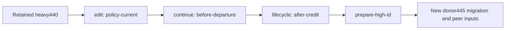
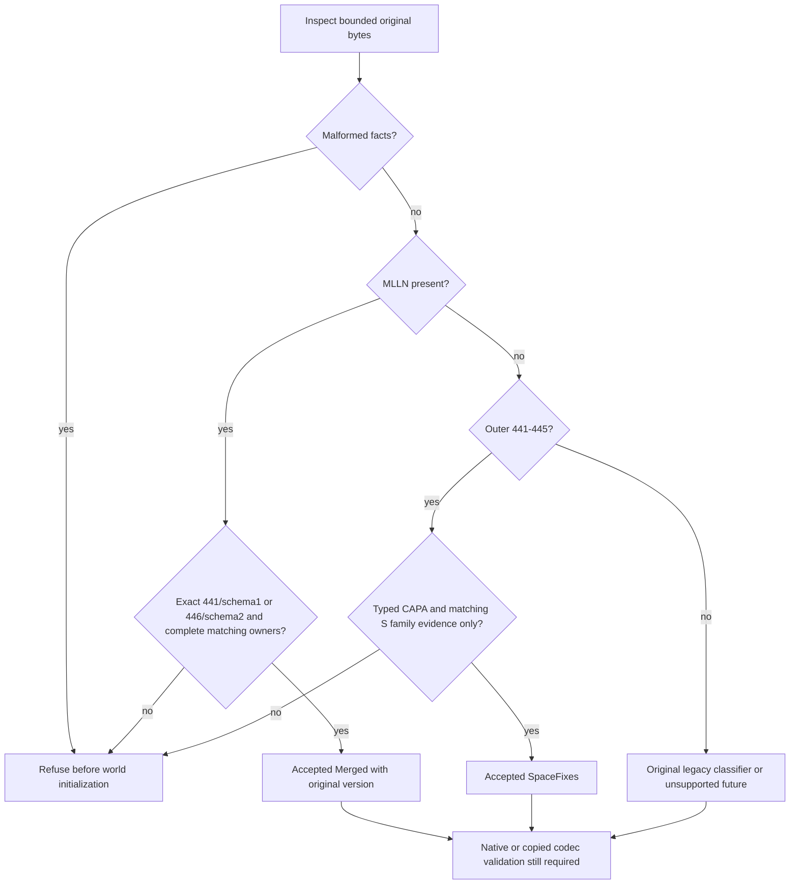
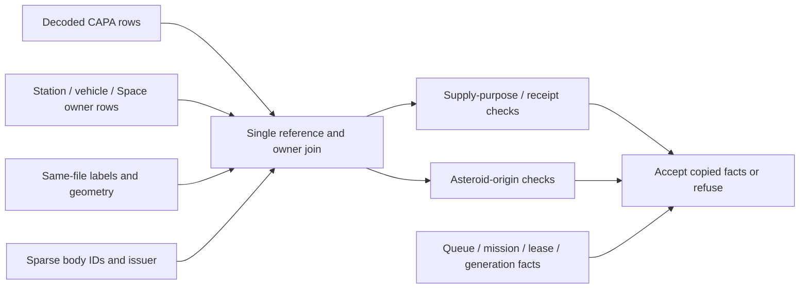
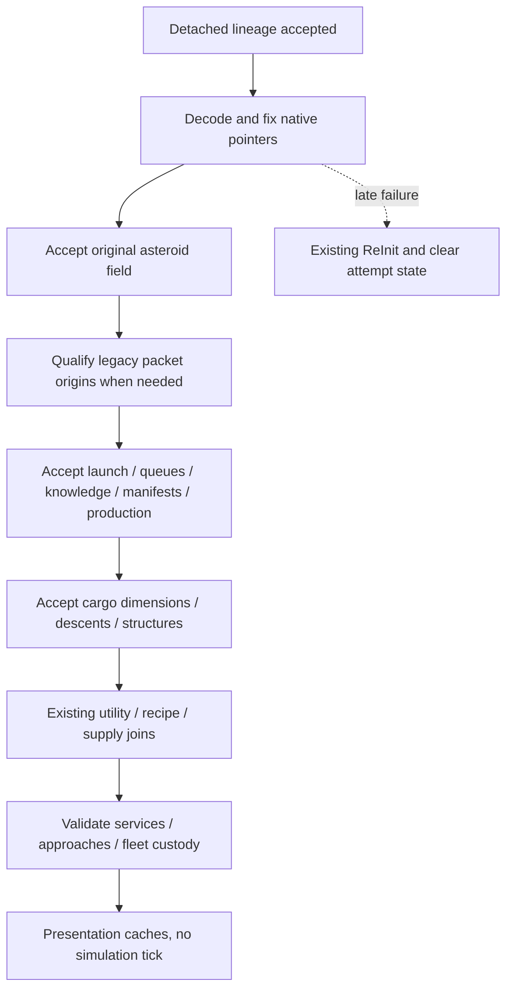

# October 26 merge, part 1: source recovery and save compatibility

## Global Mandatory Reading

> **Execution protocol**
>
> - Read this Global Mandatory Reading section before the first task and again
>   after every context compaction.
> - Before starting or resuming a task group, read the nearest preceding Area
>   Mandatory Reading block whose `Applies to` label includes that group. Area
>   blocks appear immediately before the first group they govern.
> - A referenced heading or exported symbol is authoritative. Global navigation
>   hints and Area line ranges are for navigation only; if they drift, relocate
>   the named section or symbol rather than expanding to the whole file.
> - Mandatory reading is non-transitive. Do not preload a linked file's own
>   Mandatory Reading, Consult on Demand, or Planning Provenance entries unless
>   this plan names them directly for the current area.
> - Do not read Consult on Demand or Planning Provenance merely because those
>   sources are listed. Use a Consult on Demand source only when its trigger
>   occurs.
> - No created source file, test file or JSON file should start with same prefix as a planning MD file (such as r2). Only MD files can have that prefix. No MD file should be created anywhere in source directories unless specifically asked.
> - After EVERY CONTEXT COMPACTION, you must add a note above the task group
>   which is currently in execution. The note will say: "Context has compacted
>   X times while executing this group.". If the compaction occurs before any
>   meaningful work was done (this can happen when there is a lot of baggage
>   from the previous compaction), then and ONLY then you can skip this step.
> - When exceeding 3 context compactions, YOU MUST ask yourself if you're not  
>   chewing more than we can handle :). Heck, plans change! :). In such a case,  
>   the way out is to split the group on the spot,
>   in the plan, into more groups,  
>   by appending B, C, D as a suffixes to those groups (splitting sub-groups  
>   themselves is also allowed). When you do this, create Local Mandatory
>   Reading areas so you can optimize your context only for the
>   ACTUAL task at hand.
>   Before starting or resuming a task group, read the nearest preceding Area
>   Mandatory Reading block whose `Applies to` label includes that group. Area
>   blocks appear immediately before the first group they govern.

| File name | Line Ranges | Description |
| --- | --- | --- |
| [docs/zz-reach2/upgrades/2026-10/m2o23-4-come-space-b-integration-handoff.md](m2o23-4-come-space-b-integration-handoff.md) | 5-20 | **Delivered boundary, 2026-10-25** defines the already integrated geometry, native cargo/paid-supply owners, utility scheduler, protocol and art boundary. Every group must preserve these delivered features; this merge adds Space fixes without replacing the earlier underground integration. |
| [OpenTTD4: r2sff1-z-o-final-handoff.md](../../../../../OpenTTD4/docs/zz-reach2/upgrades/2026-10/r2sff1-z-o-final-handoff.md) | 14-23 | Delivered-fixes paragraph identifies construction/shortcut behavior, straight exits, safe detachment, order-owned continuation and the donor 441–445 transport sequence. It defines the incoming feature set and prevents treating the later donor commit as authority to overwrite destination-only behavior. |
| [src/map_layer.h](../../../../src/map_layer.h) | 96-104; 215-235 | `MultiLayerMap::DecodeStoredTile`, `TileInLayer`, `ProjectToSurface`: candidate geometry is same-file; native geometry is physical and independent of the camera. This globally constrains previews, cargo origins, motion, UI and deterministic tests. |
| [src/cargo_custody.h](../../../../src/cargo_custody.h) | 15-29 | `NativeCargoPacketVisitor` and `VisitNativeCargoPackets` define the sole traversal over actual containers. Native containers own cargo; copied metadata and receipt books do not. Every import must preserve uniqueness and avoid a second inventory/traversal authority. |
| [src/saveload/save_lineage.h](../../../../src/saveload/save_lineage.h) | 104-116 | `ClassifySaveDialect` and `HasSaveCapability` separate byte-stream identity from runtime features. The 441 collision makes these globally necessary: neither the latest numeric version nor the newest commit can grant another dialect's capabilities. |

## Plan sequence and split boundary

**Status, 2026-10-28:** for the Linux workspace, this merge is now planned and executed by [m2o28 Part 1](m2o28-1-merge-oct28.md) and [Part 2](m2o28-2-merge-oct28.md), which adopt these decisions with enhancements (a real Git merge commit, a pending save-version gate in that commit, Linux builds with a Windows handoff, and cleanup with automatic backup). This plan's tasks stay as the historical October 26 record; do not execute them alongside m2o28.

The merge is planned in two files in this directory. Group and task numbers remain continuous across them; every unqualified group reference uses this shared numbering. This file split changes no implementation task, difficulty, checkbox, code sketch or diagram.

| Plan | Groups | Responsibility |
| --- | --- | --- |
| [Part 1: source recovery and save compatibility](m2o26-merge-source-save-compatibility-oct26.md) | 1-18 | Pin and recover inputs, import source, compose dialect/cargo/field/mission codecs, validate copied/native adoption and activate writer446. |
| [Part 2: runtime integration and qualification](m2o27-merge-runtime-qualification-oct26.md) | 19-36 | Extend diagnostics, integrate native lifecycle/commands/UI/cleanup, build and qualify current images, then hand over the merge. |

The dependency boundary is after Group 18. Part 1 hands over source contracts and explicitly pending combined-native tests; Part 2 owns the first required complete build in Group 27 and final merge acceptance. Neither file authorizes Git writes, deletion, donor modification or protected gameplay advance.

## Scope, pins and chronology

This is a planning-only change, dated **2026-10-26**. Destination **D** is `D:/Codez/Sandbox/OpenTTD`; incoming **S** is `D:/Codez/Sandbox/OpenTTD4`. The older plans' **A/B** labels refer to the earlier OpenTTD/OpenTTD3 merge; **S is not that historical B dialect**. Keep those meanings distinct in code, fixtures and evidence.

Both current branches are named `mlm-mlv`, but their tips diverge. Verified common ancestor: `cfeff84db52f8a3753a43c2a770a6363c62b2c67`. Destination tip: `530daca23b0590d5cec7ea2a2332648a3935f932`. Incoming tip: `3d45ad4a4c53186ce03ac2e8bec4616b9db189b7`. Initial destination status contained only this empty untracked plan; incoming status was clean.

Plans were inventoried by modification date and checked against author/committer dates and ancestry. Dates below retain the commit's recorded offset; author and committer times match for these commits. File modification time is navigation evidence, not merge authority: the incoming final handoff was modified October 24 but committed October 26.

| Order | Location / commit | Recorded commit time | Delivered work / plan record |
| --- | --- | --- | --- |
| 0 | Shared `cfeff84db5` | 2026-10-23 09:19:49 +02:00 | Cleanup completion and Space Goods capacity; all earlier shared feature work is already in both trees. |
| 1 | D `2d11eea16a` | 2026-10-23 20:24:50 +02:00 | [M2O23-1](m2o23-1-come-space.md) through Group 22D: lineage, tagged supply/custody, command identities, TBM face/bay integration. |
| 2 | D `d0da7e9d76` | 2026-10-23 20:26:30 +02:00 | Concurrent [M2O23-2](m2o23-2-come-space.md) progress checkpoint; a documentation checkpoint, not a competing final implementation. |
| 3 | D `530daca23b` | 2026-10-25 04:51:36 +01:00 | Completes M2O23-1/2 plus [M2O23-3](m2o23-3-come-space.md) and [M2O23-4](m2o23-4-come-space.md): underground/Tube/geothermal, writer 441 + MLLN, 128-family checks, shared UI, art, retained inputs and reconstruction. |
| 4 | S `53368602c7` | 2026-10-26 07:41:57 +01:00 | [R2SFF1](../../../../../OpenTTD4/docs/zz-reach2/upgrades/2026-10/r2sff1-space-fixes-features-1.md), authored/executed from October 23: construction pages/waits, shortcuts, sparse asteroid renewal, full-width cargo, mining policies, writer 445, native replay/peer evidence. |
| 5 | S `3d45ad4a4c` | 2026-10-26 09:19:04 +01:00 | Cleanup script, cleanup fixtures and policy documentation; adds root/clean-tree safeguards but deliberately removes automatic preservation/export. |

Relative to the base, D changes **5,285 paths** (198 runtime, 3,050 tests/fixtures, 173 docs, 1,812 retained-save paths, plus assets/tooling); S changes **222 paths** (89 runtime, 76 tests, 55 docs, root CMake and cleanup). **38 paths overlap**, leaving 184 incoming-only changed paths. Much of D's volume is retained evidence, not 5,285 independent feature edits.

A read-only `git merge-tree --trivial-merge <base> <D> <S>` preview, with S's object directory supplied only as a process-local alternate, produced **22 conflicted paths / 39 conflict blocks**. It wrote no merge tree or index. This legacy preview is a textual forecast, not an actual merge or proof of semantic correctness; refresh it if either tip changes.

Execution, when requested, is a file-level three-way integration into D. Planning does **not** authorize checkout, fetch, merge, rebase, staging or commits. No destructive Git commands or recursive deletion anywhere. Do not run `clean.ps1 -Apply` or cleanup tests that recursively remove fixture trees. No deletion is needed for this plan; the user's separate ceiling of ten individually deleted project files remains binding. Keep S read-only and preserve original saves/configs/evidence. Use descriptive implementation/test/JSON names; auxiliary Markdown stays in this documentation area.

### Observed evidence availability

The incoming handoff's `test-cache/space-fixes/` directory is absent. A read-only recursive inventory of **5,853 files ending in .sav** under S (including ignored/hidden paths outside Git metadata) found no outer header441–445; the highest observed save header was440. This is a header/path inventory, not validation of those payloads or proof that no backup exists elsewhere. Historical named caches/logs must therefore be treated as missing prerequisites until resolved.

Groups 2-3 prepare an independent reference build from exact S source in a new project-owned directory, without writing S or Git. It may produce fresh genuine S445 output and rebuild native role/high-ID inputs from retained405/418/440 originals. That proves a reconstructed donor writer, not preservation of historical R2SFF1 runs. Missing intermediate441-444 original files remain explicitly unqualified until a backup or separately justified source-era fixture is available. The user reports that cleanup before transferring S to this machine may have removed these artifacts. That is a plausible cause, not a verified deletion history; no alternative backup location is currently known. Proceed on the working assumption that the caches are unavailable: reconstruct fresh reference evidence from retained inputs and disclose historical gaps, without repeatedly requesting missing artifacts or indefinitely blocking the merge on an unknown backup. A failed compatibility/conservation test still blocks the affected implementation.

### Recovery readiness checked on 2026-10-26

Read-only inspection found the required retained seeds, current source producers and local build prerequisites. This is a prerequisite check, **not an executed donor rebuild or a passing runtime replay**.

| Recovery input | Verified local evidence | Consequence |
| --- | --- | --- |
| Original mining/construction worlds | S's [space-mining-working-405.sav](../../../../../OpenTTD4/src/tests/fixtures/demos/space/space-mining-working-405.sav) (SHA256 starts dc5f93d90a2f21d8) and [space-module-work-418.sav](../../../../../OpenTTD4/src/tests/fixtures/demos/space/space-module-work-418.sav) (1400381a5a805fc4) are present with the expected outer versions. | Fresh load/construction/mining qualification can start from retained originals. |
| Heavy/mission/factory worlds | S's [space-heavy-440.sav](../../../../../OpenTTD4/src/tests/fixtures/demos/space/space-heavy-440.sav) (0c858ed753a847cc9), [space-missions-440.sav](../../../../../OpenTTD4/src/tests/fixtures/demos/space/space-missions-440.sav) (7513080263bc2895), and [space-factory-440.sav](../../../../../OpenTTD4/src/tests/fixtures/demos/space/space-factory-440.sav) (e063202b825bf16d) are present at440. | The missing policy/continuation/lifecycle/high-ID states have retained starting worlds; no new paid actors or inventory need to be invented to replace those seeds. |
| Configuration and runtime content | S's retained build play.cfg/hotkeys.cfg and native-art.cfg exist. Both repositories' canonical openttd.grf match SHA256 c04fbf0d5525edc53250cfbd963f5e3bbe0d0bce655a3553c73b76483a8e8744. Destination generated baseset, multilayer_industry.grf and English/English_US language files are present. | Test configuration and art were not lost with the Space-fixes cache. Rebuild distribution through the existing owners and use private copies. |
| Portable dependency recipes and base assets | `native_build.load_profile(root=...)` passed independently for D and S: the retained dependency recipe ZIP, its per-archive hashes and seven original-DOS runtime assets match their profiles. D's installed dependency check verifies298 payload files. | Dependency recipes/assets and an installed dependency cache are available locally. The ZIP contains provider/port recipes, not a claim that every possible third-party source download is archived. |
| Actual local tools | D's `discover_tools` passed using explicit vcpkg/GRFCodec paths: MSVC19.44.35229, MSBuild17.14.60.43110, toolset14.44.35207, SDK10.0.26100.0, CMake3.31.6-msvc6, recorded vcpkg, GRFCodec/NFORenum6.2.0 and GNU patch2.7.6. | An operational toolchain is present. Default discovery alone misses the repository-local vcpkg; supply the explicit overrides below. |
| Donor historical tool pins | S records MSVC19.44.35216, MSBuild17.14.23.42201 and patch2.8; its unmodified discovery correctly refuses this machine's newer compiler. | Use an explicit contemporary recovery profile while retaining S application/test source unchanged. Record new tool/image identities; do not promise the old executable hash or bypass version checks silently. |

The verified local overrides at planning time are `D:/Codez/Sandbox/OpenTTD/build/.native-tools/vcpkg-dcd5788f49cb4490` and `D:/Codez/Sandbox/OpenTTD/test-cache/graphics-toolchain/grfcodec620/grfcodec-6.2.0-windows-win64/bin`. They are local prerequisites, not durable source authority; re-probe them before execution and preserve/reconstruct through the existing build-tool owners if their caches move.

The reconstruction dependency chain is explicit in the retained driver and native observer:

`space-heavy-440.sav` → `space_fixes_checks.py --mining-controls edit` → `policy-current.sav` → `--mining-controls continue` → `policy-before-departure.sav` → `--mining-controls lifecycle` → `policy-lifecycle-after-credit.sav` → `--mining-controls prepare-high-id` → `policy-high-id-current.sav` → real peer/replay drivers. Each arrow uses the preceding new run's actual output and a fresh run identity. The light role has the parallel `edit-light`/`continue-light` path. The native source still contains the policy input, continuation checkpoints, all five lifecycle phase saves and `PrepareNativeHighIDPeerSource` producers.

What cannot currently be recovered exactly is the old removed logs/screenshots/run identity and absent original intermediate441-444 save evidence. New runs can establish fresh behavior and migration evidence; they do not recreate historical proof merely by reusing an old filename.

## Conflict decisions and merge contract

| Boundary | Observed conflict and selected resolution | Implemented in |
| --- | --- | --- |
| Save identity | D441 means canonical merged supply/machinery plus MLLN/schema1. S441 means typed asteroid cargo, S442 lifecycle, S443 policy/intent, S444 unordered mining departure, S445 released survey return. Preserve all original interpretations; plan a new **446 writer with MLLN/schema2**, after rechecking unused numbers. Freeze 441/schema1 as historical constants. Extend the existing classifier/capability owner with an explicit Space-fixes dialect; do not relabel S as historical DonorB or infer modern fields from `>=441`. | 5-9, 11, 13-18 |
| CAPA and physical custody | Combine D's permanent non-paying supply purpose, U64 receipt link and literal departure with S's full-width body/mineral source, source tile and first station. Preserve both checks. Adapt S asteroid validation to `VisitNativeCargoPackets`; do not restore its separate hand-written owner walk, which could miss destination-only owners. | 10-12, 15-20 |
| Copied candidates | Retain D's `NativeCargoOwnerPreview` (packet/cargo/station) and extend its consumers for S typed origins. Fold S's redundant `NativeCargoReferencePreview` into that richer owner record. Retain all candidate-only body IDs, leases, generation cursors and continuation; clear them on every success/failure/reset. | 15-17 |
| Supply-label API | Keep D's public `CargoLabel GetSpaceSupplyLabel(SpaceSupply)` with `CT_INVALID` for unsupported input. Adapt incoming optional-return call sites explicitly; retain immutable labels for copied previews and S's real service admission. | 10, 22 |
| Commands and network | D uses IDs 211-222 for delivered ground/supply commands; S assigns 211 to `SetSpaceMiningPolicy`. Preserve D's complete IDs/tuples through 222; append policy at **223** if refreshed inventory confirms it. Advance the existing protocol discriminator so old D/S and historical peers refuse before authentication/map transfer. | 24, 32-33 |
| UI and settings | Deliver one Alt+1..4 mapping and one opening-hotkey policy in normal/editor modes. Preserve D's Escape, small-map, construction-selection and generic toggle behavior while adding S's modal/pinned/no-close protection and retained Game Options raising. Deduplicate settings and strings even where Git reports a clean merge. | 25, 34 |
| Asteroids and mining | Adopt S's straight actual-plane exits, 1/3/5 earned size credits, 741-2222 normal ticks per interval, sparse never-reused IDs, safe detach, and one original order queue. Preserve D's real cargo/supply/utility owners. Camera, pause and fast-forward must retain their defined simulation semantics. | 21-23, 27-35 |
| Canonical diagnostics | Extend existing D complete-owner diagnostics with S source/renewal/continuation fields. S's fifteen-owner peer checks supplement D's complete-family checks; neither may replace the other. Derive the new exact family/schema contract from source owners; do not assume a larger family count merely because fields were added. | 19-20, 27-35 |
| Assets and protected gameplay | Keep D's selected canonical GRF, offsets, Battery/Electronics choices, paid ground integration and retained Space foundation. S changes no media paths. Merge testing uses explicit copies and grants no new protected Space spending/earning window. | 1, 27, 31, 36 |
| Cleanup policy | **User clarification, 2026-10-26:** keep automatic saves/native-settings preservation, but decouple routine cleanup from historical code/config-version reconstruction audits. Reuse the existing save-export journal and add S's root, clean-tree, tracked-parent and file-identity safeguards. A legitimately changed committed `src/hotkeys.cpp` must not block cleanup because an old test snapshot expected different bytes. No cleanup execution is part of this merge. | 26 |

### Clarified preservation boundary

The old cleanup adapter combines two separate operations: exporting saves/native configurations through `save_retention.plan_save_exports(..., configurations=True)`, and auditing historical reconstruction through `verify_cleanup_inputs`. The latter verifies the complete source-epoch catalogue and searches disposable trees for unclassified source. That extra audit, not the save-copy operation, can demand old code versions.

A concrete stale reference exists: `src/tests/fixtures/cleanup/source-epochs.json` records the old snapshot `logs/proofs/mlm/clean-checkout/src/hotkeys.cpp` as reconstructible from live `src/hotkeys.cpp` at SHA256 `0f7c9513f3f6f963cd1fc631ba4fc8906cd1949382bfe217afc25c8421332f50`. S legitimately changed/committed that source in `53368602c7`; its current hash is `f25696f82c1c9afd6830715ace2fba529cfc88d4c392a59ed4cecd5bb9f83c79`. The old `verify_source_epochs` check would reject this mismatch regardless of clean Git status. This demonstrates the failure mechanism; it does not identify the exact prior error message the user saw. `hotkeys.cpp` is application code; a personal `hotkeys.cfg` is a settings file and belongs in configuration backup.

Routine cleanup should automatically preserve the save/config bytes actually at risk, verify the retained copy outside the selected deletion scope and report a concise summary. It should not require historical code snapshots, unchanged current-source hashes, all past test receipts, or an entire reconstruction graph. Historical reproducibility audits remain explicit, separate operations used only when a particular test/recovery task needs them. Existing retained archives stay untouched. Authored source/tracked files remain outside cleanup; explicitly disposable code snapshots/build products do not require manual historical-version classification. Unknown locations are outside the cleanup scope rather than a reason to ask the user to curate source history. Real backup failure, changed input during copying, or a retained destination inside the deletion target still blocks removal.

The 22 textual conflict paths are grouped here so none disappears behind a broad directory task:

| Paths (relative to D) | Resolution owner |
| --- | --- |
| `src/saveload/saveload.h`, `src/saveload/cargopacket_sl.cpp`, `src/saveload/station_sl.cpp`, `src/saveload/vehicle_sl.cpp` | Groups 5-18: dialect-specific transport and full/copy parity. |
| `src/cargopacket.h`, `src/fios.h`, `src/fios_gui.cpp`, `src/saveload/space_cargo_preview.cpp`, `src/space_manifest.h`, `src/space_manifest.cpp`, `src/space_vehicle.cpp` | Groups 10-17 and 22: union packet facts, single custody/preview traversal, label API, native policy/service. |
| `src/command_type.h` | Group 24: append-only ABI. |
| `src/main_gui.cpp`, `src/map_layer_gui.h`, `src/settings_type.h`, `src/settingentry_gui.cpp`, `src/table/settings/gui_settings.ini`, `src/toolbar_gui.h`, `src/toolbar_gui.cpp`, `src/window_func.h`, `src/lang/english.txt` | Group 25: consolidated controls, settings and strings. |
| `docs/zz-reach2/upgrades/2026-10/d2sa-space-adventures.md` | Group 36: both delivered feature sets and honest evidence scope. |

The other **16 shared paths** show no textual markers but still require review: all four CMake lists; `cargopacket.cpp`, `map_layer_gui.cpp`, `window.cpp`; `saveload/afterload.cpp`, `saveload/saveload.cpp`, `saveload/space_cargo_preview.h`; architecture historical-debug/GUI/map-layers/savegame; and the Space master/multilayer feature master. Additional semantic work is necessary in D-only lineage, supply, canonical-state and network code, plus S-only source/field/mining codecs.

## Implementation tasks

This plan owns Groups 1-18 only. Continue with [Part 2](m2o27-merge-runtime-qualification-oct26.md#implementation-tasks) after the handoff below.

Every example is an **implementation sketch**, not a claim that the proposed helper or field exists today. C++ public headers are the public boundary here; do not introduce a new registry/barrel merely to match generic planning vocabulary. Proposed helper names may be adjusted within the named owner, with callers/tests updated together.

Groups 5-26 compose a shared native library across the two plans. Add focused fixtures with each contract and run independent/standalone checks when possible. The first required combined native build is Group 27 in Part 2; tests requiring unresolved adapters remain explicitly pending until then. Entry gates before that build check implemented declarations, adapters and fixture coverage; Groups 28 onward require actual fresh binary/test evidence.

Keep S read-only, preserve original bytes and the clarified save/config backup policy. Existing comments citing predecessor-plan group numbers retain their historical meanings.

### Area Mandatory Reading - Comparison and original-input inventory

_Applies to Group 1._

| File name | Line Ranges | Description |
| --- | --- | --- |
| [docs/zz-reach2/upgrades/2026-10/m2o23-4-come-space-b-integration-handoff.md](m2o23-4-come-space-b-integration-handoff.md) | 22-57 | **Qualified evidence and exact epochs** and **Current continuation and player review** pin original aliases, source/image identity and protected gameplay scope. Inventory existing inputs without choosing a newer directory or resuming financial trials. |
| [OpenTTD4: r2sff1-z-o-final-handoff.md](../../../../../OpenTTD4/docs/zz-reach2/upgrades/2026-10/r2sff1-z-o-final-handoff.md) | 44-69 | **Verified evidence** identifies the old six-image and native-run claims. Their deleted cache dependencies must be recorded as missing, not silently treated as current proof. |

### Group 1 - Pin the comparison and protect its inputs

Execution evidence: [Group 1 execution record](m2o26-a-execution-notes.md#group-1-completed); path/input observations in `test-cache/merge-oct26/execution-inventory.json`, textual forecast in `logs/merge-oct26/merge-tree.txt`. No runtime advancement was needed.

{{SIMPLE}}

- [X] **1.1** Recheck both HEADs, branch names, read-only status and common ancestry against the pins above. Record every new tracked/untracked change; preserve unrelated work and refresh this plan if either feature baseline changed. Do not stage this plan or create a Git worktree.

- [X] **1.2** Produce an explicit path disposition inventory from base-to-D and base-to-S name/status differences: shared-conflict, shared-clean-but-reviewed, S-only import, D-retained, and policy-deferred. Record the 22-path/39-block textual forecast separately from semantic conflicts; inspect renames/deletions if a refreshed diff introduces any.

- [X] **1.3** Resolve original D441 and shared/older retained inputs through the existing catalogue, recording hashes/actual envelope versions and retention aliases. For S441–445, record the observed missing-cache status and check only an explicitly supplied backup location if one appears; preserve any selected originals actually found. Continue with Group 3 reconstruction when none exist, without repeated backup requests. Do not alter S or manufacture a historical original by editing its header.

- [X] **1.4** Pin D's canonical GRF hash, source manifests, current profile/catalogue ownership and the selected protected Space foundation. Record private output roots and copied configurations for future tests; neither source saves nor user config files are test output.

- [X] **1.5** Record the exact commands/targets and input dependencies of the existing lineage, supply, ground, Space-fixes and peer harnesses. Identify recursive deletion, Git mutation and uncontrolled process termination before any helper is run; those paths must remain disabled or be replaced with non-destructive test doubles.

### Area Mandatory Reading - Independent donor recovery

_Applies to Groups 2-3._

**ASSUMPTION: this was already built previously. If not, re-asses at runtime**

**Entry gate:** Group 1 must have pinned S, identified retained heavy440/405/418 inputs and verified read-only source ownership. Verify hashes/existence and the profile preflight. If absent, stop Groups 2-3 build/replay; source inventory and pure format design may continue. Never substitute merged binaries, edited source headers, arbitrary cache directories or a current-output-derived expected donor.

| File name | Line Ranges | Description |
| --- | --- | --- |
| [src/tests/multilayer/support/native_build.py](../../../../src/tests/multilayer/support/native_build.py) | 43-76; 109-175 | `load_profile` validates retained recipe/runtime inputs; `discover_tools` verifies actual tool versions. Use an explicit contemporary recovery profile rather than mutating S or disabling pinned checks. |
| [OpenTTD4: r2sff1-z-o-final-handoff.md](../../../../../OpenTTD4/docs/zz-reach2/upgrades/2026-10/r2sff1-z-o-final-handoff.md) | 71-116 | **Reproduction** gives actual native targets, configuration selection and private source/output ownership. Resolve each producer through its existing driver; new saves do not become shared live worlds. |
| [OpenTTD4: r2sff1-z-a-policy-input.md](../../../../../OpenTTD4/docs/zz-reach2/upgrades/2026-10/r2sff1-z-a-policy-input.md) | 22-45 | Actual-input table and `policy-current.sav` contract establish the retained heavy440 starting point; prepare it with native work and commands. |
| [OpenTTD4: r2sff1-z-b-policy-continuation.md](../../../../../OpenTTD4/docs/zz-reach2/upgrades/2026-10/r2sff1-z-b-policy-continuation.md) | 13-30; 37-63 | Native continuation contract and reproduction commands produce `policy-before-departure.sav` without inventing stock or paid assets; declared last-safe geometry remains a stated fixture limit. |
| [OpenTTD4: r2sff1-z-j-native-lifecycle.md](../../../../../OpenTTD4/docs/zz-reach2/upgrades/2026-10/r2sff1-z-j-native-lifecycle.md) | 6-18 | Native lifecycle predecessor and five phase saves establish the route to an earned after-credit input. No prior cache is required if this chain succeeds. |
| [src/tests/multilayer/support/package_transfer.py](../../../../src/tests/multilayer/support/package_transfer.py) | 204-271; 274-372; 375-439; 442-507 | `_destination`, `_member`, `_check_output_lengths` and `stage_donor_source` define the read-only donor bootstrap. `stage_transfer` may export into its source and `stage_selected_recovery` requires an existing build, so neither replaces this entry. Old263-391 ranges predate Group2; relocate these named functions if they drift. |

Context has compacted 1 times while executing this group.

### Group 2 - Prepare and build the donor reference separately

Execution evidence: all three donor targets built successfully in RelWithDebInfo through the existing one-worker memory/process guard. Six focused staging checks passed; final verification rehashed 6,014 original/staged input pairs, the complete source epoch, ten tool executables, runtime resources and all three images. The six protected destination contracts remain unchanged. Native receipt SHA256: `79700d5195a55cde77d06bf62724c3b0b1fe21fc947bfe191d8e69b8ef79ec15`. See [execution observations](m2o26-a-execution-notes.md) and [machine-transfer handover](m2o26-b-group2-handover.md). Stop here at the user's request; Group 3 is unstarted.

**ASSUMPTION: this was already built previously. If not, re-asses at runtime**

Consumes Group 1 pins and retained inputs. Completion produces a source-bound donor445 application plus focused native test target and private runtime distribution.

{{MEDIUM}}

- [X] **2.1** Add a narrow source-only staging entry to the existing `package_transfer.py` owner, with explicit S read root and fresh D/test-cache write root. Reuse its ordinary-file, member-path, length, containment and per-file hash guards; exclude Git metadata, generated output, symlinks/hard links and historical executable dependencies. It must perform no writes to S and must not call source-side save export or broad historical-source auditing. Before real copying, verify source-write refusal, path escape, preexisting destination and source-changed-during-copy cases using non-destructive doubles.

- [X] **2.2** Use that entry with the Group 1 pinned source/input inventory to copy S application/test/build-support files plus explicitly selected retained content/configs. Verify each source before and after copying and each destination hash; record the manifest outside S. Refuse an existing destination or redirected path without overlay or cleanup. This snapshot is a reconstruction input, not another canonical repository.

- [X] **2.3** Create an explicit recovery build profile for the verified local MSVC/MSBuild/patch versions. Retain S dependency/package/content pins and application/test bytes. Probe the recorded local vcpkg and GRFCodec overrides again; report absent tools rather than bypassing `discover_tools` or installing guessed versions.

- [X] **2.4** Build donor `openttd`, `openttd_test` and `openttd_space_fixes_test` sequentially, using the existing memory/process guard. Prepare baseset/NewGRF and English language distribution through existing public build helpers; never compile or write outputs in S.

- [X] **2.5** Record contemporary source/profile/tool/binary hashes and distinguish this fresh donor445 writer from the deleted historical images. Stop reconstruction claims if these targets cannot be built; preserve the concrete error and allow independent classifier/test design to continue.

### Group 3 - Regenerate donor checkpoints through explicit producers

**ASSUMPTION: this was already built previously. If not, re-asses at runtime**

Group 2 supplies the actual donor binaries and distribution. Verify their manifest, then use fresh run IDs. Stop only the dependent recovery chain when a producer fails; never jump to the desired state through private pool edits.

Producer order (run each existing driver from the staged donor root using a fresh run identity):



{{HARD}}

- [ ] **3.1** Run donor no-op load/preview/save from retained405 mining and418 construction inputs; bind original and fresh445 output hashes. Do not call the merged writer to produce this reference or rename its output as a historical441-444 original.

- [ ] **3.2** From retained heavy440, run `edit`, then run `continue` from that new `policy-current.sav`; preserve before-departure, retarget and unload phase saves and their next-opportunity records. Reconstruct the light role separately with `edit-light`/`continue-light` when needed.

- [ ] **3.3** Run `lifecycle` and `lifecycle-hidden` from the same new before-departure input, keeping five phase saves and comparing actual traces. Feed the new `policy-lifecycle-after-credit.sav` to `prepare-high-id`; preserve its declared issuance-prefix limitation and the subsequent actual birth/extraction.

- [ ] **3.4** Export the selected new saves/configs through the existing retention journal and record the producer dependency chain. Historical logs/screenshots/intermediate441-444 originals stay unverified; their absence does not block later merge work once fresh reference generation succeeds.

### Area Mandatory Reading - Controlled source import

_Applies to Group 4._

**ASSUMPTION: this was already built previously. If not, re-asses at runtime**

**Entry gate:** Group 1 disposition inventory and Groups 2-3 reference status must be recorded. Verify the path inventory, including shared conflicts and missing historical evidence. Missing donor build evidence stops claims dependent on it, not file comparison. Do not overwrite D-changed paths or use a whole-directory replacement.

| File name | Line Ranges | Description |
| --- | --- | --- |
| [OpenTTD4: r2sff1-space-fixes-features-1.md](../../../../../OpenTTD4/docs/zz-reach2/upgrades/2026-10/r2sff1-space-fixes-features-1.md) | 46-72 | **Scope and decisions** fixes incoming UI, timer, motion, renewal, nearest-target and legacy defaults before mechanically importing source. |
| [src/cargo_custody.h](../../../../src/cargo_custody.h) | 15-29 | `VisitNativeCargoPackets` already owns complete native traversal. Imports may refer to it later; they must not overwrite D with a second custody authority. |

### Group 4 - Import nonoverlapping source and register targets

**ASSUMPTION: this was already built previously. If not, re-asses at runtime**

Produces destination copies of the named S public headers/codecs/test drivers, preserving D-owned changes. Registration is not proof that the partly reconciled library already builds.

{{MEDIUM}}

- [ ] **4.1** Copy S-only feature additions and their directly paired tests into D using the disposition inventory; keep source bytes attributable to S. Include typed-origin/digest helpers, sparse identity/renewal, mining target/return/continuation/departure modules and their codec headers. Do not overwrite any file changed on both sides.

- [ ] **4.2** Apply S changes to files still identical to the base in D only after checking their dependencies on shared interfaces. Bring existing asteroid/space/order/structure/approach/service owners forward; keep D-only underground, utility, surface-supply, renderer and network changes. Treat imported raw version checks as pending Groups 5-18 work, not accepted compatibility.

- [ ] **4.3** Merge root, src, saveload and tests CMake registrations as a set: retain every destination target and add `openttd_space_fixes_test`, its sources, runtime-library settings and platform links once. Include each new production unit once; isolate allocation-failure test hooks from production and avoid duplicate test/main/mock symbols.

- [ ] **4.4** Bring S-only R2SFF1 plan/evidence Markdown into the existing documentation directory with its history intact. Preserve both versions of shared architecture/player guidance for Group 36 rather than copying S over D. Record incoming cleanup files as policy-dependent Group 26 work.

- [ ] **4.5** Port incoming Python/native harness paths to the destination's existing public artifact/build/input helpers where applicable. Preserve native subprocess deadlines, private homes, sequential build guards, original input hashes and exact binary provenance; do not launch a stale S executable as a substitute for the combined build.

### Area Mandatory Reading - Wire identities and pure capability policy

_Applies to Groups 5-6._

**ASSUMPTION: this was already built previously. If not, re-asses at runtime**

**Entry gate:** Group 4 supplies incoming declarations/reference codecs; Group 1 pins the existing441 meanings. Verify current headers and refresh the version allocation before editing. If pins drift, stop allocations and dependent wire work; independent source/case inventories may continue. No numeric alias, historical DonorB reuse or global virtual-version rewrite may bypass the collision.

| File name | Line Ranges | Description |
| --- | --- | --- |
| [src/saveload/save_lineage.h](../../../../src/saveload/save_lineage.h) | 15-102 | `SaveDialect`, `SaveWireFacts`, historical marker constants and `SaveCapability` define the existing pure compatibility boundary. Extend these declarations; historical DonorB and merged441 meanings cannot change. |
| [src/saveload/save_lineage.cpp](../../../../src/saveload/save_lineage.cpp) | 81-136; 216-228 | `CompatibleA`, `CompatibleB`, `HasSaveCapability` show the frozen legacy ranges and current enum-position arithmetic. Replace only capability derivation; keep legacy interpretation unchanged. |
| [src/saveload/save_lineage_sl.cpp](../../../../src/saveload/save_lineage_sl.cpp) | 13-45 | `MLLNChunkHandler` writes an eight-byte marker. Its U32 magic/U16 schema/U16 writer tuple can distinguish old441/schema1 and new446/schema2 without inventing another chunk. |

### Group 5 - Freeze the finite source-format matrix

**ASSUMPTION: this was already built previously. If not, re-asses at runtime**

Produces named constants, appended capability declarations and a test truth table; writer activation remains Group 18.

Closed matrix for the five appended capabilities (older common/A/B behavior stays in its original tests):

| Source | Typed origin | Renewal | Mining intent | Unqueued departure | Released survey return |
| --- | --- | --- | --- | --- | --- |
| D441 + MLLN1 | no | no | no | no | no |
| S441 | yes | no | no | no | no |
| S442 | yes | yes | no | no | no |
| S443 | yes | yes | yes | no | no |
| S444 | yes | yes | yes | yes | no |
| S445 | yes | yes | yes | yes | yes |
| Combined446 + MLLN2 | yes | yes | yes | yes | yes |

{{MEDIUM}}

- [ ] **5.1** Append `AsteroidCargoOrigins`, `AsteroidFieldLifecycle`, `SpaceMiningContinuation`, `SpaceLegacyDeparture` and `SpaceSurveyDeparture` to `SaveCapability` in `save_lineage.h`, with an explicit `SaveDialect::SpaceFixes`. Preserve all existing capability values and the old merged441/schema1 constants. Reserve `CURRENT_MERGED_SAVE_VERSION = 446` and a distinct current marker schema2 constant after rechecking availability; leave the existing 441 symbol attached to historical transport.

- [ ] **5.2** Freeze the matrix above in existing lineage tests/documentation: D441 has all preexisting merged capabilities but none of the five incoming ones; S441-445 inherits A440 features, never B-only ground features, and introduces the five incoming features cumulatively; combined446 has the explicit union.

- [ ] **5.3** Define the current marker as the existing eight-byte network-order magic/schema/writer tuple with schema2/writer446. Do not add S441-445 aliases to `SaveLoadVersion` that can enter generic numeric comparisons; retain the old `MergedLineage = 441`, append the current writer at446, and represent S introductions through capability rules.

### Group 6 - Implement and test capability selection without parsing

**ASSUMPTION: this was already built previously. If not, re-asses at runtime**

Group 5 declarations and closed matrix exist. Verify `SaveDialect::SpaceFixes`, the five capabilities, and distinct historical/current marker constants before implementing this policy.

Owner-local sketch: the table covers **every** existing and new capability; representative row only, not a second registry.

```cpp
// Proposed local representation inside save_lineage.cpp.
struct CapabilityRule {
    SaveCapability capability;
    uint16_t first_a;       // 0: unavailable in historical DestinationA
    uint16_t first_b;       // 0: unavailable in historical DonorB
    uint16_t first_space;   // 0: unavailable in S441-445
    bool merged441;
    bool merged446;
};
// Example new row: {AsteroidCargoOrigins, 0, 0, 441, false, true}
// Validate status, capability and the dialect's closed version range first.
// Lookup by capability; never calculate capability from its enum position.
```

{{HARD}}

- [ ] **6.1** Replace `HasSaveCapability` index arithmetic with explicit per-capability rules. Each rule states the original A/B introduction where applicable, S availability and merged441/446 membership. Unknown capability, unsupported dialect/version or non-Accepted status grants nothing; a future enum append must never silently become available in old441.

- [ ] **6.2** Implement the Group 5 truth table and preserve all existing shared/A/B boundary tests. Test every new introduction at n-1/n, both441 dialects and an invalid future capability; include original field-era defaults independent of whether a live world currently has asteroids.

- [ ] **6.3** Adapt `SlHasSaveCapability` writer-context selection to current merged446, keeping load-context results from the accepted source. Keep `DestinationVersionCapability` for original A425-440 enum meanings; replace incoming numeric checks explicitly at their consumers in Groups 11/13/14 rather than teaching an ambiguous enum alias to this switch.

- [ ] **6.4** Prepare focused pure tests at the existing `SAVE_LINEAGE_STANDALONE` boundary where possible. Mark whole-engine executions pending Group 27. Review that `GetLoadCapabilities`/`ScopedLoadLineage` retain the unchanged original envelope version and clear between attempts.

### Area Mandatory Reading - Detached evidence collection and classification

_Applies to Groups 7-9._

**ASSUMPTION: this was already built previously. If not, re-asses at runtime**

**Entry gate:** Groups 5-6 must supply the pure matrix and explicit capability policy. Verify declarations and fixture cases, using standalone execution where available. If absent, stop Groups 7-9 integration; fixture schema inventories can continue. Do not infer dialect from filenames, newest commits, live pools, missing-marker fallback or a rewritten header.

| File name | Line Ranges | Description |
| --- | --- | --- |
| [src/saveload/save_envelope.h](../../../../src/saveload/save_envelope.h) | 16-35 | `SaveInspectionLimits` and `InspectSaveWireFacts` require bounded, rewindable inspection before gameplay callbacks/world initialization. Collect facts, not native owners. |
| [src/saveload/save_envelope.cpp](../../../../src/saveload/save_envelope.cpp) | 231-269; 271-345 | `CheckSelectedColumns` currently assumes numeric441 means merged; `ReadRiff` makes the same assumption for SSOR and MLLN. Replace these two assumptions with observed layout evidence independent of chunk order. |
| [src/surface_supply_merged_wire.h](../../../../src/surface_supply_merged_wire.h) | 10-22; 34-39 | SSM1 constants and `InspectMergedSurfaceSupplyOrders` provide a bounded streaming tagged-book validator. Reuse it; no payload-sized buffer or duplicate receipt decoder is allowed in preflight. |
| [src/saveload/save_lineage.cpp](../../../../src/saveload/save_lineage.cpp) | 138-214 | `ClassifySaveDialect` currently forces every441 through MLLN and caps support there. Preserve its malformed-first, no-hint-override behavior while inserting explicit modern dialect cases. |
| [src/saveload/save_lineage.h](../../../../src/saveload/save_lineage.h) | Live definitions; no fixed range | Groups 5-6 produce the source matrix and `HasSaveCapability` policy. `SaveWireFacts`/`ClassifySaveDialect` remain the public evidence/classification boundary; no active-game fallback is valid. |

### Group 7 - Collect exact CAPA column and marker observations

**ASSUMPTION: this was already built previously. If not, re-asses at runtime**

Consumes Group 6 capability policy but does not call it to guess columns; Groups 8-9 join the observations.

Proposed facts are transport observations, not new gameplay state:

```cpp
enum class SupplyColumnEncoding : uint8_t {
    Absent, LegacyU32Bool, CanonicalU64U8, Malformed
};
// Add to the existing SaveWireFacts, with inert defaults:
// SupplyColumnEncoding cargo_supply_encoding = Absent;
// SaveEvidenceState asteroid_origin_columns = Absent;
// Record typed-column presence even when CAPA contains zero packet rows.
// A later classifier chooses D441 / SpaceFixes / Merged446 from the whole file.
```

{{HARD}}

- [ ] **7.1** Extend `SaveWireFacts` with separate observed CAPA supply-column encoding and asteroid-column completeness facts. Supply states must distinguish absent, legacy U32/Bool, canonical U64/U8 and malformed; typed origin states must distinguish absent, exactly two U32 keys and malformed. Keep existing legacy facts compatible until callers migrate.

- [ ] **7.2** In `CheckSelectedColumns`, count names and validate wire types before rows, including empty CAPA. Record facts from actual descriptors, not `original_version == 441`. Reject half pairs, duplicate keys and wrong widths. Do not use the presence of one extension to silently discard the other.

- [ ] **7.3** In `ReadRiff` record MLLN magic/schema/writer only after exact eight-byte framing. Permit exactly the historical441/schema1 and planned446/schema2 tuples; flag wrong kind/extent/tuple as malformed with no legacy fallback. This observation must work even when MLLN follows CAPA/SSOR.

- [ ] **7.4** Add detached scanner fixtures for D441, S441, new446, empty CAPA and reordered MLLN/CAPA chunks. Assert bounded work, unchanged raw digest/header and rewind-on-success/failure; malformed columns cannot be repaired by a source-origin hint.

### Group 8 - Observe SSOR and incoming family shapes without world state

**ASSUMPTION: this was already built previously. If not, re-asses at runtime**

Group 7 CAPA/marker facts exist. Public streaming supply decoder and S codec constants from Group 4 must be present; stop this group if either is missing.

{{HARD}}

- [ ] **8.1** Remove the numeric441 decoder choice in `ReadRiff` SSOR handling. Read a fixed bounded prefix, retain original-fixed shape facts (14-byte header, little-endian count, exact 14+53*n extent), and use a prefix-replay scalar adapter for the existing SSM1 streaming inspector when its signature is applicable. Never allocate the whole SSOR payload or materialize receipt vectors in preflight.

- [ ] **8.2** Record explicit fixed/tagged validity rather than guessing from MLLN arrival order. If signatures appear to overlap, preserve that ambiguity and require a uniquely consistent whole-file result in Group 9; do not rescue a malformed recognized tagged payload by falling through to an older parser. Add a synthetic prefix-collision/contradiction case so the policy is documented, not assumed.

- [ ] **8.3** Inventory S-only ASTR/SPKN/SPOR/VEHS schema changes and record only the bounded presence/shape facts needed for modern classification. Reuse exact constants and descriptor keys from their native codecs. Do not move complete field/mission/lease/custody validation into the envelope inspector: those belong to Groups 13-17.

- [ ] **8.4** If VEHS nested fields are inspected, keep common TABLE/sparse framing and legacy vehicle variants intact. Add a bounded schema/header-only inspection path rather than blindly marking VEHS as the existing flat `selected` table path; that path currently assumes TABLE mode3 and flat scalar rows. Test non-Space variants and absent-field Classic data.

- [ ] **8.5** Write fixtures for original A440/S441 fixed SSOR, historical B TABLE+SSOH, D441/current446 tagged SSOR, truncated/oversized chunks, duplicates and wrong framing. Verify marker-first/marker-last yields the same observations. Keep whole incoming payload validity explicitly deferred to the owning codec.

### Group 9 - Compose classifier decisions and the load preflight gate

**ASSUMPTION: this was already built previously. If not, re-asses at runtime**

Groups 7-8 observations and Group 6 matrix must exist. Verify fixture coverage for each observation before composing decisions.

Control-flow sketch; `CompatibleSpaceFixes` and extracted legacy/merged checks are proposed owner-local helpers, never fallback loaders.



{{HARD}}

- [ ] **9.1** Extract the existing pre441 A/B logic as an owner-local legacy path without changing its family/count/history-bit rules or exact-digest hint semantics. Add a modern branch before that path: recognized marker selects only its exact merged version; markerless441-445 may select SpaceFixes only with positive typed-CAPA plus complete A-derived fixed-supply/content evidence and no B/merged-only evidence.

- [ ] **9.2** Implement `CompatibleSpaceFixes` inside the existing classifier owner using Group 5 rules. Do not call `CompatibleA` unchanged: it currently accepts fixed SSOR only at exactly440 and rejects B-style columns/bits. Reuse common checks explicitly while preserving historical A440 behavior and forbidding ground-family masquerading.

- [ ] **9.3** Keep modern classification closed: malformed evidence wins,446 without its marker refuses, marker on S versions refuses, conflicting supply/typed layouts refuse, future versions are Unsupported, and modern ambiguity cannot be resolved by legacy filename/digest hints. Required inactive/empty owners still supply their exact framing.

- [ ] **9.4** Integrate this result into existing `DoLoad` preflight without moving world initialization earlier. Add both441 classifications, S442-445/new446, classic/no-field cases and unchanged-open-world refusal tests. Document that accepted lineage selects a decoder; it is not a certificate that later payload/custody adoption must succeed.

### Area Mandatory Reading - Native source values and physical packet custody

_Applies to Groups 10-12._

**ASSUMPTION: this was already built previously. If not, re-asses at runtime**

**Entry gate:** Groups 4-9 must expose imported `Source` helpers and the accepted source capability context. Verify header declarations and classifier cases. Stop Groups 11-12 codec/adoption integration if absent; pure equality/API cleanup in Group 10 can continue. No private second packet table, donor-native pool lookup or U16 cast may bypass these contracts.

| File name | Line Ranges | Description |
| --- | --- | --- |
| [OpenTTD4: source_type.h](../../../../../OpenTTD4/src/source_type.h) | 38-93; 107-125 | `AsteroidCargoOrigin`, `FromAsteroid`, `IsCanonical`, `GetAsteroidOrigin` and guarded setters retain full identity and permanent purpose through ordinary source operations. Adapt only within the existing `Source` value. |
| [src/cargo_custody.h](../../../../src/cargo_custody.h) | 15-29 | `NativeCargoPacketVisitor`/`VisitNativeCargoPackets` enumerate actual physical owners without allocating gameplay objects or adding a second inventory. Asteroid checks become a policy on this traversal. |
| [OpenTTD4: cargo_source_sl.cpp](../../../../../OpenTTD4/src/saveload/cargo_source_sl.cpp) | 10-66 | `EncodeCargoSourceAsteroid`, `DecodeCargoPacketSource`, `ValidateCargoPacketSourceSchema` currently take a numeric version. Preserve portable fields but replace source-era decisions with the accepted lineage context. |
| [src/saveload/cargopacket_sl.cpp](../../../../src/saveload/cargopacket_sl.cpp) | 131-179 | `GetCargoPacketDesc` and `CheckCargoPacketSourceFields` preserve D U64/raw-U8 supply fields and older B U32/Bool transport. Both supply and typed-origin pairs must survive the merge. |
| [OpenTTD4: asteroid_cargo.cpp](../../../../../OpenTTD4/src/asteroid_cargo.cpp) | 28-99 | Both `ResolveAsteroidCargoOrigin` overloads and `NormalizeLegacyAsteroidCargoPackets` distinguish native/copied lookup and preflight all old provenance before in-place upgrade. Do not infer a missing old mineral from a live configured cargo slot. |

### Group 10 - Reconcile immutable source values and label APIs

**ASSUMPTION: this was already built previously. If not, re-asses at runtime**

Group 4 imports and Group 5 type names exist; completion produces one Source value and one supply-label API.

Concrete source identity example (existing S API after import):

```cpp
const Source high = Source::FromAsteroid(65536, CargoLabel{"NORE"});
const Source low  = Source::FromAsteroid(0, CargoLabel{"NORE"});
CHECK(high != low);
CHECK(high.GetAsteroidOrigin()->body == 65536);
// Never narrow body to SourceID. Historical mineral remains after retirement.
// CompanySupply has no asteroid payload and retains its non-paying purpose.
```

{{MEDIUM}}

- [ ] **10.1** Merge S's `AsteroidCargoOrigin` into the existing `Source` while retaining D CompanySupply semantics. Add cases for ID65536 versus ID0, immutable mineral, invalid sentinel, ordinary source equality, and prohibited generic asteroid-index rewriting.

- [ ] **10.2** Keep `CargoLabel GetSpaceSupplyLabel(SpaceSupply)` and `CT_INVALID` as D's public API. Adapt S optional-return consumers explicitly, including pure preview and receiver/service code. Do not consult current CargoSpec merely to retrieve immutable compartment labels.

- [ ] **10.3** Merge both controlled CargoPacket access hooks: CAPA decoding may install an admitted source; canonical supply adoption may normalize its original purpose. Keep `UpgradeLegacyAsteroidSource` narrow and reject invalid/non-asteroid/already-conflicting input.

- [ ] **10.4** Prepare packet-operation test coverage showing split/merge/Reduce preserve source, receipt link, raw departure, age, credit and quantity as specified. Complete source/header integration here; serialization and physical-owner checks are subsequent groups.

### Group 11 - Compose the CAPA codec and row-scratch lifecycle

**ASSUMPTION: this was already built previously. If not, re-asses at runtime**

Group 10 values and Group 9 classification exist. The following is a proposed signature change in the existing cargo-source codec, not an added compatibility owner.

```cpp
// Proposed replacement for the donor's numeric-version parameter:
std::optional<Source> DecodeCargoPacketSource(
    Source scalar, CargoSourceAsteroidWire wire, Money feeder_share,
    const SaveLineageResult &source_format);

// In the existing native/copied row loop, before SlObject:
_cargo_source_asteroid_wire = {}; // body=UINT32_MAX, mineral=0
// ...decode exact row fields...
// Pass the already accepted source_format, never SAVEGAME_VERSION for a load.
// On SAVE, use the explicit current writer context instead.
```

{{HARD}}

- [ ] **11.1** Change pure source codec/schema helpers to consume an explicit accepted `SaveLineageResult` (or a small context derived by the same lineage owner). Keep original numeric versions only for unambiguous shared pre-fork gates. Modern asteroid fields use `HasSaveCapability(AsteroidCargoOrigins)`; company-supply-era admission also respects the original dialect.

- [ ] **11.2** Merge native and LoadCheck CAPA descriptors with `.WithCapability(...)` rather than S numeric441 introductions. Preserve historical B U32/Bool versus merged U64/U8 supply widths and add both typed U32 asteroid fields only for admitted S/new446. Check actual header counts/types, including unknown skipped keys and empty tables.

- [ ] **11.3** Reset `_cargo_source_asteroid_wire` before every real native/copied row and populate it from the packet before save. Decode scalar source plus scratch only after row validation; preserve source tile/first station and D receipt/departure fields in the copied packet. Empty contiguous CAPA holes must not carry a preceding packet's origin.

- [ ] **11.4** Add codec cases for both441 dialects, original B, S445/current446, high ID, ordinary source with illicit asteroid payload, absent/half/duplicate/wrong-width pairs, raw departure2 and U64 receipt above UINT32_MAX. The same source context must drive native and copied paths.

### Group 12 - Use one native custody traversal and qualified legacy upgrade

**ASSUMPTION: this was already built previously. If not, re-asses at runtime**

Group 11 packet transport and Group 10 API exist. Public `VisitNativeCargoPackets` stays the authority; no duplicate container walk is introduced.

Policy structure using current public traversal (checks abbreviated, not omitted implementation requirements):

```cpp
std::set<CargoPacketID> owned;
const bool complete = VisitNativeCargoPackets(
    [&](const CargoPacket &packet, CargoType cargo, StationID) {
        if (!packet.GetSource().IsCanonical()) return false;
        if (packet.GetSource().type != SourceType::Asteroid) return true;
        const auto origin = ResolveAsteroidCargoOrigin(packet.GetSource(), field);
        if (!origin || !owned.insert(packet.index).second) return false;
        // Check actual container cargo, same native Space production plane,
        // first station and issued-origin bounds; no packet mutation here.
        return OriginMatchesOwner(packet, cargo, *origin); // proposed local predicate
    });
// Require complete, then account for every allocated asteroid packet once.
```

{{HARD}}

- [ ] **12.1** Replace the conflicting hand-written `ValidateAsteroidPacketCustody` walk with `VisitNativeCargoPackets`. First reject any noncanonical Source, then for each actual asteroid packet resolve native origin, check container cargo label, Space production tile and invalid first station, and collect its identity once. After traversal reject allocated asteroid packets with no owner.

- [ ] **12.2** Retain D visitor coverage for ordinary carriers/station goods/handling, manifests, descent packets, construction/stock, both service berths and all manufacture/recipe inputs. A pod reference or diagnostic record is not a second cargo owner. Add a case in the fourth manufacture slot to catch donor traversal regressions.

- [ ] **12.3** Keep `NormalizeLegacyAsteroidCargoPackets` as provenance-only normalization after accepted original field installation; preflight every upgrade before applying any. Gate it by absence of typed-origin capability, not numeric version. Do not change cargo quantities/owners or use it as a substitute for the later complete custody check.

- [ ] **12.4** Add native cases for retired issued origins, missing old body, wrong mineral/plane, duplicate and unowned packets, and ordinary/purchased supplies coexisting with asteroid cargo. Mark late-load execution pending Groups 17/27 while completing fixtures and adapters here.

### Area Mandatory Reading - Field and mission transport adapters

_Applies to Groups 13-14._

**ASSUMPTION: this was already built previously. If not, re-asses at runtime**

**Entry gate:** Groups 9-12 supply source classification and packet-source semantics. Verify public APIs and fixture matrix. Missing capabilities stop source-era adapter edits; inspect shared old layouts independently. Do not use SAVEGAME_VERSION to decode a source, regenerate missing fields, or fabricate a legacy order queue.

| File name | Line Ranges | Description |
| --- | --- | --- |
| `D/src/saveload/asteroid_field_sl.h`; pinned reference [OpenTTD4: asteroid_field_sl.h](../../../../../OpenTTD4/src/saveload/asteroid_field_sl.h) | Live definitions; no fixed range. S reference: 9-17 | Group 4 produces/imports this destination boundary; verify the named exports in D before dependent work. `AsteroidFieldWireEra`, `GetAsteroidFieldWireMaximum`, `EncodeAsteroidField` and `DecodeAsteroidField` own ASTR. Select the era from source capabilities; do not create another field schema. |
| [OpenTTD4: asteroid_sl.cpp](../../../../../OpenTTD4/src/saveload/asteroid_sl.cpp) | 83-118 | `ASTRChunkHandler::Save/Read/Load` bound allocation and use one pure field decoder. Keep shared pre404/405/410 gates while replacing the two colliding modern numeric gates. |
| `D/src/saveload/space_mining_sl.h`; pinned reference [OpenTTD4: space_mining_sl.h](../../../../../OpenTTD4/src/saveload/space_mining_sl.h) | Live definitions; no fixed range. S reference: 10-31 | Group 4 produces/imports this destination boundary; verify the named exports in D before dependent work. `SpaceMiningContinuationWire`, `EncodeSpaceMiningContinuation`, `DecodeSpaceMiningContinuation` and `ValidateSpaceMiningContinuationPreview` define the explicit saved mission payload; all optional fields need literal flag/range validation. |
| [OpenTTD4: space_mining_sl.cpp](../../../../../OpenTTD4/src/saveload/space_mining_sl.cpp) | 57-75 | `ValidateSpaceMiningContinuationSchema` identifies the fourteen nested continuation keys. Adapt modern presence to capabilities and retain unknown-field/duplicate rejection semantics. |
| [src/saveload/save_lineage.h](../../../../src/saveload/save_lineage.h) | Live definitions; no fixed range | Groups 5-9 produce the incoming capability decisions. `HasSaveCapability` is the sole selector for new field/mission meanings, including old merged441 absence. |

### Group 13 - Adapt ASTR and SPKN without changing field ownership

**ASSUMPTION: this was already built previously. If not, re-asses at runtime**

Groups 5-9 define the matrix; Group 4 provides destination `asteroid_field_sl.h` and its exact exports. Verify their presence before this adapter is implemented.

Proposed local selector; existing shared-version checks precede this excerpt:

```cpp
// For sources at/after the shared StarterInputs introduction:
if (!HasSaveCapability(source, SaveCapability::AsteroidFieldLifecycle))
    return AsteroidFieldWireEra::StarterInputs;
return HasSaveCapability(source, SaveCapability::SpaceSurveyDeparture)
    ? AsteroidFieldWireEra::SurveyDeparture
    : AsteroidFieldWireEra::Lifecycle;
```

{{HARD}}

- [ ] **13.1** Create one owner-local ASTR era selector: retain Preview/NativeMining/StarterInputs shared gates; choose Lifecycle only with its capability and SurveyDeparture only with its capability. D441 remains StarterInputs; S441 likewise; S442-444 uses Lifecycle; S445/new446 uses SurveyDeparture.

- [ ] **13.2** Use that selector in native Read and LoadCheck, preserving the existing bounded maximum before body allocation. Adapt SPKN sparse/current count and identity joins through the same capability; retain next-ID/knowledge semantics and valid empty/no-field Classic cases.

- [ ] **13.3** Add pure codec fixtures for every era, exact trailer/row extent, impossible earned-credit history, sparse high IDs, missing knowledge/body joins and absent-history defaults. Original velocities, reserves, private RNG and frontier are never regenerated or inferred from current live count.

### Group 14 - Adapt SPOR, VEHS and departure references as one mission contract

**ASSUMPTION: this was already built previously. If not, re-asses at runtime**

Group 13 supplies admitted sparse field/knowledge semantics and Group 11 packet records; full ownership joins remain Groups 16-17.

{{HARD}}

- [ ] **14.1** Preserve `SpaceMiningContinuationWire` scalar encoding, replacing numeric443 tests in VEHS native/copied descriptors and schema validation with `SaveCapability::SpaceMiningContinuation`. Require the complete fourteen-key group when supported, none in older sources; reset per-row wire scratch and retain empty vehicle variants.

- [ ] **14.2** Adapt SPOR policy reading/writing and validation to source capabilities while retaining one actual order queue. Legacy policy defaults to LegacyReturn; original Visit order/cursor and generation-qualified references survive. Trace transition and launch-center generation readers that feed these joins.

- [ ] **14.3** Gate unordered local miner departure and ownerless released survey Return/Waiting separately with `SaveCapability::SpaceLegacyDeparture` and `SaveCapability::SpaceSurveyDeparture`. A source that lacks them must refuse nonempty new state instead of adding a Mine queue, target or service entitlement.

- [ ] **14.4** Add wire cases for unknown phase/policy, contradictory presence flags, stale generations/leases, wrong role, missing/duplicate keys, source without newer fields and all boundary versions. Native and copied adapters must feed the same `ValidateSpaceMiningContinuation` context structure.

### Area Mandatory Reading - Copied candidate facts and admission

_Applies to Groups 15-16._

**ASSUMPTION: this was already built previously. If not, re-asses at runtime**

**Entry gate:** Groups 11/13/14 must provide native/copied codecs and Group 10 immutable labels. Verify descriptors and resulting public record fields; if absent, stop Group 16 validation, while Group 15 shape/reset work can proceed. Do not borrow active CargoSpec, station/map/field pools, private registries or defaults from the previously selected file.

| File name | Line Ranges | Description |
| --- | --- | --- |
| [src/saveload/space_cargo_preview.h](../../../../src/saveload/space_cargo_preview.h) | 13-29 | `ValidateSpaceCargoPreviewOwners/Dimensions` and `AcceptLoadedSpaceCargoDimensions` separate copied custody from installed definitions. Expand existing traversal, not a second candidate inventory. |
| [src/saveload/space_cargo_preview.cpp](../../../../src/saveload/space_cargo_preview.cpp) | 17-118 | `ValidateSpaceCargoPreviewOwners` currently initializes labels and visits detailed native owner rows only when supply is non-null. Incoming asteroid validation must also request those meanings, including when there is no paid supply. |
| [OpenTTD4: asteroid_cargo.cpp](../../../../../OpenTTD4/src/asteroid_cargo.cpp) | 64-76 | Copied `ResolveAsteroidCargoOrigin` takes same-file body rows and issuer frontier. It must not switch to the native-field overload during preview. |
| `D/src/space_mining_continuation.h`; pinned reference [OpenTTD4: space_mining_continuation.h](../../../../../OpenTTD4/src/space_mining_continuation.h) | Live definitions; no fixed range. S reference: 30-46 | Group 4 produces/imports this destination boundary; verify the named exports in D before dependent work. `SpaceMiningContinuationContext` and `ValidateSpaceMiningContinuation` accept same-file facts without selecting targets or issuing work. |
| [src/saveload/save_lineage.h](../../../../src/saveload/save_lineage.h) | Live definitions; no fixed range | Groups 5-14 provide accepted lineage and decoded source/field/mission records. The admitted source context selects legacy normalization; the copied data itself supplies every identity/label. |

### Group 15 - Unify copied owner records and reset every new field

**ASSUMPTION: this was already built previously. If not, re-asses at runtime**

Groups 11/13/14 define decoded row types. Completion produces one copied fact set for Group 16, not an additional registry.

{{MEDIUM}}

- [ ] **15.1** Extend `NativeCargoPacketPreview` with S production tile/first station/legacy-origin qualification while retaining D U64 receipt and literal shipment byte. Retain one `NativeCargoOwnerPreview` with reference/cargo/station; adapt donor consumers away from redundant `NativeCargoReferencePreview`.

- [ ] **15.2** Compose station and vehicle LoadCheck readers so aggregate references and detailed owner rows describe exactly the same physical packets. Add sparse body rows/frontier, mining leases, launch-center issuer and contained mission fields to `LoadCheckData` using the imported value types.

- [ ] **15.3** Update `LoadCheckData::Clear`, successful exit and copied-failure reset paths for every appended field/vector. Write shape/reset cases alternating different dialects, empty worlds, invalid candidates and a later valid candidate; no stale owner row may survive.

### Group 16 - Compose copied custody, provenance and continuation checks

**ASSUMPTION: this was already built previously. If not, re-asses at runtime**

Groups 15 and 9 produce complete candidate records and source identity. Shared validator signatures and label API must be present; stop rather than synthesizing a missing public context.

Copied-admission sketch (helpers are local policies inside the existing validator):



{{HARD}}

- [ ] **16.1** Generalize label preparation and detailed native-owner admission in `ValidateSpaceCargoPreviewOwners` so they run when asteroid validation needs them, even with `supply == nullptr`. Use same-file CDIM or the existing explicitly admitted legacy-label route; keep configured labels independent of current CargoSpec.

- [ ] **16.2** Apply asteroid-origin checks at the same `admit(packet, meaning, station)` policy point as supply checks. Keep exactly-once reference accounting separate from semantic admission so detailed owner rows do not count a packet twice. Validate manufacture/recipe slots and orphan asteroid CAPA rows as well as ordinary carriers.

- [ ] **16.3** Join copied sparse IDs/frontier, mineral, original Space geometry, leases, generation cursors and mission/queue facts before legacy preview normalization. Adapt donor `NormalizeLegacyAsteroidCargoPreview` to the unified facts and keep its preflight-before-change behavior. Never infer historical mineral from the packet's requested cargo slot.

- [ ] **16.4** Add valid-A/invalid-S/valid-merged preview sequences and malformed duplicate-owner/source/lease cases against a running world. Assert native cash, RNG, profile, geometry and containers stay unchanged; preserve the useful copied error while clearing rejected candidate data.

### Area Mandatory Reading - Native adoption and current writer activation

_Applies to Groups 17-18._

**ASSUMPTION: this was already built previously. If not, re-asses at runtime**

**Entry gate:** Groups 11-16 must have all native/copied field contracts and joint validators, verified by declarations, call sites and focused fixture assertions. If absent, stop Groups 17-18 activation; source-level ordering diagrams and fixture inventory may continue. No direct pool edits, synthetic owner defaults, forced successful load or header rewriting may bypass a missing decoder/validator.

| File name | Line Ranges | Description |
| --- | --- | --- |
| [OpenTTD4: r2sff1-r-transport-gate.md](../../../../../OpenTTD4/docs/zz-reach2/upgrades/2026-10/r2sff1-r-transport-gate.md) | 7-28 | **Certified boundary** fixes field-before-legacy-origin qualification and complete native/copied joins. Preserve order without treating an accepted schema as permission to publish gameplay work. |
| [src/saveload/save_lineage_sl.cpp](../../../../src/saveload/save_lineage_sl.cpp) | 15-45 | `MLLNChunkHandler` owns the one fixed marker for Save/Load/LoadCheck. Group 5 constants become active only after composed codecs exist. |
| [src/saveload/saveload.cpp](../../../../src/saveload/saveload.cpp) | 3475-3483 | `DiscardFailedLoadCheckData` clears only copied facts and retains the error. Full-load `ReInit` behavior is a separate contract, not preservation of the previous live world after late native adoption. |
| [docs/zz-reach2/upgrades/2026-10/m2o23-3-come-space-d-canonical-state.md](m2o23-3-come-space-d-canonical-state.md) | 26-64 | **Explicit merged transport set** and **Permitted original-to-merged structural transformations** require exact owner/framing sets and approved migration allowances. Keep old441 separate from current446 expectations. |
| [src/saveload/save_lineage.h](../../../../src/saveload/save_lineage.h) | Live definitions; no fixed range | Groups 5-16 produce current/historical identity, capability policy and source-specific codecs. `ClassifySaveDialect`/`HasSaveCapability` remain authoritative at activation; referenced incoming headers must now exist in D. |
| [src/saveload/afterload.cpp](../../../../src/saveload/afterload.cpp) | 3515-3573 | The acceptance-call block from `AcceptLoadedTBMProjects` through `LogMultiLayerStateDiagnostics`, including `AcceptLoadedAsteroidField`, supply, services and Tube/geothermal joins, fixes D ordering. Insert legacy-origin qualification at the field boundary while preserving every destination join and presentation-only refresh. |

### Group 17 - Join native load ordering and failure cleanup

**ASSUMPTION: this was already built previously. If not, re-asses at runtime**

Groups 12-16 produce normalization/custody/codec adapters. Read the live `AfterLoadGame` acceptance block by the exact calls listed, because earlier file additions will move its lines.

Ordering sketch; the unchanged destination ground/utility branches remain around these dependency edges:



{{HARD}}

- [ ] **17.1** Audit the existing `AfterLoadGame` block by named calls. Insert capability-gated legacy asteroid normalization immediately after accepted original ASTR and before dependent manifests/fleet checks, following S. Preserve destination TBM/exchange/processor, utility, recipe, canonical supply and Tube/geothermal dependency order.

- [ ] **17.2** Finish the dependency join only after real cargo definitions and Space owners exist: launch centers/hubs/handling, queues/knowledge, pods/manifests/transitions/production, dimensions/descents/structures, utility/recipes, supply custody, services/approaches and final fleet validation. No normal tick, selection, payment or free service may run during adoption.

- [ ] **17.3** Clear new field/mission/scratch staging on initialization, success and failure. Preserve `ScopedLoadLineage` lifetime. Distinguish nonmutating preflight/LoadCheck Error from native late-failure ReInit; the latter must leave no usable partial world and allow a later valid load, not pretend to preserve the already-replaced old world.

- [ ] **17.4** Prepare controlled failure cases after field install, packet upgrade, queue install and final custody join. Assert the correct Error/ReInit boundary, cleared staging and successful subsequent valid load. Keep presentation-cache rebuild after accepted ownership and do not use a gameplay tick to refresh it.

### Group 18 - Activate writer446 and freeze its exact owner contract

**ASSUMPTION: this was already built previously. If not, re-asses at runtime**

Group 17 source adoption and Groups 11/13/14 codecs exist. Stop current writer activation if any source-dependent descriptor still uses an ambiguous donor enum.

{{HARD}}

- [ ] **18.1** Activate `SaveLoadVersion` current446 only after all new writer descriptors/codecs are connected. Keep historical441 constants unchanged; update current-writer checks, `_sl.lineage`-absent save context and network-facing writer identity to the explicit current constant.

- [ ] **18.2** Update MLLN Save to the eight-byte schema2/446 tuple. Load/LoadCheck must compare exactly against the already admitted historical or current source tuple; no numeric >=441 shortcut and no accepting arbitrary future marker schemas.

- [ ] **18.3** Preserve the old merged441 family fixture and add a versioned current446 contract through the existing fixture/reader owner. Enumerate exact existing family names/framing from the original-derived contract plus actual schema changes; S adds fields in existing owners, so do not assume new chunk names/counts.

- [ ] **18.4** Prepare writer tests for required empty families, exact marker, full CAPA/ASTR/SPOR/VEHS fields and paused second-save equality. Mark original-to-current conversions separately from current-to-current identity; do not derive expected fields/families by accepting whatever the new writer emits.

## Part 1 handoff to runtime integration

**ASSUMPTION: this was already built previously. If not, re-asses at runtime**

Before Part 2 starts dependent integration, verify the following outputs from Groups 1-18 in the destination. This is a handoff contract; no implementation group has executed during planning.

| Output | Producer groups | Verification and boundary |
| --- | --- | --- |
| Pinned source/input dispositions and independent contemporary donor445 reference | 1-4 | Verify source/input/image manifests and declared missing historical441-444 originals. Fresh reconstruction cannot recreate deleted historical receipts. |
| Explicit original dialect and capability policy | 5-9, 18 | Inspect public `ClassifySaveDialect`, `HasSaveCapability`, `SaveDialect::SpaceFixes` and `CURRENT_MERGED_SAVE_VERSION` in `src/saveload/save_lineage.h`. Old merged441/schema1 remains historical; current446/schema2 is distinct. |
| Unified provenance, physical custody and source-aware native/copied transport | 10-17 | Verify `Source::GetAsteroidOrigin`, `VisitNativeCargoPackets`, `ValidateSpaceCargoPreviewOwners`, bounded field/mission codecs and the copied-reset/native-adoption call sites. Every owner remains under its existing authority. |
| Current writer and versioned exact-family contract | 18 | Inspect the MLLN writer and old441/current446 contract fixtures. Focused standalone results must identify what actually ran; unresolved combined-native tests remain pending Group 27 in Part 2. |

If a required output is absent, stop the dependent Part 2 task at its Area entry gate and resolve the producing Part 1 group. Independent source inventory, static review and test preparation may continue. Do not bypass the handoff with donor binaries, old objects, direct pool edits, rewritten save headers, partial-owner diagnostics or a parallel compatibility/retention authority.

## Consult on Demand

These are conditional sources, not additional prerequisites. Read a row only after its observable trigger occurs.

| Trigger | File name | Start at | Expand only when | Consultation purpose |
| --- | --- | --- | --- | --- |
| Classifier cannot distinguish an empty or mixed441 candidate | [src/saveload/save_lineage.cpp](../../../../src/saveload/save_lineage.cpp) | `ClassifySaveDialect` and `HasSaveCapability` | Only if the source-specific truth table and inspected marker/column facts disagree | Identify the existing ambiguity/refusal rules. Live classifier behavior constrains compatibility; this is not permission to guess an origin or grant a capability. |
| A retained source SHA or alias cannot be resolved | [docs/zz-reach2/upgrades/2026-10/m2o23-4-come-space-b-integration-handoff.md](m2o23-4-come-space-b-integration-handoff.md) | **Current continuation and player review**, lines45-57 | Only if the referenced retention journal still lacks the exact selected original | Recover the explicit original/source selection and protected gameplay boundary; timestamps and nearby saves are not substitutes. |
| Incoming reconstruction needs missing high-ID or lifecycle predecessor inputs | [OpenTTD4: high-ID peer record](../../../../../OpenTTD4/docs/zz-reach2/upgrades/2026-10/r2sff1-z-m-high-id-peers.md) | Declared historical-prefix boundary, lines6-38; then **Native source and no-op transport verified**, lines50-85 | Only if preparation cannot be reconstructed through its named native harness | Recover declared-prefix versus earned-event facts and original preparation sequence. Historical claims do not certify a newly built donor or combined image. |
| A modern typed origin fails only in a particular physical owner | [OpenTTD4: cargo origin record](../../../../../OpenTTD4/docs/zz-reach2/upgrades/2026-10/r2sff1-j-cargo-origin.md) | **Semantic consumer inventory**, lines152-179 | Only if the current canonical visitor and its tests leave that owner's intended source semantics unclear | Find overlooked source-identity consumers; the live destination visitor remains custody authority and no second traversal should be restored. |
| A completed integration feature appears absent after a clean-looking import | [docs/zz-reach2/upgrades/2026-10/m2o23-1-come-space-i-handover.md](m2o23-1-come-space-i-handover.md) | **Canonical cross-feature handoffs to preserve**, starting92 | Only if current code/tests and the final integration handoff do not explain the regression | Recover earlier supply/TBM/identity intent. This checkpoint is older than the final handoff and cannot override delivered code. |
| A cold build imports Python modules from another checkout or lacks runtime assets | [docs/zz-reach2/upgrades/2026-10/m2o23-4-come-space-b-integration-handoff.md](m2o23-4-come-space-b-integration-handoff.md) | **Supported reconstruction boundary**, lines59-79 | Only if existing public build/staging helpers cannot produce their declared prerequisites | Diagnose `_pth`, distribution and source/profile ownership without using archived executables or another checkout's mutable state. |
| A complete-world comparison fails only for an original migration | [docs/zz-reach2/upgrades/2026-10/m2o23-3-come-space-d-canonical-state.md](m2o23-3-come-space-d-canonical-state.md) | **Permitted original-to-merged structural transformations**, lines38-64 | Only if current codecs and exact source fields do not explain the changed owner | Distinguish approved legacy structural conversion from an actual conservation regression; never broaden allowed normalizations to silence a failed current round trip. |

## Planning Provenance

This is **not an execution reading queue** and must not be preloaded after context compaction. It is **non-transitive**: linked reading lists do not become requirements. Ranges record use during planning, not runtime authority. Live code/tests take precedence for delivered behavior; the user's task instructions supplied the plan format and repository-safety rules.

| File name | Sections or Line Ranges used while planning | Planning contribution |
| --- | --- | --- |
| [docs/zz-reach2/upgrades/2026-10/m2o23-1-come-space.md](m2o23-1-come-space.md) | Headings for Groups1-5, 10-14D, 20-22D (headings only) | Established the earlier integration's dependency order: source lineage, canonical receipts, command identity, one custody traversal and TBM face/bay work; these are retained features, not new work to redo. |
| [docs/zz-reach2/upgrades/2026-10/m2o23-2-come-space-b-handover.md](m2o23-2-come-space-b-handover.md) | 20-41; 43-71 | Actual face-wait/whole-transfer and camera evidence distinguished native behavior from prepared fixtures and shaped the ground regression gate. |
| [docs/zz-reach2/upgrades/2026-10/m2o23-3-come-space.md](m2o23-3-come-space.md) | Headings for Groups38-47 and48-53 (headings only) | Mapped detached inspection, source capabilities, merged441, full-state/ABI and asset ownership to the new compatibility-first sequence. |
| [docs/zz-reach2/upgrades/2026-10/m2o23-4-come-space-b-integration-handoff.md](m2o23-4-come-space-b-integration-handoff.md) | **Delivered boundary**5-20; **Qualified evidence**22-43; **Current continuation**45-57; **Supported reconstruction**59-79 | Supplied final delivered owners, writer441/128-family facts, exact evidence limits, retained foundation and reconstruction constraints. |
| [docs/zz-reach2/upgrades/2026-10/m2o23-3-come-space-d-canonical-state.md](m2o23-3-come-space-d-canonical-state.md) | 7-64 | Established complete-owner comparisons and the existing permitted migration transformations; prevented replacing those checks with incoming selected-owner diagnostics. |
| [OpenTTD4: Space fixes plan](../../../../../OpenTTD4/docs/zz-reach2/upgrades/2026-10/r2sff1-space-fixes-features-1.md) | **Scope and decisions**,46-72; headings for Groups9-16,21-29 and31-34 (headings only) | Established incoming feature policy and chronological implementation: UI/construction, motion/safety, sparse identity, provenance, policies, wire gates, native lifecycle and acceptance. |
| [OpenTTD4: final handoff](../../../../../OpenTTD4/docs/zz-reach2/upgrades/2026-10/r2sff1-z-o-final-handoff.md) | 14-23; **Verified evidence**44-69; **Reproduction**71-116; **Limits**118-134 | Identified donor441–445 feature eras, actual harnesses and cache-dependent evidence; prompted the observed missing-input gate and independent donor-reference rebuild. |
| [OpenTTD4: transport gate](../../../../../OpenTTD4/docs/zz-reach2/upgrades/2026-10/r2sff1-r-transport-gate.md) | 7-51 | Fixed field/cargo/mission adoption order and the distinction between aggregate transport fixtures and earned native lifecycle evidence. |
| [src/saveload/save_lineage.h](../../../../src/saveload/save_lineage.h) | 15-116 | Confirmed numeric441 already denotes a distinct merged schema and that an explicit extension of the existing dialect/capability owner is necessary. |
| [OpenTTD4: source_type.h](../../../../../OpenTTD4/src/source_type.h) | 38-125 | Confirmed full 32-bit immutable provenance, canonical source equality and guarded legacy setters; shaped packet/custody integration. |
| [src/cargo_custody.h](../../../../src/cargo_custody.h) | 15-29 | Confirmed the destination already exports a complete native visitor, so the donor's overlapping hand-written cargo walk must be adapted rather than retained as a second authority. |
| [src/tests/multilayer/support/native_build.py](../../../../src/tests/multilayer/support/native_build.py) | `load_profile`,43-76; `discover_tools`,109-175 | Read-only follow-up verified both retained input profiles and the actual destination toolchain. Donor compiler/MSBuild/patch pins differ, so Group 2 needs an explicit contemporary recovery profile. |
| [OpenTTD4: policy input record](../../../../../OpenTTD4/docs/zz-reach2/upgrades/2026-10/r2sff1-z-a-policy-input.md) | Actual input table and saved-output contract,22-45 | Traced the missing policy-current predecessor to the retained heavy440 original and its native producer, rather than assuming the deleted cache was indispensable. |
| [OpenTTD4: policy continuation record](../../../../../OpenTTD4/docs/zz-reach2/upgrades/2026-10/r2sff1-z-b-policy-continuation.md) | Native continuation and phase/replay contract,13-69 | Traced policy-current through real queue/continuation work to policy-before-departure, the input for new lifecycle/high-ID evidence. |
| [OpenTTD4: lifecycle record](../../../../../OpenTTD4/docs/zz-reach2/upgrades/2026-10/r2sff1-z-j-native-lifecycle.md) | Native predecessor and phase-save contract,6-18 | Confirmed the missing after-credit save is produced by ordinary lifecycle opportunities from the reconstructible before-departure phase. |
| [src/saveload/save_lineage.cpp](../../../../src/saveload/save_lineage.cpp) | `CompatibleA`/`CompatibleB`,81-136; `ClassifySaveDialect`,138-214; `HasSaveCapability`,216-228 | Deeper inspection separated finite capability policy from observed wire facts and classification. S cannot pass the old A-only440 rule unchanged, and enum arithmetic cannot grant features across the441 collision. |
| [src/saveload/save_envelope.cpp](../../../../src/saveload/save_envelope.cpp) | `CheckSelectedColumns`,231-269; `ReadRiff`,271-345; `ReadChunks`,347-425 | Established separate column/marker and streaming-SSOR groups; nested VEHS schema cannot safely enter the existing flat selected-table path. |
| [OpenTTD4: cargo_source_sl.cpp](../../../../../OpenTTD4/src/saveload/cargo_source_sl.cpp) | `EncodeCargoSourceAsteroid`, `DecodeCargoPacketSource`, `ValidateCargoPacketSourceSchema`,10-66 | Shaped explicit accepted-lineage parameters, isolated per-row scratch handling and native/copied codec parity. |
| [src/saveload/space_cargo_preview.cpp](../../../../src/saveload/space_cargo_preview.cpp) | `ValidateSpaceCargoPreviewOwners`,17-118 | Exposed supply-only label/owner gating; split copied record/reset work from semantic admission, including asteroid-only candidates. |
| [src/saveload/saveload.cpp](../../../../src/saveload/saveload.cpp) | `DiscardFailedLoadCheckData`,3475-3483; `DoLoad` preflight and late-failure branches | Separated active-world-preserving preflight errors from late native ReInit; made reset and acceptance tasks assert their actual engine contracts. |
| [src/tests/multilayer/support/package_transfer.py](../../../../src/tests/multilayer/support/package_transfer.py) | `_destination`/`_member`/`_check_output_lengths`,197-260; `stage_transfer`,263-325; `stage_selected_recovery`,328-391 | Final deep review found source-side preservation writes in full transfer and an existing-build prerequisite in selected recovery. Group 2 now adds a bounded source-only entry under this same owner instead of assuming either mode can bootstrap S read-only. |

The original 15-batch draft was decomposed into 36 groups before this split. Its earlier batches2-5 became current Groups2-18 in this file; earlier batches6-15 became Groups19-36 in [Part 2](m2o27-merge-runtime-qualification-oct26.md). The full conflict inventory and recovery findings above remain the planning record for both halves.

## Completion Conditions

Part 1 is complete when Groups 1-18 have their scoped source outputs and handoff evidence. Whole-merge acceptance belongs to [Part 2](m2o27-merge-runtime-qualification-oct26.md#completion-conditions).

- Groups 1-18 and all 73 tasks are resolved in dependency order. The independent donor reference and any historical evidence gaps have exact source/input/build identities or an explicit scoped blocker.
- The classifier, capabilities and codecs preserve shared/historical/D441/S441-445 meanings; current446/schema2 is unambiguous. Original saves and retained archives remain immutable.
- Native and copied cargo/field/mission transport preserve full asteroid identity, permanent supply purpose, receipt/departure, quantities and one-time settlement. Copied preflight refusal and late native ReInit retain their separate reset contracts.
- The Group 18 writer and exact-family contract exist under the established public owners. Focused checks record actual results; combined-native executions deferred to Part 2 Group 27 remain explicitly pending and cannot be reported as passing.
- The handoff above identifies produced APIs and unresolved dependencies. Destination runtime/command/UI/cleanup behavior is still qualified by Groups 19-36; finishing Part 1 alone does not establish merge completion.
- Reading coverage, local links, named boundaries and difficulty batches are valid. No Git write, recursive deletion, donor modification or protected gameplay advance occurs.

Planning-format audit (2026-10-26, two-file split): **73 task checkboxes, 18 groups (1-18), one difficulty tag per group, maximum 5 tasks per batch, 9 unambiguous Area blocks and 87 resolving local links (48 distinct targets)**. This half preserves 6 code sketches and 4 Mermaid diagrams. Group/task numbering continues across both files; all 140 task texts and all 15 examples were preserved exactly. The execution protocol is unchanged verbatim in both files. Link targets/anchors, Area coverage, dependency ownership and appendix order were validated. Execution status is recorded by task checkboxes and group evidence. That audit covered the two-file planning split; subsequent execution changes are recorded by group evidence above.
