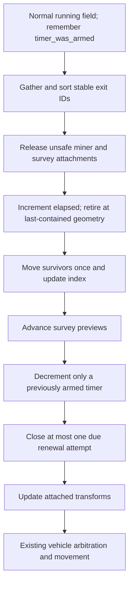
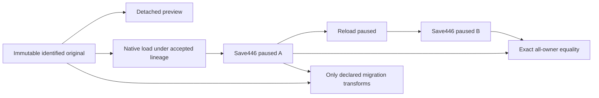

# October 26 merge, part 2: runtime integration and qualification

## Global Mandatory Reading

> **Execution protocol**
>
> - Read this Global Mandatory Reading section before the first task and again
>   after every context compaction.
> - Before starting or resuming a task group, read the nearest preceding Area
>   Mandatory Reading block whose `Applies to` label includes that group. Area
>   blocks appear immediately before the first group they govern.
> - A referenced heading or exported symbol is authoritative. Global navigation
>   hints and Area line ranges are for navigation only; if they drift, relocate
>   the named section or symbol rather than expanding to the whole file.
> - Mandatory reading is non-transitive. Do not preload a linked file's own
>   Mandatory Reading, Consult on Demand, or Planning Provenance entries unless
>   this plan names them directly for the current area.
> - Do not read Consult on Demand or Planning Provenance merely because those
>   sources are listed. Use a Consult on Demand source only when its trigger
>   occurs.
> - No created source file, test file or JSON file should start with same prefix as a planning MD file (such as r2). Only MD files can have that prefix. No MD file should be created anywhere in source directories unless specifically asked.
> - After EVERY CONTEXT COMPACTION, you must add a note above the task group
>   which is currently in execution. The note will say: "Context has compacted
>   X times while executing this group.". If the compaction occurs before any
>   meaningful work was done (this can happen when there is a lot of baggage
>   from the previous compaction), then and ONLY then you can skip this step.
> - When exceeding 3 context compactions, YOU MUST ask yourself if you're not  
>   chewing more than we can handle :). Heck, plans change! :). In such a case,  
>   the way out is to split the group on the spot,
>   in the plan, into more groups,  
>   by appending B, C, D as a suffixes to those groups (splitting sub-groups  
>   themselves is also allowed). When you do this, create Local Mandatory
>   Reading areas so you can optimize your context only for the
>   ACTUAL task at hand.
>   Before starting or resuming a task group, read the nearest preceding Area
>   Mandatory Reading block whose `Applies to` label includes that group. Area
>   blocks appear immediately before the first group they govern.

| File name | Line Ranges | Description |
| --- | --- | --- |
| [docs/zz-reach2/upgrades/2026-10/m2o23-4-come-space-b-integration-handoff.md](m2o23-4-come-space-b-integration-handoff.md) | 5-20 | **Delivered boundary, 2026-10-25** defines the already integrated geometry, native cargo/paid-supply owners, utility scheduler, protocol and art boundary. Every group must preserve these delivered features; this merge adds Space fixes without replacing the earlier underground integration. |
| [OpenTTD4: r2sff1-z-o-final-handoff.md](../../../../../OpenTTD4/docs/zz-reach2/upgrades/2026-10/r2sff1-z-o-final-handoff.md) | 14-23 | Delivered-fixes paragraph identifies construction/shortcut behavior, straight exits, safe detachment, order-owned continuation and the donor 441–445 transport sequence. It defines the incoming feature set and prevents treating the later donor commit as authority to overwrite destination-only behavior. |
| [src/map_layer.h](../../../../src/map_layer.h) | 96-104; 215-235 | `MultiLayerMap::DecodeStoredTile`, `TileInLayer`, `ProjectToSurface`: candidate geometry is same-file; native geometry is physical and independent of the camera. This globally constrains previews, cargo origins, motion, UI and deterministic tests. |
| [src/cargo_custody.h](../../../../src/cargo_custody.h) | 15-29 | `NativeCargoPacketVisitor` and `VisitNativeCargoPackets` define the sole traversal over actual containers. Native containers own cargo; copied metadata and receipt books do not. Every import must preserve uniqueness and avoid a second inventory/traversal authority. |
| [src/saveload/save_lineage.h](../../../../src/saveload/save_lineage.h) | Live definitions; no fixed range. Original declarations:104-116 | Part 1 Groups 5-18 produce `ClassifySaveDialect`, `HasSaveCapability`, `SaveDialect::SpaceFixes` and `CURRENT_MERGED_SAVE_VERSION`. This is globally necessary to preserve both441 meanings and select current446 without numeric guesses; runtime, protocol and acceptance must consume this single public compatibility owner. |

## Plan sequence and split boundary

**Status, 2026-10-28:** for the Linux workspace, this merge is now planned and executed by [m2o28 Part 1](m2o28-1-merge-oct28.md) and [Part 2](m2o28-2-merge-oct28.md), which adopt these decisions with enhancements (a real Git merge commit, a pending save-version gate in that commit, Linux builds with a Windows handoff, and cleanup with automatic backup). This plan's tasks stay as the historical October 26 record; do not execute them alongside m2o28.

The merge is planned in two files in this directory. Group and task numbers remain continuous across them; every unqualified group reference uses this shared numbering. This file split changes no implementation task, difficulty, checkbox, code sketch or diagram.

| Plan | Groups | Responsibility |
| --- | --- | --- |
| [Part 1: source recovery and save compatibility](m2o26-merge-source-save-compatibility-oct26.md) | 1-18 | Pin and recover inputs, import source, compose dialect/cargo/field/mission codecs, validate copied/native adoption and activate writer446. |
| [Part 2: runtime integration and qualification](m2o27-merge-runtime-qualification-oct26.md) | 19-36 | Extend diagnostics, integrate native lifecycle/commands/UI/cleanup, build and qualify current images, then hand over the merge. |

The dependency boundary is after Group 18. Part 1 hands over source contracts and explicitly pending combined-native tests; Part 2 owns the first required complete build in Group 27 and final merge acceptance. Neither file authorizes Git writes, deletion, donor modification or protected gameplay advance.

## Scope and upstream handoff

This is Part 2 of the planning-only integration dated **2026-10-26**. Destination **D** is `D:/Codez/Sandbox/OpenTTD`; incoming **S** is `D:/Codez/Sandbox/OpenTTD4`. Historical **A/B** refers to the earlier OpenTTD/OpenTTD3 merge; S is the separate Space-fixes dialect.

Use the shared pins: base `cfeff84db52f8a3753a43c2a770a6363c62b2c67`, D `530daca23b0590d5cec7ea2a2332648a3935f932`, S `3d45ad4a4c53186ce03ac2e8bec4616b9db189b7`. Group 1 in Part 1 rechecks them; drift requires revising the dependent comparison before execution.

**ASSUMPTION: this was already built previously. If not, re-asses at runtime**

Part 1 Groups 1-18 provide accepted original dialects/capabilities, full-width source values, unified cargo custody, source-aware native/copied codecs, reset/adoption ordering and writer446/schema2 with historical441/schema1 retained. Verify those live public definitions and the [Part 1 handoff](m2o26-merge-source-save-compatibility-oct26.md#part-1-handoff-to-runtime-integration) before dependent work. Each Area below gives its narrower entry gate. Missing contracts stop their consumers; source inventory, static review and fixture preparation may continue. Donor images, old objects, edited save headers, private pool mutation or alternate registries cannot substitute.

The missing donor Space-fixes cache can be regenerated from retained405/418/440 seeds through Part 1 Groups 2-3 using an explicit contemporary tool profile. Old441-444 originals and deleted historical receipts remain unverified where unavailable. Current runtime failures still block acceptance; an unknown backup is not an indefinite prerequisite.

Preserve D's native/legacy supply, TBM/Tube/geothermal/utility, selected art and protected Space foundation while adding S lifecycle/mining/UI behavior. Keep IDs0-222, append policy223 and reject stale network revisions; diagnostics and complete-family comparisons remain under existing owners. Group 26 retains automatic save/native-config backups through the existing journal while removing historical-source hash blockers. No cleanup execution is authorized.

Execution remains file-level integration into D when requested. Keep S read-only; preserve original saves/configs and unrelated work. No Git writes, destructive Git commands, recursive deletion or protected-save advance are part of either plan. Detailed chronology, the 22-path conflict inventory and recovery findings remain in [Part 1](m2o26-merge-source-save-compatibility-oct26.md#scope-pins-and-chronology); consult the specific section only when the current task needs it.

## Implementation tasks

This plan continues Groups 19-36; Groups 1-18 remain in [Part 1](m2o26-merge-source-save-compatibility-oct26.md#implementation-tasks). Do not renumber or reimplement those upstream tasks.

Every example is an **implementation sketch**, not a claim that the proposed helper or field exists today. C++ public headers are the public boundary here; do not introduce a new registry/barrel merely to match generic planning vocabulary. Proposed helper names may be adjusted within the named owner, with callers/tests updated together.

Groups 5-26 compose a shared native library across the two plans. Add focused fixtures with each contract and run independent/standalone checks when possible. The first required combined native build is Group 27 in Part 2; tests requiring unresolved adapters remain explicitly pending until then. Entry gates before that build check implemented declarations, adapters and fixture coverage; Groups 28 onward require actual fresh binary/test evidence.

Keep S read-only, preserve original bytes and the clarified save/config backup policy. Existing comments citing predecessor-plan group numbers retain their historical meanings.

### Area Mandatory Reading - Canonical diagnostics and whole-save readers

_Applies to Groups 19-20._

**ASSUMPTION: this was already built previously. If not, re-asses at runtime**

**Entry gate:** Group 18 exact current writer contract and Group 11 full source identity are implemented. Verify public definitions and fixture names. If missing, stop version dispatch and round-trip assertions; field coverage inventory may continue. Do not compare only the donor fifteen-owner subset, normalize away unknown families, or generate expected bytes from current output.

| File name | Line Ranges | Description |
| --- | --- | --- |
| [src/multilayer_state.h](../../../../src/multilayer_state.h) | 148-174 | `MultiLayerCanonicalField/Record` and `ComputeMultiLayerStateDigest`/`ComputeLiveMultiLayerStateDigest` define portable diagnostics over existing owners, not another mutable registry. |
| [docs/zz-reach2/upgrades/2026-10/m2o23-3-come-space-d-canonical-state.md](m2o23-3-come-space-d-canonical-state.md) | 7-36 | **Existing canonical owners** and **Explicit merged transport set** preserve complete cargo/supply/ground/Space coverage and exact names/kinds. Incoming selected-owner peer diagnostics supplement them. |
| [src/tests/multilayer/support/savegame_tables.py](../../../../src/tests/multilayer/support/savegame_tables.py) | 196-232 | `merged_world_chunks` and `compare_merged_worlds` currently hardcode a441 fixture. Add source-aware dispatch while retaining all-owner equality and the historical fixture. |
| [src/saveload/save_lineage.h](../../../../src/saveload/save_lineage.h) | Live definitions; no fixed range | Groups 5-18 define the finite source formats and actual current writer. Reuse those definitions/test fixtures when teaching diagnostic readers; no Python-only dialect interpretation may conflict with native admission. |

### Group 19 - Extend existing digests to the combined saved fields

**ASSUMPTION: this was already built previously. If not, re-asses at runtime**

Groups 10-18 define the actual saved fields. Use existing owner digests; this group does not invent a parallel state model.

{{MEDIUM}}

- [ ] **19.1** Replace source type/id-only digest sites with imported `AppendCargoSourceDigest`, starting with D-only `CargoPacket::ComputePoolDigest`, then manifest/fleet/descent/handling/stock consumers. Keep receipt/departure, quantity, age, credit and source tile in their existing owner roots.

- [ ] **19.2** Audit asteroid/SpaceVehicle/order roots for issuer frontier, exit counters/latest exit, credit, timer and both private renewal streams; include mineral, effective target/generation, departure, retry, route cursor and travel budget. Preserve explicit field encoding and version diagnostics if byte order changes.

- [ ] **19.3** Add mutation-sensitivity tests: changing each saved field changes the appropriate diagnostic; reordering equivalent sparse storage or moving the camera does not. Derived indexes, addresses, hash bucket order and allocator state stay excluded.

### Group 20 - Adapt exact-family readers and independent comparison oracles

**ASSUMPTION: this was already built previously. If not, re-asses at runtime**

Groups 18-19 supply the current exact contract and diagnostics. Completion produces readers used by Groups 28-35; executable results remain pending until the combined build.

{{HARD}}

- [ ] **20.1** Add explicit old441/current446 contract dispatch to `merged_world_chunks` and `complete_world`; select S441-445 only using admitted marker/schema facts and its source-family contract. Do not use the outer number441 alone. Preserve unknown/duplicate/missing/wrong-kind refusals.

- [ ] **20.2** Update donor Python CAPA/ASTR/order readers and mutation helpers to understand the combined fields and correct byte offsets without weakening donor-only comparisons. Verify fields by named descriptors/explicit era layouts; do not copy old offset assumptions into446.

- [ ] **20.3** Keep paused new446 save/reload/save comparisons byte-exact over every required raw family. Original migration comparisons use only the documented structural transforms, including old origin upgrade and absent lifecycle defaults; they never normalize away whole owners or changed cash/RNG/custody.

- [ ] **20.4** Prepare paired reader/native classification cases and cross-check both441 meanings, fresh donor445/current446 and classic/no-field sources. Failure reports must identify owner/field/source era, so a later acceptance agent can diagnose a bounded discrepancy.

### Area Mandatory Reading - Native motion, mission ownership and loop publication

_Applies to Groups 21-23._

**ASSUMPTION: this was already built previously. If not, re-asses at runtime**

**Entry gate:** Groups 4 and 10-20 must supply destination lifecycle/mission headers, source-aware saves, unified custody and diagnostics. Verify actual exports and owner call sites. If absent, stop native publication; pure geometry/selection review may continue. No duplicate queue/ledger, private pool setup, direct issuer changes or synthesized service can fill missing prerequisites.

| File name | Line Ranges | Description |
| --- | --- | --- |
| `D/src/asteroid_lifecycle.h`; pinned reference [OpenTTD4: asteroid_lifecycle.h](../../../../../OpenTTD4/src/asteroid_lifecycle.h) | Live definitions; no fixed range. S reference: 9-40 | Group 4 produces/imports this destination boundary; verify the named exports in D before dependent work. `RetireAsteroidBatch`, `PlanNativeAsteroidRenewal`, `CheckAsteroidRenewalAdmission`, `CommitAsteroidRenewal` preserve atomic field/index/ledger publication and explicit failed-interval closure. Destination copies are produced by Group 4. |
| `D/src/space_mining_continuation.h`; pinned reference [OpenTTD4: space_mining_continuation.h](../../../../../OpenTTD4/src/space_mining_continuation.h) | Live definitions; no fixed range. S reference: 13-46 | Group 4 produces/imports this destination boundary; verify the named exports in D before dependent work. `BeginSpaceMiningContinuation`, `ResolveEffectiveSpaceOrderTarget`, `TickSpaceMiningContinuation` and its context validators preserve the original queue, stopped state and typed target meaning. |
| `D/src/space_return_target.h`; pinned reference [OpenTTD4: space_return_target.h](../../../../../OpenTTD4/src/space_return_target.h) | Live definitions; no fixed range. S reference: 14-60 | Group 4 produces/imports this destination boundary; verify the named exports in D before dependent work. `GetSpaceReturnRoute`, `GetSpaceReturnCandidateAdmission`, `FindNearestEligibleSpaceReturn` and `ExecuteSpaceReturnArrival` separate nearest selection from actual berth/material/service admission. No navigation prediction grants a paid result. |
| [OpenTTD4: asteroid.cpp](../../../../../OpenTTD4/src/asteroid.cpp) | 1066-1135 | `TickAsteroidField` is the concrete native ordering authority: gather stable exits, release safety attachments, retire, move survivors, advance survey previews, tick only a previously armed timer, attempt one birth, update attachments. Preserve its allocation-failure semantics. |
| [src/cargo_custody.h](../../../../src/cargo_custody.h) | Live definitions; no fixed range | Groups 10-17 adapt typed sources and load adoption while keeping `VisitNativeCargoPackets` the single physical-container traversal. Runtime cargo transfers must continue through these actual owners. |

### Group 21 - Reconcile geometry and field transactions in isolation

**ASSUMPTION: this was already built previously. If not, re-asses at runtime**

Group 4 imports the transaction owners and Groups 13/19 preserve their fields/diagnostics. These are port/reconciliation tasks over delivered S behavior, not a new renewal design.

{{HARD}}

- [ ] **21.1** Preserve S `StepSpaceMotionStraight` and actual plane bounds, sparse identity lookup and insertion/removal index updates. Check old strip restrictions remain placement policy rather than terminal bounds. Keep empty fields valid and never reuse retired IDs.

- [ ] **21.2** Integrate `RetireAsteroidBatch` against original last-contained geometry and strictly ascending copied IDs. Verify lease/knowledge/index removal plus exact1/3/5 credits; depletion alone does not retire. No borrowed body pointer may survive vector/index publication.

- [ ] **21.3** Integrate renewal proposal/admission/commit with one recognized ticket. Credit/ID debit occurs only on a real birth; recognized capacity/placement/allocation refusal retains credit and closes its own timer/RNG interval exactly once; stale ticket is unchanged refusal.

- [ ] **21.4** Prepare pure/native transaction cases for storage reversal, simultaneous exits/latest-size ordering, exhausted issuance, no eligible size, capacity and scoped allocation failure. Do not change the normal loop yet; test helpers must state when input geometry is declared.

### Group 22 - Reconcile mining continuation and real receiver/service admission

**ASSUMPTION: this was already built previously. If not, re-asses at runtime**

Group 21 transactions and Groups 10-17 cargo/mission contracts exist. Keep pure eligibility separate from actual actions.

Existing APIs distinguish the phases; avoid implementing a second action producer:

```cpp
auto candidate = FindNearestEligibleSpaceReturn(craft, purpose);
// Selection grants no berth, stock, payment, service or arrival.
// The original queue performs travel and every intervening Visit.
if (/* original controller observes actual reached target */) {
    const bool admitted = ExecuteSpaceReturnArrival(craft, target, purpose);
    // Existing queue/work owner alone handles progression after admission.
}
```

{{HARD}}

- [ ] **22.1** Join `ReleaseUnsafeSpaceMiningAttachments` and survey-release paths to the same safety forecast. Preserve stopped hulls, own leases, cargo and static Core/Dock service claims; a blocked departure retains its named wait instead of resetting work or teleporting.

- [ ] **22.2** Adapt `ResolveEffectiveSpaceOrderTarget` and the existing order-action controller to one original queue. FullLoadNearest retains mineral and Visit sequence; legacy/default behavior stays exact; ReturnNearest is restricted to the original domain. Keep stable distance/typed-ID/generation tie-breaks and bounded retry notifications.

- [ ] **22.3** Reconcile `CanNavigateSpaceOnboardService`, receiver capacity, shell/descent and actual arrival operations with D supply/custody. Planning reads existing parts/allowance without consumption; `ExecuteSpaceReturnArrival` revalidates current owners and delegates actual transfer/service to them.

- [ ] **22.4** Prepare cases for partial/full holds, required service, missing/occupied/unsafe body, no receiver, paused work, stopped craft and explicit Recall/cancel. Constructor/normal supplied-work progression uses original work admission; no idle screenshot is itself proof of a deadlock.

### Group 23 - Publish one correctly ordered normal field opportunity

**ASSUMPTION: this was already built previously. If not, re-asses at runtime**

Groups 21-22 own field transactions and continuation; Group 19 provides complete observations. The following sequence reflects inspected live S code, not a newly chosen ordering.



{{HARD}}

- [ ] **23.1** Preserve S `TickAsteroidField` ordering shown above, including remembering whether the timer was armed before exits. First credit keeps its entire new delay; a new body first moves on the next tick. Keep normal/editor/menu/pause gates independent of camera visibility.

- [ ] **23.2** Join the single field call in `StateGameLoop` before existing vehicle arbitration/movement while retaining D utility/ground/manifest/pod/transition scheduling and its once-per-opportunity guards. Inventory both branches of the loop; do not leave a second field tick or accidentally tick in pause mode.

- [ ] **23.3** Retain S terminal error handling when allocation failure occurs after partial native publication. Do not invent a general rollback or turn an invalid partial opportunity into a harmless wait. Keep fallible proposal preparation before atomic owner publication where the transaction contract already allows unchanged refusal.

- [ ] **23.4** Prepare matched visible/hidden, pause/normal/fast-forward and save-at-boundary fixtures. Assert unchanged stopped state, exact elapsed ticks and one timer decrement/birth attempt; invoke native public opportunities rather than private field stepping for integration proof.

### Area Mandatory Reading - Combined command ABI

_Applies to Group 24._

**ASSUMPTION: this was already built previously. If not, re-asses at runtime**

**Entry gate:** Groups 5-23 must supply the current writer identity and native policy owner. Inspect public declarations, command registrations and the Group 22 policy fixtures. Stop command execution claims if absent; ABI enumeration and negative payload fixtures may continue. Do not alias S ID211, renumber D commands or stub a policy owner.

| File name | Line Ranges | Description |
| --- | --- | --- |
| [src/command_type.h](../../../../src/command_type.h) | 446-462 | The tail of `Commands` fixes existing IDs through `SetTubeVehicleGeothermalPower` (222). Append one entry before `End`; earlier tuples and ordinals are immutable. |
| [src/space_vehicle_cmd.h](../../../../src/space_vehicle_cmd.h); pinned reference [OpenTTD4: space_vehicle_cmd.h](../../../../../OpenTTD4/src/space_vehicle_cmd.h) | Live definitions; no fixed range. S reference: 42-51 | Group 4 produces/imports this destination boundary; verify the named exports in D before dependent work. `CmdSetSpaceMiningPolicy` and its `DEF_CMD_TRAIT` define the generation-checked existing-Mine edit; preserve query purity while assigning the new combined ID. |
| [src/network/core/network_game_info.cpp](../../../../src/network/core/network_game_info.cpp) | 48-58; 122-148 | `GetMergedNetworkRevisionSuffix` and `IsNetworkCompatibleVersion` reject a mismatched save/command/content suffix before Git-hash fallback. Select the new writer constant without changing historical dialect constants. |
| [src/saveload/save_lineage.h](../../../../src/saveload/save_lineage.h) | Live definitions; no fixed range | Groups 5-18 produce `CURRENT_MERGED_SAVE_VERSION`, `ClassifySaveDialect` and `HasSaveCapability`; the protocol suffix consumes current writer identity, not the old441 marker constant. |

### Group 24 - Publish the combined command and protocol identity

**ASSUMPTION: this was already built previously. If not, re-asses at runtime**

Groups 5-23 provide the policy/mission types and combined save constants. The command is appended once, independently of source enum spellings.

```cpp
// Expected combined ordinals; retain the existing command tuples.
static_assert(to_underlying(Commands::SetTubeVehicleGeothermalPower) == 222);
static_assert(to_underlying(Commands::SetSpaceMiningPolicy) == 223);
// GetMergedNetworkRevisionSuffix uses CURRENT_MERGED_SAVE_VERSION,
// Commands::End and the existing content-profile version.
```

{{MEDIUM}}

- [ ] **24.1** Append `SetSpaceMiningPolicy` after D's current command tail (planned ID223), keeping IDs0-222 and all existing tuples unchanged. Register `CmdSetSpaceMiningPolicy` and its generation/index/policy arguments once in native and network dispatch; retain query-before-execute refusal semantics.

- [ ] **24.2** Update the protocol suffix to use `CURRENT_MERGED_SAVE_VERSION` (446) and the actual appended command count. Preserve the suffix comparison before hash fallback and native length bounds. Extend the command identity auditor with a separately named current fixture; old fixtures remain historical evidence, including S211 and D211 meanings.

- [ ] **24.3** Add codec/admission cases for policy range, stale hull generation, wrong owner, non-Mine cursor, query/no mutation and changed target before execution. Retain existing canonical supply, TBM, geothermal and Tube command tests.

- [ ] **24.4** Finish duplicate/missing command and CMake registrations, then compile the affected targets when prerequisites permit. Run the identity/codec tests here if runnable, otherwise record their exact pending target for Group 27. Keep the combined protocol refusal cases for Group 32; a codec-only pass is not a real-peer claim.

### Area Mandatory Reading - Shared presentation and keyboard dispatch

_Applies to Group 25._

**ASSUMPTION: this was already built previously. If not, re-asses at runtime**

**Entry gate:** Group 24 must expose `CmdSetSpaceMiningPolicy` through native/network command dispatch, and Group 4 must import the three construction text functions. Check the header and registration. Stop policy submission or construction wait integration if absent; layout and setting deduplication may continue. Do not directly edit mission state or synthesize construction prerequisites.

| File name | Line Ranges | Description |
| --- | --- | --- |
| [src/window_func.h](../../../../src/window_func.h) | 54-86 | `FindFrontmostClosableWindow`, `IsWindowRaisedAsFarAsPossible`, `CloseFrontmostClosableWindow` and `CancelPlacementOrCloseWindow` preserve D z-priority and Escape/placement precedence. |
| [src/toolbar_gui.cpp](../../../../src/toolbar_gui.cpp) | 2149-2168 | `HotkeyWindow` and `ToggleHotkeyWindow` are the single existing opening-key toggle path. Extend its eligibility guards; do not add a second F2 dispatcher. |
| [src/map_layer_gui.h](../../../../src/map_layer_gui.h) | 90-96 | `ShowMainViewportLayerInDisplayOrder` preserves display order, unavailable-layer refusal and viewport geometry while adapting incoming names. |
| `D/src/space_construction_gui.h`; pinned reference [OpenTTD4: space_construction_gui.h](../../../../../OpenTTD4/src/space_construction_gui.h) | Live definitions; no fixed range. S reference: 15-20 | Group 4 produces/imports this destination boundary; verify the named exports in D before dependent work. `GetSpaceConstructionReasonText`, `GetSpaceConstructionBuilderText`, `GetSpaceConstructionMaterialText` read real construction owners. Imported by Group 4, these queries grant no work or material. |
| [src/tests/window_hotkey_toggle.cpp](../../../../src/tests/window_hotkey_toggle.cpp) | 100-151; 153-208; 211-231 | The toolbar close/raise, Escape and four-layer tests define retained interaction behavior; add donor modal/pinned cases to these boundaries. |

### Group 25 - Consolidate controls, construction pages and player feedback

**ASSUMPTION: this was already built previously. If not, re-asses at runtime**

Group 24 supplies the admitted policy command; Group 22 owns the live waits. Keep GUI work limited to those owners.

{{MEDIUM}}

- [ ] **25.1** Use one layer-selection entry and one Alt+1..4 mapping in both normal/editor toolbars. Preserve D's display-order symbols or map incoming names explicitly; merge hotkeys.cfg migration without changing custom user bindings, and retain Ctrl+Alt Debug shortcuts.

- [ ] **25.2** Unify repeat-opening behavior for Game Options and D's other mapped windows: open absent, raise covered without recreation, close an eligible raised target only when toggles are enabled. Incorporate S's modal-progress, modal-window, Sticky and NoClose safeguards while respecting D's z-priority definition. Keep Escape placement/edit/query precedence separate.

- [ ] **25.3** Deduplicate `hotkey_toggles_window` across settings struct, INI generation, settings UI and English strings. Preserve `escape_closes_window` and every D-only setting/help row. Resolve shared header/comment conflicts against actual delivered public symbols, not stale plan filenames.

- [ ] **25.4** Bring S's bounded orbital construction action pages, resizing and actionable missing-material/service/work messages into the current GUI. Preserve D's layer-specific construction previews, station supply controls and underground/Tube/geothermal entry points.

- [ ] **25.5** Expose incoming Mine continuation policies and exact wait reasons using the admitted command and original mission owner. Preserve legacy defaults and command refusal feedback; presentation must not directly mutate policy, cargo, selection or runtime intent.

- [ ] **25.6** Run focused D window-toggle/Escape/layer cases and S layout/shortcut/policy-control cases, including Debug and editor dispatch, pinned/modal/covered windows and copied old/new hotkey configs. Verify one event produces one action, settings occur once, and hidden layers do not change simulation/RNG.

### Area Mandatory Reading - Cleanup policy and retained tooling

_Applies to Group 26._

| File name | Line Ranges | Description |
| --- | --- | --- |
| [src/tests/multilayer/support/save_retention.py](../../../../src/tests/multilayer/support/save_retention.py) | 77-124; 149-187 | `_observe`, `_destination`, `plan_save_exports` identify save bytes and native .cfg/.scr settings, reuse verified retained payloads and plan aliases in the existing journal. |
| [src/tests/multilayer/support/artifact_preservation.py](../../../../src/tests/multilayer/support/artifact_preservation.py) | 213-295; 298-352 | `verify_cleanup_inputs` is the broad historical audit; `cleanup_operation` couples it to save export and narrows per-scope verification. Remove only that audit coupling from the routine path; retain selected-scope integrity checks. |
| [src/tests/multilayer/support/artifact_source_epochs.py](../../../../src/tests/multilayer/support/artifact_source_epochs.py) | 166-183 | `verify_source_epochs` requires historical hash matches. It is explicit reconstruction evidence, not a precondition for protecting current saves/configs. |
| [OpenTTD4: clean.ps1](../../../../../OpenTTD4/clean.ps1) | 2-53 | Script help defines S ownership, clean-tree and preview safeguards. Retain those guards while replacing its disposable-save policy. |
| [OpenTTD4: cleanup_fixture.ps1](../../../../../OpenTTD4/src/tests/multilayer/support/cleanup_fixture.ps1) | 119-139 | `Complete-CleanupChecks` performs recursive teardown. Replace the destructive fixture behavior with doubles before any verification invocation. |

### Group 26 - Keep save/config backups without historical source blockers

**ASSUMPTION: this was already built previously. If not, re-asses at runtime**

The existing retention journal remains the backup authority. This group edits and tests the cleanup interface; it does not authorize executing cleanup or preservation apply.

Proposed adapter boundary; keep the existing per-scope verification implementation and response contract, updating its caller together. These are implementation sketches, not commands to run:

```python
if operation == "plan":
    proposal = plan_save_exports(root, request["scopes"], configurations=True)
    return {"plan": proposal}  # caller consumes backup facts, not source epochs
if operation == "apply":
    return {"exports": apply_save_exports(request["plan"], root)}
# verify: retain the existing selected-scope narrowing and verify_save_exports.
# Explicit historical reconstruction may call verify_cleanup_inputs separately.
```

{{MEDIUM}}

- [ ] **26.1** Separate routine save/config export from the broad `verify_cleanup_inputs` source-epoch/checkpoint audit inside the existing preservation adapter. Routine cleanup must not call `verify_source_epochs`, require all historical receipts, or demand classification/export of old code snapshots. Keep explicit recovery audits available to their actual consumers and preserve existing archived records unchanged; do not add a second preservation journal.

- [ ] **26.2** Keep automatic backup of saves/scenarios (including renamed save-like payloads) and native configs/startup scripts actually inside the selected output scopes. Reuse verified exact-byte copies and existing journal aliases outside those scopes; back up changed personal hotkeys.cfg automatically. A tracked copy outside the cleanup scope is protected by the tracked-file boundary; identical safely retained bytes need no new copy or approval. Neither an old source hash nor an unrelated absent history file may block this operation. Real copy/hash/containment/race failures still refuse removal.

- [ ] **26.3** Incorporate S's repository-root/current-directory, Git-environment override, clean-tree, tracked-parent/submodule and final file-identity safeguards. Keep preview read-only and make dry-run/WhatIf precedence explicit. Do not clean authored source, retained archives or unknown locations; within explicitly disposable output owners, code/build snapshots need no historical-version preservation workflow. Provide a concise count/location summary of backups and precise actionable errors only for actual unsafe backup/removal conditions.

- [ ] **26.4** Adapt both cleanup test suites using non-destructive removal/Git doubles. Add regression cases for a legitimately changed committed hotkeys.cpp with a stale source-epoch reference, an unchanged tracked hotkeys.cfg outside the target, a changed personal runtime hotkeys.cfg automatically backed up, stale unrelated history, and failed/changed-in-flight save copies. The first and stale-history cases must not block routine backup/preview; actual backup integrity and ownership failures must still refuse. Disable recursive teardown and git init/add/commit fixture setup before invoking tests.

- [ ] **26.5** Reconcile historical-debug architecture, both cleanup plan notes and script help: explain save/config backup separately from optional historical reconstruction, with no instruction to freeze live source or manually preserve arbitrary code versions. Record missing donor runtime evidence as likely cleanup loss reported by the user, not a proven deletion event or a reason to restore the old broad blockers.

- [ ] **26.6** Validate PowerShell/Python syntax and preview/refusal/backup-planning contracts with non-destructive doubles. Confirm tracked/untracked working changes still block real apply where intended, preview permits them, exact retained-copy checks remain effective, and wrong root/redirect/tracked-descendant cases refuse. Do not invoke real deletion, cleanup apply or preservation apply during cleanup verification. Group 3 separately owns explicitly scoped recovery-save export; it grants no deletion.

### Area Mandatory Reading - Combined build

_Applies to Group 27._

**ASSUMPTION: this was already built previously. If not, re-asses at runtime**

**Entry gate:** Groups 4-26 must leave registered combined targets, current writer/capabilities, unified cargo/preview APIs and policy command. Verify declarations and the pending focused-test ledger. Stop native qualification if absent; fixture inventory, static reader review and documentation may continue. No S binaries, stale pre-merge objects, fake implementations or edited headers may satisfy this gate.

| File name | Line Ranges | Description |
| --- | --- | --- |
| [src/tests/multilayer/support/native_build.py](../../../../src/tests/multilayer/support/native_build.py) | 43-76; 109-175 | `load_profile` and `discover_tools` bind actual retained dependencies and compiler versions to the combined image. Group 2 donor recovery profiles are separate evidence. |
| [src/saveload/save_lineage.h](../../../../src/saveload/save_lineage.h) | Live definitions; no fixed range | Groups 5-18 produce the current writer, classifier and explicit capabilities. Verify declarations and definitions before building; current tests must use that public boundary. |
| [OpenTTD4: r2sff1-z-o-final-handoff.md](../../../../../OpenTTD4/docs/zz-reach2/upgrades/2026-10/r2sff1-z-o-final-handoff.md) | 71-116 | **Reproduction** names the real targets, configurations, bounded drivers and output ownership. Adapt to D-built images and fresh run IDs; old build receipts cannot certify this source. |

### Group 27 - Build one combined epoch and run its focused checks

**ASSUMPTION: this was already built previously. If not, re-asses at runtime**

Groups 4-26 supply implementations and scoped fixtures; this is the first required whole combined build. Use the existing sequential build/process limits.

{{MEDIUM}}

- [ ] **27.1** Configure and build D sequentially in Debug and RelWithDebInfo, using the existing native-build memory/process guards. Build `openttd`, `openttd_test`, `openttd_space_fixes_test` and affected destination supply/capital/Tube targets. Bind exact source, compiler/config, asset/input and binary hashes; do not reuse a historical receipt as a current build.

- [ ] **27.2** Run the pending focused cases from Groups 5-26 in the appropriate target: source matrix, bounded envelope, packet scratch, field/mission codecs, copied joins, failure reset, exact-owner readers, lifecycle transactions, command and UI dispatch. Record each actual result and configuration; fixture preparation is not a passing run.

- [ ] **27.3** Fix only diagnosed integration failures and rerun their affected checks. Inspect stale numeric-version tests, source identity truncation and duplicate target registration first; do not weaken historical compatibility, remove canonical owners or suppress assertions to obtain a build. Publish the source/image/input manifest required by Group 28.

### Area Mandatory Reading - Compatibility and conservation qualification

_Applies to Groups 28-31._

**ASSUMPTION: this was already built previously. If not, re-asses at runtime**

**Entry gate:** Group 27 must provide new Debug and RelWithDebInfo images, focused results and source/input hashes; Group 20 must expose complete-world comparisons. Verify actual files and receipts. Stop Groups 28-31 native acceptance claims if absent. Inventory and test-case preparation may continue; never substitute S images, private decoder copies, selected-owner digests, edited source headers or historical successes.

| File name | Line Ranges | Description |
| --- | --- | --- |
| [src/saveload/save_lineage.h](../../../../src/saveload/save_lineage.h) | Live definitions; no fixed range | Groups 5-18 produce `ClassifySaveDialect`, `HasSaveCapability` and writer/marker constants. The accepted source matrix controls native and detached load expectations. |
| [src/tests/multilayer/support/savegame_tables.py](../../../../src/tests/multilayer/support/savegame_tables.py) | Live definitions; no fixed range | Group 20 updates `merged_world_chunks` and `compare_merged_worlds` with versioned exact-family contracts. Include empty families and all unchanged owners, not only Space diagnostics. |
| [docs/zz-reach2/upgrades/2026-10/m2o23-3-come-space-d-canonical-state.md](m2o23-3-come-space-d-canonical-state.md) | 38-64 | **Permitted original-to-merged structural transformations** limits legacy supply/engine/rail/catalogue changes and second-save equality. Add only explicit source-era origin/lifecycle defaults, never generic normalization. |
| [src/saveload/save_envelope.h](../../../../src/saveload/save_envelope.h) | 16-35 | `InspectSaveWireFacts` and `SaveInspectionLimits` constrain detached preflight. Refusal before world initialization must preserve active state; it differs from late native adoption failure. |
| [OpenTTD4: r2sff1-r-transport-gate.md](../../../../../OpenTTD4/docs/zz-reach2/upgrades/2026-10/r2sff1-r-transport-gate.md) | 7-28 | **Certified boundary** requires field-before-origin adoption and complete copied joins/reset. Compare the Group 17 implementation with this contract before advancing runtime tests. |
| [src/tests/multilayer/acceptance/space_checkpoint.py](../../../../src/tests/multilayer/acceptance/space_checkpoint.py) | 128-137; 186-194 | `load_foundation` and `verify_foundation` select and verify the exact sealed Space foundation without treating its old executable as a current result. Advancing tests need separately allowed copies. |

### Group 28 - Qualify source migrations and paused current round trips

**ASSUMPTION: this was already built previously. If not, re-asses at runtime**

Groups 3, 18, 20 and 27 supply the independent reference, current writer, versioned comparisons and combined binaries. Exit with a source-by-source matrix, not one aggregate green result.



{{HARD}}

- [ ] **28.1** Instantiate a row for each independently identified source: shared403, historical A438/440 and B434/collision fixtures, D merged441, retained genuine S441-445, Classic374 and donor Space405/418/440. Record source hash, accepted dialect/capabilities, available image and allowed transformations before running; unavailable historical sources stay explicitly unverified.

- [ ] **28.2** Use Groups 2-3 independently rebuilt S445 output for the missing current-donor original, plus the Groups 6-14 component fixtures for absent S441-444 eras. Label contemporary reference reconstruction separately from historical-run reproduction. Do not fabricate originals or wait indefinitely for an unknown backup.

- [ ] **28.3** For each available row, compare detached preview with ordinary native load, save446, reload paused and save446 again. Compare every required current owner/family byte-for-byte between the two current saves. Keep runtime motion disabled for this transport gate.

- [ ] **28.4** Compare original-to-current changes only against the predeclared per-dialect transformations: existing D migrations, typed legacy origin qualification, absent lifecycle/continuation defaults and canonical marker/wire changes. Investigate any extra changed field; fix the codec or the explicit mistaken expectation, never broadly mask a failing owner.

### Group 29 - Qualify refusal, copied reset and late native failure

**ASSUMPTION: this was already built previously. If not, re-asses at runtime**

Groups 15-17 define copied reset and native failure ownership; Group 27 supplies the real path. Test each stage against its own failure contract.

{{HARD}}

- [ ] **29.1** Run malformed-source cases for missing/duplicate/wrong-kind MLLN and feature families; incomplete origin pairs; source-label mismatch; impossible issuance/credit history; invalid policy/intent/generation/lease; and partial source-owned records. Ambiguous originals and modern corrupt files must refuse without fallback or invented history.

- [ ] **29.2** Alternate valid and invalid detached previews and preflight loads. Snapshot active cash, RNG, profile, geometry, packet ownership and copied staging before each attempt. A preflight refusal must preserve the active world, clear partial copied data while retaining its error, and allow the next valid candidate.

- [ ] **29.3** Inject/trigger a failure after native adoption starts, then check the actual `SaveOrLoadResult::ReInit` path and load a valid file. Require reset of staging/pools/caches and no stale references; do not require restoration of the old running world after destructive initialization. Retain the distinction from preflight Error in fixtures and receipts.

### Group 30 - Qualify mixed cargo custody and paid ground continuations

**ASSUMPTION: this was already built previously. If not, re-asses at runtime**

Groups 12, 17, 22-23 and 28 establish custody, load ordering and lifecycle transport. The complete-owner oracle from Group 20 must remain enabled; conservation cannot be established from the fifteen incoming observations alone.

{{HARD}}

- [ ] **30.1** Carry high-ID and retired-source asteroid packets through station goods, ordinary vehicles, launch handling, manifests/pods and descents using native operations. At each transfer compare source/body/mineral, quantities, travel/age, feeder credit and exactly one physical owner; include partial transfer, duplicate/missing owner and ID-reuse refusal.

- [ ] **30.2** Exercise module manufacture, processing, construction and service consumption alongside native/legacy supply receipts. Include all input slots and dispatch/refund irreversibility; paid purpose, receipt/departure and actual consumption must settle once without converting asteroid origin into purchased supply.

- [ ] **30.3** Run affected D regressions for Native/LegacyB supply, TBM face/bay and whole transfer, Tube/provider switching, geothermal/heat/town service and mixed utility allocation. Use their existing actual source owners; broaden only for failures or newly affected behavior.

- [ ] **30.4** Replay available original paid ground/TBM/Tube/geothermal continuations with Space lifecycle active in the same world where legitimate inputs support it. Check one settlement per native opportunity, persistent manual stops and paid waits. If an input does not contain the required cross-feature world, report that coverage gap rather than installing synthetic stock or capabilities.

### Group 31 - Verify protected foundations and retained art

**ASSUMPTION: this was already built previously. If not, re-asses at runtime**

Groups 27-30 supply the current images and scoped load/custody results. Verify sealed inputs and affected bindings; this group does not advance protected gameplay.

{{MEDIUM}}

- [ ] **31.1** Requalify the exact protected Space foundation through existing restore/verification entry points and separately named outputs. Preserve original seals and financial/usefulness restrictions; any advancing test must use an explicitly allowed test copy and cannot be reported as progress on the protected gameplay continuation.

- [ ] **31.2** Confirm D's selected assets, renderer bindings and public manifest remain intact. Reuse existing immutable asset expectations, perform affected native GUI/render smoke only, and record the current GRF hash. This merge does not regenerate/reallocate the art catalogue or supersede prior qualified raster evidence.

### Area Mandatory Reading - Real peers and replay

_Applies to Groups 32-33._

**ASSUMPTION: this was already built previously. If not, re-asses at runtime**

**Entry gate:** Groups 24 and 27-31 must provide the registered policy command, two combined configurations and passing migration/custody gates. Check binaries and receipts before spawning peers. Stop Groups 32-33 runtime claims if absent; topology/input inventory can continue. A one-process replay, old receipt, private pool edit or altered save header cannot substitute for real socket peers.

| File name | Line Ranges | Description |
| --- | --- | --- |
| [src/network/core/network_game_info.cpp](../../../../src/network/core/network_game_info.cpp) | Live definitions; no fixed range | Group 24 updates `GetMergedNetworkRevisionSuffix` and `IsNetworkCompatibleVersion` to writer446/command223. Inspect this live discriminator before asserting WrongRevision timing. |
| [OpenTTD4: space_lifecycle_peer_checks.py](../../../../../OpenTTD4/src/tests/multilayer/acceptance/space_lifecycle_peer_checks.py) | 121-161 | `opportunities` and `compare_peer` require real assigned frames, contiguous common opportunities and each saved phase plus next decision. Adapt these imported functions to include Group 20 complete-world comparisons. |
| [OpenTTD4: r2sff1-z-m-high-id-peers.md](../../../../../OpenTTD4/docs/zz-reach2/upgrades/2026-10/r2sff1-z-m-high-id-peers.md) | 6-38; 50-84 | Declared historical-prefix paragraphs and **Native source and no-op transport verified** distinguish prepared issuance metadata from earned high-ID birth/extraction/retirement. Preserve that evidence limit. |
| [src/multilayer_state.h](../../../../src/multilayer_state.h) | Live definitions; no fixed range | Group 19 extends `ComputeMultiLayerStateDigest` and `ComputeLiveMultiLayerStateDigest` through existing canonical records. Use the same owners for matched-peer evidence; diagnostics do not replace raw all-family equality. |

### Group 32 - Establish actual peer topology and protocol refusal

**ASSUMPTION: this was already built previously. If not, re-asses at runtime**

Group 24 fixes the protocol discriminator and command identity; Groups 27-31 qualify the images and source world. Exit with a working baseline topology before adding lifecycle phase scenarios.

{{HARD}}

- [ ] **32.1** Create distinct homes/configs and new run IDs for the combined host, owning client and late observer; record endpoint image/source/input hashes and actual sockets. Verify matching peers join and resume the same accepted current world in both configurations.

- [ ] **32.2** Send the appended policy command from the owning client through the real command stream. Compare actual assigned frames, cash/RNG, cargo/supply/ground roots and the fifteen incoming observations at matched opportunities, including the late observer only after its join. Never issue an equivalent direct native edit as peer evidence.

- [ ] **32.3** Exercise old D441, S445 and historical A/B revision identities against the combined handshake and verify WrongRevision before authentication/map transfer. Use available independently built original clients for actual peer runs; identify protocol-unit tests separately where an original binary is unavailable. Add malformed/stale policy payloads and verify refusal neither executes ID211 nor alters the original mission.

### Group 33 - Qualify lifecycle phases and high-ID peer replay

**ASSUMPTION: this was already built previously. If not, re-asses at runtime**

Group 32 supplies the real peer driver and passing baseline. The high-ID preparation limit remains declared even when the subsequent native events pass.

{{HARD}}

- [ ] **33.1** Capture real phase saves around pre-exit release, retirement/credit, armed countdown, due refusal and successful birth. Require contiguous common opportunity coverage and each phase plus its next decision across actual peers; compare complete worlds as well as synchronized diagnostics.

- [ ] **33.2** Reload the same phases in independent local and reversed-storage twins and compare next native decisions with uninterrupted execution. Local twins have no server-frame authority: compare semantic opportunities, preserve packet provenance/continuation and require actual assigned frames only for joined peers.

- [ ] **33.3** Prepare the high-ID source through Group 3 native producers or the equivalent qualified combined chain: explicitly declare only the permitted historical prefix, then earn birth65536, extraction and retirement natively. Run real peers and actual return/service with combined custody; verify no 16-bit alias, source replacement or body-ID reuse. Record prefix/geometry declarations separately from earned work.

### Area Mandatory Reading - Bounded gameplay and runtime acceptance

_Applies to Groups 34-35._

**ASSUMPTION: this was already built previously. If not, re-asses at runtime**

**Entry gate:** Groups 27-33 must provide current-image build, transport, conservation and peer results, and Group 25 must expose consolidated controls. Verify scoped receipts; stop affected runtime success claims if absent. Checklist and workload inventory may continue. Do not use screenshots as personal-save reproduction, container counts as FPS, or direct state edits as earned construction/mining work.

| File name | Line Ranges | Description |
| --- | --- | --- |
| [OpenTTD4: r2sff1-z-o-final-handoff.md](../../../../../OpenTTD4/docs/zz-reach2/upgrades/2026-10/r2sff1-z-o-final-handoff.md) | 71-116 | **Reproduction** names the real layout/shortcut, compatibility and lifecycle drivers and their case selections. Use the imported drivers with combined images and private configs. |
| [OpenTTD4: r2sff1-z-n-lifecycle-work.md](../../../../../OpenTTD4/docs/zz-reach2/upgrades/2026-10/r2sff1-z-n-lifecycle-work.md) | 53-100 | **Release results** defines seven bounded workloads, capacity refusal, turnover and retry work. Counts measure these components, not whole-game FPS or total heap. |
| [src/window_func.h](../../../../src/window_func.h) | 63-86 | `IsWindowRaisedAsFarAsPossible` and the Escape helpers constrain the final covered/pinned/modal interaction checks after Group 25. |
| `D/src/space_return_target.h`; pinned reference [OpenTTD4: space_return_target.h](../../../../../OpenTTD4/src/space_return_target.h) | Live definitions; no fixed range. S reference: 14-60 | Group 4 produces/imports this destination boundary; verify the named exports in D before dependent work. `GetSpaceReturnCandidateAdmission`, `FindNearestEligibleSpaceReturn` and `ExecuteSpaceReturnArrival` separate pure receiver prediction from actual paid service admission. Groups 22-23 preserve this owner; runtime observations must show earned work and genuine waits. |

### Group 34 - Repeat native controls and actual gameplay scenarios

**ASSUMPTION: this was already built previously. If not, re-asses at runtime**

Groups 22-25 implement the native decisions and UI; Groups 27-33 qualify transport and peers. Use current images and immutable selected inputs.

{{MEDIUM}}

- [ ] **34.1** Run the established native construction/shortcut/layout scenarios in both configurations with private configs: all action pages reachable at recorded GUI/font scales, Alt+1..4 and repeat-F2 in normal/editor modes, retained window state, Escape precedence, actionable waits and a normally supplied paid construction completion.

- [ ] **34.2** Run both mining roles through partial/full hold, same-mineral continuation, nearest eligible receiver, absent asteroid/receiver, real service wait, manual stop and Recall. Preserve the original paid wait/allowance and verify normally supplied construction completes through its own native opportunities. Record actual wait reasons; an idle screenshot alone cannot establish deadlock.

### Group 35 - Repeat bounded work and cadence measurements

**ASSUMPTION: this was already built previously. If not, re-asses at runtime**

Groups 23 and 34 establish one native field opportunity and correct player interactions. Measurements remain bounded to their recorded configuration, input and counter scope.

{{MEDIUM}}

- [ ] **35.1** Repeat the seven established bounded field/work cases, capacity refusal, high-ID turnover and no-compatible-mineral retry measurements; record configuration, live population/storage, work counts and elapsed scope. Compare against donor bounds and destination combined-work baselines without asserting whole-game FPS from component counts.

- [ ] **35.2** Compare visible versus hidden Space views using identical native inputs/opportunity counts. Verify pause freezes field opportunities and fast-forward changes elapsed wall time without changing renewal tick rules; exercise camera/layer controls without RNG or simulation divergence.

- [ ] **35.3** Repeat only affected destination mixed ground/orbital contention and player-control smoke cases. Record any unresolved personal-save reproduction gap honestly; supplied screenshots or retained demos do not prove the missing personal save has been reproduced. Keep acceptance outputs separate from protected continuation progress.

### Area Mandatory Reading - Documentation and implementation handoff

_Applies to Group 36._

**ASSUMPTION: this was already built previously. If not, re-asses at runtime**

**Entry gate:** Groups 27-35 must provide current-image evidence for each claimed acceptance row. Verify manifests and outcomes before marking implementation complete. Stop success publication for missing results; source corrections and a clearly incomplete handoff may continue. Historical green checkboxes, old logs/images and current-output-derived expectations are not substitutes.

| File name | Line Ranges | Description |
| --- | --- | --- |
| [docs/zz-reach2/upgrades/2026-10/m2o23-4-come-space-b-integration-handoff.md](m2o23-4-come-space-b-integration-handoff.md) | 59-79 | **Supported reconstruction boundary** separates retained originals, recipe reconstruction and scoped qualification. Keep the existing storage/recipe authorities in the final handoff. |
| [OpenTTD4: r2sff1-z-o-final-handoff.md](../../../../../OpenTTD4/docs/zz-reach2/upgrades/2026-10/r2sff1-z-o-final-handoff.md) | 118-134 | **Limits and remaining ownership** preserves personal-save, declared-prefix, component-performance and protected Space limitations. Combined results do not silently widen those claims. |
| [src/tests/multilayer/support/savegame_tables.py](../../../../src/tests/multilayer/support/savegame_tables.py) | Live definitions; no fixed range | Group 20 produces versioned `merged_world_chunks`/`compare_merged_worlds`; Groups 27-35 produce actual results. Use their exact-family coverage and disclosed gaps for compatibility claims. |

### Group 36 - Reconcile records and hand over the complete merge

**ASSUMPTION: this was already built previously. If not, re-asses at runtime**

All prior groups supply their scoped outputs. Missing original historical runs remain disclosed rather than invented; actual failures or unrun required current checks keep completion open.

{{SIMPLE}}

- [ ] **36.1** Merge shared GUI/map-layers/savegame/desync/game-loop/vehicles/storage architecture and the Space/multilayer master updates around the final delivered behavior. Explain both historical441 dialects and current446, source-era migration, command223 and consolidated controls. Keep future feature work and original scope limits separate.

- [ ] **36.2** Reconcile `d2sa-space-adventures.md`, affected demo fixes and cleanup guidance with both feature sets. Preserve D's underground/Tube/geothermal/player controls and S's construction/mining guidance; verify launcher selections use the existing public resolver and immutable source aliases.

- [ ] **36.3** Publish a concise implementation handoff here or in an explicitly requested adjacent Markdown file with exact final source/build/input hashes, tested and missing original versions, focused/native/peer results, asset hash, cleanup decision and remaining human questions. Keep the existing profile/content catalogue, command table, asset manifest, retention journal and recipe registry as their sole authorities.

- [ ] **36.4** Validate every disposition entry and every one of the 38 shared paths against the merged result; confirm no source addition, save field, test target or documentation change was silently lost. Recheck S's HEAD/tracked/untracked status, original input hashes and D's unrelated work. Verify there were no Git writes or deletes.

- [ ] **36.5** Validate task numbering/difficulty batches, Area coverage, named symbols, tight ranges, local links and non-transitive reading lists. Mark only actually completed tasks with their concrete evidence during execution; leave blocked/unrun tasks open and report the precise remaining decision. Report the file-level merge result without staging or committing it.

## Consult on Demand

These are conditional sources, not additional prerequisites. Read a row only after its observable trigger occurs.

| Trigger | File name | Start at | Expand only when | Consultation purpose |
| --- | --- | --- | --- | --- |
| Classifier cannot distinguish an empty or mixed441 candidate | [src/saveload/save_lineage.cpp](../../../../src/saveload/save_lineage.cpp) | `ClassifySaveDialect` and `HasSaveCapability` | Only if the source-specific truth table and inspected marker/column facts disagree | Identify the existing ambiguity/refusal rules. Live classifier behavior constrains compatibility; this is not permission to guess an origin or grant a capability. |
| A retained source SHA or alias cannot be resolved | [docs/zz-reach2/upgrades/2026-10/m2o23-4-come-space-b-integration-handoff.md](m2o23-4-come-space-b-integration-handoff.md) | **Current continuation and player review**, lines45-57 | Only if the referenced retention journal still lacks the exact selected original | Recover the explicit original/source selection and protected gameplay boundary; timestamps and nearby saves are not substitutes. |
| Incoming reconstruction needs missing high-ID or lifecycle predecessor inputs | [OpenTTD4: high-ID peer record](../../../../../OpenTTD4/docs/zz-reach2/upgrades/2026-10/r2sff1-z-m-high-id-peers.md) | Declared historical-prefix boundary, lines6-38; then **Native source and no-op transport verified**, lines50-85 | Only if preparation cannot be reconstructed through its named native harness | Recover declared-prefix versus earned-event facts and original preparation sequence. Historical claims do not certify a newly built donor or combined image. |
| A modern typed origin fails only in a particular physical owner | [OpenTTD4: cargo origin record](../../../../../OpenTTD4/docs/zz-reach2/upgrades/2026-10/r2sff1-j-cargo-origin.md) | **Semantic consumer inventory**, lines152-179 | Only if the current canonical visitor and its tests leave that owner's intended source semantics unclear | Find overlooked source-identity consumers; the live destination visitor remains custody authority and no second traversal should be restored. |
| A completed integration feature appears absent after a clean-looking import | [docs/zz-reach2/upgrades/2026-10/m2o23-1-come-space-i-handover.md](m2o23-1-come-space-i-handover.md) | **Canonical cross-feature handoffs to preserve**, starting92 | Only if current code/tests and the final integration handoff do not explain the regression | Recover earlier supply/TBM/identity intent. This checkpoint is older than the final handoff and cannot override delivered code. |
| A renewal test disagrees about motion, costs, timing or eligibility | [OpenTTD4: Space fixes plan](../../../../../OpenTTD4/docs/zz-reach2/upgrades/2026-10/r2sff1-space-fixes-features-1.md) | **Scope and decisions**, lines57-68 | Only if the named live motion/lifecycle/target contracts contradict each other | Recover confirmed20-60-second policy, 1/3/5 weights, no instant refill and nearest-target tie-break rationale; validate implementation against those requirements. |
| A cold build imports Python modules from another checkout or lacks runtime assets | [docs/zz-reach2/upgrades/2026-10/m2o23-4-come-space-b-integration-handoff.md](m2o23-4-come-space-b-integration-handoff.md) | **Supported reconstruction boundary**, lines59-79 | Only if existing public build/staging helpers cannot produce their declared prerequisites | Diagnose `_pth`, distribution and source/profile ownership without using archived executables or another checkout's mutable state. |
| Routine save/config backup still refuses because of an old source hash or unrelated historical file | [src/tests/multilayer/support/artifact_preservation.py](../../../../src/tests/multilayer/support/artifact_preservation.py) | `cleanup_operation`, lines298-352, then `verify_cleanup_inputs`, lines213-295 | Only if the narrow export path still reaches historical source/checkpoint auditing | Find the remaining coupling and remove it from routine cleanup. Explicit historical reconstruction keeps its own evidence rules; this does not permit deletion or conceal a failed actual backup. |
| A complete-world comparison fails only for an original migration | [docs/zz-reach2/upgrades/2026-10/m2o23-3-come-space-d-canonical-state.md](m2o23-3-come-space-d-canonical-state.md) | **Permitted original-to-merged structural transformations**, lines38-64 | Only if current codecs and exact source fields do not explain the changed owner | Distinguish approved legacy structural conversion from an actual conservation regression; never broaden allowed normalizations to silence a failed current round trip. |

## Planning Provenance

This is **not an execution reading queue** and must not be preloaded after context compaction. It is **non-transitive**: linked reading lists do not become requirements. Ranges record use during planning, not runtime authority. Live code/tests take precedence for delivered behavior; the user's task instructions supplied the plan format and repository-safety rules.

| File name | Sections or Line Ranges used while planning | Planning contribution |
| --- | --- | --- |
| [docs/zz-reach2/upgrades/2026-10/m2o23-1-come-space.md](m2o23-1-come-space.md) | Headings for Groups1-5, 10-14D, 20-22D (headings only) | Established the earlier integration's dependency order: source lineage, canonical receipts, command identity, one custody traversal and TBM face/bay work; these are retained features, not new work to redo. |
| [docs/zz-reach2/upgrades/2026-10/m2o23-2-come-space.md](m2o23-2-come-space.md) | Headings for Groups23-23EB, 24-24E, 25-36 (headings only) | Identified destination-only TBM, new-game/UI, geothermal, conversion and Tube provider behavior requiring shared-boundary regression coverage. |
| [docs/zz-reach2/upgrades/2026-10/m2o23-2-come-space-b-handover.md](m2o23-2-come-space-b-handover.md) | 20-41; 43-71 | Actual face-wait/whole-transfer and camera evidence distinguished native behavior from prepared fixtures and shaped the ground regression gate. |
| [docs/zz-reach2/upgrades/2026-10/m2o23-3-come-space.md](m2o23-3-come-space.md) | Headings for Groups38-47 and48-53 (headings only) | Mapped detached inspection, source capabilities, merged441, full-state/ABI and asset ownership to the new compatibility-first sequence. |
| [docs/zz-reach2/upgrades/2026-10/m2o23-4-come-space.md](m2o23-4-come-space.md) | Headings for Groups54-59 and63-72 (headings only) | Established which previous build/art/peer/performance/recovery steps are completed history rather than tasks to repeat indiscriminately. |
| [docs/zz-reach2/upgrades/2026-10/m2o23-4-come-space-b-integration-handoff.md](m2o23-4-come-space-b-integration-handoff.md) | **Delivered boundary**5-20; **Qualified evidence**22-43; **Current continuation**45-57; **Supported reconstruction**59-79 | Supplied final delivered owners, writer441/128-family facts, exact evidence limits, retained foundation and reconstruction constraints. |
| [docs/zz-reach2/upgrades/2026-10/m2o23-3-come-space-d-canonical-state.md](m2o23-3-come-space-d-canonical-state.md) | 7-64 | Established complete-owner comparisons and the existing permitted migration transformations; prevented replacing those checks with incoming selected-owner diagnostics. |
| [OpenTTD4: Space fixes plan](../../../../../OpenTTD4/docs/zz-reach2/upgrades/2026-10/r2sff1-space-fixes-features-1.md) | **Scope and decisions**,46-72; headings for Groups9-16,21-29 and31-34 (headings only) | Established incoming feature policy and chronological implementation: UI/construction, motion/safety, sparse identity, provenance, policies, wire gates, native lifecycle and acceptance. |
| [OpenTTD4: final handoff](../../../../../OpenTTD4/docs/zz-reach2/upgrades/2026-10/r2sff1-z-o-final-handoff.md) | 14-23; **Verified evidence**44-69; **Reproduction**71-116; **Limits**118-134 | Identified donor441–445 feature eras, actual harnesses and cache-dependent evidence; prompted the observed missing-input gate and independent donor-reference rebuild. |
| [OpenTTD4: transport gate](../../../../../OpenTTD4/docs/zz-reach2/upgrades/2026-10/r2sff1-r-transport-gate.md) | 7-51 | Fixed field/cargo/mission adoption order and the distinction between aggregate transport fixtures and earned native lifecycle evidence. |
| [src/saveload/save_lineage.h](../../../../src/saveload/save_lineage.h) | 15-116 | Confirmed numeric441 already denotes a distinct merged schema and that an explicit extension of the existing dialect/capability owner is necessary. |
| [OpenTTD4: source_type.h](../../../../../OpenTTD4/src/source_type.h) | 38-125 | Confirmed full 32-bit immutable provenance, canonical source equality and guarded legacy setters; shaped packet/custody integration. |
| [src/cargo_custody.h](../../../../src/cargo_custody.h) | 15-29 | Confirmed the destination already exports a complete native visitor, so the donor's overlapping hand-written cargo walk must be adapted rather than retained as a second authority. |
| [src/toolbar_gui.cpp](../../../../src/toolbar_gui.cpp) | 2149-2168 | Confirmed the broad destination hotkey policy and why importing the donor F2 helper alone could double-handle keys or regress existing mappings. |
| [OpenTTD4: clean.ps1](../../../../../OpenTTD4/clean.ps1) | 2-53; base-to-tip diff in3d45ad4a4c | Exposed the deliberate removal of automatic preservation in a textually nonconflicting file; separated policy choice from useful ownership/race safeguards. |
| [OpenTTD4: cleanup fixture](../../../../../OpenTTD4/src/tests/multilayer/support/cleanup_fixture.ps1) | 119-139 | Revealed recursive teardown hidden in a verification helper, requiring non-destructive testing under the user's repository rules. |
| [src/tests/multilayer/support/artifact_preservation.py](../../../../src/tests/multilayer/support/artifact_preservation.py) | `verify_cleanup_inputs`,213-295; `cleanup_operation`,298-352 | Follow-up inspection showed that routine cleanup combines real save/config export with an unrelated historical reconstruction audit; Group 26 now separates those responsibilities. |
| [src/tests/multilayer/support/artifact_source_epochs.py](../../../../src/tests/multilayer/support/artifact_source_epochs.py) | `live_source_index`,24-48; `unclassified_cleanup_sources`,51-93; `verify_source_epochs`,166-183 | Confirmed exact historical hashes were tied to mutable live source paths. The retained hotkeys.cpp hash differs from the legitimately committed S file, explaining the reported class of refusal without claiming access to the past error log. |
| [src/tests/multilayer/support/native_build.py](../../../../src/tests/multilayer/support/native_build.py) | `load_profile`,43-76; `discover_tools`,109-175 | Read-only follow-up verified both retained input profiles and the actual destination toolchain. Donor compiler/MSBuild/patch pins differ, so Group 2 needs an explicit contemporary recovery profile. |
| [OpenTTD4: policy input record](../../../../../OpenTTD4/docs/zz-reach2/upgrades/2026-10/r2sff1-z-a-policy-input.md) | Actual input table and saved-output contract,22-45 | Traced the missing policy-current predecessor to the retained heavy440 original and its native producer, rather than assuming the deleted cache was indispensable. |
| [OpenTTD4: policy continuation record](../../../../../OpenTTD4/docs/zz-reach2/upgrades/2026-10/r2sff1-z-b-policy-continuation.md) | Native continuation and phase/replay contract,13-69 | Traced policy-current through real queue/continuation work to policy-before-departure, the input for new lifecycle/high-ID evidence. |
| [OpenTTD4: lifecycle record](../../../../../OpenTTD4/docs/zz-reach2/upgrades/2026-10/r2sff1-z-j-native-lifecycle.md) | Native predecessor and phase-save contract,6-18 | Confirmed the missing after-credit save is produced by ordinary lifecycle opportunities from the reconstructible before-departure phase. |
| [src/saveload/saveload.cpp](../../../../src/saveload/saveload.cpp) | `DiscardFailedLoadCheckData`,3475-3483; `DoLoad` preflight and late-failure branches | Separated active-world-preserving preflight errors from late native ReInit; made reset and acceptance tasks assert their actual engine contracts. |
| [OpenTTD4: asteroid.cpp](../../../../../OpenTTD4/src/asteroid.cpp) | `TickAsteroidField`,1066-1135 | Fixed the exact release/retire/move/survey/timer/birth/attachment ordering; separated field transactions from mission joining and final loop publication. |
| [OpenTTD4: space_return_target.h](../../../../../OpenTTD4/src/space_return_target.h) | `GetSpaceReturnRoute`, `GetSpaceReturnCandidateAdmission`, `FindNearestEligibleSpaceReturn`, `ExecuteSpaceReturnArrival`,14-60 | Provided concrete pure-selection versus actual-arrival APIs for the mission sketch; kept paid service with existing owners. |
| [Part 1: source recovery and save compatibility](m2o26-merge-source-save-compatibility-oct26.md) | **Conflict decisions and merge contract**; **Clarified preservation boundary**; **Part 1 handoff to runtime integration** | The original shared analysis establishes retained destination/incoming behavior and the upstream source contracts. This plan consumes those outputs and owns current runtime qualification; it does not duplicate their implementation. |

The user's 2026-10-26 clarification is implemented by Group 26: retain save/config backup, remove historical-code preservation friction, and treat donor cache loss during cleanup/transfer as plausible without claiming it is proven. No backup location is currently known.

## Completion Conditions

Part 2 and the overall merge are complete only when the upstream [Part 1 handoff](m2o26-merge-source-save-compatibility-oct26.md#part-1-handoff-to-runtime-integration) is satisfied, Groups 19-36 have their scoped current-image evidence, all intended features from both pins survive, and no unresolved compatibility or conservation failure is hidden behind a successful textual merge.

- Groups 1-18 in Part 1 and Groups 19-36 here are resolved in dependency order; missing prerequisites or human decisions remain visibly open until resolved.
- Original shared/historical/D441/S441–445 dialects have explicit admission or documented refusal rules; the new combined writer and marker are unambiguous. Fresh independently reconstructed S445 migration and source-era component tests cover the observed missing-cache boundary. Missing historical-original inputs/results are disclosed as unverified and are never described as passing historical runs; their absence alone does not prevent completing the merge. Actual compatibility/conservation failures remain blockers.
- The canonical native and copied cargo boundaries preserve full asteroid identity, permanent supply purpose, receipt/departure, quantities and one-time settlement across all owners. No parallel registry, queue, receipt book, profile/catalogue, compiler, asset materializer or retention authority was introduced.
- D's command IDs and prior ABI remain stable; incoming policy is appended, and incompatible peers refuse. New Debug/RelWithDebInfo native, original-save, complete-world, real-peer and bounded runtime results identify their actual source/images/inputs.
- Construction, shortcuts, Escape and mining controls retain both branches' delivered behavior. Ground/TBM/Tube/geothermal/utility and canonical art remain qualified within the affected scope.
- Routine cleanup retains automatic verified save/native-config backups and ownership safeguards without requiring historical source/config versions or unrelated reconstruction evidence. Legitimate committed hotkeys.cpp changes do not trigger preservation prompts/refusals. No recursive delete, Git write, donor-repository modification or protected-save gameplay advance was performed by this merge; original input bytes, unrelated work and existing retained archives remain preserved.
- Architecture/player guidance and the final handoff describe actual combined behavior and limitations. All local links, named contracts, reading ranges, difficulty batches and task coverage have been checked.

Planning-format audit (2026-10-26, two-file split): **67 empty task checkboxes, 18 groups (19-36), one difficulty tag per group, maximum 6 tasks per batch, 10 unambiguous Area blocks and 90 resolving local links (52 distinct targets)**. This half preserves 3 code sketches and 2 Mermaid diagrams. Group/task numbering continues across both files; all 140 task texts and all 15 examples were preserved exactly. The execution protocol is unchanged verbatim in both files. Link targets/anchors, Area coverage, dependency ownership and appendix order were validated. No implementation group has started; this is a planning split. Only the two plan files were changed, including the requested rename of the first plan.
