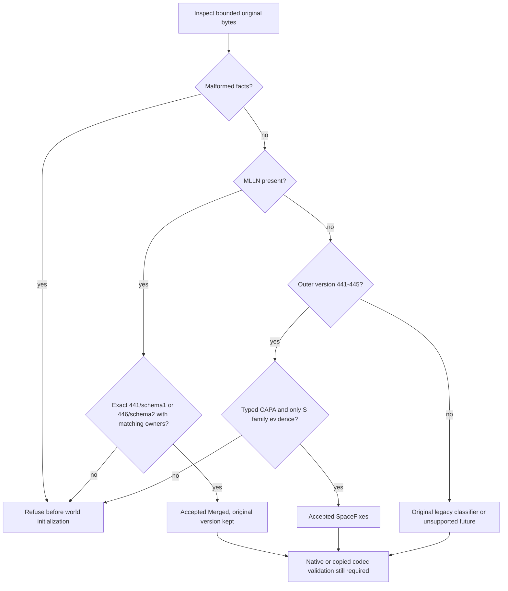
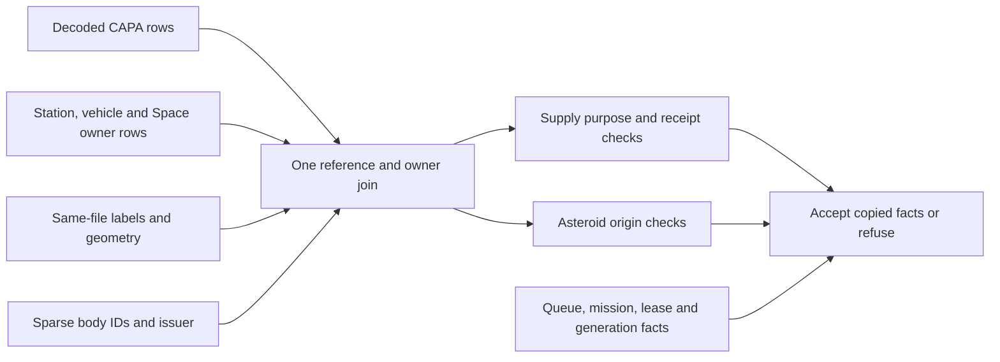
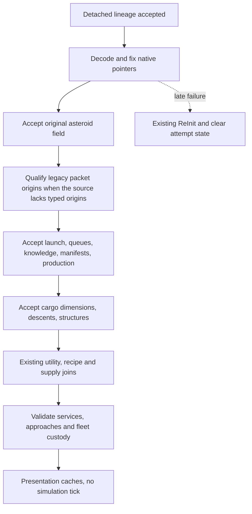

# October 28 merge, part 1: the merge commit and save compatibility

## Global Mandatory Reading

> **Execution protocol**
>
> - Read this Global Mandatory Reading section before the first task and again
>   after every context compaction.
> - Before starting or resuming a task group, read the nearest preceding Area
>   Mandatory Reading block whose `Applies to` label includes that group. Area
>   blocks appear immediately before the first group they govern.
> - A referenced heading or exported symbol is authoritative. Global navigation
>   hints and Area line ranges are for navigation only; if they drift, relocate
>   the named section or symbol rather than expanding to the whole file.
> - Mandatory reading is non-transitive. Do not preload a linked file's own
>   Mandatory Reading, Consult on Demand, or Planning Provenance entries unless
>   this plan names them directly for the current area.
> - Do not read Consult on Demand or Planning Provenance merely because those
>   sources are listed. Use a Consult on Demand source only when its trigger
>   occurs.
> - No created source file, test file or JSON file should start with same prefix as a planning MD file (such as r2). Only MD files can have that prefix. No MD file should be created anywhere in source directories unless specifically asked.
> - After EVERY CONTEXT COMPACTION, you must add a note above the task group
>   which is currently in execution. The note will say: "Context has compacted
>   X times while executing this group.". If the compaction occurs before any
>   meaningful work was done (this can happen when there is a lot of baggage
>   from the previous compaction), then and ONLY then you can skip this step.
> - When exceeding 3 context compactions, YOU MUST ask yourself if you're not 
>   chewing more than we can handle :). Heck, plans change! :). In such a case, 
>   the way out is to split the group on the spot,
>   in the plan, into more groups, 
>   by appending B, C, D as a suffixes to those groups (splitting sub-groups 
>   themselves is also allowed). When you do this, create Local Mandatory
>   Reading areas so you can optimize your context only for the
>   ACTUAL task at hand.
>   Before starting or resuming a task group, read the nearest preceding Area
>   Mandatory Reading block whose `Applies to` label includes that group. Area
>   blocks appear immediately before the first group they govern.

| File name | Line Ranges | Description |
| --- | --- | --- |
| [docs/zz-reach2/upgrades/2026-10/m2o23-4-come-space-b-integration-handoff.md](m2o23-4-come-space-b-integration-handoff.md) | 5-20 | **Delivered boundary, 2026-10-25** names the destination owners for geometry, original formats, writer 441 + MLLN, the tagged SSOR supply book, TBM/fleet, utilities, Tube terminals, networking, art and `mlm/review-producers.json`. Global because every conflict resolution must keep these owners: the incoming branch adds Space fixes and never replaces a destination owner. It constrains every "keep D's" decision in **Conflict decisions and merge contract**. |
| `S:docs/zz-reach2/upgrades/2026-10/r2sff1-z-o-final-handoff.md` | 14-23 | The paragraph before **Playable entries** lists the incoming delivered set: reachable construction pages, Alt+1..4 and repeat-F2, actionable waits, straight exits, safe release, order-owned continuation and delayed replacement, written by save version 445 with eras 441-445. Global because this is the feature set the merge must keep, and it is the source of the 441 collision. Read it with `git show origin/mlm-mlv-2sp:<path>` until Group 4 starts the merge; afterwards the local file is identical. |
| [src/saveload/save_lineage.h](../../../../src/saveload/save_lineage.h) | 15-16; 49-52; 92-116 | `SaveDialect`, `MERGED_SAVE_LINEAGE_VERSION`/`_MAGIC`/`_SCHEMA` (441, MLN1, 1), `SaveCapability`, `ClassifySaveDialect` and `HasSaveCapability` are the only owner that maps a file's bytes to features. Global because 441 already means the destination's merged lineage, while the incoming branch used 441-445 for five other eras. No group may grant a feature from a version number alone. This constrains the Group 4 pending gate, Groups 9-22 and every save test. |
| [src/cargo_custody.h](../../../../src/cargo_custody.h) | 15-29 | `NativeCargoPacketVisitor` and `VisitNativeCargoPackets` are the one traversal over physical cargo containers. Global because the incoming branch carries a second, hand-written owner walk (`ValidateAsteroidPacketCustody(const AsteroidField &)`). Every custody, preview and diagnostic change uses this visitor and adds no other inventory. |
| [src/map_layer.h](../../../../src/map_layer.h) | 96-104; 215-235 | `MultiLayerMap::DecodeStoredTile` gives same-file candidate geometry; `TileInLayer` and `ProjectToSurface` give physical geometry. Global because asteroid origins, motion, previews and the layer hotkeys must never read the camera or the open world when they judge a candidate file. |
| [.gitignore](../../../../.gitignore) | 3-4 | `/logs` and `/build*` are ignored, and `test-cache/.gitignore` ignores all of `test-cache/`. This is the evidence boundary: logs go to `logs/merge-oct28/`, disposable staging to `test-cache/merge-oct28/`, and the only tracked record is `m2o28-a-execution-notes.md` beside this plan. Global because every group writes evidence, the merge commit must contain none, and the cleaner refuses a dirty tree. |

## Scope, pins and chronology

Planning date **2026-10-28**, on a Linux cloud container (Ubuntu 24.04, 4 cores, GCC 13.3, Clang 18.1.3, CMake/Ninja, Python 3; no MSVC and no PowerShell). The destination **D** is `mlm-mlv` in this checkout. The incoming **S** is `origin/mlm-mlv-2sp`. The historical **A/B** labels in older plans mean the earlier OpenTTD/OpenTTD3 merge; S is not that historical B dialect, and code, fixtures and evidence must keep the two apart.

| Role | Reference | Commit | Recorded time |
| --- | --- | --- | --- |
| Merge base | `git merge-base mlm-mlv origin/mlm-mlv-2sp` | `9f36af95d69abe3c6d619f64b525c7ab27df9710` | 2026-10-23 09:19:49 +0200 |
| D | `mlm-mlv` = `origin/mlm-mlv` | `d49c35961da14c7ad12977df2b2c8046a3facffc` | 2026-10-28 08:16:27 +0000 |
| S | `origin/mlm-mlv-2sp` | `66713bdfab723aa8e737e7a918159d2b9e6cfe94` | 2026-10-26 09:19:04 +0100 |
| Textual forecast | `git merge-tree --write-tree mlm-mlv origin/mlm-mlv-2sp` | tree `d0486387b9fdb0141047222fd50f89d2667da139` | — |

The plans in both branches were sorted by file date and checked against commit times. File dates are only navigation: S's final handoff was edited on 10-24 but committed on 10-26. The October 26 plans used the Windows clone's hashes; the second column maps them (same author times).

| Order | Commit (Windows hash) | Side | Recorded time | Delivered work and plan record |
| --- | --- | --- | --- | --- |
| 0 | `9f36af95` (`cfeff84db5`) | shared | 2026-10-23 09:19:49 +0200 | Cleanup completion and Space Goods capacity. |
| 1 | `99d8aa5a` | D | 2026-10-23 20:24:50 +0200 | [M2O23-1](m2o23-1-come-space.md) through Group 22D: lineage, tagged supply/custody, command identities, TBM face/bay. |
| 2 | `eadd05cb` | D | 2026-10-23 20:26:30 +0200 | [M2O23-2](m2o23-2-come-space.md) progress checkpoint. |
| 3 | `0119308a` (`530daca23b`) | D | 2026-10-25 04:51:36 +0100 | M2O23-1..4 complete: underground/Tube/geothermal, writer 441 + MLLN, the 128-family contract, shared UI, art. |
| 4 | `462cc088` (`53368602c7`) | S | 2026-10-26 07:41:57 +0100 | `r2sff1-space-fixes-features-1.md` Groups 1-34 and r2df updates: construction pages/waits, shortcuts, sparse renewal, typed cargo origins, mining policies, writer 445. |
| 5 | `66713bdf` (`3d45ad4a4c`) | S | 2026-10-26 09:19:04 +0100 | Tolerant `clean.ps1`, three cleanup check scripts, and the policy note in `r2fc-file-cleanup3.md` (**Current cleanup policy — user correction, 2026-10-26**). |
| 6 | `a3c7bc6c` | D | 2026-10-26 20:14:22 +0100 | Merge preparations: the m2o26 and m2o27 merge plans (deleted 2026-10-28; in Git history at `d49c3596`), Groups 1-2 executed on Windows (`package_transfer.stage_donor_source`). |
| 7 | `7a66e52f` | D | 2026-10-26 20:29:50 +0100 | Took S's `clean.ps1` ("the bad one"). |
| 8 | `75598d9f` through `d49c3596` | D | 2026-10-27 12:15 – 2026-10-28 08:16 +0000 | [r2lbf](r2lbf-linux-build-fixes.md): 30 commits, all 112 tasks; GCC/Clang 1361/1361, Dedicated 1360/1360. |

Relative to the base, D changes **5,326 paths** (35 commits) and S changes **222 paths** (2 commits: 128 added, 94 modified, no deletions or renames). **40 paths** are changed on both sides; **182** are S-only. The forecast shows **23 conflicted paths with 42 conflict blocks**, and 17 shared paths that merge without markers but still need review.

### Planning research on Linux, 2026-10-28

A `git archive` export of S was built in the session scratchpad, with the r2lbf portability fixes applied where their hunks fit. The repository was not modified.

- **Build:** GCC 13.3 Release, `ninja -j4 -k 0 openttd openttd_test openttd_space_fixes_test`: all 1,523 edges compiled and linked in 20 min 56 s with **0 failed edges**. 684 warnings: 325 `-Wmissing-field-initializers`, 158 `-Wrange-loop-construct`, 82 libstdc++ `-Wstringop-overflow`, 71 `-Wunused-function`, and 7 `-Wdangling-pointer` from one site. That site is `src/tests/space_return_surface.cpp:39`, `for (const auto cell : *GetLaunchCenterFootprint(tile, 0))`: the r2lbf **R6** shape (range-for over a destroyed `std::optional` temporary). It is S-only and is fixed in Group 8.
- **`openttd_space_fixes_test`:** 245 cases, 510,652 assertions, **all passed** in 1.05 s. The incoming Space fixes work on Linux.
- **CTest:** 1,137 registered tests, 1,087 passed, 50 failed. Four are `regression_*`, because only three targets were built and the regression files are copied by the default target. `WindowDesc - ini_key validity` fails on `launch_assembly_gui.cpp:95`, the site r2lbf 13.1 fixed; S's `asteroid_gui.cpp` passes because S gave it the key `space_inspector` with a 560×380 default size. The other 45 fall in the TBM, Tube, recipe and catalogue files whose test fixes r2lbf Groups 9-13 made after S branched. Group 2 reproduces this in a tracked-evidence run and classifies each case.

### Relationship to the October 26 plans

The October 26 plans m2o26 (Groups 1-18, Groups 1-2 done on Windows) and m2o27 (Groups 19-36, unstarted) were reviewed in full, then deleted on 2026-10-28 at the user's request. Read them with `git show d49c3596:docs/zz-reach2/upgrades/2026-10/<name>.md`. Their decisions are adopted with these enhancements, and this plan and [Part 2](m2o28-2-merge-oct28.md) are the only execution authority:

1. **Real Git merge commit** (user decision, 2026-10-28) instead of a file-level integration. History keeps both parents, and later `git merge` of S updates is incremental.
2. **Linux first, Windows handoff.** GCC and Clang build and test here, and tests run right after the merge commit (Group 8) instead of waiting for a first combined build in m2o26/m2o27's Group 27. MSVC Debug/RelWithDebInfo, the native pipeline and PowerShell checks go to the Windows handoff in Part 2.
3. **Safe interim, then full** (user decision). The merge commit parks S's five save-era names behind a pending gate, so that no S-era field is read or written and no S file is misread as D441. Groups 9-22 then implement m2o26's capability matrix, classifier, codecs and writer 446.
4. **No pushes until the user says** (user decision). Every commit is local, on the integration branch.
5. **Cleanup: best of both** (user decision, 2026-10-28): S's tolerant boundary and safety guards, plus automatic, proportionate save/config backup, without the old source-epoch and hash gates. Part 2 Group 30 owns it.
6. Facts that postdate m2o26: r2lbf changed four shared paths (`clean.ps1`, `src/asteroid_gui.cpp`, `src/saveload/saveload.h`, `src/saveload/vehicle_sl.cpp`); D's `ValidateAsteroidPacketCustody()` already uses `VisitNativeCargoPackets`; S's `"space_inspector"` window key collides with r2lbf's `"space_survey"`; and S has S-only Linux defects (the R6 site above, and the harness path `build/<Configuration>/openttd_space_fixes_test.exe`).

## Conflict decisions and merge contract

| Boundary | Decision | Groups |
| --- | --- | --- |
| Git mechanics | Create the local branch `merge-2sp-oct28` from D. Run `git merge --no-ff --no-commit origin/mlm-mlv-2sp`, resolve, build, then commit locally: the first parent is D (`d49c3596`, plus any planning-only commits), the second is S `66713bdf`. Fix-ups are new commits; never amend the merge, rebase or force anything. `mlm-mlv` is fast-forwarded locally in Part 2 Group 41. Nothing is pushed until the user says, and `mlm-mlv-2sp` is never written. | 1, 4-7, 41 |
| Save identity, interim | In the merge commit, `MergedLineage = 441` stays the last real enumerator. S's `AsteroidCargoOrigins`, `AsteroidFieldLifecycle`, `SpaceMiningContinuation`, `SpaceLegacyDeparture` and `SpaceSurveyDeparture` move after `MaxVersion` with the value `MaxVersion`. Their fields are then neither read nor written, `IsSavegameVersionBefore(...)` is true for every file, a markerless 441 refuses through the existing MLLN rule, and 442-445 exceed the maximum. An interim build must not save real games: S-era runtime state (typed origins, renewal, continuation) is lost on reload. | 4, 8 |
| Save identity, final | S441-445 become `SaveDialect::SpaceFixes` with five appended capabilities. The combined writer becomes **446 with MLLN schema 2**; 441/schema 1 stays a frozen historical meaning. Every S numeric gate becomes a capability check; Group 22 deletes the pending enumerators. | 9-22 |
| CAPA and custody | Combine D's non-paying supply purpose, U64 receipt link and literal departure with S's full-width asteroid body/mineral source. Keep both schema checks. Implement S's public `ValidateAsteroidPacketCustody(const AsteroidField &)` on D's visitor; no hand-written owner walk. | 4-5, 14-16 |
| Copied candidates | Keep D's `NativeCargoOwnerPreview` (packet/cargo/station); fold S's `NativeCargoReferencePreview` into it, keeping S's bound check "Excessive native cargo meaning references". | 4, 19-20 |
| Supply-label API | Keep D's `CargoLabel GetSpaceSupplyLabel(SpaceSupply)`, which returns `CT_INVALID`; drop S's `std::optional` overload and adapt its callers. | 5, 14 |
| Commands and network | Keep D's IDs through `SetTubeVehicleGeothermalPower` (222) and append `SetSpaceMiningPolicy` at **223**. `GetMergedNetworkRevisionSuffix` already includes `Commands::End`, so old D and S peers refuse at once; the save part of the suffix moves to 446 in Part 2. | 5, 28 |
| UI and settings | Keep D's names: `MTHK_SHOW_MAP_LAYER_1..4`, `MainToolbarEditorHotkeys::ShowMapLayer1..4`, INI names `show_map_layer_*`, `ShowMainViewportLayerInDisplayOrder`, and the `ToggleHotkeyWindow` dispatcher. Port S's safeguards (modal progress and modal windows, pinned and `NoClose` windows are raised, never closed) into `ToggleHotkeyWindow`; remove S's duplicate `HandleWindowOpeningHotkey` and `SelectMainViewportLayer`. One `hotkey_toggles_window`; keep `escape_closes_window`. | 6-7, 29 |
| Window INI key | Take S's `"space_inspector", 560, 380` for the survey window and drop r2lbf's unreleased `"space_survey"`. Both satisfy upstream's ini_key rule; S's is older and carries a default size. | 5, 40 |
| Asteroids and mining | Adopt S's behavior: straight exits, 1/3/5 size credits, 741-2222 tick intervals, sparse never-reused IDs, safe release and one original order queue. Keep D's cargo, supply and utility owners. | 25-27 |
| Diagnostics | D's complete-owner records and the 128-family contract stay; S's fifteen-owner peer checks add to them and never replace them. | 23-24 |
| Assets | D's canonical GRF and manifest stay; S changes no media. | 35 |
| Cleanup | Best of both, per the user (2026-10-28). | 30 |
| Linux portability | The merge commit holds only conflict resolution and the API adaptations it needs to compile. S-only Linux fixes follow in their own commit (Group 8). | 7-8 |

### Conflict inventory

Each path names its resolving group, so none hides behind a directory task. Block counts come from the forecast.

| Paths (relative to the repository) | Blocks | Group |
| --- | --- | --- |
| `src/saveload/saveload.h` | 1 | 4 |
| `src/saveload/cargopacket_sl.cpp`, `src/cargopacket.h` | 5, 2 | 4 |
| `src/saveload/station_sl.cpp`, `src/saveload/vehicle_sl.cpp`, `src/fios.h`, `src/fios_gui.cpp`, `src/saveload/space_cargo_preview.cpp` | 3, 2, 2, 1, 1 | 4 |
| `src/space_manifest.h`, `src/space_manifest.cpp`, `src/space_vehicle.cpp`, `src/command_type.h`, `src/asteroid_gui.cpp`, `docs/zz-reach2/upgrades/2026-10/d2sa-space-adventures.md` | 1, 1, 2, 1, 1, 1 | 5 |
| `src/toolbar_gui.h`, `src/toolbar_gui.cpp`, `src/window_func.h`, `src/map_layer_gui.h`, `src/main_gui.cpp`, `src/settings_type.h`, `src/table/settings/gui_settings.ini`, `src/settingentry_gui.cpp`, `src/lang/english.txt` | 2, 5, 1, 1, 2, 2, 1, 2, 2 | 6 |

Seven of the 42 blocks are only the file header (`src/main_gui.cpp`, `src/settingentry_gui.cpp`, `src/settings_type.h`, `src/table/settings/gui_settings.ini`, `src/toolbar_gui.cpp`, `src/toolbar_gui.h`, `src/window_func.h`): D's one-line `@file` with an r2df or architecture `@see` against S's multi-line `@file` with `@see r2sff1-space-fixes-features-1.md Group3`. Resolve each by keeping D's description and every `@see` from both sides, one per line.

The 17 shared paths that merge without markers are reviewed in Group 7: `CMakeLists.txt`, `src/CMakeLists.txt`, `src/saveload/CMakeLists.txt`, `src/tests/CMakeLists.txt`, `clean.ps1` (identical on both sides), `src/cargopacket.cpp`, `src/map_layer_gui.cpp`, `src/window.cpp`, `src/saveload/afterload.cpp`, `src/saveload/saveload.cpp`, `src/saveload/space_cargo_preview.h`, `docs/zz-reach2/architecture/archi-historical-debug.md`, `docs/zz-reach2/architecture/gui/archi-gui.md`, `docs/zz-reach2/architecture/map-layers/archi-map-layers.md`, `docs/zz-reach2/architecture/savegame/archi-savegame.md`, `docs/zz-reach2/upgrades/2026-10/r2mlsp-space-master-plan.md` and `docs/zz-reach2/upgrades/2026-10/r2mlvs-multilayer-vehicles-and-structures.md`.

## Plan sequence and split boundary

The merge is planned in two files in this directory; group and task numbers continue across them.

| Plan | Groups | Responsibility |
| --- | --- | --- |
| [Part 1: the merge commit and save compatibility](m2o28-1-merge-oct28.md) | 1-22 | Pin inputs, build the S reference on Linux, make and verify the merge commit, then replace the pending gate with the capability matrix, classifier, codecs, adoption order and writer 446. |
| [Part 2: runtime integration and qualification](m2o28-2-merge-oct28.md) | 23-41 | Diagnostics, native lifecycle, protocol, controls, cleanup, combined builds, compatibility/conservation, peers, gameplay, documentation and the Windows handoff. |

The boundary is after Group 22: Part 1 hands over a branch whose full GCC and Clang suites pass with writer 446 active (**Part 1 handoff to Part 2**). Neither file authorizes a push, a pull request, a change to `mlm-mlv-2sp`, `clean.ps1 -Apply` on this checkout, or progress on the protected Space gameplay continuation.

## Implementation tasks

Every code example is an **implementation sketch**: a proposed helper or field is not a claim that it exists. Public C++ headers are the boundary; no registry or barrel is added to match planning vocabulary. Helper names may change inside their named owner when callers and tests change with them.

Shared execution rules for every group:

- Work on `merge-2sp-oct28`. Commit locally at the end of each group (or more often), with plan file and group numbers in the message. Never push.
- Build trees stay inside the checkout (`build/`, `build-clang/`, `build-dedicated/`), one build at a time, at most `-j4`. Run full suites through CTest (one process per case); a whole-executable `openttd_test` run is not a valid baseline, because cases leak state between each other (r2lbf Group 15).
- No `git clean`, `git reset --hard`, `git checkout -- <path>` over unreviewed work, `git stash drop`, recursive deletion of saves/configs, or `clean.ps1 -Apply` here. Original saves, configs and retained evidence are read-only inputs.
- Created source, test and JSON files must not start with a plan prefix such as `r2` or `m2`. Helper Markdown sits beside this plan (`m2o28-a-…`, `m2o28-b-…`).
- Existing comments that cite older plan group numbers keep their historical meaning. New comments cite `m2o28-1-merge-oct28.md` or `m2o28-2-merge-oct28.md` with the group.

### Area Mandatory Reading - Pins and disposition inventory

_Applies to Group 1._

**Entry gate:** the checkout is on `mlm-mlv` at `d49c3596`, or at a descendant whose only changes are planning Markdown (this plan pair, and the deletion of the October 26 plans); `git status --short` shows nothing else; and `origin/mlm-mlv-2sp` resolves to `66713bdf`. Verify with `git rev-parse` and `git status`. If either pin drifted, stop 1.2-1.6, refresh the forecast and this plan's counts, and ask the user if new commits change a decision; 1.1 may continue as the drift record. Forbidden: merging another commit than the pinned S tip, or continuing on a dirty tree by stashing someone's work.

| File name | Line Ranges | Description |
| --- | --- | --- |
| [docs/zz-reach2/upgrades/2026-10/m2o26-a-execution-notes.md](m2o26-a-execution-notes.md) | 7-15 | **Group 1 completed** records the same inventory done on Windows: the five disposition categories, missing S441-444 originals and the harness hazards. Its paths (`D:/Codez/…`, `test-cache/merge-oct26/`) do not exist here. Reuse its categories so both records compare, but not its files. |
| [docs/zz-reach2/upgrades/2026-10/m2o23-4-come-space-b-integration-handoff.md](m2o23-4-come-space-b-integration-handoff.md) | 22-43 | **Qualified evidence and exact epochs** pins retained aliases, image identities and the protected Space foundation. The inventory lists those inputs as read-only originals and never picks a newer file by date. |
| `S:docs/zz-reach2/upgrades/2026-10/r2sff1-z-o-final-handoff.md` | 44-70 | **Verified evidence** cites a `test-cache/space-fixes/` cache that the S commit does not contain. Record those claims as missing historical evidence, not as proof, and do not search the machine for it. |

### Group 1 - Pin the merge inputs and record path dispositions

Produces the integration branch, the disposition inventory, the forecast record and the execution-notes file that every later group writes into.

Execution evidence: [Group 1 record](m2o28-a-execution-notes.md#group-1). Pins held; inventory and forecast match the plan.

{{SIMPLE}}

- [X] **1.1** Run `git fetch origin mlm-mlv-2sp mlm-mlv` (read-only) and recheck the pins: `git rev-parse mlm-mlv origin/mlm-mlv origin/mlm-mlv-2sp`, `git merge-base mlm-mlv origin/mlm-mlv-2sp` and `git status --short`. Record the values. On drift, follow the entry gate.

- [X] **1.2** Create the local integration branch: `git switch -c merge-2sp-oct28 mlm-mlv`. If planning Markdown changes (this plan pair, the deletion of the October 26 plans) are not committed yet, commit exactly those as the branch's first commit. Record that the branch has no upstream, and do not set one.

- [X] **1.3** Write the path inventory to `test-cache/merge-oct28/dispositions.tsv` from `git diff --name-status -M <base> mlm-mlv` and `git diff --name-status -M <base> origin/mlm-mlv-2sp`. Each path gets one category: `shared-conflict` (23), `shared-clean-review` (17), `S-only` (182) or `D-only` (5,286). Flag six S-only paths as `policy` for Part 2 Group 30: `src/tests/multilayer/support/cleanup_check.ps1`, `cleanup_check-1.ps1`, `cleanup_check-2.ps1`, `cleanup_fixture.ps1` and the two `r2fc*-file-cleanup3.md` plans. Confirm 0 renames and 0 deletions on S.

- [X] **1.4** Record the forecast in `logs/merge-oct28/merge-tree.txt` with `git merge-tree --write-tree --name-only mlm-mlv origin/mlm-mlv-2sp`, and per-file block counts from the conflicted blobs. Expect tree `d0486387…`, 23 paths and 42 blocks; any difference updates **Conflict inventory** first.

- [X] **1.5** Run the duplicate scans the textual forecast cannot show, and record each hit with the group that resolves it:
  - symbols both sides declare: `GetSpaceSupplyLabel`, `NativeCargoReferencePreview`/`NativeCargoOwnerPreview`, `HandleWindowOpeningHotkey`/`ToggleHotkeyWindow`, `SelectMainViewportLayer`/`ShowMainViewportLayerInDisplayOrder`, `hotkey_toggles_window`, and command 211;
  - S's own references to names that Group 6 removes: `git grep -nE "MTHK_LAYER_|map_layer_(surface|underground|deep_underground|space)|SelectMainViewportLayer|HandleWindowOpeningHotkey|MainToolbarEditorHotkeys::Layer" origin/mlm-mlv-2sp`. Expect the toolbar sites, `src/tests/space_fixes_native.cpp:202` and `src/tests/multilayer/acceptance/space_fixes_checks.py:78`;
  - CMake: every S test source is registered exactly once per target;
  - duplicates that merge **without** markers, scanned in the forecast tree: repeated `STR_` IDs in `src/lang/english.txt` and repeated `var =` lines in `src/table/settings/*.ini`. Planning found exactly `STR_CONFIG_SETTING_HOTKEY_TOGGLES_WINDOW` (+`_HELPTEXT`) and `gui.hotkey_toggles_window` (Group 6.5); `gui.scroll_mode`, `gui.show_date_in_logs` and the other repeats already exist in D as version-ranged entries.

- [X] **1.6** Create `m2o28-a-execution-notes.md` beside this plan, with one heading per group and a header that links this plan and says it is a record, not a reading queue. Record the environment (compiler versions, CMake, Ninja, Python, the absence of MSVC and `pwsh`) and the fact that m2o26's Windows outputs (`test-cache/merge-oct26/`, the staged donor build) are not present on this machine. Commit the notes file alone, on the integration branch.

### Area Mandatory Reading - Linux donor reference

_Applies to Groups 2-3._

**Entry gate:** Group 1 recorded the S pin, and `test-cache/merge-oct28/s-reference/` does not exist yet. Verify the pin and that the directory is absent. If the pin is missing, stop Groups 2-3; Groups 4-7 may still start, because resolution does not depend on the reference, but Group 8 classification then waits for 2.6. Forbidden: building or writing inside a Git worktree of S, reusing the planning scratch build as evidence, editing the export's behavior (only portability), or treating a merged binary as the S reference.

| File name | Line Ranges | Description |
| --- | --- | --- |
| [docs/zz-reach2/upgrades/2026-10/r2lbf-linux-build-fixes.md](r2lbf-linux-build-fixes.md) | 54-62; 291-335 | The R1-R7 root-cause table (**Scope and observed baseline**) and **Group 6 - Materialize test runtime content inside the build trees**. These are the portability shapes the S export also needs, and the only accepted way to put the seven original-DOS base-set files into a build tree (`native_build.prepare_runtime_assets`). |
| [src/tests/multilayer/support/native_build.py](../../../../src/tests/multilayer/support/native_build.py) | 43-76; 193-238 | `load_profile` validates the retained profile and asset hashes; `runtime_asset_sources` and `prepare_runtime_assets` copy the base set. The S export has the same owner; run its own copy against its own tree. Never edit the profile to admit Linux. |
| `S:src/tests/multilayer/acceptance/space_fixes_checks.py` | 41-200 | `run()` builds the native command: source save, `ROOT / "build" / args.configuration / "openttd_space_fixes_test.exe"`, the `OTTD_SPACE_FIXES_*` environment and the hidden `[.space-fixes-native]` case with a 110 s timeout. The executable path is the Windows multi-config layout; on Linux it is `build/openttd_space_fixes_test`. |
| `S:docs/zz-reach2/upgrades/2026-10/r2sff1-z-o-final-handoff.md` | 71-116 | **Reproduction** names the producers, their argument chains and private output ownership that Group 3 replays. |

### Group 2 - Build and baseline the S reference on Linux

Produces an S-only Linux reference ledger. Group 8 uses it to tell S's own Linux failures from merge regressions.

Execution evidence: [Group 2 record](m2o28-a-execution-notes.md#group-2). Build 0 failed; Space fixes 245/245; the 46 CTest failures are all base-era defects D already fixed (class D-fixed).

{{MEDIUM}}

- [X] **2.1** Export S read-only: `mkdir -p test-cache/merge-oct28/s-reference && git archive origin/mlm-mlv-2sp | tar -x -C test-cache/merge-oct28/s-reference`. Record the commit and `git rev-parse origin/mlm-mlv-2sp^{tree}`. The export is a reference input only: never commit it, merge from it or copy files back from it.

- [X] **2.2** Apply the portability fixes the export lacks, and record each one in the notes as a candidate for Group 8:
  - the r2lbf source hunks that apply (`git show 48ef3858 42865ce5 68d0ef40 0ce50dab 58c21e51 -- src | patch -p1 --dry-run`, then for real), where the rejected hunks are D-only files;
  - the S-only R6 site at `src/tests/space_return_surface.cpp:39`, by binding the optional first (sketch below).

  Change no behavior.

  ```cpp
  // R6: keep the optional alive for the whole loop.
  const auto footprint = GetLaunchCenterFootprint(tile, 0);
  for (const auto cell : *footprint) {
  ```

- [X] **2.3** Configure `-G Ninja -DCMAKE_BUILD_TYPE=RelWithDebInfo` in the export's own `build/` (the `build_content.py` guard accepts it there). Build the default target plus `openttd_space_fixes_test` with `ninja -j4 -k 0`. Log to `logs/merge-oct28/s-reference/build-gcc.log`, and record the wall time, `FAILED:` count (0 expected) and warning counts per flag.

- [X] **2.4** Put the base set into the export's `build/baseset/` with the export's own `prepare_runtime_assets`, as in r2lbf 6.1. Then run `ctest --test-dir build -N | tail -1` (planning research: 1,137) and `ctest --test-dir build -j4 --timeout 600 --output-junit …/ctest-gcc.xml`.

- [X] **2.5** Run `openttd_space_fixes_test -r junit -o …/space-fixes.xml` from `build/`. Planning research: 245 cases and 510,652 assertions, all passing.

- [X] **2.6** Classify every failing case in `test-cache/merge-oct28/s-reference-ledger.tsv` (case, file, first failing expansion, class) and summarize the counts in the notes. The classes are:
  - **r2lbf-known:** the same case is fixed in D by r2lbf Groups 9-13 or 13.1;
  - **environment:** for example the regression files missing in a partial build;
  - **S-Linux:** a new portability defect, fixed in Group 8;
  - **S-behavior:** a real S defect; report it to the user and do not fix it in the merge.

### Group 3 - Regenerate donor 445 checkpoints through the native producers

Replays m2o26 Group 3 on Linux, with the S reference binaries from Group 2. It gives fresh S445 saves for the migration fixtures of Groups 13-22; it cannot recreate the lost historical 441-444 originals.

Execution evidence: [Group 3 record](m2o28-a-execution-notes.md#group-3). Every producer passed headless; 28 fresh 445 saves with a manifest in `test-cache/merge-oct28/donor445/`.

Producer chain (each step reads the previous step's actual output under a fresh run ID):


{{HARD}}

- [X] **3.1** In the export only, make `space_fixes_checks.py` find the Linux executable (`build/openttd_space_fixes_test` when `build/<Configuration>/…exe` is absent). Then run `--asteroid-preview` and `--cargo-origin` from the retained `space-mining-working-405.sav` and `space-module-work-418.sav`, and bind source and output hashes. Record the patch: Group 8 applies a platform-aware form to the merged tree.

- [X] **3.2** From retained `space-heavy-440.sav`, run `--mining-controls edit`, then `continue` on the new `policy-current.sav`. Keep the before-departure, retarget and unload phase saves. Run the light role (`edit-light`, `continue-light`) separately.

- [X] **3.3** Run `lifecycle` and `lifecycle-hidden` from the same before-departure save and keep the five phase saves. Feed `policy-lifecycle-after-credit.sav` to `prepare-high-id`, and record its declared issuance-prefix limitation.

- [X] **3.4** Copy the selected outputs into `test-cache/merge-oct28/donor445/` with `manifest.json`: source hash, run ID, producer arguments, output hash, binary hash and the S tree hash. Do not write them into the tracked retention journal; Part 2 Group 32 decides on promotion.

- [X] **3.5** When a producer needs a real video driver or fails headless, record the exact case and error as a Windows-handoff item (Part 2 Group 41) and continue the chain where its inputs still exist. The reference is supplementary: its gaps do not block Groups 4-22. Saves the producers did not make are never invented, and a header is never rewritten.

### Area Mandatory Reading - Merge commit resolution

_Applies to Groups 4-7._

**Entry gate:** Group 1 is complete; the checkout is on `merge-2sp-oct28`, whose commits after `d49c3596` touch only planning Markdown (`git diff --stat d49c3596 HEAD`), with an empty `git status --short`. Verify with `git branch --show-current`, that diff and `git status`. If any check fails, stop 4.1 and everything after it. Group 3 may continue in parallel, because it only touches the export. Forbidden: `git merge -X ours`/`-X theirs` or `git checkout --ours/--theirs` on a whole conflicted file; resolving a C++ conflict by taking one side without reading both; `git merge --abort` after resolution work has started (save the resolved files first); and committing with any conflict marker.

Line ranges for conflicted files are given for **D = stage 2** (`git show :2:<path>` during the merge, identical to `HEAD`) and **S = stage 3** (`git show :3:<path>` or `origin/mlm-mlv-2sp`). The working file has markers and shifted lines; relocate by symbol.

| File name | Line Ranges | Description |
| --- | --- | --- |
| [src/saveload/saveload.h](../../../../src/saveload/saveload.h) | D 522-525; S 503-510 | The tail of `enum class SaveLoadVersion`. D ends with `SurfaceSupplyOrders` (440), `MergedLineage = MERGED_SAVE_LINEAGE_VERSION` (441) and `MaxVersion`; S ends with `SurfaceSupplyOrders` (440), its five eras (441-445) and `MaxVersion`. `SAVEGAME_VERSION` is `MaxVersion - 1` (`saveload.cpp:103`), so whatever stands last before `MaxVersion` is the writer. The pending gate decision rests on this. |
| [src/saveload/cargopacket_sl.cpp](../../../../src/saveload/cargopacket_sl.cpp) | D 131-161; 163-179; 181-260. S 133-158; 160-170; 172-243 | `GetCargoPacketDesc`, `CheckCargoPacketSourceFields` and `CAPAChunkHandler`. D carries the historical B U32/Bool and merged U64/U8 supply columns, the receipt link and raw departure; S carries `asteroid_body`/`asteroid_mineral` and `ValidateCargoPacketSourceSchema`. The union of both is the CAPA contract. |
| [src/fios.h](../../../../src/fios.h) | D 91-106; S 90-99; 118-122 | D's `NativeCargoPacketPreview` and `NativeCargoOwnerPreview` (packet/cargo/station); S's `NativeCargoPacketPreview` and `NativeCargoReferencePreview`. One copied owner record survives: D's, extended with S's fields. |
| [src/space_vehicle.cpp](../../../../src/space_vehicle.cpp) | D 516-543; S 566-624 | D's `ValidateAsteroidPacketCustody()` already calls `VisitNativeCargoPackets`; S's `ValidateAsteroidPacketCustody(const AsteroidField &)` walks owners by hand. The merged function keeps S's signature and D's traversal. |
| [src/command_type.h](../../../../src/command_type.h) | D 449-462; S 446-451 | The command tail. D 211-222 are delivered ABI; S puts `SetSpaceMiningPolicy` at 211. Append-only: D keeps 211-222 and policy becomes 223. |
| [src/toolbar_gui.cpp](../../../../src/toolbar_gui.cpp) | D 2152-2168; 2288-2353; 2421-2469; 2762-2809; 2882-2911. S 2200-2262; 2330-2377; 2650-2691; 2764-2793 | D's `ToggleHotkeyWindow`, then the main and editor toolbars' `OnHotkey` and `hotkeys` tables on each side. D uses `MTHK_SHOW_MAP_LAYER_*`, `MainToolbarEditorHotkeys::ShowMapLayer*` and INI names `show_map_layer_*`; S calls `HandleWindowOpeningHotkey(WindowClass::GameOptions, …)` and uses `MTHK_LAYER_*`, `MainToolbarEditorHotkeys::Layer*` and `map_layer_*`. One dispatcher and one name set survive. |
| `src/window.cpp` (merges cleanly; forecast lines) | 3380-3411 | S's `HandleWindowOpeningHotkey`: modal progress returns at once, a modal window is raised, `Sticky` and `NoClose` targets are raised and never closed. These are the safeguards Group 6 ports into `ToggleHotkeyWindow`. |

### Group 4 - Start the merge and resolve the save and packet codec conflicts

Produces resolved, staged save-version and cargo-packet files with the pending gate. Nothing is committed yet.

Execution evidence: [Group 4 record](m2o28-a-execution-notes.md#group-4). Discovery: the packet preview orders S's origin fields before D's supply fields, because two S tests initialize it positionally.

{{MEDIUM}}

- [X] **4.1** Run `git merge --no-ff --no-commit origin/mlm-mlv-2sp`. Record `git diff --name-only --diff-filter=U` (23 expected) and `git status --short | wc -l`. From now on, read S-only files locally.

- [X] **4.2** Resolve `src/saveload/saveload.h` with the pending gate. Keep D's tail, put S's five names after `MaxVersion` with their original doc comments shortened to the era meaning, and keep r2lbf's `required_capability{}` default.

  ```cpp
  	MergedLineage = MERGED_SAVE_LINEAGE_VERSION, ///< Saveload version: 441. ...
  	MaxVersion, ///< Highest possible saveload version.
  	/* Merge interim, m2o28-1-merge-oct28.md Group 4: the incoming eras 441-445 collide with MergedLineage. Until
  	 * Groups 9-22 replace each gate with HasSaveCapability(), these compare as never present, so their fields are
  	 * neither read nor written. Group 22 deletes them. */
  	AsteroidCargoOrigins = MaxVersion, ///< Pending: incoming 441, typed asteroid cargo origins.
  	AsteroidFieldLifecycle = MaxVersion, ///< Pending: incoming 442, sparse issuance and renewal.
  	SpaceMiningContinuation = MaxVersion, ///< Pending: incoming 443, Mine policies and contained intent.
  	SpaceLegacyDeparture = MaxVersion, ///< Pending: incoming 444, unordered local miner departure.
  	SpaceSurveyDeparture = MaxVersion, ///< Pending: incoming 445, ownerless survey Return/Waiting.
  ```

  Add `static_assert(SAVEGAME_VERSION == SaveLoadVersion::MergedLineage)` next to the `SAVEGAME_VERSION` definition, so an accidental reorder fails at compile time.

- [X] **4.3** Resolve `src/saveload/cargopacket_sl.cpp` (5 blocks) as the union:
  - `GetCargoPacketDesc` keeps D's supply columns and S's two asteroid U32 keys;
  - the native and LoadCheck handlers run both D's `CheckCargoPacketSourceFields` and S's `ValidateCargoPacketSourceSchema`;
  - S's `DecodeCargoPacketSource` decodes the source, and D's receipt/departure checks follow it;
  - the per-row `_cargo_source_asteroid_wire` reset stays before every row.

  Keep the file header's `@see` lines from both sides.

- [X] **4.4** Resolve `src/cargopacket.h` (2 blocks). Keep both friend declarations (D's `AcceptLoadedSurfaceSupplyOrders` and S's `CAPAChunkHandler`) and S's `UpgradeLegacyAsteroidSource`, with D's member order and doc style.

- [X] **4.5** Resolve the copied-preview conflicts in `src/fios.h`, `src/saveload/station_sl.cpp` (3), `src/saveload/vehicle_sl.cpp` (2) and `src/fios_gui.cpp`:
  - extend D's `NativeCargoPacketPreview` with S's source fields;
  - keep D's `NativeCargoOwnerPreview` rows and remove `NativeCargoReferencePreview`, pointing S's readers at the owner rows;
  - keep S's bound check "Excessive native cargo meaning references";
  - `vehicle_sl.cpp` also keeps r2lbf's explicit instantiations and S's `WithSpaceMiningContinuation` and `CheckSpaceMiningContinuationHeader`.

- [X] **4.6** Resolve `src/saveload/space_cargo_preview.cpp`. Keep D's two-argument `feature()` with `GetSpaceSupplyLabel` labels, and adapt S's `ValidateSpaceAsteroidCargoPreview` to D's owner rows, so that asteroid checks run even when no paid supply exists. Leave a `// m2o28 Group 20` note where Group 20 generalizes label preparation.

- [X] **4.7** For every file above: `grep -nE '^(<<<<<<<|=======|>>>>>>>)'` returns nothing, `git diff --check` is clean, and then `git add <file>`. Record each file's resolution in one line in the notes.

### Group 5 - Resolve the Space runtime, command and Space GUI conflicts

Execution evidence: [Group 5 record](m2o28-a-execution-notes.md#group-5).

{{MEDIUM}}

- [X] **5.1** Resolve `src/space_manifest.h` and `src/space_manifest.cpp`. Keep D's `CargoLabel GetSpaceSupplyLabel(SpaceSupply)` and delete S's `std::optional<CargoLabel>` overload. Adapt every S-only caller found by `grep -rn "GetSpaceSupplyLabel" src` to compare with `CT_INVALID`; no caller may consult the current `CargoSpec` for an immutable label.

- [X] **5.2** Resolve `src/space_vehicle.cpp` (2 blocks). The function keeps S's public signature, `bool ValidateAsteroidPacketCustody(const AsteroidField &field)`, and D's `VisitNativeCargoPackets` body. Add S's checks inside the visitor: canonical source, typed origin resolved through `ResolveAsteroidCargoOrigin(source, field)`, exactly one owner per packet, and an owner for every allocated asteroid packet. The production-link validator passes `field`. Delete the hand-written owner walk.

- [X] **5.3** Resolve `src/command_type.h`. Keep D's list through `SetTubeVehicleGeothermalPower`, then `SetSpaceMiningPolicy`, then `End`. The new entry's comment says "m2o28 append 223; was 211 in the incoming r2sff1 branch". In `src/tests/merged_command_compatibility.cpp`, add `static_assert`s for 222 and 223, and update the network suffix expectation from `+m441c223p` to `+m441c224p`: `GetMergedNetworkRevisionSuffix` includes `Commands::End`, so old D and S peers already refuse. Confirm with `git grep -n "Commands::SetSpaceMiningPolicy"` that S code uses only the name, never the number.

- [X] **5.4** Resolve `src/asteroid_gui.cpp`. Take S's `_space_survey_desc(WindowPosition::Automatic, "space_inspector", 560, 380, …)` and drop r2lbf's `"space_survey", 0, 0`. Record in the notes that the r2lbf key was never released, so no `windows.cfg` migration is needed, and add the `r2lbf-b-windows-handoff.md` update to the Group 40 list.

- [X] **5.5** Resolve `docs/zz-reach2/upgrades/2026-10/d2sa-space-adventures.md` as a union: keep D's underground/Tube/geothermal guidance and S's construction/mining guidance, with no duplicated step and the D heading order. Group 40 reconciles the wording.

- [X] **5.6** Apply 4.7 to every Group 5 file.

### Group 6 - Resolve the GUI, settings and string conflicts

Execution evidence: [Group 6 record](m2o28-a-execution-notes.md#group-6). Discovery: S's handler also avoided recreating Game Options on a repeated F2; `ShowOrRaiseGameOptions()` keeps that.

{{MEDIUM}}

- [X] **6.1** Resolve `src/toolbar_gui.h` (2 blocks). Keep D's `MTHK_SHOW_MAP_LAYER_1..4` and delete S's `MTHK_LAYER_*`; resolve the header.

- [X] **6.2** Resolve `src/toolbar_gui.cpp` (5 blocks):
  - keep D's hotkey tables (`show_map_layer_surface` … `show_map_layer_space`, Alt+1..4, once per toolbar);
  - keep D's `OnHotkey` layer cases through `ShowMainViewportLayerInDisplayOrder`;
  - delete S's `MTHK_LAYER_*`, `MainToolbarEditorHotkeys::Layer*` and `map_layer_*` entries;
  - route Game Options through D's `ToggleHotkeyWindow(Get…HotkeyWindow(hotkey))` and remove S's `HandleWindowOpeningHotkey` calls, so one key event produces one action.

- [X] **6.3** Port S's safeguards into `ToggleHotkeyWindow`, keeping D's `IsWindowRaisedAsFarAsPossible` test. Then delete `HandleWindowOpeningHotkey` from `src/window.cpp` and `src/window_func.h`, and resolve the `window_func.h` header. Expected behavior:
  - with a modal progress active, the key does nothing;
  - with a modal window open, that window is raised and nothing else happens;
  - a pinned (`Sticky`) or `NoClose` target is raised and never closed.

  ```cpp
  // Sketch inside ToggleHotkeyWindow, before the existing close test.
  if (HasModalProgress()) return true; // the key does nothing
  if (const Window *modal = FindFrontmostModalWindow(); modal != nullptr) { // proposed helper
  	BringWindowToFrontById(modal->window_class, modal->window_number);
  	return true; // the modal window keeps the focus
  }
  if (w->flags.Test(WindowFlag::Sticky) || w->window_desc.flags.Test(WindowDefaultFlag::NoClose)) return false; // raise
  ```

- [X] **6.4** Resolve `src/map_layer_gui.h`. Keep D's `ShowMainViewportLayerInDisplayOrder(uint)` and delete S's `SelectMainViewportLayer(MapLayer)` from the header and from `src/map_layer_gui.cpp`. Both were thin wrappers over `SetViewportLayer`. Adapt `src/tests/space_fixes_native.cpp:202`: its invalid-layer check becomes `CHECK_FALSE(ShowMainViewportLayerInDisplayOrder(MAX_MAP_LAYERS))`.

- [X] **6.5** Resolve the settings set. Two duplicates merge **without** markers, so Git will not flag them:
  - `src/settings_type.h` (conflict block): one `hotkey_toggles_window` with D's comment plus "pinned and non-closable windows are raised instead", and D's `escape_closes_window`;
  - `src/table/settings/gui_settings.ini`: resolve the header block, then delete the second `[SDTC_BOOL] var = gui.hotkey_toggles_window` block (forecast line 182; both have `def = true`) and keep D's block with its r2df comment (line 160) and `gui.escape_closes_window`;
  - `src/settingentry_gui.cpp`: keep D's `escape_closes_window` entry; `hotkey_toggles_window` is already listed once;
  - `src/lang/english.txt`: the two conflict blocks are the layer tooltips (`STR_TOOLBAR_TOOLTIP_CYCLE_MAP_LAYER`, `STR_SCENEDIT_TOOLBAR_CYCLE_MAP_LAYER_TOOLTIP`); keep D's wording, which names all four layers and N. Then delete one of the two clean-merged `STR_CONFIG_SETTING_HOTKEY_TOGGLES_WINDOW` and `…_HELPTEXT` pairs (forecast lines 1882-1883 S, 1889-1890 D) and reword the survivor for the final behavior: F2 as the example, covered windows raised, pinned and non-closable windows never closed.

  Run strgen through the build and check that no string ID is defined twice.

- [X] **6.6** Resolve `src/main_gui.cpp`. Keep D's Ctrl+Alt Debug comment and shortcuts, and confirm that S's `HotkeyList::Load` migration in `src/hotkeys.cpp` (Alt+0/1/2 → Ctrl+Alt for `crash_game`, `money`, `update_coordinates`) matches D's global names. In `src/tests/multilayer/acceptance/space_fixes_checks.py:78`, change `map_layer_space` to `show_map_layer_space`.

- [X] **6.7** Apply 4.7 to every Group 6 file. Then rerun the 1.5 removed-name grep over the merge result, and expect hits only in historical plan text.

### Group 7 - Review the clean merges, build and commit the merge

Produces the merge commit. Its gate is a successful GCC build of the three main targets with no conflict markers; Group 8 owns the first full test run.

Execution evidence: [Group 7 record](m2o28-a-execution-notes.md#group-7). Merge commit `aa91b303`; one frozen command-count test needed updating.

{{HARD}}

- [X] **7.1** Review each of the 17 clean shared paths against both parents (`git diff HEAD -- <path>` and `git diff MERGE_HEAD -- <path>`):
  - the four CMake lists: ten focused executables, `openttd_space_fixes_test` registered once with its MSVC runtime and links, and each new production or test unit once;
  - `src/saveload/afterload.cpp`: S's `NormalizeLegacyAsteroidCargoPackets` call stays right after `AcceptLoadedAsteroidField` and, under the pending gate, runs for every load, which is correct because no D441 file carries typed origins;
  - `src/saveload/saveload.cpp`: the same for `NormalizeLegacyAsteroidCargoPreview`;
  - `src/cargopacket.cpp`, `src/saveload/space_cargo_preview.h`, and `src/window.cpp`/`src/map_layer_gui.cpp` after 6.3/6.4;
  - the six docs, which Group 40 reconciles.

- [X] **7.2** Check the S-only callers of every API changed in Groups 4-6: `GetSpaceSupplyLabel`, the owner preview rows, `ValidateAsteroidPacketCustody`, the layer and window hotkey entries, and the command enum. Record the call-site list in the notes, and confirm with `git grep -nE "SaveLoadVersion::(AsteroidCargoOrigins|AsteroidFieldLifecycle|SpaceMiningContinuation|SpaceLegacyDeparture|SpaceSurveyDeparture)\b" -- src` that the pending-gate sites match the forecast: 32 production sites in 9 files and 23 in 3 test files.

- [X] **7.3** Build GCC in the existing `build/` tree: `ninja -C build -j4 -k 0 openttd openttd_test openttd_space_fixes_test`, logged to `logs/merge-oct28/merge/build-gcc.log`. Fix compile and link errors only inside the resolution and record each. A failure in S-only code that Group 2 also saw is not fixed here; record it for Group 8.

- [X] **7.4** Run the static checks:
  - no conflict markers in the whole tree: `git grep -nE '^(<<<<<<<|=======|>>>>>>>)( |$)' -- ':!*.md'`, then the Markdown files by hand;
  - `git diff --cached --check`;
  - `python3 -I test-cache/linux-baseline/check_swallowed_code.py` over every resolved C++ file. It is r2lbf's local helper; if it is absent, recreate it from r2lbf Group 17's description.

- [X] **7.5** Commit the merge with `git commit` and no `-m` shortcut that drops the default "Merge …" line. The message names both pins, the pending gate, command 223, the hotkey and preview consolidations and this plan's Groups 4-7, and ends with the attribution lines. Verify `git log --graph --oneline -4`: the first parent is the Group 1 tip (`d49c3596` plus planning commits) and `git rev-parse HEAD^2` is `66713bdf`. Do not push.

### Area Mandatory Reading - Merged baseline

_Applies to Group 8._

**Entry gate:** `HEAD` is the Group 7 merge commit, its second parent is `66713bdf`, its first parent descends from `d49c3596`, and the three main targets built. Verify with `git rev-parse HEAD^2`, `git merge-base --is-ancestor d49c3596 HEAD^1` and the 7.3 log. If not, stop 8.2-8.8 and return to Group 7; 8.1 may be prepared. Forbidden: running tests from a pre-merge binary, `--rerun-failed` on its own as a baseline, deleting or `[.hidden]`-tagging a failing case, or loosening an assertion to reach green.

| File name | Line Ranges | Description |
| --- | --- | --- |
| `CMakeLists.txt` (merged cleanly; forecast lines) | 263-317; 319; 415; 424; 434; 442; 475; 490; 631; 664 | `openttd_test`, the new `openttd_space_fixes_test` source list, and the nine D focused targets (`openttd_surface_supply_test` … `openttd_merge_contract_test`). All ten are `EXCLUDE_FROM_ALL` and not in CTest, so they are built and run explicitly. |
| [src/tests/test_artifact_paths.cpp](../../../../src/tests/test_artifact_paths.cpp) | 372-403 | `GetTestRuntimeConfig` copies `baseset/`, `newgrf/`, `scripts/` and `lang/` from `<repository>/build` into each process home, so `build/` must be built and given its base set before any `build-clang/` test. |
| [docs/zz-reach2/upgrades/2026-10/r2lbf-b-windows-handoff.md](r2lbf-b-windows-handoff.md) | 101-106 | **Known limits** of the Linux baseline: one process per case, the leaking pairs, and what only Windows can confirm. These limits carry over to the merged baseline unchanged. |
| `test-cache/linux-baseline/run_focused.sh` (local helper, ignored) | 12-13 | The target list of the focused runner. Add `openttd_space_fixes_test`. The runner builds, runs and deletes one 1.4 GB executable at a time. If the helper is absent, recreate it from r2lbf item 15.1. |

### Group 8 - Port S-only code to Linux and establish the merged baseline

Produces the first merged test ledger and the **pending ledger**, the list of failures the pending gate is expected to cause. The pending ledger is Part 1's burn-down metric.

Execution evidence: [Group 8 record](m2o28-a-execution-notes.md#group-8). GCC 1,493/1,496 then fixed to 1,495; Clang 1,495/1,496; class (c) empty; two pending items (one schema case, and re-saving worlds with typed asteroid origins).

{{HARD}}

- [X] **8.1** Commit the S-only Linux fixes from Group 2 (2.2, 2.6 S-Linux) and 3.1 as their own commit:
  - the R6 footprint binding in `src/tests/space_return_surface.cpp`;
  - the platform-aware executable path in `space_fixes_checks.py` and in any other S harness that hard-codes `.exe` or `build/<Configuration>` (`git grep -n "openttd_space_fixes_test.exe\|args.configuration" -- src/tests/multilayer`);
  - anything else the ledger marked S-Linux.

  Each fix stays valid for MSVC.

- [X] **8.2** Build `build/` (GCC, default target) and run CTest: `ctest -N | tail -1`, then `ctest --test-dir build -j4 --timeout 600 --output-junit ../logs/merge-oct28/baseline/ctest-gcc.xml`. Record the counts against the expectation: D's 1,361 plus the S tests registered in `openttd_test`.

- [X] **8.3** Configure and build `build-clang/` (`CC=clang CXX=clang++`, RelWithDebInfo) and run its CTest the same way. Record every GCC/Clang difference.

- [X] **8.4** Run the ten focused executables with `run_focused.sh build logs/merge-oct28/baseline/focused`, after adding `openttd_space_fixes_test` to its list. Clang focused runs are optional here and mandatory in Part 2 Group 31.

- [X] **8.5** Classify every failure into exactly one class, in `test-cache/merge-oct28/baseline-ledger.tsv` and the notes:
  - **(a) S-reference:** present in the Group 2 ledger and not r2lbf-known;
  - **(b) pending-gate:** expected while the five eras are disabled, such as a save/load round trip of typed origins, renewal history or continuation. Name the owning Group from 14-22;
  - **(c) merge regression:** passed on D at `d49c3596` and on S, and fails now.

- [X] **8.6** Fix each class (c) case at its root, one commit per cause, and rerun the affected cases plus their whole source file through CTest. If more than five distinct causes appear, split this group per the protocol (8B, 8C…). Never fix a class (b) case by moving its owning group's work forward without that group's tests.

- [X] **8.7** Publish the pending ledger in the notes. For each class (b) case give its tag, file and owning group. Pure codec cases that pass a pending enumerator straight to a codec (for example `DecodeCargoPacketSource(…, SaveLoadVersion::AsteroidCargoOrigins)`) should pass under the gate; a failure there is class (c).

- [X] **8.8** Smoke-test the game: load D's retained `underground-mines` demo and one retained S Space save (`space-heavy-440.sav`) in the null-video build, run one paused save, and confirm both load.

### Area Mandatory Reading - Wire identities and pure capability policy

_Applies to Groups 9-10._

**Entry gate:** Group 8's pending ledger exists and class (c) is empty. Verify in the notes. If class (c) has open cases, stop Groups 9-10 implementation; 9.1's site inventory may continue. Forbidden: numeric aliases that let S's 441 compare equal to `MergedLineage`; relabeling S as historical `DonorB`; deriving a capability from its enum position; and activating writer 446 before Group 22.

| File name | Line Ranges | Description |
| --- | --- | --- |
| [src/saveload/save_lineage.h](../../../../src/saveload/save_lineage.h) | 15-102 | `SaveDialect`, `SaveWireFacts`, the marker constants and `SaveCapability`: the pure compatibility boundary. Extend these declarations by appending only; the meanings of historical `DonorB` and merged 441 cannot change. |
| [src/saveload/save_lineage.cpp](../../../../src/saveload/save_lineage.cpp) | 81-136; 216-228 | `CompatibleA` and `CompatibleB` (frozen legacy ranges) and `HasSaveCapability` (current enum-position arithmetic). Group 10 replaces only the capability derivation. |
| [src/saveload/saveload.cpp](../../../../src/saveload/saveload.cpp) | 250-292 (post-merge; 249-291 before Group 4) | `GetLoadCapabilities`, `DestinationVersionCapability` and `SlHasSaveCapability`: the load-context versus writer-context selection. The writer context must grant none of the five incoming capabilities until writer 446 exists. |
| [src/saveload/save_lineage_sl.cpp](../../../../src/saveload/save_lineage_sl.cpp) | 15-45 | `MLLNChunkHandler` writes the eight-byte marker (U32 magic, U16 schema, U16 writer). The same tuple tells 441/schema 1 from 446/schema 2 without a new chunk. |
| [src/tests/save_lineage_policy.cpp](../../../../src/tests/save_lineage_policy.cpp) | 43-116; 118-154; 156-286 | The `Common`/`Destination`/`Donor`/`Merged` fact builders, the `CAPABILITY_EXPECTATIONS` table with its `static_assert` against `SaveCapability::Count`, and the five `[save-lineage]` cases. Appending capabilities breaks that `static_assert` until their expectation rows exist, which is how Group 9 proves every capability has a rule. |

Context has compacted 1 times while executing this group.

### Group 9 - Freeze the finite source-format matrix

Produces named constants, appended capability declarations and a truth-table test. The writer stays at 441.

Closed matrix for the five appended capabilities (older shared/A/B behavior keeps its own tests):

| Source | Typed origin | Renewal | Mining intent | Unqueued departure | Released survey return |
| --- | --- | --- | --- | --- | --- |
| D441 + MLLN schema 1 | no | no | no | no | no |
| S441 | yes | no | no | no | no |
| S442 | yes | yes | no | no | no |
| S443 | yes | yes | yes | no | no |
| S444 | yes | yes | yes | yes | no |
| S445 | yes | yes | yes | yes | yes |
| Combined 446 + MLLN schema 2 | yes | yes | yes | yes | yes |

{{MEDIUM}}

- [X] **9.1** Turn the 7.2 grep into the burn-down table in the notes: each pending-gate site, its file, and the group that replaces it (CAPA and `cargo_source_sl` 15; legacy normalization in `afterload.cpp`/`saveload.cpp` 16 and 21; ASTR/SPKN in `asteroid_sl.cpp` 17; SPOR/VEHS in `space_order_sl.cpp`, `space_mining_sl.cpp` and `vehicle_sl.cpp` 18). Every later group ticks its rows.

- [X] **9.2** Append `AsteroidCargoOrigins`, `AsteroidFieldLifecycle`, `SpaceMiningContinuation`, `SpaceLegacyDeparture` and `SpaceSurveyDeparture` to `SaveCapability` (before `Count`), and `SpaceFixes` to `SaveDialect`. Keep every existing value. Add `CURRENT_MERGED_SAVE_VERSION = 446` and `CURRENT_MERGED_SAVE_LINEAGE_SCHEMA = 2` next to the frozen 441/schema 1 constants, documented as reserved until Group 22.

- [X] **9.3** Freeze the matrix above in `src/tests/save_lineage_policy.cpp`, adding the five rows to `CAPABILITY_EXPECTATIONS` so its `static_assert` holds:
  - D441 has every existing merged capability and none of the five;
  - S441-445 inherit the A440 features, never B-only ground features, and gain the five cumulatively;
  - combined 446 has the union.

  The cases compile now and stay pending until Group 10.

- [X] **9.4** Document in `save_lineage.h` that S's eras are capability rules, not `SaveLoadVersion` values: `MergedLineage = 441` stays, the writer moves to 446 in Group 22, and the pending enumerators are deleted then.

Execution evidence: see **Group 9** in [m2o28-a-execution-notes.md](m2o28-a-execution-notes.md). The matrix case is tagged `[!mayfail]` until Group 10; the standalone policy build reports 5 cases passed and the matrix case failing as expected.

### Group 10 - Implement capability selection without parsing

Group 9's declarations exist. Verify `SaveDialect::SpaceFixes`, the five capabilities and the reserved constants first.

Owner-local sketch; the table covers **every** capability and is not a second registry:

```cpp
// Proposed local representation inside save_lineage.cpp.
struct CapabilityRule {
	SaveCapability capability;
	uint16_t first_a;     ///< 0: unavailable in historical DestinationA.
	uint16_t first_b;     ///< 0: unavailable in historical DonorB.
	uint16_t first_space; ///< 0: unavailable in S441-445.
	bool merged441;
	bool merged446;
};
// Example row: {SaveCapability::AsteroidCargoOrigins, 0, 0, 441, false, true}
// Validate status, capability and the dialect's closed version range first; look up by capability, never by position.
```

{{HARD}}

- [X] **10.1** Replace the index arithmetic in `HasSaveCapability` with explicit per-capability rules: original A/B introduction where it applies, S availability, and merged 441/446 membership. An unknown capability, an unsupported dialect or version, or a status other than Accepted grants nothing. A future append must never silently become available in old 441.

- [X] **10.2** Make the Group 9 truth table pass and keep every existing shared/A/B boundary test. Test each new introduction at n-1/n, both 441 dialects, and an invalid future capability.

- [X] **10.3** Adapt `SlHasSaveCapability`. The writer context reports merged 441 until Group 22 activates 446, and the load context answers from the accepted source. Keep `DestinationVersionCapability` for the original A425-440 meanings. Do not add pending enumerators to its switch: consumers move to capabilities in Groups 15-18.

- [X] **10.4** Check that `GetLoadCapabilities` and `ScopedLoadLineage` keep the original envelope version and clear between attempts. Run `ctest -R "save-lineage|lineage"` in GCC and Clang and record the results.

Execution evidence: see **Group 10** in [m2o28-a-execution-notes.md](m2o28-a-execution-notes.md). GCC and Clang both pass the lineage subset (20/20) and the wider save-load subset (53/53).

### Area Mandatory Reading - Detached evidence collection and classification

_Applies to Groups 11-13._

**Entry gate:** Groups 9-10 supply the matrix and the explicit capability policy, with their cases passing. Verify in the notes and by running the lineage tests. If they are missing, stop Groups 11-13 integration; fixture schema inventories may continue. Forbidden: inferring a dialect from a filename, the newest commit, the live pools, a missing-marker fallback or a rewritten header.

| File name | Line Ranges | Description |
| --- | --- | --- |
| [src/saveload/save_envelope.h](../../../../src/saveload/save_envelope.h) | 16-35 | `SaveInspectionLimits` and `InspectSaveWireFacts`: bounded, rewindable inspection before any gameplay callback or world initialization. Collect facts, not native owners. |
| [src/saveload/save_envelope.cpp](../../../../src/saveload/save_envelope.cpp) | 231-269; 271-345; 347-425 | `CheckSelectedColumns` assumes numeric 441 means merged; `ReadRiff` makes the same assumption for SSOR and MLLN; `ReadChunks` drives them. Replace these assumptions with observed layout evidence, independent of chunk order. |
| [src/surface_supply_merged_wire.h](../../../../src/surface_supply_merged_wire.h) | 10-22; 34-39 | The SSM1 constants and `InspectMergedSurfaceSupplyOrders`, a bounded streaming tagged-book validator. Reuse it; preflight allows no payload-sized buffer and no second receipt decoder. |
| [src/saveload/save_lineage.cpp](../../../../src/saveload/save_lineage.cpp) | 138-214 | `ClassifySaveDialect` forces every 441 through MLLN and caps support there. Keep its malformed-first, no-hint-override behavior while inserting the modern cases. |
| [src/saveload/save_lineage.h](../../../../src/saveload/save_lineage.h) | Live definitions; no fixed range | Groups 9-10 produce the matrix and the `HasSaveCapability` policy. `SaveWireFacts` and `ClassifySaveDialect` stay the public evidence and classification boundary. |

### Group 11 - Collect exact CAPA column and marker observations

Consumes the Group 10 policy, but never calls it to guess columns.

Proposed transport observations (not gameplay state):

```cpp
enum class SupplyColumnEncoding : uint8_t { Absent, LegacyU32Bool, CanonicalU64U8, Malformed };
// Added to SaveWireFacts with inert defaults:
// SupplyColumnEncoding cargo_supply_encoding = SupplyColumnEncoding::Absent;
// SaveEvidenceState asteroid_origin_columns = SaveEvidenceState::Absent;
// Typed-column presence is recorded even when CAPA has zero rows.
```

{{HARD}}

- [X] **11.1** Extend `SaveWireFacts` with separate observed facts. The CAPA supply-column encoding distinguishes absent, legacy U32/Bool, canonical U64/U8 and malformed. Asteroid-column completeness distinguishes absent, exactly two U32 keys, and malformed. Keep the existing facts compatible until their callers move.

- [X] **11.2** In `CheckSelectedColumns`, count names and validate wire types before rows, including an empty CAPA. Take facts from the descriptors, never from `original_version == 441`. Reject half pairs, duplicate keys and wrong widths.

- [X] **11.3** In `ReadRiff`, record MLLN magic/schema/writer only after exact eight-byte framing. Allow exactly 441/schema 1 and the reserved 446/schema 2; flag any other tuple as malformed, with no legacy fallback. The observation must work when MLLN follows CAPA or SSOR.

- [X] **11.4** Add detached scanner fixtures for D441, S441 and S445 (from Group 3's `donor445/`, or synthetic), a synthetic 446, an empty CAPA, and reordered MLLN/CAPA chunks. Assert bounded work, an unchanged raw digest and header, and rewind on both success and failure.

Execution evidence: see **Group 11** in [m2o28-a-execution-notes.md](m2o28-a-execution-notes.md). Synthetic fixtures live in `src/tests/save_envelope_cargo_columns.cpp`; the real donor 445 scan runs when `OTTD_DONOR445_DIR` names the directory.

### Group 12 - Observe SSOR and the incoming family shapes without world state

Group 11 facts exist. The public streaming supply decoder and S's codec constants (`src/saveload/asteroid_field_sl.h`, `src/saveload/space_mining_sl.h`) must be present.

{{HARD}}

- [X] **12.1** Remove the numeric 441 decoder choice in `ReadRiff`'s SSOR handling. Read a fixed bounded prefix and keep the original fixed-shape facts: 14-byte header, little-endian count, exact 14+53·n extent. Use a prefix-replay adapter for the SSM1 streaming inspector. Never allocate the whole SSOR payload or build receipt vectors during preflight.

- [X] **12.2** Record fixed and tagged validity explicitly, never guessing from MLLN arrival order. Keep any signature overlap as an ambiguity for Group 13 to refuse. A malformed recognized tagged payload never falls through to an older parser. Add a synthetic prefix-collision case.

- [X] **12.3** Inventory S-only ASTR, SPKN, SPOR and VEHS schema changes, and record only the bounded presence/shape facts that modern classification needs. Reuse the exact constants and keys from S's codecs. Field, mission, lease and custody validation stays in Groups 17-20.

- [X] **12.4** If VEHS nested fields are inspected, add a bounded schema/header-only path; never reuse the flat selected-table path, which assumes TABLE mode 3 and flat scalar rows. Test non-Space vehicle variants and Classic data with absent fields.

- [X] **12.5** Add fixtures for A440/S441 fixed SSOR, historical B TABLE+SSOH, D441/446 tagged SSOR, truncated or oversized chunks, duplicates and wrong framing. Marker-first and marker-last must give the same observations.

Execution evidence: see **Group 12** in [m2o28-a-execution-notes.md](m2o28-a-execution-notes.md). 12.3's inventory found that classification needs no ASTR/SPKN/SPOR/VEHS fact, so 12.4's conditional VEHS inspection was not added.

### Group 13 - Compose classifier decisions and the load preflight gate

Groups 11-12 observations and the Group 10 matrix exist. `CompatibleSpaceFixes` and the extracted legacy check are proposed owner-local helpers, never fallback loaders.



{{HARD}}

- [X] **13.1** Extract the pre-441 A/B logic as an owner-local legacy path, keeping its family, count and history-bit rules and exact-digest hint semantics. Add a modern branch before it: a recognized marker selects only its exact merged version. A markerless 441-445 may select `SpaceFixes` only with positive typed-CAPA evidence, complete A-derived fixed-supply/content evidence, and no B-only or merged-only evidence.

- [X] **13.2** Implement `CompatibleSpaceFixes` inside the classifier owner from the Group 9 rules. Do not call `CompatibleA` unchanged: it accepts fixed SSOR only at exactly 440 and rejects B-style columns. Reuse the common checks explicitly.

- [X] **13.3** Keep classification closed:
  - malformed evidence wins;
  - 446 without its marker refuses, and a marker on an S version refuses;
  - conflicting supply or typed layouts refuse;
  - future versions are Unsupported;
  - legacy filename or digest hints never resolve modern ambiguity.

  - _Plan change during execution (Group 13):_ an SSOR overlap (Group 12's `Ambiguous`) is settled by the writer instead of always refused. A marked merged file takes its tagged book, because the marker selects that decoder. A markerless file refuses, because no markerless writer wrote the SSM1 signature. Always refusing would make a genuine D441 save unloadable whenever its issuer frontier is a multiple of 256 and its row count also fits the fixed equation, for example frontier 1536 with exactly 8 legacy rows. That is a regression from D. The fixture `OverlappingBook()` in `save_envelope_supply_book.cpp` is such a book.

- [X] **13.4** Wire the result into `DoLoad` preflight without moving world initialization earlier. Add both 441 classifications, S442-445 (Group 3 outputs where available), synthetic 446, and Classic/no-field cases, plus an unchanged-open-world refusal test. At this point S445 files classify as accepted, but their eras still decode as pending until Groups 15-21.

Execution evidence: see **Group 13** in [m2o28-a-execution-notes.md](m2o28-a-execution-notes.md). GCC and Clang both pass the focused subset (74/74) and the wide save/load subset (369/369). `DoLoad` refuses admitted Space fixes files as pending; that burn-down row belongs to Group 21.

### Area Mandatory Reading - Native source values and physical packet custody

_Applies to Groups 14-16._

**Entry gate:** Groups 9-13 expose the accepted source capability context through `GetLoadCapabilities`/`SlHasSaveCapability`, and S's `Source` helpers are in the tree. Verify the declarations and the classifier cases. If they are missing, stop Groups 15-16 codec and adoption work; Group 14 value and API checks may continue. Forbidden: a private second packet table, a donor pool lookup, a U16 cast of a body ID, or keeping a pending `SaveLoadVersion` comparison in a file this area converts.

| File name | Line Ranges | Description |
| --- | --- | --- |
| `S:src/source_type.h` (merged byte-identical) | 38-131 | `AsteroidCargoOrigin`, `Source::FromAsteroid`, `IsCanonical`, `GetAsteroidOrigin` and the guarded setters keep full identity and the permanent purpose through ordinary source operations. Adapt only inside the existing `Source` value. |
| [src/cargo_custody.h](../../../../src/cargo_custody.h) | 15-29 | `VisitNativeCargoPackets` enumerates physical owners without allocating gameplay objects. Asteroid checks are a policy on this traversal. |
| `S:src/saveload/cargo_source_sl.cpp` (merged byte-identical) | 10-21; 23-48; 50-66 | `EncodeCargoSourceAsteroid`, `DecodeCargoPacketSource` and `ValidateCargoPacketSourceSchema` take a numeric `SaveLoadVersion`. Keep the portable fields, and make the era decisions consume the accepted lineage. |
| [src/saveload/cargopacket_sl.cpp](../../../../src/saveload/cargopacket_sl.cpp) | Live definitions; no fixed range | Group 4 produced the union of `GetCargoPacketDesc`, `CheckCargoPacketSourceFields` and `CAPAChunkHandler`. Both the supply pairs and the typed-origin pair must survive Group 15. |
| `S:src/asteroid_cargo.cpp` (merged byte-identical) | 28-99 | `ValidateAsteroidCargoOrigin`, both `ResolveAsteroidCargoOrigin` overloads (native field and copied rows) and `NormalizeLegacyAsteroidCargoPackets`, which preflights every old provenance before any in-place upgrade. Never infer a missing old mineral from a live cargo slot. |

### Group 14 - Verify immutable source values and the label API

Most of this union was done in the merge commit (4.4, 5.1). This group proves it with tests, and fixes anything the merge left inconsistent.

Concrete identity example (S API, now in the tree):

```cpp
const Source high = Source::FromAsteroid(65536, CargoLabel{'N', 'O', 'R', 'E'});
const Source low = Source::FromAsteroid(0, CargoLabel{'N', 'O', 'R', 'E'});
CHECK(high != low);
CHECK(high.GetAsteroidOrigin()->body == 65536);
// Never narrow body to SourceID. The historical mineral stays after retirement.
// CompanySupply has no asteroid payload and keeps its non-paying purpose.
```

{{MEDIUM}}

- [X] **14.1** Add cases next to S's `src/tests/asteroid_cargo_origin.cpp` for ID 65536 versus 0, the immutable mineral, the invalid sentinel, ordinary source equality, a CompanySupply source next to an asteroid source, and refusal of a generic asteroid-index rewrite.

- [X] **14.2** Prove the label API: every caller of `GetSpaceSupplyLabel` treats `CT_INVALID` as unsupported, and none reads the current `CargoSpec` for an immutable compartment label. Include the pure preview and the receiver/service code.

- [X] **14.3** Test both controlled `CargoPacket` hooks. CAPA decoding may install an admitted source; canonical supply adoption may normalize its original purpose. `UpgradeLegacyAsteroidSource` refuses invalid, non-asteroid or already-typed input.

- [X] **14.4** Add packet-operation coverage showing that split, merge and Reduce keep the source, receipt link, raw departure, age, credit and quantity.

Execution evidence: see **Group 14** in [m2o28-a-execution-notes.md](m2o28-a-execution-notes.md). Three cases were added to `src/tests/asteroid_cargo_origin.cpp`. GCC and Clang both pass 312/312.

### Group 15 - Compose the CAPA codec and the row-scratch lifecycle

Group 14 values and Group 13 classification exist. Proposed signature change in the existing codec, not a new compatibility owner:

```cpp
// Replaces the numeric SaveLoadVersion parameter.
std::optional<Source> DecodeCargoPacketSource(Source scalar, CargoSourceAsteroidWire wire, Money feeder_share,
		const SaveLineageResult &source_format);
// In the native and copied row loops, before SlObject:
_cargo_source_asteroid_wire = {}; // body = UINT32_MAX, mineral = 0
// On SAVE, pass the explicit writer context instead of a loaded file's lineage.
```

{{HARD}}

- [X] **15.1** Make the pure codec and schema helpers in `cargo_source_sl.h/.cpp` consume the accepted `SaveLineageResult`, or a small context the lineage owner derives. Keep numeric versions only for unambiguous shared pre-fork gates (`TableChunks`, `SpaceMiningVehicles`, `CompanySupplyPackets`). Modern asteroid fields use `HasSaveCapability(…, SaveCapability::AsteroidCargoOrigins)`.

- [X] **15.2** Change the native and LoadCheck CAPA descriptors to `.WithCapability(SaveCapability::AsteroidCargoOrigins)` instead of the pending enumerator. Keep the historical B U32/Bool versus merged U64/U8 widths, and admit the two typed U32 fields only for S or 446 sources. Check the actual header counts and types, including unknown skipped keys and empty tables.

- [X] **15.3** Reset `_cargo_source_asteroid_wire` before every native and copied row, and fill it from the packet before save. Decode the scalar source plus scratch only after row validation, and keep the source tile, first station and D's receipt/departure fields in the copied packet. An empty CAPA hole must not carry the previous packet's origin.

- [X] **15.4** Add codec cases for both 441 dialects, original B, S445/446, a high ID, an ordinary source with an illicit asteroid payload, absent/half/duplicate/wrong-width pairs, raw departure 2 and a U64 receipt above `UINT32_MAX`. The same context drives native and copied paths.

- [X] **15.5** Tick the CAPA and `cargo_source_sl` rows of the 9.1 burn-down, and update the pending tests in `src/tests/asteroid_cargo_wire.cpp` and `src/tests/asteroid_cargo_native.cpp` from enumerator arguments to lineage contexts. Rerun their files in GCC and Clang. Reading Group 3's S445 files must now pass; round trips of new typed origins stay pending until Group 22.

Execution evidence: see **Group 15** in [m2o28-a-execution-notes.md](m2o28-a-execution-notes.md). GCC and Clang both pass 320/320. The S445 files are read at codec level (every real CAPA row decodes). Native reading of 442-445 waits for Group 22's MaxVersion, and the Group 13 pending refusal holds until Group 21.

### Group 16 - Use one native custody traversal and a qualified legacy upgrade

Group 15 transport and the Group 5 custody function exist.

```cpp
std::set<CargoPacketID> owned;
const bool complete = VisitNativeCargoPackets([&](const CargoPacket &packet, CargoType cargo, StationID) {
	if (!packet.GetSource().IsCanonical()) return false;
	if (packet.GetSource().type != SourceType::Asteroid) return true;
	const auto origin = ResolveAsteroidCargoOrigin(packet.GetSource(), field);
	if (!origin.has_value() || !owned.insert(packet.index).second) return false;
	return OriginMatchesOwner(packet, cargo, *origin); // proposed local predicate: label, Space plane, first station
});
// Require complete, then account for every allocated asteroid packet exactly once.
```

{{HARD}}

- [X] **16.1** Finish the Group 5 function. First reject any non-canonical `Source`. For each asteroid packet, check the container cargo label, the Space production tile and an invalid first station, and collect its identity once. After the traversal, reject allocated asteroid packets that have no owner.

- [X] **16.2** Keep D's visitor coverage: ordinary carriers, station goods and handling, manifests, descent packets, construction and stock, both service berths, and all manufacture/recipe inputs. A pod reference or a diagnostic record is not a second owner. Add a case with an asteroid packet in the fourth manufacture slot.

- [X] **16.3** Gate `NormalizeLegacyAsteroidCargoPackets` in `afterload.cpp` and `NormalizeLegacyAsteroidCargoPreview` in `saveload.cpp` on the absence of `SaveCapability::AsteroidCargoOrigins`, not on the pending enumerator. Preflight every upgrade before applying any. Tick both rows of the 9.1 burn-down.

- [X] **16.4** Add native cases: retired issued origins, a missing old body, wrong mineral or plane, duplicate and unowned packets, and ordinary or purchased supplies next to asteroid cargo. Run them in GCC and Clang.

Execution evidence: see **Group 16** in [m2o28-a-execution-notes.md](m2o28-a-execution-notes.md). GCC and Clang both pass the wide subset (519/519).

### Area Mandatory Reading - Field and mission transport adapters

_Applies to Groups 17-18._

**Entry gate:** Groups 13-16 supply classification and packet-source semantics, and the CAPA rows of the 9.1 burn-down are ticked. Verify in the notes and with `git grep` for the pending names in `cargopacket_sl.cpp` and `cargo_source_sl.*`, which should return none. If any remain, stop Groups 17-18 era edits; shared old layouts may still be inspected. Forbidden: deciding a source era from `SAVEGAME_VERSION`, regenerating missing field data, or fabricating a legacy order queue.

| File name | Line Ranges | Description |
| --- | --- | --- |
| `S:src/saveload/asteroid_field_sl.h` (merged byte-identical) | 10-17 | `AsteroidFieldWireEra` (`Preview`, `NativeMining`, `StarterInputs`, `Lifecycle`, `SurveyDeparture`), `GetAsteroidFieldWireMaximum`, `EncodeAsteroidField` and `DecodeAsteroidField` own the ASTR payload. Select the era from capabilities; no second field schema. |
| `S:src/saveload/asteroid_sl.cpp` (merged byte-identical) | 83-143; 164-208 | `ASTRChunkHandler` and `SPKNChunkHandler` bound allocation and use one pure decoder. Keep the shared pre-404/405/410 gates; replace the three pending gates (lines 105, 106 and 179). |
| `S:src/saveload/space_mining_sl.h` (merged byte-identical) | 11-31 | `SpaceMiningContinuationWire`, `Encode`/`DecodeSpaceMiningContinuation`, `ValidateSpaceMiningContinuationSchema` and `ValidateSpaceMiningContinuationPreview`: the saved mission payload. Every optional field needs literal flag and range validation. |
| `S:src/saveload/space_mining_sl.cpp` (merged byte-identical) | 57-131 | `ValidateSpaceMiningContinuationSchema` names the fourteen nested continuation keys, and `ValidateSpaceMiningContinuationPreview` joins them with copied queues. Move modern presence to capabilities and keep the unknown-field and duplicate refusals. |
| [src/saveload/vehicle_sl.cpp](../../../../src/saveload/vehicle_sl.cpp) | Live definitions; no fixed range | Group 4 kept S's `WithSpaceMiningContinuation` (15 pending-gate fields) and `CheckSpaceMiningContinuationHeader` next to r2lbf's instantiations. Convert these descriptors to `.WithCapability(SaveCapability::SpaceMiningContinuation)`. |

### Group 17 - Adapt ASTR and SPKN without changing field ownership

Proposed selector; the shared-version checks come before it:

```cpp
if (!SlHasSaveCapability(SaveCapability::AsteroidFieldLifecycle)) return AsteroidFieldWireEra::StarterInputs;
return SlHasSaveCapability(SaveCapability::SpaceSurveyDeparture) ? AsteroidFieldWireEra::SurveyDeparture
		: AsteroidFieldWireEra::Lifecycle;
```

{{HARD}}

- [ ] **17.1** Create one owner-local ASTR era selector. Keep the Preview, NativeMining and StarterInputs shared gates; choose Lifecycle and SurveyDeparture only with their capabilities. D441 and S441 are StarterInputs, S442-444 Lifecycle, S445 and 446 SurveyDeparture.

- [ ] **17.2** Use the selector in native Read and LoadCheck, keeping the bounded maximum before any body allocation. Move SPKN's sparse/current count and identity joins to the same capability; keep the next-ID and knowledge semantics, and keep empty and Classic files valid.

- [ ] **17.3** Add pure codec fixtures for every era: exact trailer and row extent, impossible earned-credit history, sparse high IDs, missing knowledge/body joins and absent-history defaults. Original velocities, reserves, private RNG and frontier are never regenerated. Tick the ASTR/SPKN burn-down rows.

### Group 18 - Adapt SPOR, VEHS and departure references as one mission contract

Group 17 supplies sparse field and knowledge semantics; Group 15 supplies packet records.

{{HARD}}

- [ ] **18.1** Keep the `SpaceMiningContinuationWire` scalar encoding, and replace the pending gates in the VEHS native and copied descriptors and in `ValidateSpaceMiningContinuationSchema` with `SaveCapability::SpaceMiningContinuation`. Require the complete fourteen-key group when supported and none in older sources; reset the per-row scratch.

- [ ] **18.2** Adapt SPOR policy reading, writing and validation (`space_order_sl.cpp` lines 48, 60-61 and 177) to capabilities, keeping one order queue. A legacy policy defaults to `LegacyReturn`; the original Visit order, cursor and generation-qualified references survive.

- [ ] **18.3** Gate unordered local miner departure with `SpaceLegacyDeparture`, and ownerless released survey Return/Waiting with `SpaceSurveyDeparture`, separately. A source without them must refuse non-empty new state instead of adding a Mine queue, target or service entitlement.

- [ ] **18.4** Add wire cases: unknown phase or policy, contradictory presence flags, stale generations or leases, wrong role, missing or duplicate keys, a source without the newer fields, and every boundary era. Convert the pending cases in `src/tests/space_mining_wire.cpp` and tick the SPOR/VEHS burn-down rows.

### Area Mandatory Reading - Copied candidate facts and admission

_Applies to Groups 19-20._

**Entry gate:** Groups 15, 17 and 18 provide native and copied codecs; Group 14 provides immutable labels. Verify the descriptors and the `LoadCheckData` fields they fill. If they are missing, stop Group 20; Group 19 shape and reset work may continue. Forbidden: borrowing the active `CargoSpec`, station, map or field pools, a private registry, or defaults left over from a previously selected file.

| File name | Line Ranges | Description |
| --- | --- | --- |
| [src/saveload/space_cargo_preview.h](../../../../src/saveload/space_cargo_preview.h) | 14-35 (post-merge; 13-29 before Group 4) | `ValidateSpaceCargoPreviewOwners`, S's `ValidateSpaceAsteroidCargoPreview` and `NormalizeLegacyAsteroidCargoPreview`, `ValidateSpaceCargoPreviewDimensions` and `AcceptLoadedSpaceCargoDimensions` keep copied custody apart from installed definitions. Expand this traversal; no second candidate inventory. |
| [src/saveload/space_cargo_preview.cpp](../../../../src/saveload/space_cargo_preview.cpp) | Live definitions; no fixed range | Group 4 adapted S's `ValidateSpaceAsteroidCargoPreview` into D's `ValidateSpaceCargoPreviewOwners`. D's version prepares labels and visits detailed owner rows only when `supply` is non-null; asteroid validation must also request them when there is no paid supply. |
| [src/fios.h](../../../../src/fios.h) | Live definitions; no fixed range | Group 4 produced the unified `NativeCargoPacketPreview`/`NativeCargoOwnerPreview` and the merged `LoadCheckData`. Every appended field needs a reset in `LoadCheckData::Clear`. |
| `S:src/space_mining_continuation.h` (merged byte-identical) | 31-46 | `SpaceMiningContinuationContext` and `ValidateSpaceMiningContinuation` accept same-file facts without choosing targets or issuing work. |

### Group 19 - Unify copied owner records and reset every new field

{{MEDIUM}}

- [ ] **19.1** Check the Group 4 result. `NativeCargoPacketPreview` carries S's production tile, first station and legacy-origin qualification as well as D's U64 receipt and literal shipment byte. Exactly one `NativeCargoOwnerPreview` exists, and no S consumer still expects a reference-only row.

- [ ] **19.2** Make the station and vehicle LoadCheck readers describe the same physical packets in their aggregate references and their detailed owner rows. Add the sparse body rows/frontier, mining leases, launch-center issuer and contained mission fields to `LoadCheckData` with S's value types, where Groups 17-18 did not already.

- [ ] **19.3** Update `LoadCheckData::Clear`, the successful exit and the copied-failure reset for every appended field. Add shape/reset cases that alternate dialects, empty worlds, invalid candidates and a later valid candidate: no stale owner row may survive.

### Group 20 - Compose copied custody, provenance and continuation checks



{{HARD}}

- [ ] **20.1** Generalize label preparation and detailed owner admission in `ValidateSpaceCargoPreviewOwners`, so they run whenever asteroid validation needs them, even with `supply == nullptr`. Use same-file CDIM, or the existing explicitly admitted legacy-label route.

- [ ] **20.2** Apply asteroid-origin checks at the same `admit(packet, meaning, station)` point as the supply checks. Keep exactly-once reference accounting separate from semantic admission, so detailed owner rows never count a packet twice. Validate manufacture/recipe slots and orphan asteroid CAPA rows as well as ordinary carriers.

- [ ] **20.3** Join copied sparse IDs and frontier, mineral, original Space geometry, leases, generation cursors and mission/queue facts before legacy preview normalization. Adapt S's `NormalizeLegacyAsteroidCargoPreview` to the unified facts, keeping its preflight-before-change behavior.

- [ ] **20.4** Add preview sequences that alternate a valid A file, an invalid S file and a valid merged file, plus malformed duplicate-owner, source and lease cases, all against a running world. Assert that native cash, RNG, profile, geometry and containers stay unchanged, and that a rejected candidate's error is kept while its data is cleared.

### Area Mandatory Reading - Native adoption and current writer activation

_Applies to Groups 21-22._

**Entry gate:** Groups 15-20 provide every native and copied field contract and the joint validators, and the 9.1 burn-down has only the `saveload.h` definitions left. Verify with the burn-down table and `git grep` for the pending names in `src/saveload` and `src/tests`. If any consumer remains, stop Group 22's writer activation; Group 21 ordering work may continue. Forbidden: direct pool edits, synthetic owner defaults, a forced successful load, header rewriting, or activating 446 while any descriptor still uses a pending enumerator.

| File name | Line Ranges | Description |
| --- | --- | --- |
| `S:docs/zz-reach2/upgrades/2026-10/r2sff1-r-transport-gate.md` | 7-29 | **Certified boundary**: field before legacy-origin qualification, and complete native/copied joins. Keep that order, and never treat an accepted schema as permission to publish gameplay work. |
| [src/saveload/save_lineage_sl.cpp](../../../../src/saveload/save_lineage_sl.cpp) | 15-45 | `MLLNChunkHandler` owns the one fixed marker for Save, Load and LoadCheck. Group 9's reserved constants become active here. |
| `src/saveload/saveload.cpp` (merged cleanly; forecast lines) | 3476-3484 | `DiscardFailedLoadCheckData` clears only copied facts and keeps the error. Full-load `ReInit` after late native adoption is a separate contract. |
| `src/saveload/afterload.cpp` (merged cleanly; forecast lines) | 3517-3578 | The acceptance block from `AcceptLoadedTBMProjects` through `LogMultiLayerStateDiagnostics`, including `AcceptLoadedAsteroidField` and S's legacy normalization right after it. Keep D's TBM, exchange, processor, utility, recipe, supply and Tube/geothermal order. |
| [docs/zz-reach2/upgrades/2026-10/m2o23-3-come-space-d-canonical-state.md](m2o23-3-come-space-d-canonical-state.md) | 26-64 | **Explicit merged transport set** and **Permitted original-to-merged structural transformations**: the exact owner/framing set and the approved migration allowances. Keep old 441 expectations separate from 446. |

### Group 21 - Join native load ordering and failure cleanup

Read the live `AfterLoadGame` block by the named calls; earlier groups moved its lines.



{{HARD}}

- [ ] **21.1** Audit the `AfterLoadGame` block by its named calls. The capability-gated normalization from 16.3 sits right after `AcceptLoadedAsteroidField` and before dependent manifests and fleet checks. D's TBM, exchange, processor, utility, recipe, canonical supply and Tube/geothermal order stays.

- [ ] **21.2** Finish the dependency join only after real cargo definitions and Space owners exist. No normal tick, selection, payment or free service may run during adoption.

- [ ] **21.3** Clear new field, mission and scratch staging on initialization, success and failure, and keep the `ScopedLoadLineage` lifetime. A preflight or LoadCheck Error keeps the open world; a late native failure goes through `ReInit`, leaves no usable partial world, and lets a later valid load succeed.

- [ ] **21.4** Add controlled failure cases after field install, packet upgrade, queue install and the final custody join. Assert the correct Error or ReInit boundary, cleared staging and a successful next valid load.

### Group 22 - Activate writer 446 and retire the pending gate

Groups 15-21 are done and the burn-down holds only the `saveload.h` definitions.

{{HARD}}

- [ ] **22.1** Activate the writer. Append `CombinedSpaceFixes = CURRENT_MERGED_SAVE_VERSION` (446) after `MergedLineage` in `SaveLoadVersion`, so `SAVEGAME_VERSION` becomes 446, and delete the five pending enumerators and their comment. Move the 4.2 `static_assert` to the new enumerator. 442-445 stay unused numbers, never live enumerators, so no generic comparison can reach them. Switch `GetMergedNetworkRevisionSuffix` to `CURRENT_MERGED_SAVE_VERSION`, and update the expectation in `src/tests/merged_command_compatibility.cpp` to `+m446c224p`.

- [ ] **22.2** Make MLLN Save write the eight-byte 446/schema 2 tuple, and make Load and LoadCheck compare exactly against the admitted historical or current tuple: no `>= 441` shortcut and no other schema. The `SlHasSaveCapability` writer context now grants all five capabilities.

- [ ] **22.3** Keep the old merged 441 family fixture, and add a 446 contract through the existing fixture/reader owner. S added fields inside existing owners, so derive the exact family names and framing from the source owners: do not assume new chunk names or counts, and never accept whatever the writer emits as the expectation.

- [ ] **22.4** Add writer tests: required empty families, the exact marker, the full CAPA/ASTR/SPOR/VEHS fields, and paused second-save equality. Label original-to-current conversions separately from current-to-current identity.

- [ ] **22.5** Run the milestone suites: full CTest in GCC and Clang and the ten focused executables. Every class (b) entry in the pending ledger must now pass. Record the counts, and mark any case still failing as a Part 1 defect with its owning group reopened.

- [ ] **22.6** Commit, and update the notes with the Part 1 handoff state. Do not push.

## Part 1 handoff to Part 2

Before Part 2 starts, verify these outputs on `merge-2sp-oct28`. Missing outputs stop the dependent Part 2 task at its Area entry gate.

| Output | Producer groups | Verification |
| --- | --- | --- |
| Local merge commit (first parent descends from `d49c3596`, second parent `66713bdf`) and S-only Linux fixes | 4-8 | `git log --graph`; the Group 8 baseline ledger with class (c) empty. |
| S Linux reference ledger and fresh donor 445 inputs | 2-3 | `test-cache/merge-oct28/s-reference-ledger.tsv`, `test-cache/merge-oct28/donor445/manifest.json`, and the gaps handed to Windows. |
| Explicit dialect and capability policy, writer 446/MLLN schema 2 | 9-13, 22 | `SaveDialect::SpaceFixes`, the five capabilities, `CURRENT_MERGED_SAVE_VERSION` in `src/saveload/save_lineage.h`; no pending enumerator left. |
| Unified provenance, custody and source-aware transport | 14-21 | `Source::GetAsteroidOrigin`, `ValidateAsteroidPacketCustody(const AsteroidField &)` on `VisitNativeCargoPackets`, `ValidateSpaceCargoPreviewOwners`, the era selectors and the reset/adoption sites. |
| Green milestone | 22 | Full GCC and Clang CTest and the ten focused executables, with results in the notes. |

Do not bypass the handoff with S binaries, pre-merge objects, direct pool edits, rewritten save headers, partial-owner diagnostics or a second compatibility authority.

## Consult on Demand

These are conditional sources, not prerequisites. Read a row only after its trigger occurs.

| Trigger | File name | Start at | Expand only when | Consultation purpose |
| --- | --- | --- | --- | --- |
| A conflict block's intent is unclear from both sides' code | `d49c3596:docs/zz-reach2/upgrades/2026-10/m2o26-merge-source-save-compatibility-oct26.md` (deleted; read with `git show`) | **Conflict decisions and merge contract**, lines 108-141 | The decision table in this plan does not name the boundary | Recover the October 26 reasoning for that boundary. This plan's decision table wins wherever they differ. |
| The classifier cannot tell an empty or mixed 441 candidate apart | [src/saveload/save_lineage.cpp](../../../../src/saveload/save_lineage.cpp) | `ClassifySaveDialect`, lines 138-214 | The Group 9 truth table and the observed marker/column facts disagree | Find the existing ambiguity and refusal rules. This never permits guessing an origin or granting a capability. |
| A retained source SHA or alias does not resolve | [docs/zz-reach2/upgrades/2026-10/m2o23-4-come-space-b-integration-handoff.md](m2o23-4-come-space-b-integration-handoff.md) | **Current continuation and player review**, lines 45-57 | The retention journal still lacks the exact selected original | Recover the explicit original selection and the protected-gameplay boundary; a nearby file or date is no substitute. |
| A Group 3 producer needs a missing high-ID or lifecycle predecessor | `S:docs/zz-reach2/upgrades/2026-10/r2sff1-z-m-high-id-peers.md` | Opening section, lines 6-38; then **Native source and no-op transport verified**, lines 50-85 | The named native harness cannot rebuild the input | Recover the declared-prefix versus earned-event facts and the original preparation order. |
| A typed origin fails in only one physical owner | `S:docs/zz-reach2/upgrades/2026-10/r2sff1-j-cargo-origin.md` | **Semantic consumer inventory**, lines 152-179 | The visitor and its tests leave that owner's intended source meaning unclear | Find an overlooked source-identity consumer; the visitor stays the custody authority. |
| A delivered D feature seems lost after a clean-looking merge | [docs/zz-reach2/upgrades/2026-10/m2o23-1-come-space-i-handover.md](m2o23-1-come-space-i-handover.md) | **Canonical cross-feature handoffs to preserve**, from line 92 | Current code, tests and the final handoff do not explain the regression | Recover the earlier supply, TBM and identity intent. It is older than the final handoff and cannot override delivered code. |
| A Linux-only compile, link or runtime failure appears in merged code | [docs/zz-reach2/upgrades/2026-10/r2lbf-linux-build-fixes.md](r2lbf-linux-build-fixes.md) | R1-R7 table, lines 54-62; R8 table, lines 96-98 | The failure does not match a recorded shape | Match the defect to a known portability family and reuse its accepted fix. |
| A complete-world comparison fails only for an original migration | [docs/zz-reach2/upgrades/2026-10/m2o23-3-come-space-d-canonical-state.md](m2o23-3-come-space-d-canonical-state.md) | **Permitted original-to-merged structural transformations**, lines 38-64 | Current codecs and exact source fields do not explain the changed owner | Tell an approved legacy conversion from a real conservation regression. Never widen the allowed normalizations to hide a failed round trip. |

## Planning Provenance

This is **not an execution reading queue** and must not be preloaded after a context compaction. It is **non-transitive**: reading lists inside these files do not become requirements. The ranges record what was used while planning, not runtime authority; live code and tests win for delivered behavior. The user's request supplied the format and the decisions dated 2026-10-28.

| File name | Sections or Line Ranges used while planning | Planning contribution |
| --- | --- | --- |
| `d49c3596:docs/zz-reach2/upgrades/2026-10/m2o26-merge-source-save-compatibility-oct26.md` (deleted 2026-10-28) | Whole plan reviewed; **Conflict decisions and merge contract** 108-141; Groups 1-18 at 162-732 | Supplied the adopted decisions and the codec/classifier/adoption sequence that became Groups 9-22 (renumbered +4), enhanced with the pending gate and merge-commit mechanics. |
| `d49c3596:docs/zz-reach2/upgrades/2026-10/m2o27-merge-runtime-qualification-oct26.md` (deleted 2026-10-28) | Whole plan reviewed; Groups 19-36 at 99-567 | Supplied the runtime and qualification sequence that Part 2 adapts to Linux. |
| [docs/zz-reach2/upgrades/2026-10/m2o26-a-execution-notes.md](m2o26-a-execution-notes.md) | **Group 1 completed** 7-15; **Group 2 completed** 17-37 | Showed which Windows outputs exist only on the other machine, and that S's code was built there but never run. |
| `S:docs/zz-reach2/upgrades/2026-10/r2sff1-space-fixes-features-1.md` | **Scope and decisions** 46-73; Area headings 82-890 | Mapped S's feature eras and groups to the conflict paths. |
| `S:docs/zz-reach2/upgrades/2026-10/r2sff1-z-o-final-handoff.md` | 14-23; **Verified evidence** 44-70; **Reproduction** 71-116; **Limits and remaining ownership** 118-134 | Identified the eras, the harnesses and the cache-dependent evidence. |
| `S:docs/zz-reach2/upgrades/2026-10/r2fc-file-cleanup3.md` | **Current cleanup policy — user correction, 2026-10-26** 49-104 | The tolerant policy that Part 2 Group 30 combines with automatic backup. |
| [docs/zz-reach2/upgrades/2026-10/r2lbf-linux-build-fixes.md](r2lbf-linux-build-fixes.md) | **Scope and observed baseline** 48-116; Group 6 291-335; Group 13 713-745 | Supplied the Linux recipe, the root-cause shapes, and the reason for the `space_survey` key. |
| `git merge-tree` forecast, tree `d0486387b9fdb0141047222fd50f89d2667da139` | All 23 conflicted blobs, the 17 clean shared paths, `CMakeLists.txt` 263-317 | Gave the conflict inventory, the header-only blocks, the CMake target count and the pending-gate site count. |
| S export in the session scratchpad | GCC Release build, CTest and `openttd_space_fixes_test` logs | Gave the **Planning research on Linux** facts. |
| [src/space_vehicle.cpp](../../../../src/space_vehicle.cpp) | `ValidateAsteroidPacketCustody` 516-543; S 566-624 | Showed that D already uses the visitor, which simplified the custody resolution. |
| `src/window.cpp`, [src/toolbar_gui.cpp](../../../../src/toolbar_gui.cpp), `src/map_layer_gui.cpp` | S `HandleWindowOpeningHotkey` 3380-3411; D `ToggleHotkeyWindow` 2152-2168; both layer wrappers | Shaped the single-dispatcher and single-layer-entry decisions. |
| [src/tests/multilayer/support/save_retention.py](../../../../src/tests/multilayer/support/save_retention.py) | `_observe` 77-99; `_destination` 101-124; `plan_save_exports` 149-187 | Showed that the journal writes tracked paths, which shaped the Part 2 backup location. |

## Completion Conditions

Part 1 is complete when Groups 1-22 have their outputs and the handoff above is verified. Whole-merge acceptance belongs to [Part 2](m2o28-2-merge-oct28.md#completion-conditions).

- All Part 1 tasks are resolved in order. Blocked tasks stay open with their exact blocker.
- The merge commit exists locally with D's line as first parent and S `66713bdf` as second, no conflict markers, no duplicate settings, strings, commands or CMake registrations, and one hotkey dispatcher and one layer entry.
- The classifier, capabilities and codecs keep the shared, historical, D441 and S441-445 meanings, and 446/schema 2 is unambiguous. No pending `SaveLoadVersion` enumerator remains.
- Native and copied cargo, field and mission transport keep full asteroid identity, the permanent supply purpose, receipt and departure, quantities and one-time settlement.
- Full GCC and Clang CTest and the ten focused executables pass, with any S-reference exceptions justified in the notes.
- Nothing was pushed; `mlm-mlv-2sp`, original saves, configs and retained archives are unchanged.
