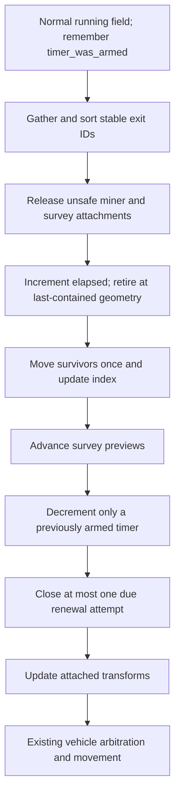
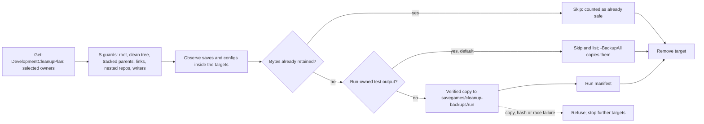
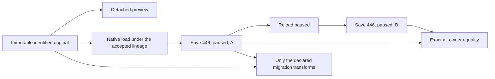

# October 28 merge, part 2: runtime integration and qualification

## Global Mandatory Reading

> **Execution protocol**
>
> - Read this Global Mandatory Reading section before the first task and again
>   after every context compaction.
> - Before starting or resuming a task group, read the nearest preceding Area
>   Mandatory Reading block whose `Applies to` label includes that group. Area
>   blocks appear immediately before the first group they govern.
> - A referenced heading or exported symbol is authoritative. Global navigation
>   hints and Area line ranges are for navigation only; if they drift, relocate
>   the named section or symbol rather than expanding to the whole file.
> - Mandatory reading is non-transitive. Do not preload a linked file's own
>   Mandatory Reading, Consult on Demand, or Planning Provenance entries unless
>   this plan names them directly for the current area.
> - Do not read Consult on Demand or Planning Provenance merely because those
>   sources are listed. Use a Consult on Demand source only when its trigger
>   occurs.
> - No created source file, test file or JSON file should start with same prefix as a planning MD file (such as r2). Only MD files can have that prefix. No MD file should be created anywhere in source directories unless specifically asked.
> - After EVERY CONTEXT COMPACTION, you must add a note above the task group
>   which is currently in execution. The note will say: "Context has compacted
>   X times while executing this group.". If the compaction occurs before any
>   meaningful work was done (this can happen when there is a lot of baggage
>   from the previous compaction), then and ONLY then you can skip this step.
> - When exceeding 3 context compactions, YOU MUST ask yourself if you're not 
>   chewing more than we can handle :). Heck, plans change! :). In such a case, 
>   the way out is to split the group on the spot,
>   in the plan, into more groups, 
>   by appending B, C, D as a suffixes to those groups (splitting sub-groups 
>   themselves is also allowed). When you do this, create Local Mandatory
>   Reading areas so you can optimize your context only for the
>   ACTUAL task at hand.
>   Before starting or resuming a task group, read the nearest preceding Area
>   Mandatory Reading block whose `Applies to` label includes that group. Area
>   blocks appear immediately before the first group they govern.

| File name | Line Ranges | Description |
| --- | --- | --- |
| [docs/zz-reach2/upgrades/2026-10/m2o28-1-merge-oct28.md](m2o28-1-merge-oct28.md) | 94-112 | **Conflict decisions and merge contract** is the single decision authority for both parts: merge mechanics, the pending gate and writer 446, CAPA/custody, copied candidates, the supply-label API, command 223, UI names and dispatcher, the window INI key, asteroid behavior, diagnostics, assets, cleanup and Linux portability. Global because every Part 2 group implements or qualifies one of these rows and must not re-decide it. |
| [docs/zz-reach2/upgrades/2026-10/m2o23-4-come-space-b-integration-handoff.md](m2o23-4-come-space-b-integration-handoff.md) | 5-20 | **Delivered boundary, 2026-10-25**: the destination owners (geometry, formats, supply book, TBM/fleet, utilities, Tube terminals, networking, art, producer catalogue). Global because qualification must show these still work after the merge, not only that the Space fixes arrived. |
| `docs/zz-reach2/upgrades/2026-10/r2sff1-z-o-final-handoff.md` (present after Part 1 Group 4) | 14-23 | The incoming delivered set: construction pages, Alt+1..4 and repeat-F2, actionable waits, straight exits, safe release, order-owned continuation, delayed replacement. Global because each item needs a Part 2 qualification row. |
| [src/saveload/save_lineage.h](../../../../src/saveload/save_lineage.h) | Live definitions; no fixed range (original declarations 15-116) | Part 1 Groups 9-22 produce `SaveDialect::SpaceFixes`, the five appended `SaveCapability` values, `CURRENT_MERGED_SAVE_VERSION` (446) and `ClassifySaveDialect`/`HasSaveCapability`. Global because runtime, protocol, readers and acceptance consume this one compatibility owner and never a version number. |
| [src/cargo_custody.h](../../../../src/cargo_custody.h) | 15-29 | `VisitNativeCargoPackets`: the one physical-container traversal. Global because runtime transfers, diagnostics and conservation checks must go through the actual owners. |
| [src/map_layer.h](../../../../src/map_layer.h) | 96-104; 215-235 | Same-file candidate geometry (`DecodeStoredTile`) versus physical geometry (`TileInLayer`, `ProjectToSurface`). Global because camera, pause and layer controls must never change simulation, commands or RNG. |
| [.gitignore](../../../../.gitignore) | 3-4 | `/logs`, `/build*` and the all-ignoring `test-cache/.gitignore`: logs go to `logs/merge-oct28/`, staging to `test-cache/merge-oct28/`, and the tracked record is `m2o28-a-execution-notes.md`. Global because every group writes evidence and Group 30 adds one more ignored owner. |

## Plan sequence and upstream handoff

This is Part 2 of the plan pair; group and task numbers continue from [Part 1](m2o28-1-merge-oct28.md), which holds the pins, chronology, research results, decision table and conflict inventory. Do not repeat or reimplement Part 1 tasks here.

**Entry state:** the [Part 1 handoff](m2o28-1-merge-oct28.md#part-1-handoff-to-part-2) is verified on the local branch `merge-2sp-oct28`. The merge commit's first parent descends from `d49c3596` and its second parent is `66713bdf`; writer 446/MLLN schema 2 is active; no pending `SaveLoadVersion` enumerator remains; full GCC and Clang CTest and the ten focused executables pass. Each Area below has its narrower gate. A missing contract stops its consumers; inventory, static review and fixture preparation may continue. S binaries, pre-merge objects, edited save headers, private pool edits and alternate registries never substitute.

**Linux and Windows split.** Everything that runs headless on Linux runs here: native Catch cases, Python readers, and S's native peer and mining harnesses once their executable path is portable (Part 1 Group 8). Work that needs MSVC, the native build profile, PowerShell, a real video driver or screenshots goes into `m2o28-b-windows-handoff.md`, created in Group 41. Each such row names its exact command, so the Windows run needs no planning.

**Pushes.** All commits stay local. Group 41 asks the user before any push, including the one that lets the Windows machine fetch the branch.

## Implementation tasks

Every code example is an **implementation sketch**. Public C++ headers are the boundary; proposed helper names may change inside their owner when callers and tests change with them. The shared execution rules in [Part 1](m2o28-1-merge-oct28.md#implementation-tasks) apply to every group here.

### Area Mandatory Reading - Canonical diagnostics and whole-save readers

_Applies to Groups 23-24._

**Entry gate:** Part 1 Group 22 is complete: the 446 writer contract exists, and the full suites passed. Verify the notes and `git grep -nE "SaveLoadVersion::(AsteroidCargoOrigins|AsteroidFieldLifecycle|SpaceMiningContinuation|SpaceLegacyDeparture|SpaceSurveyDeparture)\b" -- src`, which must return nothing. If not, stop version dispatch and round-trip assertions; the field coverage inventory may continue. Forbidden: comparing only S's fifteen-owner subset, normalizing away unknown families, or deriving expected bytes from current output.

| File name | Line Ranges | Description |
| --- | --- | --- |
| [src/multilayer_state.h](../../../../src/multilayer_state.h) | 148-174 | `MultiLayerCanonicalField`, `MultiLayerCanonicalRecord`, `ComputeMultiLayerStateDigest` and `ComputeLiveMultiLayerStateDigest`: portable diagnostics over the existing owners, not a mutable registry. |
| [docs/zz-reach2/upgrades/2026-10/m2o23-3-come-space-d-canonical-state.md](m2o23-3-come-space-d-canonical-state.md) | 7-36 | **Existing canonical owners** and **Explicit merged transport set**: complete cargo, supply, ground and Space coverage with exact names and kinds. S's peer observations add to these. |
| [src/tests/multilayer/support/savegame_tables.py](../../../../src/tests/multilayer/support/savegame_tables.py) | 196-233; 261-281 | `merged_world_chunks`, `compare_merged_worlds` and `complete_world` hard-code the 441 contract. Add source-aware dispatch and keep all-owner equality and the historical fixture. |
| `src/cargo_source_digest.h` (S-only, merged byte-identical) | 9-25 | `AppendCargoSourceDigest`: the source-digest helper that includes the typed origin. Every digest site uses it instead of hashing type and ID alone. |

### Group 23 - Extend the existing digests to the combined saved fields

{{MEDIUM}}

- [ ] **23.1** Replace digest sites that hash only source type and ID with `AppendCargoSourceDigest`, starting with D's `CargoPacket::ComputePoolDigest` (`src/cargopacket.cpp`), then the manifest, fleet, descent, handling and stock consumers. Keep the receipt/departure, quantity, age, credit and source tile in their existing owner roots.

- [ ] **23.2** Audit the asteroid, `SpaceVehicle` and order roots for the issuer frontier, exit counters and latest exit, credit, timer, and both private renewal streams. Also include the mineral, effective target and generation, departure, retry, route cursor and travel budget. If a byte order changes, keep the explicit field encoding and version the diagnostic.

- [ ] **23.3** Add mutation-sensitivity tests: changing each saved field changes the right diagnostic, while reordering equivalent sparse storage or moving the camera does not. Derived indexes, addresses, hash-bucket order and allocator state stay out of the digest.

- [ ] **23.4** Run the affected cases (`[multilayer-state]`, the Space digest cases and the S peer-diagnostic cases) through CTest in GCC and Clang, and record them in the notes.

### Group 24 - Adapt the exact-family readers and independent comparison oracles

{{HARD}}

- [ ] **24.1** Add explicit 441/446 contract dispatch to `merged_world_chunks` and `complete_world`. Select S441-445 only from admitted marker/schema facts and S's source-family contract, never from the outer number 441 alone. Keep the unknown, duplicate, missing and wrong-kind refusals.

- [ ] **24.2** Update S's Python CAPA, ASTR and order readers and their mutation helpers for the combined fields and correct byte offsets, without weakening S-only comparisons. Check fields by named descriptors or explicit era layouts; do not copy old offset assumptions into 446.

- [ ] **24.3** Keep paused 446 save/reload/save comparisons byte-exact over every required family. Original migration comparisons use only the documented structural transforms (including the old origin upgrade and absent lifecycle defaults); they never normalize away whole owners or changed cash, RNG or custody.

- [ ] **24.4** Add paired reader/native classification cases: both 441 meanings, Group 3's fresh donor 445 saves, 446, and Classic/no-field sources. A failure report names the owner, field and source era. Run the Python cases with `python3 -I` on Linux.

### Area Mandatory Reading - Native motion, mission ownership and loop publication

_Applies to Groups 25-27._

**Entry gate:** Groups 23-24 supply the complete diagnostics, and Part 1 supplies source-aware saves and unified custody. Verify that the headers below export the named functions and that their callers compile. If they are missing, stop native publication; pure geometry and selection review may continue. Forbidden: a duplicate queue or ledger, private pool setup, direct issuer changes, or a synthesized service.

| File name | Line Ranges | Description |
| --- | --- | --- |
| `src/asteroid_lifecycle.h` (S-only, merged byte-identical) | 9-40 | `RetireAsteroidBatch`, `PlanNativeAsteroidRenewal`, `CheckAsteroidRenewalAdmission` and `CommitAsteroidRenewal`: atomic field/index/ledger publication and explicit closure of a failed interval. |
| `src/space_mining_continuation.h` (S-only, merged byte-identical) | 13-46 | `ResolveEffectiveSpaceOrderTarget`, `BeginSpaceMiningContinuation`, `TickSpaceMiningContinuation`, `SpaceMiningContinuationContext` and `ValidateSpaceMiningContinuation` keep the original queue, the stopped state and the typed target meaning. |
| `src/space_return_target.h` (S-only, merged byte-identical) | 14-60 | `GetSpaceReturnRoute`, `GetSpaceReturnCandidateAdmission`, `FindNearestEligibleSpaceReturn` and `ExecuteSpaceReturnArrival` separate nearest selection from actual berth, material and service admission. A navigation prediction never grants a paid result. |
| `src/asteroid.cpp` (S-only, merged byte-identical) | 1066-1135 | `TickAsteroidField`, the native ordering authority: gather stable exits, release safety attachments, retire, move survivors, advance survey previews, tick only a previously armed timer, try one birth, update attachments. Keep its allocation-failure semantics. |
| `src/openttd.cpp` (S-only change, merged byte-identical) | 1221-1314 | `StateGameLoop`: S removed the editor's field tick and keeps one `TickAsteroidField` before `CallVehicleTicks` in the normal branch. D's utility, ground, manifest and pod scheduling must keep their once-per-opportunity guards around it. |

### Group 25 - Reconcile geometry and field transactions in isolation

These port and reconcile delivered S behavior; they are not a new renewal design.

{{HARD}}

- [ ] **25.1** Keep S's `StepSpaceMotionStraight`, the actual plane bounds, sparse identity lookup and index updates on insertion and removal. Old strip restrictions stay placement policy, not terminal bounds. Empty fields stay valid, and retired IDs are never reused.

- [ ] **25.2** Check `RetireAsteroidBatch` against the original last-contained geometry and strictly ascending IDs: lease, knowledge and index removal, plus exact 1/3/5 credits. Depletion alone does not retire. No borrowed body pointer may survive vector or index publication.

- [ ] **25.3** Check renewal proposal, admission and commit with one recognized ticket. Credit and ID are debited only on a real birth. A recognized capacity, placement or allocation refusal keeps the credit and closes its own timer/RNG interval exactly once; a stale ticket is an unchanged refusal.

- [ ] **25.4** Run S's transaction cases (`asteroid_retirement.cpp`, `asteroid_creation.cpp`, `asteroid_renewal_proposal.cpp`, `asteroid_renewal.cpp`) in `openttd_space_fixes_test`, and add merged-world cases where D owners take part: a D utility or ground actor in the same world, and storage reversal. Do not change the normal loop yet.

### Group 26 - Reconcile mining continuation with real receiver and service admission

Existing APIs keep the phases apart; do not add a second action producer:

```cpp
auto candidate = FindNearestEligibleSpaceReturn(craft, purpose);
// Selection grants no berth, stock, payment, service or arrival.
// The original queue performs travel and every intervening Visit.
if (/* the original controller observes the actual reached target */) {
	const bool admitted = ExecuteSpaceReturnArrival(craft, target, purpose);
	// The existing queue/work owner alone handles progression after admission.
}
```

{{HARD}}

- [ ] **26.1** Join `ReleaseUnsafeSpaceMiningAttachments` and the survey-release paths to the same safety forecast. Stopped hulls, own leases, cargo and static Core/Dock service claims survive; a blocked departure keeps its named wait instead of resetting work or teleporting.

- [ ] **26.2** Adapt `ResolveEffectiveSpaceOrderTarget` and the order-action controller to the one original queue. FullLoadNearest keeps the mineral and the Visit sequence; legacy/default behavior stays exact; ReturnNearest stays in the original domain. Keep the stable distance/typed-ID/generation tie-breaks and the bounded retry notices.

- [ ] **26.3** Reconcile `CanNavigateSpaceOnboardService`, receiver capacity, shell/descent and arrival operations with D's supply and custody owners. Planning reads existing parts and allowance without consuming them. `ExecuteSpaceReturnArrival` revalidates the current owners and hands the actual transfer or service to them.

- [ ] **26.4** Add cases for partial and full holds, required service, a missing/occupied/unsafe body, no receiver, paused work, a stopped craft, and explicit Recall/cancel, each with D's paid supply active in the same world. An idle state alone is never proof of a deadlock: assert the named wait.

### Group 27 - Publish one correctly ordered normal field opportunity

The sequence below reflects S's live code, not a new ordering:



{{HARD}}

- [ ] **27.1** Confirm that `TickAsteroidField` follows the order above, including remembering whether the timer was armed before exits. A first credit keeps its whole new delay, and a new body first moves on the next tick. The normal, editor, menu and pause gates are independent of camera visibility.

- [ ] **27.2** Inventory both branches of `StateGameLoop` and every D scheduler around the single field call (utility settlement, ground and TBM work, manifests, pods, transitions). Confirm one field tick per normal tick, none in the editor and none while paused, and no D scheduler running twice.

- [ ] **27.3** Keep S's terminal error handling when allocation fails after partial native publication. Do not invent a general rollback or turn an invalid partial opportunity into a harmless wait.

- [ ] **27.4** Run S's `asteroid_lifecycle_tick.cpp` and `asteroid_lifecycle_native.cpp` cases, and add matched visible/hidden, pause/normal/fast-forward and save-at-boundary cases in a merged world. Assert the unchanged stopped state, exact elapsed ticks, and one timer decrement and birth attempt.

### Area Mandatory Reading - Combined command and protocol identity

_Applies to Group 28._

**Entry gate:** Part 1 appended `SetSpaceMiningPolicy` at 223 (Group 5) and activated writer 446 (Group 22), and Group 26 supplies the policy fixtures. Verify `static_assert(to_underlying(Commands::SetSpaceMiningPolicy) == 223)` compiles. If not, stop command execution claims; ABI enumeration and negative payload fixtures may continue. Forbidden: aliasing S's ID 211, renumbering D commands, or stubbing the policy owner.

| File name | Line Ranges | Description |
| --- | --- | --- |
| [src/command_type.h](../../../../src/command_type.h) | Live definitions; no fixed range (pre-merge tail 449-462) | Part 1 Group 5 appended `SetSpaceMiningPolicy` after `SetTubeVehicleGeothermalPower` (222). Earlier ordinals and tuples are immutable. |
| `src/space_vehicle_cmd.h` (S-only, merged byte-identical) | 42-51 | `CmdSetSpaceMiningPolicy` and its `DEF_CMD_TRAIT`: a generation-checked edit of one existing Mine, with pure query. |
| [src/network/core/network_game_info.cpp](../../../../src/network/core/network_game_info.cpp) | 48-58; 122-148 | `GetMergedNetworkRevisionSuffix` (`+m<save>c<commands>p<profile>`) and `IsNetworkCompatibleVersion`, which rejects a mismatched suffix before the Git-hash fallback. Part 1 Group 22 moved the save part to `CURRENT_MERGED_SAVE_VERSION`. |
| [src/tests/merged_command_compatibility.cpp](../../../../src/tests/merged_command_compatibility.cpp) | 42-66 | The suffix expectation (`+m441c223p` before the merge; `+m446c224p` after Groups 5 and 22). Historical fixtures keep their old meaning. |

### Group 28 - Publish the combined command and protocol identity

```cpp
// Expected combined ordinals; existing tuples unchanged.
static_assert(to_underlying(Commands::SetTubeVehicleGeothermalPower) == 222);
static_assert(to_underlying(Commands::SetSpaceMiningPolicy) == 223);
// GetMergedNetworkRevisionSuffix: CURRENT_MERGED_SAVE_VERSION, Commands::End and the content-profile version.
```

{{MEDIUM}}

- [ ] **28.1** Verify the command once more: one registration of `CmdSetSpaceMiningPolicy` with its generation, index and policy arguments in native and network dispatch, query-before-execute refusal, and no other command referring to ID 211 by number.

- [ ] **28.2** Extend the command identity auditor (`src/tests/merge_command_identity_checks.py` and `src/tests/merged_command_compatibility.cpp`) with a separately named current fixture for IDs 0-223 and the `+m446c224p` suffix. The old fixtures stay as historical evidence, including both meanings of 211.

- [ ] **28.3** Add codec and admission cases: policy out of range, stale hull generation, wrong owner, non-Mine cursor, query without mutation, and a target changed before execution. Keep the existing canonical supply, TBM, geothermal and Tube command tests.

- [ ] **28.4** Run the identity, codec and command cases in GCC and Clang. The real-peer protocol refusal stays in Group 36; a codec-only pass is not a peer claim.

### Area Mandatory Reading - Shared presentation and keyboard dispatch

_Applies to Group 29._

**Entry gate:** Group 28 exposes the policy command through native and network dispatch, and Part 1 Group 6 left one dispatcher (`ToggleHotkeyWindow`) and one layer entry (`ShowMainViewportLayerInDisplayOrder`). Verify with `git grep -n "HandleWindowOpeningHotkey\|SelectMainViewportLayer" -- src`, which must return nothing. If it returns hits, stop 29.2 and return to Part 1 Group 6; layout and setting checks may continue. Forbidden: editing mission state directly from the GUI, or synthesizing construction prerequisites.

| File name | Line Ranges | Description |
| --- | --- | --- |
| [src/window_func.h](../../../../src/window_func.h) | Live definitions; no fixed range (pre-merge 54-86) | `FindFrontmostClosableWindow`, `IsWindowRaisedAsFarAsPossible`, `CloseFrontmostClosableWindow` and `CancelPlacementOrCloseWindow` define D's z-priority and Escape/placement precedence; Part 1 Group 6 removed S's duplicate declaration. |
| [src/toolbar_gui.cpp](../../../../src/toolbar_gui.cpp) | Live definitions; no fixed range (pre-merge `ToggleHotkeyWindow` 2152-2168) | `ToggleHotkeyWindow` with S's modal, pinned and `NoClose` safeguards (Part 1 Group 6): the single opening-key toggle for the normal and editor toolbars. |
| `src/space_construction_gui.h` (S-only, merged byte-identical) | 15-20 | `GetSpaceConstructionReasonText`, `GetSpaceConstructionBuilderText` and `GetSpaceConstructionMaterialText` read real construction owners and grant no work or material. |
| [src/tests/window_hotkey_toggle.cpp](../../../../src/tests/window_hotkey_toggle.cpp) | 100-151; 153-208; 211-231 | D's toolbar close/raise cases, the Escape cases and the four-layer case. S's modal, pinned and `NoClose` cases join these. |

### Group 29 - Consolidate controls, construction pages and player feedback

{{MEDIUM}}

- [ ] **29.1** Prove one layer mapping in both toolbars: Alt+1..4 through `show_map_layer_*` in the normal and editor tables, and S's `HotkeyList::Load` migration of the Alt+0/1/2 Debug defaults to Ctrl+Alt. A copied old `hotkeys.cfg` with custom bindings keeps them.

- [ ] **29.2** Add S's modal-progress, modal-window, pinned and `NoClose` cases to `src/tests/window_hotkey_toggle.cpp`, next to D's toggle cases. A second press closes only an eligible front-most window; a covered window is raised without being recreated; Escape keeps its placement/edit/query precedence.

- [ ] **29.3** Check the settings set once more: one `hotkey_toggles_window` with its string and help text, `escape_closes_window`, and every D-only setting row. Strings match the final behavior. File headers name delivered symbols, not stale plan files.

- [ ] **29.4** Check S's bounded orbital construction action pages, resizing, and the actionable missing-material/service/work messages in the merged GUI. D's layer-specific construction previews, station supply controls and underground/Tube/geothermal entry points stay.

- [ ] **29.5** Check the Mine continuation policy controls in `src/asteroid_gui.cpp` and their exact wait reasons. The controls submit `Commands::SetSpaceMiningPolicy` and never mutate policy, cargo or intent directly.

- [ ] **29.6** Run D's `[demo-fix-window-toggle]` cases and S's `[space-shortcut-config]` and `[space-shortcut-layers]` cases in GCC and Clang. Put the screenshot-based layout and shortcut scenarios (`space_fixes_checks.py --layout`, `--shortcuts`, `--construction`) on the Windows handoff list: they need a real video driver.

### Area Mandatory Reading - Cleanup: best of both

_Applies to Group 30._

**Entry gate:** the merged tree carries S's cleanup files (`clean.ps1`, the three `cleanup_check*.ps1` scripts and `cleanup_fixture.ps1`), and `git status --short` is empty. Verify with `git log -1 -- clean.ps1` and the status. If the tree is dirty, stop 30.4-30.7 until the changes are committed. Forbidden: running `clean.ps1 -Apply` against this checkout; restoring the old source-epoch, catalogue-completeness or source-hash gates in the routine path; writing routine backups to tracked locations (which would dirty the tree and make the next cleanup refuse); and a second save journal.

| File name | Line Ranges | Description |
| --- | --- | --- |
| [clean.ps1](../../../../clean.ps1) | 2-53; 301-360; 518-571 | The help text (S's tolerant policy: Apply deletes everything inside the selected owners, "never reads preservation catalogues, hashes source inputs, exports saves or creates backups"), `Get-DevelopmentCleanupPlan` (the selected owners) and `Invoke-DevelopmentCleanup` (preview, Git gates, `ShouldProcess`, per-target removal and report). The backup step goes into `Invoke-DevelopmentCleanup`, before the first removal. |
| `docs/zz-reach2/upgrades/2026-10/r2fc-file-cleanup3.md` (S-only change, local after Part 1 Group 4) | 49-104 | **Current cleanup policy — user correction, 2026-10-26**: the guards S keeps (root, clean tree, tracked parents, reparse points, nested repositories, writers, mutation checks, preview/DryRun/WhatIf) and the 74/29/26 check counts. The user's 2026-10-28 decision keeps all of this and adds automatic backup. |
| [src/tests/multilayer/support/save_retention.py](../../../../src/tests/multilayer/support/save_retention.py) | 77-124; 149-187; 254-326 | `_observe` (save-like files by header, plus `.cfg`/`.scr` when asked), `_destination` and `plan_save_exports` (hash reuse against `migration.json` and `save-exports.json`), `apply_save_exports` and `verify_save_exports` (verified copy). This owner already detects and copies; its destinations (`savegames/retained`, `src/tests/fixtures/config/multilayer/retained`) are tracked, which is why routine cleanup needs an ignored destination. |
| [src/tests/multilayer/support/artifact_source_epochs.py](../../../../src/tests/multilayer/support/artifact_source_epochs.py) | 166-183 | `verify_source_epochs` demands that historical source hashes still match live files: the "paranoid" gate the user rejected. Routine cleanup never calls it; it stays available for explicit reconstruction work. |
| `src/tests/multilayer/support/cleanup_fixture.ps1` (S-only change, local after Part 1 Group 4) | 66-139 | `New-CleanupFixture`, the Git and writer doubles, and `Complete-CleanupChecks`, which removes only its own GUID scratch under `test-cache/cleanup/cleaner-checks`. The fixtures need no Git mutation and are safe to run as they are. |

### Group 30 - Make the cleaner back up proportionately without the historical gates

**User decision, 2026-10-28:** "the new clean script should be a best of both worlds". The old adapter was too paranoid (source-epoch and hash gates, demanding old code versions); S's "bad one" is too tolerant (no backup at all). The design below keeps S's boundary and every guard, and adds one automatic, proportionate, verified backup step.



Proposed boundary (sketch). `-NoBackup` restores today's behavior for a caller who has already made a backup:

```powershell
# Inside Invoke-DevelopmentCleanup, after the guards and before the first Remove-CleanupTarget:
if ($Apply -and -not $DryRun -and -not $NoBackup) {
    $backup = Invoke-CleanupBackup 'apply' @{ targets = @($plan.Path); all = [bool]$BackupAll } $Repository
    Write-Host ("Backed up {0} files ({1}); {2} already retained; {3} run-owned outputs skipped." -f ...)
}
```

{{HARD}}

- [ ] **30.1** Measure before designing the defaults. Run `clean.ps1 -DryRun` (on Windows, or with `pwsh` here if it can be installed) or an equivalent read-only Python observation over the same owners, and record per owner the count and bytes of save-like files and of `.cfg`/`.scr` files. Classify each as human-play (`mlm/runtime/<profile>/`, `build/save/`, `build/scenario/`, the build root's `openttd.cfg`/`hotkeys.cfg`/`private.cfg`/`secrets.cfg`) or run-owned test output (inside a `GetTestArtifactPaths` run directory or a CTest/Catch process home). Present the numbers and the proposed default to the user, and continue with that default unless they change it.

- [ ] **30.2** Add `plan_cleanup_backup` and `apply_cleanup_backup` to the existing `save_retention.py`, reusing `_observe(…, configurations=True)`, `file_identity` and its verified-copy routine. The backup destination is `savegames/cleanup-backups/<UTC run id>/<original relative path>`, ignored through a new `/savegames/cleanup-backups/` line in `.gitignore`. Each run writes one `manifest.json` (original path, SHA256, bytes, detected format, reuse source); it is a run receipt, not a second journal. Bytes already present in `migration.json`, `save-exports.json` or an earlier backup manifest are counted and never copied again.

- [ ] **30.3** Do not call `verify_cleanup_inputs`, `verify_source_epochs`, `unclassified_cleanup_sources` or any catalogue-completeness check from these entries. An old source hash, a legitimately changed committed `src/hotkeys.cpp`, or a missing unrelated history file can never block backup or cleanup. Only real backup failures refuse: copy or hash mismatch, a source changed during the copy, a destination inside a target, or insufficient space.

- [ ] **30.4** Wire the step into `clean.ps1`:
  - add `-NoBackup` and `-BackupAll` with help text;
  - `-DryRun` and the default preview print the backup counts and bytes per target and write nothing;
  - `-Apply` runs the backup before the first removal, through a structured-JSON `Invoke-CleanupBackup` that follows the old `Invoke-CleanupPreservation` pattern (base `9f36af95:clean.ps1` 414-438);
  - a refused backup stops before that target, like S's partial-failure rule.

  Update the help text that says the cleaner never creates backups.

- [ ] **30.5** Add Python tests for the new entries (runnable here with `python3 -I`). Cover: identical bytes already retained (no copy), a changed personal `hotkeys.cfg` in a build root (copied), a run-owned save (skipped by default, copied with `all`), a renamed save detected by header, a source changed during the copy (refused), a destination inside a target (refused), and a stale source-epoch reference next to a changed `src/hotkeys.cpp` (no effect).

- [ ] **30.6** Extend S's PowerShell checks with backup cases using the fixture doubles: preview writes nothing, `-NoBackup` skips, a refused backup keeps the target, and the 74/29/26 existing checks still pass. Run them with `pwsh -NoProfile -File` if PowerShell 7 can be installed here; otherwise put the exact three commands on the Windows handoff list. Never run `-Apply` on the real checkout.

- [ ] **30.7** Reconcile the documentation:
  - the new policy note in `r2fc-file-cleanup3.md` (2026-10-28: automatic proportionate backup, kept guards, no historical gates);
  - `docs/zz-reach2/architecture/archi-historical-debug.md` storage ownership, with the new ignored backup owner;
  - the script help.

  Record S's missing runtime evidence as a likely cleanup loss reported by the user, not a proven deletion.

### Area Mandatory Reading - Combined builds

_Applies to Group 31._

**Entry gate:** Groups 23-30 are committed and `git status --short` is empty. Verify both. If the tree is dirty, commit or finish the open group first; inventory and documentation may continue. Forbidden: S binaries, stale objects from before the merge, `-k 0` partial builds reported as success, compiler-flag suppression, or removing sources or tests from CMake.

| File name | Line Ranges | Description |
| --- | --- | --- |
| `CMakeLists.txt` (merged cleanly; forecast lines) | 263-317; 319; 415; 424; 434; 442; 475; 490; 631; 664 | `openttd_test`, `openttd_space_fixes_test` and the nine D focused targets. All ten focused targets are `EXCLUDE_FROM_ALL` and outside CTest. |
| [docs/zz-reach2/upgrades/2026-10/r2lbf-linux-build-fixes.md](r2lbf-linux-build-fixes.md) | 936-953 | **Group 16 - Cover the CI Dedicated/no-PCH variant and classify residual warnings**: the `build-dedicated` recipe and the warning triage this build repeats for merged code. |
| [src/tests/test_artifact_paths.cpp](../../../../src/tests/test_artifact_paths.cpp) | 372-403 | `GetTestRuntimeConfig` reads `<repository>/build`, so `build/` is built and given its base set before the Clang and Dedicated test runs. |

### Group 31 - Build every Linux configuration and run every suite

{{MEDIUM}}

- [ ] **31.1** Rebuild `build/` (GCC RelWithDebInfo) from scratch: move the old tree aside as `build-pre-merge-<date>` (do not delete it), then configure, run `ninja -j4 -k 0` and check `FAILED: 0`. Record the wall time and warnings per flag, and triage warnings in merged or S code as in r2lbf Group 16.

- [ ] **31.2** Rebuild `build-clang/` the same way. Record `-Wdangling-gsl` (0 expected after the R6 fixes) and any Clang-only diagnostic.

- [ ] **31.3** Build `build-dedicated/` with the CI Dedicated/no-PCH options from r2lbf Group 16, and run its CTest.

- [ ] **31.4** Run full CTest in `build/` and `build-clang/` (`-j4 --timeout 600`, JUnit output), and the ten focused executables in both trees with `run_focused.sh`. Every case must pass; record counts against the Part 1 Group 22 milestone.

- [ ] **31.5** Write `test-cache/merge-oct28/build-manifest.json` with the source commit, compiler versions, build options, the base-set and GRF hashes and the binary SHA256s. Groups 32-39 cite it.

### Area Mandatory Reading - Compatibility and conservation qualification

_Applies to Groups 32-35._

**Entry gate:** Group 31 produced the build manifest with all suites passing, and Group 24 exposes the complete-world comparisons. Verify the manifest and the notes. If either is missing, stop Groups 32-35 acceptance claims; inventory and case preparation may continue. Forbidden: S images, private decoder copies, selected-owner digests, edited source headers, or historical successes used as current evidence.

| File name | Line Ranges | Description |
| --- | --- | --- |
| [src/tests/multilayer/support/savegame_tables.py](../../../../src/tests/multilayer/support/savegame_tables.py) | Live definitions; no fixed range | Group 24 made `merged_world_chunks`, `compare_merged_worlds` and `complete_world` contract-aware (441 and 446), including empty families and every unchanged owner. |
| [docs/zz-reach2/upgrades/2026-10/m2o23-3-come-space-d-canonical-state.md](m2o23-3-come-space-d-canonical-state.md) | 38-64 | **Permitted original-to-merged structural transformations** limits the legacy supply, engine, rail and catalogue changes and second-save equality. Only explicit source-era origin and lifecycle defaults are added. |
| [src/saveload/save_envelope.h](../../../../src/saveload/save_envelope.h) | 16-35 | `InspectSaveWireFacts` and `SaveInspectionLimits`: refusal before world initialization keeps the open world, which differs from a late native adoption failure. |
| `docs/zz-reach2/upgrades/2026-10/r2sff1-r-transport-gate.md` (local after Part 1 Group 4) | 7-29 | **Certified boundary**: field before origin adoption, and complete copied joins and resets. |
| [src/tests/multilayer/acceptance/space_checkpoint.py](../../../../src/tests/multilayer/acceptance/space_checkpoint.py) | 128-137; 186-194 | `load_foundation` and `verify_foundation` select and verify the sealed Space foundation without treating its old executable as a current result. Any advancing test needs a separately allowed copy. |

### Group 32 - Qualify source migrations and paused current round trips



{{HARD}}

- [ ] **32.1** Make a row for each independently identified source: shared 403; historical A438/440 and B434 collision fixtures; D merged 441; Group 3's fresh donor 445 saves; Classic 374; and S's retained Space 405/418/440. For each, record the source hash, accepted dialect and capabilities, the binary and the allowed transformations before running. Unavailable historical sources stay explicitly unverified.

- [ ] **32.2** Decide which Group 3 outputs become tracked fixtures. Promote only the small saves that a regression test needs, through the existing `save_retention.py --apply` journal, and commit them. Contemporary reconstruction stays labeled apart from the reproduction of a historical run.

- [ ] **32.3** For each available row, compare the detached preview with an ordinary native load, then save 446, reload paused, and save 446 again. Compare every required owner and family byte for byte between the two current saves. Runtime motion stays off for this gate.

- [ ] **32.4** Compare each original with its current save only against the declared per-dialect transformations: D's existing migrations, typed legacy origin qualification, absent lifecycle/continuation defaults, and the marker and wire changes. Investigate any other changed field and fix the codec or the mistaken expectation; never mask an owner.

### Group 33 - Qualify refusal, copied reset and late native failure

{{HARD}}

- [ ] **33.1** Run malformed-source cases: missing, duplicate or wrong-kind MLLN and feature families; incomplete origin pairs; source-label mismatch; impossible issuance or credit history; invalid policy, intent, generation or lease; and partial source-owned records. Ambiguous originals and corrupt modern files refuse, with no fallback and no invented history.

- [ ] **33.2** Alternate valid and invalid detached previews and preflight loads. Snapshot the open world's cash, RNG, profile, geometry, packet ownership and copied staging before each attempt. A preflight refusal keeps the open world, clears partial copied data while keeping its error, and allows the next valid candidate.

- [ ] **33.3** Trigger a failure after native adoption starts, check the `SaveOrLoadResult::ReInit` path, and then load a valid file. Staging, pools and caches reset with no stale references; do not require the old world back after destructive initialization.

### Group 34 - Qualify mixed cargo custody and paid ground continuations

The complete-owner oracle from Group 24 stays on; S's fifteen observations alone cannot establish conservation.

{{HARD}}

- [ ] **34.1** Carry high-ID and retired-source asteroid packets through station goods, ordinary vehicles, launch handling, manifests/pods and descents with native operations. At each transfer compare source, body, mineral, quantity, travel/age, feeder credit and exactly one physical owner. Include a partial transfer, a duplicate or missing owner, and ID-reuse refusal.

- [ ] **34.2** Exercise module manufacture, processing, construction and service consumption next to native and legacy supply receipts, in all input slots, including dispatch/refund irreversibility. The paid purpose, receipt/departure and actual consumption settle once, and asteroid origin never becomes purchased supply.

- [ ] **34.3** Run D's affected regressions: Native/LegacyB supply, TBM face/bay and whole transfer, Tube provider switching, geothermal/heat/town service and mixed utility allocation (`openttd_surface_supply_test`, `openttd_tube_test` and the related CTest tags).

- [ ] **34.4** Replay the available original paid ground, TBM, Tube and geothermal continuations with Space lifecycle active in the same world, where legitimate inputs allow it. Check one settlement per native opportunity, persistent manual stops and paid waits. If no input holds the needed cross-feature world, report the gap instead of installing synthetic stock.

### Group 35 - Verify protected foundations and retained art

{{MEDIUM}}

- [ ] **35.1** Requalify the protected Space foundation through `load_foundation`/`verify_foundation` and separately named outputs. Its seals and financial restrictions stay; any advancing test uses an explicitly allowed copy and is never reported as progress on the protected continuation.

- [ ] **35.2** Confirm that D's selected assets, renderer bindings and public manifest are intact: record the canonical GRF hash (`c04fbf0d…8e8744` expected), and run the affected native render cases (`openttd_ground_art_test`, `openttd_space_art_test`). Put GUI raster smoke on the Windows handoff list.

### Area Mandatory Reading - Real peers and replay

_Applies to Groups 36-37._

**Entry gate:** Group 28 registered the policy command; Groups 31-35 passed. Verify the build manifest and the notes. If either is missing, stop Groups 36-37 runtime claims; topology and input inventory may continue. Forbidden: a one-process replay, an old receipt, a private pool edit, or an altered save header in place of real socket peers.

| File name | Line Ranges | Description |
| --- | --- | --- |
| [src/network/core/network_game_info.cpp](../../../../src/network/core/network_game_info.cpp) | Live definitions; no fixed range | Group 28 verified `GetMergedNetworkRevisionSuffix` (`+m446c224p…`) and `IsNetworkCompatibleVersion`. Read the live discriminator before asserting when WrongRevision happens. |
| `src/tests/multilayer/acceptance/space_lifecycle_peer_checks.py` (S-only; Part 1 Group 8 made its executable path portable) | 29-86; 121-162 | `launch` starts each endpoint as `openttd_test "[.space-lifecycle-peers]"` with a private home and loopback socket; `opportunities` and `compare_peer` require real assigned frames, contiguous common opportunities, and each saved phase plus its next decision. Add the Group 24 complete-world comparisons. |
| `docs/zz-reach2/upgrades/2026-10/r2sff1-z-m-high-id-peers.md` (local after Part 1 Group 4) | 6-38; 50-85 | The declared historical-prefix section and **Native source and no-op transport verified** separate prepared issuance metadata from earned high-ID birth, extraction and retirement. Keep that evidence limit. |
| [src/multilayer_state.h](../../../../src/multilayer_state.h) | Live definitions; no fixed range | Group 23 extended `ComputeMultiLayerStateDigest` and `ComputeLiveMultiLayerStateDigest`. Matched-peer evidence uses the same owners; diagnostics never replace raw all-family equality. |

### Group 36 - Establish the actual peer topology and protocol refusal

{{HARD}}

- [ ] **36.1** Run the S peer harness on Linux: a combined host, the owning client and a late observer, each with its own home, config and run ID. Record the binary, source and input hashes and the actual sockets. Matching peers join and resume the same accepted 446 world. Use D's `ground_peer_merge.py` too if its executable paths resolve on Linux; otherwise list it for Windows.

- [ ] **36.2** Send the policy command from the owning client through the real command stream. Compare assigned frames, cash and RNG, the cargo, supply and ground roots, and the fifteen S observations at matched opportunities, including the late observer after its join. A direct native edit is never peer evidence.

- [ ] **36.3** Check protocol refusal. Exercise the old D441 (`+m441c223p`), S445 and historical A/B revision strings against the combined handshake and verify WrongRevision before authentication or map transfer. Where an original binary can be built (D at `d49c3596` from `build-pre-merge-*`, the S reference from Part 1 Group 2), use it as a real peer. Add malformed and stale policy payloads and verify that refusal neither executes ID 211 nor changes the original mission.

### Group 37 - Qualify lifecycle phases and high-ID peer replay

{{HARD}}

- [ ] **37.1** Capture real phase saves around pre-exit release, retirement and credit, the armed countdown, a due refusal and a successful birth. Require contiguous common opportunities and each phase plus its next decision across the peers; compare complete worlds as well as diagnostics.

- [ ] **37.2** Reload the same phases in independent local and reversed-storage twins, and compare the next native decisions with an uninterrupted run. Local twins have no server-frame authority: compare semantic opportunities only.

- [ ] **37.3** Prepare the high-ID source through the Part 1 Group 3 producers, or an equivalent chain on the combined build. Declare only the permitted historical prefix, then earn birth 65536, extraction and retirement natively. Run real peers and an actual return/service with combined custody, and verify that there is no 16-bit alias, source replacement or body-ID reuse.

### Area Mandatory Reading - Bounded gameplay and runtime acceptance

_Applies to Groups 38-39._

**Entry gate:** Groups 31-37 provide the current build, transport, conservation and peer results, and Group 29 the consolidated controls. Verify the notes. If any is missing, stop the affected runtime success claims; checklist and workload inventory may continue. Forbidden: screenshots as reproduction of a personal save, container counts as FPS, or direct state edits as earned construction or mining work.

| File name | Line Ranges | Description |
| --- | --- | --- |
| `docs/zz-reach2/upgrades/2026-10/r2sff1-z-o-final-handoff.md` (local after Part 1 Group 4) | 71-116 | **Reproduction** names the layout/shortcut, compatibility and lifecycle drivers and their case selections. Use them with the combined build and private configs. |
| `docs/zz-reach2/upgrades/2026-10/r2sff1-z-n-lifecycle-work.md` (local after Part 1 Group 4) | 53-100 | **Release results**: seven bounded workloads, capacity refusal, turnover and retry work. The counts measure these components, not whole-game FPS or heap. |
| `src/space_return_target.h` (S-only, merged byte-identical) | 14-60 | Pure receiver prediction versus actual paid service admission; runtime observations must show earned work and genuine waits. |

### Group 38 - Repeat the native controls and the actual gameplay scenarios

{{MEDIUM}}

- [ ] **38.1** Run the headless `space_fixes_checks.py --mining-controls` scenarios on Linux with private configs: both mining roles through partial and full holds, same-mineral continuation, nearest eligible receiver, absent asteroid or receiver, real service wait, manual stop and Recall. Record the actual wait reasons.

- [ ] **38.2** Put the screen-based scenarios on the Windows handoff list with exact commands: every construction action page at the recorded GUI and font scales, Alt+1..4 and repeat-F2 in the normal and editor modes, retained window state, Escape precedence, and a normally supplied paid construction to completion.

- [ ] **38.3** Run D's affected player-control smoke in the null-video build: load the `underground-mines` demo and one Space demo, use the layer hotkeys, and save paused. Confirm that no simulation or RNG difference appears between visible and hidden layers.

### Group 39 - Repeat the bounded work and cadence measurements

{{MEDIUM}}

- [ ] **39.1** Repeat the seven bounded field/work cases, capacity refusal, high-ID turnover and the no-compatible-mineral retry measurements, recording configuration, live population and storage, work counts and elapsed scope. Compare with S's bounds without claiming whole-game FPS.

- [ ] **39.2** Compare visible and hidden Space views with identical inputs and opportunity counts. Pause freezes field opportunities; fast-forward changes only wall time.

- [ ] **39.3** Repeat only the affected D ground/orbital contention cases. Record any unresolved personal-save gap honestly; screenshots or retained demos do not prove a missing personal save was reproduced.

### Area Mandatory Reading - Records, Windows handoff and branch finalization

_Applies to Groups 40-41._

**Entry gate:** Groups 31-39 have results in the notes for every claimed row. Verify the notes and the build manifest. If a row lacks results, publish it as open and do not mark the merge complete; documentation may continue. Forbidden: historical checkboxes, old logs or images, or expectations derived from current output as substitutes; and any push without the user's word.

| File name | Line Ranges | Description |
| --- | --- | --- |
| [docs/zz-reach2/upgrades/2026-10/m2o23-4-come-space-b-integration-handoff.md](m2o23-4-come-space-b-integration-handoff.md) | 59-79 | **Supported reconstruction boundary**: retained originals, recipe reconstruction and scoped qualification. The final handoff keeps these storage and recipe authorities. |
| `docs/zz-reach2/upgrades/2026-10/r2sff1-z-o-final-handoff.md` (local after Part 1 Group 4) | 118-134 | **Limits and remaining ownership**: the personal-save, declared-prefix, component-performance and protected-Space limits. Combined results do not widen them. |
| [docs/zz-reach2/upgrades/2026-10/r2lbf-b-windows-handoff.md](r2lbf-b-windows-handoff.md) | 9-70 | **What to run on Windows**: the existing r2lbf Windows checks. The merge handoff adds its rows to this pattern instead of inventing another format, and updates the `asteroid_gui.cpp` key note. |

### Group 40 - Reconcile the records

{{SIMPLE}}

- [ ] **40.1** Reconcile the six shared architecture and master documents that merged without markers (`archi-historical-debug.md`, `archi-gui.md`, `archi-map-layers.md`, `archi-savegame.md`, `r2mlsp-space-master-plan.md`, `r2mlvs-multilayer-vehicles-and-structures.md`) around the final behavior: both historical 441 meanings and writer 446, source-era migration, command 223, the consolidated controls and the cleanup backup.

- [ ] **40.2** Reconcile `d2sa-space-adventures.md` (Part 1 5.5 union) and the affected demo guidance with both feature sets. Check that launcher selections use the public resolver and immutable source aliases.

- [ ] **40.3** Update `r2lbf-b-windows-handoff.md`: the survey window's INI key is now `space_inspector` (560×380), not `space_survey`. Then update the **Status, 2026-10-28** note in the m2o26 and m2o27 plans (added while planning) with the final merge commit, leaving their tasks as historical records.

- [ ] **40.4** Validate every row of `dispositions.tsv` and all 40 shared paths against the merged result, and confirm no S addition, save field, test target or documentation change was lost (`git diff origin/mlm-mlv-2sp HEAD --stat -- <S-only paths>` shows only intended changes).

### Group 41 - Hand over the Windows checks and finalize the branch

{{MEDIUM}}

- [ ] **41.1** Create `m2o28-b-windows-handoff.md` beside this plan, in the r2lbf handoff format. List:
  - the MSVC Debug and RelWithDebInfo builds through `native_build.py` of `openttd`, `openttd_test`, `openttd_space_fixes_test` and the focused targets;
  - the full test runs;
  - the screen-based `space_fixes_checks.py` scenarios from 29.6 and 38.2;
  - the three cleanup check scripts and `clean.ps1 -DryRun` from 30.6;
  - GUI raster smoke (35.2);
  - any producer or peer that could not run on Linux (3.5, 36.1).

  Each row gives the exact command and its pass criterion.

- [ ] **41.2** Publish the final record in the notes: the final commit and build manifest, tested and missing original versions, focused, native and peer results, the GRF hash, the cleanup decision and its measured defaults, and the remaining questions for the user. Mark each plan task `[X]` only with its evidence; leave blocked tasks open with the blocker.

- [ ] **41.3** Validate both plan files once more: numbering, one tag per group, at most eight tasks per batch, the verbatim protocol, Area coverage, named symbols, current ranges and local links.

- [ ] **41.4** Fast-forward `mlm-mlv` locally: `git switch mlm-mlv && git merge --ff-only merge-2sp-oct28`. Confirm `git log --graph --oneline -5` and that `mlm-mlv-2sp` is unchanged.

- [ ] **41.5** Ask the user whether to push, and what: `mlm-mlv`, and optionally `merge-2sp-oct28`, so the Windows machine can fetch them. Push only after their answer, with `git push -u origin <branch>`.

## Consult on Demand

These are conditional sources, not prerequisites. Read a row only after its trigger occurs.

| Trigger | File name | Start at | Expand only when | Consultation purpose |
| --- | --- | --- | --- | --- |
| A runtime group's intent for a boundary is unclear from code | [docs/zz-reach2/upgrades/2026-10/m2o27-merge-runtime-qualification-oct26.md](m2o27-merge-runtime-qualification-oct26.md) | The group whose number is this group minus 4, from **Group 19** at line 99 | The Part 1 decision table does not cover the boundary | Recover the October 26 reasoning. The Part 1 decision table wins wherever they differ. |
| A renewal test disagrees about motion, cost, timing or eligibility | `docs/zz-reach2/upgrades/2026-10/r2sff1-space-fixes-features-1.md` (local after Part 1 Group 4) | **Scope and decisions**, lines 46-73 | The live motion, lifecycle and target contracts contradict each other | Recover the 20-60 s policy, the 1/3/5 weights, no instant refill and the nearest-target tie-break rationale. |
| Routine backup still refuses because of an old source hash or an unrelated historical file | [src/tests/multilayer/support/artifact_preservation.py](../../../../src/tests/multilayer/support/artifact_preservation.py) | `cleanup_operation`, lines 298-352, then `verify_cleanup_inputs`, lines 213-295 | The new backup path still reaches historical auditing | Find the remaining coupling and remove it from the routine path; never hide a real failed backup. |
| A cold build imports Python modules from another checkout or lacks runtime assets | [docs/zz-reach2/upgrades/2026-10/m2o23-4-come-space-b-integration-handoff.md](m2o23-4-come-space-b-integration-handoff.md) | **Supported reconstruction boundary**, lines 59-79 | The public build and staging helpers cannot produce their declared prerequisites | Diagnose `_pth`, distribution and profile ownership without archived executables. |
| A complete-world comparison fails only for an original migration | [docs/zz-reach2/upgrades/2026-10/m2o23-3-come-space-d-canonical-state.md](m2o23-3-come-space-d-canonical-state.md) | **Permitted original-to-merged structural transformations**, lines 38-64 | Current codecs and source fields do not explain the changed owner | Tell an approved conversion from a conservation regression. |
| A peer run fails before the join on Linux only | [docs/zz-reach2/upgrades/2026-10/r2lbf-b-windows-handoff.md](r2lbf-b-windows-handoff.md) | **Known limits**, lines 101-106 | The failure is environmental (sockets, video, process homes) rather than a protocol result | Decide whether the row moves to the Windows handoff instead of being forced on Linux. |
| A test passes alone and fails in a whole-executable run | [docs/zz-reach2/upgrades/2026-10/r2lbf-linux-build-fixes.md](r2lbf-linux-build-fixes.md) | **Group 15 - Run the nine focused executables**, line 867 | The failure is a leak between cases rather than a product defect | Reuse r2lbf's bisection and pair-scan method (`test-cache/linux-baseline/bisect_leak.sh`, `pair_scan.sh`). |

## Planning Provenance

This is **not an execution reading queue** and must not be preloaded after a context compaction. It is **non-transitive**: reading lists inside these files do not become requirements. The ranges record what was used while planning, not runtime authority; live code and tests win for delivered behavior. The user's request supplied the format and the decisions dated 2026-10-28.

| File name | Sections or Line Ranges used while planning | Planning contribution |
| --- | --- | --- |
| [docs/zz-reach2/upgrades/2026-10/m2o27-merge-runtime-qualification-oct26.md](m2o27-merge-runtime-qualification-oct26.md) | Groups 19-36, lines 99-567; Consult on Demand 569-583 | Supplied the runtime and qualification sequence, renumbered +4 (Groups 19-36 became 23-41, with Group 36 split into 40-41), adapted to Linux and the real merge commit. |
| [docs/zz-reach2/upgrades/2026-10/m2o28-1-merge-oct28.md](m2o28-1-merge-oct28.md) | **Conflict decisions and merge contract**; **Part 1 handoff to Part 2** | The upstream decisions and the entry state of this part. |
| `S:src/tests/multilayer/acceptance/space_lifecycle_peer_checks.py` | `launch` 29-86; `opportunities`/`compare_peer` 121-162 | Showed the peer harness runs `openttd_test` endpoints over loopback, which makes Linux peers feasible once the executable path is portable. |
| `S:src/tests/multilayer/acceptance/space_fixes_checks.py` | `run` 41-200; `main` 202-235 | Separated the headless mining scenarios (Linux) from the screen-based layout, shortcut and construction scenarios (Windows). |
| [clean.ps1](../../../../clean.ps1) and base `9f36af95:clean.ps1` | Help 2-53; `Invoke-DevelopmentCleanup` 518-571; base `Invoke-CleanupPreservation` 414-438 | Showed the tolerant boundary and the structured-JSON pattern the backup step reuses. |
| [src/tests/multilayer/support/save_retention.py](../../../../src/tests/multilayer/support/save_retention.py) | `_observe` 77-99; `_destination` 101-124; `plan_save_exports` 149-187 | Showed detection, reuse and verified copy already exist, and that their tracked destinations would dirty the tree, so routine backups need an ignored owner. |
| [src/tests/multilayer/support/artifact_inventory.py](../../../../src/tests/multilayer/support/artifact_inventory.py) | `DISPOSABLE`, line 22 | The selected cleanup owners (`logs`, `test-cache`, `mlm/runtime`, `mlm/reviews`, `build`), which bound the 30.1 measurement. |
| [src/tests/multilayer/support/runner.py](../../../../src/tests/multilayer/support/runner.py) | `console_executable` 113-139 | Showed that the runtime owner already branches on `os.name`, the precedent for platform-aware executable paths. |
| [src/network/core/network_game_info.cpp](../../../../src/network/core/network_game_info.cpp) | `GetMergedNetworkRevisionSuffix` 48-58 | Showed that the suffix includes `Commands::End`, so the 223 append alone already refuses old peers; the save part moves in Part 1 Group 22. |
| [src/tests/merged_command_compatibility.cpp](../../../../src/tests/merged_command_compatibility.cpp) | Suffix expectation, line 47 | Showed the `+m441c223p` expectation that Groups 5, 22 and 28 update. |

## Completion Conditions

The merge is complete only when the [Part 1 handoff](m2o28-1-merge-oct28.md#part-1-handoff-to-part-2) holds, Groups 23-41 have current evidence, every delivered feature of both pins survives, and no compatibility or conservation failure hides behind a clean textual merge.

- Groups 1-41 are resolved in order; missing prerequisites, Windows-only rows and user decisions stay visibly open until resolved.
- The shared, historical, D441 and S441-445 dialects have explicit admission or documented refusal; writer 446 and MLLN schema 2 are unambiguous. Missing historical originals are disclosed as unverified and never described as passing.
- Native and copied cargo keep full asteroid identity, the permanent supply purpose, receipt and departure, quantities and one-time settlement across all owners. No parallel registry, queue, receipt book, catalogue, compiler, asset materializer or retention authority was added.
- D's command IDs 0-222 are unchanged and policy is 223; incompatible peers refuse before map transfer. Linux GCC, Clang and Dedicated suites, the ten focused executables, original-save, complete-world and peer results name their binaries and inputs.
- Construction, shortcuts, Escape and mining controls keep both branches' behavior. Ground, TBM, Tube, geothermal, utility and canonical art stay qualified within the affected scope.
- Routine cleanup backs up the saves and configs actually at risk into an ignored, verified owner, keeps every S guard, and never needs historical source versions. No `clean.ps1 -Apply` ran on this checkout.
- `mlm-mlv` is fast-forwarded locally, `mlm-mlv-2sp` is unchanged, and nothing was pushed without the user's word. The Windows handoff lists every row this machine could not run.
