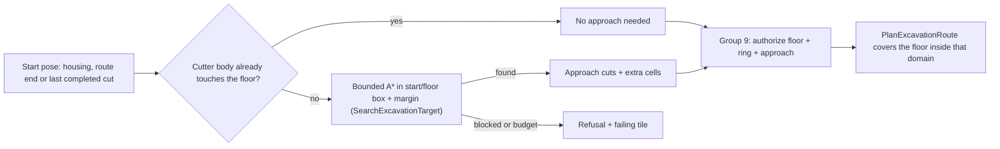
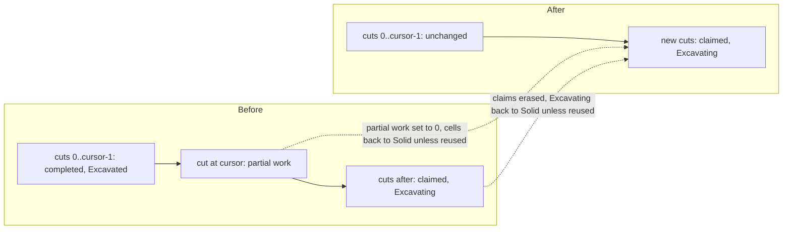
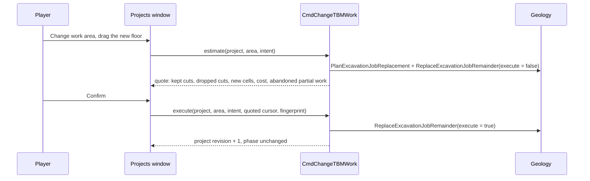
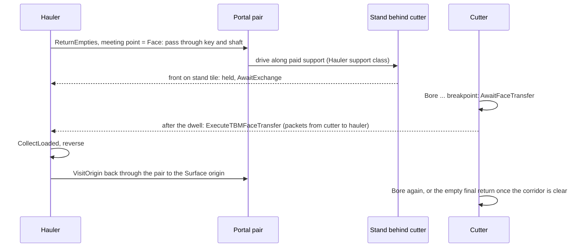
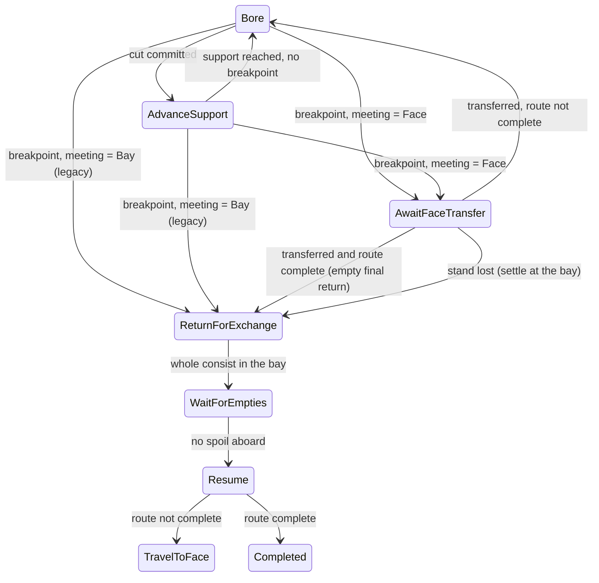

# R2DF - Demo fixing, 2026-10-15

## Global Mandatory Reading

> **Execution protocol**
>
> - Read this Global Mandatory Reading section before the first task and again
>   after every context compaction.
> - Before starting or resuming a task group, read the nearest preceding Area
>   Mandatory Reading block whose `Applies to` label includes that group. Area
>   blocks appear immediately before the first group they govern.
> - A referenced heading or exported symbol is authoritative. Global navigation
>   hints and Area line ranges are for navigation only; if they drift, relocate
>   the named section or symbol rather than expanding to the whole file.
> - Mandatory reading is non-transitive. Do not preload a linked file's own
>   Mandatory Reading, Consult on Demand, or Planning Provenance entries unless
>   this plan names them directly for the current area.
> - Do not read Consult on Demand or Planning Provenance merely because those
>   sources are listed. Use a Consult on Demand source only when its trigger
>   occurs.
> - No created source file, test file or JSON file should start with same prefix as a planning MD file (such as r2). Only MD files can have that prefix. No MD file should be created anywhere in source directories unless specifically asked.
> - After EVERY CONTEXT COMPACTION, you must add a note above the task group
>   which is currently in execution. The note will say: "Context has compacted
>   X times while executing this group.". If the compaction occurs before any
>   meaningful work was done (this can happen when there is a lot of baggage
>   from the previous compaction), then and ONLY then you can skip this step.
> - When exceeding 3 context compactions, YOU MUST ask yourself if you're not 
>   chewing more than we can handle :). Heck, plans change! :). In such a case, 
>   the way out is to split the group on the spot,
>   in the plan, into more groups, 
>   by appending B, C, D as a suffixes to those groups (splitting sub-groups 
>   themselves is also allowed). When you do this, create Local Mandatory
>   Reading areas so you can optimize your context only for the
>   ACTUAL task at hand.
>   Before starting or resuming a task group, read the nearest preceding Area
>   Mandatory Reading block whose `Applies to` label includes that group. Area
>   blocks appear immediately before the first group they govern.

| File name | Line Ranges | Description |
| --- | --- | --- |
| [This plan](r2df-demo-fixing-oct-15.md#demo-reports-and-decisions) | 56-73 | **Demo reports and decisions** table, rows R1-R10, Q1-Q2 and decisions D1-D10. Every group implements one or more of these rows. The table separates observed facts from planning-time hypotheses. A hypothesis marked unconfirmed must be confirmed by Group 1 before a fix is accepted. The decisions record what the user asked for, and they override older plan text that described narrower behaviour. |
| [This plan](r2df-demo-fixing-oct-15.md#execution-conventions) | 91-109 | **Execution conventions**: build/test cadence on this machine (one MSBuild project, two compiler workers), new file names without the `r2` prefix, log/review/runtime locations, documentation headers, save-version policy and the no-Git-write default. These rules constrain every group's file creation and verification steps. |
| [R2MLVS parent](r2mlvs-multilayer-vehicles-and-structures.md#development-artifact-layout) | 36-48 | **Development artifact layout**: `mlm/runtime/<profile>/<run-id>/<process>/`, `mlm/reviews/<feature>/<scenario>/<run-id>/` with mandatory `images/`, `mlm/tools/`, `logs/<feature>/<scenario>/<run-id>/`, and docs-only `docs/zz-reach2/`. Every reproduction, capture, save and log produced here must follow it; test output never goes into docs or immutable fixture folders. |
| [R2MLVS parent](r2mlvs-multilayer-vehicles-and-structures.md#cross-plan-invariants) | 458-476 | **Cross-plan invariants** I-1..I-8 and I-13: layer identity, no free excavation, cargo conservation, atomic commands with pure estimates, determinism independent of view, explicit transport, persistence and the 45-degree advancing-turn rule. Each fix in this plan (window behaviour, signal segmentation, planner approaches, face exchange) must keep all of them. |
| [Map layers architecture](../../architecture/map-layers/archi-map-layers.md#code-map) | 190-229 | **Code map** and **Invariants**: which file owns layer rules, portal tiles, saved portal work, train movement, signals/YAPF and layer saves. Above all, `Viewport::layer` never influences a command, simulation tick or `Random()`. This is the ownership spine for routing every change to its owner. It also forbids GUI layer changes (Groups 2-3) from touching simulation. |
| [`src/map_layer_type.h`](../../../../src/map_layer_type.h) | 15-32 | `enum class MapLayer` and `MAX_MAP_LAYERS`. Storage values (Surface 0, Underground 1, Space 2, Deep 3) differ from the GUI display order and are baked into every saved `TileIndex`. Hotkeys, the small map, portal pairs and planners must map by name/display order and never renumber layers. |

## Status and scope

Status: planned 2026-10-15; no task has been executed. Input: the user's demo of the `tbm-work` checkpoint (menu 11), recorded in [DemoNotes.txt](../../../Demo2026-06-13/DemoNotes.txt) and six screenshots in the same folder. The screenshots show project 0 / Train#2 at 11, 13 and 22 of 50 cuts, then a second project (project 1) at the same portal after release. Second planning pass (same day): the first draft's COMPLEX approach, change-work and face-exchange groups were split into Groups 8-21, each HARD or easier, with code sketches and diagrams. The sketches guide the work, but live code and the named symbols stay authoritative.

This is an independent remediation queue requested by the user. It does not resume the paused [R2MLVS3MP master](r2mlvs3mp-master-plan.md) queue or tick any of its child tasks. Where a fix changes a delivered public contract, the named task in this plan amends the owning plan (13.3, 23.3). Master task 12.6 (fixture pruning) still waits for user acceptance; the refreshed checkpoints from Group 22 are an input to that gate, not a pass.

Owners touched: Plan2 geology/excavation (approach planning, work replacement), Plan3 portals (signal segmentation, hauler admission), Plan4 TBMs (controller, steering, status), Plan5 haulage (face exchange), Plan13 graphics (vehicle poses/packing), R2MLM map layers (small map, layer hotkeys) and the core window system (hotkey toggle, Escape).

## Demo reports and decisions

Each row cites the screenshot, what the code shows at planning time, and the decision. "Unconfirmed" means a code-reading hypothesis that Group 1 must reproduce before the owning fix is accepted.

| # | Report (screenshot) | Planning-time diagnosis | Decision | Groups |
| --- | --- | --- | --- | --- |
| R1 | Small map cannot be made shorter; large empty legend area (01). | `SmallMapWindow::GetNumberRowsLegend` and `OnInit` reserve the largest row count of **all** map types (cargo/industry/company counts), whichever type is shown. `NWidgetSmallmapDisplay::SetupSmallestSize` turns that into the minimum height. The fork's extra layer button adds one button row; multilayer cargos/industries raise the counts. Unconfirmed: why the Underground contour legend lists only "0 ft". | Size the legend from the map type actually shown, and check that the contour legend lists real entries for each layer. | 2 |
| R2 | The small map does not change layer when the layer hotkey is used (01). | `SetViewportLayer` invalidates only toolbars. The small map keeps its own `layer` member by design (architecture "Layer dropdowns and view state"; review item M-7). | **D1:** the small map follows every main-view layer change (hotkey, `N`, toolbar dropdown). Its own selector may still preview another layer until the next main-view change. | 2 |
| R3 | One hotkey per layer; Alt+1..4 do nothing (01). | No per-layer binding exists. In Debug builds Alt+0/1/2 are `crash_game`/`money`/`update_coordinates` in the global list, matched before the toolbar, and `build/hotkeys.cfg` stores them. | **D2:** Alt+1 Surface, Alt+2 Underground, Alt+3 Deep Underground, Alt+4 Space (GUI display order). Unallocated layers are ignored. The debug actions move to Ctrl+Alt+0/1/2. | 2 |
| R4 | "Held: nothing" although the TBM and hauler carry spoil (02, 03). | `Held:` prints `TBMBlockedReason` (`None` means "nothing"). It is not cargo. The projects list never shows cargo; only Portal controls shows attached-wagon loads. | **D3:** say what the machine is waiting for, or that it is working. Add a carried-cargo line for the cutter and its haulers. | 4 |
| R5 | The loaded hauler (Train#1, "Heading for Invenville", 0 mph) stays in its Surface depot unless forced through signals (03). | Unconfirmed, primary: `ExploreSegment` crosses a Sealed/Commissioning pair as one piece, while `GetTileTrackStatus_LayerPortal` hides it from routing and support cannot carry signals. The Surface stub, the pair and the whole corridor are therefore one block, occupied by the working TBM, and `CheckTrainStayInDepot` sees it Full forever. Secondary: magazine entry/departure never updates signals, and the key's reservation bit can be left behind. | **D4:** a pair that is not Connected ends the signal segment. The project controller, not signals, owns admission to the corridor. | 6 |
| R6 | A new construction area needs a full return and park (02, 04). | The projects window always shows the **release** requirement "Return and park the whole machine first…", which looks like a general gate. **New area** on a portal with a project refuses. **Pause and extend** only appends after the last planned cut and requires a pause. Parked projects cannot be extended. | **D5:** **Change work area** is available while working, paused, returning or parked. It replaces the unfinished remainder from the last completed cut. Completed ground, support, cargo and money are untouched. The quote states any partial-face work that is abandoned. No return or parking is needed. | 4, 11-12 |
| R7 | Moving consist sprites overlap, "crushed into one another" (04). | Packed Earth/Rock hoppers are 42-43 px wide in the E/W views against a 32 px envelope; the hauler is 36 and the Deep TBM 35. `convert_vehicle_art.py` skips its `ENVELOPES` for `pose_sampling: "native"` sources. Every part is 8 length units. | **D6:** fit the art to the envelopes. Do **not** change vehicle lengths, because measured consist dimensions are frozen into accepted jobs and saves. | 5 |
| R8 | "The boring machine cannot plan a supported route out of the portal through this area" for an area beside the exit (05). | The planner authorizes only the floor rectangle, a one-cell ring and the anchor's 3x3. A solid start must leave straight. `AuthorizeExcavationOutline` never adds approach cells. The refused quote shows £0 and zero lines, labels new solid cells as "new cuts" and never shows the failing tile. The extension flow reports the same failure as PARTIAL. | **D7:** the planner works out a legal paid approach (straight exit, then advancing 45-degree bends) from the start pose to the requested floor. The approach appears as explicit charged extra cells in the quote the player confirms. Off-axis straight-tunnel endpoints get the same treatment. When a request is truly impossible, the quote names the blocking tile and reason. | 4, 8-10 |
| R9 | The TBM of project 1 shows "0 mph - Waiting: something is in the way" at the portal and never leaves (06). | That text is `TBMBlockedReason::Obstruction`. While travelling, its only source is `VehicleRailFlag::Stuck` with a steering target (`ObserveTBMPhaseInputs`). Unconfirmed candidates: (a) a Source-bay return target uses the door trackdir, but the cutter arrives along the shaft, so YAPF never matches; (b) `GetLayerPortalAdmittedTrackdirs` hides the key while another train's part is on it (the forced-out hauler stopped with its tail there); (c) stale key/Surface reservations; (d) junctions on the corridor. | **D8:** fix the confirmed causes. The status names the blocking vehicle or tile, and the cutter resumes by itself when the blocker clears. | 7 |
| R10 | The hauler should drive to the TBM, take the load and go home; the TBM should never return to unload (06). | Today the TBM backs to an exchange bay (source magazine or underground depot), and `ExecuteTBMWagonExchange` swaps whole wagon units with both heads on the bay tile. The user's prompt did not ask for this: it was recorded as an initial-release deferral in parent AD-6 ("a hauler reaching past an active cutter is deferred"). Blockers include: no Hauler support class, no hauler admission through a Commissioning pair, no moving meeting target, and a single track that makes a wagon swap impossible without a passing loop. | **D9 (user, 2026-10-15):** the assigned hauler travels through the portal and along paid support to the cutter's tail. The actual cargo packets move from the TBM's attached hoppers into the hauler's own hoppers (`VehicleCargoList::Shift` semantics: no copy, no buffer, provenance kept). The hauler then returns to its Surface origin. The TBM keeps cutting while the hauler travels and waits at the face only when its hoppers are full. Bays and magazines remain for parking, hangars and legacy saves. Rejected alternative: paid passing loops for wagon swaps. | 13-21 |
| Q1 | Why does Simulation Rate differ from Frame Rate? | Separate clocks; see answers below. | Answer the question; explain it in the window's tooltip; measure the demo. | 1, 3 |
| Q2 | F2 again should hide Settings; Escape does not close windows; is there a setting? | `ShowGameOptions` closes and re-creates the window on every press. Escape is always taken by the `reset_object_to_place` global hotkey. No toggle or Escape-close setting exists; only right-click close and Delete exist. | **D10:** pressing a window's toolbar hotkey again closes it when it is the front-most closable window (setting, default on). Escape first cancels any active placement; otherwise it closes the front-most closable window (setting No/Yes/Yes except pinned; default Yes except pinned). | 3 |

## Answers to the bonus questions

**Q1 - Simulation rate versus frame rate.** They are two independent clocks, and they are not meant to match.

- **Simulation rate.** The simulation advances one tick every `MILLISECONDS_PER_TICK` = 27 ms (`src/gfx_type.h`). At normal speed that is about **37.04 ticks per second**.
- **Graphics frame rate.** Drawing follows the `gui.refresh_rate` setting, default **60 fps**, or the display when vsync is on with hardware acceleration (`VideoDriver::GetGameInterval`/`GetDrawInterval`, `src/video/video_driver.hpp`).
- **What the window shows.** The Frame rate window measures them separately: `PerformanceElement::GameLoop` and `PerformanceElement::Drawing`. At normal speed, about 37 versus about 60 is the expected result.
- **Fast-forward.** Only the simulation interval shrinks, so the simulation rate climbs above the frame rate.
- **When to worry.** If the simulation rate stays clearly below about 35 at normal speed, the computer cannot keep up with the game. The shortfall shows in the "Game loop" total and its sub-rows. The fork's Space ticks and the per-layer tile loop also add work there. Task 1.7 measures the demo, and task 3.5 puts this explanation into the window's tooltip.

**Q2 - F2 again and Escape.** No setting does this today.

- **What exists.** **Close window on right-click** (`gui.right_click_wnd_close`) and the **Delete** hotkey (`delete_windows`), which closes every non-pinned window.
- **No-code workaround.** In `hotkeys.cfg`, clear `reset_object_to_place` and add `ESC` to `delete_windows`. This closes *all* windows at once and stops Escape from cancelling placement, so it is not recommended.
- **Planned fix.** Group 3 adds both requested behaviours as settings that are on by default (D10).

## Execution conventions

- **Order and completion.** Execute groups top to bottom. Mark a task `[X]` only after its stated behaviour and focused evidence pass. A design note, declaration or isolated fixture does not complete player-facing behaviour.
- **Builds.** Batch each group's related source and test changes before compiling. Build one MSBuild project at a time with at most two compiler workers (`-j 1 -- /p:CL_MPCount=2 /nodeReuse:false`), because of the earlier out-of-memory incident. Never overlap heavyweight native file suites with compilation.
- **Waiting and test length.** Wait at least 50 seconds when polling a running build or test. Split any test case that runs longer than two minutes into focused companion files (`...-1`).
- **Regressions.** Run only focused tests per group. The one justified affected regression burst is task 22.3.
- **New file names.** New source, test and JSON files never start with `r2`. Proposed names:
  - tests: `src/tests/smallmap_layer.cpp`, `src/tests/window_hotkey_toggle.cpp`, `src/tests/portal_signal_boundary.cpp`, `src/tests/tbm_obstruction.cpp`, `src/tests/excavation_approach.cpp`, `src/tests/tbm_change_work.cpp`, `src/tests/tbm_face_meeting.cpp`, `src/tests/tbm_face_access.cpp`, `src/tests/tbm_face_steering.cpp`, `src/tests/tbm_face_transfer.cpp`, `src/tests/tbm_face_controller.cpp`, `src/tests/tbm_face_lifecycle.cpp` and `src/tests/tbm_face_exchange_save.cpp`, each registered in `src/tests/CMakeLists.txt`;
  - Catch2 tags: `[demo-fix-...]`;
  - native runner: `src/tests/multilayer/tbm/demo_feedback.py`.
- **Companion notes.** Notes live in `docs/zz-reach2/upgrades/2026-10/demo-fixes/` as `r2df-<letter>-<topic>.md`. Temporary scratch files are removed when no longer needed.
- **Artifacts.**
  - logs: `logs/demo-fixes/<scenario>/<run-id>/`;
  - saves, reports and captures: `mlm/reviews/demo-fixes/<scenario>/<run-id>/`, with captures in `images/`;
  - native homes: `mlm/runtime/`;
  - immutable demo snapshots in `src/tests/fixtures/demos/` are never overwritten.
- **Code documentation.** Every created or modified source/test file has an architecture/owning-plan header. Every new or modified function has a JavaDoc purpose/parameters/return. Compound conditions and non-trivial loops are explained in gameplay terms.
- **Saves.** New persistent fields use **one** new save version appended after `AsteroidStarterInputs` (424), with explicit older-version mapping and malformed-load refusal. Preview and estimate paths stay pure.
- **Strings and Git.** New strings go into `src/lang/english.txt` only. Perform no Git commits, pushes or tags unless the user asks.

## Execution queue

### Area Mandatory Reading - Demo reproduction

_Applies to Group 1._

| File name | Line Ranges | Description |
| --- | --- | --- |
| [DemoNotes.txt](../../../Demo2026-06-13/DemoNotes.txt) | 1-34 | The user's complete report; every line is a requirement or a question, so the whole short file is the source. Pair each numbered note with its screenshot in the same folder before reproducing it. |
| [`demo-checkpoints.json`](../../../../src/tests/fixtures/demos/underground/demo-checkpoints.json) | 34-105 | `tbm-work` checkpoint: immutable snapshot path/SHA256, layer, camera and pause state. This is the exact starting input of the demo; a reproduction must load it read-only and record its hash. |
| [`runner.py`](../../../../src/tests/multilayer/support/runner.py) | 162-264 | `current_run_context`, `native_command`, `run_native`, `start_native`: the shared native launcher that writes runtime homes, logs and captures to the R2FC locations. The new `demo_feedback.py` must use it rather than inventing paths. |
| [`tbm_feedback_runtime.cpp`](../../../../src/tests/tbm_feedback_runtime.cpp) | 1050-1105 | `TEST_CASE("TBM feedback reproduces native input and loaded movement")`: the existing native observer that loads saves, drives real GUI input and logs vehicle/project state. Extend this pattern for the reproduction scenarios instead of writing a parallel harness. |
| [Underground demo guide](d2um-underground-mines.md#tour-excavation-and-the-spoil-loop) | 332-343 | **Tour excavation and the spoil loop**: the exact steps the user followed (Projects, Portal controls, unpause, Return and park). Reproduce the same path so the evidence matches the screenshots. |

### Group 1 - Reproduce every reported state from the demo save

{{MEDIUM}}
- [ ] 1.1 Record the reproduction inputs in `demo-fixes/r2df-a-reproduction-notes.md`: `tbm-work-403.sav` hash, the executable configuration used for the demo, `build/play.cfg` signal/path-reservation settings and the `build/hotkeys.cfg` bindings. The repo-local `hotkeys.cfg` suggests a Debug build. Never modify the snapshot.
- [ ] 1.2 Add `src/tests/multilayer/tbm/demo_feedback.py` plus native observer cases that load `tbm-work`, unpause and reach screenshot 03's state. Log the hauler's tile and track state (real depot or portal magazine), `CheckTrainStayInDepot`/`CheckTrainStayInMagazine` decisions, signal states and segment flags on the portal block, and key/pair reservation bits. Confirm or refute R5's hypotheses.
- [ ] 1.3 Drive the user's path from screenshots 04-05: return and park, finish and release, **New area** at the same portal for project 1, then the area beside the exit. Record the outline, authorized cells, failing tile, planner error and the quote text exactly as displayed.
- [ ] 1.4 Reproduce screenshot 06: project 1 started, hauler forced through a red signal and then stopped. Record which `Obstruction` source fires, the Stuck flag, `path_found`, the target trackdirs, the key's admitted trackdirs, reservation bits and which train's part occupies the key. Classify R9's candidates (a)-(d) as confirmed or refuted.
- [ ] 1.5 Capture the projects list showing "Held: nothing" in the same frame as the actual per-part cargo of the cutter and the assigned hauler (from `InspectTBMConsist` and the hauler chain).
- [ ] 1.6 Capture the moving consist in all eight directions at every zoom level. Measure each packed pose's opaque width against `occupied_envelopes` and the 8-unit spacing for the cutter, Deep cutter, Earth/Rock hoppers and hauler.
- [ ] 1.7 Reproduce R1-R3 natively: the small map's minimum height on Underground contours, its layer after `N`, the dropdown and Alt+1..4, and the legend entries per layer. Read the Frame rate window on `tbm-work` at normal speed and record the Simulation and Graphics rates and the Game-loop sub-rows.
- [ ] 1.8 Publish the checkpoint with confirmed causes, refuted hypotheses and remaining unknowns for R1-R10/Q1, each mapped to its fixing group. Update this plan's diagnosis column where a hypothesis was refuted. Do not start a fix whose cause is still unknown without recording that explicitly.

### Area Mandatory Reading - Map window, hotkeys and window input

_Applies to Groups 2-3._

| File name | Line Ranges | Description |
| --- | --- | --- |
| [`smallmap_gui.cpp`](../../../../src/smallmap_gui.cpp) | 782-796; 1523-1546; 1582-1637; 1874-1909; 2111-2129 | `SmallMapWindow::GetNumberRowsLegend`, `SmallMapCenterOnCurrentPos`, `OnInit`, `OnInvalidateData` and `NWidgetSmallmapDisplay::SetupSmallestSize`. Row counts are shared by minimum size, layout, hit-testing and drawing, so a per-map-type change must update all of them together and keep at least two columns. `OnInvalidateData` codes 0-2 already mean industry chain, owner legend and colours; any other code hits `NOT_REACHED()`, so the layer notification needs a new code. |
| [`map_layer_gui.cpp`](../../../../src/map_layer_gui.cpp) | 192-246 | `SetViewportLayer` and `CycleMainViewportLayer`: the single place where a view changes layer and toolbars are invalidated. The small-map notification belongs here, only for the main window, never for extra viewports. |
| [`toolbar_gui.cpp`](../../../../src/toolbar_gui.cpp) | 2198-2254; 2322-2365; 2634-2668; 2741-2766 | `MainToolbarWindow::OnHotkey`, the `maintoolbar` `HotkeyList`, `ScenarioEditorToolbarWindow::OnHotkey` and the `scenedit_maintoolbar` list. New layer hotkeys append after `MTHK_CYCLE_MAP_LAYER`; editor entries must be special hotkeys. The F2 toggle is decided at the top of both `OnHotkey` functions. |
| [`main_gui.cpp`](../../../../src/main_gui.cpp) | 274-423; 476-520 | `MainWindow::OnHotkey` and the `global` hotkey list. Escape is `GHK_RESET_OBJECT_TO_PLACE`, and the Debug-only Alt+0/1/2 entries are matched before toolbar hotkeys. The Escape decision (abort placement first, else close a window) and the Debug key move live here. |
| [`window.cpp`](../../../../src/window.cpp) | 2673-2729; 3371-3387 | `HandleKeypress` dispatch order (focused editbox, windows front to back, main toolbar, global) and `CloseNonVitalWindows`. The new close helper sits beside the latter and respects `WindowDefaultFlag::NoClose`, sticky windows and vital windows. Editbox, query and save/load Escape handling must still win. |
| [`settings_gui.cpp`](../../../../src/settings_gui.cpp) | 1859-1864 | `ShowGameOptions` closes and re-creates the window on every call: the direct cause of Q2's F2 behaviour. |
| [`gui_settings.ini`](../../../../src/table/settings/gui_settings.ini) | 139-150 | `gui.right_click_wnd_close` definition: the template (client-only, not saved, GUI dropdown) for the two new window-close settings. |
| [GUI architecture](../../architecture/gui/archi-gui.md#retained-windows) | 7-31 | **Retained windows**: window identity is `window_class` + `window_number`, and the z-order list is front-to-back. The toggle mapping and "front-most closable window" rule depend on this. |

### Group 2 - Make the map window follow layers and shrink

{{SIMPLE}}
- [ ] 2.1 Make `GetNumberRowsLegend`, `GetMinLegendWidth` and `OnInit` depend on the shown `map_type`. LinkStats reserve the link-colour column; Industries/Owners use their counts; other types use their own fixed rows. Keep `GetPositionOnLegend` and `DrawWidget` consistent and the column count at least 2.
- [ ] 2.2 Confirm the contour legend lists the correct height entries on each layer (the "0 ft" observation from 1.7). Fix the legend source if a rock layer shows a misleading single entry; leave simulation untouched.
- [ ] 2.3 In `SetViewportLayer`, notify `WindowClass::SmallMap` with a new invalidation code when the main window changes layer. In `SmallMapWindow::OnInvalidateData`, adopt the main view's layer through one shared helper that updates the layer button sprite and marks the link overlay dirty. Reuse that helper in `SmallMapCenterOnCurrentPos` and `OnDropdownSelect`.
- [ ] 2.4 Add per-layer hotkeys Alt+1..4 in display order (D2) to the game toolbar (`MTHK_*` after `MTHK_CYCLE_MAP_LAYER`) and the editor toolbar (special hotkeys). Each selects through one helper in `map_layer_gui.cpp` that ignores unallocated layers. Mention the keys in the layer button tooltips.
- [ ] 2.5 Move the Debug `crash_game`/`money`/`update_coordinates` defaults to Ctrl+Alt+0/1/2 and check for conflicts. Back up the repo-local `build/hotkeys.cfg`, then update its stored Alt+1/Alt+2 entries so the new defaults take effect. Record the change in the 2.7 documentation.
- [ ] 2.6 Add `src/tests/smallmap_layer.cpp`: the legend minimum per map type, the layer following after `N`/dropdown/Alt+N, extra viewports not moving the small map, and unallocated layers ignored. Use the hotkey pattern of `src/tests/underground_window.cpp`. Capture the small map at the screenshot size for each layer.
- [ ] 2.7 Update the map-layer architecture **Layer dropdowns and view state** paragraph and the review-map M-7 note to say the small map now follows the main view. List the new hotkeys.

### Group 3 - Toggle and close popups from the keyboard

{{MEDIUM}}
- [ ] 3.1 Add the client settings `gui.hotkey_toggles_window` (bool, default on) and `gui.escape_closes_window` (No/Yes/Yes except pinned, default Yes except pinned) beside `right_click_wnd_close`. Add their strings, help text and settings-tree entries.
- [ ] 3.2 Add `CloseFrontmostClosableWindow(bool except_sticky)` in `window.cpp` (declared in `window_func.h`). It skips vital windows, `NoClose`, the main window, tooltips and optionally pinned windows, and returns whether it closed one.
- [ ] 3.3 Change the Escape path. While placement is active (place mode, a callback window or a special mouse mode), Escape only aborts placement, as today. Otherwise it closes the front-most closable window according to the setting. Editbox, query and save/load Escape handling keep precedence.
- [ ] 3.4 Toggle at the top of both toolbar `OnHotkey` functions. Map each window-opening hotkey to its `(WindowClass, number)`, with F2 mapping to Game Options. If that window is the front-most closable window, close it; otherwise keep the existing raise or open behaviour. A build toolbar for a different rail or road type switches rather than closes. Pause, fast-forward, zoom, screenshots and layer selection never toggle.
- [ ] 3.5 Add tooltips to the Frame rate window's Simulation rate and Graphics frame rate rows that explain the two clocks and their normal-speed targets (Q1). Use the existing measurement values; add no new simulation timing.
- [ ] 3.6 Add `src/tests/window_hotkey_toggle.cpp`: F2 opens then closes Game Options, a covered window is raised rather than closed, Escape aborts placement first and then closes, pinned windows obey the setting and editboxes keep Escape. Re-run the Escape-dependent placement checks in `tbm_feedback_runtime.cpp`; the underground palette must stay open after aborting placement.

### Area Mandatory Reading - TBM status presentation

_Applies to Group 4._

| File name | Line Ranges | Description |
| --- | --- | --- |
| [`tbm_projects_gui.cpp`](../../../../src/tbm_projects_gui.cpp) | 43-78; 235-273 | `GetTBMVehicleStatus` and `TBMProjectsWindow::DrawWidget`. The list draws name, progress and the `Held:` hold line per project, and draws the release requirement into `WID_TP_RELEASE_REASON` unconditionally. These are the exact R4/R6 presentation defects. |
| [`layer_portal_gui.cpp`](../../../../src/layer_portal_gui.cpp) | 158-188 | `GetTBMHoldString`: the `TBMBlockedReason` to text mapping shared by the projects list, portal window and vehicle caption. Wording changes stay consistent across all three. |
| [`tbm_controls.cpp`](../../../../src/tbm_controls.cpp) | 153-232 | `DescribeTBMProject`: its unit loop sums actual Earth/Rock cargo and capacity per role from `InspectTBMConsist`. Extract that loop into a pure helper; do not call the full `GetTBMPairControls`, which runs command estimates, from a once-per-second list repaint. |
| [`tbm_project.cpp`](../../../../src/tbm_project.cpp) | 426-445 | `GetTBMProjectReleaseProblem`: the release-only readiness check whose `STR_ERROR_TBM_RELEASE_RETURN` text the user mistook for a general gate. |
| [`underground_gui.cpp`](../../../../src/underground_gui.cpp) | 191-271; 523-622 | `UndergroundConstructionWindow::GetWidgetString` (quote price/material/time/floor lines) and `OnPlaceObject` (portal click; the `STR_UNDERGROUND_PORTAL_HAS_PROJECT` dead end for a portal with a project). |
| [`tbm_commission.cpp`](../../../../src/tbm_commission.cpp) | 211-231 | `PreviewTBMCommissionArea`: a refused plan returns `purchase = CommandCost(refusal)` with zero cost, which is why refused quotes print £0 lines. |

### Group 4 - Say what the machine is waiting for and what it carries

{{SIMPLE}}
- [ ] 4.1 Replace `Held: {STRING}`/`Held: nothing` with wording that states the wait ("Waiting for: …") or "Working normally". Apply it in the projects list, portal window and vehicle caption through `GetTBMHoldString`, keeping string IDs stable or migrating every use.
- [ ] 4.2 Extract the per-role cargo/capacity summation from `DescribeTBMProject` into a pure helper. Show "Carrying: Earth x/y t, Rock x/y t" for the cutter and each assigned hauler in the projects list, adjusting the row height.
- [ ] 4.3 Show the release requirement only as the **Finish/cancel and release** prerequisite, prefixed "To finish and release:", so it no longer reads as a gate for other actions. Keep the named settlement blocker vehicle.
- [ ] 4.4 When **New area** is clicked on a portal that already has an owned project, open that project's change-work flow (the existing **Pause and extend** until Group 12 lands) instead of the `PORTAL_HAS_PROJECT` dead end. Foreign or invalid projects keep their refusal.
- [ ] 4.5 Refused quotes hide the £0 price, material and time lines and show the refusal plus the failing tile (highlighted in the preview). Label solid cells as "new solid cells" and cutter positions separately. Make the fresh and extension flows report the same failure with the same message.
- [ ] 4.6 Add focused GUI tests for the wording, cargo line, release prefix, New-area routing and refused-quote layout. Capture native replacements for screenshots 02, 04 and 05.

### Area Mandatory Reading - Vehicle sprite envelopes

_Applies to Group 5._

| File name | Line Ranges | Description |
| --- | --- | --- |
| [`convert_vehicle_art.py`](../../../../media/multilayer/convert_vehicle_art.py) | 25-86 | `ENVELOPES` and `native_pose`: per-view safe envelopes (N/S 16, diagonal 24, E/W 32 px) and the `pose_sampling: "native"` branch that returns reused poses without fitting them. This is R7's root cause and the only conversion change point. |
| [`vehicle-details-manifest.json`](../../../../logs/proofs/mlm/native-art/derived/vehicle-details-manifest.json) | 36613-36646 | `occupied_envelopes` in the generated (git-ignored) conversion report: the per-view limits written from `ENVELOPES` in `convert_vehicle_art.py`, which stays the authority. Regenerate the report before measuring. Since the 2026-10-09 file reorg, the untracked copy under `media/multilayer/sprites/m1/` is stale and must not be used. |
| [`multilayer_sprite.cpp`](../../../../src/multilayer_sprite.cpp) | 174-258 | `GetMultiLayerTrainSprite`: the runtime pose selection that replaces base art for native vehicles. It confirms that only art changes are needed; gameplay length stays 8 units. |
| [Plan13 M1 packing](r2mlvs13-graphics-and-asset-pipeline.md#group-79b---pack-the-selected-m1-source-set) | 949-987 | **Local Mandatory Reading - M1 deterministic packing preparation**, **Group 79B**, **Group 80B**, **Group 81B**: the pinned packing route, protected sprite ranges 0..65/66..73, checksum regeneration and corruption fixtures that a repack must preserve. |

### Group 5 - Stop wagon sprites from overlapping

{{HARD}}
- [ ] 5.1 Using 1.6's measurements, list every M1 vehicle family/direction/state whose opaque width exceeds `occupied_envelopes`. Keep the decision fixed: no vehicle length or articulation change (D6).
- [ ] 5.2 Make `convert_vehicle_art.py` enforce the envelopes for every pose, including `pose_sampling: "native"` sources. Refuse oversize poses with a clear family/direction message; never silently clip them.
- [ ] 5.3 Re-derive the Deep cutter, Earth hopper, Rock hopper and hauler poses within the envelopes from their retained originals through the established conversion, keeping anchors and contacts. If a view cannot be reduced legibly, re-author only that view through Plan13's framed ImageGen procedure. Retain originals and provenance.
- [ ] 5.4 Repack through the M1 route, preserving protected and published ranges, IDs and offsets. Regenerate checksums and confirm two clean conversions are identical and the corruption fixtures still refuse.
- [ ] 5.5 Verify in the real game: straight, diagonal and curved track at every zoom, coupler gaps between all neighbours, depot/vehicle list widths and depth sorting. Store captures under `mlm/reviews/demo-fixes/vehicle-spacing/<run-id>/images/` and compare them with screenshot 04.

### Area Mandatory Reading - Signals, reservations and portal movement

_Applies to Groups 6-7._

| File name | Line Ranges | Description |
| --- | --- | --- |
| [`signal.cpp`](../../../../src/signal.cpp) | 269-427 | `ExploreSegment`, including its `TileType::LayerPortal` case: it crosses any company rail pair "as one straight piece" regardless of work state. The R5 segment boundary is decided here and must keep Connected pairs unchanged. |
| [`layer_portal_cmd.cpp`](../../../../src/layer_portal_cmd.cpp) | 243-256; 378-432; 434-484 | `GetTileTrackStatus_LayerPortal` (hides non-Connected pairs from routing), `RunLayerPortalMagazine` (magazine entry, no signal update) and `VehicleEnterTile_LayerPortal` (entry admission). Signal, reservation and admission rules must agree across all three. |
| [`layer_portal_work.cpp`](../../../../src/layer_portal_work.cpp) | 133-162; 164-248 | `CheckLayerPortalWorkAccess`, `GetLayerPortalMagazineExit`, `IsLayerPortalMagazineBusy` and `GetLayerPortalAdmittedTrackdirs`. These decide who may use the key and when the key's track becomes invisible (R9 candidate b). |
| [`train_cmd.cpp`](../../../../src/train_cmd.cpp) | 2700-2827; 3182-3445 | `CheckTrainStayInMagazine`, `CheckTrainStayInDepot`, `ChooseTrainTrack` (its TBM no-path branch marks Stuck) and `TryPathReserve`. These are the hold, stuck and reservation owners behind R5 and R9. |
| [`tbm_project.cpp`](../../../../src/tbm_project.cpp) | 966-999 | `ObserveTBMPhaseInputs`: converts `VehicleRailFlag::Stuck` plus a steering target into `TBMBlockedReason::Obstruction`, the only travelling source of "something is in the way". |
| [`tbm_support.cpp`](../../../../src/tbm_support.cpp) | 170-219 | `GetTBMCutterSteeringTarget`: the return branch uses the door trackdir for both bay kinds, while the hangar branch accepts the shaft axis. This is R9 candidate (a). |
| [`tbm_exchange.cpp`](../../../../src/tbm_exchange.cpp) | 754-822 | `IsTBMHaulerHeld`, `IsTBMHaulerAdmittedAtBay`, `MayTBMTrainLeaveMagazine`, `IsTBMWaitingAtLineEnd` and `GetTBMHaulerSteeringTarget`: hauler-side holds and targets that must not be mistaken for the signal hold. |
| [`yapf_destrail.hpp`](../../../../src/pathfinder/yapf/yapf_destrail.hpp) | 140-197; 205-219 | `CYapfDestinationTileOrStationRailT::SetDestination` (TBM cutter/hauler targets and their trackdirs) and its `PfDetectDestination(TileIndex, Trackdir)` match. A target trackdir that a train cannot arrive with makes `path_found` false forever. |
| [Rail pathfinder architecture](../../architecture/pathfinder/archi-pathfinder-rail.md#destination) | 116-140 | **Destination** and **Reservation**: how YAPF matches targets and how path reservation and safe waiting points work. Use it to keep the fix consistent with path signals. |

### Group 6 - Let a loaded hauler leave under normal signals

{{HARD}}
- [ ] 6.1 From 1.2's trace, state which hold applies (real depot `CheckTrainStayInDepot`, magazine exit, or a red signal after departure) and which segment and occupant keep it red. Write the confirmed cause into the checkpoint before changing code.
- [ ] 6.2 Make `ExploreSegment` end the segment at a rail pair whose work state is not Connected, matching `GetTileTrackStatus_LayerPortal`. Corridor trains then no longer occupy Surface blocks. Connected pairs keep crossing as one piece with both ends occupying the block.
- [ ] 6.3 Update signals when trains enter or leave a portal magazine, as depots do. Where path signals apply, reserve a path on magazine departure, and free it on refusal.
- [ ] 6.4 Clear the key's reservation bit when a consist is fully stored in the magazine or leaves the key, and release a backing cutter's leftover reservation through the door. Preserve reservations held by trains that still occupy the key.
- [ ] 6.5 Re-verify corridor admission now that signals no longer guard it. Ordinary trains still cannot enter a Commissioning pair; the project's own trains are admitted by the controller's rules. Record this ownership in the Plan3 public handoff note list for 23.3.
- [ ] 6.6 Add `src/tests/portal_signal_boundary.cpp`: block signals, path signals and path reservation on/off. A loaded hauler leaves a Surface depot and the magazine while the TBM works. Ordinary trains outside are unaffected, and a Connected tunnel keeps its signal behaviour.
- [ ] 6.7 Save and reload with the hauler mid-departure and with a stored consist. Assert there are no leftover reservations, identical next transitions, and that demolition and connection guards are unchanged.

### Group 7 - Free the TBM from false "something is in the way"

{{HARD}}
- [ ] 7.1 From 1.4's trace, name the active `Obstruction` source and every contributing condition (R9 a-d) with evidence. Keep refuted candidates documented.
- [ ] 7.2 Correct the return target for a Source-bay return so it accepts the trackdir the cutter actually arrives with along the shaft, consistent with the hangar branch. Keep depot and hauler door targets unchanged.
- [ ] 7.3 Define the key rule when another train's part stands on it. Never hide track from the project's own cutter in a way that leaves it permanently Stuck. Instead, hold with a named blocker, and still refuse ordinary trains.
- [ ] 7.4 Make a stale Stuck clear itself when the obstruction disappears (the reservation retry path). Force-proceed must not immediately re-stick a cutter that has no real blocker.
- [ ] 7.5 Name the actual blocker in the status, for example "Waiting for Train#1 to clear the portal" or the blocked tile, in the vehicle caption and the projects list. Keep the generic text only when no blocker can be identified.
- [ ] 7.6 Add `src/tests/tbm_obstruction.cpp`: the forced-out hauler stopped on the key, Source-bay return with path reservation on and off, a PBS signal in the segment, a corridor junction (the `tbm_movement.cpp` junction pattern) and reload while Stuck. The cutter leaves by itself once the blocker clears.

### Area Mandatory Reading - Approach planning

_Applies to Groups 8-10._

**Entry gate for Groups 9-10.** Group 8's producer must exist: `ExcavationApproachProposal` and `PlanExcavationApproach` declared in `src/excavation.h`, with `[demo-fix-approach]` passing on the current build. Verify by searching the header and running the tag. If either is absent, stop Groups 9-10; Group 8 work may continue. Do not bypass the gate by enlarging the ring in `MakeTBMOutlineWithRing`, by widening `authorized_tiles` inside the TBM layer, or by passing cells to `AuthorizeExcavationOutline` that the quote never displays.

| File name | Line Ranges | Description |
| --- | --- | --- |
| [`excavation_route.cpp`](../../../../src/excavation_route.cpp) | 53-99; 140-269; 271-411; 413-447 | `AdvanceExcavationPlanningPose`; `CheckPlanningCut`, `NewPlanningCells` and `SearchExcavationTarget`, the deterministic A* (straight first edge from a solid start, `PlanningDistance` goal, stable tie order); `PlanExcavationRouteInternal` (cleared set, starter rule, tunnel branch refusing off-axis endpoints with `IllegalTurn`, area target loop); `PlanExcavationRoute` and `PlanExcavationJobExtension` (replays the accepted route into the start pose). The approach producer reuses `SearchExcavationTarget` with a wider domain instead of writing a second search. |
| [`excavation.h`](../../../../src/excavation.h) | 752-778; 796-833; 855-867 | `ExcavationOutline`, `NormalizeExcavationOutline`/`AuthorizeExcavationOutline` ("never silently adding a planner's turn/approach cells"), `ExcavationPlanningPose`, `ExcavationPlanningStep`, `ExcavationPlanIntent`, `ExcavationPlanningLimits`, `ExcavationRouteProposal` and `PlanExcavationJobExtension`. New approach types are declared beside them. |
| [`excavation_outline.cpp`](../../../../src/excavation_outline.cpp) | 15-93 | `NormalizeExcavationOutline` (eight-connected set, Deep gate, `MAX_EXCAVATION_JOB_TILES`) and `AuthorizeExcavationOutline` (canonical union plus extra-cell quote). Approach cells keep the authorized set connected and within its limits. |
| [`tbm_area.cpp`](../../../../src/tbm_area.cpp) | 21-190 | `MakeTBMOutlineWithRing`, `MakeTBMWorkOutline`, `MakeTBMTunnelOutline` and `PreviewTBMAreaWithDimensions`. `turn_envelope` is swept minus requested, so authorized approach cells appear as charged working space without new drawing code. |
| [`tbm_area_preview.h`](../../../../src/tbm_area_preview.h) | 29-47 | Builder declarations whose signatures gain a start pose. |
| [`tbm_commission.cpp`](../../../../src/tbm_commission.cpp) | 110-185; 211-231 | `PlanTBMCommission` (start pose = `proof.destination` + `proof.exit_heading` + measured planning points; outline and authorization at lines 160-169) and `PreviewTBMCommissionArea` (fingerprint over pass terms and totals). |
| [`tbm_project.cpp`](../../../../src/tbm_project.cpp) | 715-810 | `PreviewTBMExtension`/`CmdExtendTBMProject`: ring anchor = `commissioning_anchor`, start = replayed `route.back()`, alignment refusal for straight intent, combined-job fingerprint. |
| [`tbm.h`](../../../../src/tbm.h) / [`tbm_replanning.h`](../../../../src/tbm_replanning.h) | 272-285 / 14-34 | `TBMAreaPreview` (`turn_envelope` already documented as "approach, turn and working space") and `TBMExtensionPreview`/`PreviewTBMExtension`: the two quote records that gain the approach summary in 10.1. |
| [`underground_gui.cpp`](../../../../src/underground_gui.cpp) | 191-271 | `UndergroundConstructionWindow::GetWidgetString`: the quote price, material, time and floor lines beside which 10.2 adds the approach line. |
| [R2MLVS parent AD-5](r2mlvs-multilayer-vehicles-and-structures.md#ad-5---a-tbm-is-a-train-with-a-work-controller-owners-4-5) | 277-289 | **AD-5**: paid support is the only way rail enters solid rock; advancing turns of at most 45 degrees; area clearing of any reachable rock with fully charged approach and turn space. These bound every approach. |

### Group 8 - Produce legal approaches in the geology planner

Today the planner may only use the requested floor, a one-cell ring and the housing's 3x3. An area beside the exit therefore has no way in. Group 8 adds a pure producer that finds a bent approach inside a bounded box and returns its cells as an explicit proposal. Groups 9-10 show and charge that proposal. Nothing here touches the TBM layer.



Proposed public API (`src/excavation.h`, beside `ExcavationRouteProposal`):

```cpp
/** Read-only approach from a start pose to the requested floor; its cells stay proposals until the player confirms the quote. */
struct ExcavationApproachProposal {
	ExcavationError error = ExcavationError::None; ///< None, Limit, or the first geometry/ownership refusal.
	TileIndex failure_tile = INVALID_TILE; ///< Stable failing tile for the preview.
	std::vector<ExcavationCutGeometry> route; ///< Advancing cuts from the start; empty when no approach is needed.
	std::vector<TileIndex> extra_tiles; ///< Canonical swept cells outside the floor and the existing authorization.
	ExcavationPlanningPose end; ///< Pose at which coverage planning continues.
	uint32_t expansions = 0; ///< Deterministic budget consumed.
};

ExcavationApproachProposal PlanExcavationApproach(const ExcavationPlanningPose &start, const ExcavationOutline &target,
	uint16_t model_id, const ExcavationPlanningLimits &limits, ExcavationJobID continuing_job, bool solid_start, bool exact_goal);
```

Implementation sketch (`src/excavation_route.cpp`):

```cpp
static constexpr int APPROACH_MARGIN = 4; ///< Cells around start and floor in which a bent approach may search.

// SearchExcavationTarget gains `bool exact_goal = false`; existing callers keep their behaviour.
const auto remaining = [&](TileIndex p) { return exact_goal ? DistanceMax(p, target) : PlanningDistance(p, target); };
// goal test:  remaining(node.pose.position) == 0 && !(solid_start && index == 0)
// heuristic:  remaining(next.pose.position)   (still admissible)

ExcavationApproachProposal PlanExcavationApproach(...)
{
	// 1. Goal = requested cell with the smallest PlanningDistance (or DistanceMax when exact) from start.position;
	//    ties pick the lowest TileIndex, so every peer chooses the same goal.
	// 2. No approach: !solid_start && remaining(start.position) == 0  ->  return {.end = start}.
	// 3. Domain = box around start.history and target.requested_tiles, grown by APPROACH_MARGIN, clipped to the map
	//    and to the start layer (reuse AddPlanningRectangle), then sorted. Refuse with Limit above 4 * MAX_EXCAVATION_JOB_TILES.
	// 4. cleared = Excavated cells of the domain, plus every swept cell of the continuing job's accepted route
	//    (the same rules as PlanExcavationRouteInternal lines 317-334; the unopened solid pocket stays solid).
	// 5. ExcavationOutline domain_outline; domain_outline.authorized_tiles = domain;
	//    SearchExcavationTarget(start, goal, domain_outline, cleared, model_id, limits, scratch, solid_start, continuing_job, exact_goal).
	// 6. Success: route = scratch.route, end = scratch.end, extra_tiles = union(swept) minus target.authorized_tiles.
	//    Failure: copy error and failure_tile; route stays empty, because an approach is all or nothing.
}
```

{{HARD}}
- [ ] 8.1 Add the `exact_goal` parameter (default false) to `SearchExcavationTarget` with the goal and heuristic shown. Prove existing callers are unchanged: run the current planner, TBM area and coverage tags and compare their routes.
- [ ] 8.2 Declare `ExcavationApproachProposal` and `PlanExcavationApproach` in `excavation.h` with JavaDoc, and implement steps 1-6. Refuse non-rock layers, locked Deep and invalid limits exactly as `PlanExcavationRouteInternal` does.
- [ ] 8.3 Honour solid starts: when the start is a Sealed housing (`ResolveExcavationStarter` reports `required`), check the exit heading, keep the pocket out of `cleared` and let the search's existing root rule force a straight first edge.
- [ ] 8.4 Keep the producer pure and bounded: no claims, terrain, money or `Random()` use; `CheckPlanningCut` still refuses structures, foreign claims, foreign seams and active cuts inside the wider domain.
- [ ] 8.5 Add `src/tests/excavation_approach.cpp` (`[demo-fix-approach]`): the screenshot-05 shape (floor beside the exit), floor behind the housing, diagonal offsets, exact goal, map edge, owned structure in the way, foreign claim, locked Deep, budget exhaustion, and two identical runs.
- [ ] 8.6 Record the margin, goal rule and measured expansion counts per test case in `demo-fixes/r2df-b-approach-design.md`, as evidence that the default limits suffice.

### Group 9 - Use approaches in commissioning, extension and tunnels

ASSUMPTION: this was already built previously. If not, re-asses at runtime. Group 8's `PlanExcavationApproach` exists and passes `[demo-fix-approach]`.

The TBM layer builds the floor and ring as today, asks for an approach, and authorizes floor + ring + approach through the one public `AuthorizeExcavationOutline`. Coverage planning then runs unchanged inside that domain. Fingerprints already hash the job's route and authorized cells (`ComputeExcavationPassFingerprint`), so approach cells are part of every reviewed quote.

```cpp
// src/tbm_area.cpp (new; MakeTBMWorkOutline keeps its signature for existing callers)
ExcavationOutline MakeTBMWorkOutlineWithApproach(const ExcavationPlanningPose &start, bool solid_start, uint16_t model_id,
	ExcavationJobID continuing_job, TileIndex ring_anchor, TileIndex area_start, TileIndex area_end,
	std::span<const TileIndex> previous_work, ExcavationApproachProposal &approach)
{
	auto base = MakeTBMWorkOutline(ring_anchor, area_start, area_end, previous_work);
	if (base.error != ExcavationError::None) return base;
	approach = PlanExcavationApproach(start, base, model_id, {}, continuing_job, solid_start, false);
	if (approach.error != ExcavationError::None) return {approach.error, approach.failure_tile};
	std::vector<TileIndex> extra = base.extra_tiles; // ring + previous work
	extra.insert(extra.end(), approach.extra_tiles.begin(), approach.extra_tiles.end());
	return AuthorizeExcavationOutline(base, extra, model_id); // canonical, connected, quoted
}
```

Off-axis straight tunnels: `MakeTBMTunnelOutline` builds its floor and work from an exact-goal approach. The tunnel branch of `PlanExcavationRouteInternal` then follows that authorized path instead of refusing:

```cpp
// PlanExcavationRouteInternal, tunnel branch, replacing the off-axis IllegalTurn refusal at line 347
if (steps == 0 || dx != steps * delta.x || dy != steps * delta.y) {
	const size_t before = result.route.size();
	const bool reached = SearchExcavationTarget(result.end, tunnel_end, work, cleared, model_id, limits, result,
		starter.required, continuation == nullptr ? ExcavationJobID{UINT32_MAX} : continuation->id, true);
	// Quote route[before..] exactly like the area loop (lines 393-403), then fill covered/remaining targets.
	result.partial = !reached;
	return result;
}
```

{{HARD}}
- [ ] 9.1 Add `MakeTBMWorkOutlineWithApproach` as shown, with its declaration and JavaDoc in `tbm_area_preview.h`.
- [ ] 9.2 Switch the area path of `PlanTBMCommission` to it: start = housing pose with measured planning points, `solid_start = true`, ring anchor `proof.destination`, invalid continuing job.
- [ ] 9.3 Extract the route replay of `PlanExcavationJobExtension` (lines 436-443) into one shared helper that returns the pose after N accepted cuts. Switch the area path of `PreviewTBMExtension` to the new builder with that pose after all cuts, `solid_start = false` and the job as continuing job.
- [ ] 9.4 Angled tunnels: give `MakeTBMTunnelOutline` the start pose, model and continuing job. For an off-axis endpoint, build floor (cutter centres) and work (swept cells) from an exact-goal approach. Replace the off-axis refusal in the tunnel branch with the exact-goal search shown. Exactly-ahead endpoints keep the existing straight loop.
- [ ] 9.5 Add the approach cell count and its `QuoteExcavationCells` cost to the commission and extension fingerprints. Prove that changing one approach tile between quote and execute refuses as stale.
- [ ] 9.6 Extend `src/tests/excavation_approach.cpp` (`[demo-fix-approach-tbm]`): screenshot 05's commission quote now succeeds with charged approach cells; extension approach from the route end; angled tunnel; an impossible request returns its failing tile; repeated quotes leave money, terrain, claims and `Random()` unchanged; `PrepareExcavationPass` and `CheckTBMSupportRailTurns` accept every result.
- [ ] 9.7 Commission and drive an approach-plus-area job natively. Every cutter and wagon part stays on paid support through the bends and the area completes. Captures go to `mlm/reviews/demo-fixes/approach/<run-id>/images/`.

### Group 10 - Present the approach in the quote

ASSUMPTION: this was already built previously. If not, re-asses at runtime. Groups 8-9 supply `ExcavationApproachProposal` to the quotes; task 4.5 supplies the refused-quote layout and failing-tile highlight.

Approach cells already draw in the working-space colour because they are part of `turn_envelope`. This group only adds the numbers and words that explain them.

{{MEDIUM}}
- [ ] 10.1 Carry the approach (cells, cut count, `QuoteExcavationCells` estimate) on `TBMAreaPreview` and `TBMExtensionPreview`, filled by the callers changed in Group 9.
- [ ] 10.2 Add one quote line, "Approach: N cells, £X, Earth/Rock …", separate from the area totals and hidden when N is zero.
- [ ] 10.3 Check that cutter-position numbering continues across the approach in the viewport preview. Add help text saying the shaded working space includes the approach path.
- [ ] 10.4 Map approach refusals to short reasons: map edge ("would leave the map"), `Conflict` ("a building is in the way"), `ActiveCut`/claims ("another project's work"), `Limit` ("too far to plan; draw a closer area"). Highlight the failing tile.
- [ ] 10.5 Add a GUI test and a native capture of screenshot 05's request, now accepted with its approach.

### Area Mandatory Reading - Work remainder replacement

_Applies to Groups 11-12._

**Entry gate for tasks 12.4-12.5.** Groups 8-9 must exist: `PlanExcavationApproach` and `MakeTBMWorkOutlineWithApproach`, with `[demo-fix-approach-tbm]` passing. If absent, stop 12.4-12.5; Group 11 and tasks 12.1-12.3, 12.6-12.7 may continue with approach-free plans. Do not bypass the gate by appending hidden approach cells to the replacement outline.

| File name | Line Ranges | Description |
| --- | --- | --- |
| [`excavation.h`](../../../../src/excavation.h) | 392-418; 869-881 | `ExcavationJob` (cursor, `partial_work_ticks`, revision, requested/authorized sets, `pass_terms`) and the `AppendExcavationJob` contract. Replacement keeps the identity and completed prefix and changes only the unfinished part. |
| [`excavation.cpp`](../../../../src/excavation.cpp) | 187-307; 465-494 | `AppendExcavationJob` (admission, breakpoints, claims, Solid to Excavating, atomic container swap) and `CancelExcavationJob` (claim erase, Excavating back to Solid). Replacement combines both patterns in one transaction. |
| [`excavation_jobs.cpp`](../../../../src/excavation_jobs.cpp) | 39-167 | `ValidateExcavationJobGeometry` (continuity from the anchor, every sweep authorized, requested cells swept or open) and `RebuildExcavationJobClaims` (claims = sweeps of cuts cursor..end; a claimed Solid cell is corruption). The replaced job must pass both. |
| [`excavation_route.cpp`](../../../../src/excavation_route.cpp) | 413-447 | `PlanExcavationJobExtension`: replays accepted cuts into a start pose. The replacement planner replays only the completed cuts. |
| [`tbm_work.cpp`](../../../../src/tbm_work.cpp) | 297-321 | `IsTBMExchangeDue`: an exchange is due at a breakpoint in `exchange_after` with spoil aboard. Replacement keeps breakpoints up to the cursor and seeds new ones from the actual load. |
| [`tbm_project.cpp`](../../../../src/tbm_project.cpp) | 715-810 | `PreviewTBMExtension`/`CmdExtendTBMProject`: owner, reference, model, origin, capacity and retreat checks plus the fingerprint pattern to mirror. |
| [`tbm_replanning.h`](../../../../src/tbm_replanning.h) / [`tbm_cmd.h`](../../../../src/tbm_cmd.h) | 14-34 / 44-58 | `TBMExtensionPreview`/`PreviewTBMExtension` and the `CmdExtendTBMProject` declaration plus `DEF_CMD_TRAIT`: the templates for `TBMWorkChangePreview`, `PreviewTBMWorkChange` and `CmdChangeTBMWork`. |
| [`command_type.h`](../../../../src/command_type.h) | 200-443 | `enum class Commands : uint8_t`. A new command is appended immediately before `End`, so existing command identities keep their values; confirm a free `uint8_t` value remains. |
| [`tbm_projects_gui.cpp`](../../../../src/tbm_projects_gui.cpp) | 212-337 | `OnPaint` button states, `DrawWidget` and `OnClick` (the Extend handler): where **Change work area** is exposed. |
| [`underground_gui.cpp`](../../../../src/underground_gui.cpp) | 151-174; 523-622; 649-674; 846-855 | `PlanExtension`, `OnPlaceObject` (New area on a portal that has a project), `QuoteWork` and `PlanUndergroundProjectExtension`: the existing-machine planning flow that change-work reuses. |

### Group 11 - Replace an unfinished job's remainder atomically

A replacement keeps every completed cut, drops the planned cuts that were not finished, and appends new cuts that start next to the last completed position. The cutter's face approach tile (`route[cursor - 1]`) does not move. The controller therefore needs no phase change, and nothing physical is undone.



Proposed API (`src/excavation.h`):

```cpp
/** Spoil already aboard the cutter's wagons, measured by the TBM owner; it seeds the first new exchange breakpoint. */
struct ExcavationLoadStart {
	uint64_t earth_t = 0; ///< Earth aboard now.
	uint64_t rock_t = 0; ///< Rock aboard now.
};

ExcavationJobResult ReplaceExcavationJobRemainder(ExcavationJobID job, uint32_t expected_cursor, const ExcavationOutline &outline,
	std::span<const ExcavationCutGeometry> route, ExcavationLoadStart load, bool execute);

ExcavationRouteProposal PlanExcavationJobReplacement(ExcavationJobID job, const ExcavationOutline &outline, uint8_t planning_points,
	const ExcavationPlanningLimits &limits = {}, ExcavationPlanIntent intent = ExcavationPlanIntent::Area, TileIndex tunnel_end = INVALID_TILE);
```

Core of `ReplaceExcavationJobRemainder` (after the same admission checks as `AppendExcavationJob` lines 191-211, plus `cursor > 0`, `cursor < route.size()` and `cursor == expected_cursor`):

```cpp
ExcavationJob next = *job;
next.route.resize(job->cursor); // completed cuts only
next.partial_work_ticks = 0;    // abandoned face work; the quote states it
std::erase_if(next.requested_tiles, [](TileIndex t) { return GetGeologyWorldState().terrain.Get(t) != ExcavationState::Excavated; });
// authorized = sweeps of the kept cuts + kept requested + outline.authorized_tiles (unused old authorization is dropped)
next.route.insert(next.route.end(), route.begin(), route.end());
// exchange_after: keep entries <= cursor; seed earth/rock counters with `load`; then add breakpoints exactly like
// AppendExcavationJob lines 238-276 (one cut must fit each wagon group; final return appended at next.route.size()).
// Execute: dropped = sweeps of old cuts [cursor, end) not in the new footprint -> erase claim, Excavating -> Solid;
//          footprint = sweeps of the new cuts -> claim, Solid -> Excavating; ++revision; swap containers atomically.
```

{{HARD}}
- [ ] 11.1 Declare `ExcavationLoadStart`, `ReplaceExcavationJobRemainder` and `PlanExcavationJobReplacement` in `excavation.h` with JavaDoc covering the cursor rules (refuse `cursor == 0`, an empty new route, closed jobs and a stale cursor).
- [ ] 11.2 Implement `PlanExcavationJobReplacement` with Group 9's shared replay helper over `route[0, cursor)`. Pass a truncated copy of the job as continuation, so dropped cuts neither count as open floor nor block the new route through their claims.
- [ ] 11.3 Implement replacement admission: owner, policy, references, outline layer, support continuity, structures, claims, seams and per-cut capacity, following `AppendExcavationJob` lines 238-264. The `execute = false` path changes nothing.
- [ ] 11.4 Implement breakpoint recomputation seeded by `load`, recompute the pass fingerprint, and validate `next` with `ValidateExcavationJobGeometry` before publishing.
- [ ] 11.5 Implement the atomic execute: prepare job and claim containers, swap them, then update terrain for dropped-only and new cells, then `++revision`. In Debug builds, assert that `RebuildExcavationJobClaims` on a copy of the world succeeds.
- [ ] 11.6 Add geology cases to `src/tests/tbm_change_work.cpp` (`[demo-fix-change-work]`): replacement mid-route, with partial work, with overlapping old and new cells, `cursor == 0` refusal, stale cursor, foreign claim, a load that forces an immediate breakpoint, no completed cell reverting, claim-rebuild equality, and estimates leaving state unchanged.

### Group 12 - Change the work area from the projects window

ASSUMPTION: this was already built previously. If not, re-asses at runtime. Group 11's replacement primitive, task 4.2's cargo summation helper and (for 12.4-12.5) Groups 8-9's approach builder exist.

The face approach tile is unchanged by a replacement, so the controller keeps its phase. A cutter in `Bore` simply starts the new route's first cut. The quote binds the **cursor** rather than the job revision, which changes on every work tick. A running machine can therefore be replanned without pausing; the quote goes stale only when another cut completes.



```cpp
/** Transient change-work quote; no identities, terrain or inventories are allocated. */
struct TBMWorkChangePreview {
	CommandCost result; ///< Success, or the player's refusal message.
	ExcavationOutline outline; ///< New floor, ring and approach.
	ExcavationRouteProposal plan; ///< New cuts from the last completed cut.
	uint32_t cursor = 0; ///< Completed cuts kept.
	uint32_t dropped_cuts = 0; ///< Planned cuts that will no longer be made.
	uint64_t abandoned_work_ticks = 0; ///< Partial face work discarded.
	uint64_t fingerprint = 0; ///< Reviewed geometry, quantities and cursor.
};
TBMWorkChangePreview PreviewTBMWorkChange(CompanyID company, TBMProjectID id, TileIndex area_start, TileIndex area_end, ExcavationPlanIntent intent);
CommandCost CmdChangeTBMWork(DoCommandFlags flags, TBMProjectID id, TileIndex area_start, TileIndex area_end,
	uint32_t expected_cursor, uint64_t expected_fingerprint, ExcavationPlanIntent intent);
```

{{HARD}}
- [ ] 12.1 Implement `PreviewTBMWorkChange` mirroring `PreviewTBMExtension`'s owner, reference, model, origin, capacity and retreat checks, without the Pause requirement. Accept working, returning and parked projects. Refuse finished jobs (12.5 handles them). Measure the actual load for `ExcavationLoadStart` with the task 4.2 helper.
- [ ] 12.2 Declare `CmdChangeTBMWork` and its `DEF_CMD_TRAIT` in `tbm_cmd.h` beside `CmdExtendTBMProject`, with the same flags and script/AI exposure, and append `Commands::ChangeTBMWork` immediately before `End` in `command_type.h`. Execute calls `ReplaceExcavationJobRemainder`, bumps `project->revision` and keeps phase, heading and `work_remainder`.
- [ ] 12.3 Add **Change work area** to the projects window, enabled for live unfinished projects with at least one completed cut. It opens the area tool bound to the project, posts no Pause, shows kept/dropped/new/abandoned values and confirms through `CmdChangeTBMWork`.
- [ ] 12.4 Plan the replacement through `MakeTBMWorkOutlineWithApproach`, with the start pose after the completed cuts, so a new area anywhere reachable gets its paid approach.
- [ ] 12.5 **New area** on the portal of an owned project: open Change work area when the project is unfinished (replacing task 4.4's interim routing). When the project is finished and its machine stored, offer **Release and plan new work**, which posts Retire and then the commissioning command with machine reuse, and shows the Retire refusal if one occurs.
- [ ] 12.6 Add command/GUI cases to `src/tests/tbm_change_work.cpp` (`[demo-fix-change-work-ui]`): parity; change while boring without a pause (the next cut is the new route's first); while returning; while parked (Resume goes to the new work); stale after a cut completes; foreign refusal; a real save just after the change reloading to the same next cut.
- [ ] 12.7 Record the change-work contract (kept prefix, dropped remainder, no pause, cursor-bound quote, unchanged phase) in `demo-fixes/r2df-b-approach-design.md` for the Plan2/Plan4 handoff updates in 23.3.

### Area Mandatory Reading - Face exchange design and meeting point

_Applies to Groups 13-14._

| File name | Line Ranges | Description |
| --- | --- | --- |
| [R2MLVS parent AD-3](r2mlvs-multilayer-vehicles-and-structures.md#ad-3---sealed-portals-and-bootstrap-access-owners-3-4-5) | 257-267 | **AD-3**: only the assigned TBM may enter a Commissioning pair's work pocket. Task 13.3 amends it to admit the project's assigned hauler while every other train stays out. |
| [R2MLVS parent AD-6](r2mlvs-multilayer-vehicles-and-structures.md#ad-6---transfer-the-actual-wagons-owner-5) | 291-303 | **AD-6**: bay exchange of actual wagons, no invisible buffers, saved origin/receivers, and the deferral of "a hauler reaching past an active cutter". D9 replaces the bay exchange during work with a packet transfer at the face; conservation and the origin leg stay. |
| [Plan5 public handoff](r2mlvs5-spoil-wagons-and-haulage.md#public-handoff-contract) | 53-61 | Settlement, advice and parking consumers of the exchange (`GetTBMProjectSettlementBlocker`, `ReleaseSettledTBMProjectHaulers`, hangar settlement) that must keep working. |
| [Plan4 public handoff](r2mlvs4-tunnel-boring-machines.md#public-handoff-contract) | 53-79 | Parking, release, hangar and far-exit handover contracts whose flows Group 19 re-verifies. |
| [`tbm.h`](../../../../src/tbm.h) | 25-56; 87-113; 647-664 | `TBMPhase` with its predicates, `struct TBMProject` and the controller boundary (one tick call site; commands record intent only; wagons and cargo stay in the actual chains). |
| [`tbm_exchange.h`](../../../../src/tbm_exchange.h) | 95-171 | `TBMWagonSet`, `TBMWagonSetState`, `TBMHaulerPhase`, `TBMHaulerWait` and `TBMExchangeAssignment`. The face design keeps every one of these unchanged. |
| [`tbm_exchange.cpp`](../../../../src/tbm_exchange.cpp) | 612-752 | `ObserveTBMHaulerInputs`, `StepTBMHaulerPhase` (edges at 683-713) and `AdvanceTBMHauler`: the cycle whose "at bay" input becomes "at the meeting point". |
| [`tbm_project.cpp`](../../../../src/tbm_project.cpp) | 812-932; 1023-1082 | `StepTBMProjectPhase` (Bore/AdvanceSupport to `ReturnForExchange`) and `AdvanceTBMWork` (backs the consist only when leaving the face for a return). |
| [`tbm_support.cpp`](../../../../src/tbm_support.cpp) | 87-126; 170-219 | `GetTBMWorkRailPath` (housing, side cells, cutter positions) and `GetTBMCutterSteeringTarget` (laid-piece trackdir selection, lines 205-217). The stand behind the cutter is computed on this path with the same piece rule. |
| [`tbm_work.cpp`](../../../../src/tbm_work.cpp) | 148-208; 297-321 | `PrepareTBMCutParticipation` (any foreign vehicle in the next cut's sweep blocks the cut) and `IsTBMExchangeDue` (capacity breakpoints): the stand must stay outside that sweep, and breakpoints become transfer points. |

### Group 13 - Write the face exchange design and amend the contracts

The design is decided here. The note records it, checks it against live code and amends the owning contracts.

Coverage routes only **advance** (`SearchExcavationTarget` expands straight, left 45 and right 45; backing is never a cut edge). A hauler waiting behind the cutter therefore never meets a reversing cutter during work; the cutter backs only when it returns to its bay.

- **F1 Meeting point, derived and never saved.** The meeting point is the Face when the cutter's front stands on its current face approach tile and `FindTBMFaceStand` finds a stand; otherwise it is the Bay.
- **F2 Breakpoints.** At an `exchange_after` breakpoint the cutter enters the new `TBMPhase::AwaitFaceTransfer` when the meeting point is the Face, or the existing `ReturnForExchange` when it is the Bay.
- **F3 Transfer.** Whole packets move from the cutter's spoil wagons to the hauler's set wagons, Earth to Earth and Rock to Rock, with `VehicleCargoList::Shift`. The transfer runs only when the hauler's free capacity covers the cutter's entire load, and only after `project.phase_ticks >= TBM_FACE_TRANSFER_TICKS`, a deterministic dwell.
- **F4 Hauler cycle unchanged.** The hauler keeps its existing phases. "At bay" becomes "at the meeting point": the bay tile, or the hauler's front on the stand tile. `ReturnEmpties` steers to the meeting point.
- **F5 One hauler in the corridor.** Only one hauler of a project is in the corridor at a time: the turn holder, which is the lowest assignment ID needing the face. Other haulers wait in the Source magazine as today.
- **F6 When the hauler leaves.** A hauler in the corridor reverses out after a transfer, when the cutter returns with no spoil aboard, or when the project is finished or stored.
- **F7 No backing past a hauler.** The cutter never moves backwards while a hauler of its project has a part on the corridor. It holds with that hauler named as the blocker.
- **F8 Returns.** For the final return, park, cancel and hangar travel:
  - if a hauler stands at the stand and spoil is aboard, the transfer happens at the face first, then the empty cutter returns along the existing path;
  - with no hauler present, the existing bay exchange settles the spoil.
- **F9 Saved state.** One `TBMPhase` value is appended and no field is added. Legacy saves finish their in-flight bay exchanges under the old rules.





Proposed public symbols, to be confirmed in 13.1:

- `TBMPhase::AwaitFaceTransfer` (appended) and `inline bool IsTBMAwaitingFaceTransfer(TBMPhase)`;
- `enum class TBMMeetingKind : uint8_t { Bay, Face }`, `struct TBMFaceStand { TileIndex tile; Trackdir trackdir; }`;
- `FindTBMFaceStand`, `GetTBMMeetingKind`, `IsTBMReadyForFaceTransfer`, `IsTBMHaulerInCorridor`, `FindTBMHaulerInCorridor` (`tbm.h`);
- `TBM_FACE_TRANSFER_TICKS`, `DescribeTBMFaceTransfer`, `ValidateTBMFaceTransfer`, `ExecuteTBMFaceTransfer`, `struct TBMHaulerSteeringTarget`, `IsTBMHaulerAdmittedThroughPortal`, `IsTBMFaceTurnHolder`, `BackUpTBMHauler` (`tbm_exchange.h`).

{{MEDIUM}}
- [ ] 13.1 Write `demo-fixes/r2df-c-face-exchange-design.md` recording F1-F9, both diagrams and the final symbol names, after checking each named symbol against live code.
- [ ] 13.2 Check the rules against behaviour that must survive: settlement (`GetTBMProjectSettlementBlocker`), parking and hangars (`ControlTBMProject`, `BeginTBMHangarReturn`), far-exit handover, too-few-orders advice suppression and the origin leg (`MayTBMSpoilLeaveVehicle`). Record any conflict as a design change before Group 14 starts.
- [ ] 13.3 Amend parent AD-3 (the assigned hauler may traverse its project's Commissioning pair and support) and AD-6 (packet transfer at the face; bay exchange kept as fallback, parking and legacy; deferral reversed on 2026-10-15 at the user's request). Update the Plan4/Plan5 public handoffs, keeping superseded text marked.
- [ ] 13.4 Fix and justify the constants: `TBM_FACE_TRANSFER_TICKS` (proposed 74, one day) and the stand gap (one clear tile between the hauler's front and the cutter's rearmost part).

### Group 14 - Derive the meeting point behind the cutter

These are pure queries over the work-rail path and the actual consist. Every later face group consumes them.

```cpp
std::optional<TBMFaceStand> FindTBMFaceStand(const TBMProject &project)
{
	const Train *front = GetLiveTBMCutter(project); // file-static in tbm_project.cpp today; exported by 14.3
	const ExcavationJob *job = GetLiveTBMJob(project);
	if (front == nullptr || job == nullptr || job->cursor == 0) return std::nullopt;
	std::vector<size_t> ends;
	const auto path = GetTBMWorkRailPath(*job, job->cursor, ends); // housing ... last completed cutter position
	// A consist of N parts covers at most N tiles, so only the path tail is searched (I-9: no full-route scan every tick).
	size_t parts = 0;
	for (const Train *part = front; part != nullptr; part = part->Next()) ++parts;
	const auto window_begin = path.end() - std::min(path.size(), parts + 2);
	size_t tail = path.size();
	for (const Train *part = front; part != nullptr; part = part->Next()) {
		const auto it = std::find(window_begin, path.end(), part->tile);
		if (it == path.end()) return std::nullopt; // A part still in the shaft or on the other layer: no stand yet.
		tail = std::min<size_t>(tail, static_cast<size_t>(it - path.begin()));
	}
	if (tail < 3) return std::nullopt; // path[0] is the housing; keep one clear tile and stand on plain rail.
	const size_t stand = tail - 2;
	if (job->cursor < job->route.size() && std::ranges::binary_search(job->route[job->cursor].swept_tiles, path[stand])) return std::nullopt;
	const Trackdir trackdir = GetTBMPathPieceTrackdir(path, stand); // shared with GetTBMCutterSteeringTarget lines 205-217
	if (trackdir == INVALID_TRACKDIR) return std::nullopt;
	return TBMFaceStand{path[stand], trackdir};
}
```

{{HARD}}
- [ ] 14.1 Append `TBMPhase::AwaitFaceTransfer` (not yet produced by any edge) with `IsTBMAwaitingFaceTransfer`. Declare `TBMMeetingKind`, `TBMFaceStand`, `FindTBMFaceStand`, `GetTBMMeetingKind`, `IsTBMReadyForFaceTransfer`, `IsTBMHaulerInCorridor` and `FindTBMHaulerInCorridor` in `tbm.h` with JavaDoc. Do **not** add the new phase to `IsTBMWaitingForExchange`, because park, release and hangar map those phases to bay-only waits.
- [ ] 14.2 Extract the entry/exit laid-piece selection of `GetTBMCutterSteeringTarget` (lines 205-217) into `GetTBMPathPieceTrackdir`, and use it from both the cutter target and the stand.
- [ ] 14.3 Export `GetLiveTBMCutter` and `GetLiveTBMJob` (file-static in `tbm_project.cpp` today) through `tbm.h`, then implement `FindTBMFaceStand` as sketched in `tbm_support.cpp`, the path owner.
- [ ] 14.4 Implement `GetTBMMeetingKind` per F1 (front on `cursor == 0 ? anchor : route[cursor - 1].cutter_position` and a stand exists) and `IsTBMReadyForFaceTransfer` (Face, spoil aboard per `IsTBMExchangeDue`, and phase `AwaitFaceTransfer` or a `IsTBMReturning` phase still at the face).
- [ ] 14.5 Implement `IsTBMHaulerInCorridor(project, hauler)` (that assigned hauler has a part on the sorted `GetTBMWorkCorridor` tiles or on either end of the project's pair) and `FindTBMHaulerInCorridor(project)` (the lowest such hauler ID, or `VehicleID::Invalid()`).
- [ ] 14.6 Add `src/tests/tbm_face_meeting.cpp` (`[demo-fix-face-meeting]`): a straight route; two 45-degree bends (side cells); a consist partly in the housing; a short route (`tail < 3`); exclusion of the next cut's sweep; the trackdir matching the laid piece; the meeting kind for every phase; and a performance bound on a 1,024-cut route.

### Area Mandatory Reading - Hauler track access and steering

_Applies to Groups 15-16._

**Entry gate.** Group 6's Connected-only segment rule and Group 7's obstruction fixes must pass (`[demo-fix-signal-boundary]`, `[demo-fix-obstruction]`), and Group 14's queries must exist (`[demo-fix-face-meeting]`). If any is absent, stop Groups 15-16; Group 13 documentation may continue. Do not bypass the gate by disabling signals or path reservation, by setting force-proceed from a controller, by admitting all trains through Commissioning pairs, or by moving the hauler between tiles.

| File name | Line Ranges | Description |
| --- | --- | --- |
| [`tbm.h`](../../../../src/tbm.h) | 705-730; 939-979 | `TBMSupportClass` (already lists `Hauler`), `TBMSupportTile`, `TBM_SUPPORT_MAX_SPEED`, corridor queries, `IsTBMHoldingTrain`, `GetTBMTravelHoldReason` and the cutter steering target. |
| [`tbm_support.cpp`](../../../../src/tbm_support.cpp) | 495-559 | `GetTBMSupportClass` ("Plan 5 haulers will declare the Hauler class here"), `MayTBMSupportCarry`, `GetTBMWorkCorridor` and `IsTBMCorridorOccupied`. |
| [`layer_portal_work.cpp`](../../../../src/layer_portal_work.cpp) | 133-248 | `CheckLayerPortalWorkAccess` (cutter only), `GetLayerPortalMagazineExit`, `IsLayerPortalMagazineBusy` and `GetLayerPortalAdmittedTrackdirs` (today a hauler reaches only its Source key, through the door). |
| [`layer_portal_cmd.cpp`](../../../../src/layer_portal_cmd.cpp) | 378-484 | `RunLayerPortalMagazine` (stores a part entering against its exit side) and `VehicleEnterTile_LayerPortal` (admission recheck). A pass-through hauler must not be stored. |
| [`tbm_exchange.h`](../../../../src/tbm_exchange.h) | 309-405 | `TBMHaulerInputs`, `TBMHaulerStep`, `ObserveTBMHaulerInputs`, `StepTBMHaulerPhase`, `AdvanceTBMHauler`, `IsTBMHaulerHeld`, `IsTBMHaulerAdmittedAtBay`, `MayTBMTrainLeaveMagazine`, `IsTBMWaitingAtLineEnd` and `GetTBMHaulerSteeringTarget`. |
| [`tbm_exchange.cpp`](../../../../src/tbm_exchange.cpp) | 612-822 | Hauler cycle and the hold/admission/leave/steering implementations changed by Groups 15-16. |
| [`yapf_destrail.hpp`](../../../../src/pathfinder/yapf/yapf_destrail.hpp) | 140-197 | `SetDestination`: cutter target with trackdirs, hauler bay target with a recomputed door trackdir (replaced by the supplied trackdirs). |
| [`follow_track.hpp`](../../../../src/pathfinder/follow_track.hpp) | 383-393 | The follower refuses temporary support for any part `MayTBMSupportCarry` refuses; the Hauler class must pass here. |
| [`pbs.cpp`](../../../../src/pbs.cpp) | 429-475 | `IsSafeWaitingPosition`: a plain tile before an occupied one is not safe today, so a reserving hauler would stick short of its stand. |
| [`train_cmd.cpp`](../../../../src/train_cmd.cpp) | 2451-2473; 2700-2744; 4513-4717 | `BackUpTBMConsist`/`ChooseTBMReturnDirection` (reversal pattern), `CheckTrainStayInMagazine`, and `TrainLocoHandler`'s early hold (`IsTBMHoldingTrain`/`IsTBMHaulerHeld` zero the speed) and stuck handling. |
| Live Group 6/7/14 exports | Live definitions; no fixed range | Groups 6/7 produce the segment rule and named-blocker status; Group 14 produces `FindTBMFaceStand`, `GetTBMMeetingKind` and `IsTBMHaulerInCorridor`. Their tags are the authority. |

### Group 15 - Let the assigned hauler use its project's portal and support

ASSUMPTION: this was already built previously. If not, re-asses at runtime. Group 6 ends signal segments at non-Connected pairs; Group 14's meeting queries exist.

```cpp
// tbm_support.cpp, GetTBMSupportClass: recognise an assigned hauler (replacing the "will declare" comment)
if (project == nullptr) {
	return GetTBMExchangeAssignmentForHauler(front->index) != nullptr ? std::optional{TBMSupportClass::Hauler} : std::nullopt;
}

// MayTBMSupportCarry: a hauler runs only on support laid by the project it serves
if (*vehicle_class == TBMSupportClass::Hauler) {
	const auto *assignment = GetTBMExchangeAssignmentForHauler(part.First()->index);
	if (assignment == nullptr || assignment->project != support->project) return false;
}
```

```cpp
// tbm_exchange.cpp (new)
bool IsTBMHaulerAdmittedThroughPortal(const Train &front, TileIndex tile)
{
	const TBMExchangeAssignment *assignment = FindTBMExchangeAssignmentForHauler(front.First()->index);
	const TBMProject *project = assignment == nullptr ? nullptr : GetTBMProject(assignment->project);
	if (project == nullptr || front.owner != project->company) return false;
	const auto key = GetLayerPortalPairKey(tile);
	if (!key.has_value() || *key != project->portal) return false; // its own project's pair, either end
	// Outbound whenever a part is already inside; inbound only as the face turn holder.
	return IsTBMHaulerInCorridor(*project, front.First()->index) ||
		(GetTBMMeetingKind(*project) == TBMMeetingKind::Face && IsTBMFaceTurnHolder(*assignment));
}
```

Integration points:

- `GetLayerPortalAdmittedTrackdirs`: the `hauler` branch also accepts `IsTBMHaulerAdmittedThroughPortal`, including shaft steps (`side == Invalid`).
- `VehicleEnterTile_LayerPortal`: the `admitted` expression gains the same predicate.
- `GetLayerPortalMagazineExit`: returns `Invalid` for a pass-through hauler, so `RunLayerPortalMagazine` never stores it.
- `MayTBMTrainLeaveMagazine`: a queued hauler stored in the magazine may leave through the shaft once it becomes the turn holder.

{{HARD}}
- [ ] 15.1 Change `GetTBMSupportClass` and `MayTBMSupportCarry` as shown. The follower and rail movement pick this up unchanged; prove that ordinary and foreign trains still refuse support.
- [ ] 15.2 Add `IsTBMFaceTurnHolder` (lowest assignment ID of the project in `ReturnEmpties`/`AwaitExchange` with an empty set) and `IsTBMHaulerAdmittedThroughPortal` as shown.
- [ ] 15.3 Wire the predicate into `GetLayerPortalAdmittedTrackdirs` and `VehicleEnterTile_LayerPortal` for both pair ends. Cutter admission stays byte-for-byte the same.
- [ ] 15.4 Magazine rules: `GetLayerPortalMagazineExit` returns `Invalid` for a pass-through hauler, and `MayTBMTrainLeaveMagazine` releases a stored queued hauler through the shaft when it becomes the turn holder.
- [ ] 15.5 Make `IsSafeWaitingPosition` return true for an assigned face-mode hauler on its current stand tile and trackdir, so path signals or `reserve_paths` cannot leave it Stuck. Every other train keeps the existing rule.
- [ ] 15.6 Add `src/tests/tbm_face_access.cpp` (`[demo-fix-face-access]`): admission through both ends only for the hauler's own project; a second hauler queuing in the magazine; ordinary and foreign trains refused at both ends and on support; cutter admission unchanged; `reserve_paths` on and off.

### Group 16 - Steer, hold and turn the hauler at the meeting point

ASSUMPTION: this was already built previously. If not, re-asses at runtime. Groups 7, 14 and 15 provide the named-blocker status, meeting queries and track access.

```cpp
// tbm_exchange.h: the steering target carries its trackdirs (replaces the TileIndex result)
struct TBMHaulerSteeringTarget {
	TileIndex tile = INVALID_TILE; ///< Bay tile or face stand.
	TrackdirBits trackdirs{}; ///< Bay door direction, or the stand's direction towards the cutter.
};
std::optional<TBMHaulerSteeringTarget> GetTBMHaulerSteeringTarget(const Train &front);

// yapf_destrail.hpp: use the supplied trackdirs instead of recomputing a door
if (const auto target = GetTBMHaulerSteeringTarget(*v); target.has_value()) {
	Yapf().DisableCache(true);
	this->dest_tile = target->tile;
	this->dest_station_id = StationID::Invalid();
	this->dest_trackdirs = target->trackdirs;
	this->CYapfDestinationRailBase::SetDestination(v);
	return;
}
```

```cpp
// ObserveTBMHaulerInputs: "at the bay" becomes "at the meeting point"
if (GetTBMMeetingKind(*project) == TBMMeetingKind::Face && IsTBMFaceTurnHolder(assignment)) {
	const auto stand = FindTBMFaceStand(*project);
	inputs.at_bay = stand.has_value() && hauler->tile == stand->tile; // IsTBMHaulerHeld stops it on this tile
} else {
	/* existing bay rule */
}
inputs.cutter_waiting = IsTBMWaitingForExchange(project->phase) || IsTBMReadyForFaceTransfer(*project);
if (IsTBMHaulerInCorridor(*project, hauler->index)) {
	inputs.exchange_finished |= IsTBMReturning(project->phase) && !IsTBMExchangeDue(*project); // F6: nothing left to collect
}

// IsTBMHaulerHeld: also stop on the stand while still returning empties
if (assignment->phase == TBMHaulerPhase::ReturnEmpties && GetTBMMeetingKind(*project) == TBMMeetingKind::Face) {
	const auto stand = FindTBMFaceStand(*project);
	return stand.has_value() && front.tile == stand->tile;
}
```

When the stand moves forward after a cut, the existing edge `AwaitExchange` → `ReturnEmpties` ("it left the bay without exchanging") releases the hold. The hauler then creeps to the new stand.

{{HARD}}
- [ ] 16.1 Replace `GetTBMHaulerSteeringTarget`'s `TileIndex` result with `TBMHaulerSteeringTarget` and update `yapf_destrail.hpp` and every caller. A Face meeting with the turn holder targets the stand; Bay keeps the door rule; other queued haulers target the Source bay.
- [ ] 16.2 Generalise `ObserveTBMHaulerInputs` (`at_bay`, `cutter_waiting`, `exchange_finished`) as shown.
- [ ] 16.3 Extend `IsTBMHaulerHeld` for the stand. Show in a test that `TrainLocoHandler`'s early hold stops the hauler on the stand tile at `TBM_SUPPORT_MAX_SPEED` without entering the gap tile.
- [ ] 16.4 Add `BackUpTBMHauler` (the `BackUpTBMConsist` pattern: reverse when stopped, otherwise set `Reversing`). Call it when a hauler inside its project moves to `CollectLoaded` or `VisitOrigin`, so it follows its ordinary origin order back out through the pair.
- [ ] 16.5 F7: `GetTBMTravelHoldReason` returns `Obstruction` while the cutter is in a return phase and `FindTBMHaulerInCorridor` returns a hauler; Group 7's blocker status names that hauler.
- [ ] 16.6 Add `src/tests/tbm_face_steering.cpp` (`[demo-fix-face-steering]`): the hauler reaches and stops on the stand; follows a stand that moved after a cut; never enters the next cut's sweep; reverses and leaves under F6; the cutter's return waits for it; YAPF finds the stand through the pair with and without path reservation.

### Area Mandatory Reading - Face transfer and controller integration

_Applies to Groups 17-19._

**Entry gate.** Groups 14-16 must pass (`[demo-fix-face-meeting]`, `[demo-fix-face-access]`, `[demo-fix-face-steering]`). If any is absent, stop Groups 17-19. Do not use `ExchangeRailWagonUnits` at the face, copy cargo counts, keep a side buffer, or move either train between tiles.

| File name | Line Ranges | Description |
| --- | --- | --- |
| [`tbm_exchange.cpp`](../../../../src/tbm_exchange.cpp) | 395-597 | `DescribeTBMWagonExchange`, `ValidateTBMWagonExchange`, `HandOverTBMWagonSets` and `ExecuteTBMWagonExchange`: identity checks, Keep-only cargo rule and set/assignment bookkeeping that the face transfer mirrors without relinking wagons. |
| [`tbm_exchange.cpp`](../../../../src/tbm_exchange.cpp) | 718-752; 867-929; 959-973 | `AdvanceTBMHauler` (exchange dispatch at 724-733), the load validators (an Assigned set rides on the cutter; carried sets are never Assigned) and `MayTBMSpoilLeaveVehicle` (origin leg). The packet design keeps all three valid unchanged. |
| [`cargopacket.h`](../../../../src/cargopacket.h) | 487-496 | `VehicleCargoList` move operations, including `Shift(uint max_move, VehicleCargoList *dest)`. |
| [`cargopacket.cpp`](../../../../src/cargopacket.cpp) / [`cargoaction.cpp`](../../../../src/cargoaction.cpp) | 623-634 / 190-202 | `VehicleCargoList::Shift` and `CargoShift::operator()`: moves Keep packets and may split one, which allocates a packet. Pre-check the pool. |
| [`tbm_work.cpp`](../../../../src/tbm_work.cpp) | 226-270; 297-321; 454-468 | `TBMCutParticipant::Commit` (after cargo changes: `CargoChanged`, `UpdateAcceleration`, window/vehicle dirtying), `IsTBMExchangeDue` and `IsTBMHoldingTrain`. |
| [`tbm_project.cpp`](../../../../src/tbm_project.cpp) | 258-279; 481-574; 812-1082 | `BeginTBMHangarReturn`, `ControlTBMProject` (park/cancel phase mapping at 520 and 535-536), `StepTBMProjectPhase`, `ObserveTBMPhaseInputs`, `GetTBMWorkState` and `AdvanceTBMWork` (`leaving_face` backing at 1060-1062). |
| [`layer_portal_gui.cpp`](../../../../src/layer_portal_gui.cpp) | 128-188 | `GetTBMPhaseString` and `GetTBMHoldString`: player wording for the new phase. |
| Live Group 14-16 exports | Live definitions; no fixed range | `TBMPhase::AwaitFaceTransfer`, meeting queries, hauler admission/steering/hold and `BackUpTBMHauler`, as named by the Group 13 note. |

### Group 17 - Transfer spoil from the cutter to the hauler at the face

ASSUMPTION: this was already built previously. If not, re-asses at runtime. Groups 14-16 deliver the stand, admission and hold.

```cpp
TBMExchangeProposal DescribeTBMFaceTransfer(const TBMExchangeRequest &request)
{
	// Identity checks as DescribeTBMWagonExchange lines 411-423 (project, company, assignment, live trains), then:
	//  - GetTBMMeetingKind(*project) == Face && IsTBMReadyForFaceTransfer(*project)          else NotAtBay
	//  - project->phase_ticks >= TBM_FACE_TRANSFER_TICKS                                     else NotAtBay (dwell)
	//  - cutter stopped; hauler->tile == FindTBMFaceStand(*project)->tile and stopped        else NotAtBay
	//  - every cutter spoil part: ActionCount(Keep) == TotalCount() (as line 444)            else UnstableCargo
	//  - the cutter carries spoil                                                            else NoSpoil
	//  - every hauler set wagon on the hauler and IsEmptyTBMSpoilUnit (as line 464)          else WrongWagons
	//  - per role: hauler set free capacity >= cutter load                                   else InsufficientEmpties
	//  - CargoPacket::CanAllocateItem(number of hauler destination parts)                    else Limit
	// loaded_units = cutter spoil units, empty_units = hauler set units, earth_t/rock_t, capacities;
	// original_* == proposed_*, because no part changes train.
}

TBMExchangeProposal ExecuteTBMFaceTransfer(const TBMExchangeRequest &request)
{
	auto proposal = DescribeTBMFaceTransfer(request);
	if (proposal.error != TBMExchangeError::None) return proposal;
	// project, assignment, cutter, hauler and set are resolved exactly as in the description.
	// Destination parts per role, in set order: the hauler's own set wagons (GetTBMSpoilRole splits Earth/Rock).
	std::vector<Train *> earth_dest, rock_dest;
	for (VehicleID id : set->wagons) {
		Train *unit = Train::Get(id);
		auto &dest = GetTBMSpoilRole(*unit) == TBMConsistRole::EarthWagon ? earth_dest : rock_dest;
		for (Train *part = unit; part != nullptr; part = part->Next()) {
			if (part->cargo_cap != 0) dest.push_back(part);
			if (part == unit->GetLastEnginePart()) break;
		}
	}
	// Source parts: the cutter's detachable spoil units, read exactly as DescribeTBMWagonExchange does (lines 438-450).
	size_t next_earth = 0, next_rock = 0;
	for (const auto &unit : InspectTBMConsist(*cutter, *project).exchangeable_units) {
		const bool earth = unit.role == TBMConsistRole::EarthWagon;
		auto &dest = earth ? earth_dest : rock_dest;
		size_t &next = earth ? next_earth : next_rock;
		Train *head = Train::Get(unit.vehicle);
		for (Train *source = head; source != nullptr; source = source->Next()) {
			while (source->cargo.TotalCount() != 0) {
				while (dest[next]->cargo.StoredCount() >= dest[next]->cargo_cap) ++next; // capacity proven by the description
				const uint room = dest[next]->cargo_cap - dest[next]->cargo.StoredCount();
				source->cargo.Shift(std::min<uint>(room, source->cargo.TotalCount()), &dest[next]->cargo);
			}
			if (source == head->GetLastEnginePart()) break;
		}
	}
	for (Train *t : {cutter, hauler}) { t->CargoChanged(); t->UpdateAcceleration(); t->MarkDirty(); }
	// Bookkeeping as HandOverTBMWagonSets (lines 549-583), without moving wagons: the hauler's set -> Loaded,
	// visited_origin = false; assignment -> CollectLoaded, ++exchanges, wait None, phase_ticks 0; revisions bumped.
	// The cutter's own units keep their set (Assigned) or none, so the load validators stay valid.
	return proposal;
}
```

{{HARD}}
- [ ] 17.1 Declare `TBM_FACE_TRANSFER_TICKS` and `DescribeTBMFaceTransfer`/`ValidateTBMFaceTransfer`/`ExecuteTBMFaceTransfer` in `tbm_exchange.h` with JavaDoc. Reuse existing `TBMExchangeError` values; add one only if no existing value fits.
- [ ] 17.2 Implement `DescribeTBMFaceTransfer` with every rule listed, in that order, so refusals are stable.
- [ ] 17.3 Implement `ValidateTBMFaceTransfer` (the description is the whole check because nothing is relinked) and `ExecuteTBMFaceTransfer` with the Shift loop, cache updates, window invalidation and bookkeeping.
- [ ] 17.4 Prove conservation: total Earth and Rock, every packet's source and loading tile, and money are unchanged. The cutter is empty and the hauler set Loaded afterwards, and `MayTBMSpoilLeaveVehicle` still lets the spoil leave only at the origin.
- [ ] 17.5 Add `src/tests/tbm_face_transfer.cpp` (`[demo-fix-face-transfer]`): success; dwell not elapsed; hauler off the stand; unstable cargo; insufficient hauler capacity; wrong wagons; packet-pool exhaustion (an isolated file, as the existing pool fixture rule requires); estimates leave state unchanged.

### Group 18 - Make the cutter wait at the face and the hauler serve it

ASSUMPTION: this was already built previously. If not, re-asses at runtime. Groups 14-17 deliver the phase value, meeting queries, hauler movement and transfer.

```cpp
// StepTBMProjectPhase
case TBMPhase::Bore:
	if (exchange_due) {
		step.phase = GetTBMMeetingKind(project) == TBMMeetingKind::Face ? TBMPhase::AwaitFaceTransfer : TBMPhase::ReturnForExchange;
	} else if (inputs.cut_committed) {
		step.phase = TBMPhase::AdvanceSupport;
	}
	break;
// AdvanceSupport: the same replacement in its exchange_due branch.
case TBMPhase::AwaitFaceTransfer:
	if (!inputs.exchange_due) {
		step.phase = inputs.route_complete ? TBMPhase::ReturnForExchange : TBMPhase::Bore; // empty final return, or keep cutting
	} else if (GetTBMMeetingKind(project) != TBMMeetingKind::Face) {
		step.phase = TBMPhase::ReturnForExchange; // stand lost: settle at the bay as before
	}
	break;

// AdvanceTBMWork: a return that starts at the face still backs the consist
const bool leaving_face = previous_phase == TBMPhase::Bore || previous_phase == TBMPhase::AdvanceSupport ||
	previous_phase == TBMPhase::TravelToFace || previous_phase == TBMPhase::Commissioning || previous_phase == TBMPhase::AwaitFaceTransfer;

// IsTBMHoldingTrain
return project->phase == TBMPhase::Bore || IsTBMAwaitingFaceTransfer(project->phase) || IsTBMWaitingForExchange(project->phase) || IsTBMStored(project->phase);

// AdvanceTBMHauler: pick the transfer kind
const auto proposal = IsTBMReadyForFaceTransfer(*project) ? ExecuteTBMFaceTransfer(request) : ExecuteTBMWagonExchange(request);
if (proposal.error == TBMExchangeError::None && GetTBMMeetingKind(*project) == TBMMeetingKind::Face) BackUpTBMHauler(*hauler);
```

{{HARD}}
- [ ] 18.1 Give `AwaitFaceTransfer` its player text in `GetTBMPhaseString` ("waiting for the hauler at the face"), and add hauler captions ("bringing empty hoppers to the TBM", "taking spoil from the TBM").
- [ ] 18.2 Apply the `StepTBMProjectPhase` edges shown, including the fallback to the bay when the stand disappears.
- [ ] 18.3 Apply the `AdvanceTBMWork` `leaving_face` and `IsTBMHoldingTrain` changes shown. `BackUpTBMConsist` runs only on the transition tick and only when `stepped->blocked` is `None`; prove the cutter still reverses when F7 holds it at that moment, or reverse it once the hold clears.
- [ ] 18.4 Apply the `AdvanceTBMHauler` dispatch shown, mapping face refusals to hauler waits as the bay path does (`InsufficientEmpties` → `NoEmpties`).
- [ ] 18.5 Logistics and advice: `GetTBMLogisticsWait` treats `AwaitFaceTransfer` like a bay wait (`NoHauler` without an assignment), and `CheckOrders` suppression still recognises the healthy face cycle for both trains.
- [ ] 18.6 Add `src/tests/tbm_face_controller.cpp` (`[demo-fix-face-controller]`): every phase edge including the fallback; an in-memory loop for Standard and Deep (commission, cut, breakpoint, hauler arrives, transfer, disposal, empty return, next breakpoint) with no bay visit before the final return; ordinary trains still refused.

### Group 19 - Keep parking, release, hangar and far-exit flows working

ASSUMPTION: this was already built previously. If not, re-asses at runtime. Groups 12 and 14-18 deliver change-work, the meeting point, hauler movement, transfer and the face phase.

`IsTBMWaitingForExchange` excludes `AwaitFaceTransfer`. The existing mappings in `ControlTBMProject` (`WaitToPark` : `ReturnToPark`, `WaitToRelease` : `ReturnToRelease`) and `BeginTBMHangarReturn` therefore already send a face-waiting cutter to the **Return** phases while it still stands at its face. `IsTBMReadyForFaceTransfer` lets a standing hauler take the spoil there (F8), and F7 keeps the backing held until that hauler has left.

| Request while at the face | Hauler at the stand and spoil aboard | No hauler at the stand |
| --- | --- | --- |
| Return and park | transfer, hauler leaves, empty cutter returns, Parked | cutter returns loaded; bay exchange as today |
| Finish/cancel and release | same, then ReleasePending | as today |
| Hangar order | transfer, then TravelToHangar | ReturnForHangar as today |
| Final cut | AwaitFaceTransfer, transfer, empty final return, Completed | ReturnForExchange as today |

{{HARD}}
- [ ] 19.1 Verify `ControlTBMProject`, `BeginTBMHangarReturn` and cancellation map `AwaitFaceTransfer` to Return phases. `ChooseTBMReturnDirection` may reverse the cutter at once, but F7 holds its motion until the hauler leaves.
- [ ] 19.2 Prove each table row: after a face transfer in a Return phase, the empty cutter backs to its bay, and the Wait phases see no spoil and finish (`Parked`, `ReleasePending`, `TravelToHangar`, `Completed`).
- [ ] 19.3 Settlement: `GetTBMProjectSettlementBlocker`, `ReleaseSettledTBMProjectHaulers` and `IsTBMCorridorOccupied` treat a hauler on the corridor as unsettled until it leaves. Release stays refused meanwhile and names the hauler.
- [ ] 19.4 Far exit and change work: building exit B (the R2TBMF9 handover) refuses while a hauler is in the corridor. **Change work area** during `AwaitFaceTransfer` keeps the wait until the transfer completes; the cursor, and so the stand, are unchanged.
- [ ] 19.5 Fleet lifecycle: a hauler sold, crashed or stopped in the corridor uses the existing deletion/sale/stop hooks. The cutter falls back to the bay rule, or its F7 hold names the stopped hauler.
- [ ] 19.6 Add `src/tests/tbm_face_lifecycle.cpp` (`[demo-fix-face-lifecycle]`): both columns of every table row, outcomes matching the existing R2TBMF parking/release/hangar expectations, and no orphaned claims, packets or assignments.

### Area Mandatory Reading - Face-loop acceptance and persistence

_Applies to Groups 20-21._

**Entry gate.** Groups 17-19 must pass (`[demo-fix-face-transfer]`, `[demo-fix-face-controller]`, `[demo-fix-face-lifecycle]`). If any is absent, stop Groups 20-21. Do not reuse an existing phase value for the face wait without a version, write transient fields into the `VEHS` cargo chunks, or count prepared fixture states as real-file evidence.

| File name | Line Ranges | Description |
| --- | --- | --- |
| [`saveload.h`](../../../../src/saveload/saveload.h) | 435-437; 485-489 | `SaveLoadVersion` entries `TBMProjects` (376), `SpoilReceivers` (377) and `TBMExchange` (378), and the current tail `AsteroidStarterInputs` (424) before `MaxVersion`. The new version appends here. |
| [`tbm_sl.cpp`](../../../../src/saveload/tbm_sl.cpp) | 199-307 | `TBMPChunkHandler`, including the per-version phase and blocked-reason bounds at 259-264 that the new phase extends. |
| [`tbm_exchange_sl.cpp`](../../../../src/saveload/tbm_exchange_sl.cpp) | 149-318 | `TBXH`/`TBXA`/`TBXS` handlers. Hauler phases and waits are unchanged by F4, so their bounds stay as they are; confirm that. |
| [`tbm_exchange.cpp`](../../../../src/tbm_exchange.cpp) | 867-929 | Load validators: still valid under F3, because wagons never change trains at the face. |
| [Plan15 evidence matrix](r2mlvs15-savegame-determinism-and-lifecycle.md#ground-persistence-evidence-matrix) | 314-331 | **Ground persistence evidence matrix**: what counts as real-file evidence and the owner/clock/RNG comparisons expected. |
| [`tbm_feedback_runtime.cpp`](../../../../src/tests/tbm_feedback_runtime.cpp) / [`runner.py`](../../../../src/tests/multilayer/support/runner.py) | 1050-1105 / 162-264 | The native observer and launcher that drive and capture the real loop. |
| Live Groups 14-19 outputs | Live definitions; no fixed range | The face phase, queries, transfer and lifecycle behaviour delivered earlier; their tags are the authority. |

### Group 20 - Prove the face loop in the real game

ASSUMPTION: this was already built previously. If not, re-asses at runtime. Groups 14-19 deliver the complete face exchange.

{{HARD}}
- [ ] 20.1 Extend `demo_feedback.py` and the native observer to drive `tbm-work` on the fixed build through at least three face transfers with the default hauler. Log the stand, dwell, packets, money and both trains' phases at each transfer.
- [ ] 20.2 Repeat on a Deep project (1980 or later) whose stand lies behind a diagonal section after a bend.
- [ ] 20.3 Prove visible/hidden and headless equivalence for the loop: cameras and rendering may change presentation only.
- [ ] 20.4 Capture the hauler behind the cutter at the face, comparable with screenshot 06, under `mlm/reviews/demo-fixes/face-loop/<run-id>/images/`.
- [ ] 20.5 Measure cuts per 20,000 ticks against the old bay loop on the same route and record the result. Do not retune.

### Group 21 - Persist the face exchange

ASSUMPTION: this was already built previously. If not, re-asses at runtime. `TBMPhase::AwaitFaceTransfer` exists (Group 14) and is produced (Group 18).

```cpp
// saveload.h: append after the current last version (424 at planning time; use the next free value)
TBMFaceTransfer, ///< Saveload version: 425\n Cutter AwaitFaceTransfer phase; wagon custody unchanged. See r2df-demo-fixing-oct-15.md Group 21.

// tbm_sl.cpp, TBMP read: extend only the newest bound
... IsSavegameVersionBefore(SaveLoadVersion::TBMNativeOrderControl) ? TBMPhase::ParkedHangar :
	IsSavegameVersionBefore(SaveLoadVersion::TBMFaceTransfer) ? TBMPhase::FollowOrders : TBMPhase::AwaitFaceTransfer;
```

{{HARD}}
- [ ] 21.1 Append the save version and extend the TBMP phase bound as shown. All older bounds stay exactly as they are.
- [ ] 21.2 Legacy loads: prove that saves in `ReturnForExchange`/`WaitForEmpties` finish under the bay rules and that later breakpoints use the face. The mode is derived, so no conversion code is needed.
- [ ] 21.3 Malformed and preview refusals: `AwaitFaceTransfer` in a pre-425 file refuses. Confirm the project digest covers the new value.
- [ ] 21.4 Add `src/tests/tbm_face_exchange_save.cpp` (`[demo-fix-face-save]`) with real files: hauler travelling to the stand, held at the stand, cutter mid-dwell, hauler leaving loaded through the pair. Each reloads to the same next transition and the same owner/clock/RNG state as the uninterrupted run.
- [ ] 21.5 Reload lifecycle states: hauler stopped in the corridor, cutter return held by F7, and release pending while the hauler leaves.

### Area Mandatory Reading - Integrated demo acceptance and handoff

_Applies to Groups 22-23._

**Entry gate.** Groups 1-21 must have their tasks checked with evidence. Verify this from the checkboxes and the linked companion notes. If a group is incomplete, Group 22 may still replay and capture the delivered reports, but it records each undelivered report as not delivered. Group 23 documents only delivered behaviour. Do not substitute prepared saves, edited save bytes, console cheats or fixture-only states for the ordinary native journey, and do not describe pending behaviour as available in the guides.

| File name | Line Ranges | Description |
| --- | --- | --- |
| [Underground demo guide](d2um-underground-mines.md#numbered-save-menu) | 68-117; 332-443 | **Numbered save menu**, **Tour excavation and the spoil loop**, **Select work successfully**, **Select a digging area** and **Build the far exit and retain the TBM**: the player-facing steps and checkpoint descriptions that the refreshed saves and documentation must match. |
| [`demo-checkpoints.json`](../../../../src/tests/fixtures/demos/underground/demo-checkpoints.json) | 34-105 | `tbm-work` checkpoint record (snapshot, ordinary load, verification log fields): the shape every refreshed TBM checkpoint record follows. |
| [`play.ps1`](../../../../play.ps1) | 92-107 | `tbm-work`/`tbm-plan`/`tbm-exit`/`tbm-tunnel` launcher entries: names, snapshot paths and menu text to update with refreshed saves. |
| [How-to](r2mlvs-how-to.md#limits-today) | 197-239 | **Limits today** and **If something goes wrong**: current player guidance that cites **Held**, bay exchange and recovery actions changed by this plan. |
| [R2MLVS3MP master](r2mlvs3mp-master-plan.md#scope-and-authority) | 15-37 | **Scope and authority**: the master queue is paused and its checkpoints are not completed by this plan. Status updates must not tick master tasks. |
| Live outputs of Groups 1-21 | Live definitions; no fixed range | Companion notes `r2df-a`..`r2df-c`, the new focused tags and the refreshed public symbols. Acceptance consumes them; it does not re-derive designs. |

### Group 22 - Replay the demo and refresh the playable checkpoints

{{HARD}}
- [ ] 22.1 Replay the user's demo journey natively on the fixed build. The hauler leaves under normal signals; the list shows waits and cargo; the area is changed while working; the off-axis area is accepted with its approach; the cutter leaves the portal; the hauler meets the cutter at the face and delivers to the Surface receivers.
- [ ] 22.2 Regenerate the affected underground checkpoints (`tbm-work`, `tbm-plan`, `tbm-exit`, `tbm-tunnel`) through ordinary native commands at the new save version. Add them beside the retained 403 snapshots, and update `demo-checkpoints.json` and `play.ps1` with hashes and descriptions.
- [ ] 22.3 Build Debug and RelWithDebInfo; run every new `[demo-fix-*]` tag and the affected existing TBM, portal, exchange and small-map tags in both configurations. Run one justified affected-integration regression and record every failure.
- [ ] 22.4 Capture the six screenshot views after the fixes under `mlm/reviews/demo-fixes/acceptance/<run-id>/images/` and pair each with its original in `demo-fixes/r2df-d-acceptance-notes.md`.
- [ ] 22.5 Re-measure the Frame rate window on the refreshed `tbm-work` at normal speed. Record whether the simulation stays at or above 95% of 37.04 ticks per second. Profile and record, but do not tune, if it does not.

### Group 23 - Update the guides and record the answers

{{SIMPLE}}
- [ ] 23.1 Update [r2mlvs-how-to.md](r2mlvs-how-to.md): new wait and cargo wording, Alt+1..4 and small-map following, Change work area at any time, angled approaches, the hauler meeting the cutter, and the troubleshooting table.
- [ ] 23.2 Update [d2um-underground-mines.md](d2um-underground-mines.md): refreshed checkpoints, excavation tour steps, F2/Escape behaviour and the settings that control it.
- [ ] 23.3 Update [archi-map-layers.md](../../architecture/map-layers/archi-map-layers.md) **Paid boring and real spoil haulage** and **Layer dropdowns and view state**, plus [archi-gui.md](../../architecture/gui/archi-gui.md) for hotkey toggling and Escape. Fold in the handoff notes queued by 6.5 and 12.7.
- [ ] 23.4 Add the Q1 and Q2 answers to the how-to, including what a low simulation rate means and the new window settings.
- [ ] 23.5 Add a dated note to the master plan's scope section and to R2TBMF task 11.5. It records that this plan captured and addressed the 2026-10-15 demo feedback, the master queue remains paused, and 11.5/12.6 stay pending until the user reviews the refreshed demo.
- [ ] 23.6 Publish a short review checklist in `demo-fixes/r2df-d-acceptance-notes.md` mapping every DemoNotes item to its evidence and to the checkpoint to try. Leave user acceptance explicitly pending.

## Consult on Demand

| Trigger | File name | Start at | Expand only when | Consultation purpose |
| --- | --- | --- | --- | --- |
| A legend-size change alters the non-contour map types' layout unexpectedly | Upstream `src/smallmap_gui.cpp` at commit `d3e0d0e115` (`git show d3e0d0e115:src/smallmap_gui.cpp`) | `SmallMapWindow::GetNumberRowsLegend` | The upstream row/column rules differ from the fork's in more than the layer button | Learn the original legend contract; it does not override D1 or R1's per-type decision. |
| Someone objects that the small map should keep its independent layer | [Review map M-7](map-layers/r2rvm-review-map.md) | **M-7 The smallmap pushes its own layer onto the main view** (317-322) | The review contains a follow-up decision about smallmap layer ownership | Explain the earlier one-way rule; D1 supersedes it only for main-view changes. |
| A stored `hotkeys.cfg` still overrides new defaults after 2.5 | [`hotkeys.cpp`](../../../../src/hotkeys.cpp) | `HotkeyList::Load` (271-282) | A key name fails to parse | Confirm how saved bindings replace code defaults; not a reason to change parsing. |
| Escape handling collides with a focused editbox or query window | [`window.cpp`](../../../../src/window.cpp) | `Window::HandleEditBoxKey` (2565-2639) | A window-specific `OnKeyPress` also consumes Escape | Keep editbox and query precedence; no new global Escape path may preempt them. |
| The Game-loop measurement in 1.7/22.5 shows a large unexplained remainder | [`openttd.cpp`](../../../../src/openttd.cpp) | `StateGameLoop` (1218-1311) | The remainder exceeds the Space/tile-loop work listed there | Identify unmeasured per-tick owners for the record; performance tuning is out of scope. |
| Connected tunnels lose correct signal blocks after 6.2 | [Plan3](r2mlvs3-sealed-portals-and-deep-rail.md) | **Group 15 - Controls, art and acceptance** (360-381) | A connected crossing/reversal case fails | Recover the delivered Connected signal/reversal acceptance; it does not authorize signalling Commissioning pairs. |
| A path-reservation or safe-waiting-point rule blocks the hauler or cutter fix | [Rail pathfinder architecture](../../architecture/pathfinder/archi-pathfinder-rail.md) | **Call sites in `train_cmd.cpp`** (141) | The fix touches `CheckNextTrainTile` or depot reservation | Understand native reservation call order; native rules stay authoritative for ordinary trains. |
| The approach planner exhausts its budget on ordinary requests | [Plan2](r2mlvs2-geology-and-excavation.md) | **Group 14B - Reconcile canonical planning and cuts with a solid commissioning pocket** (314-325) | The solid starter rule itself seems to prevent a legal approach | Confirm the starter/pocket contract; budgets may change only within the hard caps in `excavation.h`. |
| A coverage route appears to back the cutter during work, contradicting F1/F7 (Group 13) | [Plan4](r2mlvs4-tunnel-boring-machines.md) | **Group 11 - Exercise area coverage and turning as a separate behavior** (346-361) | The canonical passes expose a backing extent during coverage | Find where backing during work is defined; the stand must then stay behind that extent, and the canonical pass remains the authority. |
| Face settlement conflicts with release or parking readiness | [Release notes R](tbm-fixes/r2tbmf-r-release-notes.md) | **Delivered release contract** (35-42) | A release, parking or hangar test fails after Group 19 | Recover the settled-release contract; face exchange must satisfy it, not weaken it. |
| Separating ordinary freight from project corridor claims behaves unexpectedly | [Plan4](r2mlvs4-tunnel-boring-machines.md) | **Group 14 - Separate work reservations from ordinary freight** (381-396) | Ordinary trains enter the corridor in any test | Recover the corridor/claim separation rules; ordinary trains stay refused. |
| Repacking changes protected ranges or published hashes | [M1 packing notes](portal-tbm/r2mlvs3mp-q-m1-packing-notes.md) | The 40-brief scope and native range paragraph (line 11) | The 79B reproducibility comparison fails or a native offset outside 74..2,404 moves | Recover the 40-family packing layout and immutable payload strategy. |
| A pose must be re-authored instead of reduced | [Plan13](r2mlvs13-graphics-and-asset-pipeline.md) | **Framed ImageGen sheets and safe extraction** (218) | The framed sheet extraction itself fails | Follow the safe extraction procedure; generated output is not approved art without review. |
| Refreshed demo saves conflict with retained fixture policy | [R2FC](r2fc-file-cleanup.md) | **Output and fixture contract** (263-274) | A retained 403 snapshot would be replaced or deleted, or a new checkpoint needs a fixture home | Keep immutable inputs; master 12.6 still owns pruning. |

## Planning Provenance

This section records sources that shaped the plan. It is not an execution reading queue: do not preload it after context compaction. It is non-transitive, and its line ranges record planning use, not runtime authority.

| File name | Sections or Line Ranges used while planning | Planning contribution |
| --- | --- | --- |
| [DemoNotes.txt](../../../Demo2026-06-13/DemoNotes.txt) and screenshots `01MapIssues.png`..`06SomethingInTheWay.png` | 1-34; all six images | Defined R1-R10 and Q1-Q2, the demo checkpoint (project 0 at 11/13/22 of 50, then project 1) and the user's decision D9. |
| [R2MLVS3MP master](r2mlvs3mp-master-plan.md) | 1-63; 496-538 | Paused-queue authority, demo dispatch, fixture-pruning gate 12.6 and completion vocabulary, which kept this plan independent of the master queue. |
| [R2TBMF fixes](r2tbmf-tbm-fixes.md) | 1-78, especially execution rules 18-25 | Prior user-feedback plan structure, the build/test discipline adopted in Execution conventions, and the parking/hangar/release behaviour that face exchange must preserve. |
| [R2MLVS parent](r2mlvs-multilayer-vehicles-and-structures.md) | 257-303; 458-476 | AD-3/AD-5/AD-6 and the invariants. Showed that the return-to-bay design was an explicit initial-release deferral (AD-6) rather than the user's request. |
| [Plan4](r2mlvs4-tunnel-boring-machines.md) and [Plan5](r2mlvs5-spoil-wagons-and-haulage.md) public handoffs | Plan4 53-79; Plan5 53-61 | Delivered controller, settlement, parking and hangar contracts that bound which owners the fixes may change. |
| [Underground demo guide](d2um-underground-mines.md) | 49-117; 332-443; 476-507 | How the user played the demo, the documented "remote room cannot be dug" refusal and the feedback format. |
| [How-to](r2mlvs-how-to.md) | 197-239 | Confirmed that **Held** is documented as a hold reason, explaining R4's wording problem. |
| [Map layers architecture](../../architecture/map-layers/archi-map-layers.md) | 38-48; 60-66 | Smallmap layer ownership (R2) and the current haulage description to update. |
| Second-pass code dive for Groups 8-21 (2026-10-15) | `excavation_route.cpp` 191-447, `excavation.cpp` 187-494, `excavation_jobs.cpp` 39-167, `tbm_area.cpp` 21-190, `tbm_commission.cpp` 110-231, `tbm_project.cpp` 115-160, 481-574, 715-1082, `tbm_work.cpp` 148-468, `tbm_support.cpp` 87-245, 495-559, `tbm_exchange.cpp` 395-973, `layer_portal_work.cpp` 133-248, `layer_portal_cmd.cpp` 378-484, `train_cmd.cpp` 1627-1695, 2451-2473, 4513-4717, `pbs.cpp` 429-475, `cargopacket.cpp` 623-634, `saveload/tbm_sl.cpp` 199-307 | Showed that coverage routes only advance (no backing during work), that the face approach tile is unchanged by a remainder replacement (no controller phase change), that `IsTBMWaitingForExchange` drives park/release/hangar mappings (so the face wait needs its own predicate), and that packets can move without relinking wagons. These findings shaped the splits into Groups 8-12 and 13-21, the snippets and the diagrams. |
| Code investigation of the cited owners | `smallmap_gui.cpp`, `map_layer_gui.cpp`, `toolbar_gui.cpp`, `main_gui.cpp`, `window.cpp`, `settings_gui.cpp`, `video_driver.hpp`, `framerate_gui.cpp`, `tbm_*.cpp`, `excavation_*.cpp`, `signal.cpp`, `layer_portal_*.cpp`, `train_cmd.cpp`, `yapf_destrail.hpp`, `convert_vehicle_art.py`, packed/vehicle manifests, save handlers | The planning-time diagnoses in the reports table, the Debug Alt+digit conflict, the sprite envelope bypass and the single-track constraint behind the packet-transfer decision. |

## Completion Conditions

Every report R1-R10 and both questions have direct evidence on the fixed build: a reproduction before the fix and a native capture, test or real file after it. A planner unit test does not prove the GUI accepts the area, and a signal unit test does not prove the demo hauler leaves its depot.

- The small map follows layer changes and shrinks for each map type, and Alt+1..4 select layers in both configurations.
- F2 toggles and Escape closes as configured, without breaking placement.
- The project list states the wait and carried cargo truthfully.
- Wagon sprites no longer overlap at any zoom.
- A loaded hauler leaves under ordinary signals. A cutter never stays in a false obstruction, and its status names any real blocker.
- Off-axis areas and endpoints are planned with paid legal approaches.
- The work area can be changed at any time without returning.
- The hauler meets the cutter at the face and settles spoil there, with conservation, persistence, lifecycle and visibility equivalence proven.
- Refreshed checkpoints, guides and contracts describe the new behaviour.

User acceptance of the refreshed demo remains pending until the user reviews it; this plan does not complete master task 12.6 or R2TBMF task 11.5.
