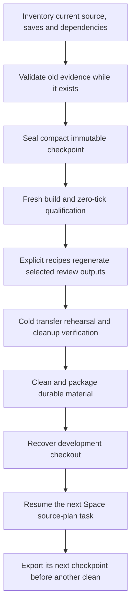
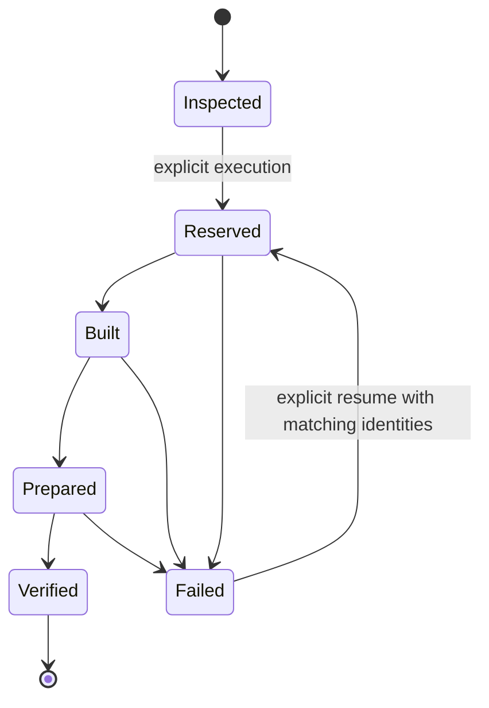

# R2FC-3 - Transfer-ready cleanup and reproducible verification

## Global Mandatory Reading

Owner: this plan, following [R2FC](r2fc-file-cleanup.md) and [R2FC-2](r2fc-file-cleanup-2.md). Change storage, regeneration and cleanup behavior; preserve gameplay, save formats, public sprite identities, authored originals and unfinished work. The parent layout is the architecture spine; its old permanent proof-cache placement is a migration input, not the target policy. Read only the named contracts below and the current Area block. Area Mandatory Reading is this plan's Local Mandatory Reading.

> **Execution protocol**
>
> - Read this Global Mandatory Reading section before the first task and again
>   after every context compaction.
> - Before starting or resuming a task group, read the nearest preceding Area
>   Mandatory Reading block whose `Applies to` label includes that group. Area
>   blocks appear immediately before the first group they govern.
> - A referenced heading or exported symbol is authoritative. Global navigation
>   hints and Area line ranges are for navigation only; if they drift, relocate
>   the named section or symbol rather than expanding to the whole file.
> - Mandatory reading is non-transitive. Do not preload a linked file's own
>   Mandatory Reading, Consult on Demand, or Planning Provenance entries unless
>   this plan names them directly for the current area.
> - Do not read Consult on Demand or Planning Provenance merely because those
>   sources are listed. Use a Consult on Demand source only when its trigger
>   occurs.
> - No created source file, test file or JSON file should start with same prefix as a planning MD file (such as r2). Only MD files can have that prefix. No MD file should be created anywhere in source directories unless specifically asked.
> - After EVERY CONTEXT COMPACTION, you must add a note above the task group
>   which is currently in execution. The note will say: "Context has compacted
>   X times while executing this group.". If the compaction occurs before any
>   meaningful work was done (this can happen when there is a lot of baggage
>   from the previous compaction), then and ONLY then you can skip this step.
> - When exceeding 3 context compactions, YOU MUST ask yourself if you're not 
>   chewing more than we can handle :). Heck, plans change! :). In such a case, 
>   the way out is to split the group on the spot,
>   in the plan, into more groups, 
>   by appending B, C, D as a suffixes to those groups (splitting sub-groups 
>   themselves is also allowed). When you do this, create Local Mandatory
>   Reading areas so you can optimize your context only for the
>   ACTUAL task at hand.
>   Before starting or resuming a task group, read the nearest preceding Area
>   Mandatory Reading block whose `Applies to` label includes that group. Area
>   blocks appear immediately before the first group they govern.

| File name | Line Ranges | Description |
| --- | --- | --- |
| [Multilayer parent](r2mlvs-multilayer-vehicles-and-structures.md#development-artifact-layout) | 36-49 | `Development artifact layout` owns repository-local runtime/review/log routing, immutable templates and the sole media authority. Every group must preserve feature/process isolation and explicit input selection; replace the dated `logs/proofs` retention rule through the shared owner, never through a second asset catalogue. |
| [Python artifact boundary](../../../../src/tests/multilayer/support/artifact_paths.py) | 49-75; 95-152 | `contained`, `owned_root` and `RunContext.directory/runtime_dir/images/saves/reports/logs` define contained owners and separate process homes from source inputs. These live boundaries constrain every relocation and generated destination; extend them rather than inventing private path resolution. |
| [Cleanup boundary](../../../../clean.ps1) | 70-92; 162-179; 269-287 | `Assert-CleanupContainment`, `Assert-CleanupNoLinks`, `Assert-CleanupTarget`, `Assert-CleanupUntracked` and `Assert-CleanupStopped` establish exact repository containment, reparse-point refusal, tracked-file protection and stopped writers. All groups must preserve these safeguards while broadening disposable targets; ignored/untracked status alone never proves disposability. |

## Status and transfer objective

**Planning only, 2026-10-21.** No cleanup implementation, deletion, build, feature resumption or Git mutation is performed by writing this plan. Execute the groups sequentially, top to bottom, without subagents. Mark an individual task `[X]` only after its stated result is verified. Finish and record each group before starting the next.

The deliverable is a small transferable development repository containing source, original graphical assets, saves, compact regression inputs and the tools/instructions to rebuild everything else. Default `clean.ps1` remains a preview; its explicit `-Apply` must eventually remove all disposable logs, test-cache, runtime profiles, generated reviews and declared build products. It must not preserve tens of gigabytes because validators read yesterday's outputs.

This plan replaces R2FC-2's unimplemented retention/migration approach where it would leave a permanent archive of review images, executables or machine-consumed diagnostics. Retain its safety findings and minimum-fixture principle. Update predecessor status links during implementation; do not mark their unchecked tasks completed merely because this replacement plan exists.

The user expressly requires Space plans and handovers to adopt the new locations, preparation commands and cleanup lifecycle. Updating only the cleaner, or only the Space master, is insufficient. This deeper planning revision splits implementation into bounded groups and explicitly resumes Space development after recovery: Group34 is the transfer-ready milestone; Groups35-37 recover the chosen checkout, execute its next source-plan task and publish the next durable checkpoint.

### Measured starting point

Read-only inventory on 2026-10-21; summed file lengths, not a promise of allocated disk recovery:

| Owner | GiB | Finding |
| --- | ---: | --- |
| `test-cache/` | 24.186 | 23.797 GiB of EXEs, including 634 repeated historical images. |
| `mlm/reviews/` | 4.358 | 2.164 GiB PPM, 0.666 GiB SAV, 0.619 GiB EXE, plus indexes and other output. |
| `mlm/runtime/` | 3.710 | Includes 2.227 GiB in `launch-fleet-art/`; these are execution homes with copied languages/content. |
| `logs/` | 3.516 | Includes proofs, comparison inputs, receipts and 2.230 GiB of executables. |
| `build/` | 6.476 | Must first extract saves, useful configuration and the portable build description. |
| Remaining repository, including Git and media | approximately 2.45 | Before promoted saves/checkpoints and small necessary fixtures. |
| Total | 44.698 | Approximately 48 GB in decimal units. |

The existing input catalogue names 274 files under reviews totalling 3.29 MiB; this is only one catalogue, not the full retained dependency closure. Preserve all discovered saves, not just those 274 files. A roughly 3-4 GiB source/history/assets/save transfer before compression is a planning target, not permission to discard an indispensable input to meet a quota.

### End-state storage contract

| Material | Durable owner or generated destination | Required lifecycle |
| --- | --- | --- |
| Authored/selected graphical originals, palettes, source contracts and existing canonical shipping assets | Existing `media/` owners | Preserve originals and provenance. AI-generated originals are source assets; prompts cannot recreate their exact approved pixels. Do not move them to a cache or request new art to repair cleanup. |
| Curated save-format, gameplay and graphical comparison inputs | Existing purpose-named `src/tests/fixtures/<feature>/<purpose>/` owners; `regression/` where already authoritative | Immutable, small, reviewed for actual coverage. Expected values must be independent of the producer being tested. Do not generate a new expected baseline from the changed implementation during ordinary tests. |
| Current Space/underground continuation saves and compact checkpoint contracts | `src/tests/fixtures/checkpoints/space/` and `src/tests/fixtures/checkpoints/underground/` | Exact saves plus configuration, state expectations, source epochs and explicit historical/current evidence roles. No executable or screenshot archive. |
| Other user/demo/backup/autosave/scenario files discovered in disposable trees | `savegames/retained/`, preserving original relative names through an explicit migration map | Keep every save/scenario; identical bytes may share one retained payload only with complete aliases. This directory is a save owner, never a second generic artifact cache. |
| Reusable Python/C++ producers and orchestration | Existing `src/tests/` and `media/multilayer/` tools | Every supported review/verification family has a named producer, exact parameters, retained inputs, prerequisites and bounded rebuild command. New test tooling stays beside tests. |
| Generated screenshots, atlases, indexed rasters, payloads, reports and required current-run transcripts | Explicit `mlm/reviews/<feature>/<scenario>/<run-id>/{images,data,reports,evidence,scratch}/` | Ignored and entirely cleanable after saves/checkpoints are exported. Producer/consumer recipes prepare selected prerequisites again after cleaning. Retain only the tracked routing README. |
| Runtime configs, startup scripts, autosaves and copied distribution data | `mlm/runtime/<profile>/<run-id>/<process>/` | Every profile is disposable; export saves before deletion. No profile-name allowlist that misses the next feature. |
| Optional stdout/stderr and build diagnostics | `logs/` | Entire directory disposable. No persistent checkpoint, baseline, source snapshot, approval or progress authority may live here. |
| Temporary builds, native image copies and verification workspaces | `test-cache/` and declared build roots | Entire `test-cache/` disposable. Generated prerequisites here must have explicit preparation; no unique retained input lives here. |
| Configuration templates and portable build requirements | Existing fixture/config owners and repository build files | Preserve meaningful settings outside `build/`. Machine paths are discovered or supplied explicitly; never transfer `CMakeCache.txt` as the build specification. |

A freshly generated report can depend on that invocation's generated data. It cannot depend on an undeclared earlier workstation run. Clearing a cache requires rebuilding its selected prerequisites; it must not require reconstructing the project's entire development history.

Historical receipts remain historical. A compact retained historical fact record may quote old hashes and results, but cannot certify a fresh executable or hide missing current proof. Fresh runs publish new executable identities. Do not promise identical EXE hashes across machines/toolchains, rewrite old hashes to make tests pass, or keep old EXEs solely to satisfy a historical path.

### Protected current work and recovery boundary

**Space is ongoing in this checkout.** [Space master](r2mlsp-space-master-plan.md) `Latest result` and [current Space handover](r2mlsp-z-z-z-z-z-q-launch-center-source.md#current-boundary) are authoritative over dated summaries, including the underground handover's statement about another worktree. Planning snapshot: Plan11 **15CSGZVEEH complete; 15CSGZVEEI next, code not begun**. Original continuous-chain tasks15.1/.2 remain open. Preserve other worktrees; this cleanup neither merges them nor assumes their changes are present here.

Current Space checkpoints to identify and seal before changing their consumers:

- Debug final save: `mlm/reviews/space/surface-entry-resupply-construction-cash-work/20261020-215547-fa0b1bae22/saves/surface-resupply-construction-cash-work-440.sav`, SHA256 `cb3c4ba4b44a09dd76250c540d83860c7e0e812423028d0d45bb4a6ce59e5f01`.
- RelWithDebInfo final save: `mlm/reviews/space/surface-entry-resupply-construction-cash-work/20261020-215542-242d79e2e7/saves/surface-resupply-construction-cash-work-440.sav`, SHA256 `5b11bc4b38a33f80ab49fc66f5908085ad387a6a50624d0a86b100541726919a`.
- Current raw receipts: `logs/surface-entry-construction-cash-work-032-{configuration}.json`; bound receipt: `logs/surface-entry-construction-cash-verification.json`. The current binder exposes thirteen explicit source/image epochs and 612 retained products. Determine their actual required closure; do not copy 612 executable products into fixtures.
- Actual current cash182,302/debt5,000,000, original35 named train bodies/32 wagons, center stock32Steel/50Goods/38PROP, original operational Core and live Rocket54, retired Constructor38 material history. GZVEEH is **closed at32 windows/64,000 ticks: no033**. Both30,000 exceptions are spent; normal40,000 operating default remains;100,000 capital floor is restored. No new paid scope, purchase, income window or gameplay ticks are authorized by cleanup.
- Verify these pointers against the live handover at implementation start. If another thread has advanced it, capture the new exact boundary instead; never overwrite newer progress with this snapshot.

The [underground checkpoint](r2mlvs17-underground-transport-tubes.md) at `Checkpoint handover — paused at the user's request,2026-10-21` also remains protected. Group9 is complete; master10.5/Group10 has provisional five-model source edits **not built or tested**. Preserve both `logs/underground-tubes/20261021-models-01/before.json` and `before-definitions.json` as distinct source epochs, plus necessary terminal/art comparison metadata. Cleanup must not resume feature implementation or claim the provisional code passed.

### Implementation standards and test budget

- Preserve all modified/untracked source, media and test files. No Git reset/checkout/commit/stage/clean, no Git-writing build version discovery, no edits or deletion outside this repository except the user's allowed temporary destinations. Archive creation is separate from deletion.
- All new/edited live functions have JavaDoc/Doxygen-style documentation with argument meanings; classes/interfaces have equivalent headers. Files link their architecture or owning `r*.md` plan. Explain every compound `if` and nontrivial loop as business logic. Retained immutable bytes keep their identities; describe their provenance in the containing fixture contract rather than modifying them.
- Reuse `mlm/review-producers.json`, existing input resolution and original Python/C++ producers. Do not invent a second asset identity catalogue, new gameplay stores or a general build system.
- Run focused bursts for the group being developed. No full regression is required by this plan. Any justified broad run is limited to the end or once per ten groups. Split test runners exceeding two minutes into bounded `-1`/`-2` companions beside tests. Build time is reported separately from test runtime.
- Native test subprocess caps remain appropriate to their producer, usually60 seconds. While a process runs, wait at least50 seconds per poll; the harness must tolerate at least60 seconds of agent inactivity. Use at most two build workers and disable owned MSBuild node reuse where supported. Do not terminate unrelated processes.
- After compaction reread only this Global section and the nearest applicable Area block. Record compaction count above the active group; split after more than three compactions with B/C/D suffixes and matching Area coverage.
- Any assisting Markdown belongs beside this plan, with names `r2fc-file-cleanup3-a-<purpose>.md`, then b/c chronologically. Prefer the handover in this plan. New source/test/JSON filenames never begin `r2`. Logs/debug output stays under `logs/` or `test-cache/`.

## Tasks

### Decomposition and execution map

This revision replaces the former eleven broad groups. Each group now has one bounded implementation result; none is rated COMPLEX. Proposed code/schema examples are design contracts, not claims that those exports already exist. Keep each named boundary in its existing owner or the explicitly named small adapter.

| Earlier group | Replacement groups | Main simplification |
| --- | --- | --- |
| 1 | 1-2 | Capture the live boundary, then establish a typed inventory. |
| 2 | 3-6 | Trace Space, graphics and other consumers separately before registering recipes. |
| 3 | 7-8,11-12,15 | Validate history, seal saves, implement a pure load check, adapt continuation, then qualify fresh builds. |
| 4 | 9-10 | Preserve immutable material before changing shared output routing. |
| 5 | 13-15,29 | Separate build bootstrap, recipe execution, checkpoint qualification and packaging. |
| 6 | 16-20 | Separate evidence selection, pure conversion, native payload loading and two capture domains. |
| 7 | 21-22 | Split prior-stage verification from active Space publication. |
| 8 | 23,25 | Update Space guidance separately from runtime storage. |
| 9 | 24,26-28 | Export saves, implement cleanup, test destruction boundaries, then guard future routing. |
| 10 | 30-32 | Rehearse builds/checkpoints, graphics and clean/rebuild behavior independently. |
| 11 | 33-34 | Apply verified cleanup, then package the finalized handover. |
| Added resumption | 35-37 | Recover the actual development checkout and dispatch its next Space task through the new foundation. |



### Area Mandatory Reading - Capture and inventory

_Applies to Groups 1-2._

| File name | Line Ranges | Description |
| --- | --- | --- |
| [Space master](r2mlsp-space-master-plan.md) | 7-9;287-291 | Latest dispatch and GZVEEF-I task rows identify actual current work. Capture these facts before any producer changes; a dated other-worktree summary cannot choose the checkpoint. |
| [Space handover](r2mlsp-z-z-z-z-z-q-launch-center-source.md#current-boundary) | 5-17 | `Current boundary` names final originals, thirteen epochs and closed financial scopes. Capture both configurations and the no033 limit. |
| [Input resolver](../../../../src/tests/multilayer/support/artifact_paths.py) | 322-346 | `resolve_input_path` currently checks existing paths before aliases and does not itself verify the manifest's SHA. Inventory alias precedence and identity validation as separate concerns. |
| [R2FC-2 findings](r2fc-file-cleanup-2.md#why-logs-cannot-be-emptied-yet) | 116-149 | Named baselines, transcripts and progress readers seed the inventory; the table is not a complete dependency closure or a permanent-output retention policy. |

### Group 1 - Freeze the live planning boundary

{{SIMPLE}}
- [ ] 1.1 Record repository/worktree identity, modified/untracked/ignored valuable files and active writers using read-only operations. Capture a stable snapshot before relinking consumed applications.
- [ ] 1.2 Confirm the current Space task and exact final save/receipt pair from its live handover; record closed financial scopes and protected source/application hashes. Refresh this plan's dated values if another thread advanced.
- [ ] 1.3 Record underground Group10's partial source and the distinct pre-edit/partial-definition baselines. Keep its feature work paused and its uncompiled status explicit.
- [ ] 1.4 Record sizes, exact build roots, nested repositories, reparse points and external tool/dependency locations. No wildcard build-root deletion or copy of another worktree.

### Group 2 - Establish the file and save inventory contract

{{MEDIUM}}
- [ ] 2.1 Add a small `artifact_inventory.py` beside support tests, exporting `collect_candidates` and `classify_reference`. Inventory paths/roles without importing legacy acceptance modules, which can initialize run contexts or load predecessor chains.
- [ ] 2.2 Record every save/scenario/autosave/backup, including unusual extensions using existing save-stream detection where applicable. Unknown save-like content stays protected; no decoder success is required to retain an old-format save.
- [ ] 2.3 Publish a compact durable migration manifest under `src/tests/fixtures/cleanup/` with original path, destination, SHA256, role, consumers, disposition and verification status. Put large enumeration/debug output under test-cache.
- [ ] 2.4 Capture effective compiler/CMake/runtime/Python/Pillow/GRF/vcpkg requirements and config templates separately from machine-local cache paths. Preserve user configuration that cannot be reconstructed.
- [ ] 2.5 Verify inventory-only execution writes no exports and detects missing, conflicting, redirected and changed inputs. Keep source/tool discovery read-only.

Proposed dependency row; field names are to be validated in Group2, not inferred from every arbitrary JSON string:

```json
{
  "_documentation": "Owner: r2fc-file-cleanup3.md; migration dependency, not gameplay authority",
  "consumer": "surface_original_evidence.bind",
  "json_pointer": "/operation/output",
  "input": {"path": "<exact-old-save>", "sha256": "<captured-sha256>"},
  "role": "continuation_save",
  "disposition": "retain",
  "destination": "src/tests/fixtures/checkpoints/space/<configuration>/current.sav",
  "generator": null
}
```

### Area Mandatory Reading - Trace required input graphs

_Applies to Groups 3-6._

**ASSUMPTION: this was already built previously. If not, re-asses at runtime**

Entry gate: Group2's typed inventory and `collect_candidates/classify_reference` must exist and pass its read-only checks. Inspect those exports and schema. Stop graph publication/recipe classification if absent; inspect known readers independently. Do not infer preservation from an ignore rule or execute old acceptance scripts merely to discover imports.

| File name | Line Ranges | Description |
| --- | --- | --- |
| [Original evidence](../../../../src/tests/multilayer/acceptance/surface_original_evidence.py) | 22-44;73-192 | `verify` and `bind` read epoch/product/native/ordinary chains and copy current binaries. Trace typed edges, separating history from the next task's actual inputs. |
| [Graphics selection](../../../../media/multilayer/evidence.py) | 35-95;97-127 | `selected/output/validate_capture` bind paths, frames, source bytes and terminal evidence. Include all nested reads, not only the top manifest. |
| [Prior-stage inputs](../../../../src/tests/multilayer_state_fixture.py) | 28-43;75-104 | `prior_artifact` and `save_path` distinguish a previous accepted stage, a newly reserved output and an immutable fixture. Preserve that distinction in the graph. |
| [Producer catalogue](../../../../mlm/review-producers.json) | Live `schema_version/producers` and each selected producer row | Existing producer/feature/test-tag assignments remain canonical. Extend this catalogue with recipes after tracing actual implementations. |
| [Inventory API](../../../../src/tests/multilayer/support/artifact_inventory.py) | Live Group2 exports; no fixed range | `collect_candidates/classify_reference` and the typed migration-row schema are Group2's public inventory boundary. Verify them before graph adapters reuse its ownership/disposition decisions. |

### Group 3 - Trace the current Space dependency graph

{{HARD}}
- [ ] 3.1 Export `trace_references` from the inventory helper with explicit adapters for the current bound receipt, retained-product manifest and thirteen before-edit manifests. Follow `foundation`, `products`, `source/retained`, `historical_versions` and configuration receipt references with a visited set and path/hash mismatch detection.
- [ ] 3.2 Trace native operation `source/before/output/application/terminal/retained_harness/sources/native_processes` and ordinary restore records. Associate each reference with the reader that requires it; do not treat a historical EXE hash as a future executable dependency.
- [ ] 3.3 Classify the final saves and independent observation expectations as continuation inputs; classify completed-stage logs/process facts as historical provenance. Identify any historical fact whose only witness would otherwise be deleted.
- [ ] 3.4 Record required observer/source epochs and a metadata-only validation command. Explicitly prohibit `surface_gateway_replay.replay` here: its implementation advances two branches by3,000 ticks.
- [ ] 3.5 Verify traversal on one final configuration plus cross-configuration linking; test cycles, wrong hashes, duplicate aliases and a missing nested receipt. Do not replay a completed financial window.

### Group 4 - Trace graphics sources, generated products and proof cycles

{{HARD}}
- [ ] 4.1 Trace public source/packing/runtime references through `EvidenceSet` and selected converter/packer scopes. Distinguish original media, canonical shipping assets, derived atlases, expected payloads and actual native frames.
- [ ] 4.2 Inspect `pack_m1_art.derive/publish` and corresponding Space/orbital/launch/ground owners. Record that `derive` returns candidate bytes but `publish` writes canonical files and the public manifest; regression recipes must not call publication implicitly.
- [ ] 4.3 Identify source-to-proof-to-source cycles and frozen predecessor requirements. Choose retained source/independent expectations as roots; record a bounded generator for each derived edge instead of retaining every old gallery.
- [ ] 4.4 Map every native expected-payload literal, including M1/Space/orbital/launch `*-packed-sprites.bin`, to its generator and actual loader test. Include required terminal transcripts and source-policy observations.
- [ ] 4.5 Classify missing generators, immutable baselines and retired authoring snapshots explicitly. Old rejected/selected-original status assertions cannot become fresh runtime tests unchanged.

### Group 5 - Trace other continuation readers and close inventory gaps

{{MEDIUM}}
- [ ] 5.1 Inventory state/profile/geology, TBM feedback/motion/pacing and Space phase-pair consumers by exact reader, input role and prior-run selector. Use shared graph adapters where records share a schema.
- [ ] 5.2 Scan Python/C++/PowerShell/CMake and active plan commands for direct and assembled cache/log paths. Classify reads versus writes; filename matches alone are insufficient.
- [ ] 5.3 Record a disposition for every candidate subtree and supported producer family: retain/export, regenerate or retire as superseded. Resolve all required unknowns before deletion; do not treat a partial catalogue as a full audit.
- [ ] 5.4 Record independent pre-existing stale mine/processor proofs and provisional underground build limitations. Keep their diagnosis separate from relocation failures.

### Group 6 - Register bounded recipes and their input roles

{{MEDIUM}}
- [ ] 6.1 Confirm the current dependency graph permits editing `mlm/review-producers.json` before sealing, then extend it with recipe ID, original producer, target/test tags, retained inputs, ordered prerequisites, output roles, configuration/tool requirements and expected comparison mode. If a newer graph binds that file, move original validation/sealing before its mutation; never amend historical hashes to permit the edit.
- [ ] 6.2 Define inspect/build/prepare/verify stages and read-only versus native-fixture execution modes. Explicitly exclude closed financial work and source/publication mutation from routine regeneration.
- [ ] 6.3 Register initial recipes for `space-checkpoint`, scoped Space/ground art families and tube checkpoint material. Split umbrella recipes into bounded leaves; selecting one leaf must not build the entire acceptance directory.
- [ ] 6.4 Validate unknown dependencies, cycles, duplicate roles, cross-configuration reuse and output paths outside cleanable owners. Required missing inputs must report the exact supplying recipe or retained fixture.
- [ ] 6.5 Record Space master/Plans8/9/10/11/13/14 documentation consumers for later updates. Exit with zero unclassified required inputs; keep raw inventory output disposable.

Planning observation: the current612-product manifest binds `src/tests/multilayer/support/runner.py` but does not bind `mlm/review-producers.json`. This permits recipe-schema work before Group7 while deferring runner changes until after the seal. Recheck this edge if the active Space thread advanced.

Proposed recipe shape; a native leaf records the actual existing tag rather than a fictional aggregate suite:

```json
{
  "id": "launch-current-producers",
  "producer": "src/tests/multilayer/launch_fleet_runtime_checks.py",
  "target": "openttd_space_art_test",
  "requires": ["launch-derived-inputs", "launch-decoder"],
  "execution": "native_fixture",
  "publishes_source": false,
  "outputs": ["reports/current.json", "evidence/native.txt"],
  "configuration_required": true
}
```

### Area Mandatory Reading - Validate and seal the original Space history

_Applies to Groups 7-8._

**ASSUMPTION: this was already built previously. If not, re-asses at runtime**

Entry gate: Groups3/6 provide a verified current Space graph and recipe/disposition records. Compare its final roots to the live handover. Stop sealing if roots or original validation inputs changed; independent schema/test design may continue. Never replace absent original evidence with a newly run paid simulation.

| File name | Line Ranges | Description |
| --- | --- | --- |
| [Construction-cash binder](../../../../src/tests/multilayer/acceptance/surface_entry_construction_cash_checks-3.py) | 17-68 | `VERSIONS/main` bind32 windows and both final states. Metadata validation can run without `--retain`; avoid copying the executable archive again. |
| [Original evidence](../../../../src/tests/multilayer/acceptance/surface_original_evidence.py) | 73-192 | `bind` verifies source linkage, native process success, actual observed states and cross-build families before historical facts are sealed. Do not weaken this original verifier globally. |
| [Current observer](../../../../src/tests/multilayer/acceptance/surface_constructor_retirement_ledger.py) | 11-17 | `observe` delegates to the actual home/material observer with retirement enabled. Reuse its owner semantics; cash alone is insufficient to validate a checkpoint. |
| [Space handover](r2mlsp-z-z-z-z-z-q-launch-center-source.md#current-boundary) | 5-17 | Exact originals and closed scopes govern sealing. Fresh build identities are a later proof, not replacements for these historical identities. |
| [Dependency inventory](../../../../src/tests/multilayer/support/artifact_inventory.py) | Live Groups2-3 exports; no fixed range | `trace_references` and typed edges supply the verified import roots and required closure. Sealing must reject an unresolved edge rather than copying an incomplete hand-written subset. |

### Group 7 - Validate the existing Space evidence once

{{HARD}}
- [ ] 7.1 Revalidate original source/application identities before editing consumed adapters. Run the metadata-only binder into a new report without `--retain` and without any native work stage; record failure honestly if original history is already incomplete.
- [ ] 7.2 Recompute both current save observations and compare with the verified final receipts. Verify the original save hashes, all121 chunk families and existing per-configuration/cross-build rules.
- [ ] 7.3 Extract compact necessary historical facts: predecessor identity, actual cash flow, closed caps/approvals, owner/material observations and process outcomes. Preserve the original receipt bytes or minimal necessary semantic transcripts where they are independent witnesses.
- [ ] 7.4 Publish an audit result naming the exact imported roots and validated source epochs. Its historical EXE hashes are recorded facts; the audit result does not claim a newly compiled application ran.

### Group 8 - Seal a durable Space checkpoint contract

{{HARD}}
- [ ] 8.1 Add `space_checkpoint.py` beside acceptance tests with `load_checkpoint` and `verify_checkpoint`. Define a versioned checkpoint type distinct from a legacy operation receipt; validate exact required fields before use.
- [ ] 8.2 Store each final save under its configuration-specific checkpoint owner, with independent observation/chunk expectations and the Group7 audit reference. Preserve both different save hashes; never normalize the originals in place.
- [ ] 8.3 Retain the smallest complete historical semantic/source-epoch set needed to explain the checkpoint. Separate non-dereferenced historical EXE identity records from live retained input references; do not disguise missing required bytes as optional provenance.
- [ ] 8.4 Implement read-only seal verification: retained hashes, graph roots, configuration, actual observer result, expected chunk set and closed policies. Fail on missing/tampered input or reopened scope; produce no new gameplay authorization.
- [ ] 8.5 Publish the seal and migration map atomically after verification; interrupted writes cannot become a valid checkpoint. Update the handover to point to the seal while keeping fresh-build qualification explicitly pending.

Conceptual checkpoint contract; placeholders must be filled from Group7 evidence, not from the plan's prose:

```json
{
  "schema_version": 1,
  "kind": "sealed_space_checkpoint",
  "historical_validation": {"path": "<retained-audit>", "sha256": "<audit-sha>"},
  "configurations": {
    "Debug": {"save": {"path": "<retained-save>", "sha256": "<original-sha>"},
              "expected_observation": "<independent-retained-record>"},
    "RelWithDebInfo": {"save": {"path": "<retained-save>", "sha256": "<original-sha>"},
                      "expected_observation": "<independent-retained-record>"}
  },
  "closed_scope": {"name": "GZVEEH", "last_window": 32, "ticks": 64000},
  "next_task": "Plan11/15CSGZVEEI",
  "fresh_build_qualified": false
}
```

### Area Mandatory Reading - Promote immutable inputs and extend shared routing

_Applies to Groups 9-10._

**ASSUMPTION: this was already built previously. If not, re-asses at runtime**

Entry gate: Group8's seal verifies against the original saves and Group2 inventories all saves. Stop removal/repointing of unique inputs if either is absent; independent routing fixture work may continue. Do not delete originals to force an alias lookup or recreate expected baselines from current code.

| File name | Line Ranges | Description |
| --- | --- | --- |
| [Input and output paths](../../../../src/tests/multilayer/support/artifact_paths.py) | 171-198;244-278;281-292;322-346 | `RunContext.output/environment/write_report`, `_materialize` and `resolve_input_path` define the routing and lookup points to change together. Report paths must remain feature/run-bound. |
| [Native path owner](../../../../src/tests/test_artifact_paths.cpp) | 131-226 | `GetTestArtifactPaths` aggregate initialization, `Output`, `ResolveTestInputPath` and `GetTestRuntimeConfig` must match Python roles and aliases. Adding only struct fields leaves creation/selection incomplete. |
| [Underground handover](r2mlvs17-underground-transport-tubes.md) | 352-368 | Preserve two distinct baselines and provisional Group10 source without replaying completed art/terminal publication. |
| [Native public API](../../../../src/tests/test_artifact_paths.h) | 16-37;73-93 | `TestArtifactPaths` and resolver/runtime declarations are the shared public seam; fixtures and generated material retain distinct ownership. |
| [Checkpoint adapter](../../../../src/tests/multilayer/acceptance/space_checkpoint.py) | Live Group8 exports; no fixed range | `load_checkpoint/verify_checkpoint` establish exact durable Space saves before generic promotion/routing changes. Verify that input boundary rather than reading mutable raw receipts again. |

### Group 9 - Export all saves and small immutable baselines

{{MEDIUM}}
- [ ] 9.1 Export every inventoried save/scenario/backup into its fixture/checkpoint owner or `savegames/retained/`. Preserve original names/aliases; hash both sides before releasing any source copy.
- [ ] 9.2 Promote necessary comparison baselines and compact semantic evidence under purpose-named fixtures, including underground pre-edit and partial-definition epochs. Do not bulk-copy reviews or EXEs.
- [ ] 9.3 Update `multilayer-inputs.json` and its readers with explicit alias precedence and hash validation. Test while both old and new files exist so a stale original cannot silently satisfy a migrated key; explicit prior-run paths retain their declared semantics.
- [ ] 9.4 Preserve current source snapshots/patches only where needed for historical expectation/rebuild; record their original bytes and provenance. Separate authored/generated source contracts from scratch copies.
- [ ] 9.5 Verify every save alias, configuration and destination, including conflicting same-name/different-content files and corrupt/legacy saves. Publish a complete verified migration map outside deletion roots.

### Group 10 - Add generated data and evidence roles in both languages

{{MEDIUM}}
- [ ] 10.1 Add `data`/`evidence` to Python properties, `output` allowlist, directory materialization and report routing validation. Preserve basename, owner and run isolation.
- [ ] 10.2 Add matching C++ fields, aggregate initialization, directory creation and `Output` cases. Update fixtures to prove Python/native output locations agree.
- [ ] 10.3 Keep frames under `images`; adding general evidence roles must not relax frame producer/run checks. Put required current-run transcripts under evidence with optional diagnostic copies in logs.
- [ ] 10.4 Update durable input resolution in Python/C++ together; generated prerequisites remain explicitly selected inputs, never automatic latest-run fallbacks or fixture overwrite destinations.
- [ ] 10.5 Run focused artifact-path tests for traversal, alias precedence/hash changes, mixed-feature runs and host/client separation. Publish the parent layout/README routing changes.

### Area Mandatory Reading - Add a pure native checkpoint boundary

_Applies to Groups 11-12._

**ASSUMPTION: this was already built previously. If not, re-asses at runtime**

Entry gate: Group8 exposes `load_checkpoint/verify_checkpoint` and Group10 exposes matching data/evidence roles. Verify both contracts with focused tests. Stop native adapter wiring if absent; inspect the current callback/loader code independently. Never synthesize a legacy receipt with `complete=true` or reuse a work-capable phase as the recovery command.

| File name | Line Ranges | Description |
| --- | --- | --- |
| [Construction cash native driver](../../../../src/tests/multilayer/acceptance/surface_construction_cash_native.py) | 20-82 | `execute` accepts both query/work and consumes a legacy receipt. Its process/source assertions are useful, but its old entry point must not become the cleanup restore command. |
| [Native cash case](../../../../src/tests/surface_entry_construction_cash.h) | 10-35 | The selected callback branches into `WorkSurfaceFundedFarmGoods`. Add a separate hidden load-only case instead of depending on that branch's environment/defaults. |
| [Productive target source](../../../../src/tests/surface_entry_productive_admission.cpp) | 1-9;72-111 | Existing resupply callbacks/save helpers are included into the isolated target. Reuse that harness; its older productive query asserts an obsolete cash value and is not current recovery. |
| [Original restore / replay](../../../../src/tests/multilayer/acceptance/surface_original_evidence.py) and [gateway replay](../../../../src/tests/multilayer/acceptance/surface_gateway_replay.py) | `restore`47-70; `replay`24-53 | Ordinary restore uses bounded GLOG/pause handling; gateway replay executes3,000-tick branches. Extract/reuse the actual static loader seam without invoking replay. |
| [Checkpoint adapter](../../../../src/tests/multilayer/acceptance/space_checkpoint.py) | Live Group8 `load_checkpoint/verify_checkpoint`; no fixed range | The sealed-input API is a prerequisite for the new native qualifier. Keep its historical-validation role distinct from this area's fresh process qualification. |

### Group 11 - Implement a dedicated zero-tick native load check

{{HARD}}
- [ ] 11.1 Add a hidden `[.space-checkpoint-load]` test in the existing isolated capital harness, with an explicit source input and no work/query-mode switch. Reuse native console/load/save setup and callback error propagation.
- [ ] 11.2 Save before/after snapshots inside the paused inspection callback, observe the loaded native owners, then exit. Never invoke `StateGameLoop` work helpers, purchase commands or old cash/admission callbacks.
- [ ] 11.3 Add a Python qualification adapter that verifies source identity before/after, native process inputs/executable/exit status and the expected observation. Record all generated files in the current run.
- [ ] 11.4 Validate all121 families; compare tick counters and date fields explicitly before applying only the established pause/revision allowances. No blanket "ignore DATE/GLOG" rule may hide time or unrelated metadata changes.
- [ ] 11.5 Add focused failure cases for a wrong save/configuration, changed tick/state, unexpected tag/phase and incomplete native process. Stage actual builds for Group15.

Conceptual body inside the existing paused observer, not a replacement game loop:

```cpp
/** Serialize the loaded checkpoint twice without advancing its work owners. */
std::function<void()> inspect = [&] {
    SaveSurfaceResupply(paths.saves / "checkpoint-before.sav");
    SaveSurfaceResupply(paths.saves / "checkpoint-after.sav");
    _pause_mode.Set(PauseMode::Normal);
    _exit_game = true;
};
```

Use the harness's existing exception/observed handling around this body. The Python adapter compares actual native chunks and the established material/body observer with independent retained expectations; two equal newly written files alone are not sufficient.

### Group 12 - Introduce the new continuation foundation explicitly

{{HARD}}
- [ ] 12.1 Add `qualify_checkpoint` and `publish_successor` to the checkpoint adapter. A qualified foundation links the immutable seal to a fresh native/static result and actual current executable/source identities.
- [ ] 12.2 Define an explicit discriminator for `sealed_checkpoint` versus an ordinary `operation_receipt`. New active callers consume the qualified foundation; historical callers retain their original `verify/bind` behavior.
- [ ] 12.3 Give the future Space caller an explicit foundation argument and selected source/configuration. Do not import its thirteen-stage historical chain to discover the current save or manufacture a compatibility receipt accepted by the old binder.
- [ ] 12.4 Validate successor provenance: selected predecessor save, real before/output/process evidence and current observer must agree. Closed financial scopes cannot become new operation permissions.
- [ ] 12.5 Verify the adapter on synthetic corrupt references and retained checkpoint data; classify old receivers as historical where appropriate. The real GZVEEI producer remains owned by Plan11 and is dispatched in Groups35-37.

### Area Mandatory Reading - Build and recipe execution

_Applies to Groups 13-15._

**ASSUMPTION: this was already built previously. If not, re-asses at runtime**

Entry gate: Group6 recipe schema, Group10 routing and Groups11-12 checkpoint exports must exist. Verify those public contracts before launching builds. If absent, stop dependent native execution; inspect tool versions/configuration independently. An old build directory or cached EXE is not a substitute.

| File name | Line Ranges | Description |
| --- | --- | --- |
| [Build target definitions](../../../../CMakeLists.txt) | 331-337;403-416;417-445 | Existing capital/tube/Space-art targets limit compilation to selected producers. Reuse ordinary `openttd` for static recovery; no new gameplay implementation. |
| [Run identity](../../../../src/tests/multilayer/support/artifact_paths.py) | 187-198;219-242;294-319 | `environment/prepare_runtime/create_run_context` propagate a run and reserve IDs. Explicit duplicate IDs currently refuse; inspect must not reserve one, and resume needs validated recorded identity. |
| [Native runner](../../../../src/tests/multilayer/support/runner.py) | 199-249 | `run_native` records actual child input/executable/output identities. Recipes must preserve this evidence and subprocess exit status. |
| [Checkpoint adapter](../../../../src/tests/multilayer/acceptance/space_checkpoint.py) | Live Groups8/12 exports; no fixed range | `load_checkpoint/verify_checkpoint/qualify_checkpoint/publish_successor` are the earlier groups' public foundation. Inspect their schemas and refusal checks, not an internal legacy fallback. |

### Group 13 - Reconstruct a portable native build

{{MEDIUM}}
- [ ] 13.1 Write the portable build profile from Group2's actual generator/compiler/options and pinned dependency/tool versions. Keep user configuration/templates outside build; don't transfer CMakeCache as authority.
- [ ] 13.2 Implement tool discovery/explicit path overrides and configure-from-missing-build behavior. Route downloads, temporary state and binary caches into allowed locations; report unavailable external prerequisites before compiling.
- [ ] 13.3 Build selected existing targets per configuration, sequentially with two workers and owned MSBuild node reuse disabled. Preserve project settings and read-only Git version discovery.
- [ ] 13.4 Make the profile report actual tool versions, options, dependencies, source epoch and output identities. Old EXE hashes are not expected rebuild hashes.
- [ ] 13.5 Verify a missing build directory and mismatched/missing tool profile using a bounded fixture; stage real current target compilation with Group15.

### Group 14 - Implement the recipe executor and restart semantics

{{MEDIUM}}
- [ ] 14.1 Add `artifact_rebuild.py` with `load_recipe`, `verify_retained_inputs` and `prepare_recipe`. Resolve only registered recipes and structured argument arrays; inspect validates the graph without importing producer entry points or writing output.
- [ ] 14.2 Order prerequisites topologically and execute one explicit configuration/run. Build and generated-input stages retain separate statuses; publish a successful verification only after real selected checks pass.
- [ ] 14.3 Implement fresh run reservation plus explicit interrupted-run resume. Validate recipe, configuration, inputs and producer hashes against the stored manifest before joining `RunContext`; never silently reuse an existing directory because its name matches.
- [ ] 14.4 Keep each stage's output under shared roles and pass explicit selected manifests to children. Failure leaves a failed/incomplete generated report and cannot advance dependent stages.
- [ ] 14.5 Verify cycles, changed inputs, incomplete prior stages, duplicate invocation and source-publication/paid-work exclusion. Keep individual runners under two minutes and builds separately timed.



Inspection creates no run directory. A changed source/recipe/input requires a new invocation; completed paid operations are never replayed by this state machine.

### Group 15 - Qualify the retained Space foundation on fresh applications

{{MEDIUM}}
- [ ] 15.1 Build the current capital and ordinary applications through the new profile in both configurations. Do not replace/erase original history before the Group7/8 seal has passed.
- [ ] 15.2 Execute only the new load-only tag and ordinary static loader on each retained final save. Publish source/save/process identities and independent state comparisons through the new checkpoint adapter.
- [ ] 15.3 Validate GLOG revision and pause differences using the established bounded helpers, with unchanged gameplay counters and original save hashes. Prove no money, order, packet, owner, date or work progression was introduced.
- [ ] 15.4 Record fresh qualification separately from historical earnings. Verify a current source/application mismatch invalidates fresh qualification without invalidating or rewriting the immutable historical seal.

### Area Mandatory Reading - Graphics selection, conversion and native payloads

_Applies to Groups 16-18._

**ASSUMPTION: this was already built previously. If not, re-asses at runtime**

Entry gate: Group10 roles and Group14 recipe executor pass their focused contracts, and Group4 assigned actual graphics roots/producers. Run inspect for the selected recipe. Stop affected generation if a retained root or producer is missing; source-only diagnosis may continue. Never fill a missing dependency by copying an old gallery, accepting the new actual as its own expected image, or invoking publication.

| File name | Line Ranges | Description |
| --- | --- | --- |
| [Evidence selector](../../../../media/multilayer/evidence.py) | 35-127 | `EvidenceSet` methods validate selected paths, producer assignment, exact frames/source and terminal evidence. Migrate storage while keeping this validation contract. |
| [Pure packing and publication](../../../../media/multilayer/pack_m1_art.py) | 373-418;421-442 | `derive` returns candidate PNG/NFO/header bytes; `publish` writes canonical files and the public manifest. Fresh regression generation must use the pure boundary and disposable destinations. |
| [Expected pixel producer](../../../../src/tests/multilayer_packed_art_fixture.py) | 17-62 | `OUTPUT/pixel_hash/main` derive pixel/geometry expectations from source sheets/NFO and currently use fixed logs paths. Preserve independent source-based expectations while parameterizing paths. |
| [Native packed loader](../../../../src/tests/multilayer_packed_load.cpp) | 92-169;172-249;252-329;332-429; read the selected family case | The M1/Space/orbital/launch native loaders consume four literal payload files. Replace selected input resolution without replacing actual GRF loading with a mock. |
| [Recipe executor](../../../../src/tests/multilayer/support/artifact_rebuild.py) | Live Group14 `load_recipe/prepare_recipe`; no fixed range | Explicit selected run, dependency roles and stage status are already implemented here. Graphics adapters consume that interface instead of creating private orchestration or hidden cache fallback. |

### Group 16 - Make evidence selection independent of diagnostic logs

{{HARD}}
- [ ] 16.1 Parameterize `EvidenceSet` selection/output roots through the explicit recipe run. Move required transcript roles to generated evidence; diagnostic logs remain optional.
- [ ] 16.2 Preserve exact frame hashing, images-role location, feature/scenario/run ID, native writer and source identity checks. Updating valid roots must not turn historical-relocation records into current native passes.
- [ ] 16.3 Migrate selected-manifest fields and direct consumers together, including report-to-terminal references. Reject ambiguous mixed old/new schemas; expose a bounded migration/version error.
- [ ] 16.4 Test wrong run, stale source, edited frame, missing required evidence and absent optional logs independently. Record existing old capture imports as historical or regenerate them explicitly.

### Group 17 - Generate derived images and packing candidates without publishing

{{MEDIUM}}
- [ ] 17.1 Add explicit output selection to shared source conversion/guide generation, starting with `regenerate_art_sources` and the pure packer seam. Reuse existing `--cache-only`/`publish_source=False` behavior where present; verify it rather than introducing another publication switch. Candidate bytes go to data/images in the selected run.
- [ ] 17.2 Apply the same adapter to current Space, orbital, launch and ground family converters from the inventory. Reuse original poses/palettes/crops/anchors and pinned encoders; split any family that needs more than a mechanical destination adapter into a new numbered group before proceeding.
- [ ] 17.3 Generate contact sheets, guides, indexed rasters and packing inputs through their actual producer files. Preserve original media and compare canonical shipping bytes without invoking `publish` or rewriting runtime/publication flags.
- [ ] 17.4 Reconstruct available predecessor bytes from declared source/read-only Git objects; retain only an indispensable independent baseline where exact reconstruction is unavailable. No self-updating expected image.
- [ ] 17.5 Verify deterministic repeated output and source/public-manifest preservation on selected family cases, including an encoder-version mismatch and altered source.

### Group 18 - Pass generated expectations into the actual native loader

{{HARD}}
- [ ] 18.1 Parameterize expected sprite producers with selected packing/source inputs and an explicit generated payload destination. Cover all four literal payload families found in `multilayer_packed_load.cpp`.
- [ ] 18.2 Introduce an explicit test-only expected-payload input, for example `OTTD_TEST_EXPECTED_SPRITES`, resolved inside an allowed fixture/generated owner. Validate its recipe/configuration/hash before launching the selected native test.
- [ ] 18.3 Extend process provenance to record this non-save input. Current `run_native` auto-discovers only `.sav/.scn` source hooks, so setting an environment variable alone leaves the binary payload unbound.
- [ ] 18.4 Run the real GRF loader against independent source-derived geometry/pixel expectations. Preserve native sprite ranges/legacy prefix and canonical shipping identities.
- [ ] 18.5 Verify missing/changed payload, wrong family/configuration and genuine decoder mismatch all fail. Split each native family into a separately invocable bounded recipe leaf.

### Area Mandatory Reading - Rebuild actual native review captures

_Applies to Groups 19-20._

**ASSUMPTION: this was already built previously. If not, re-asses at runtime**

Entry gate: Groups16-18 provide explicit evidence selection, pure derived inputs and native loader recipes. Inspect those recipe manifests and focused results. Stop dependent capture verification if absent; inventory current drawing producers independently. No synthetic screenshot, old EXE or source-publication action may bypass the missing prerequisite.

| File name | Line Ranges | Description |
| --- | --- | --- |
| [Proof orchestration](../../../../media/multilayer/regenerate_art_proofs.py) | 20-30;33-64;67-148 | `CAPTURES/FOCUSED`, `execute` and `main` identify real producers, selected child runs and existing cache-only finalization. Reuse them rather than inventing captures in Python. |
| [Current launch qualification](../../../../src/tests/multilayer/launch_fleet_runtime_checks.py) | 24-63 | `run` uses the isolated Space-art target, actual producer tags and a separate decoder process. Keep source-policy/refusal checks and ordinary-review limitations. |
| [Ground current closure](../../../../src/tests/multilayer/qualify_ground_selected_closure.py) | 24-63;66-181 | `native_domain/immutable_views/qualify` separate decoded domains, source views and actual consumer proof. Rebuild selected current obligations, not every historical authoring guard. |
| [Native runner](../../../../src/tests/multilayer/support/runner.py) | 199-249 | `run_native` binds child configuration, actual executable, source saves and produced captures. Explicit selected frame sets remain mandatory. |
| [Recipe executor](../../../../src/tests/multilayer/support/artifact_rebuild.py) | Live Group14 `prepare_recipe` and Groups16-18 registered leaves; no fixed range | Use the already verified dependency/selection interface to prepare native capture inputs. A native wrapper must not reconstruct private fixed proof directories. |

### Group 19 - Rebuild current Space review families

{{HARD}}
- [ ] 19.1 Register bounded source-selector/decoder/viewport leaves for launch/rocket/pod, orbital and asteroid/probe families using actual existing targets/tags. Split configuration and expensive capture phases; no monolithic historical replay.
- [ ] 19.2 Rewire each current capture wrapper's output/terminal/manifest paths to the selected context. Keep canonical native drawing and exact source/native-pixel comparisons.
- [ ] 19.3 Use retained fixture worlds for isolated review obligations. Do not invoke the actual current GZVEEH world or old paid-work caller merely to regenerate screenshots.
- [ ] 19.4 Keep current producer success separate from ordinary-game/human acceptance and public runtime activation. Regression verification cannot automatically update authored/publication status.
- [ ] 19.5 Verify a representative complete invocation for each changed producer mechanism, then register precise per-family rebuild commands for remaining coverage.

### Group 20 - Rebuild selected ground and tube review material

{{HARD}}
- [ ] 20.1 Bind selected ground source/packed/native consumer recipes to the existing current qualification owners. Keep independent expected pose/domain boundaries and later-owner exclusions.
- [ ] 20.2 Route actual viewport/capture products into cleanable runs; remove current checks' fixed before-audit/log paths by using retained comparison inputs.
- [ ] 20.3 Preserve completed tube terminal scope separately from provisional five-model work. Rebuild only its documented producer material and record any existing source-epoch limitation.
- [ ] 20.4 Verify bounded ground/tube witnesses and all source/GRF preservation checks. No cleanup task completes unfinished model, useful-route or user-acceptance requirements.

### Area Mandatory Reading - Migrate prior-stage and Space publication consumers

_Applies to Groups 21-22._

**ASSUMPTION: this was already built previously. If not, re-asses at runtime**

Entry gate: Groups9-10 supply verified immutable inputs/shared roles and Group14 supplies explicit selected recipes; Groups8/12 supply the Space checkpoint adapter. Verify those contracts. Stop dependent consumer migration if absent; trace an unclassified reader independently. Do not infer an accepted prior stage from a matching filename or choose the latest run.

| File name | Line Ranges | Description |
| --- | --- | --- |
| [State fixture](../../../../src/tests/multilayer_state_fixture.py) | 28-104 | `prior_artifact/log_path/output_save_path/save_path` are the existing shared selection seam. Keep exact prior run and newly reserved output semantics. |
| [Phase-pair reader](../../../../src/tests/multilayer/acceptance/phase_pair_index_checks-1.py) | 18-26;29-45 | Actual path/hash and owner-family comparisons must survive index relocation; replacing the index alone is insufficient. |
| [Original native driver](../../../../src/tests/multilayer/acceptance/surface_construction_cash_native.py) | 20-82 | Current receipt-based execution records terminal/harness/native reports. Migrate only active publication/adapters; retain historical caller contracts explicitly. |
| [Checkpoint adapter](../../../../src/tests/multilayer/acceptance/space_checkpoint.py) | Live Groups8/12 exports; no fixed range | `qualify_checkpoint/publish_successor` supply the new continuation foundation and complete selected successor evidence. |
| [Recipe executor](../../../../src/tests/multilayer/support/artifact_rebuild.py) | Live Group14 `load_recipe/prepare_recipe`; no fixed range | Explicit preparation of a missing prior stage must use the existing recipe dependency/status contract and a retained input, not silently run arbitrary historical stages. |

### Group 21 - Reconstruct prior-stage test evidence explicitly

{{HARD}}
- [ ] 21.1 Replace required log reads in shared state/profile/geology helpers with retained semantic fixtures or explicitly prepared prior-stage evidence. Parse diagnostics from the current process and publish only required semantics/transcripts.
- [ ] 21.2 Migrate TBM feedback/motion/pacing consumers through their actual prior-stage selectors. Preserve accepted/refused cases and configuration/source/save identities.
- [ ] 21.3 Add a bounded prerequisite recipe when a missing earlier stage can be regenerated from a retained fixture. Preserve required older-format inputs instead of generating them with the new save format.
- [ ] 21.4 Test missing prior evidence, wrong run/configuration, unchanged refusal semantics and regenerated valid inputs. Diagnostic-log deletion must not change pass/fail.
- [ ] 21.5 Close the inventory dispositions for these families; split any distinct protocol requiring new design into its own bounded group rather than expanding this one.

### Group 22 - Move active Space indexes and successor receipts

{{MEDIUM}}
- [ ] 22.1 Update current progress/phase-pair index producers and readers together to selected report paths. Keep exact path/hash references and complete nested input sets.
- [ ] 22.2 Remove live unique source snapshots, checkpoint indexes and required authorizations from logs/test-cache. Retain spent approval facts only as historical evidence, never reusable execution permission.
- [ ] 22.3 Replace active `--retain` behavior that recursively copies executables with checkpoint/successor publication. Fresh process identities remain in generated proof; durable continuation state uses the compact foundation.
- [ ] 22.4 Prove a successor can be exported, its disposable diagnostics removed, and its next qualification reconstructed without the original report folders. Preserve real incomplete/refused operation status.

### Area Mandatory Reading - Update Space development instructions

_Applies to Group 23._

**ASSUMPTION: this was already built previously. If not, re-asses at runtime**

Entry gate: Groups15-22 have actual passing recipe commands or an explicit unresolved result per affected family. Validate commands against the live catalogue. Stop publishing "ready to rebuild/resume" for an unresolved family; classify historical documentation independently. Do not document hypothetical CLI behavior as delivered.

| File name | Line Ranges | Description |
| --- | --- | --- |
| [Space master](r2mlsp-space-master-plan.md) and [current handover](r2mlsp-z-z-z-z-z-q-launch-center-source.md#current-boundary) | Master7-9/287-291; handover5-17 | Replace current paths/practices and dispatch the actual next task. Keep historical results and closed policies truthful. |
| [Plan11 next task](r2mlvs11-orbital-stations-and-manufacturing.md#group-15csgzveei---price-genuine-additional-goods-service-before-further-capital-earnings) | 2954-2963 | Its Local block still directs future work to old logs/thirteen epochs/archived applications. Replace that bootstrap with the verified checkpoint foundation while preserving the actual Goods-query obligation. |
| [Shared layout](r2mlvs-multilayer-vehicles-and-structures.md#development-artifact-layout) | 36-49, then live Group10 changes | This shared owner must agree with child plans on generated versus durable inputs; no private Space exception keeping logs permanent. |

### Group 23 - Publish concrete cleanup-aware Space instructions

{{MEDIUM}}
- [ ] 23.1 Update master and affected Plans8/9/10/11/13/14 current instructions, mandatory-reading pointers and guide/handovers with actual retained paths and cleanable generated destinations. Label older output paths historical.
- [ ] 23.2 For each required next-step asset, name recipe, owning Python/C++ file/tag, retained inputs, configuration/target, exact command and expected scoped result. Verify each recipe exists; generic "rerun the tests" wording is insufficient.
- [ ] 23.3 Rewrite the current Space resumption instructions to consume the sealed foundation/new qualification and export future checkpoints. Explicitly remove instructions to archive another full EXE graph or replay the closed cash scope.
- [ ] 23.4 Record the post-clean development order and source-plan dispatch used by Groups35-37. Preserve current unfinished checkboxes; cold-load qualification does not complete GZVEEI.
- [ ] 23.5 Check all live documentation links/commands against the actual catalogue, including shared graphics/world instructions. Keep old receipt quotations as dated history without live dependencies.

### Area Mandatory Reading - Save export and runtime lifecycle

_Applies to Groups 24-25._

**ASSUMPTION: this was already built previously. If not, re-asses at runtime**

Entry gate: Group9 provides verified save aliases and Group22 publishes compact successors. Check those contracts before adding automatic export/retirement. Stop runtime removal if export is unavailable; measure copying independently. No unsupported save format or failed export may be treated as disposable.

| File name | Line Ranges | Description |
| --- | --- | --- |
| [Save stream reader](../../../../mlm/tools/savegames/savegame_plane_digest.py) | 87-105 | `read_stream` recognizes some compression tags but explicitly lacks LZO. Use header knowledge conservatively; decoder failure cannot justify discarding an old save. |
| [Python runtime materialization](../../../../src/tests/multilayer/support/artifact_paths.py) | 219-242 | `prepare_runtime` copies baseset/newgrf/lang/scripts. Keep mutable scripts/configs isolated while reducing repeated content work. |
| [Console image preparation](../../../../src/tests/multilayer/support/runner.py) | 86-121 | `console_executable` patches a disposable PE copy with atomic replacement and matching DLLs. Preserve source/peer image bytes and recorded identities. |
| [Native runtime materialization](../../../../src/tests/test_artifact_paths.cpp) | 205-226 | `GetTestRuntimeConfig` currently mirrors distribution copying. Python-only changes would leave native callers accumulating old homes. |

### Group 24 - Implement verified save export as a reusable operation

{{MEDIUM}}
- [ ] 24.1 Add `save_retention.py` beside support tests with `plan_save_exports` and `apply_save_exports`. Plan source/destination/hash aliases without writing; use Group9's stable owner and collision policy.
- [ ] 24.2 Copy each new save to a temporary destination, verify original and copied hashes, then atomically publish the retained payload and migration record. Keep source saves untouched during export.
- [ ] 24.3 Preserve all recognized extensions, backup forms and save-like headers even when the test decoder cannot parse them. A same-name/different-hash destination gets an explicit distinct alias or refusal, never overwrite.
- [ ] 24.4 Recheck changed/new save candidates before deletion authorization. A failed/partial export blocks the owning deletion target; rerun export safely after interruption.
- [ ] 24.5 Test dry planning, complete export, unsupported old format, conflicting destination, truncated copy and source modification during export. No real review/runtime cleanup in these tests.

### Group 25 - Bound repeated runtime and executable growth

{{MEDIUM}}
- [ ] 25.1 Measure repeated invocations by content, language, DLL, console EXE and mutable process files. Choose the simplest supported reduction; do not introduce a new shared cache architecture merely to avoid a small copy.
- [ ] 25.2 Stop recursive historical EXE retention in current producers. Keep only current build/run images and their generated provenance; use Group24 exports before retiring any completed home containing saves.
- [ ] 25.3 Reuse immutable prepared distribution content only where existing engine search paths or verified atomic copies support it. Preserve per-process configs/scripts/autosaves; no junction shortcut that contradicts cleaner safeguards.
- [ ] 25.4 Verify native/Python parity, repeated-run size, host/client isolation and no mutation of source or peer images. Failures may retain temporary diagnostics until the next explicit clean.

### Area Mandatory Reading - Cleanup implementation and destruction tests

_Applies to Groups 26-28._

**ASSUMPTION: this was already built previously. If not, re-asses at runtime**

Entry gate: Group24 exports saves safely and Groups16-23 close required-input migrations. Verify export tests and zero unresolved required inputs in the durable inventory. Stop real deletion if absent; isolated target/refusal fixtures may continue. Do not weaken tracked/reparse/nested-repository guards to force a clean result.

| File name | Line Ranges | Description |
| --- | --- | --- |
| [Cleanup target selection](../../../../clean.ps1) | 162-240 | `Assert-CleanupTarget/New-CleanupEntry/Get-DevelopmentCleanupPlan` must share the same exact broad disposable-root policy; deleting more than the validated plan is forbidden. |
| [Cleanup entry point](../../../../clean.ps1) | 306-356 | Current preview exits before process checks/deletion; actual removal rechecks targets and tracked files. Add save export without causing preview writes or shell-crossed deletion. |
| [Existing cleanup tests](../../../../src/tests/multilayer/support/cleanup_check.ps1) | 39-79;94-142 | Current fixtures deliberately discard some generated saves and preserve logs/builds. Reverse those expectations under the new policy, while retaining isolation, hard-link and refusal checks. |
| [Save exporter](../../../../src/tests/multilayer/support/save_retention.py) | Live Group24 exports; no fixed range | `plan_save_exports/apply_save_exports` are the established preservation boundary; PowerShell consumes structured results rather than implementing a divergent save policy. |

### Group 26 - Extend cleanup through one export-and-delete pipeline

{{MEDIUM}}
- [ ] 26.1 Update target generation and the safety allowlist for all logs/test-cache/runtime profiles, generated reviews except their README, audited build roots/products and classified Python/scratch output. Unknown siblings remain outside the deletion set.
- [ ] 26.2 Integrate Group24 export planning into preview and verified export into apply. Check all required retained inputs before deletion; unresolved valuable content produces an explicit refusal.
- [ ] 26.3 Keep preview-by-default and DryRun/WhatIf precedence. Preview must create neither save archives nor directories; apply uses structured arguments and repository-contained native PowerShell deletion only.
- [ ] 26.4 Recheck writer state, absolute target/type, nested Git/reparse points, tracked files and save identities immediately before each removal. If new files appeared, refresh/export/refuse; do not delete a stale preview snapshot blindly.
- [ ] 26.5 Report actual completed targets and logical/distinct storage honestly after partial failures. Preserve source/media/fixtures/savegames/Git/genuine source baselines and make a second apply idempotent.

Conceptual ordering inside the existing cleaner; proposed export helpers delegate to Group24 and are implemented in this group:

```powershell
$cleanupPlan = Get-DevelopmentCleanupPlan $repository $false
$saveExports = Get-CleanupSaveExportPlan $cleanupPlan
if ($preview) {
    Show-CleanupPaths $cleanupPlan
    Show-CleanupSaveExports $saveExports
    return
}
Assert-CleanupStopped $repository
Invoke-CleanupSaveExports $saveExports
Assert-CleanupRetainedInputs $cleanupPlan
# Each target is re-enumerated and revalidated before its existing Remove-Item call.
```

The preview branch is read-only. Export completion permits validation, not automatic deletion; all existing containment/identity/ShouldProcess checks still apply.

### Group 27 - Exercise cleanup on a disposable fixture

{{MEDIUM}}
- [ ] 27.1 Move cleanup-test scratch under test-cache and keep every nested fake project inside its explicit fixture root. Update existing preserve/discard sets so generated saves are exported, logs/cache/builds are removed and canonical media survives.
- [ ] 27.2 Cover all runtime profiles, unmatched raw PPM, generated reviews, full builds and repeated apply. Verify the retained save bytes and alias map, not just whether a destination filename exists.
- [ ] 27.3 Verify dry-run/WhatIf write nothing and a failed export blocks deletion. Include changed/new save, interrupted copy and destination conflict.
- [ ] 27.4 Preserve tracked-file, sibling/outside-root, nested repository, junction/type-swap and active-writer refusal cases. Test hard links with an outside retained owner and accurate storage estimates.
- [ ] 27.5 Check partial-deletion reporting and successful rerun after a resolved refusal. No real workspace cleanup is performed by this suite.

### Group 28 - Prevent new undeclared historical dependencies

{{MEDIUM}}
- [ ] 28.1 Add a role-aware check over recipe/manifest references and known reader adapters. Diagnostic writes are allowed; unique retained inputs under deletion roots or unowned generated outputs are rejected.
- [ ] 28.2 Detect a nested receipt pointing into old logs, a stale current EXE requirement and an output that overwrites a fixture. Do not simply ban every string containing `logs`.
- [ ] 28.3 Verify generated prerequisite references are bound to the selected recipe/run and have a preparation path. Missing/corrupt expectations fail instead of being regenerated from current actual output.
- [ ] 28.4 Reconcile the inventory/canonical catalogue and Space commands against this guard; all affected live families must be classified before cold transfer rehearsal.

### Area Mandatory Reading - Packaging and cold reconstruction

_Applies to Groups 29-32._

**ASSUMPTION: this was already built previously. If not, re-asses at runtime**

Entry gate: Groups13-28 supply build/recipe/export/cleanup contracts and passing focused checks. Inspect registered recipes, retained identities and actual cleanup target selection. Stop cold acceptance if unresolved required inputs remain; independent package enumeration may continue. No original workstation build/proof folder, external worktree or network-hosted review archive may fill a missing dependency.

| File name | Line Ranges | Description |
| --- | --- | --- |
| [Recipe executor](../../../../src/tests/multilayer/support/artifact_rebuild.py) | Live Group14 `load_recipe/verify_retained_inputs/prepare_recipe`; no fixed range | Cold execution starts through the same public interface users will invoke. No private test-only fallback to old outputs. |
| [Checkpoint adapter](../../../../src/tests/multilayer/acceptance/space_checkpoint.py) | Live Groups8/12/15 seal and qualification exports; no fixed range | Verify original save/state, fresh executable and next-task foundation independently of deleted history. |
| [Save exporter](../../../../src/tests/multilayer/support/save_retention.py) | Live Group24 plan/apply contracts; no fixed range | Every staged/real cleanup must preserve newly produced saves as well as the original inventory. |
| [Cleaner](../../../../clean.ps1) | Live Group26 target/export/application pipeline; no fixed range | The cold fixture uses the same deletion behavior as the final repository, including complete log/cache removal and runtime profile coverage. |

### Group 29 - Implement a complete source transfer package

{{MEDIUM}}
- [ ] 29.1 Add `src/tests/multilayer/support/package_transfer.py` with `enumerate_preserved_files`, `stage_transfer`, `create_transfer_archive` and `verify_transfer_archive`. Enumerate preserved working files explicitly, including untracked/ignored source/assets/saves and required Git metadata; exclude only audited generated roots.
- [ ] 29.2 Detect external Git object stores/alternates, linked-worktree metadata, nested repositories and missing dependencies. Preserve real source repositories; do not silently produce an archive depending on an absent other checkout.
- [ ] 29.3 Stage a source-only tree in an allowed temporary location with all retained identities and no builds/logs/cache/runtime/generated reviews. Keep verification output under that staged project's logs/test-cache.
- [ ] 29.4 Verify archive member paths/hashes, avoid self-inclusion and produce a checksum sidecar outside the payload. Include a small extraction roundtrip with an untracked source, authored PNG and retained save.
- [ ] 29.5 Record exact packaging/exclusion commands and the staged root; protect the live workspace throughout rehearsal.

### Group 30 - Rebuild and qualify the Space checkpoint in the staged tree

{{HARD}}
- [ ] 30.1 Inspect and configure the selected recipe from a missing build tree, using declared tools/dependencies. Fail any source-workstation absolute-path or old-cache fallback.
- [ ] 30.2 Build only the capital/ordinary targets needed for checkpoint recovery in both configurations. Record actual versions and source/executable identities.
- [ ] 30.3 Run load-only/static qualification of both original saves and verify all121 families, bounded metadata allowances and actual observer state. No old cash/replay tag may run.
- [ ] 30.4 Verify the new continuation foundation points only to retained source/saves and current generated qualification. Preserve original hashes and prove altered time/state is rejected.

### Group 31 - Rebuild graphics witnesses in the staged tree

{{HARD}}
- [ ] 31.1 Recreate selected source conversions/packing candidates from original assets with publication disabled; verify canonical source/media remains byte-identical.
- [ ] 31.2 Generate expected payloads and run the actual native loader per selected family/configuration. Fresh outputs cannot borrow an old report or an unrecorded binary fixture.
- [ ] 31.3 Recreate bounded actual Space and ground capture witnesses, recording producer, selected fixture, native process and frame identities. Use representative changed mechanisms, not the whole historical acceptance directory.
- [ ] 31.4 Remove only staged generated graphics and repeat selected leaves. Require reproducible bytes or the specified semantic comparison; preserve negative corruption checks.

### Group 32 - Rehearse continuation recovery and full staged cleanup

{{MEDIUM}}
- [ ] 32.1 Exercise a representative prior-stage state/TBM recipe with absent logs and freshly prepared prerequisites. Keep existing refusal meanings and explicit prior-run identity.
- [ ] 32.2 Verify underground source/baseline/art material is present and distinguish its provisional feature from completed terminal obligations. Do not implement the five-model task to make cleanup look complete.
- [ ] 32.3 Apply the upgraded cleaner to the staged project, checking all generated roots and every original/new save export. Rebuild a selected checkpoint/artifact recipe after that clean.
- [ ] 32.4 Record actual commands/results, current limitations and footprint; qualify all real-deletion gates. Do not claim the user's other machine was tested by this local rehearsal.

### Area Mandatory Reading - Real cleanup and transfer handover

_Applies to Groups 33-34._

**ASSUMPTION: this was already built previously. If not, re-asses at runtime**

Entry gate: Groups30-32 passed and the real live checkpoint has not advanced beyond the seal. Recheck the handover, inventory and current writer state. Stop real deletion if they changed; export/qualify the newer boundary first. A staged success cannot authorize deleting newly created source or saves.

| File name | Line Ranges | Description |
| --- | --- | --- |
| [Space current boundary](r2mlsp-z-z-z-z-z-q-launch-center-source.md#current-boundary) | Live Group23 recovery section; no fixed range | Identifies the currently selected durable checkpoint and next Space task. Reconcile concurrent progress before deletion. |
| [Cleaner](../../../../clean.ps1) | Live Group26 entry point and Group24 export adapter; no fixed range | Execute only the verified preview/apply behavior; no separate ad hoc recursive delete. |
| [Transfer helper](../../../../src/tests/multilayer/support/package_transfer.py) | Live Group29 `enumerate_preserved_files/stage_transfer/create_transfer_archive/verify_transfer_archive`; no fixed range | These public exports package all durable working material with explicit exclusions and an external checksum sidecar; verify actual exports rather than assuming an archive tool exists. |

### Group 33 - Apply verified cleanup to the real repository

{{SIMPLE}}
- [ ] 33.1 Revalidate the actual current checkpoint and source/save inventory against the live handover. Check relevant writers are stopped; never terminate unrelated processes.
- [ ] 33.2 Run the upgraded explicit preview and verify save export/retained inputs, then apply its audited targets with all gates satisfied.
- [ ] 33.3 Check source/media/Git/fixture/save preservation and the absence of generated logs/cache/runtime/build/review payloads. No disguised output archive may have been moved elsewhere.
- [ ] 33.4 Reapply to prove idempotence and record actual deleted totals/remaining footprint/partial failures. Keep any real failure open rather than marking cleanup complete.

### Group 34 - Package the clean project and finish its recovery handover

{{SIMPLE}}
- [ ] 34.1 Finalize this plan's runbook and Space/underground handovers with tested commands, actual retained hashes, tool versions, generated destinations, last results and next task.
- [ ] 34.2 Leave the removable Space resume note: it can be deleted after the checkpoint is recovered. Update predecessor cleanup follow-ups and all active Space location/practice links.
- [ ] 34.3 Create the archive in the allowed temporary area, outside its payload. Verify members/hashes and extraction; include all valuable untracked/ignored working files and required Git metadata.
- [ ] 34.4 Record actual tree/archive sizes and checksum sidecar. Refresh the archive if closure edits change its contents; do not delete indispensable inputs to meet the planning size target.
- [ ] 34.5 Mark the transfer-ready milestone only when its checks pass. Keep the final source tree clean for transfer; Groups35-37 are executed in the chosen development checkout when work resumes.

### Area Mandatory Reading - Resume actual Space development

_Applies to Groups 35-37._

**ASSUMPTION: this was already built previously. If not, re-asses at runtime**

Entry gate: Group34's retained payload is available in the chosen development checkout and the Group30 checkpoint qualification can be reproduced there. Check exact source/save identities and tool prerequisites. If the destination has not yet received the project, Groups35-37 stay pending; transfer readiness remains a separate completed milestone. Independent documentation can continue. Do not pull source from an unselected worktree, replay GZVEEH or use old EXE archives as recovery.

| File name | Line Ranges | Description |
| --- | --- | --- |
| [Space master](r2mlsp-space-master-plan.md) and [active handover](r2mlsp-z-z-z-z-z-q-launch-center-source.md#current-boundary) | Live Group23/34 dispatch and recovery sections; no fixed range | Select the actual first unfinished Space task after cleanup; the planning snapshot expects GZVEEI, but a newer recorded dispatch wins. |
| [Plan11 next-task contract](r2mlvs11-orbital-stations-and-manufacturing.md#group-15csgzveei---price-genuine-additional-goods-service-before-further-capital-earnings) | GZVEEI Local/Group, originally2954-2963, plus its explicitly required Global/Presentation/AD-12 sections | This source plan owns the new Goods-demand/native-capacity/full-cost query and its accounting. On dispatch read its relevant mandatory sections; do not treat cleanup qualification as implementation of that query. |
| [Checkpoint adapter](../../../../src/tests/multilayer/acceptance/space_checkpoint.py) | Live `load_checkpoint/qualify_checkpoint/publish_successor`; no fixed range | Actual development uses the retained foundation and fresh proof, then exports a new durable checkpoint before a later clean. No recursive retained-EXE foundation is reintroduced. |

### Group 35 - Recover the chosen development checkout

{{MEDIUM}}
- [ ] 35.1 Verify transferred source/assets/saves and discover tools in the actual development checkout. Run the selected checkpoint recipe in both configurations; record this machine's results independently of the staged rehearsal.
- [ ] 35.2 Recover the exact pair/current state/closed policies and read the live Space dispatch plus its relevant Global/Local sections. A newer explicit checkpoint wins over this plan's dated GZVEEI snapshot.
- [ ] 35.3 Prepare only the assets/build targets required by that actual next task, through registered recipes. Validate that no old logs, review folders or EXE archives are required.
- [ ] 35.4 Record recovery complete and the source-plan task to execute next. The removable checkpoint-recovery note may now be deleted; feature implementation has its own following completion checks.

### Group 36 - Execute the next bounded Space task through the new foundation

{{HARD}}
- [ ] 36.1 Dispatch the live source-plan task under its own numbering, rather than duplicating gameplay authority here. If it is still Plan11GZVEEI, create its separately selected pure Goods proposal using the qualified checkpoint argument and existing native command/route/cost owners.
- [ ] 36.2 For GZVEEI, read actual station13 waiting Goods/station15 acceptance and packet origins, original49/mixed52 capacity, depot1638 connectivity and platform fit. Quote a currently available callback-free head plus2/4/8/12Goods-wagon lots; include their first full operating interval, every existing owner cost and100,000capital floor. Preserve actual availability/refusals.
- [ ] 36.3 Rebuild the isolated target after these edits, requalify the new source/application epoch, then run both pure queries and bounded ordinary reloads. Require zero gameplay ticks/all121families and current body/material/finance observations unchanged. Do not invoke cash-work033, asset purchases or old45,080/101,093cash-specific test cases.
- [ ] 36.4 Bind the actual proposal/refusal through the new successor contract and complete only the corresponding source-plan tasks whose evidence passed. Preserve closed financial scopes; the next paid producer remains subject to its own full native admission and source-plan requirements.

At this snapshot the query can reuse the existing estimate adapter:

```cpp
const auto quote = QuoteSurfaceResupply<Commands::BuildVehicle>(
    depot, depot, candidate, false, goods, ClientID::Server);
```

This fragment obtains one native body quote. The actual task separately proves model/callback eligibility, route/platform fit and the complete proposed-consist/company invoice. `CloneVehicle` carries `CommandFlag::NoTest` in `vehicle_cmd.h`; it cannot replace a reliable whole-purchase estimate.

### Group 37 - Publish the next checkpoint and continue the Space queue

{{MEDIUM}}
- [ ] 37.1 Export the selected task's actual successor save/contract and source epoch through the established checkpoint/save-retention helpers. Preserve original and successor identities; generated process/review output remains cleanable.
- [ ] 37.2 Update the Space master/child handover with real results and the next unfinished task. Mark development resumed only after actual source-plan work, not from archive extraction or a successful static load.
- [ ] 37.3 Verify the next continuation resolves durable inputs without recursive EXE retention. Continue under the Space plan's ordering and existing authorization, keeping underground feature work paused unless separately resumed.

Transfer-ready completion is Group34. Development-resumed completion requires Groups35-37 in the chosen checkout. If transfer has not yet occurred, report those latter tasks pending rather than claiming remote execution.

Conceptual caller flow using the previously delivered adapter; signatures are finalized in Group12:

```python
checkpoint = load_checkpoint(checkpoint_path, configuration)
qualified = qualify_checkpoint(checkpoint, current_native_report)
# The selected source-plan producer observes the actual retained original.
operation = execute_selected_query(qualified, run_context)
successor = publish_successor(qualified, operation, run_context)
# Export the successor's save/contract before deleting this generated run.
```

`execute_selected_query` means the actual source-plan producer, not a cleanup stub. Its native accounting, ownership, negative cases and completion remain source-plan obligations.

## Recovery runbook to finalize during execution

**Proposed interfaces become runnable only after Groups8-15.** Group34 records exact tested versions/paths; Groups35-37 execute actual recovery and resume the next source-plan task. No cleanup or feature execution is performed by this planning revision.

Proposed checkpoint recovery commands:

```powershell
python src/tests/multilayer/support/artifact_rebuild.py --recipe space-checkpoint --configuration RelWithDebInfo --run-id transfer-space-opt-001 --stage inspect
python src/tests/multilayer/support/artifact_rebuild.py --recipe space-checkpoint --configuration RelWithDebInfo --run-id transfer-space-opt-001 --stage verify
python src/tests/multilayer/support/artifact_rebuild.py --recipe space-checkpoint --configuration Debug --run-id transfer-space-debug-001 --stage verify
```

Inspect is read-only and reserves no ID. Verify builds/prepares declared prerequisites and runs only the load/static qualification. An independent rerun gets a new explicit ID; interrupted execution uses verified resume semantics. It must not import/execute old cash-work or3,000-tick replay entry points.

Only prepare the graphics leaves the actual next task needs:

```powershell
python src/tests/multilayer/support/artifact_rebuild.py --recipe launch-current-producers --configuration RelWithDebInfo --run-id resume-launch-opt-001 --stage verify
```

The final handover lists each concrete selected recipe's producer/tag, prerequisite inputs, target/configuration, output files and scoped result. Generated images/data/reports/evidence go to its cleanable review run, mutable homes to runtime, diagnostics to logs and intermediates to test-cache/build.

After checkpoint recovery, reopen the actual next task's Global/Local reading and continue under that source plan. GZVEEI currently requires real Goods demand at stations13/15, original49/mixed52 capacity, depot1638 connectivity/platform fit and fresh head/wagon whole-cost queries with the restored100,000 capital floor. It permits no purchase, stock/order/clock change or reopening of the spent30,000 exceptions. Do not use the older productive-admission case with its45,080cash assertion.

Cleanup after stopped runs:

```powershell
powershell -NoProfile -File clean.ps1 -DryRun -ShowPaths
powershell -NoProfile -File clean.ps1 -Apply
```

Required final handover fields: both current save destinations/hashes; seal and current qualification identities; exact next task; closed-scope limits; underground partial-source/two-baseline status; tested tool/configure/build/prepare/verify commands; complete save aliases; actual archive path/size/checksum; and any missing destination-machine prerequisite. Original media and expected baselines stay durable; every new review output stays cleanable.
## Consult on Demand

| Trigger | File name | Start at | Expand only when | Consultation purpose |
| --- | --- | --- | --- | --- |
| A source/packed proof has an unexplained nested dependency | [R2FC-2](r2fc-file-cleanup-2.md) | `Why logs cannot be emptied yet`,116-149 | The named consumer's live code does not establish the dependency's role | Recover the earlier migration rationale; current code and new recipe verification determine delivered behavior. |
| A baseline was previously classified as an independent local source archive | [R2FC-2](r2fc-file-cleanup-2.md#minimal-local-baseline-archive) | `Minimal local baseline archive`,46-58 | Its manifest points to another retained original | Distinguish compact historical source authority from disposable native images; do not delete genuine baseline material to meet a size target. |
| A replay/profile/geology consumer requires a prior transcript not covered by the inventory | [State fixture](../../../../src/tests/multilayer_state_fixture.py) | `prior_artifact` | Its explicit caller selects another stage or format | Identify original stage/acceptance meaning before assigning a generator or minimal historical fixture. |
| A packed-art cold run cannot find its expected payload | [Packed fixture producer](../../../../src/tests/multilayer_packed_art_fixture.py) and [native loader](../../../../src/tests/multilayer_packed_load.cpp) | Python `main` and the native payload path reader | The producer and loader disagree on bytes or source identity | Reconnect the original generator/native consumer rather than storing another copy of generated payloads in fixtures. |
| Fresh terminal qualification rejects a source epoch | [Terminal qualification](../../../../src/tests/multilayer/qualify_tube_terminals.py) | `exact` and `main` | The changed input belongs to provisional Group10 instead of completed Group9 | Preserve completed versus provisional scope; diagnose a real source transition without relinking or replacing historical proof casually. |

## Planning Provenance

This is not an execution reading queue and must not be preloaded after compaction. It is non-transitive. Ranges record planning use, not runtime authority; the user attachment records formatting requirements and is not a transferred build prerequisite.

| File name | Sections or Line Ranges used while planning | Planning contribution |
| --- | --- | --- |
| [User's pasted planning requirements](<C:/Users/Axonn/.codex/attachments/73ea4239-d055-40af-a18e-64dd3293315c/Pasted text.txt>) | Global/Area Mandatory Reading, execution protocol, difficulty batches, Consult on Demand, provenance and final validation | Determines this plan's reading discipline, exact protocol, chronological granular tasks and bounded groups. |
| [R2FC](r2fc-file-cleanup.md) | Global Mandatory Reading and Planning status | Established the existing media/input/artifact authorities and completed earlier layout migration; its kept-log policy does not satisfy the new clean-tree objective. |
| [R2FC-2](r2fc-file-cleanup-2.md) | Native runtime accumulation; Minimal local baseline archive; Current script behavior; Why logs cannot be emptied yet; Target storage contract; Groups4-9 | Supplies known dependency classes, hard-link accounting cautions and unfinished migration work. The new plan adds transfer-first checkpoint sealing, all-save retention and full disposable-tree cleanup. |
| [Shared parent layout](r2mlvs-multilayer-vehicles-and-structures.md#development-artifact-layout) | 36-49 | Keeps canonical source/asset and process/run ownership while replacing long-term generated proof retention. |
| [Space master](r2mlsp-space-master-plan.md) and [current handover](r2mlsp-z-z-z-z-z-q-launch-center-source.md#current-boundary) | Latest result7; dispatch287-291; handover5-17 | Establish the live GZVEEH/GZVEEI boundary, source epochs, current originals and financial prohibitions. Requires updating child plans as well as the master. |
| [Construction-cash binder](../../../../src/tests/multilayer/acceptance/surface_entry_construction_cash_checks-3.py) and [original-evidence helper](../../../../src/tests/multilayer/acceptance/surface_original_evidence.py) | Binder17-68; `verify`22-44 and `bind` | Explain the recursive historical-product/EXE dependency that must be replaced by a validated compact continuation foundation, not copied wholesale. |
| [Underground pause](r2mlvs17-underground-transport-tubes.md) | Checkpoint handover352-368 | Protects incomplete uncompiled source, two separate baseline epochs and completed terminal/art obligations without resuming implementation. |
| [Artifact paths](../../../../src/tests/multilayer/support/artifact_paths.py), [runner](../../../../src/tests/multilayer/support/runner.py) and [cleaner](../../../../clean.ps1) | `prepare_runtime`219-242; `console_executable`86-121; target plan188 onward | Connect repeated distribution/image copying and narrow cleanup targets to the measured disk growth; motivates explicit recipes and all-profile cleanup. |
| [Evidence selection](../../../../media/multilayer/evidence.py), [proof regeneration](../../../../media/multilayer/regenerate_art_proofs.py) and [build targets](../../../../CMakeLists.txt) | Evidence methods35-95; captures20-30/execute44-64; target declarations331-337/403-416 | Existing concrete seams for fresh native proof, recipe orchestration and isolated build scope. |
| [Space native driver](../../../../src/tests/multilayer/acceptance/surface_construction_cash_native.py), [cash case](../../../../src/tests/surface_entry_construction_cash.h) and [gateway replay](../../../../src/tests/multilayer/acceptance/surface_gateway_replay.py) | `execute`20-82; hidden case10-35; `replay`24-53 | Revealed work-capable phases and3,000-tick replay; motivates a separate load-only tag, strict loader-difference checks and explicit continuation types. |
| [Native routing](../../../../src/tests/test_artifact_paths.cpp) and [source packer](../../../../media/multilayer/pack_m1_art.py) | Routing131-226; `derive/publish`373-442 | Concrete aggregate/output/resolver changes and the pure-conversion versus canonical-publication split informed smaller implementation groups. |
| [Expected payload](../../../../src/tests/multilayer_packed_art_fixture.py), [native loader](../../../../src/tests/multilayer_packed_load.cpp) and [launch current runner](../../../../src/tests/multilayer/launch_fleet_runtime_checks.py) | Payload17-62; native cases92/172/252/332; `run`24-63 | Identifies fixed generated input literals, missing non-save provenance and separate selector/decoder/native capture obligations. |
| [Save stream reader](../../../../mlm/tools/savegames/savegame_plane_digest.py) and [cleanup fixture](../../../../src/tests/multilayer/support/cleanup_check.ps1) | `read_stream`87-105; fixture39-142 | Unsupported LZO must still be retained; current tests discard generated saves and must change to verified export semantics. |
| [Current capital query](../../../../src/tests/surface_entry_construction_capital.h), [estimate adapter](../../../../src/tests/surface_entry_resupply.cpp) and [vehicle commands](../../../../src/vehicle_cmd.h) | `QuerySurfaceConstructionCapital`; `QuoteSurfaceResupply`65-73; command traits52-58 | Older queries bind obsolete cash values; native BuildVehicle estimates remain reusable, while CloneVehicle NoTest cannot authorize the next purchase. |
| Read-only workspace inventory,2026-10-21 | Top-level sizes, review/runtime file types, save input catalogue and current final-save identities | Grounds the transfer size target and preserves actual current inputs; no inventory output is treated as a test pass or a complete dependency audit. |

## Completion Conditions

- All saves/scenarios/backups from deletion roots are preserved byte-for-byte outside them, with explicit aliases and both current Space configurations.
- Source, authored graphical originals, canonical shipping assets, working-tree changes, useful source baselines and Git history remain intact.
- Every supported generated review/verification family has an executable Python/C++ owner, retained inputs, ordered rebuild recipe and cleanable output destination. No large review image/EXE collection is promoted merely to keep an old validator working.
- Fresh checks reconstruct their prerequisites from source/retained inputs. Historical facts remain historical; missing/corrupt expectations fail and current proof requires real current execution.
- Space master, affected Plans8/9/10/11/13/14, current handovers and live guide commands use the verified locations and cleanup-aware rebuild practices. Current feature progress and closed financial policies are preserved.
- `clean.ps1 -Apply` removes all logs/test-cache/runtime profiles/generated reviews and declared build output while exporting saves and enforcing containment/tracked/reparse/process safeguards. It is safe and idempotent; preview modes write nothing.
- Cold staged builds and focused regeneration/qualification pass within their stated scope, including both actual Space saves. The underground provisional feature remains honestly incomplete.
- The final tree contains durable development material, with no disguised multi-gigabyte output archive. Actual size and any indispensable retained excess are reported.
- A verified transfer archive includes modified/untracked/ignored valuable material and necessary Git metadata; the durable handover gives exact rebuild/resume commands without source-workstation caches. No claim of testing the destination machine is made before doing so.
- Transfer readiness is recorded at Group34. Actual Space development resumption is recorded only after Groups35-37 recover the chosen checkout, perform the next source-plan task and export its successor through the new durable foundation.


