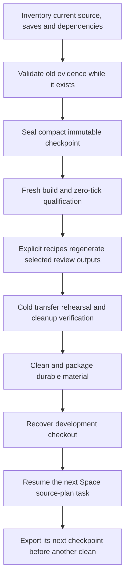
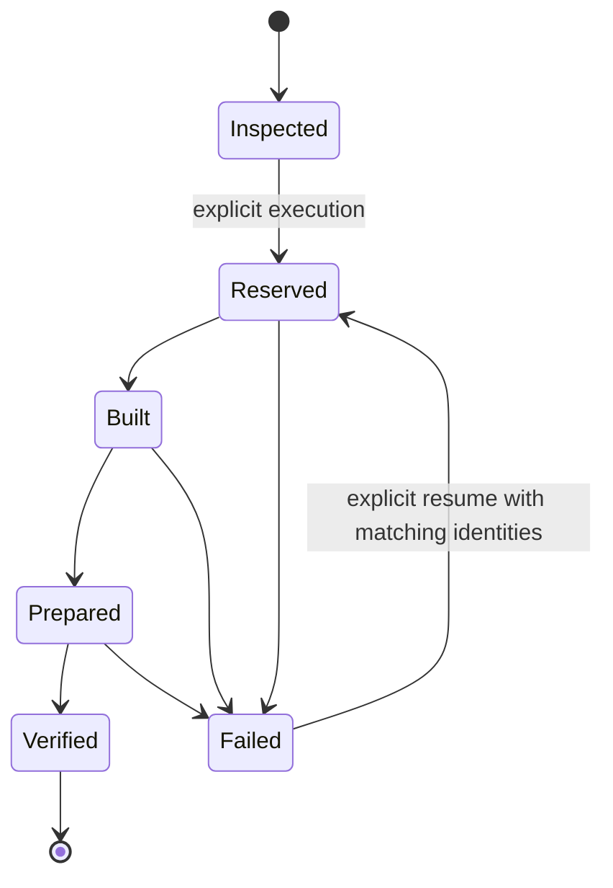

# R2FC-3 - Completed preservation and artifact reconstruction

## Global Mandatory Reading

Owner: this plan, following [R2FC](r2fc-file-cleanup.md) and [R2FC-2](r2fc-file-cleanup-2.md). Change storage, regeneration and cleanup behavior; preserve gameplay, save formats, public sprite identities, authored originals and unfinished work. The parent layout is the architecture spine; its old permanent proof-cache placement is a migration input, not the target policy. Read only the named contracts below and the current Area block. Area Mandatory Reading is this plan's Local Mandatory Reading.

> **Execution protocol**
>
> - Read this Global Mandatory Reading section before the first task and again
>   after every context compaction.
> - Before starting or resuming a task group, read the nearest preceding Area
>   Mandatory Reading block whose `Applies to` label includes that group. Area
>   blocks appear immediately before the first group they govern.
> - A referenced heading or exported symbol is authoritative. Global navigation
>   hints and Area line ranges are for navigation only; if they drift, relocate
>   the named section or symbol rather than expanding to the whole file.
> - Mandatory reading is non-transitive. Do not preload a linked file's own
>   Mandatory Reading, Consult on Demand, or Planning Provenance entries unless
>   this plan names them directly for the current area.
> - Do not read Consult on Demand or Planning Provenance merely because those
>   sources are listed. Use a Consult on Demand source only when its trigger
>   occurs.
> - No created source file, test file or JSON file should start with same prefix as a planning MD file (such as r2). Only MD files can have that prefix. No MD file should be created anywhere in source directories unless specifically asked.
> - After EVERY CONTEXT COMPACTION, you must add a note above the task group
>   which is currently in execution. The note will say: "Context has compacted
>   X times while executing this group.". If the compaction occurs before any
>   meaningful work was done (this can happen when there is a lot of baggage
>   from the previous compaction), then and ONLY then you can skip this step.
> - When exceeding 3 context compactions, YOU MUST ask yourself if you're not 
>   chewing more than we can handle :). Heck, plans change! :). In such a case, 
>   the way out is to split the group on the spot,
>   in the plan, into more groups, 
>   by appending B, C, D as a suffixes to those groups (splitting sub-groups 
>   themselves is also allowed). When you do this, create Local Mandatory
>   Reading areas so you can optimize your context only for the
>   ACTUAL task at hand.
>   Before starting or resuming a task group, read the nearest preceding Area
>   Mandatory Reading block whose `Applies to` label includes that group. Area
>   blocks appear immediately before the first group they govern.

| File name | Line Ranges | Description |
| --- | --- | --- |
| [Multilayer parent](r2mlvs-multilayer-vehicles-and-structures.md#development-artifact-layout) | 36-49 | `Development artifact layout` owns repository-local runtime/review/log routing, immutable templates and the sole media authority. Every group must preserve feature/process isolation and explicit input selection; replace the dated `logs/proofs` retention rule through the shared owner, never through a second asset catalogue. |
| [Python artifact boundary](../../../../src/tests/multilayer/support/artifact_paths.py) | 49-75; 95-152 | `contained`, `owned_root` and `RunContext.directory/runtime_dir/images/saves/reports/logs` define contained owners and separate process homes from source inputs. These live boundaries constrain every relocation and generated destination; extend them rather than inventing private path resolution. |
| [Cleanup boundary](../../../../clean.ps1) | 70-92; 162-179; 269-287 | `Assert-CleanupContainment`, `Assert-CleanupNoLinks`, `Assert-CleanupTarget`, `Assert-CleanupUntracked` and `Assert-CleanupStopped` establish exact repository containment, reparse-point refusal, tracked-file protection and stopped writers. All groups must preserve these safeguards while broadening disposable targets; ignored/untracked status alone never proves disposability. |

## Status and transfer objective

**Paused at the user's request,2026-10-22.** Groups1-20BB and12B are complete; every task retained below is checked. Group20BB finished its complete optimized matrix and Debug smoke per distinct native callback. No later implementation group has started. See the [execution checkpoint](r2fc-file-cleanup3-a-execution.md#checkpoint-paused-after-group20bb) for exact current witnesses and remaining hazards. No project cleanup, feature resumption or Git mutation has been performed.

This file contains the146 completed tasks through Group20BB and stays at its
original path. All78 remaining tasks are in one continuation:
[**R2FC2 - Remaining migrations, cleanup, transfer and Space resumption**](r2fc2-file-cleanup3.md).
That plan starts at20BC and explicitly requires fewer debug and verification
cycles. Execution remains paused; do not reread completed groups to resume.

The stable [historical debugging architecture](../../architecture/archi-historical-debug.md) describes file ownership, retained saves, current/historical evidence, artifact reconstruction and cleanup gates with Mermaid diagrams. It replaces the obsolete proposed recovery CLI at the end of this plan.

The deliverable is a small transferable development repository containing source, original graphical assets, saves, compact regression inputs and the tools/instructions to rebuild everything else. Default `clean.ps1` remains a preview; its explicit `-Apply` must eventually remove all disposable logs, test-cache, runtime profiles, generated reviews and declared build products. It must not preserve tens of gigabytes because validators read yesterday's outputs.

This plan replaces R2FC-2's unimplemented retention/migration approach where it would leave a permanent archive of review images, executables or machine-consumed diagnostics. Retain its safety findings and minimum-fixture principle. Update predecessor status links during implementation; do not mark their unchecked tasks completed merely because this replacement plan exists.

The user expressly requires Space plans and handovers to adopt the new locations, preparation commands and cleanup lifecycle. Updating only the cleaner, or only the Space master, is insufficient. This deeper planning revision splits implementation into bounded groups and explicitly resumes Space development after recovery: Group34 is the transfer-ready milestone; Groups35-37 recover the chosen checkout, execute its next source-plan task and publish the next durable checkpoint.

### Measured starting point

Read-only inventory on 2026-10-21; summed file lengths, not a promise of allocated disk recovery:

| Owner | GiB | Finding |
| --- | ---: | --- |
| `test-cache/` | 24.186 | 23.797 GiB of EXEs, including 634 repeated historical images. |
| `mlm/reviews/` | 4.358 | 2.164 GiB PPM, 0.666 GiB SAV, 0.619 GiB EXE, plus indexes and other output. |
| `mlm/runtime/` | 3.710 | Includes 2.227 GiB in `launch-fleet-art/`; these are execution homes with copied languages/content. |
| `logs/` | 3.516 | Includes proofs, comparison inputs, receipts and 2.230 GiB of executables. |
| `build/` | 6.476 | Must first extract saves, useful configuration and the portable build description. |
| Remaining repository, including Git and media | approximately 2.45 | Before promoted saves/checkpoints and small necessary fixtures. |
| Total | 44.698 | Approximately 48 GB in decimal units. |

The existing input catalogue names 274 files under reviews totalling 3.29 MiB; this is only one catalogue, not the full retained dependency closure. Preserve all discovered saves, not just those 274 files. A roughly 3-4 GiB source/history/assets/save transfer before compression is a planning target, not permission to discard an indispensable input to meet a quota.

### End-state storage contract

| Material | Durable owner or generated destination | Required lifecycle |
| --- | --- | --- |
| Authored/selected graphical originals, palettes, source contracts and existing canonical shipping assets | Existing `media/` owners | Preserve originals and provenance. AI-generated originals are source assets; prompts cannot recreate their exact approved pixels. Do not move them to a cache or request new art to repair cleanup. |
| Curated save-format, gameplay and graphical comparison inputs | Existing purpose-named `src/tests/fixtures/<feature>/<purpose>/` owners; `regression/` where already authoritative | Immutable, small, reviewed for actual coverage. Expected values must be independent of the producer being tested. Do not generate a new expected baseline from the changed implementation during ordinary tests. |
| Current Space/underground continuation saves and compact checkpoint contracts | `src/tests/fixtures/checkpoints/space/` and `src/tests/fixtures/checkpoints/underground/` | Exact saves plus configuration, state expectations, source epochs and explicit historical/current evidence roles. No executable or screenshot archive. |
| Other user/demo/backup/autosave/scenario files discovered in disposable trees | `savegames/retained/`, preserving original relative names through an explicit migration map | Keep every save/scenario; identical bytes may share one retained payload only with complete aliases. This directory is a save owner, never a second generic artifact cache. |
| Reusable Python/C++ producers and orchestration | Existing `src/tests/` and `media/multilayer/` tools | Every supported review/verification family has a named producer, exact parameters, retained inputs, prerequisites and bounded rebuild command. New test tooling stays beside tests. |
| Generated screenshots, atlases, indexed rasters, payloads, reports and required current-run transcripts | Explicit `mlm/reviews/<feature>/<scenario>/<run-id>/{images,data,reports,evidence,scratch}/` | Ignored and entirely cleanable after saves/checkpoints are exported. Producer/consumer recipes prepare selected prerequisites again after cleaning. Retain only the tracked routing README. |
| Runtime configs, startup scripts, autosaves and copied distribution data | `mlm/runtime/<profile>/<run-id>/<process>/` | Every profile is disposable; export saves before deletion. No profile-name allowlist that misses the next feature. |
| Optional stdout/stderr and build diagnostics | `logs/` | Entire directory disposable. No persistent checkpoint, baseline, source snapshot, approval or progress authority may live here. |
| Temporary builds, native image copies and verification workspaces | `test-cache/` and declared build roots | Entire `test-cache/` disposable. Generated prerequisites here must have explicit preparation; no unique retained input lives here. |
| Configuration templates and portable build requirements | Existing fixture/config owners and repository build files | Preserve meaningful settings outside `build/`. Machine paths are discovered or supplied explicitly; never transfer `CMakeCache.txt` as the build specification. |

A freshly generated report can depend on that invocation's generated data. It cannot depend on an undeclared earlier workstation run. Clearing a cache requires rebuilding its selected prerequisites; it must not require reconstructing the project's entire development history.

Historical receipts remain historical. A compact retained historical fact record may quote old hashes and results, but cannot certify a fresh executable or hide missing current proof. Fresh runs publish new executable identities. Do not promise identical EXE hashes across machines/toolchains, rewrite old hashes to make tests pass, or keep old EXEs solely to satisfy a historical path.

### Protected current work and recovery boundary

**Space is ongoing in this checkout.** [Space master](r2mlsp-space-master-plan.md) `Latest result` and [current Space handover](r2mlsp-z-z-z-z-z-q-launch-center-source.md#current-boundary) are authoritative over dated summaries, including the underground handover's statement about another worktree. Planning snapshot: Plan11 **15CSGZVEEH complete; 15CSGZVEEI next, code not begun**. Original continuous-chain tasks15.1/.2 remain open. Preserve other worktrees; this cleanup neither merges them nor assumes their changes are present here.

Current Space checkpoints to identify and seal before changing their consumers:

- Debug final save: `mlm/reviews/space/surface-entry-resupply-construction-cash-work/20261020-215547-fa0b1bae22/saves/surface-resupply-construction-cash-work-440.sav`, SHA256 `cb3c4ba4b44a09dd76250c540d83860c7e0e812423028d0d45bb4a6ce59e5f01`.
- RelWithDebInfo final save: `mlm/reviews/space/surface-entry-resupply-construction-cash-work/20261020-215542-242d79e2e7/saves/surface-resupply-construction-cash-work-440.sav`, SHA256 `5b11bc4b38a33f80ab49fc66f5908085ad387a6a50624d0a86b100541726919a`.
- Current raw receipts: `logs/surface-entry-construction-cash-work-032-{configuration}.json`; bound receipt: `logs/surface-entry-construction-cash-verification.json`. The current binder exposes thirteen explicit source/image epochs and 612 retained products. Determine their actual required closure; do not copy 612 executable products into fixtures.
- Actual current cash182,302/debt5,000,000, original35 named train bodies/32 wagons, center stock32Steel/50Goods/38PROP, original operational Core and live Rocket54, retired Constructor38 material history. GZVEEH is **closed at32 windows/64,000 ticks: no033**. Both30,000 exceptions are spent; normal40,000 operating default remains;100,000 capital floor is restored. No new paid scope, purchase, income window or gameplay ticks are authorized by cleanup.
- Verify these pointers against the live handover at implementation start. If another thread has advanced it, capture the new exact boundary instead; never overwrite newer progress with this snapshot.

The [underground checkpoint](r2mlvs17-underground-transport-tubes.md) at `Checkpoint handover — paused at the user's request,2026-10-21` also remains protected. Group9 is complete; master10.5/Group10 has provisional five-model source edits **not built or tested**. Preserve both `logs/underground-tubes/20261021-models-01/before.json` and `before-definitions.json` as distinct source epochs, plus necessary terminal/art comparison metadata. Cleanup must not resume feature implementation or claim the provisional code passed.

### Implementation standards and test budget

- Preserve all modified/untracked source, media and test files. No Git reset/checkout/commit/stage/clean, no Git-writing build version discovery, no edits or deletion outside this repository except the user's allowed temporary destinations. Archive creation is separate from deletion.
- All new/edited live functions have JavaDoc/Doxygen-style documentation with argument meanings; classes/interfaces have equivalent headers. Files link their architecture or owning `r*.md` plan. Explain every compound `if` and nontrivial loop as business logic. Retained immutable bytes keep their identities; describe their provenance in the containing fixture contract rather than modifying them.
- Reuse `mlm/review-producers.json`, existing input resolution and original Python/C++ producers. Do not invent a second asset identity catalogue, new gameplay stores or a general build system.
- Run focused bursts for the group being developed. No full regression is required by this plan. Any justified broad run is limited to the end or once per ten groups. Split test runners exceeding two minutes into bounded `-1`/`-2` companions beside tests. Build time is reported separately from test runtime.
- Native test subprocess caps remain appropriate to their producer, usually60 seconds. While a process runs, wait at least50 seconds per poll; the harness must tolerate at least60 seconds of agent inactivity. Use at most two build workers and disable owned MSBuild node reuse where supported. Do not terminate unrelated processes.
- After compaction reread only this Global section and the nearest applicable Area block. Record compaction count above the active group; split after more than three compactions with B/C/D suffixes and matching Area coverage.
- Any assisting Markdown belongs beside this plan, with names `r2fc-file-cleanup3-a-<purpose>.md`, then b/c chronologically. Prefer the handover in this plan. New source/test/JSON filenames never begin `r2`. Logs/debug output stays under `logs/` or `test-cache/`.

## Tasks

### Decomposition and execution map

This revision replaces the former eleven broad groups. Each group now has one bounded implementation result; none is rated COMPLEX. Proposed code/schema examples are design contracts, not claims that those exports already exist. Keep each named boundary in its existing owner or the explicitly named small adapter.

| Earlier group | Replacement groups | Main simplification |
| --- | --- | --- |
| 1 | 1-2 | Capture the live boundary, then establish a typed inventory. |
| 2 | 3-6 | Trace Space, graphics and other consumers separately before registering recipes. |
| 3 | 7-8,11-12,15 | Validate history, seal saves, implement a pure load check, adapt continuation, then qualify fresh builds. |
| 4 | 9-10 | Preserve immutable material before changing shared output routing. |
| 5 | 13-15,29 | Separate build bootstrap, recipe execution, checkpoint qualification and packaging. |
| 6 | 16-20 | Separate evidence selection, pure conversion, native payload loading and two capture domains. |
| 7 | 21-22 | Split prior-stage verification from active Space publication. |
| 8 | 23,25 | Update Space guidance separately from runtime storage. |
| 9 | 24,26-28 | Export saves, implement cleanup, test destruction boundaries, then guard future routing. |
| 10 | 30-32 | Rehearse builds/checkpoints, graphics and clean/rebuild behavior independently. |
| 11 | 33-34 | Apply verified cleanup, then package the finalized handover. |
| Added resumption | 35-37 | Recover the actual development checkout and dispatch its next Space task through the new foundation. |



### Area Mandatory Reading - Capture and inventory

_Applies to Groups 1-2._

| File name | Line Ranges | Description |
| --- | --- | --- |
| [Space master](r2mlsp-space-master-plan.md) | 7-9;287-291 | Latest dispatch and GZVEEF-I task rows identify actual current work. Capture these facts before any producer changes; a dated other-worktree summary cannot choose the checkpoint. |
| [Space handover](r2mlsp-z-z-z-z-z-q-launch-center-source.md#current-boundary) | 5-17 | `Current boundary` names final originals, thirteen epochs and closed financial scopes. Capture both configurations and the no033 limit. |
| [Input resolver](../../../../src/tests/multilayer/support/artifact_paths.py) | 322-346 | `resolve_input_path` currently checks existing paths before aliases and does not itself verify the manifest's SHA. Inventory alias precedence and identity validation as separate concerns. |
| [R2FC-2 findings](r2fc-file-cleanup-2.md#why-logs-cannot-be-emptied-yet) | 116-149 | Named baselines, transcripts and progress readers seed the inventory; the table is not a complete dependency closure or a permanent-output retention policy. |

### Group 1 - Freeze the live planning boundary

{{SIMPLE}}
- [X] 1.1 Record repository/worktree identity, modified/untracked/ignored valuable files and active writers using read-only operations. Capture a stable snapshot before relinking consumed applications.
- [X] 1.2 Confirm the current Space task and exact final save/receipt pair from its live handover; record closed financial scopes and protected source/application hashes. Refresh this plan's dated values if another thread advanced.
- [X] 1.3 Record underground Group10's partial source and the distinct pre-edit/partial-definition baselines. Keep its feature work paused and its uncompiled status explicit.
- [X] 1.4 Record sizes, exact build roots, nested repositories, reparse points and external tool/dependency locations. No wildcard build-root deletion or copy of another worktree.

### Group 2 - Establish the file and save inventory contract

{{MEDIUM}}
- [X] 2.1 Add a small `artifact_inventory.py` beside support tests, exporting `collect_candidates` and `classify_reference`. Inventory paths/roles without importing legacy acceptance modules, which can initialize run contexts or load predecessor chains.
- [X] 2.2 Record every save/scenario/autosave/backup, including unusual extensions using existing save-stream detection where applicable. Unknown save-like content stays protected; no decoder success is required to retain an old-format save.
- [X] 2.3 Publish a compact durable migration manifest under `src/tests/fixtures/cleanup/` with original path, destination, SHA256, role, consumers, disposition and verification status. Put large enumeration/debug output under test-cache.
- [X] 2.4 Capture effective compiler/CMake/runtime/Python/Pillow/GRF/vcpkg requirements and config templates separately from machine-local cache paths. Preserve user configuration that cannot be reconstructed.
- [X] 2.5 Verify inventory-only execution writes no exports and detects missing, conflicting, redirected and changed inputs. Keep source/tool discovery read-only.

Proposed dependency row; field names are to be validated in Group2, not inferred from every arbitrary JSON string:

```json
{
  "_documentation": "Owner: r2fc-file-cleanup3.md; migration dependency, not gameplay authority",
  "consumer": "surface_original_evidence.bind",
  "json_pointer": "/operation/output",
  "input": {"path": "<exact-old-save>", "sha256": "<captured-sha256>"},
  "role": "continuation_save",
  "disposition": "retain",
  "destination": "src/tests/fixtures/checkpoints/space/<configuration>/current.sav",
  "generator": null
}
```

### Area Mandatory Reading - Trace required input graphs

_Applies to Groups 3-6._

**ASSUMPTION: this was already built previously. If not, re-asses at runtime**

Entry gate: Group2's typed inventory and `collect_candidates/classify_reference` must exist and pass its read-only checks. Inspect those exports and schema. Stop graph publication/recipe classification if absent; inspect known readers independently. Do not infer preservation from an ignore rule or execute old acceptance scripts merely to discover imports.

| File name | Line Ranges | Description |
| --- | --- | --- |
| [Original evidence](../../../../src/tests/multilayer/acceptance/surface_original_evidence.py) | 22-44;73-192 | `verify` and `bind` read epoch/product/native/ordinary chains and copy current binaries. Trace typed edges, separating history from the next task's actual inputs. |
| [Graphics selection](../../../../media/multilayer/evidence.py) | 35-95;97-127 | `selected/output/validate_capture` bind paths, frames, source bytes and terminal evidence. Include all nested reads, not only the top manifest. |
| [Prior-stage inputs](../../../../src/tests/multilayer_state_fixture.py) | 28-43;75-104 | `prior_artifact` and `save_path` distinguish a previous accepted stage, a newly reserved output and an immutable fixture. Preserve that distinction in the graph. |
| [Producer catalogue](../../../../mlm/review-producers.json) | Live `schema_version/producers` and each selected producer row | Existing producer/feature/test-tag assignments remain canonical. Extend this catalogue with recipes after tracing actual implementations. |
| [Inventory API](../../../../src/tests/multilayer/support/artifact_inventory.py) | Live Group2 exports; no fixed range | `collect_candidates/classify_reference` and the typed migration-row schema are Group2's public inventory boundary. Verify them before graph adapters reuse its ownership/disposition decisions. |

### Group 3 - Trace the current Space dependency graph

{{HARD}}
- [X] 3.1 Export `trace_references` from the inventory helper with explicit adapters for the current bound receipt, retained-product manifest and thirteen before-edit manifests. Follow `foundation`, `products`, `source/retained`, `historical_versions` and configuration receipt references with a visited set and path/hash mismatch detection. Record the complete declared lineage separately from the actual current binder read-set; superseded ancestor identities remain historical observations.
- [X] 3.2 Trace native operation `source/before/output/application/terminal/retained_harness/sources/native_processes` and ordinary restore records. Associate each reference with the reader that requires it; do not treat a historical EXE hash as a future executable dependency.
- [X] 3.3 Classify the final saves and independent observation expectations as continuation inputs; classify completed-stage logs/process facts as historical provenance. Identify any historical fact whose only witness would otherwise be deleted.
- [X] 3.4 Record required observer/source epochs and a metadata-only validation command. Explicitly prohibit `surface_gateway_replay.replay` here: its implementation advances two branches by3,000 ticks.
- [X] 3.5 Verify traversal on one final configuration plus cross-configuration linking; test cycles, wrong hashes, duplicate aliases and a missing nested receipt. Do not replay a completed financial window.

### Group 4 - Trace graphics sources, generated products and proof cycles

{{HARD}}
- [X] 4.1 Trace public source/packing/runtime references through `EvidenceSet` and selected converter/packer scopes. Distinguish original media, canonical shipping assets, derived atlases, expected payloads and actual native frames.
- [X] 4.2 Inspect `pack_m1_art.derive/publish` and corresponding Space/orbital/launch/ground owners. Record that `derive` returns candidate bytes but `publish` writes canonical files and the public manifest; regression recipes must not call publication implicitly.
- [X] 4.3 Identify source-to-proof-to-source cycles and frozen predecessor requirements. Choose retained source/independent expectations as roots; record a bounded generator for each derived edge instead of retaining every old gallery.
- [X] 4.4 Map every native expected-payload literal, including M1/Space/orbital/launch `*-packed-sprites.bin`, to its generator and actual loader test. Include required terminal transcripts and source-policy observations.
- [X] 4.5 Classify missing generators, immutable baselines and retired authoring snapshots explicitly. Old rejected/selected-original status assertions cannot become fresh runtime tests unchanged.

### Group 5 - Trace other continuation readers and close inventory gaps

{{MEDIUM}}
- [X] 5.1 Inventory state/profile/geology, TBM feedback/motion/pacing and Space phase-pair consumers by exact reader, input role and prior-run selector. Use shared graph adapters where records share a schema.
- [X] 5.2 Scan Python/C++/PowerShell/CMake and active plan commands for direct and assembled cache/log paths. Classify reads versus writes; filename matches alone are insufficient.
- [X] 5.3 Record a disposition for every candidate subtree and supported producer family: retain/export, regenerate or retire as superseded. Resolve all required unknowns before deletion; do not treat a partial catalogue as a full audit.
- [X] 5.4 Record independent pre-existing stale mine/processor proofs and provisional underground build limitations. Keep their diagnosis separate from relocation failures.

### Group 6 - Register bounded recipes and their input roles

{{MEDIUM}}
- [X] 6.1 Confirm the current dependency graph permits editing `mlm/review-producers.json` before sealing, then extend it with recipe ID, original producer, target/test tags, retained inputs, ordered prerequisites, output roles, configuration/tool requirements and expected comparison mode. If a newer graph binds that file, move original validation/sealing before its mutation; never amend historical hashes to permit the edit.
- [X] 6.2 Define inspect/build/prepare/verify stages and read-only versus native-fixture execution modes. Explicitly exclude closed financial work and source/publication mutation from routine regeneration.
- [X] 6.3 Register initial recipes for `space-checkpoint`, scoped Space/ground art families and tube checkpoint material. Split umbrella recipes into bounded leaves; selecting one leaf must not build the entire acceptance directory. Initial declarations are explicitly disabled until their named supplying groups implement/seal their real interfaces and inputs; no fictional test tag or working command is claimed.
- [X] 6.4 Validate unknown dependencies, cycles, duplicate roles, cross-configuration reuse and output paths outside cleanable owners. Required missing inputs must report the exact supplying recipe or retained fixture.
- [X] 6.5 Record Space master/Plans8/9/10/11/13/14 documentation consumers for later updates. Exit with zero unclassified required inputs; keep raw inventory output disposable.

Planning observation: the current612-product manifest binds `src/tests/multilayer/support/runner.py` but does not bind `mlm/review-producers.json`. This permits recipe-schema work before Group7 while deferring runner changes until after the seal. Recheck this edge if the active Space thread advanced.

Proposed recipe shape; a native leaf records the actual existing tag rather than a fictional aggregate suite:

```json
{
  "id": "launch-current-producers",
  "producer": "src/tests/multilayer/launch_fleet_runtime_checks.py",
  "target": "openttd_space_art_test",
  "requires": ["launch-derived-inputs", "launch-decoder"],
  "execution": "native_fixture",
  "publishes_source": false,
  "outputs": ["reports/current.json", "evidence/native.txt"],
  "configuration_required": true
}
```

### Area Mandatory Reading - Validate and seal the original Space history

_Applies to Groups 7-8._

**ASSUMPTION: this was already built previously. If not, re-asses at runtime**

Entry gate: Groups3/6 provide a verified current Space graph and recipe/disposition records. Compare its final roots to the live handover. Stop sealing if roots or original validation inputs changed; independent schema/test design may continue. Never replace absent original evidence with a newly run paid simulation.

| File name | Line Ranges | Description |
| --- | --- | --- |
| [Construction-cash binder](../../../../src/tests/multilayer/acceptance/surface_entry_construction_cash_checks-3.py) | 17-68 | `VERSIONS/main` bind32 windows and both final states. Metadata validation can run without `--retain`; avoid copying the executable archive again. |
| [Original evidence](../../../../src/tests/multilayer/acceptance/surface_original_evidence.py) | 73-192 | `bind` verifies source linkage, native process success, actual observed states and cross-build families before historical facts are sealed. Do not weaken this original verifier globally. |
| [Current observer](../../../../src/tests/multilayer/acceptance/surface_constructor_retirement_ledger.py) | 11-17 | `observe` delegates to the actual home/material observer with retirement enabled. Reuse its owner semantics; cash alone is insufficient to validate a checkpoint. |
| [Space handover](r2mlsp-z-z-z-z-z-q-launch-center-source.md#current-boundary) | 5-17 | Exact originals and closed scopes govern sealing. Fresh build identities are a later proof, not replacements for these historical identities. |
| [Dependency inventory](../../../../src/tests/multilayer/support/artifact_inventory.py) | Live Groups2-3 exports; no fixed range | `trace_references` and typed edges supply the verified import roots and required closure. Sealing must reject an unresolved edge rather than copying an incomplete hand-written subset. |

### Group 7 - Validate the existing Space evidence once

{{HARD}}
- [X] 7.1 Revalidate original source/application identities before editing consumed adapters. Run the metadata-only binder into a new report without `--retain` and without any native work stage; record failure honestly if original history is already incomplete. The CLI failed on advanced live `cargopacket.cpp`; exact old bytes and console projections remain in the two original retained-product authorities. The explicit storage adapter passes those aliases through the original versions contract and PE verifier in a private call namespace; original verifier code/globals stay unchanged, with no EXE copy/runtime restoration/native execution.
- [X] 7.2 Recompute both current save observations and compare with the verified final receipts. Verify the original save hashes, all121 chunk families and existing per-configuration/cross-build rules.
- [X] 7.3 Extract compact necessary historical facts: predecessor identity, actual cash flow, closed caps/approvals, owner/material observations and process outcomes. Preserve the original receipt bytes or minimal necessary semantic transcripts where they are independent witnesses.
- [X] 7.4 Publish an audit result naming the exact imported roots and validated source epochs. Its historical EXE hashes are recorded facts; the audit result does not claim a newly compiled application ran.

Context has compacted 1 times while executing this group.

### Group 8 - Seal a durable Space checkpoint contract

{{HARD}}
- [X] 8.0 Isolate the existing pure table/chunk and observation primitives from import-time runtime setup, retaining original orchestration APIs through re-exports. Verify unchanged decoding and both independently recorded observations with writes/processes forbidden before seal verification uses those helpers.
- [X] 8.1 Add `space_checkpoint.py` beside acceptance tests with `load_checkpoint` and `verify_checkpoint`. Define a versioned checkpoint type distinct from a legacy operation receipt; validate exact required fields before use.
- [X] 8.2 Store each final save under its configuration-specific checkpoint owner, with independent observation/chunk expectations and the Group7 audit reference. Preserve both different save hashes; never normalize the originals in place.
- [X] 8.3 Retain the smallest complete historical semantic/source-epoch set needed to explain the checkpoint. Separate non-dereferenced historical EXE identity records from live retained input references; do not disguise missing required bytes as optional provenance.
- [X] 8.4 Implement read-only seal verification: retained hashes, graph roots, configuration, actual observer result, expected chunk set and closed policies. Fail on missing/tampered input or reopened scope; produce no new gameplay authorization.
- [X] 8.5 Publish the seal and migration map atomically after verification; interrupted writes cannot become a valid checkpoint. Update the handover to point to the seal while keeping fresh-build qualification explicitly pending.

Conceptual checkpoint contract; placeholders must be filled from Group7 evidence, not from the plan's prose:

```json
{
  "schema_version": 1,
  "kind": "sealed_space_checkpoint",
  "historical_validation": {"path": "<retained-audit>", "sha256": "<audit-sha>"},
  "configurations": {
    "Debug": {"save": {"path": "<retained-save>", "sha256": "<original-sha>"},
              "expected_observation": "<independent-retained-record>"},
    "RelWithDebInfo": {"save": {"path": "<retained-save>", "sha256": "<original-sha>"},
                      "expected_observation": "<independent-retained-record>"}
  },
  "closed_scope": {"name": "GZVEEH", "last_window": 32, "ticks": 64000},
  "next_task": "Plan11/15CSGZVEEI",
  "fresh_build_qualified": false
}
```

### Area Mandatory Reading - Promote immutable inputs and extend shared routing

_Applies to Groups 9-10._

**ASSUMPTION: this was already built previously. If not, re-asses at runtime**

Entry gate: Group8's seal verifies against the original saves and Group2 inventories all saves. Stop removal/repointing of unique inputs if either is absent; independent routing fixture work may continue. Do not delete originals to force an alias lookup or recreate expected baselines from current code.

| File name | Line Ranges | Description |
| --- | --- | --- |
| [Input and output paths](../../../../src/tests/multilayer/support/artifact_paths.py) | 171-198;244-278;281-292;322-346 | `RunContext.output/environment/write_report`, `_materialize` and `resolve_input_path` define the routing and lookup points to change together. Report paths must remain feature/run-bound. |
| [Native path owner](../../../../src/tests/test_artifact_paths.cpp) | 131-226 | `GetTestArtifactPaths` aggregate initialization, `Output`, `ResolveTestInputPath` and `GetTestRuntimeConfig` must match Python roles and aliases. Adding only struct fields leaves creation/selection incomplete. |
| [Underground handover](r2mlvs17-underground-transport-tubes.md) | 352-368 | Preserve two distinct baselines and provisional Group10 source without replaying completed art/terminal publication. |
| [Native public API](../../../../src/tests/test_artifact_paths.h) | 16-37;73-93 | `TestArtifactPaths` and resolver/runtime declarations are the shared public seam; fixtures and generated material retain distinct ownership. |
| [Checkpoint adapter](../../../../src/tests/multilayer/acceptance/space_checkpoint.py) | Live Group8 exports; no fixed range | `load_checkpoint/verify_checkpoint` establish exact durable Space saves before generic promotion/routing changes. Verify that input boundary rather than reading mutable raw receipts again. |

### Group 9 - Export all saves and small immutable baselines

{{MEDIUM}}
- [X] 9.1 Export every inventoried save/scenario/backup into its fixture/checkpoint owner or `savegames/retained/`. Preserve original names/aliases; hash both sides before releasing any source copy.
- [X] 9.2 Promote necessary comparison baselines and compact semantic evidence under purpose-named fixtures, including underground pre-edit and partial-definition epochs. Do not bulk-copy reviews or EXEs.
- [X] 9.3 Update `multilayer-inputs.json` and its readers with explicit alias precedence and hash validation. Test while both old and new files exist so a stale original cannot silently satisfy a migrated key; explicit prior-run paths retain their declared semantics.
- [X] 9.4 Preserve current source snapshots/patches only where needed for historical expectation/rebuild; record their original bytes and provenance. Separate authored/generated source contracts from scratch copies.
- [X] 9.5 Verify every save alias, configuration and destination, including conflicting same-name/different-content files and corrupt/legacy saves. Publish a complete verified migration map outside deletion roots.

### Group 10 - Add generated data and evidence roles in both languages

{{MEDIUM}}
- [X] 10.1 Add `data`/`evidence` to Python properties, `output` allowlist, directory materialization and report routing validation. Preserve basename, owner and run isolation.
- [X] 10.2 Add matching C++ fields, aggregate initialization, directory creation and `Output` cases. Update fixtures to prove Python/native output locations agree.
- [X] 10.3 Keep frames under `images`; adding general evidence roles must not relax frame producer/run checks. Put required current-run transcripts under evidence with optional diagnostic copies in logs.
- [X] 10.4 Update durable input resolution in Python/C++ together; generated prerequisites remain explicitly selected inputs, never automatic latest-run fallbacks or fixture overwrite destinations.
- [X] 10.5 Run focused artifact-path tests for traversal, alias precedence/hash changes, mixed-feature runs and host/client separation. Publish the parent layout/README routing changes.

### Area Mandatory Reading - Add a pure native checkpoint boundary

_Applies to Groups 11-12._

**ASSUMPTION: this was already built previously. If not, re-asses at runtime**

Entry gate: Group8 exposes `load_checkpoint/verify_checkpoint` and Group10 exposes matching data/evidence roles. Verify both contracts with focused tests. Stop native adapter wiring if absent; inspect the current callback/loader code independently. Never synthesize a legacy receipt with `complete=true` or reuse a work-capable phase as the recovery command.

| File name | Line Ranges | Description |
| --- | --- | --- |
| [Construction cash native driver](../../../../src/tests/multilayer/acceptance/surface_construction_cash_native.py) | 20-82 | `execute` accepts both query/work and consumes a legacy receipt. Its process/source assertions are useful, but its old entry point must not become the cleanup restore command. |
| [Native cash case](../../../../src/tests/surface_entry_construction_cash.h) | 10-35 | The selected callback branches into `WorkSurfaceFundedFarmGoods`. Add a separate hidden load-only case instead of depending on that branch's environment/defaults. |
| [Productive target source](../../../../src/tests/surface_entry_productive_admission.cpp) | 1-9;72-111 | Existing resupply callbacks/save helpers are included into the isolated target. Reuse that harness; its older productive query asserts an obsolete cash value and is not current recovery. |
| [Original restore / replay](../../../../src/tests/multilayer/acceptance/surface_original_evidence.py) and [gateway replay](../../../../src/tests/multilayer/acceptance/surface_gateway_replay.py) | `restore`47-70; `replay`24-53 | Ordinary restore uses bounded GLOG/pause handling; gateway replay executes3,000-tick branches. Extract/reuse the actual static loader seam without invoking replay. |
| [Checkpoint adapter](../../../../src/tests/multilayer/acceptance/space_checkpoint.py) | Live Group8 `load_checkpoint/verify_checkpoint`; no fixed range | The sealed-input API is a prerequisite for the new native qualifier. Keep its historical-validation role distinct from this area's fresh process qualification. |

### Group 11 - Implement a dedicated zero-tick native load check

{{HARD}}
- [X] 11.1 Add a hidden `[.space-checkpoint-load]` test in the existing isolated capital harness, with an explicit source input and no work/query-mode switch. Reuse native console/load/save setup and callback error propagation.
- [X] 11.2 Save before/after snapshots inside the paused inspection callback, observe the loaded native owners, then exit. Never invoke `StateGameLoop` work helpers, purchase commands or old cash/admission callbacks.
- [X] 11.3 Add a Python qualification adapter that verifies source identity before/after, native process inputs/executable/exit status and the expected observation. Record all generated files in the current run.
- [X] 11.4 Validate all121 families; compare tick counters and date fields explicitly before applying only the established pause/revision allowances. No blanket "ignore DATE/GLOG" rule may hide time or unrelated metadata changes.
- [X] 11.5 Add focused failure cases for a wrong save/configuration, changed tick/state, unexpected tag/phase and incomplete native process. Stage actual builds for Group15.

Conceptual body inside the existing paused observer, not a replacement game loop:

```cpp
/** Serialize the loaded checkpoint twice without advancing its work owners. */
std::function<void()> inspect = [&] {
    SaveSurfaceResupply(paths.saves / "checkpoint-before.sav");
    SaveSurfaceResupply(paths.saves / "checkpoint-after.sav");
    _pause_mode.Set(PauseMode::Normal);
    _exit_game = true;
};
```

Use the harness's existing exception/observed handling around this body. The Python adapter compares actual native chunks and the established material/body observer with independent retained expectations; two equal newly written files alone are not sufficient.

### Group 12 - Introduce the new continuation foundation explicitly

{{HARD}}
- [X] 12.1 Add `qualify_checkpoint` to the checkpoint adapter. Validate explicit current native/static/build results, then publish a foundation linking the immutable seal to the actually executed image/source identities. Separate current validation from already completed qualification facts so a later build never requires retaining an old EXE.
- [X] 12.2 Define the explicit `sealed_checkpoint` versus `operation_receipt` discriminator and typed foundation loading/verification. Historical callers retain their original `verify/bind` behavior; no compatibility receipt is manufactured.
- [X] 12.3 Verify qualification and historical/current role boundaries on synthetic corrupt references and independent retained checkpoint data. Native/static application execution remains staged for Group15.

### Area Mandatory Reading - Publish explicit Space continuations

_Applies to Group12B._

Group12 was split before implementation to keep qualification and operation publication bounded. Its typed foundation must exist and pass focused checks before successor wiring. A completed qualification records old image/source identities as historical facts; every new operation supplies its own actual current process/build evidence. It grants no new paid scope.

| File name | Relevant sections | Description |
| --- | --- | --- |
| [Checkpoint adapter](../../../../src/tests/multilayer/acceptance/space_checkpoint.py) | Live `SpaceCheckpoint`, `SpaceFoundation`, `qualify_checkpoint`, `load_foundation/verify_foundation` | Reuse the typed original/qualified input seam. A legacy operation dict cannot become a qualified foundation merely by setting complete. |
| [Qualification owner](../../../../src/tests/multilayer/acceptance/space_checkpoint_foundation.py) | Live Group12 exports/schema and witness-role validation | Verify selected source, independent observations and compact physical witnesses. Do not dereference historical EXE/source path strings as current inputs. |
| [Current observer](../../../../src/tests/multilayer/acceptance/surface_constructor_retirement_ledger.py) | `observe` | Preserve default original body/material semantics. A future paid-body mode belongs to the explicit Plan11 task, not cleanup. |
| [Current Space handover](r2mlsp-z-z-z-z-z-q-launch-center-source.md#current-boundary) | Current boundary and closed cash/approval policy | GZVEEH/no033 and both spent30,000exceptions remain closed. Plan11GZVEEI is the next source task, implemented only in Groups35-37. |

Context has compacted 1 times while executing this group.

### Group 12B - Publish explicitly selected successor operations

{{HARD}}
- [X] 12B.1 Add `publish_successor` with actual predecessor/source/before/output/process/build and owner-observation validation. Require the Plan11-owned operation validator for business permissions; completed financial scopes cannot become new permissions.
- [X] 12B.2 Give the future Space caller an explicit foundation argument and selected source/configuration. Do not import its thirteen-stage historical chain to discover the current save or manufacture a compatibility receipt accepted by the old binder.
- [X] 12B.3 Verify successor corruption/configuration/scope refusals with retained checkpoint data and synthetic transport fixtures. Classify old receivers as historical. The real GZVEEI producer remains owned by Plan11 and is dispatched in Groups35-37.

### Area Mandatory Reading - Build and recipe execution

_Applies to Groups 13-15._

**ASSUMPTION: this was already built previously. If not, re-asses at runtime**

Entry gate: Group6 recipe schema, Group10 routing and Groups11/12/12B checkpoint exports must exist. Verify those public contracts before launching builds. If absent, stop dependent native execution; inspect tool versions/configuration independently. An old build directory or cached EXE is not a substitute.

| File name | Line Ranges | Description |
| --- | --- | --- |
| [Build target definitions](../../../../CMakeLists.txt) | 331-337;403-416;417-445 | Existing capital/tube/Space-art targets limit compilation to selected producers. Reuse ordinary `openttd` for static recovery; no new gameplay implementation. |
| [Run identity](../../../../src/tests/multilayer/support/artifact_paths.py) | 187-198;219-242;294-319 | `environment/prepare_runtime/create_run_context` propagate a run and reserve IDs. Explicit duplicate IDs currently refuse; inspect must not reserve one, and resume needs validated recorded identity. |
| [Native runner](../../../../src/tests/multilayer/support/runner.py) | 199-249 | `run_native` records actual child input/executable/output identities. Recipes must preserve this evidence and subprocess exit status. |
| [Checkpoint adapter](../../../../src/tests/multilayer/acceptance/space_checkpoint.py) | Live Groups8/12/12B exports; no fixed range | `load_checkpoint/verify_checkpoint/qualify_checkpoint/publish_successor` are the earlier groups' public foundation. Inspect their schemas and refusal checks, not an internal legacy fallback. |

### Group 13 - Reconstruct a portable native build

{{MEDIUM}}
- [X] 13.1 Write the portable build profile from Group2's actual generator/compiler/options and pinned dependency/tool versions. Keep user configuration/templates outside build; don't transfer CMakeCache as authority.
- [X] 13.2 Implement tool discovery/explicit path overrides and configure-from-missing-build behavior. Route downloads, temporary state and binary caches into allowed locations; report unavailable external prerequisites before compiling.
- [X] 13.3 Build selected existing targets per configuration, sequentially with two workers and owned MSBuild node reuse disabled. Preserve project settings and read-only Git version discovery.
- [X] 13.4 Make the profile report actual tool versions, options, dependencies, source epoch and output identities. Old EXE hashes are not expected rebuild hashes.
- [X] 13.5 Verify a missing build directory and mismatched/missing tool profile using a bounded fixture; stage real current target compilation with Group15.

### Group 14 - Implement the recipe executor and restart semantics

{{MEDIUM}}
- [X] 14.1 Add `artifact_rebuild.py` with `load_recipe`, `verify_retained_inputs` and `prepare_recipe`. Resolve only registered recipes and structured argument arrays; inspect validates the graph without importing producer entry points or writing output.
- [X] 14.2 Order prerequisites topologically and execute one explicit configuration/run. Build and generated-input stages retain separate statuses; publish a successful verification only after real selected checks pass.
- [X] 14.3 Implement fresh run reservation plus explicit interrupted-run resume. Validate recipe, configuration, inputs and producer hashes against the stored manifest before joining `RunContext`; never silently reuse an existing directory because its name matches.
- [X] 14.4 Keep each stage's output under shared roles and pass explicit selected manifests to children. Failure leaves a failed/incomplete generated report and cannot advance dependent stages.
- [X] 14.5 Verify cycles, changed inputs, incomplete prior stages, duplicate invocation and source-publication/paid-work exclusion. Keep individual runners under two minutes and builds separately timed.



Inspection creates no run directory. A changed source/recipe/input requires a new invocation; completed paid operations are never replayed by this state machine.

### Group 15 - Qualify the retained Space foundation on fresh applications

{{MEDIUM}}
- [X] 15.1 Build the current capital and ordinary applications through the new profile in both configurations. Do not replace/erase original history before the Group7/8 seal has passed.
- [X] 15.2 Execute only the new load-only tag and ordinary static loader on each retained final save. Publish source/save/process identities and independent state comparisons through the new checkpoint adapter.
- [X] 15.3 Validate GLOG revision and pause differences using the established bounded helpers, with unchanged gameplay counters and original save hashes. Prove no money, order, packet, owner, date or work progression was introduced.
- [X] 15.4 Record fresh qualification separately from historical earnings. Verify a current source/application mismatch invalidates fresh qualification without invalidating or rewriting the immutable historical seal.

### Area Mandatory Reading - Graphics selection, conversion and native payloads

_Applies to Groups16-17. Later family/native areas below narrow their own mandatory reading._

**ASSUMPTION: this was already built previously. If not, re-asses at runtime**

Entry gate: Group10 roles and Group14 recipe executor pass their focused contracts, and Group4 assigned actual graphics roots/producers. Run inspect for the selected recipe. Stop affected generation if a retained root or producer is missing; source-only diagnosis may continue. Never fill a missing dependency by copying an old gallery, accepting the new actual as its own expected image, or invoking publication.

| File name | Line Ranges | Description |
| --- | --- | --- |
| [Evidence selector](../../../../media/multilayer/evidence.py) | 35-127 | `EvidenceSet` methods validate selected paths, producer assignment, exact frames/source and terminal evidence. Migrate storage while keeping this validation contract. |
| [Pure packing and publication](../../../../media/multilayer/pack_m1_art.py) | 373-418;421-442 | `derive` returns candidate PNG/NFO/header bytes; `publish` writes canonical files and the public manifest. Fresh regression generation must use the pure boundary and disposable destinations. |
| [Expected pixel producer](../../../../src/tests/multilayer_packed_art_fixture.py) | 17-62 | `OUTPUT/pixel_hash/main` derive pixel/geometry expectations from source sheets/NFO and currently use fixed logs paths. Preserve independent source-based expectations while parameterizing paths. |
| [Native packed loader](../../../../src/tests/multilayer_packed_load.cpp) | 92-169;172-249;252-329;332-429; read the selected family case | The M1/Space/orbital/launch native loaders consume four literal payload files. Replace selected input resolution without replacing actual GRF loading with a mock. |
| [Recipe executor](../../../../src/tests/multilayer/support/artifact_rebuild.py) | Live Group14 `load_recipe/prepare_recipe`; no fixed range | Explicit selected run, dependency roles and stage status are already implemented here. Graphics adapters consume that interface instead of creating private orchestration or hidden cache fallback. |

### Group 16 - Make evidence selection independent of diagnostic logs

{{HARD}}
- [X] 16.1 Parameterize `EvidenceSet` selection/output roots through the explicit recipe run. Move required transcript roles to generated evidence; diagnostic logs remain optional.
- [X] 16.2 Preserve exact frame hashing, images-role location, feature/scenario/run ID, native writer and source identity checks. Updating valid roots must not turn historical-relocation records into current native passes.
- [X] 16.3 Migrate selected-manifest fields and direct consumers together, including report-to-terminal references. Reject ambiguous mixed old/new schemas; expose a bounded migration/version error.
- [X] 16.4 Test wrong run, stale source, edited frame, missing required evidence and absent optional logs independently. Record existing old capture imports as historical or regenerate them explicitly.

### Group 17 - Generate M1 derived images and packing candidates without publishing

{{MEDIUM}}
- [X] 17.0 Resolve the missing registered `source-approval-contract` input before generation. Select existing authoritative authored contracts or preserve only indispensable original facts; do not invent approval, rebase source hashes or copy an old gallery. Verify the selected recipe root without importing producers.
- [X] 17.1 Add explicit output selection to shared source conversion/guide generation, starting with `regenerate_art_sources` and the pure packer seam. Reuse existing `--cache-only`/`publish_source=False` behavior where present; verify it rather than introducing another publication switch. Candidate bytes go to data/images in the selected run.
- [X] 17.2 Cover all current M1 packing sources, including the collector source producer omitted from the original eight-leaf recipe graph. Select actual generated reports/atlases explicitly; no fixed-cache source fallback. Remaining family adaptations from the original17.2 are assigned to17B-17D below.
- [X] 17.3 Generate contact sheets, guides, indexed rasters and packing inputs through their actual producer files. Preserve original media and compare canonical shipping bytes without invoking `publish` or rewriting runtime/publication flags.
- [X] 17.4 Reconstruct available predecessor bytes from declared source/read-only Git objects; retain only an indispensable independent baseline where exact reconstruction is unavailable. No self-updating expected image.
- [X] 17.5 Verify deterministic repeated output and source/public-manifest preservation on selected family cases, including an encoder-version mismatch and altered source.

### Area Mandatory Reading - Space and orbital source candidates

_Applies to Group17B (seven Space families); orbital craft/modules are narrowed into17BB/17BC below._

Read the existing public manifest's selected Space authoring entries and
`graphics-dependencies.json` named family/generator/cycle-break entries only.
Read `pack_space_art.py:derive/read_scope` and the
actual selected converter exports those functions call. `EvidenceSet` and
Group17's output-only adapter own routing; no new output orchestrator. Original
approval remains historical. Resolve a required independent source fact explicitly
before generation; do not copy a historical gallery or rebase its hash.

Context has compacted 1 times while executing this group.

### Group17B - Generate Space source candidates

{{HARD}}
- [X] 17B.1 Identify selected converter dependencies and separate original approval/source facts from regenerable reports. Preserve only indispensable independent facts, following the existing public media authority.
- [X] 17B.2 Apply Group17's explicit output adapter to actual Space converters and guides, preserving poses, palettes, crops, anchors and pinned encoders. Split further if the mechanism exceeds a bounded family.
- [X] 17B.3 Derive selected packing PNG/NFO/header candidates from those outputs without calling publication or reopening historical native proof chains.
- [X] 17B.4 Verify repeated bytes, canonical source/public-manifest preservation and rejection of changed source or encoder; register exact supported family commands.

### Area Mandatory Reading - Orbital craft source candidates

_Applies to Group17BB; split from17B to keep three craft families bounded._

Read selected vehicle.model-21/16/17 public authoring/source policy entries,
`convert_space_family_art.py:derive/state_pose` and the actual heavy/retained/
hauler pose exports they call. Read `pack_orbital_art.py` craft source selection
only. Reuse17B's selected source destinations and typed source report adapter.
Original approval hashes remain history; current candidates must preserve the
independent original pixel/policy identities. Do not reopen old native proof.

### Group17BB - Generate orbital craft source candidates

{{MEDIUM}}
- [X] 17BB.1 Identify the three original craft input/policy closures and preserve any indispensable independent fact through its existing media owner.
- [X] 17BB.2 Reuse17B's output adapter for actual heavy miner, retained robot and hauler source/guide producers without changing physical views, aliases or authored status.
- [X] 17BB.3 Verify repeated output, approved original hashes, source/tool mismatch and old-proof-free execution; register bounded source leaves for later orbital packing.

### Area Mandatory Reading - Orbital module source and packing candidates

_Applies to Group17BC; split from17B for seven fixed-world-cell module matrices._

Read selected module authoring/source policy entries and the actual matrix/review
exports in Core/Dock/Storage/Power/FuelStore/Assembly/Processor state converters.
Read `pack_orbital_art.py:derive/module_poses/read_scope`. Reuse17B/17BB selected
source destinations and source reports, original cell/absence/state aliases,
and the shared executor. Source input ancestry stays immutable; old source
review hashes are historical approval facts, never current filesystem inputs.

### Group17BC - Generate orbital module and packing candidates

{{HARD}}
- [X] 17BC.1 Classify the seven module original input/policy closures and any required independent facts without copying historical galleries.
- [X] 17BC.2 Route actual module state/cell/contact producers into selected images/reports, preserving native footprints, honest absent fronts and state/frame aliases.
- [X] 17BC.3 Derive orbital PNG/NFO/header candidates from all ten selected craft/module reports, preserving canonical shipping bytes without publication.
- [X] 17BC.4 Verify repeat output, original/public preservation, changed source/encoder and foreign/missing inputs; register exact bounded module and packing commands.

### Area Mandatory Reading - Launch and rocket source candidates

_Applies to Group17C; split from original17.2. Conversion and packing are narrowed into17CB/17CC below._

Read only selected launch/rocket entries in the public manifest, the corresponding
`graphics-dependencies.json` source/proof-cycle entries,
`pack_launch_fleet_art.py:derive` and its selected source-policy/pose exports.
Reuse Group17's output-only adapter and `artifact_rebuild.load_recipe/prepare_recipe`.
Retain existing physical absence, aliases, independent source policy and original
approval semantics; no regenerated actual becomes its own expected baseline.

### Group17C - Preserve launch and rocket original source facts

{{HARD}}
- [X] 17C.1 Classify selected launch/rocket dependencies, distinguishing historical qualification receipts from indispensable independent original/pixel/geometry facts.
- [X] 17C.2 Preserve the exact ten historical rocket generation-input template images through their existing media provenance owner, keeping original path/hash facts and frozen candidate/signature prefixes unchanged.
- [X] 17C.3 Identify independently retained geometry/pixel/alias expectations and original approval facts needed by fresh source validation; retain only indispensable missing facts and verify old-proof-free original ancestry resolution.

### Area Mandatory Reading - Launch and rocket source conversion

_Applies to Group17CB; split from17C after finding source-era qualification cycles._

Read `convert_launch_center_source.py:derive/decode/checked_occupied_policy` and
`convert_cargo_rocket_source.py:derive/decode/checked_art/audited_original`;
only their selected policy/fixture and actual composition/pose exports are required.
Reuse17C's retained original inputs, the independent existing fixtures and the
shared selected output adapter. Historical qualification identities remain facts;
fresh source validation must execute actual converters/decoders, not read old
success counters or preserve executable/source snapshots for a false current pass.

### Group17CB - Generate launch and rocket source candidates

{{HARD}}
- [X] 17CB.1 Separate historical source-stage qualification metadata from actual independently retained geometry/pixel expectations in the two source validators.
- [X] 17CB.2 Route actual source/guide/contact/mask/ownership producers through selected images/data/reports without changing authored originals, physical poses, source policy or publication flags.
- [X] 17CB.3 Verify deterministic repeated candidates, independent approved pixels/aliases, original preservation and source/tool/foreign-run refusals; register the two bounded source leaves.

### Area Mandatory Reading - Launch and rocket packing candidates

_Applies to Group17CC; split from17C to bound the historical source-handoff adapter._

Read `pack_launch_fleet_art.py:read_scope/derive` and
`tools/launch_fleet_handoff.py:checked_handoff/source_poses/layout`, plus only
the frozen handoff's canonical source/geometry/prefix fields. Use17CB's two
explicit current source reports; historical report/proof hashes remain approval
facts and do not require their physical old paths. Keep all1648logical IDs,
direct aliases, foreground absence, source expectations and canonical bytes.

### Group17CC - Generate launch and rocket packing candidates

{{HARD}}
- [X] 17CC.1 Bind the existing independent handoff expectations to the two actual current source reports without rewriting original approval or reopening native proof chains.
- [X] 17CC.2 Derive selected PNG/NFO/header candidates through the original packer and verify exact canonical shipping/prefix bytes without publication.
- [X] 17CC.3 Verify repeated output and source/tool/missing/foreign/geometry refusals; register and execute the exact selected source-to-packing closure.

### Area Mandatory Reading - Ground source candidates

_Applies to Group17D; original facts/diagnosis. Its47-family conversion and packing are narrowed into17DB/17DC/17DD/17DE below._

Read `pack_ground_art.py:derive` and the preserved-file guard it invokes,
`graphics-dependencies.json` ground generator/expected-input entries, and only
the selected ground converter exports required by the current public manifest.
Reuse Group17's output-only adapter. The ten source-hash mismatches observed
before cleanup remain existing limitations: diagnose their actual owning contract,
never rewrite hashes to turn changed pixels into approved source.

### Group17D - Preserve ground source facts and diagnose historical epochs

{{HARD}}
- [X] 17D.1 Separate original source/independent prefix facts from the historical publication snapshot, retaining only indispensable facts through existing media/fixture owners.
- [X] 17D.2 Diagnose the ten native mine/processor descriptor mismatches against actual owners, distinguish historical native qualification from immutable physical source expectations, and preserve old facts without hash rebasing or a false current native pass.
- [X] 17D.3 Seal only indispensable independent geometry/prefix/source/alias facts from verified historical inputs; verify durable input resolution without retaining2145physical old files or a general review archive.

### Area Mandatory Reading - Ground material source candidates

_Applies to Group17DB; split from17D for seven mines and four processing facilities._

Read selected mine/processor public entries and their original converter exports,
`tools/ground_mine_contract.py` and `tools/ground_processor_contract.py` source-only
contract readers. Use17D's independent physical expectations and distinguish old
native epochs from current source execution. Reuse shared selected images/data/
reports routing; no descriptor hash refresh without actual native owner proof.

Context has compacted 1 times while executing this group.

### Group17DB - Generate ground material source candidates

{{HARD}}
- [X] 17DB.1 Route original mine and processing-facility source/guide/contact producers into explicit selected outputs while preserving source geometry and physical part ownership.
- [X] 17DB.2 Reconstruct original source pixels/poses against independent approved identities; preserve old native descriptor facts and keep current native qualification separate.
- [X] 17DB.3 Verify repeated outputs, immutable originals/public state and source/tool/foreign-input refusals; register bounded material source leaves, splitting further if needed.

### Area Mandatory Reading - Ground fleet source candidates

_Applies to Group17DC; split from17D for conventional models05-08 and tube models09-13._

Read only selected vehicle/purchase source policies, their actual conventional/
tube converter exports and `tools/ground_fleet_contract.py`. Reuse17D's retained
physical facts and selected output adapter. Completed original art is separate
from underground Group10's provisional native edits; preserve those edits and
their two source epochs without implementing or qualifying the paused feature.

### Group17DC - Generate ground fleet source candidates

{{HARD}}
- [X] 17DC.1 Route actual selected body/purchase/state/contact producers through explicit images/data/reports without changing original model, load, company-mask or heading semantics.
- [X] 17DC.2 Verify deterministic approved source pixels, original state/frame aliases and canonical preservation, keeping provisional underground native work unqualified.
- [X] 17DC.3 Verify source/tool/foreign/missing-input refusals and register bounded family leaves; split conventional/tube mechanisms further if necessary.

### Area Mandatory Reading - Ground infrastructure source candidates

_Applies to Group17DD; narrowed to the two conventional station/terminal source mechanisms. Tube and energy/utility sources follow17DDB/17DDC._

Read only selected rail-station/road-terminal public entries and their original
station/terminal state converter exports. Preserve the
station/terminal signed native parent/roof/glass anchor contracts in
`pack_ground_art.py:native_pose`; retain honest absent parts and actual world
cells. Reuse shared output routing and17D's independent facts, with no publisher.

### Group17DD - Generate conventional station source candidates

{{HARD}}
- [X] 17DD.1 Route actual rail-station/road-terminal state/guide/contact outputs into selected owners without publication or current native qualification claims.
- [X] 17DD.2 Preserve fixed cells, signed native parent/relative-child roof/glass anchors, physical absence and aliases; reproduce independent original pixel/pose identities.
- [X] 17DD.3 Verify repeated bytes, original/public preservation and source/tool/foreign/missing-input refusals; register the two bounded source leaves.

### Area Mandatory Reading - Tube infrastructure source candidates

_Applies to Group17DDB; split from17DD for the nine tube infrastructure families._

Read only selected tube-terminal/service/interchange and tube geometry public
entries, their original pure build/contact exports in the tube converter files,
and17D's corresponding physical expectations. Preserve all original junction
variants, honest absent fronts, fixed cells and source state aliases. Reuse
shared output routing and explicit reconstructed prerequisites; paused Tube10
native implementation remains protected and unqualified.

### Group17DDB - Generate tube infrastructure source candidates

{{HARD}}
- [X] 17DDB.1 Route the actual selected tube facility/geometry/contact producers into current images/reports/data using the shared output adapter.
- [X] 17DDB.2 Preserve original complete geometry, physical absence, junction variants and aliases against independent pixel/pose expectations.
- [X] 17DDB.3 Verify repeated bytes, original/public preservation and source/tool/foreign/missing-input refusals; register bounded tube infrastructure leaves.

### Area Mandatory Reading - Ground energy, utility and control source candidates

_Applies to Group17DDC; split from17DD for seven energy/utility/control families._

Read only selected vent/powerhouse/utility/control public entries and the actual
pure exports in convert_vent_art.py, convert_generator_art.py,
convert_riser_art.py, convert_utility_art.py and convert_feature_controls.py;
read convert_geothermal_art.py only where those exports call its original
composition helpers. Four original public source paths name generated
atlases: use17D's explicit derived_source_inputs facts to regenerate from actual
retained media, preserving old paths/hashes as historical facts. Do not copy
those old derivatives as originals or qualify current native code with old proof.

### Group17DDC - Generate energy, utility and control source candidates

{{HARD}}
- [X] 17DDC.1 Route actual geothermal/utility/control source/guide/contact producers into selected outputs from their retained original media records.
- [X] 17DDC.2 Bind the four explicitly classified generated-source roles to current outputs while preserving original pixel/pose/absence/anchor expectations and canonical public state.
- [X] 17DDC.3 Verify repeated bytes, original/public preservation and source/tool/foreign/missing-input refusals; register bounded energy/utility/control leaves.

### Area Mandatory Reading - Ground packing candidates

_Applies to Group17DE; split from17D for the47-family packing closure._

Read `pack_ground_art.py:derive/native_pose` and
`tools/ground_art_handoff.py:read_scope/source_poses/allowed_empty/validate_native_palette`.
Consume17DB-17DDC's explicit current reports and17D's independent facts rather
than the old2145-file publication snapshot. Preserve all14254sprites/native
range[7791,22045), company indices, source absence and signed facility anchors.

Context has compacted 1 times while executing this group.

### Group17DE - Generate ground packing candidates

{{HARD}}
- [X] 17DE.1 Bind all selected current ground source reports to independent original source/geometry/prefix facts without reopening old native or publication chains.
- [X] 17DE.2 Derive exact canonical PNG/NFO/header candidates through the original packer without publication or stale native qualification claims.
- [X] 17DE.3 Verify repeat output and missing/foreign/tool/source/geometry/absence refusals; register and execute the complete bounded source-to-packing closure.

### Area Mandatory Reading - Actual native expected payloads

_Applies to Group18._

Read `multilayer_packed_art_fixture.py:pixel_hash/main` and the corresponding
Space/orbital/launch expected-payload producers selected by the current recipe.
Read `multilayer_packed_load.cpp` selected loader cases and literal payload inputs,
`runner.py:run_native` input/process provenance, Group17/17B-17D's selected
packing outputs, and `artifact_rebuild.load_recipe/prepare_recipe`. Keep source
expectations independent of the actual GRF decoder. Missing prerequisite outputs
stop the selected loader recipe; no old cache or canonical publication fallback.

### Group 18 - Generate explicit independent sprite expectations

{{HARD}}
- [X] 18.1 Parameterize expected sprite producers with selected packing/source inputs and an explicit generated payload destination. Cover all four literal payload families found in `multilayer_packed_load.cpp`.
- [X] 18.2 Include Ground's fifth actual producer using current source/prefix inputs, removing its selected path's old decoded-build proof dependency and canonical GRF/hash writes. Verify reproducible source payloads and register bounded pure expectation leaves.

Execution refinement: the five original payload producers, shared native input
binding and actual decoder checks are separate ownership changes. Keep them in
18/18B/18C order so source expectations are verified before native acceptance.

### Area Mandatory Reading - Native payload selection and provenance

_Applies to Group18B._

Read `test_artifact_paths.h/.cpp` current input/containment helpers,
`multilayer_packed_load.cpp` and `ground_packed_load.cpp` fixture selection,
`runner.py:run_native`, and18's actual selected payload reports/recipe roles.
Preserve family/configuration/identity/owner gates and record the exact non-save
input actually supplied to the native process. No old expected-directory fallback.

### Group18B - Bind selected payloads to native inputs

{{HARD}}
- [X] 18B.1 Introduce an explicit test-only expected-payload input, for example `OTTD_TEST_EXPECTED_SPRITES`, resolved inside an allowed fixture/generated owner. Validate its recipe/configuration/hash before launching the selected native test.
- [X] 18B.2 Extend process provenance to record this non-save input. Current `run_native` auto-discovers only `.sav/.scn` source hooks, so setting an environment variable alone leaves the binary payload unbound. Verify missing/changed/wrong-family/configuration/owner refusals before native acceptance.

### Area Mandatory Reading - Actual native sprite loading

_Applies to Group18C._

Read18's selected payload manifests and18B's explicit native input/provenance
boundary, the actual loader cases in `multilayer_packed_load.cpp` and
`ground_packed_load.cpp`, `artifact_rebuild.load_recipe/prepare_recipe`, and
`native_build.build_selected` for the two current graphics test targets.
Keep all five family leaves bounded and retain exact current process evidence.
Source-only checks or historical loader success cannot qualify current binaries.

Context has compacted 1 times while executing this group.

### Group18C - Execute actual native sprite loader leaves

{{HARD}}
- [X] 18C.1 Run the real GRF loader against independent source-derived geometry/pixel expectations. Preserve native sprite ranges/legacy prefix and canonical shipping identities.
- [X] 18C.2 Verify genuine decoder mismatch fails and each of the five actual native families passes its separately invocable bounded recipe leaf with exact input/executable/configuration/process/transcript provenance.

### Area Mandatory Reading - Rebuild actual native review captures

_Applies to Group19. Later capture groups have their own focused Area blocks._

**ASSUMPTION: this was already built previously. If not, re-asses at runtime**

Entry gate: Groups16-18C provide explicit evidence selection, pure derived inputs and actual native loader recipes. Inspect those recipe manifests and focused results. Group18's source-only completion cannot bypass18B/18C's current native input/loader gates. Stop dependent capture verification if absent; inventory current drawing producers independently. No synthetic screenshot, old EXE or source-publication action may bypass the missing prerequisite.

| File name | Line Ranges | Description |
| --- | --- | --- |
| [Proof orchestration](../../../../media/multilayer/regenerate_art_proofs.py) | 20-30;33-64;67-148 | `CAPTURES/FOCUSED`, `execute` and `main` identify real producers, selected child runs and existing cache-only finalization. Reuse them rather than inventing captures in Python. |
| [Current launch qualification](../../../../src/tests/multilayer/launch_fleet_runtime_checks.py) | 24-63 | `run` uses the isolated Space-art target, actual producer tags and a separate decoder process. Keep source-policy/refusal checks and ordinary-review limitations. |
| [Ground current closure](../../../../src/tests/multilayer/qualify_ground_selected_closure.py) | 24-63;66-181 | `native_domain/immutable_views/qualify` separate decoded domains, source views and actual consumer proof. Rebuild selected current obligations, not every historical authoring guard. |
| [Native runner](../../../../src/tests/multilayer/support/runner.py) | 199-249 | `run_native` binds child configuration, actual executable, source saves and produced captures. Explicit selected frame sets remain mandatory. |
| [Recipe executor](../../../../src/tests/multilayer/support/artifact_rebuild.py) | Live Group14 `prepare_recipe` and Groups16-18 registered leaves; no fixed range | Use the already verified dependency/selection interface to prepare native capture inputs. A native wrapper must not reconstruct private fixed proof directories. |

Execution refinement after18C: current source selectors, launch's occupied native
matrix and paused ordinary-game captures have distinct input/authority guards.
Keep them sequential in19/19B/19C. The original orbital paid construction observer
must never be used merely to regenerate screenshots.

### Group19 - Rebuild current Space source-selector reviews

{{HARD}}
- [X] 19.1 Register bounded launch/rocket/pod, orbital and asteroid/probe source-selector leaves using actual existing targets/tags and the existing18C decoder leaves. Keep configuration and expensive viewport phases separate.
- [X] 19.2 Adapt the current selector wrapper's output/terminal/manifest paths and explicit source policy inputs to the selected context. Preserve original source-policy comparisons and detached refusals.
- [X] 19.3 Verify representative complete bounded selector invocations and document per-family commands. Keep source-selector success separate from viewport, ordinary-game/human acceptance and public runtime activation.

### Area Mandatory Reading - Selected occupied launch viewports

_Applies to Group19B._

Read launch_facility_render_checks.py:run/verify_rasters/expected_scene and
launch_facility_render.cpp's [.launch-facility-render] case. Use19's current
source selectors,18C's actual decoder results and17DA/17DB's selected source
reports. The retained historical host supplies physical owners; current source
reports supply independent pixel/ownership expectations. Keep zero simulation
ticks and disclosed component pose inputs; no current GZVEEH world or paid work.

### Group19B - Rebuild selected occupied launch viewports

{{HARD}}
- [X] 19B.1 Parameterize the existing occupied native capture/raster wrapper with explicit retained host, selected source reports and actual current build, routing all captures/transcripts/manifests into its selected context.
- [X] 19B.2 Register and verify a representative complete bounded viewport leaf with exact native drawing/source-pixel comparisons and malformed-evidence refusals. Keep ordinary-game/human acceptance and public activation separate.

### Area Mandatory Reading - Paused orbital and asteroid viewports

_Applies to Group19C._

Read orbital_final_art_checks-1.py:capture/predecessor and
space_final_art_checks-1.py:capture/predecessor, runner.py:start_native/
console_executable/collect_native_screenshots, and19's selected selector/decoder
results. Use explicit retained historical worlds and current ordinary application
builds. Do not run orbital_final_art_checks-3 or [.orbital-art-native]: those
producers purchase/construct rather than merely capture. Keep live=false and
independently compare saved physical owners before/after paused view commands.

Context has compacted 1 times while executing this group.

### Group19C - Rebuild paused orbital and asteroid reviews

Implementation boundary: these original ordinary GUI screenshot mechanisms use the actual
`openttd` target and `-g/-c/-v` startup arguments through `native_application` recipes;
they have no Catch tag. The representative retained worlds are already paused and
bind independently preserved historical bytes. Current native decoder/source selectors,
ordinary process exit, indexed source matches and unchanged saved owners/clocks are separate gates.
Historical live/paid capture entry points do not acquire cleanup execution authority.

{{HARD}}
- [X] 19C.1 Register bounded viewport leaves for orbital and asteroid/probe families using the existing ordinary native capture mechanisms and explicitly retained fixture worlds.
- [X] 19C.2 Replace fixed dated producer/build/output/terminal paths in the selected wrappers with explicit current inputs and context-owned outputs. Preserve canonical native drawing and exact source/native-pixel obligations.
- [X] 19C.3 Verify a representative complete invocation for each changed capture mechanism and document precise remaining per-family commands. Grant no paid progress, authored/publication status or human acceptance.

### Area Mandatory Reading - One compile prerequisite for the selected graph

_Applies to Group19D._

Read artifact_rebuild.py:prepare_recipe/shared_current_build/verify_current_build and
artifact_shared_build_check.py. The selected ordinary capture adds an application
target after its isolated decoder/selector prerequisites. Build the exact selected
graph's declared target union before its first native case, then share that actual
compile result inside this invocation. Do not add unrelated targets, accept external
historical build results, rebase hashes or relink a previously observed executable.

### Group19D - Preserve native identities across cold graph builds

Added from19C's cold-path audit: late target expansion could relink an executable
already observed by a prerequisite. The explicit prepared19C invocations use one
combined current build and pass; their cold registered graph needs the same ordering.

{{MEDIUM}}
- [X] 19D.1 Compute the exact selected graph's declared native target union and build it once before the first native case. Preserve per-leaf current-build and independent native execution checks.
- [X] 19D.2 Verify target scoping, deduplication and compile sharing/refusal in focused tests; record cold full-graph execution for the existing Groups30-32 rehearsal gates.

### Area Mandatory Reading - Current Ground source consumers

_Applies to Group20._

Read run_ground_consumer_checks.py:verify_consumer_inputs/main,
space_source_review.py:checked_request/checked_result and the Ground target branch,
ground_sprite_selection.cpp's original tuple case, and the immutable
graphics/ground-consumer-expectations.json contract. Read18C's selected Ground
decoder result and17DE's source/packing contract in the execution record. Consult
qualify_ground_selected_closure.py:native_domain/qualify only for independent
domain/current-later scope. Viewport and paused Tube protocols have their own
20B/20Cblocks below; no old EXE or fixed before-audit/log path qualifies current proof.

### Group 20 - Rebuild current Ground source consumers

Split from the original20before implementation: independent pose/consumer,
actual viewport and paused terminal epochs have different supplying interfaces.
The original four obligations are preserved below in sequential20/20B/20C.

{{HARD}}
- [X] 20.1 Bind selected Ground source/packed/native consumer recipes to the existing current qualification owners. Keep independent expected pose/domain boundaries and later-owner exclusions.
- [X] 20.2 Replace the current source-consumer runner's fixed before/log dependencies with retained immutable expectations and context-owned current process reports. Verify both current configurations and source/GRF preservation.

### Area Mandatory Reading - Explicit Ground viewport source inputs

_Applies to Group20B._

Read regenerate_ground_sources.py:current_source_view/bind_sources/verify_poses,
ground_art_handoff.py:read_scope(current_sources=True), pack_m1_art.py:selected_sources/source_poses,
and20's ground-consumer-expectations.json. Read the execution record's17DE/20
results for the independent source/pose/native domain and current/later partition.
The original capture sources are the retained selected-industries fixture and
funded collector. Old approval/index identities are history only; no old EXE or
large generated image collection becomes a durable dependency.

### Group20B - Bind original Ground viewport sources and worlds

The original capture obligation is split before implementation into explicit
source inputs, actual bounded capture mechanisms and their selected closure.
All native drawing/pixel/preservation obligations remain in20BB/20BCbelow.

{{HARD}}
- [X] 20B.1 Bind exact current Ground and retained M1 source views through their existing independent normalizers. Preserve pose/domain/absence, approved pixels and current/later-owner boundaries.
- [X] 20B.2 Retain explicit original viewport worlds and minimal independent comparison facts; verify input selection without historical executable, screenshot-archive or before-audit dependencies.

### Area Mandatory Reading - Actual bounded Ground capture mechanisms

_Applies to Group20BB._

Read ground_viewport_review.py:checked_request/execute_stage/checked_result and
ground_viewport_capture.py:run_capture/verify_original_rasters/verify_pixels.
For the current mode only, read its original wrapper's capture and corresponding
native callback: ground_industry_runtime.cpp (collector/industry-states),
ground_transport_runtime.cpp (purchases/rail/road), or ground_station_runtime.cpp
(stations). Read the current mode's original pixel owner only:
ground_selected_closure_checks.py:collector_pixels and ground_industry_pixel_checks.py:project;
industry verify/project; transport verify_purchases or body verify/source_key;
station verify/source_pixels/compose/depth_order. Use20B's
explicit source views/worlds and20's current selector/decoder contracts. Preserve
native fixture staging disclosures, complete matrices, wrong-view/depth controls,
indexed/RGB/container provenance and source/GRF preservation. Do not infer paid
progress, operating readiness or human acceptance from these art fixtures.

Context has compacted 1 times while executing this group.

### Group20BB - Rebuild actual selected Ground captures

{{HARD}}
- [X] 20BB.1 Route the original industry/collector, transport and station native producers through explicit current build/source/retained-world inputs into cleanable isolated runs, removing fixed before-audit/log and EXE-retention dependencies.
- [X] 20BB.2 Verify the complete six-mode original pixel/composition/refusal matrix once in the current optimized build, plus a Debug smoke capture for each distinct native callback (industry, transport and stations). Preserve original source/GRF bytes and all unfinished gameplay/human gates. Debug rail/road sweeps are omitted for this routing change; the full drawing matrix is qualified once in the optimized build.

## Continuation and reconstruction

All remaining groups and their Area Mandatory Reading blocks are in
[R2FC2](r2fc2-file-cleanup3.md), beginning at20BC. Their task IDs and unchecked
states are preserved; descriptions were reviewed to eliminate duplicate debug,
verification and cold-rehearsal cycles. The former B/C/D continuation files have
been consolidated and removed. This plan retains completed tasks only.
Use the architecture's [reconstruction commands](../../architecture/archi-historical-debug.md#reconstituting-debug-artifacts).

## Consult on Demand

| Trigger | File name | Start at | Expand only when | Consultation purpose |
| --- | --- | --- | --- | --- |
| A source/packed proof has an unexplained nested dependency | [R2FC-2](r2fc-file-cleanup-2.md) | `Why logs cannot be emptied yet`,116-149 | The named consumer's live code does not establish the dependency's role | Recover the earlier migration rationale; current code and new recipe verification determine delivered behavior. |
| A baseline was previously classified as an independent local source archive | [R2FC-2](r2fc-file-cleanup-2.md#minimal-local-baseline-archive) | `Minimal local baseline archive`,46-58 | Its manifest points to another retained original | Distinguish compact historical source authority from disposable native images; do not delete genuine baseline material to meet a size target. |
| A replay/profile/geology consumer requires a prior transcript not covered by the inventory | [State fixture](../../../../src/tests/multilayer_state_fixture.py) | `prior_artifact` | Its explicit caller selects another stage or format | Identify original stage/acceptance meaning before assigning a generator or minimal historical fixture. |
| A packed-art cold run cannot find its expected payload | [Packed fixture producer](../../../../src/tests/multilayer_packed_art_fixture.py) and [native loader](../../../../src/tests/multilayer_packed_load.cpp) | Python `main` and the native payload path reader | The producer and loader disagree on bytes or source identity | Reconnect the original generator/native consumer rather than storing another copy of generated payloads in fixtures. |
| Fresh terminal qualification rejects a source epoch | [Terminal qualification](../../../../src/tests/multilayer/qualify_tube_terminals.py) | `exact` and `main` | The changed input belongs to provisional Group10 instead of completed Group9 | Preserve completed versus provisional scope; diagnose a real source transition without relinking or replacing historical proof casually. |

## Planning Provenance

This is not an execution reading queue and must not be preloaded after compaction. It is non-transitive. Ranges record planning use, not runtime authority; the user attachment records formatting requirements and is not a transferred build prerequisite.

| File name | Sections or Line Ranges used while planning | Planning contribution |
| --- | --- | --- |
| [User's pasted planning requirements](<C:/Users/Axonn/.codex/attachments/73ea4239-d055-40af-a18e-64dd3293315c/Pasted text.txt>) | Global/Area Mandatory Reading, execution protocol, difficulty batches, Consult on Demand, provenance and final validation | Determines this plan's reading discipline, exact protocol, chronological granular tasks and bounded groups. |
| [R2FC](r2fc-file-cleanup.md) | Global Mandatory Reading and Planning status | Established the existing media/input/artifact authorities and completed earlier layout migration; its kept-log policy does not satisfy the new clean-tree objective. |
| [R2FC-2](r2fc-file-cleanup-2.md) | Native runtime accumulation; Minimal local baseline archive; Current script behavior; Why logs cannot be emptied yet; Target storage contract; Groups4-9 | Supplies known dependency classes, hard-link accounting cautions and unfinished migration work. The new plan adds transfer-first checkpoint sealing, all-save retention and full disposable-tree cleanup. |
| [Shared parent layout](r2mlvs-multilayer-vehicles-and-structures.md#development-artifact-layout) | 36-49 | Keeps canonical source/asset and process/run ownership while replacing long-term generated proof retention. |
| [Space master](r2mlsp-space-master-plan.md) and [current handover](r2mlsp-z-z-z-z-z-q-launch-center-source.md#current-boundary) | Latest result7; dispatch287-291; handover5-17 | Establish the live GZVEEH/GZVEEI boundary, source epochs, current originals and financial prohibitions. Requires updating child plans as well as the master. |
| [Construction-cash binder](../../../../src/tests/multilayer/acceptance/surface_entry_construction_cash_checks-3.py) and [original-evidence helper](../../../../src/tests/multilayer/acceptance/surface_original_evidence.py) | Binder17-68; `verify`22-44 and `bind` | Explain the recursive historical-product/EXE dependency that must be replaced by a validated compact continuation foundation, not copied wholesale. |
| [Underground pause](r2mlvs17-underground-transport-tubes.md) | Checkpoint handover352-368 | Protects incomplete uncompiled source, two separate baseline epochs and completed terminal/art obligations without resuming implementation. |
| [Artifact paths](../../../../src/tests/multilayer/support/artifact_paths.py), [runner](../../../../src/tests/multilayer/support/runner.py) and [cleaner](../../../../clean.ps1) | `prepare_runtime`219-242; `console_executable`86-121; target plan188 onward | Connect repeated distribution/image copying and narrow cleanup targets to the measured disk growth; motivates explicit recipes and all-profile cleanup. |
| [Evidence selection](../../../../media/multilayer/evidence.py), [proof regeneration](../../../../media/multilayer/regenerate_art_proofs.py) and [build targets](../../../../CMakeLists.txt) | Evidence methods35-95; captures20-30/execute44-64; target declarations331-337/403-416 | Existing concrete seams for fresh native proof, recipe orchestration and isolated build scope. |
| [Space native driver](../../../../src/tests/multilayer/acceptance/surface_construction_cash_native.py), [cash case](../../../../src/tests/surface_entry_construction_cash.h) and [gateway replay](../../../../src/tests/multilayer/acceptance/surface_gateway_replay.py) | `execute`20-82; hidden case10-35; `replay`24-53 | Revealed work-capable phases and3,000-tick replay; motivates a separate load-only tag, strict loader-difference checks and explicit continuation types. |
| [Native routing](../../../../src/tests/test_artifact_paths.cpp) and [source packer](../../../../media/multilayer/pack_m1_art.py) | Routing131-226; `derive/publish`373-442 | Concrete aggregate/output/resolver changes and the pure-conversion versus canonical-publication split informed smaller implementation groups. |
| [Expected payload](../../../../src/tests/multilayer_packed_art_fixture.py), [native loader](../../../../src/tests/multilayer_packed_load.cpp) and [launch current runner](../../../../src/tests/multilayer/launch_fleet_runtime_checks.py) | Payload17-62; native cases92/172/252/332; `run`24-63 | Identifies fixed generated input literals, missing non-save provenance and separate selector/decoder/native capture obligations. |
| [Save stream reader](../../../../mlm/tools/savegames/savegame_plane_digest.py) and [cleanup fixture](../../../../src/tests/multilayer/support/cleanup_check.ps1) | `read_stream`87-105; fixture39-142 | Unsupported LZO must still be retained; current tests discard generated saves and must change to verified export semantics. |
| [Current capital query](../../../../src/tests/surface_entry_construction_capital.h), [estimate adapter](../../../../src/tests/surface_entry_resupply.cpp) and [vehicle commands](../../../../src/vehicle_cmd.h) | `QuerySurfaceConstructionCapital`; `QuoteSurfaceResupply`65-73; command traits52-58 | Older queries bind obsolete cash values; native BuildVehicle estimates remain reusable, while CloneVehicle NoTest cannot authorize the next purchase. |
| Read-only workspace inventory,2026-10-21 | Top-level sizes, review/runtime file types, save input catalogue and current final-save identities | Grounds the transfer size target and preserves actual current inputs; no inventory output is treated as a test pass or a complete dependency audit. |

## Completion Conditions

- All saves/scenarios/backups from deletion roots are preserved byte-for-byte outside them, with explicit aliases and both current Space configurations.
- Source, authored graphical originals, canonical shipping assets, working-tree changes, useful source baselines and Git history remain intact.
- Every supported generated review/verification family has an executable Python/C++ owner, retained inputs, ordered rebuild recipe and cleanable output destination. No large review image/EXE collection is promoted merely to keep an old validator working.
- Fresh checks reconstruct their prerequisites from source/retained inputs. Historical facts remain historical; missing/corrupt expectations fail and current proof requires real current execution.
- Space master, affected Plans8/9/10/11/13/14, current handovers and live guide commands use the verified locations and cleanup-aware rebuild practices. Current feature progress and closed financial policies are preserved.
- `clean.ps1 -Apply` removes all logs/test-cache/runtime profiles/generated reviews and declared build output while exporting saves and enforcing containment/tracked/reparse/process safeguards. It is safe and idempotent; preview modes write nothing.
- Cold staged builds and focused regeneration/qualification pass within their stated scope, including both actual Space saves. The underground provisional feature remains honestly incomplete.
- The final tree contains durable development material, with no disguised multi-gigabyte output archive. Actual size and any indispensable retained excess are reported.
- A verified transfer archive includes modified/untracked/ignored valuable material and necessary Git metadata; the durable handover gives exact rebuild/resume commands without source-workstation caches. No claim of testing the destination machine is made before doing so.
- Transfer readiness is recorded at Group34. Actual Space development resumption is recorded only after Groups35-37 recover the chosen checkout, perform the next source-plan task and export its successor through the new durable foundation.


