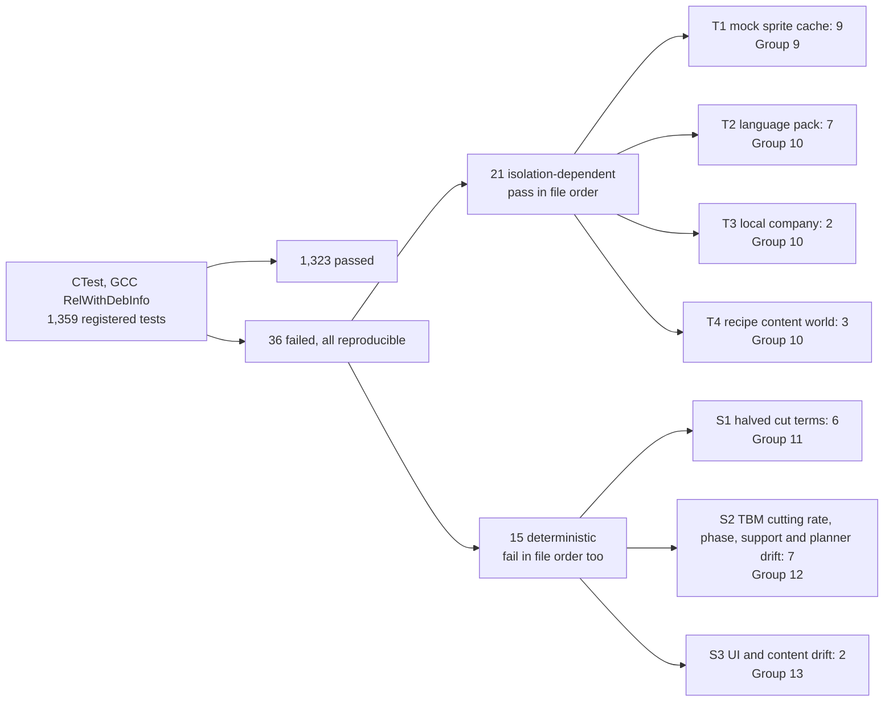
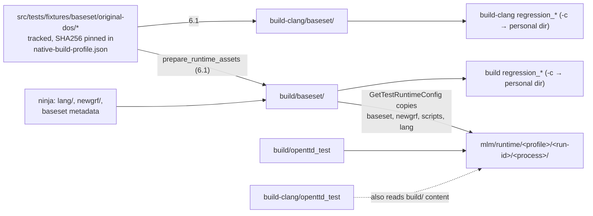
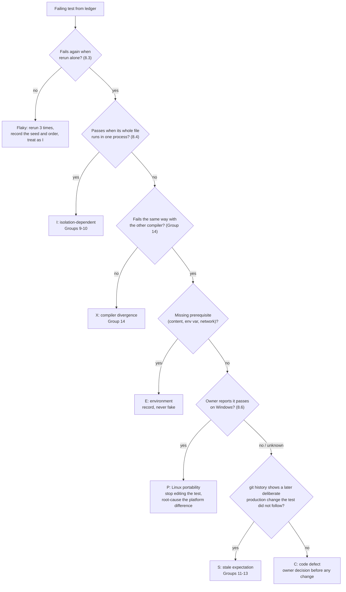
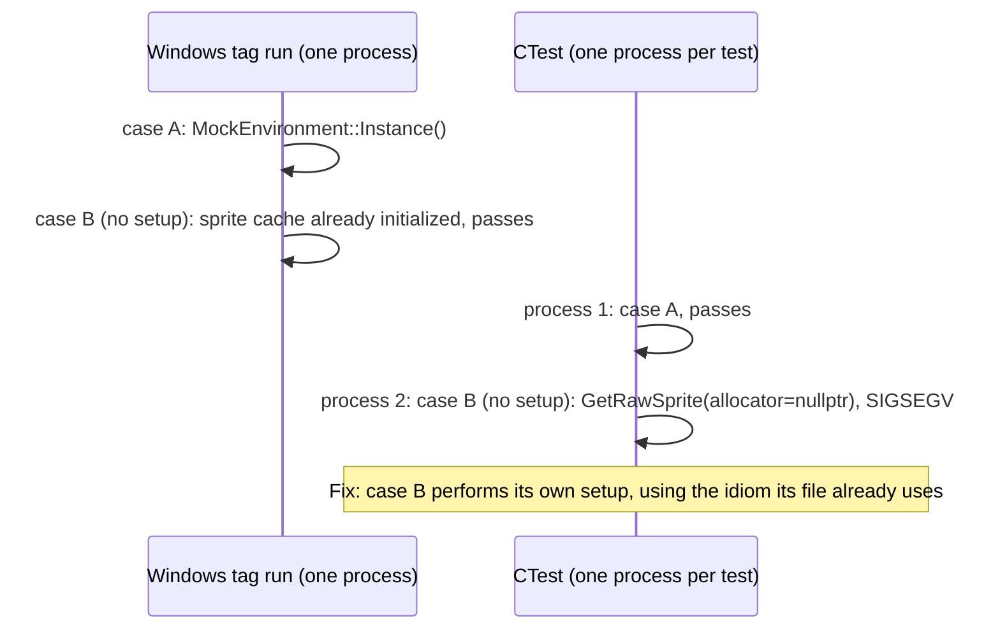
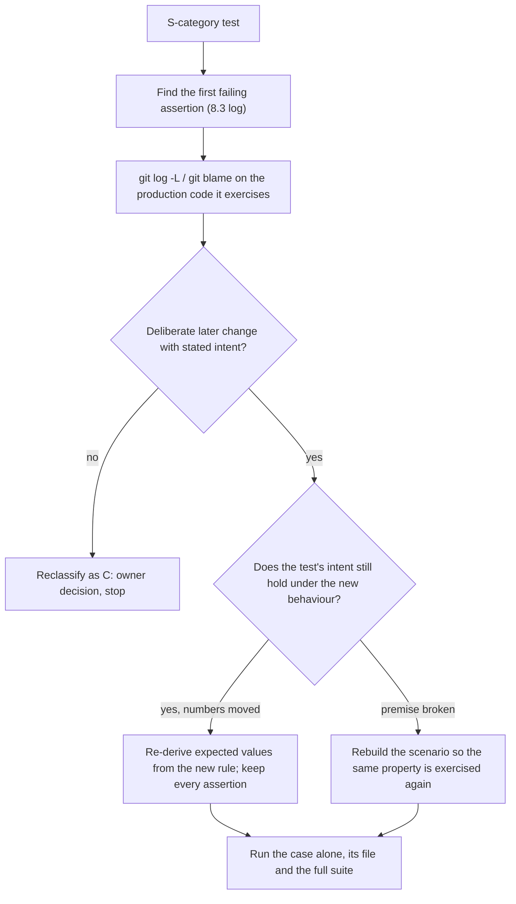

# Linux build fixes: GCC and Clang compile, link and test baseline

## Global Mandatory Reading

> **Execution protocol**
>
> - Read this Global Mandatory Reading section before the first task and again
>   after every context compaction.
> - Before starting or resuming a task group, read the nearest preceding Area
>   Mandatory Reading block whose `Applies to` label includes that group. Area
>   blocks appear immediately before the first group they govern.
> - A referenced heading or exported symbol is authoritative. Global navigation
>   hints and Area line ranges are for navigation only; if they drift, relocate
>   the named section or symbol rather than expanding to the whole file.
> - Mandatory reading is non-transitive. Do not preload a linked file's own
>   Mandatory Reading, Consult on Demand, or Planning Provenance entries unless
>   this plan names them directly for the current area.
> - Do not read Consult on Demand or Planning Provenance merely because those
>   sources are listed. Use a Consult on Demand source only when its trigger
>   occurs.
> - No created source file, test file or JSON file should start with same prefix as a planning MD file (such as r2). Only MD files can have that prefix. No MD file should be created anywhere in source directories unless specifically asked.
> - After EVERY CONTEXT COMPACTION, you must add a note above the task group
>   which is currently in execution. The note will say: "Context has compacted
>   X times while executing this group.". If the compaction occurs before any
>   meaningful work was done (this can happen when there is a lot of baggage
>   from the previous compaction), then and ONLY then you can skip this step.
> - When exceeding 3 context compactions, YOU MUST ask yourself if you're not 
>   chewing more than we can handle :). Heck, plans change! :). In such a case, 
>   the way out is to split the group on the spot,
>   in the plan, into more groups, 
>   by appending B, C, D as a suffixes to those groups (splitting sub-groups 
>   themselves is also allowed). When you do this, create Local Mandatory
>   Reading areas so you can optimize your context only for the
>   ACTUAL task at hand.
>   Before starting or resuming a task group, read the nearest preceding Area
>   Mandatory Reading block whose `Applies to` label includes that group. Area
>   blocks appear immediately before the first group they govern.

| File name | Line Ranges | Description |
| --- | --- | --- |
| [.github/workflows/ci-linux.yml](../../../../.github/workflows/ci-linux.yml) | 93-118 | **Build** and **Test** steps: `cmake ..`, `cmake --build . -j $(nproc)`, `ctest -j $(nproc) --timeout 120`, then `git diff --exit-code`. This is the upstream reference recipe for Linux and the invariant that building and testing leave every tracked file unmodified. Every verification step in this plan uses the same recipe with this plan's settings: Ninja, `RelWithDebInfo`, at most `-j4`, and a `git status --short` that shows only intended source edits. |
| [media/multilayer/build_content.py](../../../../media/multilayer/build_content.py) | 160-185 | `main()` raises `ValueError("content build output must remain inside the repository")` when `--package`/`--manifest` resolve outside the checkout. This is why every build tree must live inside the repository (`build/`, `build-clang/`, `build-dedicated/`). An out-of-tree build directory is an environment error, not a code defect. Never relax this guard. |
| [.gitignore](../../../../.gitignore) | 3-4 | `/logs` and `/build*` are the ignore boundary for build trees and run logs. They keep generated GRF/manifest outputs, objects, baseset copies and logs out of `git status`. Do not add new ignore rules to hide an unexpected tracked-file change. |
| [src/stdafx.h](../../../../src/stdafx.h) | 43-74 | The standard headers every translation unit receives. `<filesystem>`, `<fstream>` and `<utility>` are absent, so code using `std::filesystem`, `std::exchange` or `std::as_const` must include its header explicitly. The Windows MSVC STL supplies these transitively; libstdc++ (used by both GCC and Clang here) does not. This is the root cause of the largest failure class, and it constrains every fix: include what you use, never rely on transitive includes. |
| [CMakeLists.txt](../../../../CMakeLists.txt) | 54-55; 261-262; 655-659; 707-708 | `CMAKE_CXX_STANDARD 20` (required): fixes must be standard C++20, with no reliance on C++23 lifetime rules or compiler extensions. `openttd` and `openttd_test` are the default executables. `target_precompile_headers(openttd_lib …)` force-includes `src/stdafx.h` and `src/core/format.hpp` (which hides missing includes in PCH builds). `catch_discover_tests(openttd_test)` is the only CTest-registered Catch2 binary. |
| [src/tests/multilayer/support/native_build.py](../../../../src/tests/multilayer/support/native_build.py) | 43-76 | `load_profile` refuses any profile other than `platform == "windows-x64"`, `"Visual Studio 17 2022"` and `maximum_workers == 2`. This is the ownership boundary: the fork's native build and proof pipeline is Windows/MSVC-only and remains the primary build. Linux work uses plain CMake/Ninja and must not edit this profile to admit Linux. Every source fix must stay valid under MSVC. |

## Scope and observed baseline

Planning date: **2026-10-27**. Branch `mlm-mlv`, commit `7a66e52f64bdde4c260328c87f3449bd53356be1` ("Brought back clean.ps1 - the bad one."), clean worktree. The environment is a Linux cloud container (Ubuntu 24.04, 4 cores) with GCC 13.3.0, Ubuntu Clang 18.1.3, CMake 3.28.3, Ninja 1.11.1 and Python 3.13. The required libraries were already installed: SDL2, zlib, liblzma, liblzo2, libpng, libcurl, FreeType, Fontconfig, HarfBuzz and ICU. Allegro, FluidSynth, Opus/OpusFile/Ogg, Soxr, GRFCodec and vcpkg breakpad were absent. All of these are optional, and none caused a failure.

The validation builds (`-G Ninja -DCMAKE_BUILD_TYPE=RelWithDebInfo`, `ninja -j4 -k 0`) failed on both compilers, so no `openttd` or `openttd_test` binary was linked and no test ran. The build took 21 min 57 s with GCC and 23 min 34 s with Clang. CTest reported 5/5 failing because `openttd_test_NOT_BUILT` and the four regression tests require binaries that do not exist. These failures are build failures, not test results.

| ID | Root cause | GCC | Clang | Sites | Fix |
| --- | --- | --- | --- | --- | --- |
| R1 | `std::filesystem::path` used without `<filesystem>` | fails | fails | `src/tests/layer_save_fixture.h:22`; 92 test objects include it | 2.1 |
| R2 | `std::exchange` / `std::as_const` used without `<utility>` | fails | fails | `src/layer_recipe_work.cpp:42,47`; `src/surface_supply_order.cpp:181` | 2.2-2.3 |
| R3 | Braced-list assignment to a conditional lvalue, `(c ? a : b) = {x, y}`, rejected by GCC 13 | fails | accepts | `layer_processor_sl.cpp:126`, `transport_tube_power_sl.cpp:129`, `geothermal_heat_route_sl.cpp:136` | 2.4-2.6 |
| R4 | Member template `TBMExitJourney::Do` with deduced `auto` return used by the constructor before its definition | fails | fails | `src/tests/tbm_exit.cpp:64-86` | 3.1 |
| R5 | `static inline const SaveLoad description[]` of class template `SlOrdinaryCargoPreview<Type>` is still an incomplete `const SaveLoad[]` when `DefaultSaveLoadHandler::GetDescription` is instantiated | accepts | fails | `src/saveload/vehicle_sl.cpp:1204-1215` via `saveload.h:683` | 3.3 |
| R6 | Range-for over `*GetLaunchCenterFootprint(...)` dereferences a destroyed `std::optional<TileArea>` temporary (C++20 undefined behaviour; Clang `-Wdangling-gsl`) | silent | warns | 6 test sites, Group 4 | 4.1-4.7 |
| R7 | `SaveLoad::required_capability` has no default member initializer, so every designated-initializer factory warns | 944 warnings | 783 warnings | `src/saveload/saveload.h:880` | 2.7 |

Failed build edges: GCC 98 (5 `openttd_lib`, 93 `openttd_test`); Clang 96 (3 `openttd_lib`, 93 `openttd_test`). The planning session checked the R3, R5 and R7 fixes against scratch copies with both compilers. These were not edits to the repository: binding a reference first (`auto &e = c ? a : b; e = {…};`) compiles on both compilers; explicit instantiation of the four `SlOrdinaryCargoPreview` specializations compiles `vehicle_sl.cpp` on both; a default member initializer `{}` removes the warning on both. Clang stops after 20 errors per translation unit, and nothing ever reached the link step. Expect further, currently hidden diagnostics in Group 5.

Network: the proxy refused `https://cdn.openttd.org/opengfx-releases/0.6.0/opengfx-0.6.0-all.zip` (HTTP 403, `CONNECT tunnel failed`), and GitHub release pages also returned 403. The Ubuntu archive package `openttd-opengfx` 7.1-1 (universe) was available through apt. The research build below showed that OpenGFX is not needed.

### Research build in a scratch copy (2026-10-27)

During planning, a `git archive` copy of `7a66e52f` was built in the session scratchpad. The repository was not modified. Its own `build/` tree satisfied the `build_content.py` guard. Groups 2-4 were applied there exactly as written, and every anchor matched once. The results below drive the group structure from Group 4 onward.

- **GCC build:** all 1,556 edges compiled in 31 min at `-j4`. `openttd` linked. `openttd_test` failed at link with one new cause, **R8**. After the two-line test fix in item 4.8, `openttd_test` linked (1.4 GB) and the `POST_BUILD` discovery registered **1,359 CTest tests**: 1,355 Catch cases plus 4 `regression_*` tests. Many test sources belong only to the nine focused executables, which is why the count is lower than the number of `TEST_CASE` literals.
- **Runtime content:** the tracked original-DOS fixtures were materialized with the repository's own `prepare_runtime_assets` (Group 6). After that, all 4 regression tests passed with no OpenGFX and no network.
- **Full CTest run:** 29.7 s, 1,323 passed and 36 failed. A rerun reproduced all 36. Running each failing file in one process (`openttd_test -# "[#<file>]"`) split them in two. **21 are isolation-dependent**: they pass only when an earlier case in the same process set up shared state, which is how the fork runs tests on Windows (`openttd_test.exe '<tags>'`). **15 are deterministic**: they fail in file order too. Fixing the 21 with in-repository idioms (Groups 9-10) left exactly the 15. Git history ties all 15 to later, deliberate production changes that their tests never followed (Groups 11-13). Commit `bfba42fd` says "No full regression run".
- **What was ruled out:** every test that needs wrapper-only `OTTD_TEST_*` inputs is hidden (`[.…]`), so none is registered with CTest. There is no fork use of `long`, `<random>` distributions, unordered-container iteration or tie-prone `std::sort` in the failing TBM/excavation code. A whole-suite single-process run is unusable as a baseline (508 of 1,547 cases fail through cascading state).
- **Prescription check:** in the same copy, Groups 9-10 and items 11.2, 12.1-12.4 and 13.1-13.2 were then applied exactly as this plan writes them. The suite showed exactly **8 failures**: the remaining S1/S2 items 11.3-11.7 and 12.5-12.7. Two root causes are proven, and both are recorded user decisions dated 2026-10-09. Per-cell Earth/Rock yields were halved (`r2tbmf-tbm-fixes.md` line 37). TBM cutting rates were halved (`TBMHalfCuttingRate`, save version 394; `r2tbmf-tbm-fixes.md` Group 5).
- **Focused executables:** all nine built. Seven passed cleanly. `openttd_surface_supply_test` failed only on 2 already-listed cases. `openttd_tube_test` (428 cases in one process) failed on 5 already-listed cases plus 2 that pass alone, which are state leaks from an earlier case (Group 15). Under `-r junit` it once died with SIGSEGV (exit 139) and left an empty report; `-r console -d yes` completed.
- **Clang:** a `build-clang/` tree of the same patched copy built with 0 failures in 26 min. `ctest -N` gave 1,359, and the suite ran in 25 s. Its failures were the same 8 names as GCC, with zero GCC/Clang differences (no X category). The 4 `regression_*` tests first failed with `Failed to find a graphics set`, because 6.1 had only been run for `build/`. After running 6.1 for `build-clang/`, they passed 4/4.
- **The game itself:** the `underground-mines` demo save loads and renders on the Linux build. The null video driver cannot take console screenshots, because it never drains the main-thread queue, so the planning run used SDL2 under `xvfb-run` (Consult on Demand).



| ID | Root cause | Sites | Fix |
| --- | --- | --- | --- |
| R8 | `REQUIRE(room < CargoPacket::MAX_COUNT)` odr-uses the in-class `static const uint16_t MAX_COUNT` (no out-of-class definition) through Catch's by-reference expression capture. MSVC tolerates this; GNU `ld` reports `undefined reference to CargoPacket::MAX_COUNT`. | `src/tests/tbm_face_preflight.cpp:112`, `src/tests/tbm_face_cycle.cpp:51` | 4.8 |

**In scope:** source fixes that make the branch compile, link and test on Linux with GCC and Clang. These are standard C++20 fixes only, and they keep MSVC builds valid. The scope also covers test-runtime prerequisites and an explicit classification of every remaining failure.

**Out of scope:** changing the Windows native-build profile, CI workflow files, upstream-only code, bulk warning cleanup, vendoring OpenGFX into the repository, and any commit, push or pull request unless the user explicitly asks. Environment-only failures are recorded, not hidden: never use fake environment variables, `[.]` tags, `ctest -E` or skips to make a test look green.

Reference commands. This is an implementation sketch; record the exact commands you actually run:

```bash
# Build trees live inside the checkout (build_content.py guard) and are git-ignored by /build*.
cmake -S . -B build       -G Ninja -DCMAKE_BUILD_TYPE=RelWithDebInfo
CC=clang CXX=clang++ \
cmake -S . -B build-clang -G Ninja -DCMAKE_BUILD_TYPE=RelWithDebInfo
ninja -C build -j4 -k 0 2>&1 | tee logs/linux-baseline/<run>/build-gcc.log   # trees built one after another, never in parallel
ctest --test-dir build -j4 --timeout 600 --output-junit ../logs/linux-baseline/<run>/ctest-gcc.xml
```

Run logs go under `logs/linux-baseline/<run>/`; disposable staging goes under `test-cache/linux-baseline/`. Both are ignored. Implementation progress, the failure ledger and final results go in `r2lbf-a-execution-notes.md` in this directory, which Group 7 creates.

## Implementation tasks

Every code snippet is an **implementation sketch** written against the live symbols named in the Area blocks. Keep each change minimal and local to the owning file. Match the surrounding style (tabs, dense one-line Doxygen comments) and add no compiler-specific `#if` guards.

### Area Mandatory Reading - Environment preflight

_Applies to Group 1._

| File name | Line Ranges | Description |
| --- | --- | --- |
| [.github/workflows/ci-linux.yml](../../../../.github/workflows/ci-linux.yml) | 39-73 | **Install dependencies**: the upstream apt set (`liballegro4-dev`, `libcurl4-openssl-dev`, `libfontconfig-dev`, `libharfbuzz-dev`, `libicu-dev`, `liblzma-dev`, `liblzo2-dev`, `libogg-dev`, `libopus-dev`, `libopusfile-dev`, `libsoxr-dev`, `zlib1g-dev`, plus `libsdl2-dev` per matrix row) and breakpad only through vcpkg. This defines the CI-parity dependency target and shows that breakpad is optional and vcpkg-only on Linux. |
| [COMPILING.md](../../../../COMPILING.md) | 3-28 | **Required/optional libraries** classifies every library as encouraged or optional. A missing optional library must be recorded, never treated as a build blocker, and never "fixed" by editing CMake. |
| [CMakeLists.txt](../../../../CMakeLists.txt) | 132-194 | The `find_package` block. Only `Threads` is `REQUIRED`. The other packages enable `WITH_*` features conditionally, so a newly installed library changes which sources compile (for example `CONDITION OpusFile_FOUND` / `Soxr_FOUND` in `src/CMakeLists.txt`). Trees must be reconfigured after installing anything. |

### Group 1 - Record the baseline and prepare CI-parity build trees

The only dependency is the clean checkout. This group writes no source.

{{SIMPLE}}

- [X] **1.1** Confirm branch `mlm-mlv` and record `git rev-parse HEAD` and `git status --short`. The plan was written against `7a66e52f64bdde4c260328c87f3449bd53356be1` with a clean worktree. If HEAD has moved, re-check every site in the **Scope and observed baseline** table with `grep -n` before editing, and update the line numbers in this plan when they drifted.

- [X] **1.2** Record the exact toolchain: `g++ --version`, `clang++ --version`, `cmake --version`, `ninja --version`, `python3 --version`, `nproc`, and the installed versions of the CI apt packages (`dpkg -l`). The minimums are CMake 3.16, Python 3.9 and a C++20 compiler.

- [X] **1.3** If package installation is permitted, install the CI-parity optional packages that are missing: `liballegro4-dev libogg-dev libopus-dev libopusfile-dev libsoxr-dev`. Apt candidates were present on 2026-10-27. Skip vcpkg breakpad and record that it is absent. If installation is refused, record that and continue, because these libraries are optional.

- [X] **1.4** Configure two trees inside the checkout. `build/` uses the default GCC `c++`; `build-clang/` uses `CC=clang CXX=clang++`. Both use `-G Ninja -DCMAKE_BUILD_TYPE=RelWithDebInfo`. Existing trees from the 2026-10-27 validation may be reused incrementally but must be reconfigured after 1.3. Save each CMake summary (`found` / `Could NOT find` lines, `Option …` lines) to `logs/linux-baseline/<run>/configure-{gcc,clang}.log`.

- [X] **1.5** Confirm the boundaries: `git check-ignore -v build build-clang build-dedicated logs/linux-baseline test-cache/linux-baseline` matches the expected rules, and `git status --short` is still clean.

### Area Mandatory Reading - Portable source fixes

_Applies to Groups 2-4._

**Entry gate:** Group 1 left two configured trees whose CMake summaries name the same compiler families as above. Verify that `build/build.ninja` and `build-clang/build.ninja` exist. If either is missing, stop object-level verification for that compiler. Source edits may proceed, but no fix is accepted until it compiles in both trees. Neither a scratch copy outside the repository, a single-compiler result, `-fpermissive`, nor removing a source from CMake may stand in for that verification.

| File name | Line Ranges | Description |
| --- | --- | --- |
| [src/tests/layer_save_fixture.h](../../../../src/tests/layer_save_fixture.h) | 12-30 | Include block and `LayerSaveFileSink(const std::filesystem::path &)`. R1's single edit point. The fixture header must include its own `<filesystem>`; no consumer `.cpp` should be patched instead. |
| [src/ground_processor_sprite.cpp](../../../../src/ground_processor_sprite.cpp) | 6-17 | In-repository placement precedent: `"stdafx.h"`, the own header and project headers, then system headers (`<array>`, `<string_view>`, `<utility>`), a blank line, then `"safeguards.h"` last. Apply the same order for R2. |
| [src/saveload/layer_processor_sl.cpp](../../../../src/saveload/layer_processor_sl.cpp) | 116-127 | `LPCHChunkHandler::Read(bool preview)`: the existing `auto &presence = preview ? … : …;` idiom and the failing `(preview ? … : _processor_expected) = {header[1], header[2]};`. R3 uses that same reference-binding idiom. `TUPHChunkHandler::Read` and `GHTHChunkHandler::Read` have the identical shape. |
| [src/saveload/saveload.h](../../../../src/saveload/saveload.h) | 669-685; 858-891 | `DefaultSaveLoadHandler<TImpl, TObject>::GetDescription`, which returns `TImpl::description` as `SaveLoadTable`. This is the instantiation point that needs a complete array type for R5. The `struct SaveLoad` data members through `WithCapability` show `required_capability` as the only member without a default initializer (R7). |
| [src/tests/tbm_exit.cpp](../../../../src/tests/tbm_exit.cpp) | 46-97 | `TBMExitJourney`: the constructor (59-87) calls `this->Do<…>` six times, and `template <Commands Tcmd, typename... Args> auto Do(Args...)` (89-97) is defined after it. A deduced return type must be defined before its first use (R4). |
| [src/saveload/vehicle_sl.cpp](../../../../src/saveload/vehicle_sl.cpp) | 1200-1215; 1301-1312 | `template <VehicleType Type> class SlOrdinaryCargoPreview` with `static inline const SaveLoad description[]`. `VEHSChunkHandler::LoadCheck` instantiates it for `Train`, `Road`, `Ship` and `Aircraft` through `SaveLoad::Struct<…>` (R5). |
| [src/saveload/station_sl.cpp](../../../../src/saveload/station_sl.cpp) | 215-237 | `SlStationSpecList<T>` has the same templated-handler shape and is followed by `/* Instantiate SlStationSpecList classes. */ template class SlStationSpecList<…>;`. This is the repository's established cure for R5; follow it rather than inventing an array bound or an out-of-line definition. |
| [src/launch_center.h](../../../../src/launch_center.h) | 328-334 | `std::optional<TileArea> GetLaunchCenterFootprint(TileIndex anchor, uint8_t rotation)` returns by value. This is why `for (… : *GetLaunchCenterFootprint(…))` iterates a destroyed temporary in C++20 (R6). |
| [src/tests/launch_production.cpp](../../../../src/tests/launch_production.cpp) | 78-79 | `const auto footprint = GetLaunchCenterFootprint(anchor, rotation); REQUIRE(footprint);` is the existing in-repository idiom for R6. Reuse it exactly; do not introduce a helper. |
| [src/cargopacket.h](../../../../src/cargopacket.h) | 109 | `static const uint16_t MAX_COUNT = UINT16_MAX;` is an upstream in-class constant with no out-of-line definition. Any test that binds it by reference (Catch `REQUIRE(a < b)`) odr-uses it, which is R8. Fix the two test sites (4.8); leave this upstream line unchanged. |

### Group 2 - Fix missing headers and GCC-rejected assignments before the first full rebuild

These are mechanical, local edits. Item 2.7 touches `saveload.h`, so it goes here: that way Group 5 needs one full rebuild per compiler, not two. Items 2.1-2.7 were applied verbatim in the research build, and every GCC object compiled.

{{SIMPLE}}

- [X] **2.1** In `src/tests/layer_save_fixture.h`, add `#include <filesystem>` directly after `#include <fstream>` (line 12). This resolves R1 for all 92 dependent test objects on both compilers.

- [X] **2.2** In `src/layer_recipe_work.cpp`, add `#include <utility>` after `#include "layer_recipe_work.h"`, then a blank line before `#include "safeguards.h"`, following the `ground_processor_sprite.cpp` order. This fixes `std::exchange` at lines 42 and 47. Do not move the include into `layer_recipe_work.h`, because only the `.cpp` uses it.

- [X] **2.3** In `src/surface_supply_order.cpp`, add `#include <utility>` the same way, after `#include "timer/timer_game_calendar.h"`. This fixes `std::as_const` at line 181.

- [X] **2.4** In `src/saveload/layer_processor_sl.cpp:126`, replace the conditional-lvalue assignment with the reference idiom already used two lines above. The behaviour is identical:

  ```cpp
  auto &expected = preview ? _load_check_data.layer_processor_expected : _processor_expected;
  expected = {header[1], header[2]};
  ```

- [X] **2.5** Apply the same rewrite to `src/saveload/transport_tube_power_sl.cpp:129` (`tube_power_expected` / `_tube_power_expected`).

- [X] **2.6** Apply the same rewrite to `src/saveload/geothermal_heat_route_sl.cpp:136` (`geothermal_heat_route_expected` / `_heat_route_expected`, three elements). Leave line 137 unchanged: GCC accepts assigning a scalar `interval[0]` to a conditional lvalue.

- [X] **2.7** In `src/saveload/saveload.h:880`, change `std::optional<SaveCapability> required_capability;` to `std::optional<SaveCapability> required_capability{};`. The value is still `std::nullopt` and `SaveLoad` stays an aggregate. This removes about 944 GCC and 783 Clang `-Wmissing-field-initializers` warnings so that real warnings can be seen. Change no factory.

- [X] **2.8** Verify the six edited objects in both trees: `ninja -C build <obj>` and `ninja -C build-clang <obj>` for `CMakeFiles/openttd_lib.dir/src/{layer_recipe_work,surface_supply_order}.cpp.o`, `CMakeFiles/openttd_lib.dir/src/saveload/{layer_processor_sl,transport_tube_power_sl,geothermal_heat_route_sl}.cpp.o` and the fixture consumer `CMakeFiles/openttd_test.dir/src/tests/space_preview.cpp.o`. Then sweep for remaining R1-R3 shapes: `grep -rnE "\) = \{" src --include=*.cpp --include=*.h` for conditional-lvalue braced assignments, and `grep -rlE "std::(exchange|as_const|filesystem)" src` cross-checked against each file's own or fixture includes. Record the results. Leave any new hit for Group 5, which owns diagnostics, unless it is the identical shape.

### Group 3 - Correct template instantiation and member ordering

These changes need C++ template-semantics judgement and checks under both compilers. MSVC accepts both original forms, so each change must stay a pure reordering or addition. Items 3.1 and 3.3 were applied in the research build. `tbm_exit.cpp` and `vehicle_sl.cpp` compiled with GCC, and `vehicle_sl.cpp` also compiled with Clang.

{{MEDIUM}}

- [X] **3.1** In `src/tests/tbm_exit.cpp`, move the `Do` member template (doc comment plus lines 89-97) above the `explicit TBMExitJourney(...)` constructor, before line 59. Leave its body unchanged. Do not use a trailing return type, which would duplicate the `Command<Tcmd>::Do(...)` call expression. The diff must be a pure move.

- [X] **3.2** Confirm `TBMExitJourney` has no other member that uses a deduced-return member defined later in the class. Treat the Clang diagnostic "function '…' with deduced return type cannot be used before it is defined" in Group 5 as the authoritative sweep over all tests. Do not refactor other fixtures speculatively.

- [X] **3.3** In `src/saveload/vehicle_sl.cpp`, directly after the closing `};` of `SlOrdinaryCargoPreview` (line 1215), add the explicit instantiations, mirroring `station_sl.cpp`:

  ```cpp
  /* Instantiate SlOrdinaryCargoPreview classes. */
  template class SlOrdinaryCargoPreview<VehicleType::Train>;
  template class SlOrdinaryCargoPreview<VehicleType::Road>;
  template class SlOrdinaryCargoPreview<VehicleType::Ship>;
  template class SlOrdinaryCargoPreview<VehicleType::Aircraft>;
  ```

  Use exactly the four types that `VEHSChunkHandler::LoadCheck` names. Clang's diagnostic prints `VehicleType::Begin`, which is the same value as `Train`.

- [X] **3.4** Verify `CMakeFiles/openttd_lib.dir/src/saveload/vehicle_sl.cpp.o` and `CMakeFiles/openttd_test.dir/src/tests/tbm_exit.cpp.o` compile in both trees with no new warnings from those files.

- [X] **3.5** Review the combined diff of Groups 2-3 adversarially. Each hunk must be an include, a reference binding, a member move, an explicit instantiation or a default member initializer. No hunk may change a saved field, a version gate, a command or an assertion. Record the diff summary in the execution notes when Group 7 creates them.

### Group 4 - Remove dangling temporaries and odr-used constants in tests

Items 4.1-4.6 use one idiom; item 4.8 fixes the only link error the research build found (R8). Use the idiom from `launch_production.cpp:78-79` at every site: name the `std::optional` so that it outlives the loop, and require it before dereferencing. The original code dereferenced unconditionally, which was also undefined behaviour if empty. A named local with `REQUIRE(footprint)` keeps the intent and turns a silent fault into a test failure. If `footprint` is already taken in that scope, pick a nearby unused name.

```cpp
const auto footprint = GetLaunchCenterFootprint(tile, 0);
REQUIRE(footprint);
for (const auto cell : *footprint) { /* unchanged body */ }
```

{{SIMPLE}}

- [X] **4.1** Fix `src/tests/descent_custody.cpp:36`.

- [X] **4.2** Fix `src/tests/launch_center.cpp:105`.

- [X] **4.3** Fix `src/tests/launch_center.cpp:600` (a one-line `for … CHECK(IsTileType(…))` inside a `SECTION`; keep the `CHECK` unchanged).

- [X] **4.4** Fix `src/tests/launch_production.cpp:292` (iteration variable `tile`; pass `anchor, rotation` unchanged).

- [X] **4.5** Fix `src/tests/launch_retirement_native.cpp:94` (rotation `receiver->launch_center->rotation`).

- [X] **4.6** Fix `src/tests/surface_collection_boundaries.cpp:47`.

- [X] **4.7** Sweep `grep -rnE "for \(.*: \*[A-Za-z_:]+\(" src` for the same shape over any function that returns `std::optional`/by value, including production code. Fix every hit with the same idiom. Production code takes `assert(footprint.has_value())` (or the owner's existing check) instead of `REQUIRE`. Compile the five edited test objects in both trees.

- [X] **4.8** Fix R8 in the two tests, not in upstream `cargopacket.h`. Compare against a prvalue copy so that Catch binds a temporary rather than the undefined static member. `room` is `uint64_t`, so the comparison stays exact. This fix was validated in the research build: both objects recompiled and `openttd_test` linked in 42 s.

  ```cpp
  // src/tests/tbm_face_preflight.cpp:112
  REQUIRE(room < uint32_t{CargoPacket::MAX_COUNT});
  // src/tests/tbm_face_cycle.cpp:51 (dense one-line style kept)
  REQUIRE(room + 1 < uint32_t{CargoPacket::MAX_COUNT});
  ```

  Do not change `static const` to `static constexpr` in `cargopacket.h`. That would also be correct, but it edits an upstream header and rebuilds almost every object.

### Area Mandatory Reading - Full builds and test runtime content

_Applies to Groups 5-6._

**Entry gate:** items 2.8, 3.4, 4.7 and 4.8 record successful object compiles in both trees. If any is missing, stop 5.1-5.6. Items 6.1, 6.2, 6.5 and 6.6 may continue because they do not need new binaries. Do not use any of these to pass the gate or to produce the Group 5 result: stale binaries or objects from a different configuration, `-k 0` partial builds reported as success, compiler-flag suppression, or removing tests/sources from `CMakeLists.txt`.

| File name | Line Ranges | Description |
| --- | --- | --- |
| [CMakeLists.txt](../../../../CMakeLists.txt) | Target heads at 264, 360, 369, 379, 387, 420, 435, 576, 609 (263 is the ownership comment) | The nine focused `EXCLUDE_FROM_ALL` executables: `openttd_surface_supply_test`, `openttd_surface_capital_test`, `openttd_processor_contract_test`, `openttd_ground_art_test`, `openttd_ground_consumer_test`, `openttd_ground_viewport_test`, `openttd_tube_test`, `openttd_space_art_test` and `openttd_merge_contract_test`. They are neither built by `ninja` nor registered with CTest, so they must be built and run explicitly (Group 15). |
| [cmake/Catch.cmake](../../../../cmake/Catch.cmake) | 149-170 | `catch_discover_tests` adds a `POST_BUILD` command that executes the freshly linked `openttd_test` (`--list-test-names-only`). A startup crash on Linux therefore surfaces as a *build* failure of `openttd_test`, and discovery output is the test inventory. |
| [cmake/CreateRegression.cmake](../../../../cmake/CreateRegression.cmake) | 49-57 | `add_test(regression_<name> …)` runs `cmake/scripts/Regression.cmake` with `WORKING_DIRECTORY ${CMAKE_BINARY_DIR}`, so regression runs execute in the build tree root. |
| [src/fileio.cpp](../../../../src/fileio.cpp) | 958-1018 | In `DeterminePaths`, with `-c` the config directory is `Searchpath::WorkingDir`, and outside the XDG branch `_personal_dir = config_dir`. For regression runs the personal directory is therefore the build tree, so `<build>/baseset/` is a repository-local, git-ignored baseset location. |
| [src/tests/multilayer/support/native_build.py](../../../../src/tests/multilayer/support/native_build.py) | 193-238 | `runtime_asset_sources` and `prepare_runtime_assets`. These are the repository's owner for the seven proprietary original-DOS base-set fixtures (`trg1/trgc/trgh/trgi/trgt.grf`, `gm.cat`, `sample.cat`) that native tests select with `-I original_dos`. They validate each SHA256 before copying into `<build>/baseset/`. They run unchanged on Linux: the research build used them with the default profile. |
| [src/tests/test_artifact_paths.cpp](../../../../src/tests/test_artifact_paths.cpp) | 373-403 | `GetTestRuntimeConfig` copies `baseset/`, `newgrf/`, `scripts/` and `lang/` from **`<repository>/build`** into each process home. This is hard-coded, so the Clang tree's tests also read the GCC tree's content. `build/` must be built and materialized before any `build-clang/` test run. |

### Group 5 - Produce complete GCC and Clang builds and resolve newly surfaced diagnostics

**ASSUMPTION: this was already built previously. If not, re-asses at runtime**

Groups 2-4 supply every known compile and link fix. This is the first time this branch is linked on Linux. Build the trees one after another so that the 4-job limit holds.

{{MEDIUM}}

- [X] **5.1** GCC: run `ninja -C build -j4 -k 0` with full output in `logs/linux-baseline/<run>/build-gcc.log`. Record the wall time (31 min from scratch in the research build), the `FAILED:` count (0 expected) and the warning counts per `-W` flag.

- [X] **5.2** Clang: the same in `build-clang/`, logged to `build-clang.log` (26 min from scratch in the research build, 0 failures with Groups 2-4 in). Also record `-Wdangling-gsl`, which must be 0 after Group 4. Clang-only diagnostics, previously hidden by its 20-errors-per-file limit, are triaged in 5.3.

- [X] **5.3** Triage every newly surfaced compile or link error. Fix each one with a standard-conforming edit in the owning file, using the Global contracts. For a link error, first check whether a test odr-uses an in-class constant (the R8 shape), because MSVC hides that class of error. If more than five new distinct root causes appear, split this group per the protocol (5B, 5C…), one root-cause family per sub-group.

- [X] **5.4** Confirm that the `POST_BUILD` discovery succeeded in both trees, and record `ctest -N | tail -1`. Expected: `Total Tests: 1359` (1,355 Catch cases plus `regression_regression`, `regression_stationlist`, `regression_gs` and `regression_gs_compat`). If discovery crashes, record the signal and output, carry it to Group 8 as a runtime defect, and do not disable discovery.

- [X] **5.5** Explicitly build the nine focused executables in both trees under 5.3's rules, as Group 15 describes. Each linked binary is about 1.4 GB, so build, run and delete them one at a time when disk space is short.

- [X] **5.6** Run `git status --short`. It must show only the intended source edits from Groups 2-5. Confirm that no `media/**/*.grf` was regenerated (GRFCodec is absent) and that `newgrf/multilayer_industry.grf` and `generated/table/multilayer_content_manifest.h` exist only inside the build trees.

### Group 6 - Materialize test runtime content inside the build trees

**ASSUMPTION: this was already built previously. If not, re-asses at runtime**

Group 5 must leave `build/baseset/` populated with the generated metadata (`orig_dos.obg` and so on). Native tests and the regression runs need the tracked original-DOS fixtures copied in next to them. The research build showed that no download is needed.



{{SIMPLE}}

- [X] **6.1** Materialize the seven retained base-set fixtures into both trees with the existing owner. Do not copy files by hand. The research build ran this exact snippet, and the destination hashes matched the profile.

  ```bash
  python3 -I -B - <<'EOF'
  import sys; from pathlib import Path
  root = Path.cwd().resolve()                      # run from the repository root
  sys.path.insert(0, str(root / "src/tests/multilayer/support"))
  import native_build as n
  profile = n.load_profile(root=root)              # validates the profile and all seven SHA256s
  for tree in ("build", "build-clang"):
      n.prepare_runtime_assets(profile, root / tree, root)
  print("materialized")
  EOF
  ```

- [X] **6.2** Verify the bytes. For example, `sha256sum build/baseset/trg1.grf` must print `38f0494a7f508dc6e471ca3eba91703f9a1df7aad2067f0f4e25f79b5e9aab51`, and `build/baseset/sample.cat` must print `edb6233cb97546a11b4f50cf0fe3d95ed00e767d26c00246850ff992a7d495bd`. The seven expected values are the `runtime_assets` entries of `src/tests/fixtures/config/multilayer/native-build-profile.json`. Record all seven for both trees.

- [X] **6.3** Smoke-test the regression path with `ctest --test-dir build -R '^regression_' --output-on-failure`. Expected: 4/4 pass, as in the research build. If a run reports a missing graphics set, use the OpenGFX row in **Consult on Demand**. Pass any other failure to Group 8 without fixing it.

- [X] **6.4** Record the content coupling: both trees' Catch tests copy runtime content from `<repository>/build` (`GetTestRuntimeConfig`). Therefore `build/` must be built (Group 5) and materialized (6.1) before any `build-clang/` test run in Group 14. Do not change `GetTestRuntimeConfig` to follow the executable; that would change the Windows layout too.

- [X] **6.5** Record that the wrapper-only tests are not part of this baseline. Every consumer of `GetTestExpectedSprites` and `test_candidate_sprite_input.h` (`multilayer_packed_load.cpp`, `ground_packed_load.cpp`) is tagged hidden (`[.m1-packed-art-load]`, `[.ground-packed-art-load]`, …). CTest therefore never registers them. Do not synthesize `OTTD_TEST_*` inputs for them.

- [X] **6.6** Confirm that the test output locations are present and ignored: `mlm/reviews/`, `mlm/runtime/`, `logs/` and `test-cache/`. Check them with `git check-ignore -v`, keeping `mlm/reviews/README.md` tracked. Run tests only from inside the checkout, so that `FindTestRepositoryRoot` resolves this repository.

### Area Mandatory Reading - Test-run kit and GCC baseline

_Applies to Groups 7-8._

**Entry gate:** `build/openttd` and `build/openttd_test` are linked from the current source by Group 5, `ctest --test-dir build -N` reports `Total Tests: 1359` (or a recorded new count), and item 6.2's hashes match. Verify this with `ls -l build/openttd build/openttd_test`, the `-N` output and the 6.2 record. If any check fails, stop Groups 7-8 and return to Group 5 or 6. Do not use binaries from another commit, configuration or machine; hand-written test lists; tag edits; `ctest -E` exclusions; a whole-suite single-process run as the baseline; or fabricated `OTTD_TEST_*` values.

| File name | Line Ranges | Description |
| --- | --- | --- |
| [src/tests/test_artifact_paths.h](../../../../src/tests/test_artifact_paths.h) | 17-66 | `TestArtifactPaths`, `FindTestRepositoryRoot`, `ValidateTestArtifactIdentifier`, `RequireTestArtifactWithin`, `GetTestArtifactPaths`. These define where every test may write (feature/scenario/run routing inside the checkout) and which identifiers it may use. A failure here is shared infrastructure, so it is classified before individual tests. |
| [docs/zz-reach2/upgrades/2026-10/r2fc-file-cleanup.md](r2fc-file-cleanup.md) | 271-282 | **Output and fixture contract**: fixtures are read-only; outputs are routed by feature, then scenario, then run under `mlm/reviews/`; logs go under `logs/`; native data homes go under `mlm/runtime/<profile>/<run-id>/<process>/`. A Linux run that writes anywhere else, or modifies a fixture, is a defect to fix, not a path to whitelist. |
| [src/3rdparty/catch2/catch.hpp](../../../../src/3rdparty/catch2/catch.hpp) | 2 | `Catch v2.13.10`. It has no `SKIP` (so "skipped" is always 0), uses `-# "[#<file stem>]"` filename tags for per-file runs, `-f <file>` to run names from a file, and `-r junit -o <file>` for reports. CTest gets no tag labels from `cmake/CatchAddTests.cmake`, so families come from the `TEST_CASE` literals (7.3). |

### Group 7 - Prepare the test-run kit and inventory

**ASSUMPTION: this was already built previously. If not, re-asses at runtime**

Group 5 left linked test binaries and Group 6 materialized content. This group only creates tooling and records; it changes no source.

{{SIMPLE}}

- [X] **7.1** Create `logs/linux-baseline/<run>/` (for example `<run>` = `20261027-gcc-baseline`) and `test-cache/linux-baseline/`. Every later group writes its logs and reports there, never into tracked paths.

- [X] **7.2** Record the inventory for `build/`: `ctest --test-dir build -N | tail -1`, `build/openttd_test --list-tags > logs/linux-baseline/<run>/tags.txt` and `build/openttd_test --list-test-names-only | wc -l`. Use the test case and tag counts it prints, not the source-literal estimate.

- [X] **7.3** Install the ledger helper as `test-cache/linux-baseline/ledger.py`. It must not start with `r2`. It joins a JUnit report with the `TEST_CASE("<name>", "<tags>")` literals in `src/tests` and assigns a family from the first tag word. It was written and exercised during the research build: it mapped all but 2 upstream names, and labels the 4 regression tests explicitly.

  ```python
  """Join a CTest or Catch JUnit report with TEST_CASE literals into a family-sorted TSV ledger."""
  import argparse, csv, re, sys
  from collections import Counter
  from pathlib import Path
  import xml.etree.ElementTree as ET

  CASE = re.compile(r'TEST_CASE\(\s*"((?:[^"\\]|\\.)*)"\s*(?:,\s*"((?:[^"\\]|\\.)*)")?\s*\)')

  def index_cases(src):
      cases = {}
      for path in sorted((src / "tests").rglob("*.cpp")):
          if "fixtures" in path.parts: continue
          text = path.read_text(encoding="utf-8", errors="replace")
          for m in CASE.finditer(text):
              line = text.count("\n", 0, m.start()) + 1
              cases.setdefault(m.group(1).replace('\\"', '"'), (path.relative_to(src.parent).as_posix(), line, m.group(2) or ""))
      return cases

  def family(tags):
      first = re.match(r"\[([^\]]+)\]", tags)
      return re.split(r"[-_]", first.group(1))[0] if first else "upstream"

  def main():
      ap = argparse.ArgumentParser()
      ap.add_argument("--junit", required=True); ap.add_argument("--src", required=True); ap.add_argument("--out", required=True)
      a = ap.parse_args()
      cases, rows = index_cases(Path(a.src)), {}
      for tc in ET.parse(a.junit).getroot().iter("testcase"):
          raw = tc.get("name", "").replace("\\,", ",").replace("\\[", "[").replace("\\]", "]")
          name = raw if raw in cases or "/" not in raw else raw.split("/")[0]   # Catch JUnit appends "/<section>"
          failed = tc.find("failure") is not None or tc.find("error") is not None
          status = "failed" if failed else ("notrun" if tc.get("status") == "notrun" else "passed")
          file, line, tags = cases.get(name, ("?", 0, ""))
          if name.startswith("regression_"): file, line, tags = "cmake/scripts/Regression.cmake", 0, "[regression]"
          old = rows.get(name)
          if old is None or status == "failed":
              rows[name] = [family(tags), status, f"{float(tc.get('time', 0)):.1f}", name, f"{file}:{line}", tags]
      ordered = sorted(rows.values(), key=lambda r: (r[0], r[1], r[3]))
      with open(a.out, "w", newline="", encoding="utf-8") as f:
          w = csv.writer(f, delimiter="\t"); w.writerow(["family", "status", "seconds", "name", "source", "tags"]); w.writerows(ordered)
      by = Counter((r[0], r[1]) for r in ordered)
      for fam in sorted({r[0] for r in ordered}):
          print(fam, {s: by[(fam, s)] for s in ("passed", "failed", "notrun") if by[(fam, s)]})
      print("unmapped names:", sum(1 for r in ordered if r[4] == "?:0"))

  if __name__ == "__main__":
      sys.exit(main())
  ```

- [X] **7.4** Install the single-failure helper as `test-cache/linux-baseline/rerun_failed.sh`. It reruns each non-passing ledger row on its own and writes one log per test, so every later classification can cite one file.

  ```bash
  #!/bin/bash
  # usage: rerun_failed.sh <build-tree> <ledger.tsv> <out-dir>
  B=$1; L=$2; O=$3; mkdir -p "$O"
  tail -n +2 "$L" | awk -F'\t' '$2 != "passed" {print $4}' | while IFS= read -r name; do
    safe=$(printf '%s' "$name" | tr -c 'A-Za-z0-9_-' '_' | cut -c1-120)
    (cd "$B" && timeout 600 ./openttd_test "$name" -s > "$O/$safe.log" 2>&1); echo "$? $name" >> "$O/index.txt"
  done
  ```

  Test names containing `,`, `[` or `]` need a backslash before that character for Catch, otherwise Catch reads the spec as several names and a non-matching run exits 0 (a false pass). The installed helper escapes them. Execution found one such name among the 36: "A started cutter drives to its face, works its route and backs into its magazine".

- [X] **7.5** Extend `r2lbf-a-execution-notes.md` in this directory (started in Group 1), following the house style of [m2o26-a-execution-notes.md](m2o26-a-execution-notes.md). It holds a header with the toolchain and commands, one section per completed group, and a **Failure ledger** table with these columns: test, family, GCC, Clang, category (from item 8.5), evidence file, owning group.

### Group 8 - Run the GCC baseline and classify every failure

**ASSUMPTION: this was already built previously. If not, re-asses at runtime**

Group 7 provides the kit. In the research build this whole group took under 10 minutes of machine time. The full suite runs in about 30 s.



{{MEDIUM}}

- [X] **8.1** Run the suite: `ctest --test-dir build -j4 --timeout 600 --output-junit $PWD/logs/linux-baseline/<run>/ctest-gcc.xml > logs/linux-baseline/<run>/ctest-gcc.log 2>&1`. Record the summary line. The research build gave `97% tests passed, 36 tests failed out of 1359` in 29.7 s. There were no time-outs; the timeout stays at 600 s because native cases can drive up to 250,000 frames.

- [X] **8.2** Build the ledger: `python3 -I test-cache/linux-baseline/ledger.py --junit logs/linux-baseline/<run>/ctest-gcc.xml --src src --out logs/linux-baseline/<run>/ledger-gcc.tsv`. Compare the failures with the **Expected failure signatures** table below. Each listed name must appear. Any extra failure is a new family: record it, classify it through 8.3-8.5, and add a split group (for example 13B) if it is not covered by Groups 9-13.

- [X] **8.3** Rerun each failure alone with `test-cache/linux-baseline/rerun_failed.sh build logs/linux-baseline/<run>/ledger-gcc.tsv logs/linux-baseline/<run>/reruns`. All 36 reproduced in the research build. For a crash, capture a stack with `gdb -batch -ex run -ex "bt 25" --args ./openttd_test "<name>"` run from `build/`, because the abort-stack printer in `test_main.cpp` is MSVC-only. Install `gdb` if it is missing.

- [X] **8.4** Run each failing source file in one process and record per-test status. A failure that passes here is category **I**.

  ```bash
  cd build
  for f in $(awk -F'\t' 'NR>1 && $2!="passed" {split($5,a,":"); n=split(a[1],b,"/"); sub(/\.cpp$/,"",b[n]); print b[n]}' \
             ../logs/linux-baseline/<run>/ledger-gcc.tsv | sort -u); do
    timeout 600 ./openttd_test -# "[#$f]" -r junit -o ../logs/linux-baseline/<run>/files/$f.xml > ../logs/linux-baseline/<run>/files/$f.log 2>&1
  done
  ```

  Note that a crash, such as the SIGABRT in `utility_scheduler_lifecycle`, ends the per-file process early, so the cases after it read as "not reached", not as passing.

- [X] **8.5** Classify every failure with the decision diagram above, and write one ledger row per test in the execution notes with the evidence file from 8.3 or 8.4. Use only the categories I, S, P, C, X and E. Never label a failure "flaky" without three reruns.

- [X] **8.6** Prepare the owner's Windows check, which is the only direct evidence for P versus S. Write the 15 deterministic names, one per line, to `logs/linux-baseline/<run>/windows-check.txt`. Hand the owner this command, to run from their Windows build directory: `openttd_test.exe -f windows-check.txt -r compact`. Record their answer in the execution notes when it arrives. Groups 11-13 may proceed on history evidence alone, but a "passes on Windows" answer reclassifies that test as P and stops any edit to it.

- [X] **8.7** Confirm that the tracked tree is unchanged after all test runs (`git status --short`), mirroring CI's `git diff --exit-code`. Record any test that writes tracked files as a new P or C finding.

**Expected failure signatures (GCC, research build).** Failure lines are the first failing assertion; the full text is in the 8.3 logs.

| Test (source) | First failure | Category | Group |
| --- | --- | --- | --- |
| Tube restored service… (`transport_tube_recovery.cpp:73`), …topology change… (`:87`), …depot power restoration… (`:104`), …routine allocation… (`:116`) | SIGSEGV in `GetRawSprite` ← `RefreshMultiLayerTrainArt` | I (T1) | 9 |
| Tube terminals and utility footprints… (`transport_tube_construction.cpp:158`), Tube purchase and refit… (`:226`) | SIGSEGV (sprite cache) | I (T1) | 9 |
| Five actual capsule bodies… (`transport_tube_vehicle_sprite.cpp:82`) | SIGSEGV (sprite cache) | I (T1) | 9 |
| Tube terminal and interchange art… (`transport_tube_facility_sprite.cpp:59`), Tube platform art warns… (`:158`) | SIGSEGV (sprite cache) | I (T1) | 9 |
| 6 × `utility_scheduler_lifecycle.cpp` (16, 50, 81, 99, 129, 150), 1 × `utility_scheduler_contention.cpp:133` | `FatalError: String 0x8826 is invalid` (no language pack loaded; `STR_STATION_NAME` in `Station::UpdateVirtCoord`) | I (T2) | 10 |
| Geothermal interrupted collector… (`geothermal_collector.cpp:194`), Native riser abandonment… (`geothermal_riser_lifecycle.cpp:79`) | `Assertion failed at line 367 of src/economy.cpp: old_owner != _local_company` | I (T3) | 10 |
| 3 × `layer_recipe_batch.cpp` (220, 242, 274) | `proposal.plan.batches == 4` → `0 == 4` (content bootstrap absent) | I (T4) | 10 |
| Excavation outline extra work… (`excavation_outline.cpp:43`) | `earth_t == 6` → `3 == 6`, `rock_t == 12` → `6 == 12` | S1 | 11 |
| Sealed TBM startup needs the door heading… (`tbm_engine.cpp:114`) | `rock_t > 128` → `72 > 128` | S1 | 11 |
| A reload during a bend… (`tbm_coverage.cpp:216`) | `phase == ReturnForExchange` → `3 == 4` | S1 | 11 |
| A started cutter drives to its face… (`tbm_movement.cpp:325`), A TBM holds at a junction… (`:694`), A project's whole life… (`:875`) | `(breakpoints.size() >= 2) == bending`; `REQUIRE(done())` phase 7; `controls().step == step` `2 == 4` | S1 | 11 |
| Project controls pause and resume… (`tbm_project.cpp:81`) | `phase == Commissioning` → `19 == 0` (`FollowOrders`) | S2 | 12 |
| Released support stays while a train stands on it (`tbm_corridor.cpp:95`) | `CHECK_FALSE(IsTBMSupportInUse(cell))` → `!true` | S2 | 12 |
| The first cut of a standard and a Deep corridor… (`tbm_commission.cpp:371`, helper at 341-360) | `GetExcavationJob(job)->cursor == 1` → `0 == 1` (cutting rate halved: work accrues every second step) | S2 | 12 |
| A blocked hauler pauses new cutting… (`spoil_receiver_stall.cpp:56`) | `partial_work_ticks > partial \|\| cursor == 1` → `false` (cutting rate halved: one tick may bank only the remainder) | S2 | 12 |
| A TBM leaves its work hold for a real depot visit… (`tbm_movement.cpp:256`) | `REQUIRE(done())` at 307: `phase 18 blocked 1 cursor 0` (`ParkedHangar`) | S2 | 12 |
| A TBM releases at the remote hangar… (`tbm_hangar.cpp:308`) | `quote.purchase.Succeeded()`; `error=35052` = `STR_ERROR_TBM_COMMISSION_SUPPORT_PIECE` | S2 | 12 |
| Visible chamber quote refuses rail turns… (`underground_workflow.cpp:523`) | `IsWidgetDisabled(WID_UC_AREA_CONFIRM)` → `false` | S2 | 12 |
| WindowDesc - ini_key validity (`test_window_desc.cpp:49`) | `has_widget == has_inikey` at `src/launch_assembly_gui.cpp:95`, then at `src/asteroid_gui.cpp:187` once that is fixed | S3 | 13 |
| Native purchase previews resolve actual engines… (`multilayer_control_selection.cpp:140`) | `CHECK_FALSE(GetMultiLayerPurchaseSprite(5, true).has_value())` → `!true` | S3 | 13 |

### Area Mandatory Reading - Test isolation fixes

_Applies to Groups 9-10._

**ASSUMPTION: this was already built previously. If not, re-asses at runtime**

**Entry gate:** Group 8's ledger classifies each test below as I, with an 8.4 per-file run showing it passes in file order. Verify this in the execution notes. Stop the edit for any test not classified I. A fix must make the test own its setup. Never reorder tests, merge cases, add process-wide initialisation in `test_main.cpp`, or move setup into a shared fixture constructor without the 10.3 check.

CTest starts a fresh process for every test, but the fork's Windows workflow runs a whole tag or file in one process. A case that "borrows" the mock sprite cache, the loaded language pack, the default local company or the content bootstrap from an earlier case therefore passes on Windows and fails under CTest:



| File name | Line Ranges | Description |
| --- | --- | --- |
| [src/tests/mock_environment.h](../../../../src/tests/mock_environment.h) | 17-37 | `MockEnvironment::Instance()` is the per-process singleton that runs `MockGfxLoadSprites()` and `MockFontCache::InitializeFontCaches()`. Calling it at the start of a case is idempotent and is the established cure for T1. |
| [src/tests/transport_tube_recovery.cpp](../../../../src/tests/transport_tube_recovery.cpp) | 38; 136 | Same-file precedents: `MockEnvironment::Instance(); TubeMeterRig rig;` (T1), and `AutoRestoreBackup local(_local_company, CompanyID::Invalid());` around ownership changes (T3). |
| [src/tests/layer_window_fixture.h](../../../../src/tests/layer_window_fixture.h) | 21-34 | `LoadGeneratedWindowTestLanguage()` loads `<cwd>/lang/english.lng`, where CTest's working directory is the build tree. This is the T2 cure. |
| [src/tests/geothermal_town_service.cpp](../../../../src/tests/geothermal_town_service.cpp) | 9-14; 31-32 | Precedent for T2: include `layer_window_fixture.h`, then call `MockEnvironment::Instance(); LoadGeneratedWindowTestLanguage();` **before** constructing the rig. The order matters (10.3). |
| [src/economy.cpp](../../../../src/economy.cpp) | 355-367 | `ChangeOwnershipOfCompanyItems` tries to move `_local_company` off the removed owner and asserts `old_owner != _local_company`. With one company and the zero-initialized `_local_company`, a fresh process fails (T3). |
| [src/tests/layer_recipe_batch.cpp](../../../../src/tests/layer_recipe_batch.cpp) | 81; 102-105 | `BatchTestRecipe()` reads `GetMultiLayerManufacturingRecipes()`. The first two cases construct `ExcavationFixture world;`, which bootstraps that content; the failing cases do not (T4). |

### Group 9 - Give every Tube art and recovery case its own mock sprite cache (T1)

**ASSUMPTION: this was already built previously. If not, re-asses at runtime**

Insert one line as the first statement of each listed `TEST_CASE` body. The research build applied exactly these nine insertions, and all nine cases passed under CTest.

```cpp
TEST_CASE("…", "[…]")
{
	MockEnvironment::Instance(); // Own the mock sprite/font caches; do not inherit them from an earlier case.
	// … unchanged body …
```

{{SIMPLE}}

- [X] **9.1** `src/tests/transport_tube_recovery.cpp`: the cases at lines 73, 87, 104 and 116. Edit from the bottom up so that the earlier line numbers stay valid.

- [X] **9.2** `src/tests/transport_tube_construction.cpp`: the cases at lines 158 and 226.

- [X] **9.3** `src/tests/transport_tube_vehicle_sprite.cpp`: the case at line 82.

- [X] **9.4** `src/tests/transport_tube_facility_sprite.cpp`: the cases at lines 59 and 158.

- [X] **9.5** Rebuild `openttd_test` in `build/` and run the nine names with CTest, for example `ctest --test-dir build -R 'Tube|capsule' --output-on-failure`. Each must pass. Add a row per test to the ledger. `MockEnvironment.h` already reaches these files through `transport_tube_meter_fixture.h`; if a file does not compile, add `#include "mock_environment.h"` after its fixture include.

### Group 10 - Load language, isolate the local company and bootstrap recipe content (T2-T4)

**ASSUMPTION: this was already built previously. If not, re-asses at runtime**

These are three small idioms with a hard ordering constraint: the language must load before the rig builds its world (10.3). The research build validated every item below. After Group 9 and this group, exactly the 15 S-category tests remained.

{{SIMPLE}}

- [X] **10.1** `src/tests/utility_scheduler_lifecycle.cpp`: add `#include "layer_window_fixture.h"` after `#include "utility_scheduler_mixed_fixture.h"`. In each of the six cases at lines 16, 50, 81, 99, 129 and 150, extend the existing first statement as follows:

  ```cpp
  MockEnvironment::Instance(); LoadGeneratedWindowTestLanguage(); UtilitySchedulerMixedRig rig{…};
  ```

- [X] **10.2** `src/tests/utility_scheduler_contention.cpp`: the same include, and the same extension for the case at line 133.

- [X] **10.3** Do not put `LoadGeneratedWindowTestLanguage()` into `GeothermalTownServiceRig`'s constructor (`geothermal_town_service_fixture.h`). The research build tried that. `ReadLanguagePack` re-sorts cargo specs after the rig's world exists, which tripped `Assertion failed at line 260 of src/cargotype.cpp: cargo->town_production_effect != TownProductionEffect::Invalid`. It broke 16 previously passing tests, including all of `geothermal_town_service`, `geothermal_town_recovery` and `utility_controls_window`. Verify that the fixture header is unchanged by this group.

- [X] **10.4** `src/tests/geothermal_collector.cpp:203`: directly before `ChangeOwnershipOfCompanyItems(rig.request.owner, INVALID_OWNER);`, add the following line:

  ```cpp
  AutoRestoreBackup local(_local_company, CompanyID::Invalid()); // The abandoned owner is never the local player.
  ```

- [X] **10.5** `src/tests/geothermal_riser_lifecycle.cpp:88`: the same line before the same call.

- [X] **10.6** `src/tests/layer_recipe_batch.cpp`: as the first statement of the cases at lines 220, 242 and 274 (bottom up), add `ExcavationFixture world; // Bootstrap the content owner that BatchTestRecipe() reads.` The case at line 197 expects zero batches either way, so leave it unchanged.

- [X] **10.7** Rebuild, run the full suite again (8.1-8.2) and compare. Expected: `99% tests passed, 15 tests failed out of 1359`, with exactly the S1-S3 rows of the signature table. If any previously passing test now fails, revert the last idiom you added, record the failure, and re-check 10.3.

### Area Mandatory Reading - Stale expectations after deliberate production changes

_Applies to Groups 11-13._

**ASSUMPTION: this was already built previously. If not, re-asses at runtime**

**Entry gate:** Group 10 leaves exactly the 15 S-category failures, and item 8.6's Windows list has been handed to the owner. Verify both in the execution notes. Before you edit any expectation, you must cite (a) the production commit that changed the behaviour and (b) its stated intent: the commit message, a code comment or a plan line. If the owner reports that a test passes on Windows, stop that test's edit and reclassify it as P. If no deliberate change explains a failure, classify it as C and ask the owner. Do not change production behaviour to satisfy an old test. Do not loosen an assertion into a tautology (`CHECK(true)`, `>= 0`) or delete one. Do not revert `_cut_terms` or other production values in the repository; the scratch-copy differential in 11.1 is the only permitted revert.



| File name | Line Ranges | Description |
| --- | --- | --- |
| [src/excavation_cut.cpp](../../../../src/excavation_cut.cpp) | 25; 27-79 | `_cut_terms` gives per-hardness `{earth, rock, standard_days, deep_days, support_cost}` = `{3, 6, 1, 1, 30}`, `{2, 12, 2, 1, 50}`, `{1, 20, 3, 2, 80}`, `{1, 24, 0, 4, 120}`, and `QuoteExcavationCells` sums them per cell. `bfba42fd` (2026-10-09, "complete TBM fixes") halved earth/rock from `{6, 12, …}` and updated sibling tests (for example `earth_t == 18 → 9`). This is the S1 source of truth. |
| [src/tbm.h](../../../../src/tbm.h) | 30-44 | `enum class TBMPhase`: 0 `Commissioning` … 4 `ReturnForExchange` … 7 `Completed` … 18 `ParkedHangar`, 19 `FollowOrders`, 20 `AwaitFaceTransfer`. Use it to decode the numeric phases in the failure messages. |
| [src/tbm_support.cpp](../../../../src/tbm_support.cpp) | 908-922 | `IsTBMSupportInUse`: since `bfba42fd`, a train on the tile or an active job claim keeps a support "in use" ("Neither a hidden tail nor another job's claimed floor becomes convertible when the laying project ends"). This is the rule behind 12.2. |
| [src/multilayer_sprite.cpp](../../../../src/multilayer_sprite.cpp) | 58-69 | `GetMultiLayerPurchaseSprite` now consults `GetGroundRailPurchaseSprite` / `GetGroundRoadPurchaseSprite` before the five-model M1 slice (`75cf506b`, 2026-10-21, ground art). This is the rule behind 13.2. |
| [src/launch_assembly_gui.cpp](../../../../src/launch_assembly_gui.cpp) and [src/asteroid_gui.cpp](../../../../src/asteroid_gui.cpp) | 39, 95; 167, 187 | Both windows declare `WWT_STICKYBOX` but register their `WindowDesc` with an empty `ini_key` (`{}`). Upstream `test_window_desc.cpp:49-61` requires the two to agree, and its generator reports only the first offender per run. This is the rule behind 13.1. |
| [docs/zz-reach2/upgrades/2026-10/r2tbmf-tbm-fixes.md](r2tbmf-tbm-fixes.md) | 29-37; 200-207 | **User requirements and decisions**, whose **Whole-unit decision, 2026-10-09** sets per-cell yields Soft 3/6, Mixed 2/12, Hard 1/20, Basalt 1/24 (S1), and **Group 5 - Halve cutting speed and preserve partial work**, Standard 1/1 → 1/2 and Deep 3/2 → 3/4 (12.3-12.4). These are the stated intents the entry gate requires for Groups 11-12; they forbid restoring the old values. |
| [src/saveload/saveload.h](../../../../src/saveload/saveload.h) and [src/underground_gui.cpp](../../../../src/underground_gui.cpp) | 475; 398-401 | `SaveLoadVersion::TBMHalfCuttingRate` (394) marks the rate change in saves. `underground_gui.cpp` already converts work ticks to controller ticks with `CeilDiv(work_ticks * work_rate_denominator, work_rate_numerator)`, which is the in-repository formula for every rate-dependent bound in 12.3-12.4. |

### Group 11 - Re-derive expectations after the halved excavation terms (S1)

**ASSUMPTION: this was already built previously. If not, re-asses at runtime**

These six tests passed in the research build only when `_cut_terms` was temporarily restored to its pre-`bfba42fd` values in the scratch copy. That isolates their cause to the halving, which the user decided on 2026-10-09 (`r2tbmf-tbm-fixes.md` line 37). Keep each test's intent and change only what the halving moved.

**Execution note (2026-10-27):** 11.3-11.7 used the repository's own idiom for this situation instead of the literal suggestions below. `ExcavationFixture::DeclareRockSeam` / `TBMRigRock` declare Mixed rock, whose 12 t Rock per cell is the former Soft total, so routes keep their breakpoints and every assertion stays. 11.7 also surfaced a category C finding, which is now Group 13C. See `r2lbf-a-execution-notes.md`, **Group 11 completed**.

{{MEDIUM}}

- [X] **11.1** Record the causal proof in the execution notes: `git show bfba42fd -- src/excavation_cut.cpp` (the `_cut_terms` line) and the sibling test updates in the same commit (`git show bfba42fd | grep -E "^[-+].*(earth_t|rock_t) =="`). Optionally reproduce the differential in a **scratch copy outside the repository** (`git archive HEAD | tar -x -C <scratch>`): restore `{{{6, 12, 1, 1, 30}, {4, 24, 2, 1, 50}, {2, 40, 3, 2, 80}, {1, 48, 0, 4, 120}}}` there, rebuild, and confirm that the six cases pass. Never make this revert in the repository.

- [X] **11.2** `src/tests/excavation_outline.cpp:56-57`: one hardness-0 cell now yields `earth_t == 3` and `rock_t == 6`. Cost 30 and 74 work ticks are unchanged, and the asserts at lines 58-59 already pass. Change the two literals and keep every other assertion. Validated in the research copy: the case passes (22 assertions).

- [X] **11.3** `src/tests/tbm_engine.cpp:144-153`: the premise "twelve unopened cells, whose Rock alone exceeds a single 128 t hopper" no longer holds (72 t), so the `InsufficientCapacity` refusals at 147-151 do not happen. Rebuild the scenario so the refusal is exercised again. Prefer making the swept door cells harder in the fixture's geology (hardness 2 gives 12 × 20 t = 240 t of rock) over changing hopper capacity. Then update the comment's arithmetic. If the fixture cannot set hardness without new production API, record a C finding and ask the owner instead.

- [X] **11.4** `src/tests/tbm_coverage.cpp:216-236`: with half the spoil per cell, the cutter's hoppers fill later, so the expected `ReturnForExchange` (4) arrives after more ticks; `AdvanceSupport` (3) is observed instead. Trace the phase per tick in the case with `INFO(…)`, find where the reload-during-bend sequence now reaches `ReturnForExchange`, and move the assertion there. The bend, cursor and ledger-continuity checks must stay.

- [X] **11.5** `src/tests/tbm_movement.cpp:325-350`, "A started cutter drives to its face…": `REQUIRE((breakpoints.size() >= 2) == bending)` now fails for the bending variant, because fewer exchange breakpoints occur with lighter spoil. Re-derive the breakpoint count from the halved load. Keep the property that a bending route produces at least two exchange breakpoints by lengthening the route, if needed, rather than weakening the comparison.

- [X] **11.6** `src/tests/tbm_movement.cpp:694-710`, "A TBM holds at a junction…": `REQUIRE(done())` times out in phase 7 (`Completed`) with cursor 13. With lighter spoil the job completes before the junction hold is exercised. Lengthen the job, or place the junction event earlier, so the hold-and-restore path still runs. Do not raise the tick budget alone.

- [X] **11.7** `src/tests/tbm_movement.cpp:875-903`, "A project's whole life can be played…": `controls().step == step` is `2 == 4` after 20,000 ticks in phase 20 (`AwaitFaceTransfer`). Re-derive the expected control-step sequence under the halved terms. If the scripted steps assume an exchange that no longer happens, add the missing player action rather than skipping a step.

- [X] **11.8** Rebuild and run the six names alone, their files with `-#`, and the full suite. Record the result rows in the ledger. Expected: the S1 rows pass, nothing else changes, and the suite shows 9 failures.

### Group 12 - Re-align TBM phase, support, cutting and planner expectations (S2)

**ASSUMPTION: this was already built previously. If not, re-asses at runtime**

These seven still fail with the old `_cut_terms`, so each one needs its own causal commit. Items 12.1-12.4 are solved and were validated in the research copy; 12.3 and 12.4 share the halved cutting rate. Items 12.5-12.7 still need their cause found. The suspects are `bfba42fd` (2026-10-09: `FollowOrders`, support retention, "complete TBM fixes"), `99d8aa5a` (2026-10-23: `AwaitFaceTransfer`) and `0119308a` (2026-10-25: `tbm_support.cpp` +267 lines, `tbm_movement.cpp`, `tbm_hangar.cpp`). Every test file here was last edited before the production code it exercises.

**Execution note (2026-10-27):** 12.1-12.4 were applied as written. 12.5's cause is `bfba42fd`, not `0119308a`: a halted machine parks in its hangar and stays stopped until the explicit Resume, which also starts it. A loaded halt waits in its bay for a hauler. 12.6 funds the missing support piece before quoting, the fixture's own `FundFurtherRoute` idiom, rather than moving the area. 12.7 is a category C finding, which is now Group 13D. See `r2lbf-a-execution-notes.md`, **Group 12 completed**.

{{MEDIUM}}

- [X] **12.1** `src/tests/tbm_project.cpp:81-110`: after `rig.AddTravelOrder()` the project is in `FollowOrders` (19, `bfba42fd`), not `Commissioning`, and the revision numbers moved with it. Keep the intent "pause/resume touches neither orders nor phase" by capturing the baseline and comparing against it:

  ```cpp
  const auto phase = GetTBMProject(id)->phase;
  const auto revision = GetTBMProject(id)->revision;
  // … Pause …
  CHECK(GetTBMProject(id)->phase == phase);
  CHECK(GetTBMProject(id)->revision == revision + 1);
  // … Resume …
  CHECK(GetTBMProject(id)->revision == revision + 2);
  ```

  Keep the ownership and order-count checks. Validated in the research copy: with these four edits the case passes (39 assertions), so `+1`/`+2` are the observed revision steps.

- [X] **12.2** `src/tests/tbm_corridor.cpp:95-118`: since `bfba42fd`, a support with a train on it is in use (`tbm_support.cpp:912`). While the intruder stands on `cell`, change `CHECK_FALSE(IsTBMSupportInUse(cell))` to `CHECK(IsTBMSupportInUse(cell))`. After the intruder is moved home (`intruder->UpdatePosition()`), add `CHECK_FALSE(IsTBMSupportInUse(cell));` so the release side stays covered. Keep the `RemoveRail` refusal check. Validated in the research copy: the case passes (3,583 assertions).

- [X] **12.3** `src/tests/tbm_commission.cpp:341-364` (`MeasureFirstCut`, used by the case at 371): the loop bound `measure.ticks <= estimate.work_ticks` assumes one work tick per controller step ("no cutter is slower than one work tick per tick"). Since `bfba42fd` the standard cutter works at 1/2. A per-step trace in the research copy showed `partial` rising by 1 every second step, so the 888-tick estimate needs 1,776 steps. The helper already computes the right total after the loop (lines 361-364). Move that model lookup above the loop and use it as the bound:

  ```cpp
  const Money cash = Company::Get(_current_company)->money;
  // The cutter does its model's rate of geological work per tick: one for the standard cutter, more for the Deep one.
  const auto *model = GetTBMCutterModel(GetTBMProject(id)->model_id);
  REQUIRE(model != nullptr);
  const uint64_t limit = CeilDiv(estimate.work_ticks * model->work_rate_denominator, model->work_rate_numerator);
  // One controller step per tick until the commit, bounded by the model's own rate.
  while (GetExcavationJob(job)->cursor == 0 && measure.ticks <= limit) {
  	// … unchanged loop body …
  }
  // … unchanged …
  CHECK(measure.ticks == CeilDiv(estimate.work_ticks * model->work_rate_denominator, model->work_rate_numerator));
  ```

  Delete the second, now duplicate, `model` lookup and its comment before that final `CHECK`. Validated in the research copy: the case passes (8,365 assertions).

- [X] **12.4** `src/tests/spoil_receiver_stall.cpp:74-77`: after the stall clears, the test ticks once and expects new work. At rate 1/2 one tick may only add to the remainder. Tick one whole rate period instead:

  ```cpp
  CHECK(TBMExchangeRig::StepHauler(*second).wait == TBMHaulerWait::None);
  const auto *model = GetTBMCutterModel(rig.Project().model_id);
  REQUIRE(model != nullptr);
  // At a fractional cutting rate one tick may only bank the remainder; one whole rate period always works.
  for (uint tick = 0; tick < CeilDiv(model->work_rate_denominator, model->work_rate_numerator); ++tick) CHECK(rig.Tick().blocked == TBMBlockedReason::None);
  CHECK((rig.Job().partial_work_ticks > partial || rig.Job().cursor == 1)); // Work resumed, or a short cut completed.
  ```

  Validated in the research copy: the case passes (70 assertions).

- [X] **12.5** `src/tests/tbm_movement.cpp:256-307`, "A TBM leaves its work hold for a real depot visit…": the project ends in `ParkedHangar` (18) with `blocked 1`, cursor 0. Since `0119308a`, a depot visit parks the cutter until an explicit resume ("explicit Resume retains the job", `tbm.h` phase comments). Add the player's `ControlTBMProject … TBMProjectAction::Resume` at the point where the old test expected an automatic return, then keep the face-return assertions. Check every tick budget in this case against the halved cutting rate too (12.3's `CeilDiv` formula).

- [X] **12.6** `src/tests/tbm_hangar.cpp:308-387`: the remote quote is refused with `error=35052` (`STR_ERROR_TBM_COMMISSION_SUPPORT_PIECE`) at `failure_tile=5200`. A temporary support from the first job lies in the second job's swept envelope. Use `git log -L` on `tbm_support.cpp`'s commission check (search for `STR_ERROR_TBM_COMMISSION_SUPPORT_PIECE`) and decide which applies. If the new refusal is deliberate, choose `start`/`end` so the envelope avoids that support, keeping the "reuse cutter at zero cost" checks. If the support should have been released, that is a C finding: owner decision.

- [X] **12.7** `src/tests/underground_workflow.cpp:523-549`: with the current rules, the area plan from `world.site` to `site + (4, 8)` is accepted. The confirm button is enabled, a project is created and money is spent. Planning already ruled out two explanations:
  - The rule is on: `UndergroundWorkflowWorld` holds `PathfinderDefaults pathfinder;` (`underground_workflow_fixture.h:75`), which resets `pf.forbid_90_deg` to its declared default, `true` (`src/table/settings/pathfinding_settings.ini:43-44`).
  - No rail type overrides it: no fork rail type sets `RailTypeFlag::Allow90Deg` (`src/rail.h:414-425`).

  So `CheckTBMSupportRailTurns` (`src/tbm_support.cpp:209-229`) really validates the planned path and finds no forbidden bend: the area planner now routes this rectangle without one. Find the planner change with `git log -L` on the area planner in `src/tbm_area.cpp`, and print the planned path (`GetTBMWorkRailPath`) for this request to confirm it. Then choose a request whose only connection needs a 90-degree corner, such as a narrow L-shaped selection, so the refusal path, the status text and every "nothing changed" check run again. If the current planner can always avoid the bend, the refusal is unreachable from the UI. Record a C finding and ask the owner whether to keep the test as a lower-level `CheckTBMSupportRailTurns` case.

- [X] **12.8** Rebuild and run the seven names alone, their files with `-#`, and the full suite. Record the causal commit for each test in the ledger. Expected: the suite shows only the 2 S3 failures.

### Group 13 - Fix the two UI and content invariants (S3)

**ASSUMPTION: this was already built previously. If not, re-asses at runtime**

**Execution note (2026-10-27):** 13.1 and 13.2 were applied as written; 13.2 also requires that model 5 has art. Under the user's test policy (a full regression at most once every 10 groups, or at the end of the plan), 13.3's full GCC suite moved into 14.1, so it runs after Groups 13B-13D have settled. 13.3 was done as focused runs plus the `git status` check.

{{SIMPLE}}

- [X] **13.1** Give both sticky windows an INI key, following upstream's rule in `test_window_desc.cpp:49-61`. The test reports only the first offender per run, so rerun it after each fix until it passes. In the research copy, these two edits made it pass.

  ```cpp
  // src/launch_assembly_gui.cpp:95 (sticky box at line 39)
  static WindowDesc desc(WindowPosition::Automatic, "launch_assembly", 0, 0, WindowClass::LaunchAssembly, WindowClass::StationView, {}, widgets);
  // src/asteroid_gui.cpp:187 (sticky box at line 167)
  static WindowDesc _space_survey_desc(WindowPosition::Automatic, "space_survey", 0, 0, WindowClass::SpaceSurvey, WindowClass::None, {}, _space_survey_widgets);
  ```

  These are production changes. They make each window's sticky state and size persist in `windows.cfg`, which is the behaviour `WWT_STICKYBOX` implies. Removing the sticky boxes instead (lines 39 and 167) would also satisfy the test. Record that alternative for the owner in the execution notes.

- [X] **13.2** `src/tests/multilayer_control_selection.cpp:154`: model 5 is now a published ground fleet model (`75cf506b`). Keep the "unpublished model has no art" property by asserting both facts:

  ```cpp
  // Model 5 belongs to the published ground fleet; it resolves through that owner, not the M1 slice.
  const auto rail = GetGroundRailPurchaseSprite(5, true);
  CHECK(GetMultiLayerPurchaseSprite(5, true) == (rail ? rail : GetGroundRoadPurchaseSprite(5, true)));
  // A model outside every published slice still has no art or permission.
  CHECK_FALSE(GetMultiLayerPurchaseSprite(UINT16_MAX, true).has_value());
  ```

  The two ground functions are declared in `src/ground_train_sprite.h:27` and `src/ground_road_sprite.h:29`; include whichever the test does not already reach. Do not use `std::optional::or_else`, which is C++23. Validated in the research copy: with both includes added, the case passes (34 assertions), so `UINT16_MAX` is outside both published ranges.

- [X] **13.3** Run the full GCC suite. Expected: `100% tests passed, 0 tests failed out of 1359`. Record the ledger, then run `git status --short`: it must list only the intended test and source edits.

### Area Mandatory Reading - Fixture producers and tracked outputs

_Applies to Group 13B._

**ASSUMPTION: this was already built previously. If not, re-asses at runtime**

**Entry gate (added during execution, 2026-10-27):** the Group 8 baseline showed that three tests rewrite tracked fixtures in place (`git status` listed 10 files). The owner must choose the target behaviour before any edit (13B.1). Until then, restore the fixtures after every run with `git checkout -- src/tests/fixtures/` and record that you did. Do not add ignore rules, delete the producers or edit `multilayer-inputs.json` to hide the writes.

| File name | Line Ranges | Description |
| --- | --- | --- |
| [src/tests/layer_processor_load.cpp](../../../../src/tests/layer_processor_load.cpp) | 183-199 | The producer case writes `src/tests/fixtures/processors/r2mlvs6-ds-processor-<suffix>.sav` and its `.sav.txt` checkpoint via `current_path().parent_path()`. The text is written in text mode, so Linux writes LF where the tracked bytes are CRLF. |
| [src/tests/layer_mine_load.cpp](../../../../src/tests/layer_mine_load.cpp) | 115 | The same pattern for `src/tests/fixtures/mines/r2mlvs6-cr-mine-<suffix>.sav`. |
| [src/tests/underground_save.cpp](../../../../src/tests/underground_save.cpp) | 110-117 | The same pattern for `src/tests/fixtures/underground/native-fleet.sav`. |
| [src/tests/tbm_planning_seed.cpp](../../../../src/tests/tbm_planning_seed.cpp) | 176 | The run-owned alternative already used in the repository: `GetTestArtifactPaths("mines", "underground-demo").saves / …`. |
| [docs/zz-reach2/upgrades/2026-10/r2fc-file-cleanup.md](r2fc-file-cleanup.md) | 271-282 | **Output and fixture contract** item 1: fixtures are read-only during normal tests, and resaves go into the run's directories. |

### Group 13B - Stop tests from rewriting tracked fixtures (owner decision first)

**Owner decisions, 2026-10-27 (one prompt, all recommended options):** 13B (a) run-owned outputs; 13C (a) the face wait prompts for a hauler; 13D (a) a lower-level `CheckTBMSupportRailTurns` case. 13C.1 and 13D.1 are therefore done too.

{{MEDIUM}}

- [X] **13B.1** Ask the owner which behaviour they want, and record the answer: (a) route the three producers to run-owned `GetTestArtifactPaths(…).saves` paths, as `tbm_planning_seed.cpp:176` does (recommended; it satisfies the r2fc contract and CI's `git diff --exit-code`); (b) keep the in-place regeneration as a deliberate fixture workflow, and document the restore step for Linux runs; or (c) another rule they name. Ask 13C.1 and 13D.1 in the same prompt, so the owner answers all three decisions at once.

- [X] **13B.2** If (a): in `layer_processor_load.cpp`, write the save and its checkpoint text under the case's run-owned `saves` directory. Choose a feature and scenario declared in `mlm/review-producers.json`. Keep every assertion and the checkpoint content unchanged.

- [X] **13B.3** If (a): do the same in `layer_mine_load.cpp:115`.

- [X] **13B.4** If (a): do the same in `underground_save.cpp:110`.

- [X] **13B.5** Check the Python fixture checkers (`layer_processor_save_fixture.py`, `layer_mine_save_fixture.py`, `underground_save_fixture.py`) and the `multilayer-inputs.json` references. If a checker reads the producer's fresh output rather than the committed fixture, point it at the new run-owned path. Otherwise leave it unchanged.

- [X] **13B.6** Run the three producer cases and their files with `-#` in `build/`, and confirm that `git status --short -- src/tests/fixtures` is empty afterwards. If (b) was chosen, record the restore step in the execution notes instead.

### Area Mandatory Reading - Face-wait hauler prompt

_Applies to Group 13C._

**Entry gate (added during execution, 2026-10-27):** Group 11 found that a cutter in `AwaitFaceTransfer` with no assigned hauler never prompts the player (category C, see `r2lbf-a-execution-notes.md` **Group 11 completed**). This is a production change, so the owner decides first (13C.1). Do not edit production code before the answer.

| File name | Line Ranges | Description |
| --- | --- | --- |
| [src/tbm_exchange.cpp](../../../../src/tbm_exchange.cpp) | 1320-1346 | `GetTBMLogisticsWait` returns `NoHauler` only for `IsTBMReturning` or `IsTBMWaitingForExchange` phases. `IsTBMLogisticsStalled` does not count `NoHauler`, so adding the face wait changes only the controls. |
| [src/tbm_controls.cpp](../../../../src/tbm_controls.cpp) | 178-203; 255 | `ChooseTBMProjectStep` maps `NoHauler` to `TBMPlayerStep::AssignHauler` ("The machine needs empties and no hauler serves the project"), otherwise `Working`. |
| [src/tbm_project.cpp](../../../../src/tbm_project.cpp) | 1098-1123 | `Bore`/`AdvanceSupport` enter `AwaitFaceTransfer` when `GetTBMMeetingKind` is `Face`. Only removing the due load ends the wait, and that needs a hauler. |
| [src/tests/tbm_movement.cpp](../../../../src/tests/tbm_movement.cpp) | 875-910 | The whole-life controls case. On Soft rock (no `TBMRigRock`) it reproduces the gap: step `Working` for 20,000 ticks in phase 20 at cursor 11. |

### Group 13C - Prompt for a hauler while a cutter waits at its face (owner decision first)

{{SIMPLE}}

- [X] **13C.1** Ask the owner, in the same prompt as 13B.1, whether `AwaitFaceTransfer` with no assigned hauler should show `TBMPlayerStep::AssignHauler`. The options are: (a) yes, add `|| IsTBMAwaitingFaceTransfer(project.phase)` to the `NoHauler` condition in `GetTBMLogisticsWait` (recommended: the step's own documentation describes this state); (b) no, the face wait is meant to stay silent, which is then documented at the condition; or (c) another rule they name. Record the answer.

- [ ] **13C.2** If (a): apply the one-line change with a comment, and add a focused regression case to `tbm_movement.cpp`. The case plays the whole-life opening on Soft rock (no `TBMRigRock`) up to the first face wait, then requires `controls().step == TBMPlayerStep::AssignHauler` and `controls().wait == TBMLogisticsWait::NoHauler`. If (b): add the comment only.

- [ ] **13C.3** Rebuild `openttd_test` and run the new case alone, then with `-#` every file that reads `TBMLogisticsWait`: `tbm_movement.cpp`, `spoil_receiver_stall.cpp`, `tbm_exchange_acceptance.cpp`, `tbm_face_cycle.cpp` and `tbm_face_regression.cpp`. Also run `tbm_face_meeting.cpp`, which covers the face meeting itself. Expected: no new failures. Record the result in the execution notes.

### Area Mandatory Reading - Unreachable rail-turn refusal

_Applies to Group 13D._

**Entry gate (added during execution, 2026-10-27):** Group 12 (12.7) found that `STR_ERROR_TBM_COMMISSION_RAIL_TURNS` can no longer be reached through the commission command in the workflow world. None of 21,316 estimate-only quotes was refused for rail turns (`logs/linux-baseline/20261027-linux/group12-turn-scan.txt`). The test's UI premise is gone, so the owner decides first (13D.1). Do not delete the test or weaken its "nothing changed" checks.

| File name | Line Ranges | Description |
| --- | --- | --- |
| [src/tests/underground_workflow.cpp](../../../../src/tests/underground_workflow.cpp) | 522-549 | "Visible chamber quote refuses rail turns forbidden by the current game rule" (`a39ab99b`, 2026-10-06). It expects a disabled confirm button, a "90-degree" status and `STR_ERROR_TBM_COMMISSION_RAIL_TURNS` for the area `site` to `site + (4, 8)`. The current planner accepts that area. |
| [src/tbm_commission.cpp](../../../../src/tbm_commission.cpp) | 189-197 | The quote refuses with `STR_ERROR_TBM_COMMISSION_RAIL_TURNS` when `CheckTBMSupportRailTurns(preview.proposal)` fails, after the planner has already chosen the route. |
| [src/tbm_support.cpp](../../../../src/tbm_support.cpp) | 209-229 | `CheckTBMSupportRailTurns` validates every physical support bend under `pf.forbid_90_deg` and `RailTypeFlag::Allow90Deg`. It is still reachable directly with a hand-built proposal. |

### Group 13D - Keep the rail-turn refusal covered (owner decision first)

{{SIMPLE}}

- [X] **13D.1** Ask the owner, in the same prompt as 13B.1, how to cover the rail-turn refusal now that the planner never produces a forbidden bend. The options are: (a) keep the UI case for its "nothing changed" checks, but drive the refusal through a lower-level case that hands `CheckTBMSupportRailTurns` a proposal with a 90-degree support bend (recommended); (b) treat the planner's avoidance as a defect, which is a production change to investigate; or (c) another rule they name. Record the answer.

- [ ] **13D.2** If (a): add a focused `CheckTBMSupportRailTurns` case with a two-cut proposal whose support turns 90 degrees on one tile pair. Require `false` with `pf.forbid_90_deg` on and `true` with it off. Re-derive the UI case so it asserts that the planner's accepted route passes `CheckTBMSupportRailTurns`, keeping every refusal-side check under the new case. If (b), record the investigation as a new group instead.

- [ ] **13D.3** Rebuild `openttd_test` and run the new case alone, then `underground_workflow.cpp` and `tbm_support*.cpp` with `-#`. Record the result in the execution notes.

### Area Mandatory Reading - Clang baseline and focused executables

_Applies to Groups 14-15._

**ASSUMPTION: this was already built previously. If not, re-asses at runtime**

**Entry gate:** Group 13 ended with a green GCC suite, `build-clang/openttd_test` links (Group 5), and `build/` content is materialized (Group 6). Verify this with the 14.1 GCC ledger (13.3's full run moved there) and `ls -l build-clang/openttd_test`. If the GCC suite is not green, Groups 14-15 may still run, but every failure must first be matched against the GCC ledger. Do not reuse GCC binaries or objects in the Clang tree, and do not edit `GetTestRuntimeConfig` to point at `build-clang/` (6.4).

| File name | Line Ranges | Description |
| --- | --- | --- |
| [CMakeLists.txt](../../../../CMakeLists.txt) | Target heads at 264, 360, 369, 379, 387, 420, 435, 576, 609 | The nine focused targets compile their own copies of shared test sources (about 70 for `openttd_surface_supply_test`). A test can therefore fail in a focused executable exactly as in `openttd_test`; match it by name before opening a new family. |
| [src/tests/test_artifact_paths.cpp](../../../../src/tests/test_artifact_paths.cpp) | 373-403 | `GetTestRuntimeConfig` reads runtime content from `<repository>/build` for every tree (6.4). |

### Group 14 - Run the Clang baseline and resolve compiler divergence (X)

**ASSUMPTION: this was already built previously. If not, re-asses at runtime**

Groups 5, 6 and 9-13 are complete in both trees.

{{MEDIUM}}

- [ ] **14.1** First run the end-of-plan GCC regression deferred from 13.3: rebuild `build/`, run `ctest --test-dir build -j4 --timeout 600 --output-junit $PWD/logs/linux-baseline/<run>/ctest-gcc-final.xml`, write `ledger-gcc-final.tsv` with 7.3, restore `src/tests/fixtures/` if 13B chose (b), and use that ledger in 14.2. Then run `ctest --test-dir build-clang -j4 --timeout 600 --output-junit $PWD/logs/linux-baseline/<run>/ctest-clang.xml` and build `ledger-clang.tsv` with 7.3. In the research copy this took 25 s. With the same fixes applied, it failed on exactly the names GCC fails on.

- [ ] **14.2** Diff the two ledgers by name and status. List every test whose status differs between GCC and Clang as category X.

  ```bash
  python3 -I - logs/linux-baseline/<run>/ledger-gcc-final.tsv logs/linux-baseline/<run>/ledger-clang.tsv <<'EOF'
  import csv, sys
  gcc, clang = ({r["name"]: r["status"] for r in csv.DictReader(open(p), delimiter="\t")} for p in sys.argv[1:3])
  for name in sorted(set(gcc) | set(clang)):
      if gcc.get(name) != clang.get(name): print(f"{gcc.get(name, 'absent'):8} {clang.get(name, 'absent'):8} {name}")
  EOF
  ```

  Expected: no output. In the research copy the only differences were the four `regression_*` tests, and 14.4 explains them.

- [ ] **14.3** For each X test, rerun it alone in both trees with `-s` and compare the first diverging assertion. Typical causes are unspecified argument evaluation order (for example `UpdatePosition(GetString(…), GetString(…))`), uninitialized members, or implementation-defined library behaviour. Fix with code whose meaning does not depend on the compiler, and rerun both trees. If 14.2 printed nothing, record "no X category" and skip this task.

- [ ] **14.4** Run the Clang tree's regression tests (`ctest --test-dir build-clang -R '^regression_' --output-on-failure`). If they report `Failed to find a graphics set`, 6.1 has not been run for `build-clang/`. That is category E, not X: run 6.1 for that tree and rerun. In the research copy this went from 0/4 to 4/4.

- [ ] **14.5** Record the final Clang counts in the execution notes. They must equal GCC's at every stage. With Groups 9-13 complete, both read `100% tests passed, 0 tests failed out of 1359`.

### Group 15 - Run the nine focused executables

**ASSUMPTION: this was already built previously. If not, re-asses at runtime**

Group 5 builds the targets, Group 6 provides their content, and Groups 9-13 fix the shared test sources they compile.

{{MEDIUM}}

- [ ] **15.1** Build, run and delete each focused executable in turn in `build/`, so disk use stays bounded. Each binary is about 1.4 GB with debug info. The research copy ran exactly this loop: the nine targets took 208, 71, 38, 34, 59, 34, 310, 65 and 46 s, build included.

  ```bash
  for t in openttd_surface_supply_test openttd_surface_capital_test openttd_processor_contract_test openttd_ground_art_test \
           openttd_ground_consumer_test openttd_ground_viewport_test openttd_tube_test openttd_space_art_test openttd_merge_contract_test; do
    ninja -C build -j4 "$t" > "logs/linux-baseline/<run>/$t.build.log" 2>&1 || { echo "$t build FAILED"; continue; }
    (cd build && timeout 1800 "./$t" -r junit -o "$PWD/../logs/linux-baseline/<run>/$t.xml" > "../logs/linux-baseline/<run>/$t.run.log" 2>&1); echo "$t rc=$?"
    rm -f "build/$t"
  done
  ```

  A non-zero exit code is the number of failed assertions. Exit code 139 with an empty `.xml` means the process died during the JUnit run; this happened once with `openttd_tube_test`, which has 4.17 million assertions. Rebuild that target and rerun it with `-r console -d yes > <target>.console.log`, which completed in the research copy.

- [ ] **15.2** Build a ledger for each target with 7.3, which strips Catch's `/<section>` suffix. A focused executable runs all its cases in one process. Match each failure by name against the GCC ledger first. Expected from the research copy:

  | Target | Cases | Failures | Already covered by |
  | --- | --- | --- | --- |
  | `openttd_surface_supply_test` | 176 | 2 | 12.3 (`tbm_commission`), 12.7 (`underground_workflow`) |
  | `openttd_tube_test` | 428 | 7 | 11.5, 11.6, 11.7, 12.5, 12.7, plus the two leaks in 15.3 |
  | the other seven targets | | 0 | |

- [ ] **15.3** Find what leaks into the two `openttd_tube_test` cases that pass alone and in file order but fail after the earlier cases of that executable. Classify each as **I**, a leaking predecessor:
  - `geothermal_generator_delivery.cpp:120`, section "freight income": `CargoPacket::GetNumItems() == 0` is `221 == 0`.
  - `transport_tube_interchange_geometry.cpp:117`, "Tube interchange geometry refuses cross-layer station identity": `money == money` is `999991 == 999994`.

  Bisect the run order. Catch's `-f` runs the listed names in declaration order. This recipe has not yet been executed.

  ```bash
  cd build; O=../logs/linux-baseline/<run>
  ./openttd_tube_test --list-test-names-only | sed '/^$/d' > $O/tube-order.txt
  victim="Tube interchange geometry refuses cross-layer station identity"
  n=$(grep -nxF "$victim" $O/tube-order.txt | cut -d: -f1); lo=1; hi=$((n - 1))
  while [ "$lo" -lt "$hi" ]; do
    mid=$(( (lo + hi) / 2 )); { sed -n "1,${mid}p" $O/tube-order.txt; echo "$victim"; } > $O/subset.txt
    if ./openttd_tube_test -f $O/subset.txt > /dev/null 2>&1; then lo=$((mid + 1)); else hi=$mid; fi
  done
  leaker=$(sed -n "${lo}p" $O/tube-order.txt); printf '%s\n%s\n' "$leaker" "$victim" > $O/pair.txt
  ./openttd_tube_test -f $O/pair.txt   # must fail; if it passes, the leak is cumulative: bisect the remaining prefix again
  ```

  Escape `,`, `[` and `]` with a backslash in names you put into `-f` files.

- [ ] **15.4** Fix each leak at its source. The leaking case or its fixture destructor must restore what it changed: delete its cargo packets, or restore prices or economy state with `AutoRestoreBackup`. Only if the leaker cannot own the cleanup, make the victim's global assertion relative to its own baseline (for example `const auto packets = CargoPacket::GetNumItems();` at the start of the section). Never delete the assertion. Rebuild and rerun the whole `openttd_tube_test`, and rerun the GCC CTest suite to prove that nothing else changed.

- [ ] **15.5** Repeat 15.1-15.2 in `build-clang/`. Record per-target pass/fail counts, the bisection results and the fixes in the execution notes.

### Area Mandatory Reading - CI-parity variant and residual warnings

_Applies to Group 16._

**ASSUMPTION: this was already built previously. If not, re-asses at runtime**

**Entry gate:** Group 8's ledger exists and every non-E failure in it is fixed or explicitly carried. Verify this in the execution notes. If it is absent, stop 16.3, because a test run in a third tree cannot be classified without a baseline. Items 16.1, 16.2, 16.4 and 16.5 may continue.

| File name | Line Ranges | Description |
| --- | --- | --- |
| [.github/workflows/ci-build.yml](../../../../.github/workflows/ci-build.yml) | 23-52 | The `linux` matrix: Clang, GCC with SDL2, and **GCC - Dedicated** with `-DOPTION_DEDICATED=ON -DCMAKE_CXX_FLAGS_INIT="-DRANDOM_DEBUG" -DCMAKE_DISABLE_PRECOMPILE_HEADERS=ON` and no build type (Debug, asserts on). The Dedicated row is the only CI variant not yet covered, and its disabled PCH exposes includes hidden by the forced `stdafx.h`/`format.hpp`. |
| [cmake/CompileFlags.cmake](../../../../cmake/CompileFlags.cmake) | 59-79 | The GNU/Clang warning set (`-W -Wall -Wextra -Wsign-compare -Wredundant-decls …`) without `-Werror`. Warnings never fail the build, so residual warnings are recorded debt. Do not add `-Werror` or `-Wno-*` flags in this plan. |

### Group 16 - Cover the CI Dedicated/no-PCH variant and classify residual warnings

**ASSUMPTION: this was already built previously. If not, re-asses at runtime**

Groups 5-15 leave green GCC and Clang baselines that this third tree is compared with.

{{MEDIUM}}

- [ ] **16.1** Configure `build-dedicated/` with GCC exactly as the CI Dedicated row does, with no build type: `-G Ninja -DOPTION_DEDICATED=ON -DCMAKE_CXX_FLAGS_INIT="-DRANDOM_DEBUG" -DCMAKE_DISABLE_PRECOMPILE_HEADERS=ON`. Build it with `ninja -j4 -k 0` into `build-dedicated.log`.

- [ ] **16.2** Fix every missing include the disabled PCH exposes by including what is used in the owning file. Do the same for any `OPTION_DEDICATED`-only compile error in sources this branch added. Re-verify each touched object in `build/` and `build-clang/`.

- [ ] **16.3** Run `ctest --test-dir build-dedicated -j4 --timeout 600`, then classify and fix only new failures with the Group 8 diagram. Record Debug, `RANDOM_DEBUG` and dedicated-only failures separately in the ledger. `build-dedicated` tests also read content from `build/` (6.4).

- [ ] **16.4** Classify the 11 GCC `-Wmisleading-indentation` sites: `asteroid_gui.cpp:317`, `launch_assembly_gui.cpp:239,255`, `space_manifest.cpp:569`, `space_production.cpp:128,131`, `space_transition.cpp:80,139,348`, `tests/manufacturing_clone_native.cpp:292` and `tests/space_resupply.cpp:203`. Confirm that each dense `if (x) a; b;` line means `b` to run unconditionally. Change only a site where it does not, as a C-category fix. Record the rest as intentional style.

- [ ] **16.5** Record the final per-flag warning counts for all three trees in the execution notes, compared with the planning baseline (R7 and the counts in 5.1/5.2). `-Wrange-loop-construct`, `-Wunused-function` and `-Wsign-compare` stay as recorded debt, with no bulk edits.

### Area Mandatory Reading - Baseline record and Windows handoff

_Applies to Group 17._

**ASSUMPTION: this was already built previously. If not, re-asses at runtime**

**Entry gate:** Groups 1-16 are complete or have recorded, explicit carry-overs in the execution notes. Verify this against the checkboxes and the ledger. If a group is open without a carry-over, stop 17.1 and 17.3. Item 17.2 may be prepared. A summary must not describe an unexecuted run as passing.

| File name | Line Ranges | Description |
| --- | --- | --- |
| [src/tests/multilayer/support/native_build.py](../../../../src/tests/multilayer/support/native_build.py) | 109-175 | `discover_tools` binds the pinned MSVC compiler, MSBuild, CMake, Windows SDK and vcpkg executables. This is the toolchain the owner will use to confirm that the Linux fixes did not regress the primary Windows Debug/RelWithDebInfo build. |
| [docs/zz-reach2/upgrades/2026-10/m2o26-a-execution-notes.md](m2o26-a-execution-notes.md) | 7-15 | **Group 1 completed**: the house record style. It gives the observed facts, where the logs and observations live, how to regenerate them, and the explicit limits of what was and was not run. Group 17's final record follows this shape. |

### Group 17 - Publish the Linux baseline and hand over Windows verification

**ASSUMPTION: this was already built previously. If not, re-asses at runtime**

Groups 1-16 have produced the records this group publishes.

{{SIMPLE}}

- [ ] **17.1** Finalize `r2lbf-a-execution-notes.md` with: the commit tested, the toolchains, the exact configure/build/test commands for all three trees, durations, final pass/fail counts per tree and per focused executable, the complete failure ledger with each test's category, causal commit and fix, and any remaining E-category items with their prerequisites.

- [ ] **17.2** Write the Windows handoff: list every touched source and test file and the reason for each change. Ask the owner to build Debug and RelWithDebInfo through the existing Windows native-build profile, run `openttd_test.exe -f windows-check.txt` (8.6) and the affected focused tests, and note that every S-category edit was justified by history evidence. Completion needs that confirmation or an explicit waiver from the owner, because MSVC cannot be run in the Linux environment.

- [ ] **17.3** Report `git status --short` and `git diff --stat`. Do not commit, push or open a pull request unless the user explicitly asks for it.

- [ ] **17.4** List follow-up options for the user to decide on, without implementing them: a cloud SessionStart hook that runs the Group 1/6 preparation, a Linux CTest job on the fork's CI (which would have caught every I and S failure in this plan), and a rule that each feature commit runs the full `openttd_test` suite under CTest.

## Consult on Demand

These are conditional sources, not more prerequisites. Read a row only after its observable trigger occurs.

| Trigger | File name | Start at | Expand only when | Consultation purpose |
| --- | --- | --- | --- | --- |
| Linking `openttd` or `openttd_test` reports undefined references to Unix platform symbols, or Windows-only symbols are still referenced | [src/os/unix/CMakeLists.txt](../../../../src/os/unix/CMakeLists.txt) | The `add_files(… CONDITION UNIX …)` blocks and the `unix_main.cpp` registration (lines 1-21) | The missing symbol is defined in a source registered under another `CONDITION` in `src/CMakeLists.txt` | Find which source owns the symbol on Linux and whether it is conditionally excluded. This shows registration; it does not authorize stubbing out platform code. |
| `openttd_test` builds but `ctest -N` lists zero tests, or the `POST_BUILD` step fails | [cmake/CatchAddTests.cmake](../../../../cmake/CatchAddTests.cmake) | `execute_process(… --list-test-names-only)` and its result check, lines 38-55 | The listing command succeeds by hand but the generated `openttd_test_tests-*.cmake` is empty or malformed | Separate a test-binary startup failure from a discovery-script problem. It does not justify bypassing discovery. |
| `regression_*` reports a missing graphics set even after 6.1 materialized the original-DOS fixtures | [.github/workflows/ci-linux.yml](../../../../.github/workflows/ci-linux.yml) | **Get OpenGFX**, lines 75-88 | `-d misc=3` output shows that `<build>/baseset/` is searched but no set validates | Use CI's OpenGFX step as the fallback. On this host `cdn.openttd.org` returns HTTP 403, so install the Ubuntu `openttd-opengfx` package (7.1-1) and copy its files into `<build>/baseset/`. Record that its version differs from CI's 0.6.0. |
| `regression_*` reports `Unexpected output` or a result mismatch after a set is found | [cmake/scripts/Regression.cmake](../../../../cmake/scripts/Regression.cmake) | Normalization rules after line 66, then `regression/regression/result.txt` | The difference survives the script's normalizations and is not baseset text | Distinguish base-set or platform formatting noise from a real script or engine regression. Expected results are upstream-owned and are not edited to fit. |
| A test fails because `ValidateTestArtifactIdentifier` or a producer lookup refuses a feature or scenario | [mlm/review-producers.json](../../../../mlm/review-producers.json) | `_documentation` and the exact feature key named in the error | The key exists but the refusal persists | Confirm the declared feature/scenario catalogue. It is the routing authority; do not add entries to make a Linux run pass. |
| `RequireTestArtifactWithin` or `ResolveTestInputPath` refuses a path, or reports "declared test input is missing" | [src/tests/test_artifact_paths.cpp](../../../../src/tests/test_artifact_paths.cpp) | `RequireTestArtifactWithin` (148-161), then `ResolveTestInputPath` (243-282) | Canonicalization differs only by symlinks, or the input key is not in `src/tests/fixtures/multilayer-inputs.json` | Decide whether a containment or retained-input issue is P (Linux path handling) or E (an earlier-run input that only exists on the Windows workstation). The containment invariant and the SHA256 check stay. |
| `openttd` reports no graphics set even though `<build>/baseset/` holds valid files | [src/fileio.cpp](../../../../src/fileio.cpp) | `DeterminePaths` search-path setup, lines 932-957 | `-d misc=3` output does not list the build tree as a search path | Confirm the actual search-path order on this build (`WITH_PERSONAL_DIR`, XDG) before choosing CI's user-wide fallback. |
| GCC and Clang disagree on whether a construct is valid, or a fix relies on temporary-lifetime rules | [C++ working draft, \[expr.ass\]](https://eel.is/c++draft/expr.ass) and [\[stmt.ranged\]](https://eel.is/c++draft/stmt.ranged); [P2718R0](https://wg21.link/p2718r0) | Assignment from a *braced-init-list*; the range-for rewrite and its C++23 lifetime extension | The compiler behaviour contradicts the C++20 rule as read | Decide which compiler is conforming for X-category items. The draft tracks C++26, so check that a rule is not C++23-only before relying on it. |
| A test, build step or fix needs to write outside `mlm/reviews/`, `mlm/runtime/`, `logs/` or `test-cache/` | [docs/zz-reach2/upgrades/2026-10/r2fc-file-cleanup.md](r2fc-file-cleanup.md) | **Proposed directory ownership**, lines 173-228 | The owning directory for the artifact kind is still unclear | Resolve artifact ownership. It never permits writing to tracked fixtures or user-wide directories. |
| A test crashes or aborts on Linux without a useful stack | [src/tests/test_main.cpp](../../../../src/tests/test_main.cpp) | The `#ifdef _MSC_VER` block at line 24, closed by `#endif /* _MSC_VER */` at line 157 | `gdb` cannot reproduce the abort | Confirm that the abort-stack printer is MSVC-only, so Linux diagnosis uses `gdb`/core dumps. Do not port the Windows handler in this plan. |
| An S-category test's causal commit is unclear from the code alone | [docs/zz-reach2/upgrades/2026-10/m2o23-4-come-space-b-integration-handoff.md](m2o23-4-come-space-b-integration-handoff.md) | **Qualified evidence and exact epochs**, lines 22-43 | The commit message and code comments do not state the intended behaviour | Find which selected runs the merge actually qualified. Those were selected scenarios, never the full CTest suite, so they cannot prove that an old expectation is still intended. |
| The owner, or a task, needs a picture of the running game from the Linux build | [src/video/null_v.cpp](../../../../src/video/null_v.cpp) | `VideoDriver_Null::MainLoop`, lines 49-64, then `MakeScreenshot` in [src/screenshot.cpp](../../../../src/screenshot.cpp) (476-490) | A console `screenshot` under `-v null` produces no file | The null driver never drains `QueueOnMainThread`, so it cannot take console screenshots. Use the real SDL2 driver on a virtual display, as the planning run did: put `screenshot <name>` in `<config dir>/scripts/game_start.scr`, then run `timeout -s TERM 45 xvfb-run -a -s "-screen 0 1600x900x24" build/openttd -c <dir>/play.cfg -g <save> -v sdl -r 1600x900 -b 32bpp-optimized -s null -m null`. The PNG lands in `<dir>/screenshot/`. This is evidence for people, never a test oracle. |
| The build tries to regenerate `.grf` files, or `git status` shows modified `media/**/*.grf` | [COMPILING.md](../../../../COMPILING.md) | **Compilation of base sets**, lines 123-136 | GRFCodec/NFORenum have been installed by someone | Disable `GRFCODEC_EXECUTABLE`/`NFORENUM_EXECUTABLE` in the CMake cache and restore nothing by hand; only tracked bytes from Git are authoritative. |

## Planning Provenance

This is **not an execution reading queue** and must not be preloaded after context compaction. It is **non-transitive**: linked reading lists do not become requirements. Ranges record what was used during planning, not runtime authority. Live code and tests take precedence for delivered behaviour. The user's 2026-10-27 instructions supplied the format and the repository-safety rules: no source changes during the validation, and commits only when authorized.

| File name | Sections or Line Ranges used while planning | Planning contribution |
| --- | --- | --- |
| Validation build logs from the 2026-10-27 cloud session (ephemeral scratchpad; not retained in the repository) | GCC and Clang `ninja -j4 -k 0` logs; `ctest` output | Supplied R1-R7, the failed-edge counts, the warning-flag counts, and the fact that no link or test had ever run. These shaped Groups 2-4 and the single full rebuild in Group 5. |
| Research build of a `git archive` copy with Groups 2-4 applied (ephemeral scratchpad) | GCC build log; five full CTest runs with JUnit; per-file `-#` runs; `gdb` stacks; a per-step trace of `MeasureFirstCut`; the differential `_cut_terms` run; all nine focused executables; a Clang tree | Found R8, the 1,359-test inventory, the 36 failures, the I/S split, every isolation idiom (and the rejected fixture-constructor variant), the S1 differential, the halved cutting rate behind 12.3-12.4, the second `WindowDesc` offender and the two focused-executable leaks. After the validated prescriptions, 8 failures were left. This evidence replaced the old HARD/COMPLEX groups with Groups 7-15. |
| [src/tests/test_artifact_paths.cpp](../../../../src/tests/test_artifact_paths.cpp) | `FindTestRepositoryRoot`, 117-130; `ResolveTestInputPath`, 243-282; `GetTestExpectedSprites`, 284-336; `GetTestRuntimeConfig`, 373-403 | Established that a plain copy can run the tests, that wrapper-only inputs are reached only by hidden tests, and that runtime content comes from `<repository>/build` (6.4). |
| [src/tests/multilayer/support/native_build.py](../../../../src/tests/multilayer/support/native_build.py) | `load_profile`, 43-76; `discover_tools`, 109-175; `runtime_asset_sources`/`prepare_runtime_assets`, 193-238 | Showed the Windows-only build profile, and supplied the host-independent asset owner used in 6.1 instead of OpenGFX. |
| [src/fileio.cpp](../../../../src/fileio.cpp) and [src/openttd.cpp](../../../../src/openttd.cpp) | `DetermineBasePaths`/`DeterminePaths`, 761-1018; graphics-set selection, 712-735 | Explained why relative `argv[0]` values like `RelWithDebInfo/openttd_test.exe` are harmless on Linux, and why regression runs pick the original-DOS set without OpenGFX. |
| [src/tests/mock_environment.h](../../../../src/tests/mock_environment.h), [src/tests/layer_window_fixture.h](../../../../src/tests/layer_window_fixture.h), [src/tests/geothermal_town_service.cpp](../../../../src/tests/geothermal_town_service.cpp), [src/tests/geothermal_site.cpp](../../../../src/tests/geothermal_site.cpp) | 17-37; 21-34; 9-14 and 31-32; 142 | Supplied the in-repository idioms for T1-T3 and the order constraint in 10.3. |
| `git log`/`git blame` of `src/excavation_cut.cpp`, `src/tbm.h`, `src/tbm_support.cpp`, `src/multilayer_sprite.cpp`, `src/launch_assembly_gui.cpp` and the failing test files | Commits `61466cd3`, `bfba42fd`, `99d8aa5a`, `75cf506b`, `0119308a` | Tied every S-category failure to a later deliberate change. This shaped Groups 11-13 and the history-proof entry gate. |
| [.github/workflows/ci-linux.yml](../../../../.github/workflows/ci-linux.yml) and [.github/workflows/ci-build.yml](../../../../.github/workflows/ci-build.yml) | 39-118; 23-52 | Defined the dependency set, the OpenGFX fallback, the build/test recipe and the tracked-file invariant, and identified the uncovered Dedicated/no-PCH row (Group 16). |
| [COMPILING.md](../../../../COMPILING.md) | 3-28; 85-136 | Classified libraries as optional, gave the `RelWithDebInfo` option, and warned about GRFCodec regeneration. |
| [media/multilayer/build_content.py](../../../../media/multilayer/build_content.py) and [media/multilayer/CMakeLists.txt](../../../../media/multilayer/CMakeLists.txt) | `main()`, 160-185; custom command, 4-21 | Explained the first validation failure (an out-of-tree build directory) and fixed the rule that all build trees live in the checkout. |
| [src/saveload/station_sl.cpp](../../../../src/saveload/station_sl.cpp) and [src/ground_processor_sprite.cpp](../../../../src/ground_processor_sprite.cpp) | 215-237; 6-17 | Supplied the explicit-instantiation precedent for R5 and the include-order precedent for R2. |
| [docs/zz-reach2/upgrades/2026-10/r2tbmf-tbm-fixes.md](r2tbmf-tbm-fixes.md) | **User requirements and decisions**, 29-37; **Group 5**, 200-207 | Gave the user-approved intent for both halvings, which turns S1 and 12.3-12.4 from suspected drift into proven stale expectations. Its "one focused verification burst per group" rule also explains why the full suite drifted unnoticed. |
| [src/video/null_v.cpp](../../../../src/video/null_v.cpp), [src/screenshot.cpp](../../../../src/screenshot.cpp) and [play.ps1](../../../../play.ps1) | `MainLoop`, 49-64; `RealMakeScreenshot`/`MakeScreenshot`, 401-490; `$demoSaves` table, 59-123 | Explained why headless console screenshots fail and supplied the demo saves for the SDL2/Xvfb recipe in Consult on Demand. |
| [docs/zz-reach2/upgrades/2026-10/m2o27-merge-runtime-qualification-oct26.md](m2o27-merge-runtime-qualification-oct26.md) | 1-130; 337-365; 569-632 | Format precedent for Area blocks with entry gates and ASSUMPTION notes, task phrasing, Consult on Demand/Provenance tables and a final Completion Conditions audit. |
| [docs/zz-reach2/upgrades/2026-10/r2fc-file-cleanup.md](r2fc-file-cleanup.md) | **Output and fixture contract**, 271-282 | Fixed the artifact-ownership invariants that Linux test runs must respect (6.6, 8.7). |
| [docs/zz-reach2/upgrades/2026-10/m2o23-4-come-space-b-integration-handoff.md](m2o23-4-come-space-b-integration-handoff.md) | **Qualified evidence and exact epochs**, 22-43 | Showed that the last merge qualified selected scenarios, not the full suite. Together with `bfba42fd`'s "No full regression run", this supports the S classification. |
| Proxy probes during planning | `curl -I` to `cdn.openttd.org` and GitHub releases; `apt-cache policy openttd-opengfx liballegro4-dev libopusfile-dev libsoxr-dev` | Established the HTTP 403 environment blocker and the apt fallbacks used in 1.3 and the OpenGFX Consult row. |

## Completion Conditions

The Linux baseline is complete only when these all hold:

- Groups 1-17 are resolved in order. Any open item is visibly carried in the execution notes with its reason; none is silently skipped.
- `openttd`, `openttd_test` and the nine focused executables build from the same commit with GCC (`build/`) and Clang (`build-clang/`) in `RelWithDebInfo`, and the CI-parity Dedicated/no-PCH GCC tree (`build-dedicated/`) builds. Every fix is standard C++20, local to its owning file, contains no compiler-specific guard unless a cited compiler bug requires one, and was not achieved by removing sources, tests or warning flags.
- The full CTest suite and all focused executables have been run in every tree, with recorded pass/fail counts. Every remaining failure is in the ledger with an evidence-backed category. Isolation fixes use the in-repository idioms. Every S-category edit cites its causal commit and keeps the test's intent. Only E-category items may remain unfixed, and each names its missing prerequisite. No test was hidden, retagged, excluded without a record, weakened into a tautology, or fed fabricated `OTTD_TEST_*` inputs.
- Building and testing leave every tracked file unchanged apart from the intended source edits, matching CI's `git diff --exit-code` rule. Generated packages, baseset copies, logs and test outputs stay in ignored, repository-local locations.
- The Windows owner has confirmed Debug and RelWithDebInfo builds and the `windows-check.txt` run after these edits, or has explicitly waived that check.
- No commit, push or pull request was made unless the user explicitly asked.

Planning-format audit (2026-10-27, second iteration): **100 empty task checkboxes in 17 groups (1-17), one difficulty tag per group (9 {{SIMPLE}}, 8 {{MEDIUM}}, no {{HARD}} or {{COMPLEX}}), at most 8 tasks per batch (Groups 2, 4, 11 and 12), and 9 Area blocks with unambiguous coverage**: Group 1; Groups 2-4; 5-6; 7-8; 9-10; 11-13; 14-15; 16; 17. The old HARD Group 7 and COMPLEX Group 8 became Groups 7-15. Old Groups 9 and 10 are now Groups 16 and 17. Each group that depends on earlier work carries the ASSUMPTION note. The plan holds 5 Mermaid diagrams and 20 code sketches. The research copy executed these items as written: 2.1-2.7, 3.1, 3.3, 4.1-4.8, 5.1-5.2, 6.1, 6.3, 7.3, 8.1-8.4, 9.1-9.4, 10.1-10.6 (and the rejected 10.3 variant), 11.2, 12.1-12.4, 13.1, 13.2 and 15.1. The Clang tree (5.2, 14.1, 14.2, 14.4) was also built and run, with no GCC/Clang difference. Not yet executed: the 15.3 bisection and the Dedicated/no-PCH tree (Group 16). The execution protocol is verbatim. All 85 local links (54 distinct targets) resolve, and every cited line range was rechecked against `7a66e52f`. Only this plan file changed in the repository.
