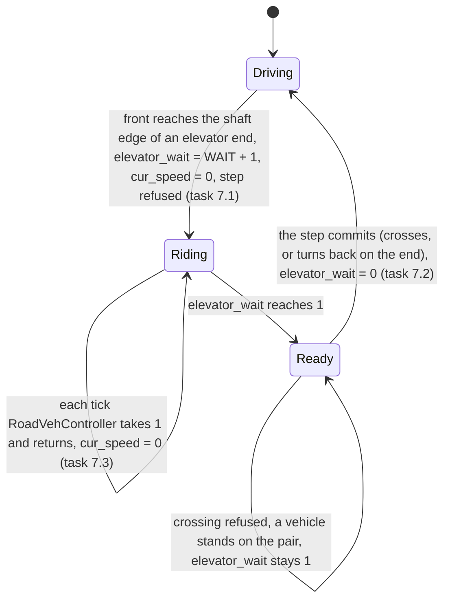

# R2MLM12 - Deep Underground, Road Tunnels, Timed Elevators and Layer Dropdowns

## Global Mandatory Reading

> **Execution protocol**
>
> - Read this Global Mandatory Reading section before the first task and again
>   after every context compaction.
> - Before starting or resuming a task group, read the nearest preceding Area
>   Mandatory Reading block whose `Applies to` label includes that group. Area
>   blocks appear immediately before the first group they govern.
> - A referenced heading or exported symbol is authoritative. Global navigation
>   hints and Area line ranges are for navigation only; if they drift, relocate
>   the named section or symbol rather than expanding to the whole file.
> - Mandatory reading is non-transitive. Do not preload a linked file's own
>   Mandatory Reading, Consult on Demand, or Planning Provenance entries unless
>   this plan names them directly for the current area.
> - Do not read Consult on Demand or Planning Provenance merely because those
>   sources are listed. Use a Consult on Demand source only when its trigger
>   occurs.
> - No created source file, test file or JSON file should start with same prefix as a planning MD file (such as r2). Only MD files can have that prefix. No MD file should be created anywhere in source directories unless specifically asked.
> - After EVERY CONTEXT COMPACTION, you must add a note above the task group
>   which is currently in execution. The note will say: "Context has compacted
>   X times while executing this group.". If the compaction occurs before any
>   meaningful work was done (this can happen when there is a lot of baggage
>   from the previous compaction), then and ONLY then you can skip this step.
> - When exceeding 3 context compactions, YOU MUST ask yourself if you're not 
>   chewing more than we can handle :). Heck, plans change! :). In such a case, 
>   the way out is to split the group on the spot,
>   in the plan, into more groups, 
>   by appending B, C, D as a suffixes to those groups (splitting sub-groups 
>   themselves is also allowed). When you do this, create Local Mandatory
>   Reading areas so you can optimize your context only for the
>   ACTUAL task at hand.
>   Before starting or resuming a task group, read the nearest preceding Area
>   Mandatory Reading block whose `Applies to` label includes that group. Area
>   blocks appear immediately before the first group they govern.

| File name | Line Ranges | Description |
| --- | --- | --- |
| [r2mlm-multi-layered-map.md](r2mlm-multi-layered-map.md) | 61-74, 98-104, 114-127 | `### AD-1 Layer vocabulary`, `### AD-2 Stacked-plane addressing`, `### AD-8 Cross-layer movement only through layer portals`, `### AD-9 Savegame`, `### AD-12 Version-1 scope` and `## Cross-plan Invariants` I-1 to I-8. AD-1 makes every `MapLayer` value implicit in every saved `TileIndex`, so values are never reordered: that is why Deep Underground is appended as value 3 (D-1). AD-2 makes a layer one full stacked plane, so a fourth layer is a fourth plane and no command or pool gains a layer field. AD-8 makes `GetLayerPortalNextTile` the only cross-layer step and forbids wormhole state; the portal kinds of D-3 keep that. AD-12 limits version 1 to three layers; Group 11 amends AD-1, AD-8 and AD-12, and every group must keep I-1 to I-8 true. |
| [r2mlm-multi-layered-map.md](r2mlm-multi-layered-map.md) | 141-170 | `## Engineering Conventions` and `## Build and Test Commands`: `//comment` with no space after `//`, a Javadoc block on every function and parameter, English-only strings, no created source, test or JSON file named `r2*`, never `git checkout`, `git reset` or `git stash`, never move or delete files, and the Build Tools 2022 toolchain with the standalone vcpkg (never Visual Studio Community). They bind every edit and build below. |
| [r2rvm-review-map.md](map-layers/r2rvm-review-map.md) | 569-672 | `### Commands used by every group` and `### Comment and header rules`: the exact configure, build (`/nodeReuse:false`, fully parallel) and unit-test commands, the `env -u NoDefaultCurrentDirectoryInExePath` rule for regression runs, the PrintWindow-only window capture, `mlm/tools/run/run_dedicated.sh`, the rule to tell the user before starting `openttd.exe`, and the file-header rule (`@see` a related `archi-*.md` or `r*.md` page on the `@file` line, so line numbers stay put). "Build Debug" and "run the unit tests" below mean exactly these commands. |
| [src/map_layer_type.h](../../../../src/map_layer_type.h) | 15-31 | `enum class MapLayer` and `MAX_MAP_LAYERS` with its `static_assert`: the one place the layer count is defined. Every live `Map::Allocate` call passes `MAX_MAP_LAYERS`. Group 2 changes it; every later group assumes four layers with `MapLayer::DeepUnderground == 3`. |
| [src/map_layer.h](../../../../src/map_layer.h) | 234-283 | `MultiLayerMap::IsStorableLayerCount`, `ValidateLayerCount`, `GetRules`, `InitialiseLayer` and `GetPortalTargetLayer`: the controller boundary. Layer meaning (counts, rules, pairing) is asked of `MultiLayerMap`; gameplay never adds `Map::PlaneSize()` to a tile by hand. `GetPortalTargetLayer(MapLayer)` is the one-to-one pair rule that Group 4 replaces with kind-aware pairing (D-3). |
| [src/layer_portal_map.h](../../../../src/layer_portal_map.h) | 63-88, 176-185 | `GetLayerPortalTargetLayer` (two bits of `m5`, so values 0 to 3), `GetLayerPortalPairTile` and `IsLayerPortalShaftExit`. The target field already holds value 3, so a Deep Underground end needs no new tile bit; the portal kind is derived from the transport and the two layers (D-3). |

**Artifact-layout migration (2026-10-09):** this plan consumes the parent [Development artifact layout](r2mlvs-multilayer-vehicles-and-structures.md#development-artifact-layout), implemented by [R2FC](r2fc-file-cleanup.md). It supersedes earlier docs asset/review/helper placement and fixed runtime-config destinations below. New native homes use `mlm/runtime/`, generated feature reviews use `mlm/reviews/`, logs remain under `logs/`, and reusable code/curated inputs keep their code/test owners. Paths and focused native/cold verification are complete; R2FC records the results and retained-input identities. Repository-relative executable commands run from the checkout root through their context-aware wrappers. Historical pass records remain dated evidence and are not new acceptance claims. No gameplay task is completed by this migration and the separate post-demo fixture-pruning gate remains.

## Outcome and Boundaries

The user asked for this plan on 2026-10-03, after playing the r2rvm2 build. Their requests and answers:

- "Change icons and tunnel assets to a better-looking more appropriate asset", judged from screenshots taken in the game. The portals and elevators still looked like a rail depot and a road garage. The user split this plan in two on 2026-10-03 because it had grown too large, and the art moved to [r2mlm13](r2mlm13-layer-art-review-and-new-sprites.md). This plan draws stand-ins (D-6).
- Bus elevators are "meant for deep travel", so a new Deep Underground layer is added. Elevators start on the Surface or the Underground and always end in Deep Underground (answer "Both").
- A road tunnel takes road vehicles from the Surface to the normal Underground. Trains cannot reach Deep Underground, because there is no rail elevator, and Deep Underground allows no rail building for now.
- Every layer button opens a dropdown of Surface, Underground, Deep Underground and Outer Space. Choosing an entry switches that view, and the button shows the chosen layer's icon.
- An elevator ride stops the bus. About 10 seconds at normal speed is fine, and the speed goes to zero.
- The earlier graphics work (r2mlm6) must be finished before this plan runs.

When this plan is done:

- Every new and loaded game has four layers. `MapLayer::DeepUnderground` is value 3, after `Space`. Saves of version 369 (three layers) load, and `AfterLoadGame` fills the Deep Underground plane.
- Deep Underground is flat dark bedrock. It accepts road, road stops, road depots, signs and elevators, but no rail, rail stations, train depots or signals.
- Road portals come in two kinds:
  - a road tunnel between Surface and Underground, which vehicles drive through without slowing;
  - a road elevator between Surface or Underground and Deep Underground, where a bus stops, waits hidden for 370 ticks, and leaves the other end from standstill.
- Rail portals are unchanged.
- The main toolbar, scenario editor toolbar, extra viewport and smallmap layer buttons each open the layer dropdown. The `N` hotkey still cycles the main view, in dropdown order. The layer named "Space" in the GUI becomes "Outer Space".
- The Deep Underground floor and icon, the road tunnel button and cursor, and the road tunnel ends draw the stand-ins of D-6. Each carries a comment naming r2mlm13 Group 9, which replaces it.
- The master plan, the portal contract, the architecture page and the acceptance plan describe four layers and three portal kinds.

Unchanged by design:

- The `TileType::LayerPortal` bit layout, `GetLayerPortalNextTile`, `TranslateIntoLayerPortalPair` and the visibility frames.
- Rail portals: Surface to Underground, crossed instantly at full speed.
- Space construction (signs only).
- `arrange14` to `arrange20` and the Towns menu, which r2mlm1 and r2mlm11 own.
- The multiplayer, savegame-matrix and performance runs, which r2mlm10 owns and which run after r2mlm13.

Out of scope:

- A rail elevator and trains in Deep Underground.
- Trams through tunnels or elevators.
- Any rule for the Underground tile under a Surface-to-Deep elevator (D-3).
- Script API layer awareness.
- The in-game review of the layer art, regenerated sprites, and the new Deep Underground and road tunnel sprites: r2mlm13.

Order: r2rvm2, then r2mlm6 together with the art groups of r2mlm8 and r2mlm9, then this plan, then r2mlm13, then r2mlm10.

## Design Decisions

### D-1 Deep Underground is appended as layer value 3

`MapLayer::DeepUnderground = 3` goes after `Space = 2`, and `MAX_MAP_LAYERS` becomes 4. Storage order (bands of world Y) and display order are separate things:

- **Storage order** is Surface, Underground, Space, Deep Underground. It is implicit in every `TileIndex` and never changes.
- **Display order** is Surface, Underground, Deep Underground, Outer Space. It is a GUI list in `src/map_layer_gui.cpp` (D-5).

Every new game allocates four planes, so the map takes a third more memory than with three. Group 11 brings this to the user as a follow-up to r2rvm2 task 18.2 (M-9).

A version-369 save stores `layers = 3`. `MAPSChunkHandler` loads three planes, and the existing missing-plane loop in `AfterLoadGame` initialises Deep Underground. A new `SaveLoadVersion::DeepUnderground` (370) is needed only for the road vehicle's elevator wait (D-4), and it lets the loader reject a pre-370 file that claims four layers.

The 28-bit RIFF length still fits: a 4096x4096 map of four layers is 67,108,864 tiles, so a 16-bit plane is 134,217,728 bytes out of a 268,435,455-byte maximum.

Rejected:
- Inserting Deep Underground at 2 and moving Space to 3. The Space plane of every 369 save would load as Deep Underground.
- Making the layer count a game setting. The master plan defers a variable layer count.

### D-2 Deep Underground rules

- **Allowed:** `Road`, `RoadStop`, `RoadDepot`, `Sign` and `LayerPortal`. Not `Rail`, `RailStation`, `TrainDepot` or `Signal` (user, 2026-10-03: trains have no elevator).
- **Ground:** the new `MapLayerGround::DeepBedrock`, at base height 0. No climate, no water flow and no ambient sound.
- **Depot split:** `MapLayerConstruction::Depot` becomes `TrainDepot` and `RoadDepot`. The bit positions are never saved; `MapLayerConstructions` exists only in the static rules table, so the split is safe.
- **Initialisation:** Deep Underground uses the same non-surface branch as Underground (rock fill, void fence, no `Random()`).

### D-3 Three portal kinds, derived and never stored

`enum class LayerPortalKind : uint8_t { RailTunnel, RoadTunnel, RoadElevator }` lives in `src/map_layer.h`, next to the pair rule.

**Allowed pairs** (unordered), answered by `MultiLayerMap::IsPortalPairAllowed(kind, a, b)`:

| Kind | Pairs |
| --- | --- |
| `RailTunnel` | Surface and Underground |
| `RoadTunnel` | Surface and Underground |
| `RoadElevator` | Surface and Deep Underground, Underground and Deep Underground |

**Deriving the kind** of an end, with `GetLayerPortalKind(tile)` in `src/layer_portal_map.h`:
- a rail end is `RailTunnel`;
- a road end whose own layer or target layer is Deep Underground is `RoadElevator`;
- every other road end is `RoadTunnel`.

So every road portal in a 369 save (Surface and Underground) becomes a road tunnel with no conversion.

**Choosing the target**, with `MultiLayerMap::GetPortalTargetLayer(from, kind, elevator_upper)`:
- a rail or road tunnel from Surface targets Underground, and from Underground targets Surface;
- an elevator from Surface or Underground targets Deep Underground;
- an elevator from Deep Underground targets `elevator_upper` (Surface or Underground), which the elevator picker sets and which defaults to Underground;
- everything else returns `MapLayer::Invalid`.

`CmdBuildLayerPortal` keeps its parameters. It derives the kind from `transport_type`, the clicked tile's layer and `target_layer`, and refuses the build unless `IsPortalPairAllowed` holds. It keeps refusing `MapLayer::Invalid` before `TileInLayer` (r2rvm task 6.4).

A Surface-to-Deep elevator leaves the Underground tile at the same (x, y) untouched, because layers are independent maps (AD-4). Group 11 records a possible later rule in `## Deferred Points`.

Rejected:
- A kind bit in `m5`. No bit is needed, and a stored bit could disagree with the layers.
- Keeping `|L - T| == 1` adjacency. Deep Underground is value 3, so value distance means nothing physically.

### D-4 How each kind is ridden

- **`RailTunnel`:** unchanged. Trains keep their speed and are hidden only inside the shaft frames.
- **`RoadTunnel`:** the same drive-through, with no speed cap.
- **`RoadElevator`:**
  - The bus brakes under `LAYER_ELEVATOR_MAX_SPEED` on the elevator tile, which is today's cap, now limited to elevators.
  - At the shaft edge the front engine stops, hidden, for `LAYER_ELEVATOR_WAIT_TICKS = 370` ticks: 10 seconds at 27 ms per tick, or 5 game days of 74 ticks (user, 2026-10-03).
  - It then crosses to the pair at speed 0 and accelerates.
  - The wait is game time, so fast-forward shortens it in real time like every other game delay. A real-time wait would desync multiplayer games.

**State.** `RoadVehicle::elevator_wait` (`uint16_t`) is saved from `SaveLoadVersion::DeepUnderground`:
- 0 means not riding;
- a value above 1 means the ride is running, with that many ticks left plus one;
- 1 means the ride is over and the next shaft step crosses.

**How the state moves** (state diagram in the Area block of Group 7).
- The front engine's shaft step on an elevator end sets `LAYER_ELEVATOR_WAIT_TICKS + 1` when it finds 0, and holds while the value is above 1. At 1 it goes on with the step.
- The value returns to 0 only when that step commits, at the end of the `RDE_NEXT_TILE` branch of `IndividualRoadVehicleController`. A step refused because a vehicle stands on the pair keeps the value at 1, so the bus waits for the road and never rides twice.
- `RoadVehController` counts down by one per tick while the value is above 1, and holds the vehicle with `cur_speed = 0`.
- Articulated parts have no counter of their own; they follow their front.
- `CmdTurnRoadVeh` refuses while `elevator_wait != 0`, as it refuses inside a tunnel (`RVSB_WORMHOLE`). Its 180-tick `reverse_ctr` would otherwise run out during the 370-tick ride and be lost.
- A bus at speed 0 never starts a breakdown (`CheckVehicleBreakdown` returns below speed 5). A breakdown that began on the approach pauses the countdown, because `HandleBreakdown` returns first.

**Queues.** `RoadVehFindCloseTo` lets a vehicle blocked for more than 1480 ticks drive through its blocker. A queue at an elevator advances once per ride, so a follower is blocked for about one ride, well under that limit. `static_assert(LAYER_ELEVATOR_WAIT_TICKS * 2 < 1480)` records the margin.

**Pathfinder.**
- A tunnel segment adds `road_layer_portal_penalty`.
- An elevator segment also adds `LAYER_ELEVATOR_WAIT_COST`, a code constant in `yapf_road.cpp`. It equals the distance a default bus covers in the wait, worked out in task 6.4 (about 10 tiles).
- No new setting is added.

Rejected:
- Keeping the speed cap as the whole ride. The user wants a stop.
- A real-time wait. It desyncs.
- A new vehicle state value. `state` stays a plain trackdir during a ride, as r2mlm8 chose.

### D-5 Layer dropdowns

All four layer buttons open the same list, built by `BuildMapLayerDropDown()` in `src/map_layer_gui.cpp`:
- one `MakeDropDownListIconItem` per allocated layer, in display order, each with the layer's icon, its name, and the `MapLayer` value as its value;
- the layer that button's view shows is selected.

What choosing an entry does:
- **Main toolbar and editor toolbar:** the main viewport switches with `SetViewportLayer`. Dispatch goes through `_menu_clicked_procs[WID_TN_MAP_LAYER]` (slot 5, `nullptr` today) and `_scen_toolbar_dropdown_procs[WID_TE_MAP_LAYER]` (slot 9, `nullptr` today), both to `MenuClickMapLayer`.
- **Extra viewport:** its own viewport switches in `OnDropdownSelect`.
- **Smallmap:** its own `layer` changes in `OnDropdownSelect`, and the link overlay is marked dirty.

Button behaviour:
- The buttons become `WWT_IMGBTN`, the style of every other menu button. The icon keeps showing the layer in view.
- The `N` hotkey keeps cycling the main view in display order, through `CycleMainViewportLayer`. It does not open the list.
- A single-layer game keeps its buttons disabled.

Names and tooltips:
- `STR_MAP_LAYER_SPACE` reads "Outer Space" (only the English text changes; the enum stays `Space`).
- `STR_MAP_LAYER_DEEP_UNDERGROUND` reads "Deep Underground".
- The tooltips say "Choose" instead of "Switch".

The Towns menu, `_toolbar_mode` and the arrangements are not touched (r2mlm11 boundary).

### D-6 Stand-in art, replaced by r2mlm13

[r2mlm13](r2mlm13-layer-art-review-and-new-sprites.md) makes the art for this plan's new things and wires it in its Group 9. Until then this plan draws stand-ins. Each one carries a comment naming r2mlm13 Group 9, so `grep -rn "r2mlm13 Group 9" src` finds them all:

- Deep Underground floor: `SPR_FLAT_ROCKY_LAND_1` drawn with `PALETTE_TO_GREY` (task 2.6);
- Deep Underground icon: the Underground icon (task 8.2);
- road tunnel button and cursor: the vanilla road tunnel button and cursor (tasks 5.2 and 5.4);
- road tunnel ends: the vanilla road tunnel entrance, `SPR_TUNNEL_ENTRY_REAR_ROAD + shaft * 2`, with the road overlay and vanilla's roof bounds, as `DrawTile_TunnelBridge` draws it (task 4.5).

Elevator ends on the Underground and on Deep Underground share the r2mlm6 underground housing (offsets 20 to 27). Only a Surface end uses the surface set. r2mlm13 may add a Deep Underground housing of its own.

## Implementation Tasks

### Area Mandatory Reading - Entry gate and baseline

_Applies to Group 1._

**Entry gate (whole plan).**

**Coding-stage override, 2026-10-03.** The user directed this session to "do the coding" and defer testing until their save is ready. Code can be staged once the code/art prerequisites exist; this does not satisfy the runtime or human-review gate. The original acceptance gate below remains open. R2MLM6's 44 sprites and Action 5 integration now exist and build in Debug, and the R2MLM8/R2MLM9 drawing swaps are implemented. Their visibility checks and R2RVM2's scenario/decision tasks remain pending. No in-game capture or scenario is claimed here.

- **Required:**
  - every task of [r2rvm2-review-map-2.md](map-layers/r2rvm2-review-map-2.md) is checked and its `## Completion Conditions` hold;
  - [r2mlm6-layer-graphics-assets.md](r2mlm6-layer-graphics-assets.md) `## Completion Conditions` hold: 44 sprites in `map_layers.png` and `map_layers.nfo`, the `0x1C` row, the constants in `src/table/sprites.h`, and no missing-sprite warning;
  - [r2mlm8-bus-elevators.md](r2mlm8-bus-elevators.md) `### Group 7 - Elevator art` and [r2mlm9-rail-layer-portals.md](r2mlm9-rail-layer-portals.md) `### Group 7 - Portal art` are checked.
- **How to verify:**
  - read those checkboxes;
  - `grep -n "SPR_MAP_LAYER_BASE\|MAP_LAYER_SPRITE_COUNT" src/table/sprites.h` prints both, and the count is 44;
  - `grep -n "_depot_gfx_table\|_road_depot" src/layer_portal_cmd.cpp` prints nothing, because the portals no longer draw the depot stand-ins.
- **If absent:** stop every group of this plan. Task 1.1 still runs and records which prerequisite is missing.
- **Forbidden fallbacks:**
  - starting Groups 2 to 8 because they "need no art": the user made the art a prerequisite of the whole plan;
  - running r2mlm6, r2mlm8 or r2mlm9 tasks from this plan instead of from those plans;
  - editing `openttd.grf` by hand, or copying sprites from another NewGRF or base set.

| File name | Line Ranges | Description |
| --- | --- | --- |
| [r2mlm6-layer-graphics-assets.md](r2mlm6-layer-graphics-assets.md) | 258-263 | `## Completion Conditions` of r2mlm6: the gate's art contract. Only these conditions are checked; r2mlm6's own reading lists are not loaded. |
| [r2mlm8-bus-elevators.md](r2mlm8-bus-elevators.md), [r2mlm9-rail-layer-portals.md](r2mlm9-rail-layer-portals.md) | r2mlm8 173-178, r2mlm9 185-191 | `### Group 7 - Elevator art` and `### Group 7 - Portal art`: the swap tasks that retire the depot stand-ins in `DrawTile_LayerPortal`. Task 1.4 photographs what those groups delivered. |
| [mlm/tools/run/ottd_window.ps1](../../../../mlm/tools/run/ottd_window.ps1) | 1-8, 25-131 | The capture and input helper: `Start-Ottd`, `Save-OttdShot` (PrintWindow, game window only), `Send-OttdClick`, `Send-OttdKey` and `Stop-Ottd`. Every screenshot in this plan uses it, and input is only ever posted to the game window, never sent through the user's mouse or keyboard. |
| [mlm/tools/run/run_game_logged.sh](../../../../mlm/tools/run/run_game_logged.sh) | 1-17 | Usage and output locations of the logged Debug game: the log in `build/scenario-logs/`, desync messages in `build/save/autosave/commands-out.log`, and crash files in `build/`. |

### Group 1 - Entry gate and baseline

Closure, 2026-10-04, under the goal's explicit operator/gate allowance: The operator-created version-369 portal/vehicle fixture and its historical pre-change captures/report are skipped. The supplied save is version 370; no downgrade or synthetic replacement fixture is manufactured. Task 3.6 separately verifies an authentic bare three-layer save upgrade. Each skipped row is marked `[s]`, never a passing test.

Coding baseline: `build/build-layer-art-Debug.log` builds both targets without compiler warnings; the existing unit-test baseline is 106/106 in `build/ctest-Debug.log`. A fresh runtime baseline and the user's version-369 portal save are pending. All six named capture/input functions exist in `mlm/tools/run/ottd_window.ps1`.

{{SIMPLE}}
- [x] 1.1 Check the entry gate above and record each of its three conditions under this task, with the grep output. If one fails, stop here and tell the user which plan must finish first.

  Final closure check, 2026-10-04: R2RVM2 code/automated tasks are complete, with explicit user-scenario skips. R2MLM6 and both consumer art-swap groups deliver generated art; their operator acceptance cases are explicitly skipped under the goal allowance. The inherited human gates therefore do not block coding/closure. `rg -n 'SPR_MAP_LAYER_BASE|MAP_LAYER_SPRITE_COUNT' src/table/sprites.h` shows the base at line 385 and the live count 66 at 386, as extended by canonical AD-10/R2MLM13; the original 44-row replay is retained. `rg -n '_depot_gfx_table|_road_depot' src/layer_portal_cmd.cpp` has no matches. R2MLM13 tasks 9.4/10.5 record the actual all-offset load without missing-extra-sprite warnings. No skipped human prerequisite is claimed as passed.
- [x] 1.2 Build Debug and RelWithDebInfo, and run the unit tests. Record the pass count under this task as this plan's baseline. Final current-tree evidence: both build targets/configurations exit 0 with zero compiler warnings, both pass 111/111 unit cases (`build/build-console-input-*.log`, `build/ctest-console-input-*.log`), and full release CTest passes 115/115 (`build/ctest-console-final-RelWithDebInfo.log`).
- [s] 1.3 Find or ask for a version-369 save that holds at least one rail portal, one road portal and one road vehicle underground. Copy it, never move it, to `build/save/deep_pre_portals.sav`. If none exists, ask the user to build one in the Debug build of the gate's tree and save it under that name. Record its savegame version, read with `python -B mlm/tools/savegames/savegame_plane_digest.py`.
- [s] 1.4 Tell the user, then start the Debug game on `deep_pre_portals.sav` with `mlm/tools/run/ottd_window.ps1`. Capture these, saved in `mlm/reviews/<feature>/<scenario>/<run-id>/images/` as `r2mlm12-a-...` PNGs:
  - the main toolbar with the layer button on each layer;
  - the rail and road toolbars;
  - a rail portal and a road portal end on Surface and on Underground, at normal zoom;
  - the Underground and Space floors.
- [s] 1.5 List the captures of task 1.4 under this task, one line each, with what it shows. r2mlm13 Groups 4, 5 and 10 compare its captures with them.
- [x] 1.6 Confirm `mlm/tools/run/ottd_window.ps1` defines `Start-Ottd`, `Save-OttdShot`, `Send-OttdHover`, `Send-OttdClick`, `Send-OttdKey` and `Stop-Ottd`, and record any function a later task needs that it lacks.

### Area Mandatory Reading - Layer vocabulary, rules and savegame

_Applies to Groups 2-3._

| File name | Line Ranges | Description |
| --- | --- | --- |
| [src/map_layer.h](../../../../src/map_layer.h) | 16-67 | `enum class MapLayerGround`, `enum class MapLayerConstruction` and `struct MapLayerRules`. Task 2.2 adds `DeepBedrock`; task 2.3 splits `Depot` into `TrainDepot` and `RoadDepot` (D-2). The construction values are bit positions of a bitset that only the static rules table holds, so they may change. |
| [src/map_layer.cpp](../../../../src/map_layer.cpp) | 27-75, 137-175 | `AllConstructions`, `UndergroundConstructions`, `SpaceConstructions`, the `_map_layer_rules` table (one row per layer, in `MapLayer` order) and `MultiLayerMap::InitialiseLayer`, whose non-surface branch fills rock with `rules.base_height` and asserts that `Random()` was not used. Deep Underground gets its own constructions function and a fourth row; the initialiser needs no new branch. |
| [src/clear_cmd.cpp](../../../../src/clear_cmd.cpp) | 142-172 | `GetLayerGroundSprite` and the head of `DrawTile_Clear`: the stand-in ground per `MapLayerGround` and the palette choice. Task 2.6 adds the Deep Underground stand-in; r2mlm13 Group 9 swaps it for real art. |
| [src/rail_cmd.cpp](../../../../src/rail_cmd.cpp), [src/road_cmd.cpp](../../../../src/road_cmd.cpp) | rail 988-994, road 1160-1165 | The two `CheckLayerAllowsConstruction(tile, MapLayerConstruction::Depot)` calls in `CmdBuildTrainDepot` and `CmdBuildRoadDepot`, the only uses of the kind that task 2.3 splits. |
| [src/saveload/saveload.h](../../../../src/saveload/saveload.h), [src/saveload/map_sl.cpp](../../../../src/saveload/map_sl.cpp) | saveload.h 424-430; map_sl.cpp 25-95 | `SaveLoadVersion::MapLayers` (369) before `MaxVersion`, where task 2.7 appends `DeepUnderground` (370). `_map_file_layers`, the RIFF-length note, and the `Load` and `LoadCheck` layer-count checks of `MAPSChunkHandler`, which become version-aware. |
| [src/tests/map_layer.cpp](../../../../src/tests/map_layer.cpp) | 52-71, 74-152, 231-260 | `Map::Allocate layer count`, `Storable layer counts`, the per-layer loops of the addressing tests (each loops over `{Surface, Underground, Space}`), and `InitialiseLayer underground ground and fence`. Group 3 extends exactly these. |

### Group 2 - Deep Underground in the vocabulary, rules and savegame

Code delivered. Task 2.5 needed only its comment updated: the existing non-surface initialiser already fills Deep Underground with rock and preserves RNG state. Task 2.6 keeps `PAL_NONE` for the integrated r2mlm6 Space art. Task 2.8 found only historical references in `saveload.h` (version 369) and `map_sl.cpp` (pre-370 checks); these remain accurate and were retained. No `MapLayerConstruction::Depot` call remains.

{{MEDIUM}}
- [x] 2.1 `src/map_layer_type.h`:
  - insert `DeepUnderground = 3, ///< The map below the Underground. Appended after Space so no saved TileIndex changes meaning (r2mlm12 D-1).` before `End`;
  - change the `MAX_MAP_LAYERS` comment to "How many real layers exist: four since r2mlm12 D-1 (AD-1 as amended)" and the `static_assert` to `== 4`;
  - give the file header its `@see` line for this plan and `archi-map-layers.md`.
- [x] 2.2 `src/map_layer.h`: add `DeepBedrock, ///< Dark rock of Deep Underground. Drawn with a stand-in until SPR_MAP_LAYER_DEEP_FLOOR exists (r2mlm13 Group 9).` to `MapLayerGround`, after `Vacuum`.
- [x] 2.3 D-2: replace `MapLayerConstruction::Depot` with `TrainDepot, ///< Train depot.` and `RoadDepot, ///< Road depot.`:
  - in `CmdBuildTrainDepot`, use `TrainDepot`;
  - in `CmdBuildRoadDepot`, use `RoadDepot`;
  - in `UndergroundConstructions`, set both.

  `grep -rn "MapLayerConstruction::Depot\b" src` must print nothing afterwards.
- [x] 2.4 `src/map_layer.cpp`:
  - add `static MapLayerConstructions DeepUndergroundConstructions()` after `UndergroundConstructions`. Its Javadoc says D-2 allows road, road stops, road depots, signs and portals, and no rail. It sets `Road`, `RoadStop`, `RoadDepot`, `Sign` and `LayerPortal`;
  - append the row `{ DeepUndergroundConstructions(), MapLayerGround::DeepBedrock, 0, false, false, false },`;
  - reword the table's comment to name all four layers;
  - add `static_assert(std::size(_map_layer_rules) == MAX_MAP_LAYERS);` below the table.
- [x] 2.5 In `MultiLayerMap::InitialiseLayer`, confirm the non-surface branch serves Deep Underground unchanged: rock fill, `rules.base_height`, freeform edges, and the `Random()` asserts. Reword its comment from "Underground and Space" to "Every layer other than the Surface". Record "no code change" or the change made.
- [x] 2.6 `src/clear_cmd.cpp`:
  - in `GetLayerGroundSprite`, add `case MapLayerGround::DeepBedrock:` returning `SPR_FLAT_ROCKY_LAND_1`, with the comment `//Stand-in for SPR_MAP_LAYER_DEEP_FLOOR until r2mlm13 Group 9. Drawn grey so Deep Underground does not look like Underground.`;
  - in `DrawTile_Clear`, choose `PALETTE_TO_GREY` for `DeepBedrock`, keep `PAL_NONE` for the real r2mlm6 `Vacuum` sprites (the old all-black stand-in palette would erase their stars), and comment the choice;
  - add the file's `@see` header line if it is missing.
- [x] 2.7 Savegame (D-1):
  - in `src/saveload/saveload.h`, append `DeepUnderground, ///< Saveload version: 370\n Map stores Deep Underground; road vehicles store their elevator wait.` after `MapLayers`;
  - in `src/saveload/map_sl.cpp`, after each `IsStorableLayerCount` check in `Load` and `LoadCheck`, add `if (IsSavegameVersionBefore(SaveLoadVersion::DeepUnderground) && _map_layers > 3) SlErrorCorrupt("Invalid map layer count");`, with the comment `//Before Deep Underground a file holds at most Surface, Underground and Space.`;
  - change the RIFF note to "A 4096 by 4096 map of four layers still fits."
- [x] 2.8 Run `grep -rn "MAX_MAP_LAYERS == 3\|three layers\|Surface, Underground and Space" src --include=*.cpp --include=*.h`, excluding `src/tests`. Fix each comment that now states a wrong count. Under this task, record every line found and whether it changed.

### Group 3 - Layer tests

{{SIMPLE}}
- [x] 3.1 `src/tests/map_layer.cpp`: add `MapLayer::DeepUnderground` to every `{MapLayer::Surface, MapLayer::Underground, MapLayer::Space}` loop, and give those tests `Map::Allocate(64, 64, MAX_MAP_LAYERS)`. In `Map::Allocate layer count`, keep the existing check for three layers and add one for four.
- [x] 3.2 In `Storable layer counts`, check that 4 is storable and 5 is not.
- [x] 3.3 Add the test case `Deep Underground rules`:
  - `GetRules(MapLayer::DeepUnderground).ground == MapLayerGround::DeepBedrock`;
  - `Road`, `RoadStop`, `RoadDepot`, `Sign` and `LayerPortal` are allowed;
  - `Rail`, `RailStation`, `TrainDepot` and `Signal` are refused;
  - Underground still allows `TrainDepot` and `RoadDepot`.
- [x] 3.4 Add the test case `InitialiseLayer deep underground ground and fence`, in the style of the underground case: inner tiles are rock clear tiles at height 0, the last row and column are void, and `_random` is unchanged.
- [x] 3.5 Build Debug and run the unit tests. Every baseline test of task 1.2 and the new cases must pass. Record the result.
- [x] 3.6 With the RelWithDebInfo build and `mlm/tools/run/run_dedicated.sh`, load `build/save/fd9_upgraded_1234_8x8.sav` (version 369, three layers) and save it as `deep_upgraded_1234_8x8`. Then compare both saves with `mlm/tools/savegames/savegame_plane_digest.py --tiles 65536`:
  - the surface digests are identical;
  - `MAPT` is four planes long (262144 at 8x8);
  - the savegame version is 370.

  Record the three results. This is I-7 for four layers.

  Verified 2026-10-04: dedicated load/save exits 0 (`build/dedicated-logs/deep_upgraded_1234_8x8.log`). The authentic input is version 369, `MAPT` length 196608; the output is version 370, `MAPT` length 262144, four planes. All ten Surface hashes are identical. Exact digest output: `build/dedicated-logs/deep-before-digests.txt`, `deep-after-digests.txt`. Input save is preserved.

### Area Mandatory Reading - Portal kinds and the road toolbar

_Applies to Groups 4-5._

| File name | Line Ranges | Description |
| --- | --- | --- |
| [r2mlm7-layer-portal-foundation.md](r2mlm7-layer-portal-foundation.md) | 63-72 | `## Portal Contract`: pair, directions, neighbour mapping, relocation, visibility, tile bits and the command signature. D-3 replaces only the Pair bullet's `|L - T| == 1`. Group 11 rewrites that bullet; everything else binds Groups 4 and 5 unchanged. |
| [src/layer_portal_map.h](../../../../src/layer_portal_map.h) | 126-174 | `MakeRailLayerPortal` and `MakeRoadLayerPortal`: both write the target layer into `m5` bits 6..5. A Deep Underground target is value 3 and fits, so the makers need no change. `GetLayerPortalKind` goes after `GetLayerPortalPairTile`. |
| [src/layer_portal_cmd.cpp](../../../../src/layer_portal_cmd.cpp) | 54-73, 103-154, 382-445 | `TranslateIntoLayerPortalPair` (adds `(to - from)` whole bands, so any pair distance works), `DrawTile_LayerPortal` and `GetTileDesc_LayerPortal` (per-transport today, per-kind after task 4.4), and `CmdBuildLayerPortal` with its M-11 guard and the `GetPortalTargetLayer` check that task 4.3 replaces. Relocate by symbol: the gate's art groups edited `DrawTile_LayerPortal`. |
| [src/tunnelbridge_cmd.cpp](../../../../src/tunnelbridge_cmd.cpp) | 1308-1336, 1340-1386, 1441-1449 | How `DrawTile_TunnelBridge` draws a road tunnel entrance: `roof_bounds` and the two separator boxes, `SPR_TUNNEL_ENTRY_REAR_ROAD + direction * 2` as ground with the road overlay on it, then `image + 1` (the roof) as a sortable sprite. Vanilla tunnel sprites are anchored at tile point 15,15, which is why `roof_bounds` carries the offset `{15, 14, -BB_Z_SEPARATOR}`. This is the road tunnel stand-in until r2mlm13 Group 9 (D-6). |
| [src/rail_gui.cpp](../../../../src/rail_gui.cpp) | 756-762 | The `WID_RAT_BUILD_LAYER_PORTAL` placement, which asks `GetPortalTargetLayer(GetTileLayer(tile))` and moves to the new signature in task 4.6. |
| [src/road_gui.cpp](../../../../src/road_gui.cpp) | 424-428, 458-462, 566, 590, 614-618, 726-732, 971-988, 1041-1044, 1157-1160, 1318-1425 | The road toolbar's elevator handling: the enable rules in `OnInvalidateData` and `OnInit`; cursor, highlight and `OnClick`; `OnPlaceObject`; the hotkeys (`U` is free); the button in the game and scenario-editor toolbars; and `BuildRoadElevatorWindow` with `ShowRoadElevatorPicker`. The road tunnel button copies each of these. |
| [src/widgets/road_widget.h](../../../../src/widgets/road_widget.h) | 13-50 | `RoadToolbarWidgets` and `BuildRoadElevatorWidgets`, where tasks 5.1 and 5.5 add widget ids. |
| [src/tests/map_layer.cpp](../../../../src/tests/map_layer.cpp) | 262-310 | `Layer portal neighbour mapping and relocation`, whose last two checks call the one-argument `GetPortalTargetLayer` that task 4.7 rewrites. |

### Group 4 - Portal kinds and pairing

{{HARD}}
- [x] 4.1 D-3, in `src/map_layer.h` after `MapLayerRules`: add `enum class LayerPortalKind : uint8_t` with `RailTunnel`, `RoadTunnel` and `RoadElevator`. Give it a Javadoc header and a `///<` comment on each value. Replace the inline `GetPortalTargetLayer(MapLayer from)` with:
  ```cpp
  	/**
  	 * Whether a portal of one kind may join two layers.
  	 * D-3: rail and road tunnels join Surface and Underground; road elevators join Surface or Underground with Deep Underground.
  	 * @param kind Kind of portal.
  	 * @param a Layer of one end.
  	 * @param b Layer of the other end.
  	 * @return True when that pair is allowed, in either order.
  	 */
  	static bool IsPortalPairAllowed(LayerPortalKind kind, MapLayer a, MapLayer b);

  	/**
  	 * The layer a new portal of one kind connects to from a clicked layer.
  	 * @param from Layer of the clicked tile.
  	 * @param kind Kind of portal being built.
  	 * @param elevator_upper Upper end chosen in the elevator picker, used only for an elevator clicked in Deep Underground.
  	 * @return The target layer, or MapLayer::Invalid when this kind cannot start on that layer.
  	 */
  	static MapLayer GetPortalTargetLayer(MapLayer from, LayerPortalKind kind, MapLayer elevator_upper);
  ```
  Define both in `src/map_layer.cpp`, each under a copy of its Javadoc block, as the other `/* static */` definitions there are:
  ```cpp
  /* static */ bool MultiLayerMap::IsPortalPairAllowed(LayerPortalKind kind, MapLayer a, MapLayer b)
  {
  	//D-3 pairs are unordered, so compare them lower value first.
  	if (a > b) std::swap(a, b);
  	switch (kind) {
  		case LayerPortalKind::RailTunnel:
  		case LayerPortalKind::RoadTunnel:
  			return a == MapLayer::Surface && b == MapLayer::Underground;

  		case LayerPortalKind::RoadElevator:
  			//An elevator goes down to Deep Underground from either upper layer, never from Outer Space.
  			return b == MapLayer::DeepUnderground && (a == MapLayer::Surface || a == MapLayer::Underground);
  	}
  	NOT_REACHED();
  }

  /* static */ MapLayer MultiLayerMap::GetPortalTargetLayer(MapLayer from, LayerPortalKind kind, MapLayer elevator_upper)
  {
  	switch (kind) {
  		case LayerPortalKind::RailTunnel:
  		case LayerPortalKind::RoadTunnel:
  			if (from == MapLayer::Surface) return MapLayer::Underground;
  			if (from == MapLayer::Underground) return MapLayer::Surface;
  			return MapLayer::Invalid;

  		case LayerPortalKind::RoadElevator:
  			if (from == MapLayer::Surface || from == MapLayer::Underground) return MapLayer::DeepUnderground;
  			//From the bottom the picker decides which upper layer the elevator reaches.
  			if (from == MapLayer::DeepUnderground && (elevator_upper == MapLayer::Surface || elevator_upper == MapLayer::Underground)) return elevator_upper;
  			return MapLayer::Invalid;
  	}
  	NOT_REACHED();
  }
  ```
- [x] 4.2 In `src/layer_portal_map.h`, after `GetLayerPortalPairTile`, add (the header already includes `map_layer.h`):
  ```cpp
  /**
   * Kind of a portal end, derived from its transport and its two layers (r2mlm12 D-3). It is never stored.
   * @param t Portal end.
   * @return RailTunnel for rail, RoadElevator when either end is in Deep Underground, otherwise RoadTunnel.
   */
  inline LayerPortalKind GetLayerPortalKind(Tile t)
  {
  	if (GetLayerPortalTransportType(t) == TransportType::Rail) return LayerPortalKind::RailTunnel;
  	//An elevator always has one end in Deep Underground; a road tunnel never has.
  	if (GetTileLayer(t) == MapLayer::DeepUnderground || GetLayerPortalTargetLayer(t) == MapLayer::DeepUnderground) return LayerPortalKind::RoadElevator;
  	return LayerPortalKind::RoadTunnel;
  }
  ```
- [x] 4.3 In `CmdBuildLayerPortal`, replace the `expected_target` block. Derive `LayerPortalKind kind`:
  - `RailTunnel` for rail;
  - `RoadElevator` when the tile's layer or `target_layer` is Deep Underground;
  - otherwise `RoadTunnel`.

  Then return `CommandCost(STR_ERROR_CAN_T_BUILD_LAYER_PORTAL)` unless `MultiLayerMap::IsValidLayer(target_layer) && MultiLayerMap::IsPortalPairAllowed(kind, GetTileLayer(tile), target_layer)`. The comment says this keeps r2rvm task 6.4: an invalid target is refused before `TileInLayer`.
- [x] 4.4 Strings in `src/lang/english.txt`:
  - change the text of `STR_LAI_LAYER_PORTAL_ROAD` to `Road tunnel to the {STRING}`;
  - add `STR_LAI_LAYER_PORTAL_ROAD_ELEVATOR :Road elevator to the {STRING}` after it.

  `GetTileDesc_LayerPortal` picks the string by `GetLayerPortalKind`.
- [x] 4.5 In `DrawTile_LayerPortal`, branch on `GetLayerPortalKind`:
  - `RailTunnel` keeps the r2mlm9 art;
  - `RoadElevator` keeps the r2mlm8 art, with the Surface end on the surface set and every other end on the underground set (D-6);
  - `RoadTunnel` draws the vanilla road tunnel entrance as the stand-in. `DrawRoadOverlays` is declared in `road_func.h`, which the file already includes:
  ```cpp
  /**
   * Bounding boxes of the vanilla tunnel roof, copied from roof_bounds in DrawTile_TunnelBridge. Indexed by shaft direction.
   * Vanilla tunnel sprites are anchored at tile point 15,15, hence the offsets. Used by the road tunnel stand-in until r2mlm13 Group 9.
   */
  static constexpr DiagDirectionIndexArray<SpriteBounds> _road_tunnel_stand_in_roof_bounds{{{
  	{{0, 1, BB_Z_SEPARATOR}, {TILE_SIZE, TILE_SIZE - 1, 1}, {TILE_SIZE - 1, TILE_SIZE - 2, -BB_Z_SEPARATOR}}, //NE
  	{{1, 0, BB_Z_SEPARATOR}, {TILE_SIZE - 1, TILE_SIZE, 1}, {TILE_SIZE - 2, TILE_SIZE - 1, -BB_Z_SEPARATOR}}, //SE
  	{{0, 1, BB_Z_SEPARATOR}, {TILE_SIZE, TILE_SIZE - 1, 1}, {TILE_SIZE - 1, TILE_SIZE - 2, -BB_Z_SEPARATOR}}, //SW
  	{{1, 0, BB_Z_SEPARATOR}, {TILE_SIZE - 1, TILE_SIZE, 1}, {TILE_SIZE - 2, TILE_SIZE - 1, -BB_Z_SEPARATOR}}, //NW
  }}};

  	//Inside DrawTile_LayerPortal, before the per-kind art of r2mlm8 and r2mlm9.
  	if (GetLayerPortalKind(ti->tile) == LayerPortalKind::RoadTunnel) {
  		//Stand-in until r2mlm13 Group 9: the vanilla road tunnel entrance, indexed by the heading into the tunnel as DrawTile_TunnelBridge indexes it.
  		//It is drawn for a slope, so on flat ground it shows a short hill face.
  		DiagDirection shaft = GetLayerPortalShaftDirection(ti->tile);
  		SpriteID image = SPR_TUNNEL_ENTRY_REAR_ROAD + to_underlying(shaft) * 2;
  		DrawGroundSprite(image, PAL_NONE);
  		uint offset = DiagDirToAxis(shaft) == Axis::X ? 1 : 0;
  		DrawRoadOverlays(ti, PAL_NONE, GetRoadTypeInfo(GetRoadTypeRoad(ti->tile)), nullptr, offset, offset);
  		AddSortableSpriteToDraw(image + 1, PAL_NONE, *ti, _road_tunnel_stand_in_roof_bounds[shaft], false);
  		return;
  	}
  ```
  - ASSUMPTION: this was already built previously (the gate's r2mlm8 and r2mlm9 Group 7 art inside `DrawTile_LayerPortal`). If not, re-assess at runtime. If that art already has a bounds table, reuse its style for the stand-in table.
- [x] 4.6 `src/rail_gui.cpp`: the portal placement becomes `MultiLayerMap::GetPortalTargetLayer(GetTileLayer(tile), LayerPortalKind::RailTunnel, MapLayer::Invalid)`. Behaviour is unchanged.
- [x] 4.7 `src/tests/map_layer.cpp`:
  - rewrite the two `GetPortalTargetLayer` checks of `Layer portal neighbour mapping and relocation` to the new signature;
  - add the test case `Layer portal kinds and pairs`:
    - the allowed matrix over all 16 ordered layer pairs and three kinds;
    - `GetPortalTargetLayer` for every kind and layer, including an elevator from Deep Underground with each upper layer;
    - `GetLayerPortalKind` on road ends made for Surface and Underground (tunnel), Underground and Deep (elevator), and Surface and Deep (elevator);
    - `TranslateIntoLayerPortalPair` from a Surface end into a Deep Underground pair, which crosses three bands of world Y.
- [x] 4.8 Build Debug and run the unit tests, then record the result. Run `grep -rn "GetPortalTargetLayer(" src`: every call must take three arguments.

### Group 5 - Road tunnel button and road portal picker

Closure, 2026-10-04, under the goal's explicit operator/gate allowance: The build/unit portion passes in the final evidence of task 1.2; the road-toolbar/both-picker screenshot operator portion is skipped. No complete picker UI pass is inferred from compilation. Each skipped row is marked `[s]`, never a passing test.

2026-10-04 verification correction: the first fresh unit run found `WWT_TEXT should not have a colour` in the new upper-end row. Its label now uses `Colours::Invalid`. Debug and RelWithDebInfo builds pass with zero compiler warnings (`build/build-capture-*.log`); all 110 Debug unit cases pass (`build/ctest-capture-Debug.log`). Operator screenshots remain separate from this evidence.

{{MEDIUM}}
- [x] 5.1 `src/widgets/road_widget.h`:
  - add `WID_ROT_LAYER_TUNNEL, ///< Build road tunnel to another map layer.` before `WID_ROT_LAYER_ELEVATOR`;
  - add `WID_BREL_UPPER_SEL, ///< Selection that shows the upper-end row only for elevators.`, `WID_BREL_UPPER_SURFACE, ///< Elevator from Deep Underground goes up to the Surface.` and `WID_BREL_UPPER_UNDERGROUND, ///< Elevator from Deep Underground goes up to the Underground.` to `BuildRoadElevatorWidgets`.
- [x] 5.2 In both road toolbars of `src/road_gui.cpp` (game and scenario editor), insert before the elevator button: `NWidget(WWT_IMGBTN, Colours::DarkGreen, WID_ROT_LAYER_TUNNEL), SetFill(0, 1), SetToolbarMinimalSize(1), SetSpriteTip(SPR_IMG_ROAD_TUNNEL, STR_ROAD_TOOLBAR_TOOLTIP_BUILD_LAYER_TUNNEL),`. The comment names the stand-in sprite and r2mlm13 Group 9.
- [x] 5.3 In `OnInvalidateData` and `OnInit`, give `WID_ROT_LAYER_TUNNEL` the same enabled rule as the elevator: road types only, `can_build`, and more than one layer. Extend the existing comments.
- [x] 5.4 Wire the button:
  - `GetCursorForWidget` returns `GetRoadTypeInfo(this->roadtype)->cursor.tunnel` (stand-in);
  - the highlight is `HT_RECT`;
  - `OnClick` opens `ShowRoadElevatorPicker(this, LayerPortalKind::RoadTunnel)`;
  - add the hotkey `Hotkey('U', "layer_tunnel", WID_ROT_LAYER_TUNNEL)` next to `layer_elevator`;
  - the elevator's `OnClick` passes `LayerPortalKind::RoadElevator`.
- [x] 5.5 Generalise `BuildRoadElevatorWindow` into the road portal picker:
  - its constructor takes `LayerPortalKind kind`, kept as a member;
  - the caption is `STR_BUILD_ROAD_LAYER_TUNNEL_CAPTION` for a tunnel, and `STR_BUILD_ROAD_ELEVATOR_CAPTION` otherwise;
  - the door buttons are unchanged;
  - an `NWID_SELECTION` (`WID_BREL_UPPER_SEL`) shows the row "Upper end: Surface | Underground" only for an elevator, backed by `static MapLayer _road_elevator_upper_layer = MapLayer::Underground;`.

  Update `ShowRoadElevatorPicker`'s declaration and Javadoc.
- [x] 5.6 `OnPlaceObject`:
  - `WID_ROT_LAYER_TUNNEL` posts `BuildLayerPortal` with `GetPortalTargetLayer(GetTileLayer(tile), LayerPortalKind::RoadTunnel, MapLayer::Invalid)`;
  - `WID_ROT_LAYER_ELEVATOR` posts it with `GetPortalTargetLayer(GetTileLayer(tile), LayerPortalKind::RoadElevator, _road_elevator_upper_layer)`.

  An invalid target is still posted, so the command answers it with its error message (a click in Space, or a tunnel from Deep Underground). The comment says why.
- [x] 5.7 `src/lang/english.txt`:
  - add `STR_ROAD_TOOLBAR_TOOLTIP_BUILD_LAYER_TUNNEL` ("Build a road tunnel between the surface and the underground");
  - add `STR_BUILD_ROAD_LAYER_TUNNEL_CAPTION` ("Road tunnel orientation");
  - add `STR_BUILD_ROAD_ELEVATOR_UPPER_SURFACE` and `_UNDERGROUND` (the layer names);
  - add `STR_BUILD_ROAD_ELEVATOR_UPPER_TOOLTIP` ("Layer an elevator built in the deep underground goes up to");
  - change `STR_ROAD_TOOLBAR_TOOLTIP_BUILD_LAYER_ELEVATOR` to "Build a road elevator down to the deep underground".
- [s] 5.8 Build Debug and run the unit tests. Then tell the user and capture the road toolbar and both pickers (`r2mlm12-a-...` PNGs), and record the results.

### Area Mandatory Reading - Elevator state, speed and pathfinder cost

_Applies to Group 6._

| File name | Line Ranges | Description |
| --- | --- | --- |
| [src/roadveh_cmd.cpp](../../../../src/roadveh_cmd.cpp) | 467-505 | `LAYER_ELEVATOR_MAX_SPEED` and `RoadVehicle::GetCurrentMaxSpeed`. Task 6.1 puts the wait constants after the cap; task 6.3 limits the cap to elevators (D-4). |
| [src/roadveh.h](../../../../src/roadveh.h), [src/saveload/vehicle_sl.cpp](../../../../src/saveload/vehicle_sl.cpp) | roadveh.h 102-115; vehicle_sl.cpp 851-872 | The `RoadVehicle` counters (`blocked_ctr`, `reverse_ctr` and the others) and their `SlVehicleRoadVeh` save entries, where `elevator_wait` joins, saved from `SaveLoadVersion::DeepUnderground` (task 6.2). |
| [src/vehicle_base.h](../../../../src/vehicle_base.h) | 29-30, 430-457 | `TILE_AXIAL_DISTANCE` (192), `GetAdvanceSpeed` (speed * 3 / 4) and `GetAdvanceDistance`: the movement arithmetic behind the elevator cost of task 6.4. |
| [src/table/engines.h](../../../../src/table/engines.h) | 655-675 | The `ROV` macro's Javadoc (road `max_speed` is in units of 0.5 km-ish/h) and row 0, the MPS Regal Bus at 112: the default 1950 temperate bus of task 6.4. |
| [src/pathfinder/yapf/yapf_road.cpp](../../../../src/pathfinder/yapf/yapf_road.cpp) | 116-187 | `PfCalcCost`: the segment loop that adds `road_layer_portal_penalty` when `follower_local.is_portal`. At that point `tile` is the end being left, so its kind is the crossed portal's kind (task 6.5). |

### Group 6 - Elevator constants, state, speed and pathfinder cost

Task 6.4 source values match the table below: MPS Regal Bus max speed 112 (`table/engines.h`), progress 84 (`Vehicle::GetAdvanceSpeed`), axial step 192 (`TILE_AXIAL_DISTANCE`), 16 steps per tile (`TILE_SIZE`). `370 * 84 / 192 / 16 = 10.1171875`, rounded to `10 * YAPF_TILE_LENGTH`. Task 6.6 call-site audit found drawing, land info, elevator sound, speed cap, shaft hold and YAPF cost, plus the accessor and unit cases. Commands derive their kind from transport and endpoints before validating the pair. Fresh unit execution now passes 110/110 in Debug (`build/ctest-capture-Debug.log`).

{{MEDIUM}}
- [x] 6.1 `src/roadveh_cmd.cpp`:
  - after `LAYER_ELEVATOR_MAX_SPEED`, add `static constexpr uint16_t LAYER_ELEVATOR_WAIT_TICKS = 370;`. Its Javadoc says: user decision 2026-10-03; 10 seconds at 27 ms per tick, which is 5 game days; game ticks, so fast-forward shortens it like every other game delay, and real time would desync;
  - add `static_assert(LAYER_ELEVATOR_WAIT_TICKS * 2 < 1480, "An elevator queue advances once per ride; RoadVehFindCloseTo lets a vehicle blocked for 1480 ticks drive through.");`;
  - reword the comment of `LAYER_ELEVATOR_MAX_SPEED`: it is now the approach speed on an elevator tile.
- [x] 6.2 State (D-4):
  - in `src/roadveh.h`, add `uint16_t elevator_wait = 0; ///< Elevator ride: 0 not riding, 1 ride over and the next shaft step crosses, above 1 the ticks left plus one (r2mlm12 D-4).` after `reverse_ctr`;
  - in `SlVehicleRoadVeh`, add `SaveLoad::Variable<VarFileType::U16>("elevator_wait", SLE_OBJECT_ADDRESS(RoadVehicle, elevator_wait), SaveLoadVersion::DeepUnderground),`.
- [x] 6.3 In `GetCurrentMaxSpeed`, replace the road-portal condition so the cap applies only to elevators:
  ```cpp
  		//D-4: only an elevator is ridden slowly. A road tunnel is driven through at full speed; a rail end never holds a road vehicle.
  		if (IsLayerPortalTile(u->tile) && GetLayerPortalKind(u->tile) == LayerPortalKind::RoadElevator) {
  			max_speed = std::min(max_speed, static_cast<int>(LAYER_ELEVATOR_MAX_SPEED));
  		}
  ```
  - ASSUMPTION: this was already built previously (task 4.2, `GetLayerPortalKind`). If not, re-assess at runtime.
- [x] 6.4 Work out `LAYER_ELEVATOR_WAIT_COST` from the code: the distance a default bus covers at top speed during the wait. The values at planning time:

  | Step | Source | Value |
  | --- | --- | --- |
  | Top speed of the MPS Regal Bus | `_orig_road_vehicle_info[0]`, `max_speed` in 0.5 km-ish/h | 112 |
  | Progress per tick at top speed | `GetAdvanceSpeed`: speed * 3 / 4 | 84 |
  | Progress per step along an axis | `GetAdvanceDistance` returns `TILE_AXIAL_DISTANCE` | 192 |
  | Steps per tile | `TILE_SIZE` | 16 |
  | Tiles covered in 370 ticks | 370 * 84 / 192 / 16 | 10.1 |

  Re-read each source and copy the table, with the values found, under this task. The constant is the whole number of tiles times `YAPF_TILE_LENGTH`: `10 * YAPF_TILE_LENGTH` with the values above.
- [x] 6.5 In `src/pathfinder/yapf/yapf_road.cpp`, add the constant below the includes with a Javadoc block (the distance of task 6.4, and that no setting is added by D-4). Then change the portal line of the segment loop:
  ```cpp
  			//One penalty for each portal the segment passes through. An elevator also costs the road a bus could cover during its wait (r2mlm12 D-4).
  			if (follower_local.is_portal) {
  				segment_cost += _settings_game.pf.yapf.road_layer_portal_penalty;
  				//The crossed end is the tile being left, and both ends of a portal have the same kind.
  				if (GetLayerPortalKind(tile) == LayerPortalKind::RoadElevator) segment_cost += LAYER_ELEVATOR_WAIT_COST;
  			}
  ```
  Add `#include "../../layer_portal_map.h"` if the file does not reach `GetLayerPortalKind` yet.
- [x] 6.6 Build Debug and run the unit tests, and record the result. Then run `grep -rn "GetLayerPortalKind(" src` and list the call sites under this task: the draw, land info and command code of Group 4, the speed cap and the pathfinder.

### Area Mandatory Reading - Elevator ride

_Applies to Group 7._

The ride as a state machine. `WAIT` is `LAYER_ELEVATOR_WAIT_TICKS`; only the front engine has the counter.



The ride starts at tick T. Ticks T+1 to T+370 count from 371 down to 1, and from T+371 the bus accelerates from standstill and takes the step as soon as its progress allows. The planned reset "set 0 when the hold finds 1" was wrong: when the pair tile was blocked at that moment, the refused step left the counter at 0 and the next tick started a second ride. Task 7.2 moves the reset to the commit.

| File name | Line Ranges | Description |
| --- | --- | --- |
| [src/roadveh_cmd.cpp](../../../../src/roadveh_cmd.cpp) | 1240-1398 | The `RDE_NEXT_TILE` branch of `IndividualRoadVehicleController`: `GetLayerPortalNextTile` (the hold goes directly before it), the path choice, the blocker check that refuses the step, `VehicleEnterTile`, the commit `v->tile = tile`, and the closing `return true;` (the reset goes directly before it). Group 6 adds lines above this branch, so relocate by symbol. |
| [src/roadveh_cmd.cpp](../../../../src/roadveh_cmd.cpp) | 1615-1684 | `RoadVehController`: the per-tick counters, the crash, breakdown and stopped checks, then orders and movement. The countdown goes right after the stopped check, so a stopped or broken-down bus pauses its ride. |
| [src/roadveh_cmd.cpp](../../../../src/roadveh_cmd.cpp) | 363-400 | `CmdTurnRoadVeh` and its refusal list (`RVSB_WORMHOLE` refuses a turn inside a tunnel). Task 7.4 adds the ride to that list. |
| [src/roadveh_cmd.cpp](../../../../src/roadveh_cmd.cpp) | 649-733 | `FindClosestBlockingRoadVeh` and `RoadVehFindCloseTo`. Hidden vehicles are not skipped, so a waiting bus blocks the bus behind it; `blocked_ctr` resets whenever the follower finds no blocker, and passes 1480 only when it stays blocked. Not changed. |
| [src/layer_portal_cmd.cpp](../../../../src/layer_portal_cmd.cpp) | 255-291 | `VehicleEnterTile_LayerPortal`: a vehicle is hidden from the visibility frame on, so the front waits hidden at the shaft edge. |
| [src/vehicle.cpp](../../../../src/vehicle.cpp) | 1328-1380 | `CheckVehicleBreakdown`, which returns while `cur_speed < 5`: a bus that waits at speed 0 never starts a breakdown. |

### Group 7 - Elevator ride

Task 7.5 static review: blocked exits and turns match the sole reset at the `RDE_NEXT_TILE` commit in `IndividualRoadVehicleController`; turn commands match the `elevator_wait != 0` refusal; stopped/breakdown cases match the early returns before the countdown in `RoadVehController` and the speed-under-5 breakdown guard. Followers match the unchanged blocker lookup, which includes hidden buses; articulated parts share their front's controller and no counter. Save/load matches the version-370 U16 vehicle field; demolition matches `EnsureNoVehicleOnGround` at both ends. The version-369 row was corrected to D-3's road-tunnel migration. Runtime queueing and articulated behaviour remain unverified until Group 10. The commit additionally sets speed to 0, fulfilling D-4's departure from standstill. Mechanical sound is now limited to elevators.

{{HARD}}
- [x] 7.1 The hold. In the `RDE_NEXT_TILE` branch, directly before `TileIndex tile = GetLayerPortalNextTile(v->tile, diagdir);`, insert:
  ```cpp
  		//D-4: an elevator ride holds the front at the shaft edge until RoadVehController has counted the wait down to 1.
  		//Only the front waits; articulated parts follow it, and a road tunnel is crossed without stopping.
  		if (v->IsFrontEngine() && IsLayerPortalShaftExit(v->tile, diagdir) && GetLayerPortalKind(v->tile) == LayerPortalKind::RoadElevator && v->elevator_wait != 1) {
  			//The first arrival starts the ride. The counter goes back to 0 only when the step below commits.
  			if (v->elevator_wait == 0) v->elevator_wait = LAYER_ELEVATOR_WAIT_TICKS + 1;
  			v->cur_speed = 0;
  			return false;
  		}
  ```
  - ASSUMPTION: this was already built previously (task 6.1 `LAYER_ELEVATOR_WAIT_TICKS`, task 6.2 `elevator_wait`, task 4.2 `GetLayerPortalKind`). If not, re-assess at runtime.
- [x] 7.2 The reset. At the end of the same branch, replace its closing `return true;` (the line after `RoadZPosAffectSpeed(v, v->UpdateInclination(true, true));`) with:
  ```cpp
  		//D-4: a ride ends only once the front has really moved. A step refused above, for example by a vehicle on the pair, keeps the counter at 1,
  		//so the bus waits for the road and never rides twice. The counter is 0 on every other step, so this costs nothing there.
  		if (v->IsFrontEngine()) v->elevator_wait = 0;
  		return true;
  ```
  The front lands on the pair at its entry edge heading away from the pair's shaft, so the next step cannot start another ride at once.
- [x] 7.3 The countdown. In `RoadVehController`, after the `VehState::Stopped` block, insert:
  ```cpp
  	//D-4: a bus riding an elevator stays hidden at the shaft edge until its wait is over. Orders and movement resume afterwards.
  	if (v->elevator_wait > 1) {
  		v->elevator_wait--;
  		v->cur_speed = 0;
  		v->SetLastSpeed();
  		return true;
  	}
  ```
- [x] 7.4 Turning around. In `CmdTurnRoadVeh`, extend the refusal list after `v->state == RVSB_WORMHOLE ||` with:
  ```cpp
  			//D-4: a bus riding an elevator cannot turn, as a bus inside a tunnel cannot. Its reverse_ctr would run out during the ride.
  			v->elevator_wait != 0 ||
  ```
- [x] 7.5 Review the cases below against the code of tasks 7.1 to 7.4. For each row, record "matches" with the line that gives it, or the fix made. Fix only this group's code.

  | Case | Expected |
  | --- | --- |
  | The pair tile is blocked when the ride ends | The step is refused, the counter stays 1, and the bus crosses as soon as the pair is free (7.2) |
  | The path turns back after the ride, for example after a skipped order | The bus turns on the elevator end and leaves by the door; the commit sets 0 |
  | "Turn around" during the ride | Refused (7.4) |
  | The bus is stopped during the ride | The stopped block returns first, so the countdown pauses and resumes when started |
  | Breakdown | None starts at speed 0; one that began on the approach pauses the countdown, because `HandleBreakdown` returns first |
  | Followers | Blocked by the hidden waiting bus; each ride moves the queue on, so `blocked_ctr` stays far below 1480 |
  | Articulated bus | Parts stop where they are; the rear may stay visible in the door during the ride. If parts split, use Consult on Demand |
  | Save and load during the ride | `elevator_wait` is saved (6.2), so the ride resumes with the ticks left |
  | Removing the elevator during the ride | Refused by `EnsureNoVehicleOnGround` on both ends in `ClearTile_LayerPortal` |
  | A version-369 save with a bus at a shaft edge | `elevator_wait` loads as 0. Its Surface/Underground road portal is a road tunnel (D-3), so it crosses without a wait; version 369 cannot contain a Deep Underground elevator |
- [x] 7.6 Build Debug and run the unit tests, and record the result. Riding, queueing and save-during-ride are checked in Group 10, because no unit test drives the road vehicle controller.

### Area Mandatory Reading - Layer dropdowns

_Applies to Group 8._

| File name | Line Ranges | Description |
| --- | --- | --- |
| [src/map_layer_gui.cpp](../../../../src/map_layer_gui.cpp), [src/map_layer_gui.h](../../../../src/map_layer_gui.h) | cpp 25-70, 114-164; h 13-68 | `GetMapLayerName`, `GetMapLayerIcon`, `GetNextMapLayer` (index + 1 today), `SetViewportLayer` (moves the scroll by the band, cancels a follow on another layer, marks the overlay dirty, invalidates the toolbars) and `CycleMainViewportLayer`. D-5's display order and `BuildMapLayerDropDown` live here. |
| [src/toolbar_gui.cpp](../../../../src/toolbar_gui.cpp) | 127-158, 888-924, 1380-1417, 2117-2121, 2133, 2219-2237, 2247, 2286-2292, 2377-2402, 2446, 2537-2542, 2689 | The `PopupMainToolbarMenu` overloads, `ToolbarMapLayerClick` and `UpdateMapLayerButtonSprite`, `_menu_clicked_procs` (slot 5 is `nullptr`) with its `static_assert`, the main toolbar's `OnDropdownSelect` and hotkey switch, `OnTooltip` and the `N` hotkey, `_toolbar_button_sprites` (the layer row is `WWT_PUSHIMGBTN`), `_scen_toolbar_dropdown_procs` (slot 9 is `nullptr`), the editor hotkey enum, the editor `OnDropdownSelect`, and the editor's layer widget. |
| [src/viewport_gui.cpp](../../../../src/viewport_gui.cpp), [src/smallmap_gui.cpp](../../../../src/smallmap_gui.cpp) | viewport_gui 41, 55-123; smallmap 1789-1796, 1975-1981 | The extra viewport's layer button and `OnClick` cycle, and the smallmap's `WID_SM_MAP_LAYER` click and widget row. Both become dropdowns with an `OnDropdownSelect`. |
| [src/dropdown_type.h](../../../../src/dropdown_type.h), [src/dropdown_func.h](../../../../src/dropdown_func.h) | dropdown_type.h 111; dropdown_func.h 24-25, 42-47 | `ShowDropDownList`, `MakeDropDownListIconItem` and its scoped-enum overload: the list API the four buttons use. |
| [src/lang/english.txt](../../../../src/lang/english.txt) | 391, 420-421, 431, 490-492 | The layer tooltips (inside and after the `###length 32` toolbar block, whose 32 strings stay in widget order) and `STR_MAP_LAYER_SURFACE`, `_UNDERGROUND` and `_SPACE`. |
| [r2mlm11-split-toolbar-subsidies.md](r2mlm11-split-toolbar-subsidies.md) | 47-66, 101-104 | `## Outcome and Boundaries` and the Towns-menu reading rows: r2mlm11 edits the same file's Towns menu, and this group must not touch it, the arrangements or `_toolbar_mode`. |

Context has compacted 1 times while executing this group.

### Group 8 - Layer dropdowns

Closure, 2026-10-04, under the goal's explicit operator/gate allowance: The build/unit portion passes task 1.2. Main/editor dropdowns and N cycling are checked in R2MLM1 Group 7; the complete four-dropdown operator capture matrix is skipped, so no extra-view/smallmap selection-isolation pass is inferred. Each skipped row is marked `[s]`, never a passing test.

Code delivered. Both targets compile in Debug and RelWithDebInfo with zero compiler warnings (`build/build-deep-Debug.log`, `build/build-deep-RelWithDebInfo.log`). Tests for the stable storage values, display order and skipping unallocated layers have been added and compile; they pass in the fresh 110/110 Debug run (`build/ctest-capture-Debug.log`). All combined build/unit/runtime boxes stay open until their remaining checks are performed.

{{MEDIUM}}
- [x] 8.1 In `src/map_layer_gui.cpp`, add `static constexpr MapLayer _map_layer_display_order[] = {MapLayer::Surface, MapLayer::Underground, MapLayer::DeepUnderground, MapLayer::Space};`, with a comment that display order is not storage order (D-1). Rewrite `GetNextMapLayer` to step through that order, wrap to the Surface, and skip layers past `layer_count`. Keep its signature and update its Javadoc.
- [x] 8.2 Add `DeepUnderground` cases:
  - `GetMapLayerName` returns `STR_MAP_LAYER_DEEP_UNDERGROUND`;
  - `GetMapLayerIcon` returns the Underground icon as the stand-in, with a comment naming r2mlm13 Group 9.

  Add `DropDownList BuildMapLayerDropDown();` to `src/map_layer_gui.h`, and define it in the `.cpp` with a Javadoc block: one `MakeDropDownListIconItem(GetMapLayerIcon(layer), PAL_NONE, GetMapLayerName(layer), to_underlying(layer))` per valid layer in display order, with a comment on the skip of unallocated layers.
- [x] 8.3 `src/lang/english.txt`:
  - add `STR_MAP_LAYER_DEEP_UNDERGROUND :Deep Underground` after `STR_MAP_LAYER_UNDERGROUND`;
  - change `STR_MAP_LAYER_SPACE` to `Outer Space`;
  - reword `STR_TOOLBAR_TOOLTIP_CYCLE_MAP_LAYER`, `STR_TOOLBAR_TOOLTIP_MAP_LAYER_CURRENT` and `STR_SCENEDIT_TOOLBAR_CYCLE_MAP_LAYER_TOOLTIP` to "Choose the map layer the main view shows: surface, underground, deep underground or outer space", the second ending in "Now showing: {STRING}";
  - keep the order of the `###length 32` block.
- [x] 8.4 Main toolbar in `src/toolbar_gui.cpp`:
  - `ToolbarMapLayerClick` keeps the disabled check, then calls `PopupMainToolbarMenu(w, widget, BuildMapLayerDropDown(), to_underlying(GetMainWindow()->viewport->layer))`;
  - add `static CallBackFunction MenuClickMapLayer(int index)` with a Javadoc block, which calls `SetViewportLayer(GetMainWindow(), static_cast<MapLayer>(index))` and returns `CallBackFunction::None`;
  - put it in slot 5 of `_menu_clicked_procs`;
  - change the `_toolbar_button_sprites` row to `WWT_IMGBTN`;
  - the `MTHK_CYCLE_MAP_LAYER` case calls `CycleMainViewportLayer()` behind the same disabled check, so `N` still cycles.
- [x] 8.5 Scenario editor:
  - put `MenuClickMapLayer` in slot 9 of `_scen_toolbar_dropdown_procs`;
  - make the `WID_TE_MAP_LAYER` widget `WWT_IMGBTN`;
  - give `MainToolbarEditorHotkeys::CycleMapLayer` the cycling behaviour of `N` instead of the widget click, with a comment;
  - update the Javadoc of `ToolbarMapLayerClick` ("Open the layer dropdown").
- [x] 8.6 Extra viewport in `src/viewport_gui.cpp`:
  - `WID_EV_MAP_LAYER` becomes `WWT_IMGBTN`;
  - its `OnClick` case calls `ShowDropDownList(this, BuildMapLayerDropDown(), to_underlying(this->viewport->layer), WID_EV_MAP_LAYER)`;
  - add `void OnDropdownSelect(WidgetID widget, int index, int) override` with a Javadoc block. For `WID_EV_MAP_LAYER` it calls `SetViewportLayer(this, static_cast<MapLayer>(index))` and sets the button sprite.
- [x] 8.7 Smallmap in `src/smallmap_gui.cpp`:
  - the `WID_SM_MAP_LAYER` row becomes `WWT_IMGBTN`;
  - its click shows the dropdown with `this->layer` selected;
  - `OnDropdownSelect` sets `this->layer` and the sprite, then calls `this->overlay->SetDirty()` and `this->SetDirty()` (r2rvm2 FD-8);
  - keep any existing `OnDropdownSelect` cases.
- [s] 8.8 Build Debug and run the unit tests. Tell the user, then capture each of the four dropdowns open (`r2mlm12-a-...` PNGs). Confirm under this task that choosing each entry switches the right view and icon, and that `N` cycles Surface, Underground, Deep Underground, Outer Space and back.

### Area Mandatory Reading - Verification

_Applies to Groups 9-10._

**Entry gate.**

- **Required:** Groups 1 to 8 are checked, and the latest Debug build passes the unit tests.
- **How to verify:** read the checkboxes, then build Debug and run the unit tests.
- **If absent:** stop Groups 9 and 10.
- **Forbidden fallbacks:**
  - passing a check by reading code;
  - running these checks in RelWithDebInfo, because the asserts are part of the evidence;
  - using AI or GameScript companies instead of the user's runs in Group 10.

| File name | Line Ranges | Description |
| --- | --- | --- |
| [mlm/tools/run/run_game_logged.sh](../../../../mlm/tools/run/run_game_logged.sh) | 1-17 | How the Debug game is started for the user and where its output goes: `build/scenario-logs/`, `build/save/autosave/commands-out.log` (desync and `infrastructure cache mismatch`), and `crash*` files in `build/`. |
| [src/cachecheck.cpp](../../../../src/cachecheck.cpp) | 37-40, 60-72 | `CheckCaches` runs only at `desync=2` or above and logs `infrastructure cache mismatch`. It is the evidence that elevator and tunnel accounting stay right on four layers. |
| [r2mlm10-multi-layer-acceptance.md](r2mlm10-multi-layer-acceptance.md) | 181-187 | `## Completion Conditions` of the acceptance plan. Groups 9 and 10 prove only this plan's changes and must not duplicate its multiplayer, savegame-matrix or performance runs. |

### Group 9 - In-game checks with screenshots

Closure, 2026-10-04, under the goal's explicit operator/gate allowance: The full in-game screenshot/refusal/portal-placement matrix is skipped. Stand-in scenes are superseded by generated art and the requested pre-change portal fixture is absent. Task 9.7 records current capture subsets and their limits. Each skipped row is marked `[s]`, never a passing test.

{{MEDIUM}}
- [s] 9.1 Tell the user, then start a new 256x256 temperate Debug game (`build/scenario.cfg`). Through the main toolbar dropdown, show each of the four layers. Capture each (`r2mlm12-b-...` PNGs) and confirm that the icon, the tooltip and each layer's ground are right. Deep Underground shows the stand-ins of D-6; r2mlm13 compares its new art with these captures.
- [s] 9.2 Open an extra viewport and the smallmap. Choose a different layer in each through its dropdown, and confirm that the main view does not change and that each caption names its own layer.
- [s] 9.3 In Deep Underground:
  - road, a bus stop, a road depot and a sign build;
  - rail, a rail station, a train depot, a signal, a rail portal and a road tunnel are refused with an error message and no assert.

  Record the messages.
- [s] 9.4 Build a road tunnel from the Surface in two mouth directions, and one from the Underground. The land info window names each one "Road tunnel to the ...". A tunnel click in Outer Space is refused.
- [s] 9.5 Build elevators from the Surface to Deep Underground, and from the Underground to Deep Underground. Then build one from Deep Underground with the upper end set to each choice. The land info window names each one "Road elevator to the ...".
- [s] 9.6 Load `build/save/deep_pre_portals.sav`:
  - the Deep Underground plane exists and is bedrock;
  - the old road portal shows as a road tunnel;
  - the rail portal is unchanged.

  Save it again and confirm version 370 with the digest tool.
- [x] 9.7 Record every result of Group 9 under this task, with the capture file names.

  The complete operator matrix 9.1..9.6 is skipped as recorded above; no pass is inferred. Current four-layer main/editor views are in R2MLM1 Group 7 and [scenario-layer-review.png](../../../../mlm/reviews/map-layers/legacy-review/import-20261009/images/scenario-layer-review.png). R2MLM13 Group 9C records the supplied-save portal/traffic captures and coverage gaps. Task 3.6 verifies a real three-to-four-layer upgrade. Those named subsets do not replace the historical stand-in captures, construction refusal matrix or the requested pre-change portal save.

### Group 10 - Scenario runs with the user

Closure, 2026-10-04, under the goal's explicit operator/gate allowance: User scenarios D1..D6 are skipped. The supplied-save rail crossing smoke is useful evidence but does not prove elevator timing, queues, wait-preserving saves or the complete road/rail comparison. No scenario pass is inferred from unit tests. Each skipped row is marked `[s]`, never a passing test.

{{MEDIUM}}
- [x] 10.1 Prepare the Debug runs with `mlm/tools/run/run_game_logged.sh` and `build/scenario.cfg`, as r2rvm2 task 17.1 did. Tell the user where the output appears. The current logged Debug setup is delivered by R2RVM2 task 17.1 and the supplied-save runs in R2MLM13 Group 9C: game logs under `build/makinpr2-review/`, desync command/cache output at `build/save/autosave/commands-out.log`. The user is notified before launches. This is setup evidence only; D1..D6 are separately skipped below.
- [s] 10.2 D1, road tunnel: a bus route from a Surface stop through a road tunnel to an Underground stop. Pass: the bus keeps its speed through the tunnel and is hidden only inside the mouth.
- [s] 10.3 D2, elevator from Underground to Deep Underground, in both directions. Pass:
  - the bus stops at the shaft and stays hidden for about 5 game days;
  - it leaves the other end from standstill;
  - at fast-forward the wait still lasts about 5 game days.
- [s] 10.4 D3, queue: six buses share one elevator. Pass: no two buses overlap, none drives through another, the queue never stalls, and a bus whose way out is blocked waits without riding again (task 7.2).
- [s] 10.5 D4, elevator from the Surface to Deep Underground: a Deep Underground bus network with its own road depot serves a Surface stop. Pass: buses ride both ways, a vehicle bought in the Deep Underground depot works, and "turn around" is refused during a ride (task 7.4).
- [s] 10.6 D5, save during a ride and load again. Pass: the bus finishes the remaining wait and does not restart it, and `commands-out.log` has no `infrastructure cache mismatch`.
- [s] 10.7 D6, rail regression: a train route through a rail portal. Pass: the train crosses without slowing, exactly as before this plan. Record D1 to D6 under this task, with the log file names.

### Area Mandatory Reading - Plan records

_Applies to Group 11._

| File name | Line Ranges | Description |
| --- | --- | --- |
| [r2mlm-multi-layered-map.md](r2mlm-multi-layered-map.md) | 11-18, 20-51, 61-63, 98-100, 114-116, 131-139 | `## Key Points` 1 and 3, `### AD-1`, `### AD-8`, `### AD-12`, `## Plan Index` and `## Deferred Points`: the master-plan text that still says three layers, adjacent-layer portals, and elevators between Surface and Underground. |
| [r2mlm7-layer-portal-foundation.md](r2mlm7-layer-portal-foundation.md) | 65, 70 | The Pair bullet (`|L - T| == 1`, "Version 1 builds only Surface and Underground pairs") and the Tile bits bullet (target in bits 6..5) of `## Portal Contract`. r2rvm2 task 18.4 rewrote other bullets of the same section; relocate by bullet name. |
| [docs/zz-reach2/architecture/map-layers/archi-map-layers.md](../../architecture/map-layers/archi-map-layers.md) | 5-64 | `## What a layer is`, `## Portals`, `## Savegame`, `## Code map` and `## Invariants` of the architecture page, which describe three layers and one road portal kind. |
| [r2mlm10-multi-layer-acceptance.md](r2mlm10-multi-layer-acceptance.md) | 60, 72-74, 86-96 | The entry gate (r2mlm8 and r2mlm9 only) and the multiplayer and savegame tasks that say "three layers" or "elevators". They must name r2mlm12 and four layers before r2mlm10 runs. |
| [r2rvm2-review-map-2.md](map-layers/r2rvm2-review-map-2.md) | 1433 | Task 18.2, M-9: the user's answer on the memory of three full planes, which a fourth plane changes. |

### Group 11 - Plan records

Closure, 2026-10-04, under the goal's explicit operator/gate allowance: The memory-cost approval question is skipped. R2RVM2 task 18.2 has no user answer to reuse; M-9 remains open in the master's Deferred Points. No acceptance or chosen mitigation is inferred. Each skipped row is marked `[s]`, never a passing test.

Code documentation is updated for four layers and three portal kinds. Closure uses the goal's explicit operator allowance; each skipped runtime group records its limits. Task 11.7's memory-cost decision is skipped, with no acceptance inferred; it remains an open decision in the master's Deferred Points. Task 11.8 symbol spellings were checked against the tree.

{{SIMPLE}}
- [x] 11.1 In the master plan, amend:
  - AD-1: four layers, `DeepUnderground = 3` appended, display order separate from storage order (D-1);
  - AD-8: pairs by `MultiLayerMap::IsPortalPairAllowed`, three derived kinds (D-3);
  - AD-12: four layers; road elevators to Deep Underground; no trains in Deep Underground.

  Add "(amended by r2mlm12, 2026-10-03)" to each heading.
- [x] 11.2 In the master plan:
  - in `## Key Points`, reword point 1 (the dropdown with four layers) and point 3 (road tunnels to the Underground, elevators down to Deep Underground);
  - in `## Plan Index`, set this plan's Status cell to `[X]`, recount the boxes of the other rows that changed since 2026-10-03, and correct this plan's Delivers cell if what was built differs;
  - in its `Order:` list, replace the sentence "r2mlm12 (planned 2026-10-03) starts only after r2rvm2, r2mlm6 and the Group 7 art of r2mlm8 and r2mlm9 are done." with "r2mlm12 was done on <date>, with stand-in art."
- [x] 11.3 In the master plan `## Deferred Points`, add:
  - a rail elevator and trains in Deep Underground;
  - a rule for the Underground tile under a Surface-to-Deep elevator (D-3);
  - a setting for the elevator wait and its pathfinder cost (D-4).
- [x] 11.4 In r2mlm7 `## Portal Contract`:
  - rewrite the Pair bullet: allowed pairs per kind, as in D-3, with a link to this plan;
  - in the Tile bits bullet, note that bits 6..5 hold every layer value up to Deep Underground (3).
- [x] 11.5 In `archi-map-layers.md`:
  - update `## What a layer is` (four layers, display order);
  - update `## Portals` (three kinds; the road tunnel driven through; the elevator wait, its saved state, and the reset at the commit);
  - update `## Savegame` (version 370, `elevator_wait`, the four-layer count check);
  - add the new symbols to `## Code map`;
  - keep the invariants.
- [x] 11.6 In r2mlm10, add r2mlm12 to the entry gate. Change "three layers" to "four layers" in tasks 2.2, 2.3 and 2.7. In tasks 1.2 and 1.3, add a road tunnel and an elevator ride with its wait.
- [s] 11.7 Show the user r2rvm2 task 18.2's recorded answer on the memory of three planes, explain that four planes cost a third more, and ask whether that is accepted. Record the answer under this task and, if a mitigation is wanted, in master plan `## Deferred Points`.
- [x] 11.8 Re-read every Markdown edit of Group 11 against the code. Every symbol named must exist with that spelling, and no other document is changed.

## Consult on Demand

| Trigger | File name | Start at | Expand only when | Consultation purpose |
| --- | --- | --- | --- | --- |
| Task 3.6 or 9.6: a version-369 save loads with the Deep Underground plane holding anything other than rock and void | [src/saveload/afterload.cpp](../../../../src/saveload/afterload.cpp) | The missing-plane loop `for (uint layer_index = _map_file_layers; ...)`, about line 573 | The loop runs but the plane is still wrong | Learn whether the loop runs before or after the code that reads the plane. Authority limited to load order; never re-run `InitialiseLayer` on a plane the file did store. |
| Task 10.4: a bus overlaps, or drives through, a bus waiting in an elevator | [src/roadveh_cmd.cpp](../../../../src/roadveh_cmd.cpp) | `FindClosestBlockingRoadVeh` and `RoadVehFindCloseTo` (649-733) | The blocker is found but `blocked_ctr` still passes 1480 | Learn whether a hidden waiting bus is found as a blocker, and whether the queue advances once per ride as D-4 assumes. The fix stays in Group 7 code. |
| Task 10.3 or 10.5: an articulated bus splits, or a part stops, at the shaft during a wait | [src/roadveh_cmd.cpp](../../../../src/roadveh_cmd.cpp) | `FollowPreviousRoadVehicle` | The front waits correctly and only the parts misbehave | Learn how parts follow the front across a tile edge. Parts must not get their own counter (D-4). |
| Task 10.5: the pathfinder sends buses on a long road detour instead of through an elevator, or through an elevator despite a much shorter road | [docs/zz-reach2/architecture/pathfinder/archi-pathfinder-road.md](../../architecture/pathfinder/archi-pathfinder-road.md) | The segment cost section | The route choice still looks wrong after task 6.4's constant | Check how segment costs add up. Tuning beyond the constant goes to Deferred Points (task 11.3). |
| Task 8.4 to 8.7: a layer dropdown closes at once, or its button stays lowered | [src/toolbar_gui.cpp](../../../../src/toolbar_gui.cpp) | `ToolbarTownClick` and `MenuClickTown` | The layer button follows that pattern and still misbehaves | Copy the upstream menu-button shape. Do not change `PopupMainToolbarMenu` or the dropdown window code. |
| Task 8.4: r2mlm11 has already edited `toolbar_gui.cpp` near the same lines | [r2mlm11-split-toolbar-subsidies.md](r2mlm11-split-toolbar-subsidies.md) | `## Outcome and Boundaries` | Its edits overlap a line this group changes | Learn which lines r2mlm11 owns, and keep both changes. |
| Any unit-test run of this plan takes longer than two minutes | [r2rvm-review-map.md](map-layers/r2rvm-review-map.md) | `### Commands used by every group`, the ctest filter | The run is slow without new failures | Run only the `map_layer` cases, or split the new cases into a separate test file named without `r2`. |

## Planning Provenance

This table records what shaped the plan. It is not an execution reading queue, it must not be preloaded after context compaction, it is non-transitive, and its line ranges record planning use rather than runtime authority.

| File name | Sections or Line Ranges used while planning | Planning contribution |
| --- | --- | --- |
| [r2mlm-multi-layered-map.md](r2mlm-multi-layered-map.md) | 7-51, 59-170 | AD-1's no-reorder rule (D-1's appended value), AD-8 and the I-3 single cross-layer step (D-3 adds kinds, not steps), AD-12 and Deferred Points (what this plan amends), the Plan Index (ordering after r2mlm6, then r2mlm13 and r2mlm10), and the conventions. |
| [r2mlm6-layer-graphics-assets.md](r2mlm6-layer-graphics-assets.md) | 56-76, 258-263 | The 44-sprite contract and the completion conditions the user made a prerequisite of this plan, and the underground housing that elevator ends share (D-6). |
| [r2mlm7-layer-portal-foundation.md](r2mlm7-layer-portal-foundation.md) | 63-72 | The portal contract: `|L - T| == 1` (replaced by D-3), and the 2-bit target field that already fits Deep Underground. |
| [r2mlm8-bus-elevators.md](r2mlm8-bus-elevators.md) | 51, 103-125, 173-178, 218 | The elevator speed cap of tasks 4.1 and 4.2. It was the planner's reading of "simple buses that can take an elevator", which the user replaced with a stop on 2026-10-03 (D-4). Also the art-swap group in the gate. |
| [r2mlm9-rail-layer-portals.md](r2mlm9-rail-layer-portals.md) | 185-192 | The rail art swap in the gate. |
| [r2mlm10-multi-layer-acceptance.md](r2mlm10-multi-layer-acceptance.md) | 60-96, 181-187 | Its three-layer assumptions (task 11.6) and the boundary that keeps multiplayer, savegame-matrix and performance runs out of Group 10. |
| [r2mlm11-split-toolbar-subsidies.md](r2mlm11-split-toolbar-subsidies.md) | 47-91, 101-104 | The dropdown precedent the user pointed to, and the Towns-menu boundary of D-5. |
| [r2mlm13-layer-art-review-and-new-sprites.md](r2mlm13-layer-art-review-and-new-sprites.md) | `## Outcome and Boundaries`, Group 9 | The second half of this plan before the user split it on 2026-10-03: the art that replaces the stand-ins of D-6. |
| [r2rvm2-review-map-2.md](map-layers/r2rvm2-review-map-2.md) | Group 17 task 17.1, task 18.2 | The logged Debug game and output locations reused by Group 10, and the M-9 memory question that task 11.7 reopens. |
| [src/map_layer_type.h](../../../../src/map_layer_type.h), [src/map_layer.h](../../../../src/map_layer.h), [src/map_layer.cpp](../../../../src/map_layer.cpp) | 15-31; 16-67, 234-283; 26-175 | The single count definition, the rules table, the depot kind shared by trains and roads (the split of D-2), the one-to-one pair rule, and the `/* static */` definition style of task 4.1. |
| [src/saveload/map_sl.cpp](../../../../src/saveload/map_sl.cpp) | 25-95 | The missing-plane path that makes a 369 save gain Deep Underground without a map format change, and the RIFF-length note behind D-1's size check. |
| [src/layer_portal_cmd.cpp](../../../../src/layer_portal_cmd.cpp), [src/layer_portal_map.h](../../../../src/layer_portal_map.h) | 53-154, 255-291, 382-445; 28-185 | Relocation over any band distance, hiding from the visibility frame on (so a waiting bus is hidden), the depot stand-ins the user saw as a garage and a hangar, the 2-bit target, and the command's M-11 guard. |
| [src/roadveh_cmd.cpp](../../../../src/roadveh_cmd.cpp), [src/roadveh.h](../../../../src/roadveh.h), [src/saveload/vehicle_sl.cpp](../../../../src/saveload/vehicle_sl.cpp) | 363-400, 467-505, 649-733, 1240-1398, 1615-1684; 102-115; 851-872 | The cap behind the user's "speed resets to zero" observation, and the 1480-tick fallback (D-4's queue margin). The blocker search keeps hidden vehicles, so a waiting bus blocks. The commit `v->tile = tile` is where task 7.2 moves the reset, after the hold planned first proved able to start a second ride. `CmdTurnRoadVeh` is refused as in a tunnel (task 7.4). Also the saved counters next to `elevator_wait`. |
| [src/vehicle_base.h](../../../../src/vehicle_base.h), [src/table/engines.h](../../../../src/table/engines.h), [src/vehicle.cpp](../../../../src/vehicle.cpp) | 29-30, 430-457; 655-675; 1328-1380 | The arithmetic of task 6.4 (about 10 tiles in 370 ticks for the MPS Regal Bus) and the breakdown guard of task 7.5. |
| [src/pathfinder/yapf/yapf_road.cpp](../../../../src/pathfinder/yapf/yapf_road.cpp) | 116-187 | Where the portal penalty is added, and that `tile` is the crossed end there (task 6.5). |
| [src/tunnelbridge_cmd.cpp](../../../../src/tunnelbridge_cmd.cpp), [src/road_cmd.cpp](../../../../src/road_cmd.cpp), [src/sprite.h](../../../../src/sprite.h) | 1308-1449; 1528-1574; 18-26 | Vanilla draws a road tunnel's rear as ground and its roof as a sortable sprite. `SpriteBounds` draws a sprite at its box origin plus offset, and vanilla tunnel sprites are anchored at tile point 15,15, hence `roof_bounds` for the stand-in of task 4.5. `DrawRoadOverlays` takes a missing tram type. |
| [src/gfx_type.h](../../../../src/gfx_type.h), [src/timer/timer_game_tick.h](../../../../src/timer/timer_game_tick.h), [src/table/settings/gui_settings.ini](../../../../src/table/settings/gui_settings.ini) | `MILLISECONDS_PER_TICK`, `DAY_TICKS`, `fast_forward_speed_limit` | 27 ms per tick, 74 ticks per day and a 2500% default fast-forward: the arithmetic behind 370 ticks and the answer to the user's game-speed question. |
| [src/toolbar_gui.cpp](../../../../src/toolbar_gui.cpp), [src/dropdown_func.h](../../../../src/dropdown_func.h) | 127-158, 888-924, 1380-1417, 2117-2121, 2133, 2219-2237, 2247, 2286-2292, 2377-2402, 2446, 2537-2542, 2689; 24-25, 42-47 | The free dropdown slots 5 and 9, the push-button widget type, the hotkey path, and the icon list item, which together decided D-5's dispatch. |

## Completion Conditions

Closed 2026-10-04 under the goal's operator/gate allowance, with each skip recorded at its owning group. Implementation and automated checks are complete: both configurations build without compiler warnings and pass 111/111 unit cases; full release CTest passes 115/115. Human art, cost and scenario decisions are not inferred. The original full runtime/approval criteria below remain future validation criteria.

- Every task box of this plan is checked, and every retained capture it names exists in `mlm/reviews/<feature>/<scenario>/<run-id>/images/`.
- New and loaded games have four layers. A version-369 save loads with a bedrock Deep Underground plane, saves as version 370, and keeps its surface digest.
- Deep Underground accepts road, road stops, road depots, signs and elevators, and refuses rail, rail stations, train depots, signals, rail portals and road tunnels, with an error message.
- Road tunnels join Surface and Underground and are driven through at speed. Elevators join Surface or Underground with Deep Underground. A bus stops in an elevator for 370 ticks, hidden. It survives a save and load mid-ride, cannot be turned round mid-ride, and never rides twice when its way out is blocked. Buses queue at an elevator without overlapping. Rail portals behave as before.
- The four layer buttons open the four-layer dropdown in display order, each button shows its view's layer, and `N` cycles the main view.
- Every stand-in of D-6 is drawn, and `grep -rn "r2mlm13 Group 9" src` finds each one.
- The Debug build has no new warning, and every unit test passes, including the new layer and portal cases.
- The master plan, r2mlm7, `archi-map-layers.md` and r2mlm10 describe four layers and three portal kinds, and the user's answer on four planes is recorded.
