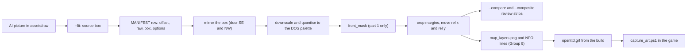

# R2MLM13 - Layer Art: In-Game Review, Regeneration and New Sprites

## Global Mandatory Reading

> **Execution protocol**
>
> - Read this Global Mandatory Reading section before the first task and again
>   after every context compaction.
> - Before starting or resuming a task group, read the nearest preceding Area
>   Mandatory Reading block whose `Applies to` label includes that group. Area
>   blocks appear immediately before the first group they govern.
> - A referenced heading or exported symbol is authoritative. Global navigation
>   hints and Area line ranges are for navigation only; if they drift, relocate
>   the named section or symbol rather than expanding to the whole file.
> - Mandatory reading is non-transitive. Do not preload a linked file's own
>   Mandatory Reading, Consult on Demand, or Planning Provenance entries unless
>   this plan names them directly for the current area.
> - Do not read Consult on Demand or Planning Provenance merely because those
>   sources are listed. Use a Consult on Demand source only when its trigger
>   occurs.
> - No created source file, test file or JSON file should start with same prefix as a planning MD file (such as r2). Only MD files can have that prefix. No MD file should be created anywhere in source directories unless specifically asked.
> - After EVERY CONTEXT COMPACTION, you must add a note above the task group
>   which is currently in execution. The note will say: "Context has compacted
>   X times while executing this group.". If the compaction occurs before any
>   meaningful work was done (this can happen when there is a lot of baggage
>   from the previous compaction), then and ONLY then you can skip this step.
> - When exceeding 3 context compactions, YOU MUST ask yourself if you're not 
>   chewing more than we can handle :). Heck, plans change! :). In such a case, 
>   the way out is to split the group on the spot,
>   in the plan, into more groups, 
>   by appending B, C, D as a suffixes to those groups (splitting sub-groups 
>   themselves is also allowed). When you do this, create Local Mandatory
>   Reading areas so you can optimize your context only for the
>   ACTUAL task at hand.
>   Before starting or resuming a task group, read the nearest preceding Area
>   Mandatory Reading block whose `Applies to` label includes that group. Area
>   blocks appear immediately before the first group they govern.

| File name | Line Ranges | Description |
| --- | --- | --- |
| [r2mlm-multi-layered-map.md](r2mlm-multi-layered-map.md) | 106-108 | `### AD-10 Graphics (owner: r2mlm6)`: map-layer sprites live in OpenTTD's extra GRF as Action 5 type `0x1C` behind `SPR_MAP_LAYER_BASE`. They are made with an AI image tool and quantised to the DOS palette by a repeatable script, and consumers draw named stand-ins until the constants exist. This plan keeps all of that and extends the r2mlm6 tools (D-1). |
| [r2mlm-multi-layered-map.md](r2mlm-multi-layered-map.md) | 141-170 | `## Engineering Conventions` and `## Build and Test Commands`: `//comment` with no space after `//`, a Javadoc block on every function and parameter, English-only strings, no created source, test or JSON file named `r2*`, never `git checkout`, `git reset` or `git stash`, never move or delete files, and the Build Tools 2022 toolchain with the standalone vcpkg (never Visual Studio Community). They bind every edit and build below. |
| [r2rvm-review-map.md](r2rvm-review-map.md) | 569-672 | `### Commands used by every group` and `### Comment and header rules`: the exact configure, build (`/nodeReuse:false`, fully parallel) and unit-test commands, the PrintWindow-only window capture, the rule to tell the user before starting `openttd.exe`, and the file-header rule (`@see` a related `archi-*.md` or `r*.md` page on the `@file` line). "Build Debug" and "run the unit tests" below mean exactly these commands. |
| [r2mlm6-layer-graphics-assets.md](r2mlm6-layer-graphics-assets.md) | 56-76 | `## Sprite Contract`: offsets 0 to 43, their sizes and anchors, the back and front parts, and that `dir` is the door side. `## Sprite Contract Extension` below continues it from offset 44. Every group produces, judges or wires sprites of these two tables. |
| [r2mlm12-deep-underground-tunnels-and-elevators.md](r2mlm12-deep-underground-tunnels-and-elevators.md) | 115-146, 206-215 | `### D-3 Three portal kinds, derived and never stored` and `### D-6 Stand-in art, replaced by r2mlm13`. A portal end's kind comes from its transport and its two layers, which is how the capture script names its scenes. D-6 lists the stand-ins this plan replaces, each marked with a comment naming r2mlm13 Group 9. |

## Outcome and Boundaries

On 2026-10-03, after playing the r2rvm2 build, the user asked to "change icons and tunnel assets to a better-looking more appropriate asset", judged from screenshots taken in the game: the portals and elevators still looked like a rail depot and a road garage. The request was part of [r2mlm12](r2mlm12-deep-underground-tunnels-and-elevators.md) until the user split that plan in two the same day, because it had grown too large. r2mlm12 keeps the gameplay and draws stand-ins (its D-6). This plan makes the art and wires it.

When this plan is done:

- Every r2mlm6 sprite has been judged in the running game, and the ones judged unfit have been regenerated and approved by the user.
- The sprite contract has grown from 44 to 66 sprites (74 with a Deep Underground elevator housing): the Deep Underground icon and floor, and the road tunnel icon, cursor and portal art. The stand-ins of r2mlm12 D-6 are gone.
- The r2mlm6 tools preview single sprites, cut back and front parts from one picture, and mirror directions. With r2mlm6's 44 rows they still rebuild its sheet byte for byte.
- Captures are scripted. `tools/capture_art.ps1` photographs every scene of a gallery save, which later art work can reuse.

Unchanged by design:

- Gameplay: everything r2mlm12 delivered.
- `_tunnel_visibility_frame`, which vanilla tunnels share.
- r2mlm6's pipeline design: Action 5 type `0x1C`, `SPR_MAP_LAYER_BASE`, the DOS palette and one zoom level.

Out of scope:

- Sprites for other zoom levels, and 32bpp sprites.
- Art for trams and for a rail elevator.
- A visibility frame table of the portals' own. If task 9.7 shows the art needs one, task 11.2 records it as a Deferred Point.

Order: r2mlm12, then this plan, then r2mlm10. Groups 6 to 8 need a harness that can generate images from a prompt and reference images, such as Cursor with its `GenerateImage` tool; Group 1 checks for one first.

## Design Decisions

### D-1 Art: review in the game, regenerate what fails, extend the contract

r2mlm6 owns the pipeline:
- the prompt template (r2mlm6 task 2.5);
- `tools/make_sprite_template.py` and `tools/sprite_quantize.py` (its `MANIFEST` is the live list of sprites);
- `media/baseset/openttd/map_layers.nfo` and `map_layers.png`;
- Action 5 type `0x1C`;
- the `SPR_MAP_LAYER_BASE` block in `src/table/sprites.h`.

This plan extends those tools in Group 2 (a longer contract, previews of single sprites, back and front parts cut from one picture, mirrored directions) and never builds a second pipeline.

**Review in the game.** Every delivered sprite is judged from PrintWindow captures of the running game. `tools/capture_art.ps1` (Group 3) takes them on a gallery save built once (Group 4):
- toolbar icons at interface size 1x and 2x;
- ground and structures at three zoom levels;
- structures with a vehicle entering.

A sprite passes when:
- it reads clearly at 20x20 at 1x (for icons);
- it uses TTD lighting from the top left and stays within the DOS palette;
- it means what it stands for: the four layer icons tell apart at a glance, and a portal reads as a tunnel mouth and an elevator as an elevator, never as a depot or a hangar.

The user confirms the final picks.

**Regenerating.** A rejected sprite gets new raw files with a `_v2` (or higher) suffix next to the old ones. Raw files are never overwritten, moved or deleted.

**One picture, two parts.** A structure is generated as one whole picture per door direction:
- the back part is the whole picture, drawn as ground under vehicles;
- the front part is the piece that must cover a vehicle, cut from the same picture by `front_mask` in `tools/sprite_quantize.py`.

Which piece the front part is depends on the door:
- a door on SW or SE faces the viewer, so the front part is the wall standing on the mouth line;
- a door on NE or NW faces away, so the whole structure stands in front of an entering vehicle, and the front part is the whole picture.

Two pictures per structure (door SW and door NE) give all four directions, because the door SE and door NW sprites are their mirrors (r2mlm6 task 4.2). r2mlm6 tried to generate back and front as two aligned pictures, and the back pictures came back holding the whole portal (its Group 4 records). The geometric cut avoids that.

**Cursors.** A cursor is the raw picture of its build icon, quantised at 32 x 32, as a vanilla cursor is a picture of its tool. No cursor is generated on its own, so none can come back as a mouse pointer (r2mlm6 Group 3 records).

**Direction index.** As in r2mlm6 `## Sprite Contract`, `dir` in an offset is the door side of the structure.

**New sprites.** They are appended as offsets 44 to 65 (`## Sprite Contract Extension`), and `MAP_LAYER_SPRITE_COUNT` becomes 66.

**Shared art.** Elevator ends on the Underground and on Deep Underground share the r2mlm6 underground housing (offsets 20 to 27). The review may ask for a Deep Underground housing; it would then be offsets 66 to 73, added by task 7.8.

**Stand-ins replaced.** r2mlm12 D-6 lists the stand-ins this plan replaces. Group 9 wires the real sprites and removes the stand-ins and their comments.

## Sprite Contract Extension

Same conventions as r2mlm6 `## Sprite Contract`: 8bpp, DOS palette, index 0 transparent, zoom `normal`. `dir` is the door side in `DiagDirection` order (NE, SE, SW, NW). `part` is 0 for back and 1 for front, both cut from one picture (D-1). Sizes are upper bounds that the quantiser crops.

| Offset | Constant | Size (w x h) | rel x, rel y | Content |
| --- | --- | --- | --- | --- |
| 44 | `SPR_IMG_MAP_LAYER_DEEP_UNDERGROUND` | 20 x 20 | 0, 0 | Toolbar icon: dark rock strata deep below a thin brown band, with a lit elevator cage. Must not be confused with the Underground icon at 20 x 20 |
| 45 | `SPR_IMG_BUILD_ROAD_LAYER_TUNNEL` | 20 x 20 | 0, 0 | Road toolbar icon: a road ramp entering a tunnel mouth, with a small down arrow |
| 46 | `SPR_CURSOR_ROAD_LAYER_TUNNEL` | 32 x 32 | 0, 0 | Placement cursor: the raw picture of offset 45, quantised at 32 x 32 (D-1) |
| 47-49 | `SPR_MAP_LAYER_DEEP_FLOOR` (+0..2) | 64 x 31 | -31, 0 | Flat dark basalt tile with faint mineral veins, three variants, darker than the Underground floor |
| 50-57 | `SPR_MAP_LAYER_ROAD_TUNNEL_SURFACE` (+dir * 2 + part) | 64 x 48 | -31, -17 | Surface descent: a road ramp into a tunnel mouth, the mouth on the door side `dir` |
| 58-65 | `SPR_MAP_LAYER_ROAD_TUNNEL_UNDERGROUND` (+dir * 2 + part) | 64 x 48 | -31, -17 | Underground emergence: a lit road tunnel mouth in rock, the mouth on the door side `dir` |

## Implementation Tasks

### Area Mandatory Reading - Entry gate and baseline

_Applies to Group 1._

**Entry gate (whole plan).**

- **Required:**
  - every task of [r2mlm12](r2mlm12-deep-underground-tunnels-and-elevators.md) is checked, and its `## Completion Conditions` hold;
  - the r2mlm6 sheet is still the one its 44 rows make;
  - the stand-ins of r2mlm12 D-6 are in the code.
- **How to verify:**
  - read the checkboxes;
  - `grep -n "MAP_LAYER_SPRITE_COUNT" src/table/sprites.h` shows 44;
  - `grep -rn "r2mlm13 Group 9" src` lists the stand-ins of r2mlm12 tasks 2.6, 4.5, 5.2 and 8.2.
- **If absent:** stop every group of this plan. Task 1.1 still runs and records what is missing.
- **Forbidden fallbacks:**
  - running r2mlm12 or r2mlm6 tasks from this plan;
  - editing `openttd.grf` by hand, or copying sprites from another NewGRF or base set.

| File name | Line Ranges | Description |
| --- | --- | --- |
| [r2mlm12-deep-underground-tunnels-and-elevators.md](r2mlm12-deep-underground-tunnels-and-elevators.md) | 813-822 | `## Completion Conditions` of r2mlm12: the gameplay this plan draws for. Only these conditions are checked; r2mlm12's own reading lists are not loaded. |
| [r2mlm6-layer-graphics-assets.md](r2mlm6-layer-graphics-assets.md) | 258-263 | `## Completion Conditions` of r2mlm6: the 44-sprite sheet this plan starts from. |
| [tools/ottd_window.ps1](tools/ottd_window.ps1) | 1-8, 25-131 | The capture and input helper: `Start-Ottd`, `Save-OttdShot` (PrintWindow, game window only), `Send-OttdClick`, `Send-OttdKey` and `Stop-Ottd`. Every screenshot in this plan uses it, and input is only ever posted to the game window, never sent through the user's mouse or keyboard. |

### Group 1 - Entry gate and baseline

{{SIMPLE}}
- [ ] 1.1 Check the entry gate above and record each of its three conditions under this task, with the grep output. If one fails, stop here and tell the user which plan must finish first.
- [ ] 1.2 Build Debug and RelWithDebInfo, and run the unit tests. Record the pass count under this task as this plan's baseline.
- [ ] 1.3 Check whether this session has an image-generation tool that accepts reference images (r2mlm6 used Cursor's `GenerateImage`), and record the answer. If it has none, tell the user now: Groups 2 to 5 can run here, but Groups 6 to 8 must run in a session that has one, and Groups 9 to 11 come after them.
- [ ] 1.4 Confirm that `build/save/deep_pre_portals.sav` (r2mlm12 task 1.3), the `r2mlm12-a-...` captures of r2mlm12 task 1.4 and the `r2mlm12-b-...` captures of r2mlm12 task 9.1 exist, and list them under this task. Groups 4, 5 and 10 compare new captures with them.

### Area Mandatory Reading - Sprite pipeline extension

_Applies to Group 2._

The pipeline after Group 2 (D-1). One raw picture can feed several offsets: back and front, and a mirrored direction.



| File name | Line Ranges | Description |
| --- | --- | --- |
| [r2mlm6-layer-graphics-assets.md](r2mlm6-layer-graphics-assets.md) | 56-76 | `## Sprite Contract`: offsets 0 to 43, sizes, anchors, the back and front parts, and that `dir` is the door side. This plan's `## Sprite Contract Extension` continues it from offset 44. |
| [tools/sprite_quantize.py](tools/sprite_quantize.py) | 19-35, 174-190, 266-298 | The 44-entry `CONTRACT` loop and the empty `MANIFEST` of `(offset, path, box)` rows, `quantise_file`, and `main` with its `len(MANIFEST) != 44` check and a `--preview` that needs the whole manifest. Group 2 changes exactly these. |
| [tools/png_indexed.py](tools/png_indexed.py) | 22, 105-126 | `read_png` (width, height, colour type, palette, pixels), `write_rgb_png` and `write_indexed_png`: the only image calls the quantiser uses, so it runs without Pillow. |
| [tools/make_sprite_template.py](tools/make_sprite_template.py) | 20-34 | `GUIDES` (boxes and anchors at 4x) and `REFERENCES` (base-set crops). Task 2.7 adds one reference row. |
| [src/layer_portal_cmd.cpp](../../../../src/layer_portal_cmd.cpp) | 75-101 | `GetLayerPortalDepth` (0 at the door edge) and `IsHiddenInLayerPortal` (hidden from the visibility frame on): why a mouth may stand no deeper than the frame (task 2.3). |
| [src/tunnelbridge_cmd.cpp](../../../../src/tunnelbridge_cmd.cpp) | 1968 | `_tunnel_visibility_frame{12, 8, 8, 12}`, indexed by shaft direction (NE, SE, SW, NW), shared with vanilla tunnels. |
| [media/baseset/openttd/openttdgui.nfo](../../../../media/baseset/openttd/openttdgui.nfo) | 188-189 | The vanilla convert-road icon (20 x 20) and its cursor (32 x 32) side by side in one PNG: the cursor is the icon's picture, which task 2.7 copies as a style reference. |

### Group 2 - Sprite pipeline extension

{{MEDIUM}}
- [ ] 2.1 In `tools/sprite_quantize.py`, replace the `CONTRACT` loop with a table that covers this plan's offsets too:
  ```python
  #Contract order: r2mlm6 ## Sprite Contract, then r2mlm13 ## Sprite Contract Extension.
  #Each row is first offset, last offset, width, height, rel x and rel y. rel is the anchor before transparent margins are cropped.
  CONTRACT_RANGES = [
      (0, 4, 20, 20, 0, 0),        #layer icons and build icons
      (5, 6, 32, 32, 0, 0),        #cursors
      (7, 11, 64, 31, -31, 0),     #Underground and Space floors
      (12, 27, 64, 64, -31, -33),  #road elevators
      (28, 43, 64, 48, -31, -17),  #rail portals
      (44, 45, 20, 20, 0, 0),      #Deep Underground icon, road tunnel build icon
      (46, 46, 32, 32, 0, 0),      #road tunnel cursor
      (47, 49, 64, 31, -31, 0),    #Deep Underground floor
      (50, 65, 64, 48, -31, -17),  #road tunnels
      #(66, 73, 64, 64, -31, -33), #Deep Underground elevator housing, only when task 5.3 asks for it (task 7.8)
  ]
  CONTRACT = []
  for first, last, width, height, rel_x, rel_y in CONTRACT_RANGES:
      CONTRACT.extend([(width, height, rel_x, rel_y)] * (last - first + 1))
  #A gap between rows would give every later offset the wrong box.
  assert all(row[0] == previous[1] + 1 for previous, row in zip(CONTRACT_RANGES, CONTRACT_RANGES[1:]))
  ```
  In `main`, replace the `len(MANIFEST) != 44` check with one against `len(CONTRACT)` that names the missing offsets.
  - ASSUMPTION: this was already built previously (r2mlm6 Groups 5 and 6 left the loop above and a 44-row `MANIFEST` of `(offset, path, box)`). If not, re-assess at runtime and keep every change an extension of what is there.
- [ ] 2.2 Let a `MANIFEST` row carry an optional fourth item, a dict of options. Rows without it are the r2mlm6 rows and behave as before.
  ```python
  #Options of a MANIFEST row (r2mlm13 D-1):
  #  mirror: read the source box right to left, for the door SE and NW sprites made from the door SW and NE pictures.
  #  part:   "back" keeps the whole picture, "front" keeps only front_mask(door, depth).
  #  door:   DiagDirection index of the door of the sprite being written: 0 NE, 1 SE, 2 SW, 3 NW.
  #  depth:  mouth distance from the door edge in tile units, needed by front parts with the door on SW or SE.
  ```
  - `downscale` gains `mirror=False`. A mirrored pixel reads `origin_x + box_w - 1 - (sx - origin_x)` instead of `sx`, so the tile stays on its anchor.
  - `quantise_file` gains `options=None`. It passes `mirror` to `downscale`, and for `part == "front"` sets every index outside `front_mask` to 0 before `crop_and_shift`.
  - `main` unpacks `offset, path, box, *rest` and passes `rest[0]` when present.
- [ ] 2.3 Add `tile_to_sprite`, `front_mask` and the frame table:
  ```python
  #Visibility frame of each shaft direction (NE, SE, SW, NW), copied from _tunnel_visibility_frame in tunnelbridge_cmd.cpp.
  #A vehicle is hidden once its depth from the door edge reaches this, so a mouth must stand no deeper.
  SHAFT_FRAME = (12, 8, 8, 12)


  def tile_to_sprite(x, y, anchor):
      """Sprite pixel of a ground point of the tile at normal zoom.

      The viewport's RemapCoords divided by ZOOM_BASE. The north corner lies between two columns, hence the half pixel.

      @param x In-tile X in tile units: 0 at the north corner, 16 at the SW edge.
      @param y In-tile Y in tile units: 0 at the north corner, 16 at the SE edge.
      @param anchor Sprite pixel of the tile's north corner, (-rel x, -rel y) of the contract.
      @return Column and row inside the sprite, as floats.
      """
      return anchor[0] + 0.5 + 2 * (y - x), anchor[1] + x + y


  def front_mask(door, depth, width, height, anchor):
      """Pixels of a contract-sized structure sprite that belong to its front part (D-1).

      Door NE or NW: the mouth faces away, so the whole structure stands in front of an entering vehicle.
      Door SW or SE: the mouth faces the viewer, so the front part is the wall standing on the mouth line,
      which crosses the tile depth tile units in from the door edge and rises to the top of the sprite.

      @param door DiagDirection index of the door: 0 NE, 1 SE, 2 SW, 3 NW.
      @param depth Mouth distance from the door edge in tile units, 1 to the shaft's visibility frame.
      @param width Contract width.
      @param height Contract height.
      @param anchor Sprite pixel of the tile's north corner.
      @return Set of (column, row) pixels to keep.
      """
      if door in (0, 3):
          return {(column, row) for row in range(height) for column in range(width)}
      shaft = door ^ 2
      if not 1 <= depth <= SHAFT_FRAME[shaft]:
          raise SystemExit(f"mouth depth {depth} must be 1 to {SHAFT_FRAME[shaft]} for door {door}")
      #Door SW: the door edge is x = 16, so the mouth line is x = 16 - depth. Door SE: the same along y.
      if door == 2:
          ends = (tile_to_sprite(16 - depth, 0, anchor), tile_to_sprite(16 - depth, 16, anchor))
      else:
          ends = (tile_to_sprite(0, 16 - depth, anchor), tile_to_sprite(16, 16 - depth, anchor))
      (left_x, left_y), (right_x, right_y) = sorted(ends)
      keep = set()
      for column in range(max(0, int(left_x)), min(width, int(right_x) + 1)):
          #Row of the mouth line under this column. The wall is everything above it.
          line_row = left_y + (right_y - left_y) * (column + 0.5 - left_x) / max(1.0, right_x - left_x)
          keep.update((column, row) for row in range(0, min(height, int(line_row) + 1)))
      return keep
  ```
  Below the code, add a comment that mirrored front parts use the mask of their own door, so a door SE sprite made from a door SW picture keeps the same depth.
- [ ] 2.4 Add `--fit <offset> <raw> [x,y,w,h]`, which prints `box <x> <y> <w> <h> cut <rows>`:
  ```python
  #Colour of the guide's anchor cross (make_sprite_template.ANCHOR). A copied cross must not stretch the box.
  GUIDE_RED = (220, 40, 40)


  def fit_box(path, offset, region=None):
      """Source box that maps a raw picture onto its contract box (D-1).

      Icons and cursors: the square around the subject, with one contract pixel of margin on each side.
      Ground and structures: the subject's width becomes the 64-pixel tile and its lowest row the tile's
      south corner, which puts the north corner on the anchor.

      @param path Raw picture.
      @param offset Contract offset.
      @param region Optional (x, y, w, h) to search in, for one variant of a floor sheet.
      @return The box (x, y, w, h) and how many subject rows fall above it, 0 when everything fits.
      """
      width, height, colour_type, palette, pixels = png_indexed.read_png(path)
      rx, ry, rw, rh = region or (0, 0, width, height)
      left, top, right, bottom = width, height, 0, 0
      for y in range(ry, ry + rh):
          for x in range(rx, rx + rw):
              colour = _rgb_of(pixels, width, colour_type, palette, x, y)
              if colour is None or all(abs(c - g) <= 30 for c, g in zip(colour, GUIDE_RED)):
                  continue
              left, top, right, bottom = min(left, x), min(top, y), max(right, x + 1), max(bottom, y + 1)
      dest_w, dest_h, _rel_x, _rel_y = CONTRACT[offset]
      if dest_w == dest_h:
          side = max(right - left, bottom - top) * dest_w // (dest_w - 2)
          box = ((left + right - side) // 2, (top + bottom - side) // 2, side, side)
          cut = 0
      else:
          box_w = right - left
          box_h = box_w * dest_h // dest_w
          box = (left, bottom - box_h, box_w, box_h)
          cut = max(0, box[1] - top)
      if box[0] < 0 or box[1] < 0 or box[0] + box[2] > width or box[1] + box[3] > height:
          raise SystemExit("the box leaves the picture; regenerate it with more magenta around the subject")
      return box, cut
  ```
  A `cut` above 0 means the structure is taller than its contract box allows. Regenerate it lower, or accept the cut only after looking at the `--compare` output.
- [ ] 2.5 Add `--compare <offset> <out.png> <raw>[@x,y,w,h][@mirror] ...`. Each candidate without a box is fitted with `fit_box`. The output is one RGB PNG (index 0 drawn mid-grey) with every candidate at 1x and at 4x, side by side. For a ground offset it also shows a 3 x 3 patch of the candidate, so seams and tone show:
  ```python
  def ground_patch(indices, width, height, rel_x, rel_y):
      """Nine copies of one ground sprite as a 3 x 3 block of tiles.

      @param indices Cropped sprite indices.
      @param width Sprite width.
      @param height Sprite height.
      @param rel_x Sprite x offset from the tile's north corner.
      @param rel_y Sprite y offset from the tile's north corner.
      @return Patch width, height and indices, 0 where no tile covers.
      """
      patch_w, patch_h = 64 * 4, 32 * 3 + height
      patch = [0] * (patch_w * patch_h)
      #Tile (i, j) has its north corner 32 * (j - i) right of and 16 * (i + j) below the north corner of tile (0, 0).
      for i in range(3):
          for j in range(3):
              left = 128 + rel_x + 32 * (j - i)
              top = rel_y + 16 * (i + j)
              for y in range(height):
                  for x in range(width):
                      if indices[y * width + x] != 0:
                          patch[(top + y) * patch_w + left + x] = indices[y * width + x]
      return patch_w, patch_h, patch
  ```
- [ ] 2.6 Add `--composite <offset> <door> <depth> <out.png> <raw>[@x,y,w,h][@mirror]`. It builds the back and front parts of one picture for that offset's contract box. Then it writes a 4x strip of frames, each with:
  - a flat grey diamond;
  - the back part;
  - a bus-sized box at depths 0, 2, 4 and on, while the depth is below `SHAFT_FRAME[door ^ 2]`;
  - the front part.

  One more frame at the frame depth shows the structure without the box, because the game hides the bus there. The box:
  - is 10 tile units long, 6 wide and 6 high, centred on the tile's middle line (lanes are ignored);
  - has its centre at `(depth, 8)` for door NE, `(8, 16 - depth)` for door SE, `(16 - depth, 8)` for door SW and `(8, depth)` for door NW;
  - has its eight corners projected with `tile_to_sprite` and then moved up by their height, as `RemapCoords` does;
  - is drawn as the convex hull of those corners, in one bright palette colour.
- [ ] 2.7 Two smaller changes:
  - add `--out <path>` to `sprite_quantize.py` (default `SHEET`). The full-manifest check applies to `SHEET` only; a scratch sheet may hold offsets 0 to n - 1, which is how task 2.8 replays the r2mlm6 sheet;
  - add the row `("media/baseset/openttd/openttdgui_convert_road.png", 0, 0, 56, 32, "toolbar_icon_and_cursor.png")` to `REFERENCES` in `make_sprite_template.py`, run the script, and confirm with `git status` that only `assets/reference/toolbar_icon_and_cursor.png` is new and no guide changed.
- [ ] 2.8 Self-checks. Record each command and result under this task:
  - with the unchanged 44 rows, `sprite_quantize.py --out <TEMP>/sheet44.png` is byte-identical to `media/baseset/openttd/map_layers.png`, and the lines it prints equal the real-sprite lines of `map_layers.nfo`;
  - `--fit 28 docs/zz-reach2/upgrades/2026-10/assets/raw/rail_portal_surface_ne_back.png` prints a box and a `cut`. That picture's mound is taller than 48 / 64 of its width and carries a copied anchor cross, so expect a cut above 0;
  - `--compare 1` on `layer_icon_underground.png` and `layer_icon_space.png` writes one sheet;
  - `--composite 32 2 12` on the same rail portal picture (its mouth faces the lower left, so its door is SW), and `--composite 30 1 12` on it with `@mirror`, write two strips in which the wall covers the box from the mouth on.

### Area Mandatory Reading - Capture tooling

_Applies to Group 3._

| File name | Line Ranges | Description |
| --- | --- | --- |
| [tools/ottd_window.ps1](tools/ottd_window.ps1) | 1-8, 25-131 | The header and the existing functions. `Save-OttdShot` returns the client offset inside the capture; `Send-OttdKey` posts key down, an optional character and key up. Task 3.1 adds functions after them. |
| [src/console_cmds.cpp](../../../../src/console_cmds.cpp) | 313-412 | `ConZoomToLevel` (`zoomto <level>`: 0 is zoomed in 4x, 2 normal, 5 zoomed out 8x, within `gui.zoom_min` and `gui.zoom_max`) and `ConScrollToTile` (`scrollto [instant] <tile>`, any tile below `Map::Size()`, so a tile of any layer). |
| [src/viewport.cpp](../../../../src/viewport.cpp) | 2595-2640 | `ScrollWindowTo`: a world point names its own layer, so scrolling to a tile of another layer switches the viewport to that layer and redraws the toolbar. |
| [src/video/win32_v.cpp](../../../../src/video/win32_v.cpp) | 677-729 | `WM_CHAR` and `WM_KEYDOWN`. The console key is scan code 41 in `lParam` bits 16 to 23, whatever the layout. With no edit box in focus a key down is handled at once; with one in focus the game waits for the character, which its own `TranslateMessage` makes (line 1032). |
| [tools/savegame_plane_digest.py](tools/savegame_plane_digest.py) | 1-28, 106-142 | The header and the chunk loop, where RIFF map planes are read. Task 3.4 hooks `--portals` in there. |
| [src/tile_type.h](../../../../src/tile_type.h) | 48-63 | `TileType`: `LayerPortal` is value 11, stored in bits 7 to 4 of each `MAPT` byte. |
| [src/layer_portal_map.h](../../../../src/layer_portal_map.h) | 28-88 | The `m5` fields of an end: shaft in bits 1..0, transport in bits 3..2 (0 rail, 1 road), target layer in bits 6..5. The door is the reverse of the shaft (`d ^ 2`). |

### Group 3 - Capture tooling

{{MEDIUM}}
- [ ] 3.1 In `tools/ottd_window.ps1`, add these functions after `Send-OttdKey`, each with a comment block like the others, and list them in the header:
  ```powershell
  <#
  .SYNOPSIS Open or close the in-game console, as the key left of 1 does.
  .PARAMETER Process The game process.
  #>
  function Switch-OttdConsole($Process) {
  	$h = $Process.MainWindowHandle
  	#The game knows the console key by scan code 41 in bits 16..23 (win32_v.cpp WM_KEYDOWN). Only key down and up are posted:
  	#with the console closed the key down alone opens it, and with it open the game's TranslateMessage makes the character that closes it.
  	[void][OttdWin]::PostMessage($h, 0x0100, [IntPtr]0xC0, [IntPtr](1 -bor (41 -shl 16)))
  	Start-Sleep -Milliseconds 100
  	[void][OttdWin]::PostMessage($h, 0x0101, [IntPtr]0xC0, [IntPtr](0xC0000001 -bor (41 -shl 16)))
  }

  <#
  .SYNOPSIS Run one console command: open the console, type the command, press Return, close the console.
  .PARAMETER Process The game process.
  .PARAMETER Command Console command, for example "scrollto instant 4660".
  #>
  function Invoke-OttdConsole($Process, [string]$Command) {
  	Switch-OttdConsole $Process
  	Start-Sleep -Milliseconds 300
  	#The console's edit box takes typed text as WM_CHAR.
  	foreach ($c in $Command.ToCharArray()) { [void][OttdWin]::PostMessage($Process.MainWindowHandle, 0x0102, [IntPtr][int]$c, [IntPtr]1) }
  	#Return without a posted character: the game's TranslateMessage makes the one the edit box needs.
  	Send-OttdKey $Process 0x0D 0
  	Start-Sleep -Milliseconds 300
  	Switch-OttdConsole $Process
  	Start-Sleep -Milliseconds 500
  }
  ```
  Also add:
  - `Get-OttdBitmap($Process)`: the PrintWindow part of `Save-OttdShot`, returning the bitmap and the client offset. `Save-OttdShot` then calls it, with unchanged behaviour;
  - `Get-OttdCentre($Process)`: the client centre in capture pixels, from `GetWindowRect` and `ClientToScreen`, taking the bottom border as wide as the side border. `scrollto` centres its tile there, because the main viewport fills the client area;
  - `Save-OttdCrop($Process, $Path, $Left, $Top, $Width, $Height)`: capture and keep one rectangle;
  - `Save-OttdBurst($Process, $Folder, $Seconds, $IntervalMs, $Left, $Top, $Width, $Height)`: `Save-OttdCrop` into `frame-0000.png` and on until the time is up. It returns the frame count.
- [ ] 3.2 Write `tools/contact_sheet.py` (Pillow, which r2mlm6 task 1.1 installed). It has a module docstring naming this plan, a docstring on every function, and a `grid` mode:
  ```python
  def grid(paths, columns, zoom, out):
      """One sheet with every picture enlarged by zoom and its file name under it.

      @param paths PNG files, in reading order.
      @param columns Pictures per row.
      @param zoom Whole-number enlargement.
      @param out Sheet to write.
      @return None.
      """
      cells = [Image.open(path).convert("RGB") for path in paths]
      cell_w = max(cell.width for cell in cells) * zoom
      cell_h = max(cell.height for cell in cells) * zoom + 14
      rows = (len(cells) + columns - 1) // columns
      sheet = Image.new("RGB", (cell_w * columns, cell_h * rows), (64, 64, 64))
      draw = ImageDraw.Draw(sheet)
      for index, (path, cell) in enumerate(zip(paths, cells)):
          x, y = (index % columns) * cell_w, (index // columns) * cell_h
          #Nearest neighbour keeps the pixels square, as the game draws them.
          sheet.paste(cell.resize((cell.width * zoom, cell.height * zoom), Image.NEAREST), (x, y))
          draw.text((x + 2, y + cell_h - 13), os.path.splitext(os.path.basename(path))[0], fill=(255, 255, 255))
      sheet.save(out)
  ```
  Usage: `python -B tools/contact_sheet.py grid <out.png> <columns> <zoom> <png> ...`.
- [ ] 3.3 Add a `pick` mode to `contact_sheet.py`: `pick <scenes.csv> <out folder> <count>`. Each CSV row is `burst folder,end name,left,top,right,bottom`. For each row it writes `<out folder>/<end name>.png`: a 2x grid of the `count` frames that differ most, inside that box, from the empty scene.
  ```python
  def changed_frames(paths, box, count):
      """The burst frames in which something passes inside one box, most changed first.

      The per-pixel median over the burst is the scene without traffic, because a vehicle covers any spot only briefly.

      @param paths Frames of one burst, all the same size.
      @param box (left, top, right, bottom) inside each frame.
      @param count How many frames to return.
      @return The chosen paths.
      """
      data = [list(Image.open(path).convert("RGB").crop(box).getdata()) for path in paths]
      middle = len(data) // 2
      median = [tuple(sorted(frame[i][channel] for frame in data)[middle] for channel in range(3)) for i in range(len(data[0]))]
      scores = [sum(abs(a - b) for pixel, base in zip(frame, median) for a, b in zip(pixel, base)) for frame in data]
      ranked = sorted(range(len(paths)), key=lambda index: -scores[index])
      return [paths[index] for index in ranked[:count]]
  ```
- [ ] 3.4 Add `--portals --size-x <n> --size-y <n>` to `tools/savegame_plane_digest.py`. It keeps the `MAPT` and `MAP5` payloads from the chunk loop, then prints one line per portal end instead of the digests:
  ```python
  def list_portals(planes, size_x, size_y):
      """Print one line per layer portal end of a save.

      @param planes Payload of each map plane chunk, by chunk id.
      @param size_x Tiles along X of one layer.
      @param size_y Tiles along Y of one layer.
      @return None.
      """
      names = ("NE", "SE", "SW", "NW")
      plane = size_x * size_y
      for index, tile_type in enumerate(planes[b"MAPT"]):
          #TileType::LayerPortal is 11, kept in bits 7..4 of the type byte (tile_map.h GetTileType).
          if tile_type >> 4 != 11:
              continue
          m5 = planes[b"MAP5"][index]
          layer, rest = divmod(index, plane)
          y, x = divmod(rest, size_x)
          transport = "rail" if (m5 >> 2) & 3 == 0 else "road"
          #The door is the reverse of the shaft (r2mlm7 Portal Contract), which flips bit 1 of a DiagDirection.
          print(f"portal tile {index} layer {layer} x {x} y {y} shaft {names[m5 & 3]} door {names[(m5 & 3) ^ 2]} transport {transport} target {(m5 >> 5) & 3}")
  ```
  Update the module docstring's usage line.
- [ ] 3.5 Write `tools/capture_art.ps1` with a comment header naming this plan and Groups 3, 4, 9 and 10. Parameters: `-Build`, `-Config` (Debug), `-Cfg`, `-Save`, `-Out`, `-SizeX` and `-SizeY` (64), `-Zooms` (1, 2, 3), the UI click points of task 3.6, and `-NoUi` and `-NoTraffic` switches. It first takes static scenes of every portal end:
  ```powershell
  . "$PSScriptRoot\ottd_window.ps1"
  $layerNames = @('surface', 'underground', 'space', 'deep')
  #One line per portal end: portal tile <i> layer <l> x <x> y <y> shaft <d> door <d> transport <t> target <l>
  $ends = & python -B "$PSScriptRoot\savegame_plane_digest.py" $Save --portals --size-x $SizeX --size-y $SizeY | ForEach-Object {
  	$f = $_ -split ' '
  	$layer = [int]$f[4]; $target = [int]$f[16]
  	#r2mlm12 D-3: the kind comes from the transport and the two layers.
  	$kind = if ($f[14] -eq 'rail') { 'railtunnel' } elseif ($layer -eq 3 -or $target -eq 3) { 'elevator' } else { 'roadtunnel' }
  	[pscustomobject]@{ Tile = [int]$f[2]; Layer = $layer; X = [int]$f[6]; Y = [int]$f[8]; Door = $f[12].ToLower(); Kind = $kind }
  }
  $p = Start-Ottd $Build $Config @('-c', $Cfg, '-g', $Save)
  #A paused game keeps vehicles still, so the static shots repeat exactly.
  Invoke-OttdConsole $p 'pause'
  $c = Get-OttdCentre $p
  foreach ($e in $ends) {
  	Invoke-OttdConsole $p "scrollto instant $($e.Tile)"
  	foreach ($z in $Zooms) {
  		Invoke-OttdConsole $p "zoomto $z"
  		Save-OttdCrop $p (Join-Path $Out ('{0}-{1}-door-{2}-z{3}.png' -f $e.Kind, $layerNames[$e.Layer], $e.Door, $z)) ($c.X - 160) ($c.Y - 120) 320 240
  	}
  }
  ```
  It then takes floor scenes: the empty middle of the first loop, on layers 1, 2 and 3, at every zoom (`floor-<layer>-z<zoom>.png`).
- [ ] 3.6 Add the UI scenes to `capture_art.ps1`, skipped with `-NoUi`. Click points are client coordinates passed as parameters, found in task 3.8:
  - `ui-toolbar-<layer>.png`: the top strip of the window, 24 pixels times the interface scale tall, after `scrollto` to a tile of each layer in display order;
  - `ui-layer-dropdown.png`: the window after `Send-OttdClick` on `-LayerButton`, then Escape (`Send-OttdKey $p 0x1B 0`);
  - `ui-road-toolbar.png` and `ui-rail-toolbar.png`: the window after a click on each toolbar's main-toolbar button;
  - `ui-cursor-<tool>.png`: for the road tunnel, road elevator and rail portal tools, a click on the tool, `Send-OttdHover` to the client centre, then a 96 x 96 crop there.
  - ASSUMPTION: the game draws its own cursor into the frame, so PrintWindow sees it. If not, record that, and judge cursors from `--compare` at 1x only.
- [ ] 3.7 Add the traffic scenes to `capture_art.ps1`, skipped with `-NoTraffic`. For each kind, and each layer that kind has ends on:
  - scroll to the loop's middle tile on that layer, `zoomto 2`, `unpause`;
  - run `Save-OttdBurst` over a 720 x 400 rectangle at the centre for `-LapSeconds` (rail 40, road tunnel 50, elevator 100, at 400 ms), into `traffic-<kind>-<layer>/`, then `pause`;
  - for every end in that view, add a row to `<Out>/scenes.csv`, its box centred on the end's tile:
  ```powershell
  		#At normal zoom a tile step is 32 pixels across and 16 down per unit of (y - x) and (x + y): RemapCoords divided by ZOOM_BASE.
  		$sx = 360 + 32 * (($e.Y - $midY) - ($e.X - $midX))
  		$sy = 200 + 16 * (($e.X - $midX) + ($e.Y - $midY)) - 16
  		Add-Content (Join-Path $Out 'scenes.csv') ('{0},{1}-{2}-door-{3},{4},{5},{6},{7}' -f $folder, $e.Kind, $layerNames[$e.Layer], $e.Door, ($sx - 80), ($sy - 60), ($sx + 80), ($sy + 60))
  ```
  The bursts take about 300 MB in `build/art-captures/`. Nothing there is committed.
- [ ] 3.8 Dry run on `build/save/deep_pre_portals.sav` (r2mlm12 task 1.3), whose road portals load as road tunnels. Tell the user first, then:
  - run `capture_art.ps1 -NoTraffic` at 1x into `build/art-captures/dry-run/`;
  - check that a lower-end capture shows lower-layer ground (so `scrollto` switched layers), that the three zooms differ, and that each crop is centred on its tile;
  - find the UI click points in a full capture, and record them with the exact command under this task.

### Area Mandatory Reading - Art gallery and review

_Applies to Groups 4-5._

| File name | Line Ranges | Description |
| --- | --- | --- |
| [src/table/settings/misc_settings.ini](../../../../src/table/settings/misc_settings.ini) | 318-325 | `gui_scale`, saved in `[misc]`: -1 is automatic, otherwise a percentage (100 is 1x, 200 is 2x). |
| [r2mlm6-layer-graphics-assets.md](r2mlm6-layer-graphics-assets.md) | 56-76 | `## Sprite Contract`: what each offset 0 to 43 should show. With this plan's `## Sprite Contract Extension`, the list the verdicts of Group 5 cover. |
| [r2mlm6-layer-graphics-assets.md](r2mlm6-layer-graphics-assets.md) | 145-184 | Task 3.6 and 4.8 records: the raw file of each offset and what went wrong before (the guide's box copied into a picture, the rail cursor drawn as a mouse pointer, icons unreadable at 20 x 20, back pictures holding the whole portal). The rubric of task 5.1 checks for each of these. |
| [tools/capture_art.ps1](tools/capture_art.ps1), [tools/contact_sheet.py](tools/contact_sheet.py) | Live definitions; no fixed range | Produced by Group 3: the scene names, parameters and modes used below. |

### Group 4 - Art gallery and review captures

{{MEDIUM}}
- [ ] 4.1 Write `build/art_1x.cfg` and `build/art_2x.cfg` as copies of `build/scenario.cfg` with these values:

  | Section | Key | `art_1x.cfg` | `art_2x.cfg` | Why |
  | --- | --- | --- | --- | --- |
  | `[misc]` | `gui_scale` | 100 | 200 | the two interface sizes of D-1 |
  | `[game_creation]` | `map_x`, `map_y` | 6, 6 | 6, 6 | a 64 x 64 gallery map |
  | `[game_creation]` | `amount_of_rivers` | 0 | 0 | no river across a loop |
  | `[difficulty]` | `terrain_type`, `quantity_sea_lakes` | 0, 0 | 0, 0 | very flat dry land, as portals need flat tiles |
  | `[difficulty]` | `number_towns` | 0 | 0 | the fewest towns |
  | `[difficulty]` | `vehicle_breakdowns` | 0 | 0 | no breakdowns or servicing detours during captures |
  | `[difficulty]` | `infinite_money` | true | true | the user builds without a money limit |
- [ ] 4.2 Ask the user to build the gallery in the Debug build, started with `-c art_1x.cfg -g`, and to save it as `build/save/art_gallery.sav`. It takes about 20 minutes. Give them this layout:

  | Loop | Kind | Lower layer | Suggested north corner (x0, y0) | Vehicle |
  | --- | --- | --- | --- | --- |
  | R | Rail tunnel | Underground | (8, 8) | one train of an engine and two wagons, no orders |
  | T | Road tunnel | Underground | (8, 30) | one bus, no orders |
  | E | Road elevator from the Surface | Deep Underground | (30, 8) | one bus, no orders |

  Each loop is a 10 x 10 square with four portals:

  | Portal | Surface tile | Door of the surface end | The vehicle |
  | --- | --- | --- | --- |
  | P1 | (x0 + 7, y0 + 9) | SW | goes down heading NE |
  | P2 | (x0 + 3, y0 + 9) | NE | comes up heading NE |
  | P3 | (x0, y0 + 7) | SE | goes down heading NW |
  | P4 | (x0, y0 + 3) | NW | comes up heading NW |

  - On the Surface, road or track runs round the square's border, except on the tiles between P1 and P2 and between P3 and P4. A depot sits outside the side at x0 + 9.
  - On the lower layer, road or track joins P1's lower end to P2's (x0 + 4 to x0 + 6 at y0 + 9), and P3's to P4's (y0 + 4 to y0 + 6 at x0).
  - Exact positions do not matter, because task 4.3 reads the portals from the save. The doors do matter: the four surface ends then cover all four doors, and so do the four lower ends.

  One lap of a loop:
  ```mermaid
  flowchart LR
      D["Depot on side x0 + 9"] --> S4["Side x0 + 9, heading SE"]
      S4 --> P1["P1 surface end, door SW"]
      P1 -->|down| L1["P1 lower end"]
      L1 --> L2["P2 lower end"]
      L2 -->|up| P2["P2 surface end, door NE"]
      P2 --> P3["P3 surface end, door SE"]
      P3 -->|down| L3["P3 lower end"]
      L3 --> L4["P4 lower end"]
      L4 -->|up| P4["P4 surface end, door NW"]
      P4 --> S3["Side y0, heading SW"]
      S3 --> S4
  ```
  A vehicle that runs the lap the other way still passes every portal. If one shuttles on one side instead, make sides y0 and x0 + 9 one-way in the lap's direction.
  - ASSUMPTION: this was already built previously (r2mlm12 Groups 4 to 7: Deep Underground, the road tunnel button, the elevator picker and the elevator ride). If not, re-assess at runtime.
- [ ] 4.3 Run `savegame_plane_digest.py build/save/art_gallery.sav --portals --size-x 64 --size-y 64` and paste the output under this task. It must list 24 ends:
  - per loop, surface ends with doors SW, NE, SE and NW, and lower ends with doors NE, SW, NW and SE;
  - transport `rail` only for loop R;
  - targets 1 for loops R and T and 3 for loop E on the Surface, and 0 on every lower end.

  If an end is missing, ask the user to fix the gallery.
- [ ] 4.4 Tell the user, then run `capture_art.ps1` with `-Cfg art_1x.cfg` into `build/art-captures/review-1x/`: static, UI and traffic scenes.
- [ ] 4.5 Run it again with `-Cfg art_2x.cfg -NoTraffic` into `build/art-captures/review-2x/`. At 2x only the interface changes, so the traffic bursts of task 4.4 are enough.
- [ ] 4.6 Make the review sheets with `contact_sheet.py grid` and save them next to this plan:
  - `r2mlm13-b-icons.png`: the toolbar strips and the open dropdown at 1x and 2x;
  - `r2mlm13-b-toolbars.png`: the road and rail toolbars at 1x and 2x;
  - `r2mlm13-b-cursors.png`;
  - `r2mlm13-b-floors.png`: three layers by three zooms;
  - `r2mlm13-b-<kind>-z<zoom>.png`: eight ends per sheet, for each kind and zoom.
- [ ] 4.7 Run `contact_sheet.py pick build/art-captures/review-1x/scenes.csv build/art-captures/review-1x/picked 6`. Combine the picks of each kind into `r2mlm13-b-entering-<kind>.png` next to this plan. List every sheet of tasks 4.6 and 4.7 under this task, one line each.

### Group 5 - Art review verdicts

{{MEDIUM}}
- [ ] 5.1 Judge each sprite with this rubric. "1x" means interface size 1x at zoom 2, unless a column says otherwise.

  | Category | Offsets | Passes when | Typical failure |
  | --- | --- | --- | --- |
  | Layer icons | 0-2, 44 | Each layer can be named from its toolbar icon alone. The four icons differ in dominant colour and in silhouette, and their edges stay crisp at 2x | Two icons share one dark palette, or detail turns to noise at 20 x 20 |
  | Build icons | 3-4, 45 | Reads as its tool beside the vanilla buttons, with the same outline weight and no text | An elevator icon that reads as a door or a lift button |
  | Cursors | 5-6, 46 | Matches its build icon; it is a picture, not an arrow | A mouse pointer (r2mlm6 records) |
  | Floors | 7-11, 47-49 | No seam or diamond outline at any zoom. Underground is clearly darker than grass, and Deep Underground darker again. Outer Space reads as vacuum with sparse stars, with no moiré at zoom 3 | Visible tile borders; one variant much brighter than the others |
  | Structures | 12-43, 50-65 | Reads as an elevator house or a tunnel mouth, never as a depot or a hangar. It stands on its own tile, with no float and no overhang beyond one pixel, lit from the top left. In the entering sheets the vehicle goes behind the front part, is never drawn over it, and is never seen through a wall | The depot look of the stand-ins; a mound wider than its tile; a bus drawn over the arch |
- [ ] 5.2 Write the verdict table under this task, one row per offset or per set of eight offsets that share a verdict:

  | Offset | Constant | Sheet | Verdict | Reason |
  | --- | --- | --- | --- | --- |
  | 0 | `SPR_IMG_MAP_LAYER_SURFACE` | `r2mlm13-b-icons.png` | keep or regenerate | One line, naming the rubric column that failed |

  It covers offsets 0 to 43. The road tunnel ends are judged here too, but they still show the vanilla stand-in, and offsets 50 to 65 are new in any case.
- [ ] 5.3 Decide whether Deep Underground needs its own elevator housing (D-1, shared art). Look at the deep ends in `r2mlm13-b-elevator-z2.png` on the stand-in deep floor. Record yes or no and why.
- [ ] 5.4 Show the user the sheets of Group 4 and the verdict table. Ask them to confirm, to change verdicts, or to add reasons, since they asked for better-looking art. Record their answer under this task and update the table.
- [ ] 5.5 Write the work list for Groups 6 and 7 under this task:
  - every offset with a "regenerate" verdict, with its category and reason;
  - offsets 44 to 65, which are always made;
  - offsets 66 to 73 if task 5.3 said yes.

### Area Mandatory Reading - Art generation

_Applies to Groups 6-8._

**Entry gate.**

- **Required:**
  - Groups 2 to 5 are checked, and task 5.5 holds the work list;
  - this session has an image-generation tool that accepts reference images. r2mlm6 used Cursor's `GenerateImage` (`description`, `filename`, `reference_image_paths`, `aspect_ratio`). It saves outside the repository and wrote JPEG, so every result is converted to PNG and copied into `assets/raw/` (r2mlm6 task 3.6 records).
- **How to verify:** read the checkboxes, and find the tool in this session's tool list.
- **If absent:** stop Groups 6 to 8 and tell the user. They can run these groups in a session that has the tool; Groups 2 to 5 do not need it.
- **Forbidden fallbacks:**
  - drawing or editing sprites by hand or by script without the user's approval (r2mlm6 Consult on Demand: hand-drawn pixel edits need it);
  - copying sprites from another base set or NewGRF;
  - overwriting, moving or deleting a raw file.

| File name | Line Ranges | Description |
| --- | --- | --- |
| [r2mlm6-layer-graphics-assets.md](r2mlm6-layer-graphics-assets.md) | 122-124 | Task 2.5's prompt template, the shared style text. The recipes of tasks 6.1, 6.5 and 7.1 are that template with the clauses this plan adds. |
| [r2mlm6-layer-graphics-assets.md](r2mlm6-layer-graphics-assets.md) | 167, 172 | Task 4.2's mirroring rule (NE with NW, SE with SW; check the light stays top-left) and task 4.7's composite check. Task 7.6 applies the first and `--composite` automates the second. |
| [r2mlm6-layer-graphics-assets.md](r2mlm6-layer-graphics-assets.md) | 145-184 | The prompts, references and chosen raw files so far, and what failed. Replacements start from these files. |
| [docs/zz-reach2/upgrades/2026-10/assets/reference/](assets/reference/) | Live definitions; no fixed range | Style references at 4x, including `toolbar_icon_and_cursor.png` from task 2.7. They are passed as reference images. |
| [tools/sprite_quantize.py](tools/sprite_quantize.py) | Live definitions; no fixed range | Produced by Group 2: `--fit`, `--compare`, `--composite`, `--out` and the `MANIFEST` options. Every candidate is judged through these before the user sees it. |

### Group 6 - Icons, cursors and floors

{{MEDIUM}}
- [ ] 6.1 The icon recipe. The prompt:

  "Pixel art toolbar icon in the style of Transport Tycoon Deluxe. One bold subject, centred, filling the square. Thick dark outline, at most six flat colours, light from the top left. Pure magenta #FF00FF background, no text, no frame, no border, no anti-aliasing. It must stay readable when shrunk to 20 x 20 pixels. Subject: <subject>."

  - Pass `assets/reference/toolbar_icon_and_cursor.png` as the only reference. Pass no guide: r2mlm6 records show the guide's box copied into the picture, and `--fit` now places the subject.
  - Subjects:

    | Offset | Subject | Dominant colours | Must be told apart from |
    | --- | --- | --- | --- |
    | 44 | Deep Underground: dark slate-blue rock strata under a thin brown band of earth, with a small lit elevator cage in the middle | slate blue and white | offset 1 (brown earth, orange lamp) and offset 2 (black sky, ringed planet) |
    | 45 | Road tunnel: a grey road ramp running into a dark tunnel mouth in a brown hillside, with a small white down arrow | grey and brown | the vanilla road tunnel button, and offset 3 beside it |
    | 0 to 4, when rejected | the r2mlm6 contract text, plus the verdict's reason as an instruction | as before | the other icons of its toolbar |

  - Name new raws `layer_icon_deep_underground.png` and `build_icon_road_tunnel.png`. A replacement is `<old name>_v2.png`, then `_v3` and up.
- [ ] 6.2 Generate offset 44, and each rejected layer icon. For each picture:
  - run `--fit 44 <raw>`;
  - run `--compare 44 <TEMP>/compare_44.png <raw>` with the Surface, Underground and Space icon raws as the other candidates.

  Keep a picture only if each of the four icons can be named at 1x without labels (rubric of task 5.1).
- [ ] 6.3 Generate offset 45, and offsets 3 and 4 when rejected. Compare each beside the vanilla road tunnel button, cropped from `ui-road-toolbar.png`, and beside offset 3: all three sit side by side on the road toolbar.
- [ ] 6.4 Cursors are not generated (D-1). Offset 46 uses the raw of offset 45, fitted with `--fit 46` (and offsets 5 and 6 use those of 3 and 4 when those were replaced). Check the 32 x 32 result with `--compare 46`: keep it if it still reads as the icon's picture. If it does not, ask the user before generating a cursor of its own.
- [ ] 6.5 The floor recipe. The prompt:

  "Isometric 2:1 pixel art ground tiles in the style of Transport Tycoon Deluxe: three flat diamond tiles in a row with magenta between them, seen from above at the game's angle. Light from the top left. A seamless texture that tiles with itself, with no outline and no shading on the diamond edges. Pure magenta #FF00FF background, no text, no frame. Subject: <subject>."

  - For offsets 47 to 49 the subject is "dark basalt bedrock, near-black blue-grey with faint mineral veins, darker than the reference". Pass the approved Underground floor sheet (`underground_floor_sheet.png` or its replacement) as the reference, so tone and grain match. Name the raw `deep_floor_sheet.png`.
  - For a rejected floor (offsets 7 to 11), the subject is the contract text plus the verdict's reason.
- [ ] 6.6 Fit and check each floor:
  - fit each variant inside its third of the sheet, with `--fit 47 <raw> <x,y,w,h>` for the left third, `--fit 48` for the middle and `--fit 49` for the right, and record the three boxes;
  - run `--compare 47` with this variant and the Underground floor's variant (its box from `MANIFEST` row 7) as candidates. Its 3 x 3 patches must show no seam, and Deep Underground must be clearly darker.
- [ ] 6.7 Allow at most three rounds per sprite, a round being one prompt change and one new picture. After the third, show the user the compare sheets and let them choose a candidate, or keep the old sprite.
- [ ] 6.8 Record each kept sprite under this task, in the format of r2mlm6 task 3.6: offset, raw file, references, subject text and box. Copy every compare sheet that decided a pick next to this plan as `r2mlm13-c-compare-<offset>.png`.

### Group 7 - Structure art

{{HARD}}
- [ ] 7.1 The structure recipe. One structure set is two pictures: door SW (mouth towards the viewer) and door NE (mouth away). The `MANIFEST` rows of task 8.3 mirror them into doors SE and NW, and `front_mask` cuts the front parts (D-1). The prompt:

  "Isometric 2:1 pixel art in the style of Transport Tycoon Deluxe: one structure standing on one diamond tile, seen from the south at the game's angle. Light from the top left. Limited earthy DOS palette. Pure magenta #FF00FF background, no text, no frame, no anti-aliasing. The structure covers its whole tile and nothing outside it. Subject: <subject>. <door clause>"

  - Door SW clause: "The opening faces the lower left of the picture. The road starts at the lower-left edge of the tile and runs straight into the opening, which stands in the back half of the tile. No walls beside the road in front of the opening."
  - Door NE clause: "The opening faces the upper right, away from the viewer, so only the solid back and sides of the structure show, and they hide the road behind them. The road enters from the upper-right edge of the tile."
  - For a rail portal, "road" reads "railway track".
  - References: `assets/reference/tunnel_portal.png` for scale. For a road tunnel, also the approved rail portal picture of the same layer, so stone, lamps and colours match.
  - Subjects:

    | Set | Offsets | Subject |
    | --- | --- | --- |
    | Road tunnel, surface end | 50-57 | a road ramp descending into a stone-framed tunnel mouth cut into a low grassy mound |
    | Road tunnel, underground end | 58-65 | a lit road tunnel mouth with a lamp on each side, in a dark rock wall, on a rock floor |
    | A rejected r2mlm6 set | 12-43 | the contract text plus the verdict's reason. An elevator is "a small elevator house with a wide door and a cage visible inside", never a garage |

  - Name the raws `road_tunnel_surface_door_sw.png`, `road_tunnel_surface_door_ne.png`, `road_tunnel_underground_door_sw.png` and `road_tunnel_underground_door_ne.png`. A regenerated r2mlm6 set uses `<set>_door_sw_v2.png` and `<set>_door_ne_v2.png`.
  - Name by door, never by shaft. r2mlm6's `rail_portal_surface_ne_back.png` shows a mouth facing the lower left, so its `ne` is the shaft and its door is SW. Check which one r2mlm9 Group 7 indexed by before reusing an r2mlm6 raw.
- [ ] 7.2 Generate the surface road tunnel pair. Run `--fit 54` on the door SW picture and `--fit 50` on the door NE picture (`50 + door * 2`). A `cut` above 0 means regenerate with "the structure is no taller than three quarters of its width" added.
- [ ] 7.3 Generate the underground road tunnel pair the same way, with `--fit 62` and `--fit 58`.
- [ ] 7.4 Generate each rejected r2mlm6 set from the work list of task 5.5 the same way, at its own offsets. Elevators use the 64 x 64 box.
- [ ] 7.5 Find the mouth depth of each door SW picture. Run `--composite <offset> 2 <depth> <TEMP>/composite_<offset>_<depth>.png <raw>` for depths 6, 8, 10 and 12. Pick the depth at which the wall starts to cover the box just as the box's front reaches the mouth, and record it.

  For each door NE picture, run `--composite <offset> 0 1 ...` and check two things: no floor pixel behind the structure covers the box where it should show, and the box never shows through the structure. If a visible floor behind the structure covers the box, regenerate the picture with the door NE clause stressed.
- [ ] 7.6 Check the mirrors:
  - door SE: `--composite <offset> 1 <depth> ... <door SW raw>@mirror`, with the depth of task 7.5;
  - door NW: `--composite <offset> 3 1 ... <door NE raw>@mirror`.

  At 4x the brighter faces must be on the left. If a mirror looks lit from the right, generate that door as its own picture, with the mirror as the reference and "light from the top left, left faces brighter" added. Record which doors are mirrors and which have their own picture.
- [ ] 7.7 Allow at most three rounds per set; after the third, the user chooses. Copy every composite that decided a set next to this plan as `r2mlm13-c-composite-<set>-door-<dir>.png`. Record each set under this task, in the format of r2mlm6 task 4.8: raw files, references, subject, door clause, boxes, depth and mirrors.
- [ ] 7.8 Only if task 5.3 said yes, make the Deep Underground elevator housing (offsets 66 to 73) the same way. Uncomment its `CONTRACT_RANGES` row, add its rows to `## Sprite Contract Extension`, and note under this task that Group 9 sets the count to 74.

### Group 8 - Approval and manifest

{{SIMPLE}}
- [ ] 8.1 Make two approval sheets with `--compare` and `contact_sheet.py grid`, and save them next to this plan:
  - `r2mlm13-d-replaced.png`: every replaced offset, old beside new, at 1x and 4x;
  - `r2mlm13-d-new.png`: offsets 44 to 65 (and 66 to 73), each beside the sprites it sits next to in the game, plus the road tunnel composites. Offset 44 sits beside 0 to 2, offset 45 beside 3, and offsets 47 to 49 beside 7 to 9.
- [ ] 8.2 Show the user both sheets and ask for approval sprite by sprite. Record the answers under this task. A rejected sprite goes back to Group 6 or 7 with the user's reason.
- [ ] 8.3 Update `MANIFEST`. Point each approved replacement at its new raw, and add rows 44 to 65 (and 66 to 73). For the surface road tunnel the rows read:
  ```python
      #Road tunnel, surface end (offsets 50 to 57). Doors NE and SW have their own pictures; SE and NW are their mirrors (D-1).
      (50, RAW + "road_tunnel_surface_door_ne.png", BOX_NE, {"part": "back", "door": 0}),
      (51, RAW + "road_tunnel_surface_door_ne.png", BOX_NE, {"part": "front", "door": 0}),
      (52, RAW + "road_tunnel_surface_door_sw.png", BOX_SW, {"part": "back", "door": 1, "mirror": True}),
      (53, RAW + "road_tunnel_surface_door_sw.png", BOX_SW, {"part": "front", "door": 1, "mirror": True, "depth": DEPTH}),
      (54, RAW + "road_tunnel_surface_door_sw.png", BOX_SW, {"part": "back", "door": 2}),
      (55, RAW + "road_tunnel_surface_door_sw.png", BOX_SW, {"part": "front", "door": 2, "depth": DEPTH}),
      (56, RAW + "road_tunnel_surface_door_ne.png", BOX_NE, {"part": "back", "door": 3, "mirror": True}),
      (57, RAW + "road_tunnel_surface_door_ne.png", BOX_NE, {"part": "front", "door": 3, "mirror": True}),
  ```
  - `RAW` stands for the `assets/raw/` path, written out as the r2mlm6 rows write it. `BOX_SW`, `BOX_NE` and `DEPTH` are the values recorded in tasks 7.2 and 7.5, written as literals.
  - A door that task 7.6 gave its own picture uses that picture, without `mirror`.
  - ASSUMPTION: this was already built previously (task 2.2, the options item of a row). If not, re-assess at runtime.
- [ ] 8.4 Run `sprite_quantize.py --out <TEMP>/sheet_all.png --preview` and view `assets/preview.png`. Every offset 0 to 65 must be there, and none may be blank or cut.
- [ ] 8.5 Record under this task the `MANIFEST` rows changed and added, and the date of the user's approval.

### Area Mandatory Reading - GRF and wiring

_Applies to Group 9._

| File name | Line Ranges | Description |
| --- | --- | --- |
| [media/baseset/openttd/map_layers.nfo](../../../../media/baseset/openttd/map_layers.nfo), [src/table/sprites.h](../../../../src/table/sprites.h) | Live definitions; no fixed range | Produced by r2mlm6 Group 6. Authoritative: the `-1 * 3 05 1C \b 44` count line, the real-sprite lines, `SPR_MAP_LAYER_BASE`, `MAP_LAYER_SPRITE_COUNT`, every `SPR_..._MAP_LAYER_...` constant, and `SPR_NEWGRFS_BASE` following the block. Tasks 9.2 and 9.3 extend them. |
| [src/newgrf/newgrf_act5.cpp](../../../../src/newgrf/newgrf_act5.cpp) | 51-82 | `_action5_types`. The `0x1C` row's maximum is `MAP_LAYER_SPRITE_COUNT`, so it follows the new count without an edit. |
| [src/tunnelbridge_cmd.cpp](../../../../src/tunnelbridge_cmd.cpp) | 1308-1336, 1441-1449 | `roof_bounds` (vanilla tunnel sprites anchored at tile point 15,15), `catenary_bounds` (the same boxes for sprites anchored at the north corner, like this plan's art), the separator boxes, and how they are drawn. Task 9.6 takes the boxes and offsets from here. |
| [src/layer_portal_cmd.cpp](../../../../src/layer_portal_cmd.cpp) | Live definitions; no fixed range | `DrawTile_LayerPortal` after r2mlm12 task 4.5: the kind switch and the road tunnel stand-in that task 9.6 replaces. |
| [src/map_layer_gui.cpp](../../../../src/map_layer_gui.cpp), [src/clear_cmd.cpp](../../../../src/clear_cmd.cpp), [src/road_gui.cpp](../../../../src/road_gui.cpp) | Live definitions; no fixed range | `GetMapLayerIcon`, `GetLayerGroundSprite` and `DrawTile_Clear`, and the `WID_ROT_LAYER_TUNNEL` button and cursor: the stand-ins of r2mlm12 tasks 2.6, 5.2, 5.4 and 8.2. |

### Group 9 - Quantise, GRF and wiring

{{MEDIUM}}
- [ ] 9.1 Run `sprite_quantize.py` (default `--out`) to write `media/baseset/openttd/map_layers.png` with all 66 sprites (or 74). Run it twice and confirm the PNG is byte-identical.
- [ ] 9.2 In `map_layers.nfo`, set the Action 5 count to 66 (or 74), and replace the real-sprite lines with the ones the script printed.
- [ ] 9.3 In `src/table/sprites.h`, after the r2mlm6 constants, add:
  ```cpp
  static const SpriteID SPR_IMG_MAP_LAYER_DEEP_UNDERGROUND   = SPR_MAP_LAYER_BASE + 44; ///< Toolbar icon of the Deep Underground layer.
  static const SpriteID SPR_IMG_BUILD_ROAD_LAYER_TUNNEL      = SPR_MAP_LAYER_BASE + 45; ///< Road toolbar button: build a road tunnel to another layer.
  static const SpriteID SPR_CURSOR_ROAD_LAYER_TUNNEL         = SPR_MAP_LAYER_BASE + 46; ///< Cursor for placing a road tunnel.
  static const SpriteID SPR_MAP_LAYER_DEEP_FLOOR             = SPR_MAP_LAYER_BASE + 47; ///< Deep Underground floor, three variants.
  static const SpriteID SPR_MAP_LAYER_ROAD_TUNNEL_SURFACE    = SPR_MAP_LAYER_BASE + 50; ///< Surface end of a road tunnel, + door * 2 + part.
  static const SpriteID SPR_MAP_LAYER_ROAD_TUNNEL_UNDERGROUND = SPR_MAP_LAYER_BASE + 58; ///< Underground end of a road tunnel, + door * 2 + part.
  ```
  Set `MAP_LAYER_SPRITE_COUNT` to 66 (or 74, with the housing constant at `+ 66`). `SPR_NEWGRFS_BASE` stays directly after the block.
  - ASSUMPTION: this was already built previously (r2mlm6 task 6.4's block, in the style above). If not, re-assess at runtime and follow the style the block has.
- [ ] 9.4 Build Debug. Confirm that `openttd.grf` and its `.hash` were regenerated and copied into `build/baseset/`. Then tell the user, start the game with `-d grf=2`, and confirm there is no missing-sprite warning and no "unimplemented Action 5" line.
- [ ] 9.5 Wire the icon and the floor:
  - `GetMapLayerIcon(MapLayer::DeepUnderground)` returns `SPR_IMG_MAP_LAYER_DEEP_UNDERGROUND`;
  - `GetLayerGroundSprite(MapLayerGround::DeepBedrock)` returns `SPR_MAP_LAYER_DEEP_FLOOR` plus a variant from 0 to 2, picked the way r2mlm6 task 7.2 picks the Underground floor's variant;
  - `DrawTile_Clear` draws it with `PAL_NONE` instead of grey.

  Remove the stand-in comments of r2mlm12 tasks 2.6 and 8.2.
- [ ] 9.6 Wire the road tunnel:
  - the button sprite becomes `SPR_IMG_BUILD_ROAD_LAYER_TUNNEL`, and the cursor `SPR_CURSOR_ROAD_LAYER_TUNNEL`;
  - in `DrawTile_LayerPortal`, the stand-in branch of r2mlm12 task 4.5 becomes the code below, and `_road_tunnel_stand_in_roof_bounds` is removed;
  - after the front part, add the two separator boxes of `DrawTile_TunnelBridge` (`rear_sep` and `front_sep`, unchanged values).
  ```cpp
  /**
   * Bounding boxes of the front part of a road tunnel end, indexed by shaft direction.
   * The boxes are vanilla's tunnel roof boxes. The offsets are those of vanilla's tunnel catenary, because this art is
   * anchored at the tile's north corner and not at tile point 15,15 as vanilla tunnel sprites are (r2mlm13 D-1).
   */
  static constexpr DiagDirectionIndexArray<SpriteBounds> _road_tunnel_front_bounds{{{
  	{{0, 1, BB_Z_SEPARATOR}, {TILE_SIZE, TILE_SIZE - 1, 1}, {0, -1, -BB_Z_SEPARATOR}}, //NE
  	{{1, 0, BB_Z_SEPARATOR}, {TILE_SIZE - 1, TILE_SIZE, 1}, {-1, 0, -BB_Z_SEPARATOR}}, //SE
  	{{0, 1, BB_Z_SEPARATOR}, {TILE_SIZE, TILE_SIZE - 1, 1}, {0, -1, -BB_Z_SEPARATOR}}, //SW
  	{{1, 0, BB_Z_SEPARATOR}, {TILE_SIZE - 1, TILE_SIZE, 1}, {-1, 0, -BB_Z_SEPARATOR}}, //NW
  }}};

  	if (GetLayerPortalKind(ti->tile) == LayerPortalKind::RoadTunnel) {
  		//D-1: the whole picture as ground under vehicles, then the front part over them. An end on the Underground uses the underground set.
  		DiagDirection shaft = GetLayerPortalShaftDirection(ti->tile);
  		SpriteID base = GetTileLayer(ti->tile) == MapLayer::Surface ? SPR_MAP_LAYER_ROAD_TUNNEL_SURFACE : SPR_MAP_LAYER_ROAD_TUNNEL_UNDERGROUND;
  		SpriteID back = base + to_underlying(GetLayerPortalDoorDirection(ti->tile)) * 2;
  		DrawGroundSprite(back, PAL_NONE);
  		AddSortableSpriteToDraw(back + 1, PAL_NONE, *ti, _road_tunnel_front_bounds[shaft], false);
  		//The separator boxes of DrawTile_TunnelBridge follow here.
  		return;
  	}
  ```
  - ASSUMPTION: this was already built previously (r2mlm12 task 4.5's stand-in branch, and r2mlm12 task 5.2's button). If not, re-assess at runtime.
- [ ] 9.7 Tell the user, then run `capture_art.ps1 -NoUi` on the gallery into `build/art-captures/wired-1x/` and `contact_sheet.py pick` on its `scenes.csv`. In the road tunnel picks, a bus must disappear inside each mouth, not in front of it.
  - If it vanishes before the mouth or shows past it, change that sprite's `depth` in `MANIFEST`, then redo tasks 9.1 to 9.4.
  - Never edit `_tunnel_visibility_frame`: vanilla tunnels share it. A frame table of the portals' own would be a new decision for the user.
- [ ] 9.8 Build Debug and run the unit tests, and record the result.

### Area Mandatory Reading - Final art check

_Applies to Group 10._

**Entry gate.**

- **Required:** Groups 1 to 9 are checked, and the latest Debug build passes the unit tests.
- **How to verify:** read the checkboxes, then build Debug and run the unit tests.
- **If absent:** stop Group 10.
- **Forbidden fallbacks:**
  - passing a check by reading code;
  - running these checks in RelWithDebInfo, because the asserts are part of the evidence.

| File name | Line Ranges | Description |
| --- | --- | --- |
| [tools/capture_art.ps1](tools/capture_art.ps1), [tools/contact_sheet.py](tools/contact_sheet.py) | Live definitions; no fixed range | Produced by Group 3. Task 10.1 repeats the review captures of Group 4 with them. |
| [r2mlm12-deep-underground-tunnels-and-elevators.md](r2mlm12-deep-underground-tunnels-and-elevators.md) | 700-718 | `### Group 9 - In-game checks with screenshots`, whose task 9.1 photographed each layer with the stand-ins. Task 10.4 repeats that scene with the real art. |

### Group 10 - Final art check in the game

{{MEDIUM}}
- [ ] 10.1 Tell the user, then run `capture_art.ps1` on the gallery at 1x and 2x into `build/art-captures/final-1x/` and `build/art-captures/final-2x/`.
- [ ] 10.2 Make the sheets of tasks 4.6 and 4.7 again from these captures, named `r2mlm13-e-...`, and save them next to this plan.
- [ ] 10.3 Compare the sheets with the verdicts of task 5.2 and the approvals of task 8.2. If a sprite now looks wrong in the game, return to Group 6 or 7 for it and record why.
- [ ] 10.4 Start a new 256x256 temperate Debug game (`build/scenario.cfg`), and show each of the four layers through the main toolbar dropdown. Capture each as `r2mlm13-e-layer-<layer>.png`, and confirm against the captures of r2mlm12 task 9.1 that the Deep Underground icon and floor are the new sprites, not the stand-ins.
- [ ] 10.5 Run `grep -rn "r2mlm13 Group 9" src` and confirm it prints nothing: every stand-in comment of r2mlm12 D-6 is gone.
- [ ] 10.6 Record every result of Group 10 under this task, with the sheet and capture file names.

### Area Mandatory Reading - Plan records

_Applies to Group 11._

| File name | Line Ranges | Description |
| --- | --- | --- |
| [r2mlm-multi-layered-map.md](r2mlm-multi-layered-map.md) | 11-18, 20-57, 106-108, 131-139 | `## Key Points` (point 5 is the art), `### AD-10 Graphics`, `## Plan Index` and `## Execution Notes` as r2mlm12 task 11.2 left them, and `## Deferred Points`. |
| [r2mlm6-layer-graphics-assets.md](r2mlm6-layer-graphics-assets.md) | 56-76 | `## Sprite Contract`, whose last line (76) gains a pointer to this plan. Other plans cite r2mlm6 line ranges, so no line may be added. |
| [r2mlm10-multi-layer-acceptance.md](r2mlm10-multi-layer-acceptance.md) | 60 | The entry gate, which r2mlm12 task 11.6 extended and this plan extends again. |
| [docs/zz-reach2/architecture/map-layers/archi-map-layers.md](../../architecture/map-layers/archi-map-layers.md) | 43-56 | `## Code map`, which r2mlm12 task 11.5 updated for the gameplay symbols. |

### Group 11 - Plan records

{{SIMPLE}}
- [ ] 11.1 In the master plan:
  - in `## Plan Index`, set this plan's Status cell to `[X]`, recount the boxes of the other rows that changed since 2026-10-03, and correct this plan's Delivers cell if what was built differs;
  - in its `Order:` list, replace "r2mlm13 was split from it the same day and runs after it." with "r2mlm13 was split from it the same day and was done on <date>."; in `## Execution Notes`, keep the **Image generation.** bullet;
  - in `### AD-10`, add "(extended by r2mlm13, 2026-10-03)" to the heading, and one sentence at the end of its paragraph: the contract continues in r2mlm13's `## Sprite Contract Extension`, and a structure's back and front parts are cut from one picture (D-1).
- [ ] 11.2 In the master plan `## Deferred Points`, add:
  - sprites for other zoom levels;
  - a visibility frame table of the portals' own, only if task 9.7 found the art needs one.
- [ ] 11.3 In r2mlm6, append to the last sentence under `## Sprite Contract` (line 76), without adding a line: "r2mlm13 extends this contract to offset 65 and extends the tools of Groups 2 and 5; see its `## Sprite Contract Extension` and its Group 2."
- [ ] 11.4 In r2mlm10, add r2mlm13 to the entry gate.
- [ ] 11.5 In `archi-map-layers.md` `## Code map`, add the new sprite constants of task 9.3 and the road tunnel drawing of task 9.6.
- [ ] 11.6 Re-read every Markdown edit of Group 11 against the code and the tools. Every symbol named must exist with that spelling, and no other document is changed.

## Consult on Demand

| Trigger | File name | Start at | Expand only when | Consultation purpose |
| --- | --- | --- | --- | --- |
| Task 3.1 or 3.8: a posted console command never reaches the console, or the console stays open in a capture | [src/video/win32_v.cpp](../../../../src/video/win32_v.cpp) | `case WM_DEADCHAR`, `case WM_CHAR` and `case WM_KEYDOWN` (673-729) | The scan-code-41 key down neither opens nor closes the console | Learn which messages the game needs on this keyboard layout (a dead console key needs two presses). Change only `ottd_window.ps1`, never the driver. |
| Task 4.2: the user cannot build a gallery portal where the layout puts it | [r2mlm12-deep-underground-tunnels-and-elevators.md](r2mlm12-deep-underground-tunnels-and-elevators.md) | `### D-3 Three portal kinds, derived and never stored` | The error is not "flat land required" or a town in the way | Learn which pairs a kind allows. Move the loop to other flat land; the capture script reads positions from the save, so exact tiles do not matter. |
| Task 7.5, 9.7 or 10.1: the composite looked right, but in the game a vehicle is drawn over a front part, or a front part covers a vehicle on a neighbouring tile | [docs/zz-reach2/architecture/gui/archi-viewport.md](../../architecture/gui/archi-viewport.md) | `## Sprite sort` (60-80) | The bounds equal vanilla's and the fault stays | Learn how parent boxes are sorted. Fix the bounds or the separator boxes in `DrawTile_LayerPortal`, never the sorter. |
| Task 9.1 or 9.2: the quantiser refuses the manifest, or GRFCodec reports a sprite count mismatch | [r2mlm6-layer-graphics-assets.md](r2mlm6-layer-graphics-assets.md) | `### Group 5 - Quantisation tool` and `### Group 6 - GRF integration` | The script or NFO differs from what those groups describe | Learn the pipeline's intended contract. r2mlm6 stays the authority; fix this plan's additions, not the pipeline's design. |
| Group 6 or 7: a generated image ignores the recipe (wrong box, a mouse pointer instead of a cursor, a frame or text) | [r2mlm6-layer-graphics-assets.md](r2mlm6-layer-graphics-assets.md) | Task 3.6 and task 4.8 records | A second try fails the same way | See which prompts and references failed before, and avoid repeating them. |
| Any unit-test run of this plan takes longer than two minutes | [r2rvm-review-map.md](r2rvm-review-map.md) | `### Commands used by every group`, the ctest filter | The run is slow without new failures | Run only the `map_layer` cases. |

## Planning Provenance

This table records what shaped the plan. It is not an execution reading queue, it must not be preloaded after context compaction, it is non-transitive, and its line ranges record planning use rather than runtime authority.

| File name | Sections or Line Ranges used while planning | Planning contribution |
| --- | --- | --- |
| [r2mlm12-deep-underground-tunnels-and-elevators.md](r2mlm12-deep-underground-tunnels-and-elevators.md) | The whole plan before the split; now D-3, D-6, tasks 1.3, 1.4, 4.5 and 9.1 | This plan was r2mlm12's second half until the user split it on 2026-10-03. It names scenes by r2mlm12's portal kinds, replaces its stand-ins, and starts from its baseline save and captures. |
| [r2mlm-multi-layered-map.md](r2mlm-multi-layered-map.md) | 7-57, 106-108, 131-170 | Key point 5 and AD-10 (r2mlm6 owns the pipeline), the Plan Index ordering (r2mlm6, then r2mlm12, this plan and r2mlm10), and the conventions. |
| [r2mlm6-layer-graphics-assets.md](r2mlm6-layer-graphics-assets.md) | 47-76, 98-214, 255, 258-263 | The sprite contract continued from offset 44, the half-finished pipeline, the prompt and mirroring rules reused in Groups 6 and 7, and the earlier failures that shaped D-1's criteria, the cursor rule and the one-picture cut. The `GenerateImage` row of its Planning Provenance shows the art was made with Cursor's image tool, which a Claude Code session does not have: hence task 1.3 and the Group 6 to 8 gate. |
| [r2mlm7-layer-portal-foundation.md](r2mlm7-layer-portal-foundation.md) | 63-72 | The pair end's reversed shaft, which is why four builds per loop give all eight ends in the gallery. |
| [r2mlm9-rail-layer-portals.md](r2mlm9-rail-layer-portals.md) | 185-192 | The visibility-frame check that task 9.7 follows without editing the shared frames. |
| [src/layer_portal_cmd.cpp](../../../../src/layer_portal_cmd.cpp), [src/layer_portal_map.h](../../../../src/layer_portal_map.h) | 75-130, 255-291; 28-88 | The depth and hiding rule behind `front_mask`, `DrawTile_LayerPortal`, and the `m5` fields that `--portals` decodes. |
| [src/tunnelbridge_cmd.cpp](../../../../src/tunnelbridge_cmd.cpp), [src/sprite.h](../../../../src/sprite.h) | 1308-1449, 1968; 18-26 | Vanilla's split: the rear drawn as ground and the roof as a sortable sprite. `SpriteBounds` draws a sprite at its box origin plus offset, hence `catenary_bounds` offsets for north-corner art (task 9.6). The shared visibility frames are never edited. |
| [tools/sprite_quantize.py](tools/sprite_quantize.py), [tools/make_sprite_template.py](tools/make_sprite_template.py), [tools/png_indexed.py](tools/png_indexed.py) | 19-35, 174-190, 266-298; 20-34; 22, 105-126 | The 44 written twice, a `--preview` that needs the whole manifest, the `(offset, path, box)` rows, and the guides and references: why Group 2 extends the tools rather than using them as they are. |
| [assets/raw/](assets/raw/), [assets/icon_preview.png](assets/icon_preview.png) | `layer_icon_*.png`, `rail_portal_surface_ne_back.png`, the icon preview | The raw art the user prefers to the stand-ins, and its state at game size. The rail portal picture's copied anchor cross and its mound taller than its box are why `--fit` skips guide red and reports cut rows, and why no guide is sent with icons. |
| [src/console_cmds.cpp](../../../../src/console_cmds.cpp), [src/viewport.cpp](../../../../src/viewport.cpp), [src/video/win32_v.cpp](../../../../src/video/win32_v.cpp) | 313-412; 2595-2640; 259-283, 673-729, 1032 | `scrollto` and `zoomto`, the layer switch in `ScrollWindowTo`, the scan-code-41 console key, and `TranslateMessage` only while an edit box has focus. That is why captures are driven through the console, and why the console key is posted without a character (Group 3). |
| [tools/savegame_plane_digest.py](tools/savegame_plane_digest.py), [src/tile_type.h](../../../../src/tile_type.h) | 1-28, 106-142; 48-63 | Where `--portals` hooks into the chunk loop, and `LayerPortal` = 11 in the type byte. |
| [src/table/settings/misc_settings.ini](../../../../src/table/settings/misc_settings.ini), `build/scenario.cfg` | 318-325; `[misc]`, `[difficulty]`, `[game_creation]` | `gui_scale` in `[misc]`, and the setting names of the gallery configs of task 4.1. |
| [media/baseset/openttd/openttdgui.nfo](../../../../media/baseset/openttd/openttdgui.nfo) | 178-191 | Vanilla 20 x 20 icons and the convert-road icon and cursor pair. A vanilla cursor is a picture of its tool, the reason D-1 derives cursors from icons. |

## Completion Conditions

- Every task box of this plan is checked, and every capture and sheet it names exists next to the plan.
- The sprite sheet holds 66 sprites (74 with a Deep Underground elevator housing), regenerated deterministically. With r2mlm6's 44 rows alone, the extended tools still rebuild r2mlm6's sheet byte for byte (task 2.8).
- Every sprite has a recorded in-game verdict, and the user approved every replaced and every new sprite.
- The stand-ins of r2mlm12 D-6 are replaced, and `grep -rn "r2mlm13 Group 9" src` prints nothing.
- A bus disappears inside every road tunnel mouth, and `_tunnel_visibility_frame` is unchanged.
- The game starts without a missing-sprite warning, the Debug build has no new warning, and every unit test passes.
- The master plan, r2mlm6, r2mlm10 and `archi-map-layers.md` point to this plan.
