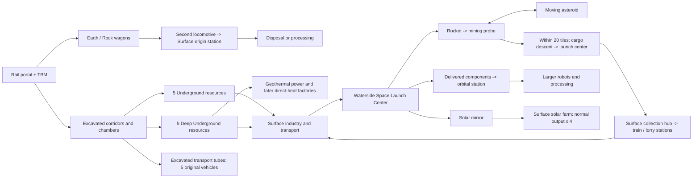

# R2MLVS Master Plan - Multilayer Vehicles and Structures

Planning baseline: 2026-10-04. **Status (2026-10-05): M0 contracts are delivered and the M1 excavation loop runs end to end by real movement in tests. No milestone is complete:** M1 still lacks its art, its occupied saves and the recurring underground bay. Execution evidence and completed task checkboxes live in the child plans.

This epic turns the four existing layers into a connected transport economy: excavate access, remove spoil, exploit underground deposits, lift equipment into orbit, mine moving asteroids, and use orbital infrastructure to improve production on Earth. It follows [R2MLM](r2mlm-multi-layered-map.md), the [level 0 architecture](../../architecture/@archi-ttd-level0.md), and the [map-layer architecture](../../architecture/map-layers/archi-map-layers.md).

This master owns scope, proposed architecture decisions, cross-plan invariants, dependencies and milestones. Implementation checkboxes live only in the owning child plans. Writing a plan does not complete its implementation tasks. New gameplay decisions below are planning defaults, not a claim of user approval or existing behavior. This epic does not inherit R2MLM's historical permission to skip operator acceptance.

## Development artifact layout

Owner: this parent; implementation: [R2FC cleanup](r2fc-file-cleanup.md). Migration and focused native/cold verification are complete; the cleanup records producer readiness, input identities and commit scope. This contract supersedes the former docs `assets/`, `assets/reviews/`, `tools/` and assisting-script placement rules for all children. It does not change gameplay, save formats or ordinary OpenTTD/Classic user paths.

The earlier rule kept binaries in subdirectories beside plans for local authoring/review and kept fixtures beside tests. A separate [diagnostic incident](r2mlvs6-a-industry-lifecycle.md) records that a config beside docs accidentally redirected native content/language lookup there. The surviving empty trees' exact creating invocation is unknown. The subsequent build-local config workaround preserved Windows baseset discovery; relocation must preserve that property, not the fixed directory name.

- `mlm/runtime/<profile>/<run-id>/<process>/`: disposable native config/data homes, with separate host/client processes and standard OpenTTD subdirectories. Immutable config templates remain under `src/tests/fixtures/config/multilayer/`. Pass a materialized runtime config explicitly; preserve repository-local content/language/startup discovery.
- `mlm/reviews/<feature>/<scenario>/<run-id>/`: generated screenshots, saves and reports. Feature-specific `images/` directories are mandatory, including within mixed tests. The producer catalogue and reports identify the actual test/writer, input/build identity and hashes. No filename-only/latest-run discovery or docs fallback.
- `mlm/tools/`: reusable multi-layer inspection, diagnostics and launch helpers. Art helpers/source contracts stay with `media/multilayer/`; reusable test runners and curated immutable inputs stay with `src/tests/`. Shipped GRF/source ownership remains with the existing media/build pipeline.
- `logs/<feature>/<scenario>/<run-id>/`: application/build/test logs. Reproducible atlas conversions and native proof images/reports/logs live under ignored `logs/proofs/mlm/native-art/`, selected by an explicit evidence manifest and rebuilt by the documented source/native phases. Genuine older-format compatibility diagnostics remain immutable fixture provenance; ordinary validation never depends on undeclared workstation history.
- `docs/zz-reach2/`: documentation only. Temporary execution aids follow the current user's scratch-file instruction and are removed at closure. Plans/companions consume this decision, update public handoffs/commands alongside producers, and retain truthful historical provenance.

Runtime and review output is ignored by location; tooling, the producer catalogue and curated inputs remain reviewable for a later commit. The eleven obsolete October data/asset/tool trees must disappear and remain absent after native runs. Root `reviews/` is superseded for this multi-layer scope. No fixture pruning is implied: [master task12.6](r2mlvs3mp-master-plan.md#group-12---close-both-target-plans-with-evidence) still requires user demo acceptance and resolved feedback.

Scope expanded on 2026-10-04: launch-center collection hubs and 20-tile orbital drops, Deep access from 1980, geothermal energy and later geothermal manufacturing, general-purpose TBM clearing with 45-degree turns, and underground tubes with five original vehicle designs. The 20-tile orbital radius, TBM turn limit and minimum five vehicles are requirements; the Surface collection radius, exact unlock date, model dates and futuristic recipes below are proposed defaults. Existing plan numbers remain stable; the new feature owners are r2mlvs17 and r2mlvs18.

## Additions at a glance

These tables summarize the planned additions by layer. Resources are listed where they originate or are produced; they may be transported to other layers. Shared vehicles/facilities are listed with all their operating layers, rather than counted as separate designs. Existing cargos or infrastructure reused by a new system are identified as such. Dates are proposed game-calendar introductions; **all Deep Underground operations require the 1980 unlock**, even when a shared vehicle model appeared earlier.

### Resources by layer

| Source / production layer | Resources or outputs | Where they come from / what they support |
| --- | --- | --- |
| Surface | Refined Metals, Chemicals | Metal refineries and chemical works process materials brought up from the mines. |
| Surface | Batteries, Electronics, Propellant | Manufacturing inputs for tube freight, spacecraft, robots and orbital infrastructure. |
| Surface | Station Components, Robotics Parts, Solar Mirror Kits | Manufactured payloads for rockets, station assembly, robots and mirrors. |
| Surface | Useful electrical power | Solar farms and nuclear generation; mirrors increase eligible solar output by 300%. Electricity is a utility, not ordinary paid freight. |
| Underground | **Coal, Iron Ore, Copper Ore, Bauxite, Salt** | Five mine resources. Coal/Iron Ore reuse compatible existing cargos; their underground sources are new. |
| Underground | Earth, Rock | TBM excavation spoil, loaded into real wagons for Surface haulage and disposal/processing. |
| Deep Underground | **Lithium Ore, Nickel Ore, Cobalt Ore, Rare Earth concentrate, Uranium** | Five additional mine resources, accessible from 1980. |
| Deep Underground | Earth, Rock | Deep TBM spoil; the same cargo types as Underground, not two additional resources. |
| Deep Underground | **Geothermal heat and electrical power** | Vent fields supply a shared thermal budget for generators and direct-heat industry. Heat is not a freight cargo; electricity can be exported through explicit utilities. |
| Deep Underground | Steel / Refined Metals (2010), Batteries (2030), Station Components / Robotics Parts (2045) | Later geothermal smelting, battery works and Mantle Forge outputs. Reuse the same product cargos as the Surface economy, including existing Steel. |
| Outer Space | **Nickel, Water Ice, Rare Earth concentrate** | Metallic, carbonaceous and rich asteroids respectively. Nickel maps to the compatible terrestrial Nickel Ore cargo; Rare Earth cargo is also shared with Deep mines. |
| Outer Space | Refined Metals, Propellant; planned Electronics inputs | Orbital processing converts mined materials into useful return cargo or local supplies; exact recipes are finalized by r2mlvs1/11. |

### Vehicles by layer

| Operating layer(s) | New vehicle / model | Role and proposed availability |
| --- | --- | --- |
| Surface and Underground | **Standard TBM** | Commissioned through a rail portal; clears corridors or arbitrary connected areas, turning at most 45 degrees per advancing segment. |
| Surface, Underground and Deep Underground | **Deep-rated TBM** | Reaches Deep through Underground rail access; handles harder excavation from 1980. |
| Surface, Underground and Deep Underground | **Spoil hauler locomotive** | Collects the TBM's actual loaded wagons and returns them to the originating Surface station. Deep routes require 1980. |
| Surface, Underground and Deep Underground | **Earth hopper; Rock hopper** | Two detachable wagon types, with separate cargo identities and visible empty/loaded states. |
| Surface, Underground and Deep Underground | **Underground freight locomotive and mineral wagons** | Carry mine output through conventional rail portals to Surface consumers; Deep operation requires compatible equipment and 1980 access. |
| Surface, Underground and Deep Underground | **Mine truck; sealed mineral carrier** | Road freight between mines, terminals and Surface receivers, using permitted tunnels/elevators and depth capabilities. |
| Underground and Deep Underground only | **Mole-70 Bulk Capsule** | Tube vehicle for ores, Rock and Earth outside the mandatory TBM wagon leg; introduced 1970, Deep use from 1980. |
| Underground and Deep Underground only | **Crate-75 Container Capsule** | Tube vehicle for Goods, Batteries, Electronics and Solar Mirror Kits; introduced 1975, Deep use from 1980. |
| Underground and Deep Underground only | **Cistern-80 Fluid Capsule** | Tube vehicle for liquid Chemicals, Propellant and compatible liquids; introduced 1980. |
| Underground and Deep Underground only | **Shield-85 Mineral Capsule** | Tube vehicle for Uranium and other designated sealed mineral loads; introduced 1985. |
| Underground and Deep Underground only | **Forge-05 Heavy Capsule** | Tube vehicle for Steel, Refined Metals, Station Components and Robotics Parts; introduced 2005. |
| Surface <-> Outer Space | **Cargo rocket** | Launches probes, components and mirror kits from a waterside Space Launch Center; delivers payloads and returns for recovery/service. |
| Outer Space | **Small mining probe** | Rocket-deployed robot that attaches to moving asteroids, mines, and releases cargo within its center's 20-tile drop radius. |
| Outer Space -> Surface | **Cargo return pod** | Saved descent/delivery unit carrying released cargo into launch-center storage; not an independently routed freight fleet. |
| Outer Space | **Heavy mining robot** | Larger station-assembled miner with increased capacity and extraction capability. |
| Outer Space | **Orbital hauler** | Moves materials and products between compatible orbital facilities and return services. |

The five tube capsules are original, distinct designs with their own stats, silhouettes and directional/load graphics. Their networks stay within one layer; cargo transfers to conventional rail/road vehicles for inter-layer transport. A probe carried inside a rocket is payload, not a Surface-operating vehicle. Solar mirrors are listed below as deployed orbital structures.

### Buildings and infrastructure by layer

| Build layer(s) | New building / facility / infrastructure | Purpose and proposed availability |
| --- | --- | --- |
| Surface | **Space Launch Center** | Waterside facility built through Airport controls, with launch pad, assembly/service buildings, recovery area and cargo storage. |
| Surface | **Launch-center collection hub and station links** | Proposed 20-tile Surface collection area serving existing train and lorry stations through bounded cargo handling; separate from the required orbital drop radius. |
| Surface | **Earth reclamation/disposal site; Rock crusher/disposal site** | Real, capacity-limited receivers for excavation spoil; disposal costs money and crushing can supply construction. |
| Surface | **Metal refinery; Chemical works** | Turn underground minerals into industrial materials and chemicals. |
| Surface | **Battery works; Electronics works; Component/robotics/mirror-kit manufacture** | Supply Batteries, Electronics, Station Components, Robotics Parts and Solar Mirror Kits; exact plant/recipe splits follow r2mlvs1/6. |
| Surface | **Solar farm; Nuclear plant; useful-power grid connections** | Useful electrical generation, mirror-supported solar output and a receiver for mined Uranium. Native content or a tested ETI profile supplies the agreed definitions. |
| Surface / Underground portal approaches | **Rail-portal TBM commissioning bay** | Purchases/assembles a TBM at an eligible rail entrance and supports the initial spoil exchange; extends the existing rail-portal system. |
| Surface <-> Underground | **Sealed tunnel entrances and commissioning states** | Existing layer tunnels gain blocked far-side faces that require TBM excavation before normal use. |
| Underground <-> Deep Underground | **Deep rail portal** | New rail connection, available from 1980; Surface-to-Deep rail travel goes via Underground. Existing road elevators remain an alternative after the same unlock. |
| Underground | **Coal mine; Iron mine; Copper mine; Bauxite mine; Salt mine** | Five distinct mines with excavated machinery/loading footprints and finite deposits. |
| Deep Underground | **Lithium mine; Nickel mine; Cobalt mine; Rare-earth mine; Uranium mine** | Five distinct deeper mines, from 1980. |
| Underground and Deep Underground | **TBM exchange bay** | Controlled facility where the secondary locomotive takes the loaded wagons and the TBM receives empties. |
| Underground and Deep Underground | **Mine loader; underground rail freight station; road mine terminal** | Loading and interchange facilities for the underground freight economy. |
| Underground and Deep Underground | **Train and road service depots** | Service compatible underground fleets; ordinary depots cannot commission new TBMs. |
| Underground and Deep Underground | **Transport tubes, junctions and tube terminals** | Dedicated powered capsule networks, constructed only after TBM clearance; first model from 1970, Deep networks from 1980. |
| Underground and Deep Underground | **Tube service depot; rail/road freight interchange; power connection** | Purchase/service capsules, transfer cargo to conventional transport and bootstrap power from paid external service. |
| Deep Underground | **Vent Collector; Vent-Tap Powerhouse — 1980** | Capture a vent's bounded heat output and generate useful electricity. Vent fields themselves are natural resources, not buildings. |
| Deep Underground | **Magma-Loop Power Station — 2000** | Advanced geothermal electricity generation with improved conversion and higher investment/service costs. |
| Deep Underground | **Geothermal Smelter — 2010** | Uses direct vent heat and transported ores to make Steel or Refined Metals. |
| Deep Underground | **Lithothermal Battery Works — 2030** | Uses heat, Lithium/Cobalt and Chemicals to manufacture Batteries. |
| Deep Underground | **Mantle Forge — 2045** | Uses heat, Refined Metals and Electronics to produce Station Components or Robotics Parts. |
| Deep Underground; connected portal endpoints toward Surface | **Heat/electric utility conduits and electrical risers** | Connect geothermal consumers and export metered electricity through commissioned inter-layer portals; heat stays in Deep Underground. |
| Outer Space | **Station Core** | Rocket-delivered anchor with initial assembly/service capability; unlocks further module construction. |
| Outer Space | **Dock module; Storage module; Utility module** | Cargo/vehicle docking, bounded storage and station power/service capacity. |
| Outer Space | **Assembly module** | Builds heavy mining robots and orbital haulers from delivered parts and components. |
| Outer Space | **Processor module** | Converts asteroid materials into useful orbital supplies or cargo for Earth. |
| Outer Space | **Solar mirror** | Launched, deployed and maintained structure that gives an eligible Surface solar farm a non-stacking +300% output bonus. |

Tube and geothermal details are expanded in [r2mlvs17](r2mlvs17-underground-transport-tubes.md) and [r2mlvs18](r2mlvs18-geothermal-energy-and-industry.md). The [resource and content catalogue](#resource-and-content-catalogue) below maps individual mined resources to their consumers; architecture decisions define the placement, transport and accounting rules behind this overview.

## Outcome

The player starts with an ordinary Surface transport company. A rail tunnel creates a sealed underground entrance. A commissioned Tunnel Boring Machine enters it, cuts rock, and loads Earth and Rock into real wagons. A second locomotive collects those wagons, returns them to the project's originating Surface station, and supplies empties. The TBM turns in steps of at most 45 degrees and can clear connected areas for any underground use, including large chambers and transport tubes. Excavated corridors and chambers then support roads, railways, tube networks, stations, depots and mines. Deep Underground opens from 1980, with harder deposits, geothermal vents and progressively more advanced heat-powered industries.

A waterside Space Launch Center, built from the airport controls, sends rockets carrying probes and construction cargo into Outer Space. Probes rendezvous with slowly moving asteroids, attach, mine, and return within 20 tiles of their launch center's orbital projection to send cargo down. A large Surface collection area lets connected train and lorry stations collect that returned cargo. Later, rockets deliver station components for assembly, larger robots and orbital processing. Launched solar mirrors target Surface solar farms and add 300% to their normal output.

## Requirements and ownership

| Requested capability | Delivery owner |
| --- | --- |
| At least five Underground mine resources transported to Surface | r2mlvs2, r2mlvs6, r2mlvs7 |
| Another five Deep Underground resources | r2mlvs2, r2mlvs3, r2mlvs6 |
| Deep Underground accessible from the 1980s; vents and later geothermal manufacturing | r2mlvs1, r2mlvs2, r2mlvs3, r2mlvs18 |
| Rock must be dug before building; new tunnel's far end starts blocked | r2mlvs2, r2mlvs3, r2mlvs4 |
| TBM turns at most 45 degrees per step and clears areas for any underground use | r2mlvs2, r2mlvs4 |
| Underground transport tubes on excavated ground, with at least five original vehicles | r2mlvs17; controls in r2mlvs7 and art in r2mlvs13/14 |
| Rail-only TBM commissioning, high operating cost, Earth and Rock in its carriages | r2mlvs4 |
| A secondary train takes those carriages to the originating Surface station | r2mlvs5 |
| Waterside launch centers built through airport controls | r2mlvs9 |
| Large launch-center collection area serving train and lorry stations | r2mlvs9 |
| Spacecraft release cargo anywhere within a 20-tile radius of the target center | r2mlvs9, r2mlvs10 |
| Rockets, probes, slowly moving asteroids, attachment, mining, return and cargo descent | r2mlvs8, r2mlvs9, r2mlvs10 |
| Solar farms, ETI investigation, mirrors adding 300% production | r2mlvs12 |
| Underground airport controls replaced by underground construction systems and stations | r2mlvs7 |
| Space construction replaces ordinary land construction | r2mlvs8, r2mlvs11 |
| Rockets carry station components; stations assemble larger robots and processors | r2mlvs9, r2mlvs11 |
| Specific graphics for all new vehicles, buildings and gameplay states | r2mlvs13 completed foundations/assets; r2mlvs14 remaining delivery, with integration in each consumer |
| Saves, multiplayer, lifecycle, balance and complete gameplay verification | Each feature owner; r2mlvs15 and r2mlvs16 coordinate |

## Plan Index

All boxes describe implementation: `[ ]` not started, `[~]` in progress, `[X]` completed with evidence. No code, assets, compatibility run or runtime scenario is marked complete by this planning pass.

| Status | Plan | Delivers | Dependencies |
| --- | --- | --- | --- |
| [X] | [r2mlvs1-gameplay-contracts-and-content.md](r2mlvs1-gameplay-contracts-and-content.md) | Content profile, cargos, recipes, IDs, capabilities and balance contracts | none |
| [X] | [r2mlvs2-geology-and-excavation.md](r2mlvs2-geology-and-excavation.md) | All producer tasks complete, including loaded terrain/survey/job art16.1. Canonical geology/guards/paid cut/planning/save conditions pass; combined bootstrap/network acceptance remains with15/16 | 1 Content Freeze; 15 Schema Foundation; scoped portal bootstrap from3; selected art from13 |
| [~] | [r2mlvs3-sealed-portals-and-deep-rail.md](r2mlvs3-sealed-portals-and-deep-rail.md) | Actual commissioning/entry/backing/lifecycle, Deep dates/scripts, genuine370/current385 occupied saves and selected final portal art delivered. Pending12.1 real tube/riser and18.2 full closure; explicit 3MP exceptions do not complete engineering acceptance | 2; actual TBM roles/recovery from4, source exchange from5; tube/riser17/18 and art13/14; staged by3MP |
| [~] | [r2mlvs4-tunnel-boring-machines.md](r2mlvs4-tunnel-boring-machines.md) | Paid actual cutting/support/turns/backing, source/recurring bay, current385 bend/recovery/cancel files, complete corridor costs and selected art/sound delivered. Pending15.1/21.4 full final non-rail use and22.2 completion; real join/bootstrap/full-performance exceptions remain unverified | 2 solid starter; 3 portal handoff; 1 wagon contract; 5 exchange/receivers; 13 completed art; 14 remaining art; staged by3MP |
| [X] | [r2mlvs5-spoil-wagons-and-haulage.md](r2mlvs5-spoil-wagons-and-haulage.md) | All producer tasks/conditions complete: actual exchanged wagon IDs/packets, paid source/recurring-depot loops, custody/cost replay and24 wait/spanning/crash file families. Broader network/bootstrap/performance acceptance remains explicitly owned by3MP/15/16 | 4 |
| [~] | [r2mlvs6-mines-and-resource-chains.md](r2mlvs6-mines-and-resource-chains.md) | Delivered finite mine/shared recipe/native selected Surface producers; later receiver/thermal/final-art/combined acceptance tasks remain pending | 2, 5; 12 Useful Power Handoff for power consumers |
| [~] | [r2mlvs7-underground-construction-and-fleet.md](r2mlvs7-underground-construction-and-fleet.md) | Delivered survey/area/conventional construction, fleet/admission/station/service owners; tube/geothermal controls and later art/acceptance remain pending | 3, 5, 6 |
| [ ] | [r2mlvs8-space-world-and-construction.md](r2mlvs8-space-world-and-construction.md) | Space simulation, orbital vehicle model, occupancy and construction controls | 1 Content Freeze; 15 Schema Foundation Handoff |
| [ ] | [r2mlvs9-launch-centers-and-rockets.md](r2mlvs9-launch-centers-and-rockets.md) | Waterside airport-menu facility, launch queues, rockets and descent cargo | 8; cargo definitions from 1 |
| [ ] | [r2mlvs10-asteroids-and-mining-probes.md](r2mlvs10-asteroids-and-mining-probes.md) | Moving deposits, rendezvous, attachment, extraction and return missions | 9 |
| [ ] | [r2mlvs11-orbital-stations-and-manufacturing.md](r2mlvs11-orbital-stations-and-manufacturing.md) | Delivered module construction, assembly docks, larger robots and processing | 9, 10; recipes from 6 |
| [~] | [r2mlvs12-solar-farms-mirrors-and-eti.md](r2mlvs12-solar-farms-mirrors-and-eti.md) | ETI compatibility decision, solar farms, useful power and orbital mirrors | ETI Feasibility Handoff uses 1 Draft Content; Useful Power Handoff after 1 Content Freeze; mirrors after 9 |
| [X] | [Plan13 - Completed graphics foundations and assets](r2mlvs13-graphics-and-asset-pipeline.md) | All173 retained checked tasks: Sprite Contract, completed sources, selected M1 native art and collector payload | Original producer evidence retained; whole-profile obligations continue in14 |
| [~] | [Plan14 - Remaining assets and runtime integration](r2mlvs14-remaining-assets-and-runtime-integration.md) | All169 remaining art tasks, including collector native display, unfinished generator states and full-profile review | 13 completed contract/source/payload; actual feature consumers; staged by3MP |
| [~] | [r2mlvs15-savegame-determinism-and-lifecycle.md](r2mlvs15-savegame-determinism-and-lifecycle.md) | Schema foundation, migration, lifecycle policies and multiplayer coverage | Schema Foundation Handoff uses 1 Draft Content; final audit after feature plans |
| [~] | [r2mlvs16-integrated-acceptance-and-balance.md](r2mlvs16-integrated-acceptance-and-balance.md) | Ground schema2 runner, physical recovery/control/economics, selected technical art, bounded utility measurements and player/evidence documentation delivered; full scenario/acceptance scope remains pending | all required groups of1..15,17,18 |
| [~] | [r2mlvs17-underground-transport-tubes.md](r2mlvs17-underground-transport-tubes.md) | Native registry/prototype, construction/separation, actual junction/recovery and independent turning Groups1-4 delivered; paid power, terminals/full fleet and acceptance pending | 2..5; contracts from 1; 12 Useful Power Handoff; UI integration with 7 |
| [ ] | [r2mlvs18-geothermal-energy-and-industry.md](r2mlvs18-geothermal-energy-and-industry.md) | Deep vents, shared heat budgets, power export and future direct-heat factories | 2, 3, 6; utility schema from 1 and runtime Useful Power Handoff from 12 |

Graphics split,2026-10-10: Plan13 retains completed tasks and the canonical ImageGen prompt; [Plan14](r2mlvs14-remaining-assets-and-runtime-integration.md) owns the remaining tasks. Former persistence14, acceptance15, tubes16 and geothermal17 are now15,16,17 and18 respectively, including companion documents and live references. Task/group IDs, native/saved gameplay identities and immutable source provenance are unchanged. Historical prompts, fixture names and proof receipts retain their original numbering. Master10.4B / Plan14 tasks79C.3-79C.4 now verify actual collector rendering/loading in both builds and ordinary-game display. Execution continues at master10.4C / Plan14 task55.3; completed Plan13 source/payload tasks remain prerequisites.

Dependencies describe availability of the required code/contracts, not a requirement to close every acceptance task before starting a consumer. For example, r2mlvs4's combined haulage acceptance uses r2mlvs5; the TBM controller must exist before haulage implementation, but its final acceptance waits for that integration. This staging never marks unfinished checks complete.

The ordered ground execution queue is [R2MLVS3MP - Portal and TBM execution master plan](r2mlvs3mp-master-plan.md). It covers full closure of Plans 3/4, with group links into their required producers. The immediate solid-starter reconciliation belongs jointly to Plan 3 Group 8B's narrow portal geometry handoff, Plan 2 Group 14B's canonical planner/reservation/cut extension and Plan 4 Group 2B/Groups 6-8's actual acquisition/material/support participants. Build saved controller foundations and real exchange/receivers before activating full commissioning; return for occupied saves, graphics, tube/riser boundaries and ground network/acceptance. Minimal Earth/Rock receivers belong to Plan 5 and do not wait for the mine economy. Full Plan 3 Group 12 needs the scoped Plan 17/18 consumers, so M1 alone does not close every original Plan 3 task. Ground-scoped Plans 15/16 audits do not wait for unrelated orbital producers or complete their whole-epic rows. Queue checkboxes coordinate execution; implementation completion remains recorded in each owning child.

Queue progress, 2026-10-08: R2MLVS3MP's developable portal/TBM/ground/electrical work and selected M1 art are delivered, with final focused builds/compatibility checks and current player/evidence guidance. [Final audit](portal-tbm/r2mlvs3mp-z-b-final-closure-audit.md) records authorized exceptions for capsule/thermal/final-use expansion, real joins, normal-newgame bootstrap, full maximum-workload performance and personal art feedback. These exceptions permit goal finalization while Plans3/4 and M1 remain incomplete. The guide documents current area/corridor controls, actual wagon exchange, Deep capacity/date rules and recovery, including the absent replacement-origin GUI picker. Later milestones and whole supporting plans remain pending; no fixture or operator exception implies their completion.

M0 order is explicit: r2mlvs1 Draft Content Handoff -> r2mlvs12 ETI Feasibility Handoff, r2mlvs13 Sprite Contract Handoff and r2mlvs15 Schema Foundation Handoff -> r2mlvs1 Content Freeze Handoff. These checkpoints are defined under each child's `Public Handoff Contract`; they consume draft definitions and do not depend on r2mlvs1's final closure. r2mlvs13/14 and15 then accompany feature development; a feature owns its serialization and tests alongside its implementation, and r2mlvs15 audits the combined result. Engineering concurrency here does not request delegated agent work. After Content Freeze, r2mlvs12 publishes its tested Useful Power Handoff independently of rockets/mirrors; mines, tubes and geothermal consumers use that single runtime ledger and its public consume/release/export operations. r2mlvs6 publishes the shared inventory-view recipe executor for Surface, orbital and geothermal processing.

Useful Power producer update (2026-10-08): [the native runtime handoff](portal-tbm/r2mlvs3mp-x-useful-power-handoff.md) is delivered through Plan12 Groups7-9/master9.1, including atomic consumption/release/directed transfer, bounded work and real town effects, saved replay protection and normal-game loading. Plans6/17/18 consume this owner. Full solar/mirror, tube and geothermal implementations/art remain their subsequent tasks; no whole-plan index is completed by this producer handoff.

## Existing implementation and required changes

| Observed baseline | Consequence for this epic |
| --- | --- |
| Stable layer values are Surface 0, Underground 1, Space 2, Deep Underground 3 | Preserve them and stacked `TileIndex` addressing; menu order is separate. |
| Underground is freely buildable flat bedrock; Deep Underground permits roads but no rail | Add real excavation state. Proposed Deep rail access deliberately extends the earlier scope. |
| Rail/road tunnels join Surface and Underground; road elevators join either upper layer to Deep | Preserve existing connections, add Underground/Deep rail tunneling, and gate new unexcavated exits. |
| `TileLoop_Industry` asserts Surface; general industry construction is forbidden below ground | Layer-aware industries require a lifecycle audit, not just removing the build guard. |
| `CmdMoveRailVehicle` requires both consists stopped inside the same depot | TBM wagon exchange needs a controlled facility and automation; arbitrary track coupling is not already supported. |
| `GetVehicleDisplayLayer` forces aircraft, ships and disasters onto Surface | Rockets/probes need explicit orbital movement and rendering; changing their sprites is insufficient. |
| Company vehicle types are contiguous and followed by Effect/Disaster | A new space vehicle category needs an enum/storage/accounting audit; do not insert it and silently renumber saved values. |
| 64 cargo slots, 240 industry types, 512 industry tile graphics in this source | Budget the complete content profile before allocating slots; external industry sets may already fill it. |
| Save versions 369/370 handle layers/elevator waits; graphics have a 66-sprite layer block | Add new versioned state and append assets without reinterpreting existing saved data or sprite offsets. |

Inspected entry points: `src/map_layer.h`, `src/map_layer.cpp`, `src/map_layer_gui.cpp`, `src/train_cmd.cpp` (`CmdMoveRailVehicle`), `src/industry_cmd.cpp` (`TileLoop_Industry`), `src/cargo_type.h`, `src/industry_type.h`, `src/vehicle_type.h`. Detailed reading belongs to each child plan. Architecture pages describe delivered behavior, so update them when implementation lands, not to present these proposals as existing features.

## Proposed architecture decisions

### AD-1 - A complete, explicit gameplay profile (owners: 1, 12, 15)

New games may select **Multilayer Industry**. The profile supplies all required cargos, industries, vehicles and graphics with the game; it must work without an external industry set. It starts with a supported Temperate economy, with other climates requiring an explicit tested mapping. Classic games remain selectable. Existing saves retain their prior gameplay/content configuration by default; no silent cargo-table replacement or newly solid rock over existing infrastructure.

Engine code owns excavation, jobs, moving objects, cross-layer transfer, wagon exchange and construction validation. A versioned first-party content package supplies definitions, recipes and art. **Execution decision, r2mlvs1 Group 3:** bundled NewGRF definitions use the existing staged loader and saved identity mappings; engine-owned behavior remains native. Group 4 delivers the first-party cargo-definition package and exact activation manifest; gameplay/vehicle/industry/art families remain with their feature owners. Missing required content causes a clear refusal rather than substitution of cargo meaning. External industry sets require named tested compatibility profiles, not arbitrary load order.

### AD-2 - Excavation is persistent world state (owners: 2, 4, 15)

Underground and Deep Underground begin as solid rock containing finite deposits. Survey information is an overlay; it does not create functioning mines inside rock. Construction requires the entire footprint and its approaches to be excavated. Bulldozing, auto-clear, area leveling, roads, stations, depots, industry funding and scripts cannot clear solid rock for money alone.

Use a compact per-underground-tile state for Solid / Excavating / Excavated, with sparse records for deposits and active jobs. Final packed storage is decided with memory measurements in r2mlvs2; do not allocate a large C++ object for every tile. Demolition removes infrastructure but keeps the cavity. Cave-ins, flooding, ventilation and full geotechnical simulation are deferred.

Generate geology and asteroids from saved feature seeds with a separately specified deterministic generator. Do not consume the Surface generation RNG. Guarantee at least one accessible deposit of each required type per supported new map; validate tiny-map capacity rather than silently dropping types. Existing Surface digests remain identical with this profile disabled; with it enabled, intended new industries may change Surface content and need their own reference fixtures.

Deep generation also guarantees at least one usable geothermal vent field on supported maps, with stable IDs and finite thermal output capacity, separate from the five required mineral resources. Excavating around a vent preserves its energy identity and opens space for plant foundations and utilities; discovery alone produces no power. Vent fields do not create arbitrary unborable holes in otherwise excavatable ground.

### AD-3 - Sealed portals and bootstrap access (owners: 3, 4, 5)

A rail layer portal built toward solid rock creates its paired shaft housing but leaves that far-side face solid. Ordinary trains cannot route through it until commissioning opens the face and connects excavated track. Only the assigned TBM may enter the shaft's controlled work pocket. That pocket is part of the portal, not a free buildable chamber.

**TBMs are commissioned only through eligible rail layer portals**, using a portal-associated purchase/assembly control. They cannot be bought in an arbitrary underground depot, spawned via a road tunnel, cloned past this restriction or delivered by an elevator. The initial TBM enters from Surface; a deep-rated TBM may later be commissioned at an accessible Underground rail portal into Deep Underground. Repairs and servicing may use compatible depots after commissioning.

The initial project includes a validated boring route and spoil capacity to open the first corridor and exchange bay. Before the bay exists, commissioning-side exchange handles the first full wagon set. The TBM can reverse back through its work pocket with its wagons; normal freight stays excluded. This prevents needing an underground station before a TBM can excavate one.

After full withdrawal, spoil settlement and project release, a compatible original or selected portal's native magazine may retain the stopped complete TBM while its public through-route is connected. Every part must be stored; moving trains, outside tails, active work and occupied approaches still block topology changes. Demolition continues to protect the stored train. The existing magazine uses a genuine native Depot identity and admits one cutter; ordinary through traffic uses its separate passage. R2TBMF7B/8 verify original/selected storage, public traffic and reuse at B. New work at a released portal requires explicit commissioning and pays for any still-solid cells in the complete starter pocket, even if its centre was already open. R2TBMF9 additionally permits a paid far-exit handover at the completed terminal of an accepted tunnel, after the whole stopped TBM has backed clear locally. The same reciprocal portal command replaces only the vacant terminal support; all other support, original work/haulage identities and ordinary demolition guards remain intact. B can connect over its already paid floor without a second purchase, followed by actual parking and final release. Both construction directions,50-cell public traffic and native reloads are verified in [Y](tbm-fixes/r2tbmf-y-exit-notes.md#group9-closure).

Road tunnels and elevators may create their sealed shaft housing, but cannot open a buildable cavity or bring a boring machine. Their far-side approaches must be excavated by a rail-origin TBM before use. A Surface-to-Deep elevator still leaves the intervening Underground tile untouched.

### AD-4 - Deep rail is part of this proposal (owners: 3, 7)

Allow rail, rail stations, depots and signals on excavated Deep Underground tiles. Add rail portals between Underground and Deep Underground, with a destination picker when building in Underground. Surface/Underground rail remains supported; direct Surface/Deep rail is deferred. Deep freight can reach Surface through two rail transitions or use existing road elevators.

For the new profile, **Deep Underground access unlocks on 1 January 1980 in game calendar time**. Before then, neither Underground/Deep rail portals nor Surface/Deep or Underground/Deep road elevators can be built or activated; Deep construction, vehicle entry, excavation and industry operation are also gated. The layer may remain viewable as a locked geological preview. UI, commands, scripts and commissioning share this rule; economic/wall-clock time is not the technology clock. Legacy saves retain their compatibility policy. Scenario-editor/test overrides must be explicit and saved, never an accidental normal-game bypass. Geothermal machinery cannot unlock earlier than Deep access.

This explicitly supersedes the no-rail-in-Deep restriction of R2MLM AD-12 for the new profile. It avoids introducing an unrelated excavation method solely to bypass the rail-only TBM requirement. Existing portal geometry, ownership and pair validation remain authoritative.

### AD-5 - A TBM is a train with a work controller (owners: 4, 5)

R2TBMF pacing/material decision,2026-10-09: Standard1/2 and Deep3/4 geological work ticks per simulation tick halve cutting speed without changing traction. Spoil remains native whole-tonne cargo: Soft3/6, Mixed2/12, Hard1/20 and Basalt1/24 Earth/Rock per newly cleared cell. The user explicitly retained Basalt's minimum1 Earth to avoid fractional transport. Quotes and cuts share these terms, including extra working space and zero-yield overlap. Existing paid terrain, cargo and partial work persist. Save399 adds deterministic regional hardness for new worlds, independently of ore/Surface RNG; older maps retain their original material difficulty. Cutting, survey and terrain/face art consume the same saved geological authority. Measured pacing, haulage and regional/native evidence are recorded by fixing Groups5/5B/10.

The TBM carries a cutter, support machinery and detachable spoil wagons. Work orders designate a connected sequence of rock faces/cavern cuts, not an arbitrary unreachable tile. Each completed cut atomically advances excavation, debits work costs, and generates a fixed geology-dependent quantity of Earth and Rock into compatible wagons. Both have separate cargo identities and capacity. Full wagons, missing support, insufficient cash, blocked reservations or missing disposal logistics pause work with a visible reason.

The cutter lays explicitly charged temporary construction rail/support as it advances. This is the only way rail enters still-solid work tiles; ordinary rail tools remain blocked. Temporary rail has declared speed/vehicle restrictions, can be converted after excavation, and supports a safe return path. Planned side cuts open station/depot/industry footprints; wide buildings do not excavate their own area when placed.

The cutter has eight headings. Successive advancing work segments may stay straight or change heading by **45 degrees left or right**, never 90/135/180 degrees in one step. Each turn requires an actual traversed segment with a valid swept cutter/consist footprint; repeated pivots on one tile cannot fake a U-turn. A 90-degree change needs at least two advancing 45-degree bends. Reversing to haul spoil means backing along supported track, not rotating the cutter or boring backwards.

Area-clearing orders cover any reachable underground rock area, regardless of whether the future use is a railway, road, tube, station, mine, geothermal plant or empty cavern. The planner decomposes an outline into legal passes with return paths, turn space and fully charged spoil/support. A tube route can replace temporary work rail once the cutter/hauler has withdrawn and a valid alternative retreat path exists. The TBM does not require permanent rail as the final land use. Map boundaries, occupied/owned structures and safe demolition rules still apply; harder rock changes the suitable model's cost/speed rather than limiting excavation to designated mine corridors.

Running costs are high while boring, lower but nonzero while standing, and distinct from per-tile support costs. Ground hardness increases Deep excavation time and cost. Defaults are tuned through a measured project budget; unlimited excavation must not become a profitable spoil-generation exploit.

### AD-6 - Transfer the actual wagons (owner: 5)

R2TBMF8 travel arbitration: the native vehicle Order/OrderList owns ordinary travel and the selected compatible hangar; the geological job keeps its immutable commissioning anchor, geometry and progress. **Follow order** suspends cutting without copying the work assignment. **Resume work** after ordinary travel uses the real working bay before rejoining the retained face. Automatic face returns back along accepted support; an explicit return from ordinary travel chooses the legal direction from the actual train position. Shared orders, scripts, cloning and replacement cannot duplicate machinery or work. Actual native input, all return intents and397/398 file continuations are verified in [W](tbm-fixes/r2tbmf-w-order-control-notes.md#group8-closure).

Resumable Return and park preserves the accepted geological job, partial work and work claims. It uses actual travel and whole-wagon exchange at the original magazine or an eligible existing exchange depot, then stops the empty complete consist. A chosen alternate hangar is a separate native destination reached after this original haulage settles. Resume drives the same machine back to its retained work. Saved controller phases carry resumable parking since395 and selected-hangar travel since397; cargo continues to use whole units. Parking alone does not certify final haulage settlement or authorize support release. See R2TBMF Groups7/8 and their retained actual files.

Use a **TBM exchange bay**, a specialized depot-like facility on excavated rail. A working TBM returns to the bay with its wagons. With both consists fully stopped, an atomic exchange detaches the loaded wagons and couples them to a secondary locomotive; empty wagons are attached to the TBM. Vehicle IDs, cargo packets, cargo age and capacity are preserved. Cargo is never copied to an invisible buffer to impersonate carriage transfer.

Final cancellation/release retains accepted claims and partial work until the complete cutter has withdrawn and actual haulage is settled. Since396, saved ReturnToRelease/WaitToRelease/ReleasePending phases preserve this pending intent; already-cancelled legacy jobs retain their historical state. The release command validates all owners before cancelling unfinished geology, ending settled hauler assignments and unbinding the portal. It retains the real machine. Convert released support through its paid command before common-rail use or reassignment, and fund any additional existing-floor track required by the next accepted route. R2TBMF7B/8 verify actual release/connection/reload and reuse at original and selected hangars.

This deliberately uses controlled depot semantics for the first release. Free shunting/coupling on arbitrary occupied track, or a hauler reaching past an active cutter, is deferred. The TBM remains a mobile generator but pauses to exchange; an advancing mobile exchange facility is unnecessary initially.

Each project saves a required originating Surface station and a hauler assignment. Haulers return the loaded carriages there. Final disposal can occur within its catchment, or the cargo can be transferred onward to a real receiver. Earth goes to a reclamation/disposal site; Rock to a crusher or disposal site. Transfer alone pays no final income; dumping has a cost and bounded acceptance. Surplus spoil never disappears for free. Lost stations or saturated receivers suspend new excavation while preserving existing cargo and the ability to recover it.

### AD-7 - Deposits, mines and transport are distinct (owners: 2, 6, 7)

A deposit is geology with a remaining reserve. A mine is a built industry whose excavated machinery/loading footprint touches the designated seam. Opening a mine does not excavate that whole reserve. Its production consumes reserve into a bounded output buffer, then ordinary station and cargo handling transports it. No receiver means no useful transport loop; every resource below therefore has a named consumer in the same content profile.

Stations serve their own layer. Identical `(x, y)` or catchment proximity never transfers cargo between layers. Mine trucks, freight trains, portals, rockets and descent operations are the explicit links. Surface house catchment for underground metro stations remains a separate future feature.

### AD-8 - Layer-specific construction menus (owners: 7, 8, 9)

Surface retains normal tools; Airport construction gains **Space Launch Center**. Underground and Deep Underground replace the airport button/menu/hotkey action with **Underground Construction**, containing survey/excavation orders, mine construction, exchange bays, underground stations and service facilities. Rail and road tools remain available according to excavation rules.

Underground Construction also includes Transport Tubes with their own track/terminal/service controls and fleet filter, plus geothermal survey, utility and industry tools on unlocked Deep Underground. Five original tube vehicles carry bulk materials, packaged goods, fluids, sealed minerals and heavy components (AD-15). Locked technologies show their calendar availability.

Outer Space replaces land/rail/road/water/airport/terraform tools with **Space Construction**: launch-linked orbital sites, docking, modules, mirrors, processing and robot assembly. Blueprints can be placed before delivery but cannot operate until required cargo arrives and assembly completes. Apply the same rules to the main toolbar, split toolbar, editor, extra-view construction, shortcuts and command API. A hidden button is not a construction guard.

### AD-9 - Orbital objects and vehicles have their own semantics (owners: 8, 10, 11)

Asteroids are persistent moving resource entities with stable IDs and integer/fixed-point positions, not moving Industry tiles. Static orbital structures use the Space map for anchors/footprints; moving bodies and vehicles use a spatial index for drawing, selection, targeting and occupancy. Specify a deterministic slow drift and bounded edge behavior, with no full orbital mechanics.

Rockets, probes and orbital haulers share a dedicated Space vehicle/controller model with cargo, ownership, service, orders and costs. The preferred implementation is a separate company vehicle category; r2mlvs8 must settle its save IDs and all four-mode assumptions before implementation. Do not silently reinterpret existing Aircraft or Effect IDs. Airport-menu placement is a user-interface choice, not a requirement to reuse aircraft flight logic.

Cross-layer movement uses named deterministic transitions with saved phase, source, destination and remaining time. Existing ground transitions still use `GetLayerPortalNextTile`; new orbital transitions extend R2MLM I-3's ground-only scope rather than bypassing layer addressing with ad hoc offsets. Normal aircraft and ships remain Surface vehicles.

### AD-10 - Launches and returns preserve cargo (owner: 9)

A Space Launch Center is a Surface station facility with pad, assembly/service building, cargo storage and recovery area. Its land footprint must share at least one orthogonal edge with a real navigable water tile (sea, river, lake or canal); diagonal contact and decorative water do not qualify. This is the proposed interpretation of "next to water," not an ocean-only requirement. Removing the last qualifying water connection is refused while the facility exists, including relevant terraforming commands.

The center creates an orbital navigation reference at its fixed Surface build anchor. **Spacecraft may release cargo anywhere within a 20-tile circular radius of that reference**, including the boundary; they do not need to fly to the exact center tile. Use plane coordinates and squared distance: `dx*dx + dy*dy <= 20*20` for tile-center positions, with equivalent fixed-point arithmetic for actual vehicle positions. Do not use stacked Y, Manhattan distance or a 41x41 square. The target center is explicit when zones overlap, and joining more station tiles never moves or enlarges its orbital radius. Normal docking/servicing retains its own approach rules. This reference supplies no free space station. Rockets carry probes as payloads and lift actual cargo packets subject to capacity, launch cost, preparation time and pad occupancy.

The initial mining probe remains orbital between missions: it returns into its originating center's drop zone and releases a recoverable cargo pod. A saved descent job records release position/target and transfers those packets once to that center's Surface storage. Release requires recovery capacity and an authorized target; a full/invalid center makes the craft wait or retarget explicitly without losing its load. No payment merely for crossing layers. Probe servicing and pod replacement incur explicit costs; no extra launch is required for every mined batch. Facility removal/ownership changes must preserve or safely reassign in-flight missions and cargo.

The launch center also owns a **Surface logistics collection area**, proposed default radius 20 tiles, measured separately from the orbital radius. Same-company train stations and lorry stations with their full station footprint inside this area may be linked as collection members; the center's own joined rail/road facilities also qualify. Separate stations keep their IDs and normal station-spread limits. Merely overlapping ordinary industry/house catchments is insufficient: an explicit logistics-hub relationship supplies returned cargo to members through bounded, timed Surface handling. This is the launch center's specialized collection service, not a global enlargement of every station's catchment.

Returned packets reside once in hub storage, an assigned Surface handling job, a member station or a vehicle. Member cargo filters/demand and deterministic capacity allocation prevent the same cargo appearing at several stations; all returned resource types have supported rail/lorry refits. Inbound rocket supplies may use the reverse handling path after a transfer order. Handling creates no final-delivery payment, preserves age/provenance and has a visible capacity/cost. Moving/extending a station out of range, ownership changes and deletion cancel or settle assignments without duplication. Surface collection does not reach Underground stations at identical coordinates. The map shows separate collection and orbital-drop overlays, even when both defaults are 20 tiles.

### AD-11 - Mining follows moving targets (owner: 10)

A mission is Launch/Deploy -> Rendezvous -> Attach -> Mine -> Detach -> Return inside the home center's 20-tile drop radius -> Descend cargo -> Service/Repeat. A probe targets an asteroid ID and approach point, not its initial tile. A latched probe moves with the asteroid and consumes its finite reserve into its own bounded hold. Full holds, depletion, service limits and cancelled orders have defined exits.

Start with three asteroid classes: metallic (Nickel), carbonaceous (Water Ice) and rich (Rare Earth concentrate). Reuse compatible terrestrial cargos where appropriate; class composition remains deterministic. Asteroids drift slowly enough to observe and intercept. Initial missions require no orbital station, avoiding a station/probe/bootstrap dependency cycle. Define an explicit safe interaction policy with stations; the initial design uses a separate asteroid travel band and approach/exclusion rules rather than impact damage.

### AD-12 - Orbital construction consumes delivered inventory (owner: 11)

The first rocket carries a deployable Station Core to an available orbital anchor. Thereafter module blueprints reserve footprint and inventory; construction consumes delivered components through saved assembly progress. Dock, storage, power/service, assembly and processor modules are distinct functional components. Larger mining robots require a completed assembly dock, delivered Robotics Parts, components, capacity and funds. Their first production must be possible entirely from Surface supplies.

An orbital processor converts mined resources into Refined Metals, Electronics inputs or Propellant according to bounded recipes. Larger robots and processing are the later expansion milestone proposed from the user's "perhaps"; basic launch/probe/mirror gameplay does not depend on them. No crew life-support, weapons, combat or real launch physics are required.

### AD-13 - Solar output is increased once, at its source (owner: 12)

Interpret "increase output by 300%" as **baseline + 3 x baseline = 4 x baseline**. One operational mirror gives one eligible Surface solar farm this bonus. Initial stacking is capped at that multiplier; more mirrors support more farms. A mirror must be launched, deployed, assigned and maintained. Assignment uses a stable industry reference, with a stated projection/range rule and ownership rules; farm deletion clears the assignment.

Apply the boost once to eligible produced power after base production/availability modifiers and before monthly production accounting. Use saved integer remainder arithmetic for partial coverage/time. Do not multiply previous months, other cargos, town growth rates, or the same output again in a script. The industry window shows baseline, mirror bonus and effective output. Power benefits a real grid/consumer system; it is not unlimited paid freight.

ETI is an investigated integration option, not a required redistributable dependency. The detailed evidence and implementation decision are in r2mlvs12. The guaranteed fallback is an original Surface solar industry and a native useful-power consumer; do not leave mirrors without a gameplay effect if ETI cannot be bundled.

### AD-14 - Persistence, ownership and failures are feature requirements (owner: 15; implemented by all)

Save excavation, reserves, work progress, wagon assignments, cargo provenance, mission phases, asteroid positions, assembly inventory, mirror assignments, settings and feature seeds. Use stable typed IDs and explicit versioned chunks; reserve actual version numbers when coding begins. Rebuild derived spatial/path caches after load. Save during every long-running action, not only at idle endpoints.

Ownership changes, vehicle sales, industry/station closure, bankruptcy, command cancellation and removal of supporting structures must never orphan packets or duplicate resources. Refuse unsafe demolition before mutation, or implement a visible deterministic evacuation/reassignment policy. Multiplayer uses simulation ticks, integer arithmetic and stable iteration order. Camera state, hidden layers, frame rate and presentation animation never control progress.

### AD-15 - Underground transport tubes and five original vehicles (owner: 17)

Transport tubes are sealed, powered guideways with dedicated terminals, service depots and self-propelled cargo capsules. They may be built only on TBM-excavated Underground or, after its unlock, Deep Underground tiles. They never excavate terrain. The proposed implementation uses a dedicated railtype/capability with existing reservation/pathfinding foundations, while presenting a separate tube toolset and fleet filter. Ordinary trains/TBMs cannot use tubes, and capsules cannot use ordinary rail, roads, rail portals or elevators. First-release tube networks stay within one layer; cargo changes mode at excavated interchanges before conventional freight crosses layers.

Create at least five distinct first-party vehicles, with their own models, silhouettes, directional/load sprites, stats and cargo roles: **Mole-70 Bulk Capsule (1970)** for ores/Rock/Earth; **Crate-75 Container Capsule (1975)** for Batteries/Electronics/Goods/Solar Mirror Kits; **Cistern-80 Fluid Capsule (1980)** for compatible liquid Chemicals/Propellant; **Shield-85 Mineral Capsule (1985)** for Uranium and other sealed mineral loads; **Forge-05 Heavy Capsule (2005)** for Steel/Refined Metals/Station Components/Robotics Parts. These are model families, not five refits or recolors of one vehicle. Final cargo forms follow the profile; no label is simultaneously treated as bulk and fluid without a declared conversion.

Paid external electrical service available at a commissioned portal-side interchange bootstraps early tubes. Later geothermal plants can supply their demand through explicit utilities. No first capsule or tube depot requires output from an inaccessible Deep geothermal plant. Tubes handle mined/processed cargo; TBM spoil still travels in its actual wagons and is hauled to the originating Surface station as specified in AD-6.

### AD-16 - Geothermal energy and future direct-heat industry (owner: 18)

Deep Underground contains geothermal vent fields in addition to its five mineral types. A vent is a renewable but rate-limited thermal source with a stable identity; it is not an extra freight cargo or an infinite bonus for every building in range. Excavated collectors and utilities allocate a shared heat budget to generators and direct-heat consumers. Converting heat to electricity and consuming it in a smelter compete for the same budget; neither may count the same heat twice.

Proposed game-technology timeline: **1980 Vent-Tap Powerhouse** produces electricity; **2000 Magma-Loop Power Station** improves electrical conversion; **2010 Geothermal Smelter** uses direct vent heat plus Iron/Copper/Nickel ores to make Steel/Refined Metals with less purchased fuel; **2030 Lithothermal Battery Works** combines vent heat with Lithium/Cobalt and Chemicals to make Batteries; **2045 Mantle Forge** uses heat, Refined Metals and Electronics to manufacture Station Components/Robotics Parts. These later facilities are fictional game technology, not claims about real industrial capability. Each still needs transported inputs, finite output space and operating/service costs.

Heat travels only through an excavated Deep utility network. Electricity may supply Deep facilities/tubes or reach the Surface useful-power system through a paid utility riser at an already commissioned inter-layer portal; it is never shared merely because coordinates/catchments coincide. The first 1980 plant/riser uses cash and materials available from Surface so geothermal and Deep transport do not depend on their own output. Geothermal electricity enters the common power accounting once, but is not eligible for the solar mirror bonus and must not be counted by both native and ETI grid authorities.

## Resource and content catalogue

These are initial game-design choices, not claims about realistic geology. Cargo labels, quantities and exact recipes are finalized by r2mlvs1; rows describe distinct transported resources, not recolors of one generic ore. A mine may have one main output to stay within existing industry slot limits.

| Layer | Mine / resource | Surface consumer and use |
| --- | --- | --- |
| Underground | Coal seam / Coal | Existing compatible power plant or steel chain; early bulk revenue |
| Underground | Iron mine / Iron Ore | Steelworks -> Steel -> structures/components |
| Underground | Copper mine / Copper Ore | Metal refinery -> Refined Metals -> Electronics |
| Underground | Bauxite mine / Bauxite | Metal refinery -> Refined Metals -> rocket/station components |
| Underground | Salt mine / Salt | Chemical works -> Chemicals -> Propellant/components |
| Deep Underground | Lithium mine / Lithium Ore | Battery works -> Batteries -> Robotics Parts |
| Deep Underground | Nickel mine / Nickel Ore | Metal refinery -> Refined Metals -> machinery |
| Deep Underground | Cobalt mine / Cobalt Ore | Battery works -> Batteries -> robots/mirrors |
| Deep Underground | Rare-earth mine / Rare Earth concentrate | Electronics works -> Electronics -> robots/mirrors |
| Deep Underground | Uranium mine / Uranium | Nuclear plant -> useful power; ETI label integration if selected |

Additional cargos: Earth, Rock, Refined Metals, Chemicals, Batteries, Electronics, Propellant, Station Components, Robotics Parts, Solar Mirror Kits and Water Ice. Reuse Steel and Goods where the selected profile supplies them. A Station Core is a module recipe using Station Components, not necessarily an extra cargo type. Power is a metered utility; an ETI profile may represent it with `POWR` but must prevent duplicate freight/grid rewards.

Earth disposal and Rock crushing have finite acceptance. Crusher output can feed construction, but digging purely for spoil must lose money after boring and haulage costs. Surface processors use recipes supported by the selected industry definitions and production callbacks. Split complex recipes into more buildings where useful; audit actual format limits rather than assuming an engine-wide cargo-array expansion is needed.

| Fleet / structure | Initial role |
| --- | --- |
| Standard TBM; deep-rated TBM | Open ordinary/hard rock; expensive train work controllers |
| Earth hopper; Rock hopper; spoil hauler locomotive | Detachable wagon logistics and empty return |
| Underground bulk train and mine truck; sealed mineral carrier | Transport all ten resources; deep capability/refit rules visible |
| Mole-70, Crate-75, Cistern-80, Shield-85, Forge-05 | Five original underground tube vehicles, introduced progressively from 1970 to 2005 |
| Tube guideways, terminals, powered service depot and freight interchange | Build only in excavated space; transfer to conventional cross-layer transport |
| Vent collector, powerhouses, utility conduits/riser, smelter, battery works and Mantle Forge | Deep heat/power and time-gated futuristic manufacturing |
| Exchange bay, mine loader, underground freight station, road terminal, service depot | Excavated loading, exchange, servicing and network access |
| Launch Center collection hub; cargo rocket; small mining probe; return pod | 20-tile orbital drops and nearby train/lorry collection of returned cargo |
| Station core, dock, storage, utility, assembly and processor modules | Delivered orbital construction and later production |
| Heavy mining robot; orbital hauler; solar mirror | Higher throughput, inter-station freight and Surface solar support |

No new passenger service or surface-city catchment is required for this epic. Existing buses and elevators remain usable wherever the chosen profile permits their routes.

## Delivery milestones

| Milestone | Demonstrable gameplay | Required owners |
| --- | --- | --- |
| M0 - Contracts | Content budget, feature settings, schema scaffolding, exact sprite manifest and an ETI feasibility decision | 1; initial12/13/15 handoffs; remaining art in14 |
| M1 - Excavation loop | Build a sealed rail portal; commission TBM; clear corridors/chambers with legal 45-degree turns; swap actual wagons; haul/dispose on Surface; return empties; save/reload | 2..5;13/14 graphics,15 persistence and16 acceptance |
| M2 - Underground economy | All ten mine types feed Surface consumers; 1980 Deep unlock; complete underground fleet and five tube models across their dates; geothermal power and later direct-heat chains | 6, 7, 17, 18; remaining underground art in14 |
| M3 - Orbital return and solar | Waterside launch center; probe mines moving asteroid; drops cargo within 20 tiles; hub supplies nearby train/lorry stations; launched mirror gives 4x solar output | 8..10, 12; corresponding art |
| M4 - Orbital industry | Rockets deliver core/modules; station assembles a heavy robot and processes asteroid cargo; outputs return to Earth or support construction | 11; corresponding art |
| M5 - Integrated acceptance | Combined economy survives lifecycle changes, save/load, multiplayer and representative performance/art review | 14..16 final groups |

M1 is the recommended first implementation target. Its excavation, wagon and financial constraints determine whether the underground game is enjoyable. Space work can use M0 contracts independently, but no milestone is presented as complete with missing gameplay graphics or untested cargo conservation.

Milestones are engineering deliveries, not calendar eras: M2's tube/geothermal acceptance uses appropriate 1970..2045 fixtures and explicitly tests introductions. r2mlvs17/18 can develop against the early contracts while their UI/art/save integration follows the same staging as existing plans. r2mlvs16 runs last after both new plans; their higher numbers do not put acceptance ahead of them.

## Cross-plan invariants

- **I-1 - Layer identity:** stable layer IDs and stacked tile/world coordinates remain unchanged; ordinary neighboring tiles stay on their layer.
- **I-2 - Excavation:** no ordinary construction or vehicle traversal opens solid rock. Only a validated boring operation changes its state; portal work pockets have narrowly defined access.
- **I-3 - Conservation:** remaining reserves + extracted inventory + recorded consumed/disposed amounts balance. Cargo/wagons are moved, never duplicated by exchange, descent, assembly, save/load or transfer payments.
- **I-4 - Atomic actions:** command estimates do not mutate state or consume RNG; execution revalidates both portal ends, full footprints, inventory, vehicles and reservations before committing.
- **I-5 - Determinism:** synchronized world state and simulation time govern work. View selection, sprite animation and wall-clock time cannot change production, movement or reservations.
- **I-6 - Explicit transport:** cross-layer delivery requires physical vehicle movement or a saved launch/descent job. Geometric proximity and shared catchment cannot transport cargo between layers. The launch center's Surface collection service uses explicit saved handling jobs under AD-10.
- **I-7 - Persistence:** save/load preserves active jobs, vehicle IDs, packet identity and timers; older supported saves retain their previous playable economy.
- **I-8 - Capability checks:** tools, AI/GS commands, cloning, autoreplace and NewGRF content obey the same commissioning, excavation, layer and payload restrictions.
- **I-9 - Bounded work:** simulation iterates active jobs/entities, with measured limits, rather than scanning every tile of all four planes each tick.
- **I-10 - Graphics completeness:** final assets communicate all gameplay-critical states; an icon or sprite sheet alone is not in-game art acceptance.
- **I-11 - Solar accounting:** at most one +300% bonus per eligible farm; zero baseline stays zero; the grid receives the same effective output the industry reports.
- **I-12 - Bootstrap:** TBM spoil exchange, first mine consumers, first tube power/route, first geothermal plant/riser, first probe, first station and first heavy robot each have a path that does not require their own completed output or an unavailable later technology.
- **I-13 - TBM geometry:** each advancing turn is at most 45 degrees with a real traversed segment; area clearing is independent of final land use and accounts for the complete swept footprint.
- **I-14 - Deep availability:** new-profile Deep access and operations obey the calendar unlock through every entry path; legacy/editor exceptions are explicit saved policies.
- **I-15 - Tube separation:** tubes require excavated ground, compatible capsules and power; they never commission TBMs or replace mandatory spoil-wagon hauling.
- **I-16 - Launch collection:** a 20-tile circular orbital drop requires an explicit target/descent; Surface hub membership neither duplicates packets nor grants cross-layer catchment.
- **I-17 - Thermal accounting:** finite vent output is allocated once across heat/electric uses; geothermal energy cannot receive a solar mirror multiplier or duplicate grid credit.

## Plan 1 M0 execution decisions

Plan 1 is complete. Index marks for Plans 12/13/15 indicate only the prerequisite native feasibility/draft solar, sprite contract and Schema Foundation handoffs delivered for M0; all remaining feature tasks stay unchecked. M0 Content Freeze does not imply M1 or runtime feature acceptance.

Plan 1's [Content Freeze record](r2mlvs1-g-content-freeze.md) owns the compiled numerical/ownership tables and evidence. Native MLVI is selected, with 30 active cargos, 64/283 industry/tile envelopes and 275 logical designs. ETI v14 is unsupported for this profile; its pinned source/terms failures and unexecuted runtime checks remain explicit. Its first-party fallback is the shipped cargo package and tested native utility/effect contract; operational Useful Power is still Plan 12 work after Content Freeze.

Bootstrap adds bounded paid Surface procurement, including Electronics/Batteries from 1965 for the 1970 tube; purchased company supplies earn no freight income. Rock yields bounded local construction aggregate with a maximum replacement value and paid residue/disposal, instead of unrestricted profitable Goods. Two pod shells and a service preload are included in first-probe supplies. The station nucleus is a Surface-preassembled kit preceding heavy-robot assembly. These choices fit the budgets and close self-dependent build paths.

Schema Foundation allocates MLMD/save version 371 after verified 369/370 preservation. Exact content is checked before activation and cargo meanings afterwards; old chunk absence remains Classic, and saved editor policy is explicit. SolarMirrorID names a deployed solar-owned object and adds no routed engine design. Sprite M0 freezes 141 families/58,059 planned sprites, protects 0..73 and proposes core 74..167 without activation. Actual feature pools, source art, operating utility and whole-world network/performance acceptance remain unfinished.

## Decisions to revisit during implementation

The draft is executable using the defaults above. Record revisions here and update affected contracts before coding dependencies; do not hide a changed design in a child checklist.

| Decision | Proposed default | Why it matters |
| --- | --- | --- |
| Rail in Deep Underground | Full rail support on excavated tiles; access through Underground | Makes the specified rail-only TBM available on both rock layers |
| Wagon handling | TBM returns to a controlled exchange bay; real wagons change locomotive | Delivers secondary haulage without a general railway shunting simulation |
| Solar percentage | +300% = 4x baseline, non-stacking | Distinguishes an increase of 300% from output at 300% |
| Water adjacency | One shared edge with navigable sea/river/lake/canal water | Makes the requested placement rule precise |
| Surface launch collection area | 20-tile circular radius, independent of the required 20-tile orbital drop radius | Supports distributed train/lorry stations without changing global station-spread limits |
| Deep availability | 1 January 1980, game calendar; legacy saves preserved | Applies the requested 1980s progression to rail and elevator access alike |
| Tube implementation and dates | Dedicated railtype/capability; five original capsule models from 1970 to 2005 | Reuses routing foundations while enforcing underground-only networks |
| Geothermal timeline | Power in 1980/2000; direct smelting 2010; battery works 2030; Mantle Forge 2045 | Makes Deep energy a progression path with transported inputs |
| Resource lifetime | Finite deposits; generation provides all ten types | Gives excavation and prospecting lasting value |
| ETI delivery | Inspect and test v14; original native fallback unless redistribution terms are established | Avoids depending on an unverified external package for required solar gameplay |
| Existing worlds | Preserve legacy behavior; full profile enabled for new worlds first | Prevents breaking existing networks or replacing cargo definitions in saves |
| Advanced station economy | Later M4 milestone within this plan | Keeps the first probe/solar loop independent of station manufacturing |

Exact prices, drilling speeds, cargo capacities, drift intervals, module footprints, proposed technology dates and power-service benefits are tuning values. The required 20-tile orbital radius and 45-degree TBM turn limit are not silently changed during balancing. r2mlvs1 records initial numerical tables, and r2mlvs16 revises them against measured scenarios. Revisit the proposed 1980 unlock explicitly if the user changes the desired era.

## Execution and evidence conventions

Each child names the relevant architecture/source areas and has small task groups with explicit acceptance. Read the master's applicable ADs/invariants and the current group's reading before implementation; linked references are navigation, not a requirement to preload every document. Keep source facts separate from proposed types/APIs.

Honor the workspace instructions: writes remain within the repository or explicitly permitted temporary locations; no write/destructive Git commands, including commit, checkout, reset or stash. Do not install ETI into a user-wide game folder during this planning task. Future test downloads/configs/build outputs stay in the repository unless separately authorized. No game was launched and no graphics were generated for this planning pass.

Use existing OpenTTD naming and build registration. Preserve the prior epic's code-comment conventions when implementing this fork; new source/test/tool filenames do not start with `r2`, and Markdown stays in documentation directories. Reuse the build commands in [R2MLM](r2mlm-multi-layered-map.md#build-and-test-commands), verifying the current toolchain when work starts. Editing plans alone does not require a game build.

Raster source workflow, 2026-10-10: Plan13 owns the reusable [framed ImageGen prompt and safe-extraction checks](r2mlvs13-graphics-and-asset-pipeline.md#framed-imagegen-sheets-and-safe-extraction). Future multi-view sheets use pure-magenta source borders, transparent gutters and measured rectangular crops; request separate files per view when separation or model consistency fails. Preserve each family's actual direction/state/footprint contract and immutable originals with exact prompts/reference hashes. Frames are excluded before native conversion. The first framed trial passed extraction but failed equipment identity, so this convention requires per-output review. Source approval, packed/decoded pixels and actual game rendering remain separate milestones; existing approved assets need no framing retrofit. Graphical child plans linked by R2MLVS3MP reference this shared policy beside their relevant tasks.

Each feature adds meaningful tests for its state transitions, refusal paths and persistence. Run focused checks as it lands; r2mlvs16 runs the integrated Debug/RelWithDebInfo, save, multiplayer, art and performance scenarios. Record exact commands, content versions and artifacts. Historical 111/115 test counts are baseline evidence, not promised counts for this epic. Skipped checks remain explicitly unverified; final acceptance cannot reuse the predecessor's skips as passes.

Planning-format conversion, 2026-10-04: the seventeen indexed implementation plans now use the supplied execution protocol, chronological difficulty batches of at most eight tasks, thin Global Mandatory Reading, scoped Area Mandatory Reading with producer gates, Consult on Demand and Planning Provenance. Named handoffs above replace obsolete references to the drafts' three topic groups. The master remains the scope/index authority; implementation tasks remain only in their owning child plans, with Completion Conditions last.

Planning deepening, 2026-10-04: all seventeen child plans were reviewed sequentially against their mandatory reading and live code. Complex work and overloaded hard groups are decomposed into bounded implementation steps, with proposed code/flow sketches, explicit earlier-producer assumptions, refreshed reading scopes and chronological numbering. Art authoring is split by model or small family; all implementation and acceptance tasks remain pending.
