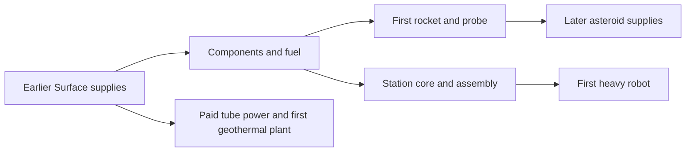

# R2MLVS1 - Gameplay Contracts and Content

## Global Mandatory Reading

> **Execution protocol**
>
> - Read this Global Mandatory Reading section before the first task and again
>   after every context compaction.
> - Before starting or resuming a task group, read the nearest preceding Area
>   Mandatory Reading block whose `Applies to` label includes that group. Area
>   blocks appear immediately before the first group they govern.
> - A referenced heading or exported symbol is authoritative. Global navigation
>   hints and Area line ranges are for navigation only; if they drift, relocate
>   the named section or symbol rather than expanding to the whole file.
> - Mandatory reading is non-transitive. Do not preload a linked file's own
>   Mandatory Reading, Consult on Demand, or Planning Provenance entries unless
>   this plan names them directly for the current area.
> - Do not read Consult on Demand or Planning Provenance merely because those
>   sources are listed. Use a Consult on Demand source only when its trigger
>   occurs.
> - No created source file, test file or JSON file should start with same prefix as a planning MD file (such as r2). Only MD files can have that prefix. No MD file should be created anywhere in source directories unless specifically asked.
> - After EVERY CONTEXT COMPACTION, you must add a note above the task group
>   which is currently in execution. The note will say: "Context has compacted
>   X times while executing this group.". If the compaction occurs before any
>   meaningful work was done (this can happen when there is a lot of baggage
>   from the previous compaction), then and ONLY then you can skip this step.
> - When exceeding 3 context compactions, YOU MUST ask yourself if you're not 
>   chewing more than we can handle :). Heck, plans change! :). In such a case, 
>   the way out is to split the group on the spot,
>   in the plan, into more groups, 
>   by appending B, C, D as a suffixes to those groups (splitting sub-groups 
>   themselves is also allowed). When you do this, create Local Mandatory
>   Reading areas so you can optimize your context only for the
>   ACTUAL task at hand.
>   Before starting or resuming a task group, read the nearest preceding Area
>   Mandatory Reading block whose `Applies to` label includes that group. Area
>   blocks appear immediately before the first group they govern.

| File name | Line Ranges | Description |
| --- | --- | --- |
| [docs/zz-reach2/upgrades/2026-10/r2mlvs-multilayer-vehicles-and-structures.md](r2mlvs-multilayer-vehicles-and-structures.md) | 188-192 | `AD-1` supplies the canonical gameplay/ownership decision for every group of this plan. It constrains profile identity, cargo meanings and one utility/accounting owner; a consumer must not redefine it locally. |
| [src/map_layer.h](../../../../src/map_layer.h) | 78-85 | `MultiLayerMap` ownership preamble: `Map` owns packed storage/geometry and this controller owns layer semantics. Every group uses world tiles/explicit layer helpers; camera selection and ad hoc plane offsets cannot define gameplay. |
| [src/cargotype.h](../../../../src/cargotype.h) | 211-223 | `SetupCargoForClimate`, `BuildCargoLabelMap`, `GetCargoTypeByLabel` separate stable labels from runtime slots; consumers must resolve the selected profile rather than hard-code cargo indices. |

Status: completed; Groups 1-23 marked [X]. [Content Freeze](r2mlvs1-g-content-freeze.md) records the delivered exports, numerical/ownership decisions, focused validation and pending feature/art/network work. Initial M0 handoffs from Plans 12/13/14 are delivered; those feature plans remain unfinished. Parent: [R2MLVS master](r2mlvs-multilayer-vehicles-and-structures.md).

**Artifact-layout migration (2026-10-09):** this plan consumes the parent [Development artifact layout](r2mlvs-multilayer-vehicles-and-structures.md#development-artifact-layout), implemented by [R2FC](r2fc-file-cleanup.md). It supersedes earlier docs asset/review/helper placement and fixed runtime-config destinations below. New native homes use `mlm/runtime/`, generated feature reviews use `mlm/reviews/`, logs remain under `logs/`, and reusable code/curated inputs keep their code/test owners. Paths and focused native/cold verification are complete; R2FC records the results and retained-input identities. Repository-relative executable commands run from the checkout root through their context-aware wrappers. Historical pass records remain dated evidence and are not new acceptance claims. No gameplay task is completed by this migration and the separate post-demo fixture-pruning gate remains.

## Outcome and Boundaries

Freeze an implementable first content profile before adding vehicles or industries. The profile includes ten distinct mine resources, their receivers, excavation spoil, five original tube vehicles, geothermal/future industries, launch collection hubs, orbital construction and useful power. It remains within the current cargo/industry limits and has a complete bootstrap path. This plan owns definitions and interface contracts; feature plans own behavior. Tube and geothermal catalogues supply the draft design inputs; their implementations are not prerequisites to drafting the content contract.

## Public Handoff Contract

Delivered public owner: [src/multilayer_content.h](../../../../src/multilayer_content.h). Exports include `MultiLayerGameplayProfile`, `LayerVehicleCapability`, `GetMultiLayerContentProfile`, `CheckDeepLayerAvailability`, `UtilityPowerAccount`. These compiled contracts define producer obligations; downstream operational behavior remains with its feature owner. Keep one authority for the fields/commands they expose; downstream plans consume the public contract rather than private pools or copied tables.

`Draft Content Handoff`: the first two reading areas publish provisional labels, budgets, recipes, capability/date policies and public profile exports. r2mlvs12/13/14 may consume these drafts to settle feasibility, sprite layout and schema. `Content Freeze Handoff`: the final area reconciles those results and freezes the selected profile before dependent gameplay proceeds.

## Implementation Tasks

Deepening pass, 2026-10-04: implementation groups use only SIMPLE, MEDIUM or HARD difficulty, with at most eight pending tasks each. Sketches describe proposed implementation contracts; verify the named earlier producers at each assumption gate. No gameplay or asset implementation is marked complete by this planning pass.

Groups are chronological and contain consecutive tasks of one difficulty. Each difficulty batch has at most eight tasks; area reading changes only when the implementation boundary or source of truth changes.

### Area Mandatory Reading - Content budget and profile

_Applies to Groups 1-6._

| File name | Line Ranges | Description |
| --- | --- | --- |
| [src/cargo_type.h](../../../../src/cargo_type.h) | 69-81 | `NUM_CARGO` and persisted cargo sentinels bound every content, capacity and compatibility decision; allocate at most 64 active cargo meanings. |
| [src/industry_type.h](../../../../src/industry_type.h) | 46-57 | `NUM_INDUSTRYTYPES`, `NUM_INDUSTRYTYPES_PER_GRF` and `NUM_INDUSTRYTILES` bound content allocation and prohibit arbitrary external-set coexistence. |
| [src/industry_type.h](../../../../src/industry_type.h) | 98-103 | `INDUSTRY_NUM_INPUTS` and `INDUSTRY_NUM_OUTPUTS` provide current 16-slot bounds; do not assume historical 3-input/2-output limits. |
| [src/industrytype.h](../../../../src/industrytype.h) | 109-152 | `IndustrySpec` owns layouts, climate/availability, recipes and callbacks; layer capabilities must be explicit and not inferred from fallback graphics. |
| [src/timer/timer_game_calendar.h](../../../../src/timer/timer_game_calendar.h) | 15-39 | `TimerGameCalendar` technology-clock contract and date conversions govern 1980/model/factory introductions; economic/realtime scheduling cannot unlock a technology. |
| [docs/zz-reach2/upgrades/2026-10/r2mlvs-multilayer-vehicles-and-structures.md](r2mlvs-multilayer-vehicles-and-structures.md) | 318-352 | `Resource and content catalogue` names all ten resources, additional cargos, consumers and fleet/facility roles; the draft budget and label map must implement this requested catalogue. |
| [src/cargotype.cpp](../../../../src/cargotype.cpp) | 126-142 | `BuildCargoLabelMap` silently ignores duplicate labels; profile validation must detect duplicate required meanings rather than treat this map as validation. |
| [src/newgrf.cpp](../../../../src/newgrf.cpp) | 1753-1881 | Complete `LoadNewGRF` staged loader defines the candidate-package activation point and skips absent files; required profile content needs explicit validation before acceptance. |
| [src/newgrf_config.cpp](../../../../src/newgrf_config.cpp) | 416-479 | Complete `IsGoodGRFConfigList` permits compatible substitutions; the content-identity spike must verify the stronger profile requirement. |
| [src/openttd.cpp](../../../../src/openttd.cpp) | 342-353 | Complete `MakeNewgameSettingsLive` copies new-game settings; profile selection must become authoritative at the same lifecycle boundary. |
| [src/genworld_gui.cpp](../../../../src/genworld_gui.cpp) | 325-341 | Complete `StartGeneratingLandscape` activates settings then resets GRF configuration; validate the selected profile after resolving this ordering. |

**Implementation sketch — content selection.** Keep loading, validation and selection distinct. The cargo label map currently keeps the first duplicate label; it does not validate this profile's uniqueness. The required-content check therefore runs on activated definitions before a new world/save is accepted.

```text
load candidate definitions -> validate identities and limits -> resolve required labels
                          -> publish immutable selected profile -> allow gameplay
missing required meaning / unsupported set -> explicit refusal before world activation
```

### Group 1 - Content budget and profile

{{SIMPLE}}
- [X] 1.1 Inventory live cargo labels/slots, industry types/tiles, accepted/produced cargo-array limits and engine IDs for the proposed Temperate profile.
- [X] 1.2 Preserve existing numeric meanings.

Evidence: [execution record, Group 1](r2mlvs1-a-content-contract.md#group-1---live-identity-and-format-inventory). Original definitions and numeric identities are unchanged. Temperate has 11 active cargos in its 12-slot original envelope; current industry arrays are 16/16.

### Group 2 - Content budget and profile

{{MEDIUM}}
- [X] 2.1 Assign stable four-character labels to all ten mined resources; resolve duplicate meanings, including one Uranium identity when ETI is selected.
- [X] 2.2 Define units and physical forms for the resource cargos, including liquid versus packaged products.
- [X] 2.3 Define cargo classes and vehicle refit compatibility for each resource.
- [X] 2.4 Map each resource to a useful receiver and a payment category without hard-coding its runtime slot.
- [X] 2.5 Budget the entire catalogue. Starting allowance: at most 12 baseline cargos + 8 additional mine resources (Coal/Iron Ore reused) + 11 additional cargos from the master + 1 Power representation = 32 active cargos before any further additions.
- [X] 2.6 Verify actual labels and climate counts; this arithmetic is a design budget, not a slot allocation.

Evidence: [draft cargo meanings and budgets](r2mlvs1-a-content-contract.md#group-2---draft-cargo-meanings). Native utility uses no freight slot: 30 active cargos within a 31-slot original-preserving envelope. Industrial `BATY` preserves Toyland `BATT`; `URAN` is one first-party meaning, with ETI mapping still gated by feasibility evidence.

### Group 3 - Compare content delivery with one representative definition

{{HARD}}
- [X] 3.1 Create a repository-local loader fixture containing one ore, one two-input processor and one vehicle; run it once through built-in definitions and once through the proposed bundled-content path. Record the registration and package files each path needs; do not build the full catalogue during this spike.
- [X] 3.2 For each candidate, save/reload the fixture and run the dedicated binary with repository-local content. Compare cargo labels, engine/industry identities and sprite availability. Select the smallest supported delivery path and record why the other candidate is unnecessary.
- [X] 3.3 Specify a required-content identity/version check before activating a Multilayer save or new world. Exercise missing package, compatible-but-different package and duplicate required label; none may silently change a saved cargo meaning.

Evidence: [Group 3 delivery decision](r2mlvs1-a-content-contract.md#group-3---delivery-spike-and-exact-identity-boundary), dedicated results (`r2mlvs1-b-loader-results.txt`; historical file unavailable). Both candidates passed new-world/save/reload definition checks. Bundled first-party NewGRF definitions are selected. `[multilayer-content-identity]` passed 17 assertions in two cases. This group publishes the read-only refusal contract; production profile activation is Group 4 and saved profile persistence remains Group 21. Experimental native registration is excluded from default builds.

### Group 4 - Persist profile choice and reject unsupported combinations

{{HARD}}
- [X] 4.1 Define the saved profile ID/version and supported Temperate content list. Wire Classic versus Multilayer selection at new-world creation; enumerate unsupported climates/industry-set combinations with a specific refusal reason.
- [X] 4.2 Specify legacy absence-of-profile migration as Classic/legacy behavior. Separate a saved explicit editor override from normal technology availability; hand the field list and migration fixture to r2mlvs14 without inventing its chunk format here.
- [X] 4.3 Verify new-game and dedicated activation produce the same label-to-slot map; keep a Classic fixture whose cargo meanings are unchanged. Defer the new saved-profile identity round trip to the final area after Schema Foundation; the earlier candidate spike uses existing content serialization only.

Evidence: [Group 4 profile and schema handoff](r2mlvs1-a-content-contract.md#group-4---profile-activation-and-persistence-handoff), actual profile results (`r2mlvs1-c-profile-results.txt`; historical file unavailable). Two profile-selection cases passed 44 assertions; the existing widget-tree check passed 330 assertions; six dedicated activation/refusal cases passed. New-game controls and the dedicated path share `GenerateWorld` preparation/activation. No saved profile round trip or downstream feature behavior is claimed by this group.

### Group 5 - Content budget and profile

{{MEDIUM}}
- [X] 5.1 Freeze the proposed 1 January 1980 calendar unlock for all Deep entry/construction/operation paths, explicit legacy/editor exceptions, five tube introduction dates and the 1980/2000/2010/2030/2045 geothermal timeline.
- [X] 5.2 Keep technology dates separate from economic production timers.
- [X] 5.3 Budget tube models, terminals and geothermal buildings as well as cargo slots. Heat/electric flows reuse metered utility state, not extra freight cargos; geothermal recipes reuse the existing planned materials.
- [X] 5.4 Define liquid Chemicals/Propellant consistently across vehicle refits.

Evidence: [calendar and representation policy](r2mlvs1-a-content-contract.md#group-5---calendar-and-representation-policy). Defaults are now explicit contracts, with per-command enforcement remaining in its feature owners. Five capsule dates, six geothermal definitions and liquid cargo forms fit the existing budgets. This definition-only group needs no additional runtime regression; the executable date boundary is Group 6.

### Group 6 - Publish content types and deterministic capability queries

{{HARD}}
- [X] 6.1 Add `src/multilayer_content.h` with `MultiLayerGameplayProfile` and `LayerVehicleCapability`: stable profile/label identities, version, supported layers, commissioning/service kind and calendar availability. Define invalid values and read-only access before adding mutating consumers.
- [X] 6.2 Declare `UtilityPowerAccount` with explicit units, producer/consumer IDs and accounting interval; the later utility-contract groups fill its allocation rules. Publish `GetMultiLayerContentProfile` and `CheckDeepLayerAvailability` with explicit saved profile/editor policy input and calendar-date semantics.
- [X] 6.3 Implement the profile lookup and Deep availability predicate with before/on/after 1 January 1980 fixtures plus legacy and saved-editor cases. Register new sources in existing CMake lists. Publish the export/field fixture; if names move, update this handoff and all direct consumers together.

Evidence: [published public contract](../../../../src/multilayer_content.h), [focused fixture](../../../../src/tests/multilayer_content.cpp). `[multilayer-content-contract]` passed 35 assertions in two cases, including typed calendar/economy separation, all three 1980 boundary dates, legacy/editor cases, invalid profile/version, invalid capability values, typed utility references and fixed-width fields. `rg` verified all five required exports before entry to Groups 7-19. Utility allocation and detailed capability tables remain their later groups' obligations.

### Area Mandatory Reading - Recipes, capability and economics

_Applies to Groups 7-19._

**Entry gate.** The following public contracts must exist before dependent implementation in this area: `src/multilayer_content.h`: `MultiLayerGameplayProfile`, `LayerVehicleCapability`, `GetMultiLayerContentProfile`, `CheckDeepLayerAvailability`, `UtilityPowerAccount`.
Verify each public file/export/schema field with `rg` in the current workspace and inspect its command/field ownership. For a same-plan contract, compile its type/signature fixture or validate its artifact after the preceding producer groups. For cross-plan behavior, also run the producer's focused executable boundary test; declarations alone cannot authorize dependent mutations or runtime claims.
If a required export is absent, stop the dependent implementation, mutation and runtime claims in Groups 7-19. Read-only characterization, source/range verification, test-case design and asset-template work that does not assume the missing behavior may continue.
Do not bypass this gate by copying private pool/tile state, inventing local IDs or cargo registries, using a historical plan as a delivered implementation, opening user-wide content stores, substituting a second utility/accounting authority, or adding an unreviewed fallback path. Finish the named producer or revise the shared contract and its direct consumers first.

| File name | Line Ranges | Description |
| --- | --- | --- |
| [src/industry.h](../../../../src/industry.h) | 75-106 | `ProducedCargo`, `AcceptedCargo`, `ProducedCargoes`, `AcceptedCargoes` expose bounded inventory and economy-time history; conserve materials and avoid narrow-counter overflow. |
| [src/vehicle_cmd.h](../../../../src/vehicle_cmd.h) | 20-42 | Build/refit/clone/depot-autoreplace commands and traits expose all purchase paths; `CloneVehicle` is `NoTest`, so do not rely on a generic estimate to enforce capability/commissioning. |
| [src/economy_base.h](../../../../src/economy_base.h) | 20-38 | `CargoPayment`, `PayTransfer`, `PayFinalDelivery` own transport income. Visiting an origin station, a descent, or handling transfer is not automatic final payment. |
| [docs/zz-reach2/upgrades/2026-10/r2mlvs-multilayer-vehicles-and-structures.md](r2mlvs-multilayer-vehicles-and-structures.md) | 302-308 | `AD-15` supplies five capsule models, cargo-form rules, underground compatibility and paid-power bootstrap; freeze these capabilities here rather than importing a second vehicle registry. |
| [docs/zz-reach2/upgrades/2026-10/r2mlvs-multilayer-vehicles-and-structures.md](r2mlvs-multilayer-vehicles-and-structures.md) | 310-316 | `AD-16` supplies the geothermal timeline, shared heat budget and direct-processing products; content contracts must preserve transported inputs and one utility owner. |
| [docs/zz-reach2/upgrades/2026-10/r2mlvs16-underground-transport-tubes.md](r2mlvs16-underground-transport-tubes.md) | 51-63 | `First-party vehicle catalogue` fixes five distinct capsule names, roles, physical cargo forms and proposed model dates; declare those capabilities rather than inventing a smaller/refit-only fleet. |
| [docs/zz-reach2/upgrades/2026-10/r2mlvs17-geothermal-energy-and-industry.md](r2mlvs17-geothermal-energy-and-industry.md) | 51-61 | `Proposed technology timeline` fixes vent power and later smelter/battery/forge products and dates for draft recipes and calendar capabilities. |
| [src/multilayer_content.h](../../../../src/multilayer_content.h) (delivered) | Live definitions; no fixed range | [r2mlvs1-gameplay-contracts-and-content.md](r2mlvs1-gameplay-contracts-and-content.md) Groups 1-6, ending with Group 6's public-contract task, publish `MultiLayerGameplayProfile`, `LayerVehicleCapability`, `GetMultiLayerContentProfile`, `CheckDeepLayerAvailability`, `UtilityPowerAccount`. These exports/schema fields are authoritative for this area. Same-plan consumers follow those earlier groups; cross-plan consumers verify the producer's required implementation/tests as well. Proposed names alone do not prove delivery. |
| [src/economy.cpp](../../../../src/economy.cpp) | 1134-1167 | Complete `TriggerIndustryProduction` selects callbacks or independent input conversion; constrains the all-input recipe contract and prevents premature consumption/output clamping. |

**ASSUMPTION: this was already built previously. If not, re-asses at runtime**. This applies only to the producer contracts named in this area's gate, after their listed producer groups have run. Verify their actual exports and focused tests before using the sketches below; proposed types and helper names in sketches are not evidence of delivered code.

**Implementation sketch — recipes and bootstrap.** These are proposed contracts to implement through the chosen content path. The preceding profile-publication groups provide label/capability queries; the recipe groups here publish the batch record before downstream industry code consumes it. The existing default `TriggerIndustryProduction` loop converts inputs independently and clamps output, so do not reuse that behavior for an all-input recipe.

```text
batches = min(time_budget, each_input_stock / required_input,
              each_output_free_space / produced_output)
if batches == 0: retain every input; report the limiting resource
else: validate checked totals; consume all inputs and add all outputs atomically
```



Use the graph to test prerequisites, including dates and transport. Later asteroid supplies may improve throughput but cannot be the only fuel source for the first launch.

### Group 7 - Recipes, capability and economics

{{MEDIUM}}
- [X] 7.1 Specify inputs, outputs, reserve consumption, storage and processing time for each mine/processor. Include usable Surface sinks for all ten resources, Earth disposal, Rock crushing and surplus disposal.

Evidence: [bounded mines, processors and receivers](r2mlvs1-d-recipes-and-bootstrap.md#group-7---mines-processors-and-bounded-receivers). All ten resources have dated Surface receivers; stock/intake/time/reserve quantities are explicit. Crusher aggregate is an internal construction stock with bounded replacement value, not unrestricted paid Goods. Group 8 validates the all-input record before feature implementation.

Context has compacted 1 times while executing this group.

### Group 8 - Define recipe batch and stock contracts

{{HARD}}
- [X] 8.1 Choose one all-input recipe execution contract for native and selected content callbacks. Specify input quantities, output quantities, interval, maximum batches, output-space refusal and fixed-width overflow checks. `input_cargo_multiplier` alone cannot enforce multi-input requirements.
- [X] 8.2 Work one partial-input and one full-output example by hand: no batch consumes stock until every required input and every output slot can fit. Define alternate recipes as a saved choice, not simultaneous production from the same inputs.
- [X] 8.3 Publish a recipe record/validation fixture for r2mlvs6/11/17. Require unique cargo roles, positive quantities, defined physical forms, slot-budget compliance and one owner of input consumption.

Evidence: [batch/commit boundary and worked examples](r2mlvs1-d-recipes-and-bootstrap.md#group-8---one-atomic-all-input-batch-owner), [public recipe contract](../../../../src/multilayer_recipe.h). `[multilayer-recipe]` passed 39 assertions in three cases. This pure planner owns no runtime facility or stock mutation; downstream owners must implement the documented atomic commit and save the alternative choice.

### Group 9 - Fill Surface manufacturing recipes

{{MEDIUM}}
- [X] 9.1 Fill the Station Components recipe from Steel/Refined Metals and Chemicals; state whether Steel and Refined Metals are alternatives or simultaneous inputs, with numerical units and batch time.
- [X] 9.2 Fill Electronics from Refined Metals and rare-earth material, then Batteries from Lithium/Cobalt; identify their earlier Surface receivers and quantities rather than relying on Deep factories.
- [X] 9.3 Fill Robotics Parts from Electronics, Batteries and metals; show one complete Surface-supplied batch for the first heavy robot.
- [X] 9.4 Fill Propellant from Chemicals or Water Ice using explicit alternative recipes; fill Solar Mirror Kits from components/electronics. Record the pre-asteroid Chemicals route so the first rocket can launch.
- [X] 9.5 For every recipe record, check input/output slot counts and bounded inventory; split plant definitions only when the chosen content path requires it.

Evidence: [manufacturing choices and expanded robot ledger](r2mlvs1-d-recipes-and-bootstrap.md#group-9---manufacturing-choices-and-first-robot-inputs). `[multilayer-manufacturing]` passed 73 assertions in one case covering all 12 immutable choices, required inputs and output caps. Largest recipe is 3 inputs/1 output; no capacity-driven split plant or extra cargo is required.

### Group 10 - Prove content bootstrap reachability

{{HARD}}
- [X] 10.1 Build a directed dependency table from each required vehicle/facility to its construction inputs, source plants, dates and access technology. Seed it with purchasable Surface supplies and initial cash; keep transport routes as prerequisites too.
- [X] 10.2 Topologically expand the table at the first TBM, first mine, 1970 tube, 1980 geothermal, first probe/mirror and first heavy-robot milestones. A cycle is acceptable only with a documented earlier external supply; reject self-dependent recipes.
- [X] 10.3 Record one input ledger and earliest feasible date per bootstrap path; check all ten mined resources have an active receiver at their introduction. Hand unresolved recipe changes back to the central catalogue before freeze.

Evidence: [bootstrap graph, external seed and capital ledger](r2mlvs1-d-recipes-and-bootstrap.md#group-10---bootstrap-graph-and-bounded-external-seed). `[multilayer-bootstrap]` passed 258 assertions in one case, expanding 11 milestones and all ten mine/receiver dates. A bounded paid 1965 supply closes the early-tube dependency; bought company supplies earn no freight income. Runtime procurement/routes and long-term balance remain feature work.

### Group 11 - Recipes, capability and economics

{{MEDIUM}}
- [X] 11.1 Specify how construction/service inputs enter facility inventory, when packets are consumed, and when a carrier earns delivery income. A delivery, a transfer and construction consumption cannot each pay for the same final transport leg.

Evidence: [packet/inventory/payment ownership table and partial-intake example](r2mlvs1-d-recipes-and-bootstrap.md#group-11---packet-inventory-and-income-boundary). Live CargoPayment transfer/final-delivery methods were inspected. This documentation group changes no payment behavior; feature integration remains outstanding.

### Group 12 - Recipes, capability and economics

{{SIMPLE}}
- [X] 12.1 Publish capability tables for standard/deep TBMs, hoppers, haulers, trucks, all five tube capsules, rockets, probes and robots: layers, transport/rail compatibility, cargo classes, commissioning facility, service facility, dates and replacement rules. Tube capability excludes ordinary rail/portals and cannot bypass spoil-wagon hauling.

Evidence: [all 19 capability/replacement rows](r2mlvs1-d-recipes-and-bootstrap.md#group-12---complete-logical-vehicle-capability-catalogue), [public read-only catalogue](../../../../src/multilayer_vehicle_catalogue.cpp). `[multilayer-vehicle-catalogue]` passed 181 assertions in one case for unique models, explicit commissioning/service, tube isolation, liquid forms, spoil obligations and conventional routes for all ten ores. Engine allocation, tanker refit mapping and command enforcement remain with feature owners.

### Group 13 - Parameterize excavation and haulage budgets

{{MEDIUM}}
- [X] 13.1 Define units and rounding for active/idle TBM charges, work duration, support price per cut and Earth/Rock yield by hardness. Keep recurring costs separate from per-cut costs and use simulation/economy time rather than display frames.
- [X] 13.2 Fill standard/deep TBM, hopper and hauler capacities plus disposal prices and intake limits. Calculate one straight corridor and one turning chamber, including loaded return and empty delivery time.
- [X] 13.3 Publish a worked ledger proving spoil-only digging loses money after work, support, transport and disposal; state the starting cash and bounded receiver capacity used.

Evidence: [hardness/capacity tables, swept-cell count and both loss ledgers](r2mlvs1-e-ground-and-space-budgets.md#group-13---excavation-units-bounded-spoil-and-legal-heading-budgets). Independent arithmetic verified 24,120/28,110 cash debits and 23,850/27,795 loss after maximal aggregate value. Twelve advancing chamber headings change at most 45 degrees. Runtime swept-consist geometry and balance remain unverified feature work.

### Group 14 - Parameterize launch and construction budgets

{{MEDIUM}}
- [X] 14.1 Fill rocket payload/fuel, launch preparation, pad turnaround and probe hold/service/pod-replacement values. Calculate one initial launch and two return batches, including Surface hub handling cost.
- [X] 14.2 Fill each station module construction quantity/time and each service inventory capacity. Define depletion as a visible pause that retains materials, including zero fuel and full output storage.
- [X] 14.3 Publish the first station/heavy-robot budget with Surface-only parts and a saved remainder policy for fractional work; these are initial tuning numbers for r2mlvs15, not measured final balance.

Evidence: [launch/return/module ledger and Q16 remainder policy](r2mlvs1-e-ground-and-space-budgets.md#group-14---launch-returns-and-surface-supplied-orbital-assembly). Arithmetic verified the 12/30-t probe/pods/service payload, 26,420 initial operating debit and exact 300+450-J fractional-work carry. Reconciled bootstrap fixture passed 258 assertions; pod/service supplies are now explicit. Nucleus deployment precedes heavy-robot assembly without a self-dependency. Runtime/art/network acceptance remains outstanding.

### Group 15 - Define the utility ledger and allocation boundary

{{HARD}}
- [X] 15.1 Finalize `UtilityPowerAccount`: distinguish generation rate, energy per accounting interval, demand, granted use, unmet demand and rounding remainder. Specify checked integer bounds and stable producer/consumer order.
- [X] 15.2 Define a layer-local allocation pass: snapshot available generation, allocate to eligible linked consumers once, then commit the ledger. Explicit electrical links debit the source and credit destination once; coordinate overlap grants nothing.
- [X] 15.3 Separate vent heat allocation from electricity: generators receive a share of heat before converting it; direct-heat recipes consume a different share. Mark eligible solar generation before its single mirror modifier.
- [X] 15.4 Provide worked fixtures for oversubscribed generation, zero supply, two consumers and one inter-layer export. Require conservation and identical results under different render/view settings.

Evidence: [shared energy/commit contract and worked ledgers](r2mlvs1-f-utility-and-transfer-contracts.md#group-15---one-conserved-utility-ledger), [pure public utility API](../../../../src/multilayer_utility.h). `[multilayer-utility]` passed 97 assertions in three cases. Checked integration/carry, sorted shortage grants, explicit export debit/credit, zero supply, wrong layers, duplicate identities and separate heat conversion conserve energy. Runtime network eligibility, interval commit and operational mirror behavior remain feature obligations.

### Group 16 - Assign native and ETI power effects to one authority

{{HARD}}
- [X] 16.1 Define the original-content consumer effects for processors/tubes and a bounded Surface town-growth benefit; publish caps, update interval and refusal behavior without implementing the downstream facilities here.
- [X] 16.2 Specify an exclusive authority selector for native town effects versus an ETI Game Script adapter. Never allow both to set the same growth rate or reward the same electricity; include the no-GS native path.
- [X] 16.3 Publish a contract fixture showing solar and geothermal entering one grid, geothermal excluded from mirror multiplication, and virtual energy excluded from unrestricted freight income.

Evidence: [native effect caps, interval and exclusive authority](r2mlvs1-f-utility-and-transfer-contracts.md#group-16---useful-native-effects-and-exclusive-town-authority). `[multilayer-power-effects]` passed 22 assertions in one case, including one mixed solar/geothermal allocation, source eligibility, capped/zero bonuses and GS refusal. No operational solar modifier, town/GS hook or freight Power cargo is introduced.

### Group 17 - Recipes, capability and economics

{{MEDIUM}}
- [X] 17.1 Define the two independent launch-center areas: required 20-tile circular orbital release radius and proposed 20-tile Surface collection radius.

Evidence: [independent radius/layer/anchor contract](r2mlvs1-f-utility-and-transfer-contracts.md#group-17---two-independent-circular-areas). The immutable profile publishes separate radius fields. Boundary/fixed-point comparison and checked arithmetic are specified; global station spread and catchment remain unchanged. Plan 9 owns operational eligibility/overlays.

### Group 18 - Specify Surface collection membership and reservation

{{HARD}}
- [X] 18.1 Define membership over the whole Surface station footprint, common company, permitted rail/lorry facilities and the independent fixed center anchor. Work an in-range station, boundary extension and wrong-layer example.
- [X] 18.2 Define one packet location at a time: center storage, reserved handling job, member station or vehicle. Select members by cargo filters/demand and stable ID order; specify per-tick capacity and handling charges.
- [X] 18.3 Specify cancellation on station extension/deletion or company changes: release unstarted reservations or settle in-progress jobs to a valid owner. Give one conservation example; r2mlvs9 owns implementation and payment integration.

Evidence: [whole-footprint membership, reservation bounds and 40-unit cancellation ledger](r2mlvs1-f-utility-and-transfer-contracts.md#group-18---collection-membership-and-one-packet-location). Circular boundary/count arithmetic was recalculated. This contract-only group adds no private pool or packet mutation; Plan 9 still owes operational conservation, deletion and payment tests.

### Group 19 - Define direct-heat recipes and early utility bootstrap

{{MEDIUM}}
- [X] 19.1 Fill the 2010 smelter alternative ore recipes, 2030 battery recipe and 2045 Mantle Forge recipe using the all-input record already published above; include transported inputs, heat per batch and bounded product stock.
- [X] 19.2 Give the 1980 collector/powerhouse/riser a construction recipe using cash and Surface-available materials. Check every input can travel by conventional transport before geothermal produces anything.
- [X] 19.3 Define paid external electricity for the first 1970 tube route independently of Deep access; retain a usable conventional Uranium carrier between 1980 and Shield-85 in 1985.
- [X] 19.4 Extend the bootstrap fixture with these dates and verify shared heat demand never exceeds the vent budget; later geothermal products cannot be required to build their own first source.

Evidence: [dated heat recipes, construction inputs, paid-power tariff and shared heat ledger](r2mlvs1-f-utility-and-transfer-contracts.md#group-19---direct-heat-and-early-power-bootstrap). `[multilayer-geothermal-bootstrap]` passed 56 assertions in one case. No bootstrap input depends on a later heat factory; 1,998,000 thermal J funds distinct recipe/generator shares. Plan 17 still owns operating factories, links/leases and their runtime acceptance.

### Area Mandatory Reading - Shared interfaces and feasibility records

_Applies to Groups 20-23._

**Entry gate.** The following public contracts must exist before dependent implementation in this area: `src/multilayer_content.h`: `MultiLayerGameplayProfile`, `LayerVehicleCapability`, `GetMultiLayerContentProfile`, `CheckDeepLayerAvailability`, `UtilityPowerAccount`; `src/solar_power.h`: `SolarGenerationAccount`, `MirrorAssignment`, `ComputeMirrorSolarOutput`; `media/multilayer/contracts/multilayer_sprite_manifest.json`: `asset_id`, `consumer`, `directions`, `frames`, `anchor`, `source`; `src/multilayer_state.h`: `MultiLayerStateSchema`, `ValidateMultiLayerStateReferences`.
Verify each public file/export/schema field with `rg` in the current workspace and inspect its command/field ownership. For a same-plan contract, compile its type/signature fixture or validate its artifact after the preceding producer groups. For this M0 area, validate the ETI Feasibility decision, Sprite Contract schema and Schema Foundation type/artifact fixtures. The solar exports are draft signatures only: operational mirror behavior and its executable tests belong to later feature work and do not block Content Freeze. These drafts never authorize runtime mutation claims.
If a required export is absent, stop the dependent implementation, mutation and runtime claims in Groups 20-23. Read-only characterization, source/range verification, test-case design and asset-template work that does not assume the missing behavior may continue.
Do not bypass this gate by copying private pool/tile state, inventing local IDs or cargo registries, using a historical plan as a delivered implementation, opening user-wide content stores, substituting a second utility/accounting authority, or adding an unreviewed fallback path. Finish the named producer or revise the shared contract and its direct consumers first.

| File name | Line Ranges | Description |
| --- | --- | --- |
| [src/saveload/saveload.h](../../../../src/saveload/saveload.h) | 447-518 | `ChunkType`, `ChunkId`, `ChunkHandler` and handler aliases define save/load/fixup/preview ownership; every feature persists its own authoritative fields through this boundary. |
| [src/command.cpp](../../../../src/command.cpp) | 301-328 | `CommandHelperBase::InternalExecuteValidateTestAndPrepExec` defines refusal/estimate before execution; no validation phase may consume inventory, RNG or funds. |
| [src/tests/map_layer.cpp](../../../../src/tests/map_layer.cpp) | 430-442 | Complete display-order test retains immutable Space=2 and Deep=3 storage meanings; future UI/profile work cannot reorder saved IDs. |
| [src/multilayer_content.h](../../../../src/multilayer_content.h) (delivered) | Live definitions; no fixed range | [r2mlvs1-gameplay-contracts-and-content.md](r2mlvs1-gameplay-contracts-and-content.md) Groups 1-6, ending with Group 6's public-contract task, publish `MultiLayerGameplayProfile`, `LayerVehicleCapability`, `GetMultiLayerContentProfile`, `CheckDeepLayerAvailability`, `UtilityPowerAccount`. These exports/schema fields are authoritative for this area. Same-plan consumers follow those earlier groups; cross-plan consumers verify the producer's required implementation/tests as well. Proposed names alone do not prove delivery. |
| [src/solar_power.h](../../../../src/solar_power.h) (delivered draft signatures) | Live definitions; no fixed range | [r2mlvs12-solar-farms-mirrors-and-eti.md](r2mlvs12-solar-farms-mirrors-and-eti.md) Groups 1-6, ending with Group 6's public-contract task, publish `SolarGenerationAccount`, `MirrorAssignment`, `ComputeMirrorSolarOutput`. These exports/schema fields are authoritative for this area. Same-plan consumers follow those earlier groups; cross-plan consumers verify the producer's required implementation/tests as well. Proposed names alone do not prove delivery. |
| [sprite manifest](../../../../media/multilayer/contracts/multilayer_sprite_manifest.json) (delivered M0 schema) | Live definitions; no fixed range | [r2mlvs13-graphics-and-asset-pipeline.md](r2mlvs13-graphics-and-asset-pipeline.md) Groups 1-8, ending with Group 8's public-contract task, publish `asset_id`, `consumer`, `directions`, `frames`, `anchor`, `source`. These exports/schema fields are authoritative for this area. Same-plan consumers follow those earlier groups; cross-plan consumers verify the producer's required implementation/tests as well. Proposed names alone do not prove delivery. |
| [src/multilayer_state.h](../../../../src/multilayer_state.h) (delivered foundation) | Live definitions; no fixed range | [r2mlvs14-savegame-determinism-and-lifecycle.md](r2mlvs14-savegame-determinism-and-lifecycle.md) Groups 1-6, ending with Group 6's public-contract task, publish `MultiLayerStateSchema`, `ValidateMultiLayerStateReferences`. These exports/schema fields are authoritative for this area. Same-plan consumers follow those earlier groups; cross-plan consumers verify the producer's required implementation/tests as well. Proposed names alone do not prove delivery. |

**ASSUMPTION: this was already built previously. If not, re-asses at runtime**. This applies only to the producer contracts named in this area's gate, after their listed producer groups have run. Verify their actual exports and focused tests before using the sketches below; proposed types and helper names in sketches are not evidence of delivered code.

**Handoff staging.** For M0, consume the draft ETI feasibility decision, sprite schema/geometry contract and save schema foundation. Their later runtime acceptance is not an input to Content Freeze; record it as outstanding in the owning feature plan. Validate proposed API declarations and numerical tables here without claiming undeveloped orbital or geothermal behavior works.

### Group 20 - Partition state ownership before schema agreement

{{HARD}}
- [X] 20.1 Produce an ownership matrix for ground state only: Deposit, ExcavationJob, TBMProject and ExchangeAssignment. List typed references, authoritative quantities/timers, invalid-reference handling and caches; feature owners implement their own records.
- [X] 20.2 Extend the matrix for OrbitalBody, SpaceMission, ConstructionInventory, MirrorAssignment, LaunchCollectionHub and SurfaceHandlingJob. Record packet ownership at every transfer boundary and the owner that resolves deletion.
- [X] 20.3 Extend the matrix for TubeNetwork and GeothermalVent/UtilityLink. Classify utility reservations and network connectivity as saved authority or rebuildable cache explicitly.
- [X] 20.4 Review each row against r2mlvs14 Schema Foundation Handoff. Freeze transaction/save boundaries one family at a time; publish the consolidated dependency table only when no field has two owners.

Evidence: [field/phase ownership and saved/cache boundaries](r2mlvs1-g-content-freeze.md#group-20---transaction-and-saved-state-ownership). Solar/sprite/schema M0 handoffs exist and their focused contract/metadata fixtures pass. Future feature IDs/pools remain producer obligations; no dependent runtime mutation is claimed.

### Group 21 - Resolve ETI evidence before content freeze

{{HARD}}
- [X] 21.1 Consume r2mlvs12 ETI Feasibility Handoff: pinned version, required labels/slots, callback behavior, Game Script authority and redistribution evidence. Record unsupported or unverified claims as such.
- [X] 21.2 Apply its result to the selected profile: approve a tested named adapter only when its requirements fit; otherwise select original solar/native power. Recalculate the complete cargo/industry/engine budgets for that choice.
- [X] 21.3 Run the selected profile and native fallback contract fixtures for labels, bootstrap recipes and single power authority. Publish the decision and its evidence; absent feasibility evidence stops content freeze, not independent table drafting.
- [X] 21.4 With Schema Foundation available, implement and round-trip saved profile ID/version and legacy absence-of-profile migration. Validate required-content identity and label meanings before allowing dependent gameplay to resume; record this persistence evidence in Content Freeze.

Evidence: [native decision, save/editor/legacy and refusal boundaries](r2mlvs1-g-content-freeze.md#group-21---selected-profile-and-persistence). Six metadata/legacy cases and seven saved-policy/refusal cases passed; original files restored. Native/fallback contract burst passed 450 assertions. ETI runtime/redistribution remain unsupported/unverified; operating power/art/features are later handoffs.

### Group 22 - Reconcile art and worked budgets for Content Freeze

{{MEDIUM}}
- [X] 22.1 Finish the initial sprite/footprint contract with r2mlvs13 Sprite Contract Handoff. Every functional type needs visible identity, status and purchase/build previews.
- [X] 22.2 Review the worked ground budgets for legal 45-degree TBM clearing and transport of all ten mine resources. Resolve changed cargo/cost assumptions centrally.
- [X] 22.3 Review first-tube, 1980 vent/riser and later-smelter budgets with calendar and power bootstrap checks.
- [X] 22.4 Review first-probe/drop/collection, first-mirror and first-station/heavy-robot budgets with Surface-supplied fuel and parts. Record unimplemented runtime/art/network checks in their owners rather than treating these paper budgets as acceptance.

Evidence: [reconciled geometry/coverage, ground/utility/Space budgets and remaining acceptance](r2mlvs1-g-content-freeze.md#group-22---reconciled-art-and-numerical-contracts). Manifest validation passed at 141 families/58,059 planned sprites; all actual art/feature/network checks remain in their owners.

Context has compacted 1 times while executing this group.

### Group 23 - Shared interfaces and feasibility records

{{SIMPLE}}
- [X] 23.1 Record any design changes centrally.
- [X] 23.2 Record the implemented public exports, focused test commands/results and remaining runtime/art/network gaps in this plan; retain original supplied saves and repository-local evidence.
- [X] 23.3 Update affected architecture/handoff documentation to describe delivered behavior and reconcile the parent index only when this plan's Completion Conditions are met. Keep every unfinished task unchecked.

Evidence: [public exports and final verification](r2mlvs1-g-content-freeze.md#group-23---public-exports-and-final-verification). Normal Debug builds passed with the loader probe disabled; 876 assertions/22 focused cases, manifest validation, two selected save loads and two exact-package refusals passed. Architecture and parent index now distinguish completed Plan 1 from partial producer M0 handoffs.

## Consult on Demand

| Trigger | File name | Start at | Expand only when | Consultation purpose |
| --- | --- | --- | --- | --- |
| A selected content profile loads with missing or mislabelled cargo | [../../architecture/newgrf/archi-newgrf.md](../../architecture/newgrf/archi-newgrf.md) | `Loading stages` | The live label map and pinned content definitions disagree after activation | Trace content activation and compatibility ownership; the architecture is navigation/rationale, not proof that another GRF can substitute for the chosen profile. |
| A required public export is absent and its owner/location is disputed | [r2mlvs-multilayer-vehicles-and-structures.md](r2mlvs-multilayer-vehicles-and-structures.md) | `Requirements and ownership` and `Plan Index` | The named producer confirms an intentional contract/ownership change | Find the responsible producer and reconcile its public handoff with direct consumers; the hub cannot substitute for missing implementation. |
| Current behavior contradicts a historical subsystem description | [../../architecture/map-layers/archi-map-layers.md](../../architecture/map-layers/archi-map-layers.md) | `Invariants` and the relevant named source in `Code map` | The live symbol and executable test do not explain the difference | Locate layer addressing or lifecycle rationale. Live code/tests govern delivered behavior; this architecture page does not prove future interfaces exist. |

## Planning Provenance

This is not an execution reading queue. Do not preload it after context compaction. It is non-transitive; ranges record planning use, not runtime authority.

| File name | Sections or Line Ranges used while planning | Planning contribution |
| --- | --- | --- |
| [docs/zz-reach2/architecture/initial-inventory.md](../../architecture/initial-inventory.md) | 185-220 | `Command as the only world mutation`, `Pool-indexed game objects`, `Tile map as a packed array` and `File-suffix modules` oriented command/pool/header ownership and source registration. This historical inventory is a location survey, not authority for current layer behavior. |
| [docs/zz-reach2/architecture/@archi-ttd-level0.md](../../architecture/@archi-ttd-level0.md) | 24-63 | `How the program fits together` and `Source and runtime boundaries` located shared simulation, data/presentation, CMake targets and subsystem handoffs used to choose the live reading sources. |
| [docs/zz-reach2/upgrades/2026-10/r2mlvs-multilayer-vehicles-and-structures.md](r2mlvs-multilayer-vehicles-and-structures.md) | 119-140 | `Requirements and ownership` assigned this plan's feature responsibilities; it shaped the decomposition without making every sibling plan a mandatory reading dependency. |
| [src/cargotype.h](../../../../src/cargotype.h) | 211-223 | The inspected live boundary helped separate characterization, public-contract production, implementation and acceptance batches. It materially constrained profile identity, cargo meanings and one utility/accounting owner; this entry records planning influence rather than an additional reading obligation. |
| [User planning-format instructions](<C:/Users/Axonn/.codex/attachments/cd59b20a-3a96-4d54-b4bd-1e8f37639e7d/Pasted text.txt>) | `Global Mandatory Reading`, `Area Mandatory Reading`, `Consult on Demand`, `Planning Provenance`, `Final validation` | Supplies the exact protocol, chronological difficulty batches of at most eight tasks, reading gates and validation format. |
| [src/economy.cpp](../../../../src/economy.cpp) | 1134-1167 | Deeper planning pass, 2026-10-04: Independent-input conversion required a shared all-input recipe contract and separate bootstrap validation. |

## Completion Conditions

Every resource has a transport vehicle and useful receiver; every advanced facility can be bootstrapped from earlier supplies. Cargo and industry budgets fit actual limits. Content can be loaded deterministically, identified in saves and distributed with the chosen delivery route. ETI uncertainty has a working original-content fallback. Definitions are specific enough for feature work without inventing incompatible IDs or payment semantics.

Completion evidence: all ten resources have dated logical carrier/receiver contracts, every advanced bootstrap row expands from paid earlier supplies, and compiled/native fixtures enforce the declared budgets, recipe and single utility authority. The generated cargo package loads and saves exact profile metadata; actual definition/save/refusal tests pass. The native fallback supplies original definitions and tested accounting/effect contracts. Operational Useful Power and feature behavior follow the master's staged handoffs; they remain unchecked in their owners.
