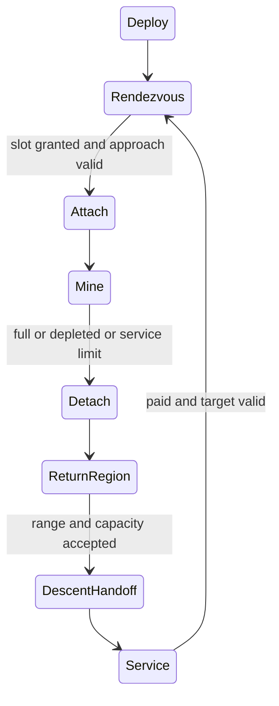

# R2MLVS10 - Asteroids and Mining Probes

## Global Mandatory Reading

> **Execution protocol**
>
> - Read this Global Mandatory Reading section before the first task and again
>   after every context compaction.
> - Before starting or resuming a task group, read the nearest preceding Area
>   Mandatory Reading block whose `Applies to` label includes that group. Area
>   blocks appear immediately before the first group they govern.
> - A referenced heading or exported symbol is authoritative. Global navigation
>   hints and Area line ranges are for navigation only; if they drift, relocate
>   the named section or symbol rather than expanding to the whole file.
> - Mandatory reading is non-transitive. Do not preload a linked file's own
>   Mandatory Reading, Consult on Demand, or Planning Provenance entries unless
>   this plan names them directly for the current area.
> - Do not read Consult on Demand or Planning Provenance merely because those
>   sources are listed. Use a Consult on Demand source only when its trigger
>   occurs.
> - User execution correction,2026-10-12: batch related feature changes and
>   fixture fixes before building. Builds take time and block the workspace.
>   Do not rebuild after each small edit; use a consolidated build/validation
>   pass when the next substantial batch is ready. Carry remaining fixture-only
>   corrections into that batch instead of repeatedly rebuilding this one.
> - User compiler limit,2026-10-13: keep tools launching MSVC `CL.exe` at two
>   outer build workers, including on battery. Keep nested compiler parallelism
>   bounded (`--parallel 2` and `CL_MPCount=2`); do not increase it to exploit
>   all16 cores. An allowance of eight workers applies only to a different compiler.
> - No created source file, test file or JSON file should start with same prefix as a planning MD file (such as r2). Only MD files can have that prefix. No MD file should be created anywhere in source directories unless specifically asked.
> - After EVERY CONTEXT COMPACTION, you must add a note above the task group
>   which is currently in execution. The note will say: "Context has compacted
>   X times while executing this group.". If the compaction occurs before any
>   meaningful work was done (this can happen when there is a lot of baggage
>   from the previous compaction), then and ONLY then you can skip this step.
> - When exceeding 3 context compactions, YOU MUST ask yourself if you're not 
>   chewing more than we can handle :). Heck, plans change! :). In such a case, 
>   the way out is to split the group on the spot,
>   in the plan, into more groups, 
>   by appending B, C, D as a suffixes to those groups (splitting sub-groups 
>   themselves is also allowed). When you do this, create Local Mandatory
>   Reading areas so you can optimize your context only for the
>   ACTUAL task at hand.
>   Before starting or resuming a task group, read the nearest preceding Area
>   Mandatory Reading block whose `Applies to` label includes that group. Area
>   blocks appear immediately before the first group they govern.

| File name | Line Ranges | Description |
| --- | --- | --- |
| [docs/zz-reach2/upgrades/2026-10/r2mlvs-multilayer-vehicles-and-structures.md](r2mlvs-multilayer-vehicles-and-structures.md) | 276-280 | `AD-11` supplies the canonical gameplay/ownership decision for every group of this plan. It constrains fixed-point moving targets, finite reserves and conserved probe cargo; a consumer must not redefine it locally. |
| [src/map_layer.h](../../../../src/map_layer.h) | 78-85 | `MultiLayerMap` ownership preamble: `Map` owns packed storage/geometry and this controller owns layer semantics. Every group uses world tiles/explicit layer helpers; camera selection and ad hoc plane offsets cannot define gameplay. |
| [src/vehicle_func.h](../../../../src/vehicle_func.h) | 192-204 | `VehicleServiceInDepot`, `CallVehicleTicks`, `ResetVehicleHash`, `ViewportAddVehicles` are public tick/service/spatial-render boundaries for orbital vehicles. |

Status: resumed at user request,2026-10-14; Groups1-7 are complete after Plan9's independent runtime handoff; runtime groups passed both configurations and documentation groups reconcile their delivered definitions. Next is Group8 task8.1. Remaining full-plan tasks still apply. Parent: [R2MLVS master](r2mlvs-multilayer-vehicles-and-structures.md). Depends on r2mlvs9.

## Current dispatch - Full-plan completion, 2026-10-12

**Historical checkpoint,2026-10-13; subsequently resumed.** The user requested stopping after the
current task. Plan8 Group13B and Plan11's physical construction-job owner now
support native Core blueprint placement, actual Earth-builder Steel/Goods
delivery, saved work, cancellation/collection and a finished frame. Verification
is in `logs/space-construction-verification.json`: RelWithDebInfo804 contract
assertions/23 cases, native interrupted/lifecycle/conservation checks, twelve
full/preview corruption cases and genuine414-to415 migration. Debug remains
for the next substantial batch. First-Core activation, operational modules,
processing/reuse, final art and full network acceptance remain open. Resume
with the Core activation producer only after a new continuation request.

**Resumed objective, 2026-10-12:** finalize both Plan9 and this plan. The recorded
demo pause is superseded. The saved-name correction and Plan9 Groups5/6
packet handling/lifecycle are delivered in both builds; the remaining launch,
mining, survey, construction, service, graphics and acceptance scope stays active.

The active objective is to finalize this entire plan. P1/P2 are delivered
increments, not completion of the original Groups1-22. Group2.1's saved
population control and Plan9's native empty Surface launch center are delivered.
Native Surface membership and timed handling are delivered. Next producers are
paid rocket commissioning and remaining service/pad/recovery producers. Plan1
Group12B's Space definitions and Plan8 Group6B's native typed queue foundation
are verified in both builds; generation/motion evidence and deployment/drop/descent
continue toward the full loop. The user's latest revision also requires
Groups8B/8C: survey and construction roles, ordered missions and survey-gated
resource disclosure, followed by Steel/Goods orbital construction and reuse.
Paid service/repeat, final art, recovery, network replay and useful Surface
delivery remain required. Underground work stays paused. Every unfinished
original task remains unchecked; the added requirements are pending too.

**Plan9 producer progress,2026-10-13; partial.** The connected launch logistics
batch now has RelWithDebInfo native evidence for real supplies, paid passive
pods, interrupted service and reusable rocket deployment/recovery, alongside
passing assembly/order/handling/center regressions. Descent stopped at the
foreign-center test-site setup before release. Its paid-canal fixture correction
and an active-service capture await the next substantial feature batch; Debug
remains deferred. `logs/launch-logistics-verification.json` binds the tested
binaries/reports and identifies those uncompiled fixture changes. This does not
complete the role actions, orbital resupply or either full plan.

**Historical demo break,2026-10-12 (superseded):** the Plan9 native
facility/membership/UI batch was verified in both builds
(`logs/launch-hub-verification.json`) before the user paused implementation. The [bundled underground/Space walkthrough](d2um-underground-mines.md)
provides mining, full-hold and `space-hub` checkpoints. Handling and its lifecycle
are now delivered; descent, Earth commissioning, survey/construction roles, paid
service/repeat and the remaining original requirements stay pending. Retain the user instruction
to batch at least two feature groups between builds/tests.

### Area Mandatory Reading - Moving field preview

_Applies to GroupP1 only._ Read this Global block, parent AD-9/AD-11 and
I-3/I-5/I-7/I-9, Plan8 GroupP1 and its shared Group10 geometry defaults,
`map_layer.h` ownership preamble, `core/random_func.hpp` randomizers,
`timer_game_calendar.h` technology clock, and this plan's Groups1-3 tables.
Verify the existing profile/content and state-foundation boundary tests. The
field consumes actual `OrbitalBodyID`/`SpaceMotion` exports and focused motion
tests from Plan8P1; do not invent a second coordinate or resource authority.

### Group P1 - Populate and show the first moving Space field

{{HARD}}

- [X] P1.1 Implement the three canonical classes, sizes, finite reserve sampling and exact population table from Groups1-2 with independent content/placement/motion RNG streams. Normal is the preview default; a player population dropdown remains Group2.1.
- [X] P1.2 Generate selected-profile new worlds only, using the shared band and four-tile grid, stable class IDs0/1/2 for starter targets, bounded capacity checks and no reload/depletion respawning. Persist generation inputs and all generated records.
- [X] P1.3 Bind the Group3 speed/heading/fraction tables to the shared synchronized motion producer. Verify exact counts/classes/reserves, seed repeatability, maximum field size, boundaries and hidden/save-reload continuation.
- [X] P1.4 Prepare predeployed model15 survey probes through Plan8's preview controller and a player walkthrough. Demonstrate moving-target pursuit, exclusive attachment and repeated departure without claiming extraction, paid launches, return pods, service or Surface delivery.

**Delivered preview,2026-10-12:** the content catalogue publishes the exact13
population rows and three cargo/reserve definitions. `asteroid.cpp` generates
one field in new Multilayer Industry worlds, with independent RNG domains and
central starter classes0/1/2; actual waterside launch access remains Group2.2.
`space.cpp` supplies the shared integer band/reflection producer; survey work
cannot debit reserves or create packets. The real new-world hook produces10
bodies/no probes for Normal64x64 and an empty field for Classic. Both featured
1990 checkpoints preserve exact orbital state through ordinary load/resave and
2,000 native ticks in both RelWithDebInfo and Debug, including hidden Space and
saved attachment. Maximum14,336-body generation and clustered index movement
pass the focused fixtures. Native and ordinary graphical evidence is under
`mlm/reviews/space/`; retained inputs are hash-bound in
`src/tests/fixtures/demos/space/demo-checkpoints.json` and results in
`logs/space-preview-verification.json`. Start with `play.ps1 space-survey`; see the
[completed-feature list and controls](d3sp-space-survey.md).

The preview does not satisfy Groups8-22's mining/economic acceptance. Reserves
remain unchanged by survey work. Final authored/packed Plan13 space families and
native company fleet integration retain their separate delivery gates.

### Area Mandatory Reading - Native orbital mining increment

_Applies to Group P2 only._ This staged producer revision follows the user's
request to continue functionality after P1. Read the Global section, parent
AD-9/AD-11, the delivered P1 exports, and
[native compatibility matrix](space-vehicle-compatibility.md). Entry producers:
state/content focused gates, canonical Vehicle/Engine/EIDS/CAPA ownership,
`space.h` Q16 geometry and the one `AsteroidField`. Consume actual native owners;
no second fleet, engine or cargo registry is allowed. This increment exports
`SpaceVehicle`, `SpaceMission`, `CmdSetSpaceMission` and finite body leases.
Explicit test/demo setup retires survey records and debits native purchases;
it is not rocket commissioning. Cargo remains in the vehicle at orbital home.
Missing launch-center/structure/descent producers stay outside P2; the original
full-fleet/full-loop entry gates and checkboxes remain in force.

Context has compacted 1 times while executing this group.

### Group P2 - Native owned probes and finite orbital extraction

{{HARD}}

- [X] P2.1 Preserve historical vehicle bytes and fleet window identities; add explicit dense company indexing, canonical Space engine/class and versioned VEHS/ASTR/CAPA persistence. Reject unsupported ordinary purchase/order/clone/script/NewGRF paths.
- [X] P2.2 Pursue moving bodies with a frozen adaptive timeout, lease one slot in native VehicleID order, mine 2 tonnes per 74 working ticks into a 20-tonne canonical packet hold, debit finite reserves and native company operating costs, and return with cargo intact.
- [X] P2.3 Provide synchronized owner-validated assign/recall commands and a native Space inspector. Prepare purchased fleet snapshots; identify retained cargo and pending launch/descent/service work in the walkthrough.
- [X] P2.4 Verify actual native contention, all resource classes, conservation/full-hold refusal/fleet bounds, cancellation/retargeting, costs/cargo age, paused/hidden ticks, old-save compatibility and exact reload continuation in both build configurations.

**Delivered native mining handoff, 2026-10-12:** `SpaceVehicle` is saved native
vehicle type6, with dense company slot4 and canonical Engine/EIDS, group/unit,
operating-account and VehicleCargoList/CAPA owners. Historical bytes0..5 and
old fleet-window numbers retain their meanings. `SpaceMission` and
`CmdSetSpaceMission` provide owner-validated moving-target pursuit, bounded
approach, exclusive native-ID leases, partial extraction and recall/retarget.
The field ticks before native vehicles; each extraction credits packets before
debiting finite reserves. Version405 saves body leases, native mission/hold
state and Asteroid provenance. Load validation rejects orphan leases, duplicate
packet ownership, legacy-byte aliases and fleets above the64-probe bound.

Focused state/content/motion/index tests pass 3,818 assertions in nine cases in
RelWithDebInfo and Debug. All three checkpoints pass ordinary exact orbital
resave and two independent 2,200-tick native continuations per configuration;
ASTR/VEHS/CAPA/PLYR outputs match exactly. Native setup tests in both builds
exercise paid purchases, simultaneous arrival, loaded recall, incompatible
retarget refusal, resumed mining, costs, ageing and reserve/hold conservation.
Paused and hidden-view checks pass. All three corrupt-save cases reject in both
builds; all eight underground demos preserve27 native owner chunks each.
Ordinary graphical inspector captures pass for approach, partial work and full
holds in both builds. Older404 survey and new-world population checks remain
supported. See `src/tests/fixtures/demos/space/mining-checkpoints.json`,
`logs/space-mining-verification.json` and the [walkthrough](d3sp-space-survey.md).

This handoff exports native orbital mining only. The explicit demo purchase
retires preview controllers and charges120,000 for three probes; it does not
commission rockets. Full20-tonne holds wait at orbital staging. The next producer
is Plan9's Surface launch center and20-tile circular drop zone, then saved
cargo descent and Surface handling. No delivery income, automatic repeat,
service producer, free Surface facility or final space-art completion is claimed.
Original full-fleet/full-loop groups retain their own pending acceptance gates.

**Artifact-layout migration (2026-10-09):** this plan consumes the parent [Development artifact layout](r2mlvs-multilayer-vehicles-and-structures.md#development-artifact-layout), implemented by [R2FC](r2fc-file-cleanup.md). It supersedes earlier docs asset/review/helper placement and fixed runtime-config destinations below. New native homes use `mlm/runtime/`, generated feature reviews use `mlm/reviews/`, logs remain under `logs/`, and reusable code/curated inputs keep their code/test owners. Paths and focused native/cold verification are complete; R2FC records the results and retained-input identities. Repository-relative executable commands run from the checkout root through their context-aware wrappers. Historical pass records remain dated evidence and are not new acceptance claims. No gameplay task is completed by this migration and the separate post-demo fixture-pruning gate remains.

## Outcome and Boundaries

**Delivered definition/queue handoff,2026-10-12:** Plan1 Group12B publishes
`multilayer_space_content.h` revision2 recipes, mass, budgets and paid-facility
admission; Plan8 Group6B publishes native `space_orders.h` queue/generation
ownership. Save410 carries exact `SDEF` content identity and separate bounded
`SPOR` transport, preserving ground/profile/package1 and paid old objects.
Both builds and focused native save/replay/refusal gates pass; see
`logs/space-content-orders-verification.json`. These handoffs grant no missing
commissioning, survey, blueprint, processing, descent, service, UI/art or network
producer. Consume their public definitions/commands; retain unfinished tasks.

Slowly moving asteroids are finite deposits. Earth-launched mining, survey and
construction probes are native vehicles with orders. Survey completion reveals
resource quantities to the owning company; mining converts finite reserves into
held cargo. Returns use the home center's20-tile drop region or a completed
orbital station. Steel/Goods may arrive from Earth or be produced by constructed
orbital processors, then be reused for infrastructure/probes or dropped to Earth.

**User revision,2026-10-12:** the canonical
[Space economy contract](r2mlvs1-d-recipes-and-bootstrap.md#space-economy-revision---2026-10-12)
and [revised numerical defaults](r2mlvs1-e-ground-and-space-budgets.md#space-economy-revision---2026-10-12)
supersede the old material/bootstrap rows. Plan9 owns initial Earth commissioning;
Plan8 owns native typed order/vehicle/blueprint identity; this plan owns probe
actions and survey disclosure; Plan11 owns delivered construction, orbital
processing and later local assembly. Every new build needs both Steel and Goods.
Placing a Fund Industry-style blueprint only reserves a site. The initial Core
is built by construction probes with delivered materials, not a free orbital
reference or preassembled Core bypass. Existing P1/P2 evidence proves neither
these additions nor completed scans: preview controllers have no company owner.

## Public Handoff Contract

Public owners: [src/asteroid.h](../../../../src/asteroid.h) supplies `AsteroidBody`, `AsteroidField`, `GenerateAsteroidField`, `AdvanceAsteroidField` and the sole live-field accessors. [src/space_vehicle.h](../../../../src/space_vehicle.h) supplies the existing native `SpaceVehicle`, `SpaceMission`, `AssignSpaceMiningMission` and `SpaceVehicle::Tick` controller. There is no alternate body/mission registry or renamed local substitute. Groups1-7 publish generation/body geometry; later consumers retain their separate role, paid launch/service/descent, manufacturing and full mission gates.

| Public owner / fields | Authority and boundary |
| --- | --- |
| `AsteroidBody::{id, resource_class, size, initial_reserve, remaining_reserve}` | This world's stable vector-ID record. One class maps to one canonical cargo through the selected profile's resource definitions; reserves are whole tonnes, one tonne per cargo unit. Zero remains a live depleted identity. No in-play removal/replacement API exists. |
| `AsteroidBody::motion` / [SpaceMotion](../../../../src/space.h) | Shared authoritative Q16 `position`, signed per-day `velocity_x/y` and unsigned `remainder_x/y`0..73. Fractional travel supplies the saved motion phase; there is no duplicate body mission-phase field. |
| `AsteroidBody::{mining_slot,survey_slot}` | One actual native mining lease or explicitly ownerless observation lease. Full fleet acceptance validates reverse native ownership; a stored target or structural slot ID alone grants no lease. |
| `AsteroidField::{generation_version,width,height,seed,density,band,elapsed_ticks,starter_input,bodies}` | Sole persistent generated inputs and actual list. Version1, exact selected population, shared band and frozen initial access input persist in ASTR424. Legacy input is unknown, never reconstructed. Loads keep actual positions/velocities/reserves; current new-game settings cannot reroll them. |
| `GetAsteroidField`, `GetMutableAsteroidBody(OrbitalBodyID)` | Const full-field view and internal owner lookup. Sentinel/out-of-range IDs return null; no tile number or reused static structure ID aliases a natural target. Quantity presentation still consumes the survey disclosure gate. |
| `GenerateAsteroidField(width,height,seed,density,optional starter)` | Pure feature-local generator; no Surface/interactive RNG draw. Unsupported geometry/input refuses. Explicit world generation obtains actual Surface site geometry first. `InstallAsteroidField` validates complete staged records and rebuilds disposable buckets; it is a world/load boundary, not a runtime respawn command. |
| `AdvanceAsteroidField`, `TickAsteroidField`, `UpdateAttachedSpaceCraftTransforms` | One synchronized body step in stable ID order, then current buckets and actual matching native attachment transforms before craft decisions. Pure fixtures may advance copied records; viewport reads cannot call this as presentation work. |
| [Asteroid catalogue](../../../../src/multilayer_asteroid_catalogue.h), selected profile resource/size spans and `space_tuning` | Immutable population/share/placement/heading/speed definitions and shared geometry/clock. Classic has no orbital definitions. Version changed simulation definitions through the profile/content contract; algorithm changes also version the generator. Saved records remain authoritative. |
| `AsteroidField::knowledge` / `GetAsteroidQuantityDisclosure` | Sparse native scan receipts persist separately in SPKN. Ownerless previews grant no quantity disclosure or resource ownership. Later survey/controller tasks retain their independent acceptance gates. |
| `AssignSpaceMiningMission(SpaceVehicle &, uint32_t body, bool execute)` | Native hull/role/owner/resource/lease admission. `execute=false` estimates without changing target, work, packets or money; commands validate the actual asking owner. The explicit invalid-body mining-command sentinel means recall, while a typed invalid natural navigation target reports `TargetRemoved`. |

Actual C++ sources are registered in the existing root/test CMake lists. Direct
consumers include the native mission/order/approach owners, ASTR/SPKN codec,
read-only Space renderer and ordinary new-world boundary. They use these public
owners; no compatibility shim fabricates a second field or vehicle identity.

## Implementation Tasks

Deepening pass, 2026-10-04: implementation groups use only SIMPLE, MEDIUM or HARD difficulty, with at most eight pending tasks each. Sketches describe proposed implementation contracts; verify the named earlier producers at each assumption gate. No gameplay or asset implementation is marked complete by this planning pass.

Groups are chronological and contain consecutive tasks of one difficulty. Each difficulty batch has at most eight tasks; area reading changes only when the implementation boundary or source of truth changes.

### Area Mandatory Reading - Asteroid generation and motion

_Applies to Groups 1-7._

**Entry gate (dependency correction, 2026-10-12).** Field generation and motion consume
`src/multilayer_content.h` selected-profile/asteroid definition exports and
`src/space.h` `OrbitalBodyID`, `SpaceMotion`, `SpaceTravelBand`, reflection and
spatial-query producers. P1's focused generation/motion/state/content tests prove
these producers. They do not consume a spacecraft, orbital structure, launch,
cargo owner or descent job. Group2.2's legal launch-site accessibility separately
requires the actual Plan9 placement predicate; that task cannot close before it
exists. Groups8-22 retain their deployment/release/service/acceptance obligations.
This corrects the former circular prerequisite without changing any gameplay or
completion requirement. The canonical native probe/mission types are in
`src/space_vehicle.h`, rather than `src/space.h`; no duplicate types are allowed.

**Published geometry producer,2026-10-14.** [src/launch_site.h](../../../../src/launch_site.h)
now exports `GetLaunchCenterTerrainTileBlock` and `GetLaunchCenterSiteGeometryBlock`.
The real Plan9 placement command reuses the terrain predicate. Both423
configurations pass its focused/native/ordinary gate in
`logs/launch-site-verification.json`; use
`src/tests/multilayer/acceptance/launch_site_checks-1.py` for current producer
verification. Read the two helper implementations and the actual command's
remaining policy checks for Group2.2; these geometry queries grant no company,
date, town, joining or clearing permission.

Verify each public file/export/schema field with `rg` in the current workspace and inspect its command/field ownership. For a same-plan contract, compile its type/signature fixture or validate its artifact after the preceding producer groups. For cross-plan behavior, also run the producer's focused executable boundary test; declarations alone cannot authorize dependent mutations or runtime claims.
If a consumed required export is absent, stop the implementation, mutation and runtime claims that depend on it. Independent field inputs may proceed; launch-site accessibility still waits for its named producer. Read-only characterization, source/range verification, test-case design and asset-template work that does not assume the missing behavior may continue.
Do not bypass this gate by copying private pool/tile state, inventing local IDs or cargo registries, using a historical plan as a delivered implementation, opening user-wide content stores, substituting a second utility/accounting authority, or adding an unreviewed fallback path. Finish the named producer or revise the shared contract and its direct consumers first.

| File name | Line Ranges | Description |
| --- | --- | --- |
| [src/core/random_func.hpp](../../../../src/core/random_func.hpp) | 24-43 | `Randomizer` and simulation versus interactive state constrain feature-seed generation: preserve Surface simulation RNG and exclude presentation randomness. |
| [src/tests/map_layer.cpp](../../../../src/tests/map_layer.cpp) | 162-183 | Complete `Plane distances ignore the layer` test fixes projected geometry but grants no cross-layer transfer authority. |
| [src/timer/timer_game_calendar.h](../../../../src/timer/timer_game_calendar.h) | 15-39 | `TimerGameCalendar` technology-clock contract and date conversions govern 1980/model/factory introductions; economic/realtime scheduling cannot unlock a technology. |
| [r2mlvs1-a-content-contract.md](r2mlvs1-a-content-contract.md#group-2---draft-cargo-meanings) | `Group 2 - draft cargo meanings` | Canonical `NORE`, `WICE` and `RARE` meanings, units and carrier forms constrain composition and finite reserve; do not allocate alternate asteroid cargo meanings. |
| [r2mlvs1-e-ground-and-space-budgets.md](r2mlvs1-e-ground-and-space-budgets.md#group-14---launch-returns-and-surface-supplied-orbital-assembly) | `Group 14 - launch, returns and Surface-supplied orbital assembly` | The 20-tonne hold, 2-tonne/74-work-tick extraction bound, two-return/service budget and paid pod supplies constrain starter reserves and movement/interception tuning. |
| `src/multilayer_content.h` (planned public contract; link after implementation) | Live definitions; no fixed range | [r2mlvs1-gameplay-contracts-and-content.md](r2mlvs1-gameplay-contracts-and-content.md) Groups 1-6, ending with Group 6's public-contract task, publish `MultiLayerGameplayProfile`, `LayerVehicleCapability`, `GetMultiLayerContentProfile`, `CheckDeepLayerAvailability`, `UtilityPowerAccount`. These exports/schema fields are authoritative for this area. Same-plan consumers follow those earlier groups; cross-plan consumers verify the producer's required implementation/tests as well. Proposed names alone do not prove delivery. |
| [src/space.h](../../../../src/space.h) (published geometry; native mission in `space_vehicle.h`) | Live definitions; no fixed range | [r2mlvs8-space-world-and-construction.md](r2mlvs8-space-world-and-construction.md) Groups 1-7, ending with Group 7's public-contract task, publish `SpaceVehicle`, `OrbitalBodyID`, `SpaceMission`, `SpaceStructure`, `SpaceTransition`. These exports/schema fields are authoritative for this area. Same-plan consumers follow those earlier groups; cross-plan consumers verify the producer's required implementation/tests as well. Proposed names alone do not prove delivery. |
| `src/launch_center.h` (planned public contract; link after implementation) | Live definitions; no fixed range | [r2mlvs9-launch-centers-and-rockets.md](r2mlvs9-launch-centers-and-rockets.md) Groups 1-7, ending with Group 7's public-contract task, publish `LaunchCenterAnchor`, `LaunchCollectionHub`, `SurfaceHandlingJob`, `SpaceDescentJob`, `CanReleaseOrbitalCargo`, `CommitOrbitalCargoRelease`. These exports/schema fields are authoritative for this area. Same-plan consumers follow those earlier groups; cross-plan consumers verify the producer's required implementation/tests as well. Proposed names alone do not prove delivery. |

**ASSUMPTION: this was already built previously. If not, re-asses at runtime**. This applies only to the producer contracts named in this area's gate, after their listed producer groups have run. Verify their actual exports and focused tests before using the sketches below; proposed types and helper names in sketches are not evidence of delivered code.

**Motion sketch (proposed).** Consume the earlier Space coordinate, edge and slot contracts. One ordered body-motion step publishes positions before probe decisions; attached craft use the same body transform.

```text
for body in stable_body_ID_order:
    body.position, body.velocity = shared_edge_step(body.saved_motion)
    update_derived_bucket(body)
for attached_probe in stable_probe_ID_order:
    probe.position = body.position + saved_attachment_offset
then advance mission decisions and bounded mining
```

Body motion and reserve extraction are independent: a depleted body still follows the chosen persistence/motion policy.

Context has compacted 1 times while executing this group.

### Group 1 - Define resource content and finite asteroid records

{{MEDIUM}}

#### Resource-content defaults

These are editable design defaults. Each asteroid supplies one cargo, with one tonne removed from its finite reserve for each tonne loaded into a probe. Inert material produces no cargo. Choose a size, sample an inclusive whole-tonne reserve from the Small range, then apply the Medium x2 or Large x4 multiplier.

| Asteroid class / cargo | Small reserve | Medium reserve | Large reserve |
| --- | --- | --- | --- |
| Metallic / Nickel Ore (`NORE`) | 400-800 t | 800-1,600 t | 1,600-3,200 t |
| Carbonaceous / Water Ice (`WICE`) | 800-1,600 t | 1,600-3,200 t | 3,200-6,400 t |
| Rich / Rare Earth concentrate (`RARE`) | 100-200 t | 200-400 t | 400-800 t |

| Size | Chance | Body diameter | Mining-probe slots |
| --- | --- | --- | --- |
| Small | 50% | 0.5 tile | 1 |
| Medium | 35% | 1 tile | 1 |
| Large | 15% | 2 tiles | 1 |

| Class | Complete 20-tonne loads per body | Average reserve per body |
| --- | --- | --- |
| Metallic | 20-160 | 1,080 t |
| Carbonaceous | 40-320 | 2,160 t |
| Rich | 5-40 | 270 t |

The average size multiplier is 1.8. Even the smallest rich body supports five full loads, exceeding the two-return starter requirement of 40 tonnes. Class proportions and total population are set in Group 2; size and reserve are sampled independently and saved once. Art selection never changes resource content.

**Configuration:** author these class/size/reserve records in planned `src/multilayer_asteroid_catalogue.cpp`, exposed as immutable typed definitions through [src/multilayer_content.h](../../../../src/multilayer_content.h), following the [logical vehicle catalogue](../../../../src/multilayer_vehicle_catalogue.cpp) style. Cargo meanings remain in [media/multilayer/cargo_catalogue.json](../../../../media/multilayer/cargo_catalogue.json). During planning, edit these tables; implementation transfers their values into the definition records. No configuration code is delivered by this document.

- [X] 1.1 Define metallic/Nickel, carbonaceous/Water Ice and rich/Rare Earth body records using r2mlvs8 `OrbitalBodyID`, fixed-point position, shape/visual size and attachment-slot capacity.
- [X] 1.2 Resolve the single class output from the Resource-content defaults through the selected cargo profile, reusing terrestrial Nickel Ore and Rare Earth meanings. Implement the 100% mineable-content and 1:1 reserve-debit policy; save initial/remaining reserve per cargo and generated composition. A visual sprite variant cannot change the cargo.
- [X] 1.3 Give each class a fixture with one slot, finite reserve and a compatible probe hold. Separate authoritative mining fields from derived spatial/render data.
- [X] 1.4 Add the class/size/reserve definition records at the planned content-catalogue location and expose them through the selected profile. Implement the Resource-content defaults' inclusive sampling and multipliers; verify per-class full-hold counts, expected reserves and extraction durations against the 20-tonne/2-tonne-per-74-tick probe budget. Group 2 combines these reserves with its exact population table into a whole-field resource budget.

**1.1-1.3 producer evidence, 2026-10-12:** `AsteroidBody` uses the shared
`OrbitalBodyID`/`SpaceMotion`, immutable class and size, saved initial/remaining
whole-tonne reserve and one native `VehicleID` lease. The three catalogue outputs
resolve to selected-profile NORE/WICE/RARE; size/art cannot change composition.
ASTR preserves each generated class/reserve and CAPA preserves compatible cargo
with actual extraction-plane provenance. Native mining fixtures operate all
three class holds, enforce one attachment lease, debit one reserve unit per hold
unit and retain cargo through recall and reload. The version406 regression run
passes all three retained phases and independent exact native replays in
RelWithDebInfo (`logs/asteroid-population-mining-regression.log`). Spatial buckets
and drawing remain derived. Group1.4 still requires the complete public size and
resource-tuning records; this closes no launch, service or delivery requirement.

**Historical partial resource-budget evidence for1.4:** the independent
canonical-definition fixture checks all three literal cargo labels and reserve
ranges, full-hold counts and weighted means. Seed `0x20261012` on Normal256x256
produces160 bodies (96/48/16), with95,050 t NORE,99,715 t WICE and4,018 t RARE:
198,783 t actual, inside78,400..627,200 t; the distribution mean is211,680 t.
Native continuation checks count actual Mining steps against74 per2 tonnes,
subtract saved partial progress and charge recalled uncommitted work before
resuming. The focused suite including launch geometry passes4,581 assertions in
11 cases in RelWithDebInfo. At that checkpoint the public size records and
focused producer acceptance were missing. The completed1.4 evidence below
supersedes that gap; motion tuning and later handoff requirements remain with
their respective groups.

**1.4 complete,2026-10-14; both configurations.** The catalogue publishes typed
class and size records, including50/35/15-percent weights,0.5/1/2-tile Q16
diameters, one mining lease and1/2/4 reserve multipliers. The selected Industry
profile exposes immutable class/size spans; Classic exposes none. Generation
uses one independent size draw and one inclusive Small-range reserve draw,
then applies the size multiplier. Feature domains, draw order, generation
version and saved fields remain unchanged; loading never regenerates bodies.
Independent fixtures exhaust all100 percentiles and both reserve endpoints
for every class/size combination, check exact one-draw RNG consumption and
untouched simulation/interactive RNG, and freeze the pre-edit per-cargo ledger.
Shared runtime budget checks prove20-160/40-320/5-40 full loads,1,080/2,160/270t
means, the two-return reserve floor and740 work ticks per20t full hold at2t/74ticks.
`logs/asteroid-catalogue-verification.json` binds the two accepted native
executable/report/log chains:4,274 assertions/ten focused cases each. Command:
`python -B src/tests/multilayer/acceptance/asteroid_catalogue_checks-1.py --configuration RelWithDebInfo`
(also Debug). [Execution notes](r2mlsp-r-asteroid-catalogue-notes.md) preserve
the producer evidence and next placement task. This supplies no new paid
mission, saved-phase replay, graphics or network acceptance.

Context has compacted 1 times while executing this group.

### Group 2 - Generate the field from the population defaults

{{MEDIUM}}

#### Population defaults

**Each number below is the total number of asteroids generated on the Space layer. Normal is the default.** Edit the numbers directly to change the desired population.

| Map size | Sparse | Normal (default) | Dense |
| --- | --- | --- | --- |
| 64 x 64 | 6 | 10 | 14 |
| 64 x 128 | 12 | 20 | 28 |
| 128 x 128 | 24 | 40 | 56 |
| 128 x 256 | 48 | 80 | 112 |
| 256 x 256 | 96 | 160 | 224 |
| 256 x 512 | 192 | 320 | 448 |
| 512 x 512 | 384 | 640 | 896 |
| 512 x 1,024 | 768 | 1,280 | 1,792 |
| 1,024 x 1,024 | 1,536 | 2,560 | 3,584 |
| 1,024 x 2,048 | 2,304 | 3,840 | 5,376 |
| 2,048 x 2,048 | 3,072 | 5,120 | 7,168 |
| 2,048 x 4,096 | 4,608 | 7,680 | 10,752 |
| 4,096 x 4,096 | 6,144 | 10,240 | 14,336 |

Rectangular maps use the row with the same total number of tiles: **64 x 1,024 uses the 256 x 256 row**, and 128 x 512 uses that same row. Rotating a map does not change its count. All supported power-of-two dimensions from 64 to 4,096 are covered by these rows. The largest-map counts intentionally grow more slowly to bound simulation work; the hard maximum is the table's largest entry, **14,336 bodies**.

| Class | Population share | Bodies on a Normal 64 x 64 map |
| --- | --- | --- |
| Metallic / Nickel Ore | 60% | 6 |
| Carbonaceous / Water Ice | 30% | 3 |
| Rich / Rare Earth concentrate | 10% | 1 |
| **Total** | **100%** | **10** |

| Placement / lifetime choice | Default |
| --- | --- |
| Distribution | Spread across the permitted travel band using seeded selection of 4-tile grid positions. |
| Minimum initial center separation | 4 tiles; future drift may bring bodies closer. |
| Starter targets | Place one of each class first, preferably within 32 tiles of a valid launch-site candidate; use the nearest admissible grid positions when the band is farther away. |
| Depleted bodies | Remain visible and keep drifting. |
| New bodies during play | None; no replacement on depletion, new-center construction or reload. |
| Generation version | 1; save with feature seed, population selection and generated records. |

The smallest map has 105 admissible 4-tile grid positions, enough for its 14-body Dense setting. Exact class counts use the percentages above: round down with a minimum of one body per class, then award remaining bodies by largest fractional remainder, breaking ties in class-ID order. The smallest Sparse field therefore has 3 metallic, 2 carbonaceous and 1 rich body. The first three body IDs hold the three starter classes; assign the remaining class labels with a seeded shuffle. Keep content, placement and motion draws separate.

**Resource-budget example:** a Normal 256 x 256 map contains **160 asteroids**: 96 metallic, 48 carbonaceous and 16 rich. Group 1's average reserves give 103,680 t Nickel Ore, 103,680 t Water Ice and 4,320 t Rare Earth concentrate: **211,680 t total**, with an absolute 78,400-627,200 t bound. Save/report the actual generated quantities per cargo.

**Configuration:** [src/multilayer_asteroid_catalogue.h](../../../../src/multilayer_asteroid_catalogue.h) publishes selected-profile population rows, class shares and placement records implemented in [src/multilayer_asteroid_catalogue.cpp](../../../../src/multilayer_asteroid_catalogue.cpp). The saved new-game **Asteroid population** dropdown (`game_creation.asteroid_density`: Sparse=0, Normal=1, Dense=2) is declared in [src/table/settings/world_settings.ini](../../../../src/table/settings/world_settings.ini), with storage in [src/settings_type.h](../../../../src/settings_type.h). It chooses a table column. Definition edits require Group7's compatibility/version handling; the player chooses the column when starting a world.

The travel band only constrains placement and capacity; it does not recalculate the selected count. Generate exactly the table count or report that the chosen geometry cannot fit it. These defaults apply to Multilayer Industry; Classic has no asteroid field. Targets continue drifting before the player launches, so missions use their current positions and Group 8's adaptive approach timeout. The 32-tile starter preference is not a guarantee for every later center.

**No-site policy,2026-10-14.** If current Surface terrain has no legal geometric
candidate, retain the exact field with an explicit saved `NoSite` input and
central preference. This supplies no launch permission or accessibility claim;
preparing a later waterside site still uses ordinary Surface commands. A missing
terrain candidate cannot silently reduce the population or fabricate a valid
anchor. Older fields retain `Legacy` unknown initial history, never a reconstructed
site based on their moved bodies or altered terrain.

- [X] 2.1 Implement the exact map-size/count table and class shares in Population defaults. Add the synchronized saved new-game population dropdown at its named location; verify every Sparse/Normal/Dense cell and same-area rectangular maps. There is no tiles-per-body density formula or silent count reduction.
**2.1 implementation evidence, 2026-10-12:** `game_creation.asteroid_density`
is a synchronized, NewgameOnly, version406 saved setting with Sparse=0,
Normal=1, Dense=2. Both random-map and heightmap generation windows expose the
selector; Classic disables it while retaining the user's selection. Existing
fields continue from ASTR without regeneration. The focused population fixture
checks all147 dimension/density combinations against the13 explicit rows,
including same-area rectangles. Production generation/reload checks cover all
three choices for selected-profile and Classic worlds; PATS retains the chosen
column despite a different local config, ASTR stays exact, and Classic has no
bodies. The native widget fixture selects every value and verifies disabled and
restored states. Command: `python -B src/tests/multilayer/acceptance/asteroid_population_checks.py`.
RelWithDebInfo evidence is under `mlm/reviews/space/population-verify/`; Debug and
full network acceptance remain part of the overall completion queue.

- [X] 2.2 Implement the Population defaults' seeded 4-tile grid placement, spacing and three starter targets within the shared travel band. Validate legal launch-site access and publish the actual initial approach-distance bound, using the 32-tile preference when feasible and Group 3's adaptive timeout for more distant targets. Validate tiny-map capacity and refuse unsupported geometry rather than silently losing a class. Discovery and the first mission require no orbital station; building a launch center must not create extra bodies.

**2.2 placement producer verified,2026-10-14.**
`src/launch_site.h` exposes the actual launch command's company-independent
per-tile terrain predicate and complete guarded site geometry query. The real
paid command calls that same predicate; company/date/town/joining/clearing
policy and costs remain at its boundary. This resolves generation's need to
inspect geometry before `StartupCompanies` without fabricating a company or
duplicating placement rules. `logs/launch-site-verification.json` binds143
focused assertions/three cases plus147 actual native placement assertions/one
case each in RelWithDebInfo/Debug, and ordinary exact LCTR/LCHB/STNN/CAPA resaves
(six native processes).
The current424 acceptance also proves that paid placement/removal/rebuild
preserves generated body identities and initial reserves. Isolated native
terrain proves no-site, distant-site and preferred32-tile selection through
this same geometry producer. Genuine generated worlds in the accepted seed
fixture have explicit `NoSite` inputs; they supply no claim of immediately
available launch terrain. [Starter access notes](r2mlsp-s-starter-access-notes.md)
preserve the producer handoff.

- [X] 2.3 Generate the complete body list, class/content and initial positions from the saved Space feature seed, generation version and selected tuning without Surface RNG draws. Save the generated records and generation inputs; load, view changes and target selection never reroll them. Group 3 extends this generator with seeded initial motion before producer readiness.
- [X] 2.4 Test repeat generation for the same seed/version/settings and changed-seed fixtures: exact total/per-class counts, reserve bounds and aggregate budget, spacing/band validity, geometric starter accessibility/approach-distance bounds and bounded generation work. Include tiny/narrow-map capacity refusal and maximum-population cases; actual motion/interception checks follow in Group 3.

**Group2 accepted,2026-10-14.** `logs/asteroid-input-verification.json` binds20
reports and64 native processes across RelWithDebInfo/Debug. Each configuration
passes37,122 assertions/12 focused generation/content cases, plus143 focused
and147 native placement assertions. ASTR schema424 appends26 bytes of frozen
initial access inputs; pre424 fields retain unknown `Legacy` history. Genuine
new/legacy worlds continue37 working ticks, independently replay and ordinarily
resave with all26 owner families exact across configurations. Seven malformed
input cases each refuse full load and read-only preview without mutating the
live field. The nearest-grid estimator matches an independent full-grid oracle
and examines at most25 points per candidate; real site search is bounded by
two geometry queries per Surface anchor. No full regression was run.
[Generation input notes](r2mlsp-t-generation-inputs-notes.md) retain exact run
identities, schema and the no-site limitation. Group3's complete motion and
attachment requirements remain open.

### Group 3 - Implement trajectory and speed on the shared schedule

{{HARD}}

#### Movement-trajectory defaults

| Trajectory choice | Default |
| --- | --- |
| Path between boundaries | Straight-line drift. |
| Initial direction | One of eight compass directions, equally likely. |
| Direction changes | Reflect at travel-band boundaries; reverse both components at a corner. |
| Random turns / orbit simulation | None. |
| Movement with an attached probe | Carry the probe at its saved attachment offset; reflection does not rotate the body. |
| Collisions / impact damage | None; keep bodies inside the dedicated travel band. |
| Depleted body movement | Continues at its saved speed and direction. |

The shared [Space geometry and reflection defaults](r2mlvs8-space-world-and-construction.md#shared-space-geometry-and-motion-defaults) are implemented by r2mlvs8 Group 10. For example, a body two tiles from a boundary moving toward it at 0.25 tile/day reaches it after eight economy days, then reflects at the same speed.

#### Movement-speed defaults

| Body speed | Chance | Tiles per economy day | Time to move one tile |
| --- | --- | --- | --- |
| Slow | 1/3 | 0.0625 | 16 days |
| Medium | 1/3 | 0.125 | 8 days |
| Fast | 1/3 | 0.25 | 4 days |

Choose the speed once at generation, independently of class and size. Group 8's basic probe travels at 4 tiles/day, 16 times the fastest body. Filling its 20-tonne hold takes 10 mining days; a fastest body drifts 2.5 tiles during that work.

**Configuration:** selected-profile `GetMultiLayerAsteroidHeadingDefinitions` and `GetMultiLayerAsteroidSpeedDefinitions` expose the eight equal-weight directions and three equal-weight speeds from the asteroid catalogue. Coordinate precision, step timing and travel margins use the shared `MultiLayerSpaceTuning` record in [src/multilayer_content.h](../../../../src/multilayer_content.h) / [src/multilayer_content.cpp](../../../../src/multilayer_content.cpp); [src/space.cpp](../../../../src/space.cpp) applies r2mlvs8's existing translation/reflection contract. Probe-model binding remains in Group8.

**Implementation notes:** one economy day is 74 synchronized simulation ticks. Update once per tick, in body-ID order, then update attached transforms and probe decisions. Use the shared Q16 coordinates (65,536 units/tile); nominal speed numerators are 4,096 / 8,192 / 16,384 Q16 units per 74 ticks. Heading components use 65,536 for axial directions and 46,340 for diagonals, rounding diagonal speed down. Start phase/remainders at zero; divide each unsigned component magnitude plus its saved remainder by 74, retain remainder 0..73 and apply the velocity sign to whole displacement. Reflection changes the sign while preserving fractional travel. Rendering projects the published result without advancing gameplay.

**Group3 accepted,2026-10-14.** `logs/asteroid-motion-verification.json`
binds10 reports,26 native processes and96 identities audited at acceptance.
Both configurations pass44,368 assertions/16 focused cases plus3,684 boundary
assertions/eight native cases. All26 owner families match independent resume,
ordinary resave and520 corresponding cross-configuration comparisons. Catalogue
heading/speed records retain the original random draws, content and positions;
`MultiLayerSpaceTuning` exposes the unchanged shared geometry/step defaults.
Generation version1 and schema424 remain unchanged. All attached preview and
actual matching mining-lease transforms publish before their work decisions.
[Motion notes](r2mlsp-u-motion-notes.md) retain the worked edge/corner records,
632-tick32-tile pursuit, distant generated starter geometry, travel-cost ledger
and explicit isolated-fixture scope. Rendering projects published Q16 positions
at native sprite-pixel precision; it does not advance gameplay. Later paid
pursuit/attachment and full mission acceptance remain open.

- [X] 3.1 Implement the Movement-trajectory defaults' equal eight-heading distribution and shared `linear_reflect` behavior. Extend Group 2's seeded generator to assign heading and speed without changing already generated content/positions; no fresh random turns per tick or full orbit solver. Publish worked initial-position/vector, edge and corner trajectories using the r2mlvs8 shared defaults unchanged.
- [X] 3.2 Implement the three body-speed choices, one-tick schedule and per-axis fractional accumulation from Movement-speed defaults. Compare with Group 8's declared probe speed, tolerance and adaptive timeout; actual probe-model binding follows in Group 8. Save velocity/phase/remainders through the shared motion record and validate the numerical interception examples and travel upkeep without platform-dependent floating point.
- [X] 3.3 Advance bodies in stable ID order once per declared simulation step, then update their spatial buckets and attached craft positions before probe work decisions. Rendering projects the published Q16 results at native sprite-pixel precision; any presentation interpolation must not advance or alter authoritative motion.
- [X] 3.4 Validate a candidate edge/corner step against the permitted drift band. Apply the shared reflection rule to velocity/overshoot and translate attached craft with the body's saved offset unchanged; never detach or teleport a probe independently.
- [X] 3.5 Test exact displacement at minimum/maximum speeds and cardinal/diagonal headings, fractional-step accumulation, and declared attachment-offset boundary records across an edge/corner and save/reload, with the layer hidden. These early geometry fixtures do not claim real latched-probe mission acceptance; that waits for the later controller groups.
- [X] 3.6 Validate the 32-tile numerical interception fixture and the actual generated starter-distance bounds, including more distant targets using the adaptive deadline. Use the fastest supported body and basic-probe speed, and account for pursuit/return upkeep in the two-return budget. Later Group 15 runs these fixtures through the actual pursuit/attachment controller.

### Group 4 - Publish the population, resource and motion tuning

{{SIMPLE}}
- [X] 4.1 Reconcile these default tables with the implemented definition records/settings and record worked map-population, finite-resource and interception validation plus the consumed r2mlvs8 band/edge contract. Document any deliberate tuning changes and their version handling before Group 7 producer readiness; attached probes follow the same authoritative motion.

**Group4 reconciled,2026-10-14.** The tables above match the accepted immutable
records and saved density selector; this documentation-only group needs no
additional build. Group3's current focused gate includes the generation and
catalogue fixtures, so all147 population cells,14,336 maximum bodies, inclusive
resource bounds and unchanged seed ledger remain verified in both configurations.
Normal256x256 is160 bodies (96/48/16), with actual95050/99715/4018 tonnes and
198783 total for feature seed `0x20261012`; expected total is211680 tonnes and
the absolute bound is78400..627200. [Motion notes](r2mlsp-u-motion-notes.md)
publish the shared64x64 centre rectangle, saved edge/corner fractions and
632-tick fastest-body32-tile interception. The basic probe's declared4-tile/day
speed is16 times the fastest body's nominal speed; its0.25-tile tolerance and
frozen adaptive deadline remain the Group8 model-binding obligation.

No population, class, reserve, size, heading, speed, strip, margin or clock
default changed. Definition extraction and earlier publication of matching
attachment transforms preserve generator version1. ASTR424 adds frozen initial
access inputs while pre424 fields keep unknown history and their actual saved
motion. Future simulation-definition changes must version the existing selected
profile/content contract, and algorithm changes must version the generator;
neither loads nor renderers may replace saved body records with current defaults.
The rendering wording now describes the actual native read-only pixel projection,
as recorded in Group3; broader presentation and Group7 readiness remain open.

### Group 5 - Keep depleted body identity and attachment safety

{{HARD}}
- [X] 5.1 Make zero reserve stop mining without refilling on detach/reload. Default depleted bodies persist visibly until a declared safe removal policy applies; generation does not respawn them silently.
- [X] 5.2 If removal is supported, first resolve all leases/mission references and release the spatial entry in deterministic order. Prevent a reused body ID from becoming an old probe target.
- [X] 5.3 Test depletion with slot/reference boundary records and publish the invalid-target notification contract. Run the real attached/approaching probe detach/retarget/return cases after the later mission-controller groups.

**Group5 accepted,2026-10-14.** `logs/asteroid-depletion-verification.json`
binds two reports/eight native processes,1051 focused assertions/two cases and
61 native boundary assertions/two cases each, plus130 cross-configuration owner
comparisons. Depleted bodies keep moving and remain indexed/rendered. There is
no in-play removal/replacement API; exact counts and stable IDs reject erasure
or renumbering, so task5.2 closes under its explicit conditional policy.
The native fixture stages a declared zero-reserve record in an existing405 copy,
then proves the actual existing lease exits to Return on one working tick,
retaining cargo and refusing another Mine assignment. Independent resume and
ordinary resave retain all26 owners exactly. This fixture does not claim
production of its historical missing reserve or a newly launched mission.
[Depletion notes](r2mlsp-v-depletion-notes.md) publish invalid-ID/recall distinctions
and `TargetRemoved` / `Target unavailable` notification semantics. Later controller
groups retain their actual final-debit, retarget, cancellation and full mission
conservation obligations.

### Group 6 - Asteroid generation and motion

{{MEDIUM}}
- [X] 6.1 Enforce the space-band/approach policy from r2mlvs8 so bodies cannot invalidate static module footprints or teleport latched probes through edges.

**Group6 accepted,2026-10-15.** `logs/asteroid-band-verification.json` binds
43,699 focused assertions/ten cases and20 actual native assertions/one case each,
six native processes and52 cross-configuration owner comparisons. Static site
validation now consumes the same immutable strip quarters as body motion;
all49 supported map shapes, static recipe footprints/south approaches and every
heading/speed/corner envelope pass. Actual native quotes accept a free north
site and refuse the moving strip/crossing approach without changing structures,
orders, bodies, money or RNG. Ordinary resave and corresponding configurations
retain all26 owners exactly. [Band policy notes](r2mlsp-w-band-policy-notes.md)
preserve the current gate and19 identities audited at acceptance. This narrow
consumer proof does not close Plan8's broader first-station/launch-access groups
or later paid mining-controller acceptance.

### Group 7 - Asteroid generation and motion

{{HARD}}
**Saved-definition policy:** population, resource and motion tuning use the selected profile's existing public owner. Version simulation-affecting definition changes through the profile/content compatibility contract before load/network use; generation-algorithm changes also increment the generation version. Retain actual generated counts, reserves and saved motion in existing worlds. Reject incompatible definitions unless an explicit migration is implemented.

- [X] 7.1 Publish `src/asteroid.h` with the exact exports/schema fields in `Public Handoff Contract`; document authoritative fields, invalid-ID semantics and command/estimate boundaries. Register any created C++ source in the existing build list. If the chosen implementation uses a different public location, update this contract and every direct consumer before declaring the producer ready.
- [X] 7.2 Validate the public generation/tuning and body-state contract against Groups 1-4 fixtures: population inputs/version, class/composition, per-cargo reserves and shared saved motion are accessible through their named owners. Loading continues existing bodies without regeneration or replacing saved velocities with new profile defaults.

**Group7 accepted,2026-10-15.** The public handoff table above documents exact
current owners, fields, invalid-ID and estimate semantics. Existing current
binaries verify the published signatures through their field/tuning consumers;
no new build was needed. `logs/asteroid-handoff-verification.json` binds four
current reports/30 native processes and85 identities audited at acceptance.
Both configurations pass37,122 assertions/12 focused cases and actual new-world
population/reload plus new/legacy37-work-tick continuation. All26 owner families
match independent replay, ordinary reload and260 comparisons across configurations.
Saved records retain their original content/motion instead of current defaults.
[Generation handoff](r2mlsp-x-generation-handoff.md) preserves the exact gate,
version policy and transition to the next mandatory-reading Area. This publishes
generation/body readiness, not completion of the later mission/manufacturing,
presentation or network consumers.

### Area Mandatory Reading - Probe mission controller

_Applies to Groups 8-13, including8B/8C._

**Entry gate.** The following public contracts must exist before dependent implementation in this area: `src/asteroid.h`: `AsteroidBody`, `AdvanceAsteroidField`, plus `SpaceVehicle`, `SpaceMission`, `AssignSpaceMiningMission` and `SpaceVehicle::Tick` in `src/space_vehicle.h`.
Verify each public file/export/schema field with `rg` in the current workspace and inspect its command/field ownership. For a same-plan contract, compile its type/signature fixture or validate its artifact after the preceding producer groups. For cross-plan behavior, also run the producer's focused executable boundary test; declarations alone cannot authorize dependent mutations or runtime claims.
If a required export is absent, stop the dependent implementation, mutation and runtime claims in Groups 8-13. Read-only characterization, source/range verification, test-case design and asset-template work that does not assume the missing behavior may continue.
Do not bypass this gate by copying private pool/tile state, inventing local IDs or cargo registries, using a historical plan as a delivered implementation, opening user-wide content stores, substituting a second utility/accounting authority, or adding an unreviewed fallback path. Finish the named producer or revise the shared contract and its direct consumers first.

| File name | Line Ranges | Description |
| --- | --- | --- |
| [src/cargopacket.h](../../../../src/cargopacket.h) | 458-489 | `VehicleCargoList::Append`, `AgeCargo`, `Stage`, `Return`, `Unload`, `Shift` move accountable packets; exchange/descent/processing must not clone packet age or feeder shares. |
| [src/cargopacket.h](../../../../src/cargopacket.h) | 596-603 | `StationCargoList::Reserve`, `Load`, `Truncate`, `Reroute` provide bounded station moves and destination reservations; hub inventory has one physical owner. |
| [src/command.cpp](../../../../src/command.cpp) | 301-328 | `CommandHelperBase::InternalExecuteValidateTestAndPrepExec` defines refusal/estimate before execution; no validation phase may consume inventory, RNG or funds. |
| [src/asteroid.h](../../../../src/asteroid.h) (published generation/body contract) | Live definitions; no fixed range | [r2mlvs10-asteroids-and-mining-probes.md](r2mlvs10-asteroids-and-mining-probes.md) Groups 1-7, ending with Group 7's public-contract task, publish `AsteroidBody`, `AdvanceAsteroidField`, plus `SpaceVehicle`, `SpaceMission`, `AssignSpaceMiningMission` and `SpaceVehicle::Tick` in `src/space_vehicle.h`. These exports/schema fields are authoritative for this area. Same-plan consumers follow those earlier groups; cross-plan consumers verify the producer's required implementation/tests as well. Proposed names alone do not prove delivery. |
| [src/source_type.h](../../../../src/source_type.h) | 19-56 | Current append-only `SourceType::Asteroid=3` identifies a stable bounded body; reuse it rather than aliasing an industry/town ID. The16-bit SourceID fits the14,336-body maximum. |
| [src/cargopacket.cpp](../../../../src/cargopacket.cpp) | 246-285 | Complete `VehicleCargoList::Append` does not enforce hold capacity and may merge/delete pointers; mining preflights capacity and initializes provenance first. |

**ASSUMPTION: this was already built previously. If not, re-asses at runtime**. This applies only to the producer contracts named in this area's gate, after their listed producer groups have run. Verify their actual exports and focused tests before using the sketches below; proposed types and helper names in sketches are not evidence of delivered code.

**Mission sketch. ASSUMPTION: this was already built previously. If not, re-asses at runtime**. The preceding asteroid groups provide saved motion/leases and r2mlvs9 provides tested deployment/release/descent. Verify those producer behaviors at the entry gate; neither a sprite nor a declared API proves delivery.



Implement one transition family per group. Failure paths retain the last authoritative cargo owner and release only reservations they own; the diagrams do not replace those guards.

### Group 8 - Configure the delivered small-probe shell

{{MEDIUM}}

#### Mining-probe defaults

| Probe quantity | Default |
| --- | --- |
| Travel speed | 4 tiles per economy day. |
| Approach tolerance | 0.25 tile from the authorized approach point. |
| Approach timeout | At least 20 economy days; extend for distant targets using the rule below. |
| Cargo hold | 20 t of one selected compatible asteroid cargo. |
| Mining rate | At most 2 t per economy day. |
| Time to fill a hold | 10 mining days. |
| Upkeep while mining | 500 money/day. |
| Upkeep while pursuing, returning or waiting | 100 money/day. |
| Initial return pods | 2; one expended per completed cargo return. |
| Service interval | After two cargo-return batches. |
| Service time / materials | 2 economy days; RFMT 1 + ELEC 1. |
| Replacement pod | 2t shell; STEL1 + GOOD2 +2,000 money +74 ticks of Surface assembly. |
| Cargo descent time | 2 economy days. |
| Separate elapsed-travel-time endurance cutoff | None; pods, service state and the saved approach deadline constrain missions. |

The [revised Space budget](r2mlvs1-e-ground-and-space-budgets.md#space-economy-revision---2026-10-12)
is authoritative for body/pod materials and masses; a pod now uses STEL1 +
GOOD2 and weighs2t. The unchanged launch/probe schedules govern shared hold,
work, cost and service. r2mlvs9 owns paid replacement and descent. No orbital
station is required for the basic loop. The old SCMP-only pod recipe must be
replaced in the catalogue, not exposed as a second construction route.

**Configuration:** extend logical model 15 (Mining probe) through [src/multilayer_vehicle_catalogue.cpp](../../../../src/multilayer_vehicle_catalogue.cpp) / [src/multilayer_content.h](../../../../src/multilayer_content.h). The r2mlvs9 hull and this controller consume the same model's tuning. These are typed content definitions, following the existing vehicle catalogue style; implementation still needs to add the physical tuning fields.

**Timeout rule:** measure upward-rounded Q16 distance `D_fp` to the current approach point when rendezvous begins, then save `max(1480, ceil(D_fp * 74 / (3 * 65536)) + 148)` ticks as that attempt's deadline. This allows at least 20 days, or travel at a conservative 3-tile/day closing speed plus two days. Target-position updates cannot keep extending the deadline. Group 15 must verify the controller meets this allowance on unblocked paths. A 32-tile approach needs 632 ticks under ideal straight pursuit or 790 ticks under the conservative bound, within the 1,480-tick minimum.

Charge travel/wait upkeep in addition to the revised25,900-money two-return
collection ledger: add `100 * assigned_idle_ticks / 74`, retaining the accrual
remainder. A saved descent job owns and charges its cargo once.

- [ ] 8.1 Consume the minimal probe hull/carry/deployment identity already delivered by r2mlvs9; add mining capability to that same engine/unit rather than create another probe registry or launch mechanism.
- [ ] 8.2 Bind the Mining-probe defaults to the existing model's tuning and add home-center/body-target commands, hold/refit choice, speed, extraction rate, upkeep, timeout and service budget. Use Group 3's body-speed bounds and the canonical r2mlvs1 cost/service budget. Validate missing target as an idle/unassigned state before a mission begins.

### Local Mandatory Reading - Additional probe roles and orders

_Applies to Groups8B/8C._ Read the Global and Probe mission controller Area
blocks, the shared Space economy revision and revised numerical tables,
parent AD-9/AD-11/AD-12, actual `SpaceVehicle`/`SpaceMission` ownership in
`src/space_vehicle.h`, `AsteroidBody` in `src/asteroid.h`, and the current native
command/save validation. Initial role deployment requires Plan9's tested
commissioning handoff. Construction mutation/unload additionally requires
Plan8's `space_structure.h` and Plan11's `orbital_station.h` blueprint/job
owners. Their coordinated Group13B construction batch implements and validates
the missing producer together with these order consumers; batch the build as
requested by the user. Until that combined executable validation passes,
retain all runtime handoff claims as pending. No free deployment or parallel
cargo registry is authorized by declarations.

Context has compacted 1 times while executing this group.

### Group 8B - Implement survey probes and typed ordered missions

{{HARD}}

**Working-tree survey/order batch,2026-10-13; native verification passed in both configurations.** Native model19 now
executes148 working ticks against the current moving-body approach without
claiming the mining lease. `AsteroidField` owns sparse per-body company knowledge;
`GetAsteroidQuantityDisclosure` is the sole player quantity query. Takeover
transfers knowledge and company removal clears old bits before ID reuse. The
inspector now shows Unknown until completion and exposes generation-checked
append/delete/reorder/clear controls with scrollable fleet/order rows. Editing
restarts the mission and discards partial scan work; unsurveyed mining stays legal.
Proposed save413 adds mandatory `SPKN` receipts and permits bounded Survey-only
work in `SPOR`, with independent copied company/body/order preview validation.
The native fixture uses two actual paid launches, concurrent mining, cancelled
and interrupted scans, company-specific screens and real company takeover/reuse.
Generated fixture names/version expectations moved together to413; retained
inputs and prior reports remain unchanged. This batch carries Plan9's paid-canal
descent fixture correction and active-service capture. Both builds pass685
contract assertions in15 cases plus the complete native survey and paid
descent/service suites. Survey verification includes fourteen full and fourteen
copied-preview corruptions and seventeen exact saved owner families. Actual
inspector captures show owner quantities, foreign Unknown and the distinct
Survey-probe default name; saved0x6000 string identities remain unchanged.
The complete Debug regression pass is green: all eight native feature suites,
both fresh profiles, eight retained underground saves and both legacy Space
continuation suites. Current RelWithDebInfo also passes the affected native
logistics, descent/service, survey and refreshed rocket suites. Exact build,
source, binary and report identities are indexed by `logs/space-survey-verification.json`.
Construction, orbital resupply, final art and full integrated/network acceptance
remain open; passing these suites does not finalize either plan.

- [ ] 8B.1 Add survey19 and construction20 without renumbering models0..18 or native vehicle kinds. Expose role/recipe-specific Earth launch-center commissioning; enable orbital manufacture only through a completed Assembly's same material gate. Version the content/save contract explicitly.
- [ ] 8B.2 Add synchronized owner-validated typed order queues for Visit, Survey, Mine, Deliver/Construct, orbital Unload and Return/Service. Save order index, target generation, work and blocked reason; role-invalid actions refuse without cargo/reserve/money mutation. Ground StationID orders cannot truncate32-bit body IDs.
- [X] 8B.3 Implement148-working-tick moving-body scans and saved per-company knowledge. Hide initial/remaining quantities through one disclosure query in every player-facing body view until completion. Cancellation, hidden views and old preview surveys grant nothing; unsurveyed mining remains legal. Scans do not occupy the exclusive mining lease.
- [ ] 8B.4 Verify Visit(bodyA) then Mine(bodyB), role refusals, two companies with different knowledge, partial/cancelled/completed scans, company-ID reuse, old unsurveyed migration and exact save/network continuation. No UI/tooltips/scripts may expose undiscovered amounts.

Context has compacted 1 times while executing this group.

### Group 8C - Deliver construction materials and reuse orbital products

{{HARD}}

- [X] 8C.1 Implement the Earth-launched construction probe's20t mass-limited STEL/GOOD hold, paid material-built body and generation-checked blueprint orders. Count Goods crates with the canonical weight; preserve payload/cargo ownership through launch and role-specific refits.
- [X] 8C.2 Deliver actual packets to an empty Core blueprint through Plan11's saved construction job; advance bounded construction work and consume each required input once. Support missing-material waits, multiple trips/probes and cancellation without needing a pre-existing dock/storage/Assembly.
- [ ] 8C.3 Allow explicit unloading of mined ore at completed orbital processors and loading of their Steel/Goods for construction or Plan9 authorized drop/descent. Distinguish construction reservation from transport ownership; competing builds/export cannot claim the same quantity.
- [ ] 8C.4 Exercise Earth-only probe commissioning, two-material first-station delivery, constructed Steelworks/Goodsworks, imported versus locally produced construction stock, later local probe assembly and product Earth collection. Save interrupted orders/jobs and compare next-step conservation and command replay; no free station, input, launch or duplicate payment.

**Delivered boundary:**8C.1/8C.2 finish the physical frame only. The native UI
explicitly identifies it as awaiting activation; it grants no free storage,
docking, assembly or electricity. Plan11's1.3/1.4 and the remaining8C tasks
still gate a usable station and orbital manufacturing. Cancelled jobs retain
their site until unconsumed packets are collected; consumed materials cannot
be recovered through the cancellation command.

### Group 9 - Deploy and pursue a moving target

{{HARD}}
- [ ] 9.1 Activate the carried small probe only through the r2mlvs9 deployment handoff and validate its home center/body target. Start Rendezvous from the saved deployment position; no orbital station is required.
- [ ] 9.2 Use bounded deterministic pursuit of the target current approach position, updating by target ID each simulation step. Consume Group 3's body-speed bounds and Group 8's probe speed/timeout, with fixed-point step rounding; validate them against the actual approach geometry and service budget. An optimal orbit solver is unnecessary.
- [ ] 9.3 Revalidate target/slot availability during pursuit; on disappearance, timeout or exhausted service budget choose the explicit blocked/retarget/return state without losing cargo.
- [ ] 9.4 Test a body crossing its initial tile and edge while approached; the probe follows current coordinates rather than an old tile order.

### Group 10 - Lease an attachment slot and mine finite reserve

{{HARD}}
- [ ] 10.1 Acquire a body attachment lease through r2mlvs8 stable request/ID ordering. Attach only within approach tolerance with valid relative position and free slot; two competing probes cannot both own it.
- [ ] 10.2 Save body ID, slot and attachment offset; derive latched position from the body after each motion update rather than independently integrating probe velocity.
- [ ] 10.3 At each mining step, preflight the minimum of work allowance, remaining body reserve and compatible hold room plus packet capacity. Commit reserve debit, hold credit and service/work cost once.
- [ ] 10.4 Initialize new cargo through the canonical provenance contract: record extraction-plane coordinates and age at production, never cast `OrbitalBodyID` to `IndustryID`. Account for reserved hold capacity and `Append` merging/deleting packet pointers; moving the body later cannot rewrite existing cargo origin.
- [ ] 10.5 Handle full hold, depleted body, low service and cancellation by requesting detachment after the last committed extraction. A failed packet allocation must not debit reserve.

### Group 11 - Detach and return to an authorized release region

{{HARD}}
- [ ] 11.1 Release the attachment lease and choose a safe approach-exit position via the shared occupancy policy; preserve held cargo and saved work history.
- [ ] 11.2 Route toward a deterministic reachable point inside the home center circular region rather than the exact anchor. Recompute when the craft is still outside, and check current position at command execution.
- [ ] 11.3 Wait or request explicit retargeting if the home center is invalid/full; overlap with another circle does not authorize foreign delivery. Keep exact service-docking orders separate from cargo-only returns.

### Group 12 - Hand off descent and repeat after paid service

{{HARD}}
- [ ] 12.1 Call r2mlvs9 release preflight/commit, retaining the probe hold until descent ownership actually commits. Record the returned descent/job identity so a retried mission tick cannot release twice.
- [ ] 12.2 Implement paid servicing, rearming/pod replacement and budget exhaustion from the profile. The probe stays in orbit and can repeat without another rocket launch or station.
- [ ] 12.3 Enter the next rendezvous only after the cargo handoff/service conditions succeed. Save/reload at that boundary and verify no duplicated pending hold or free service.

### Local Mandatory Reading - Paid repeat and orbital resupply batch

_Applies to Group12B._ Read Global, the Probe mission controller Area, Plan9's
Orbital resupply and repeat Local block, and the revised Space numerical budget.
Use the actual saved `SpaceManifest` return/pending/service fields and native
pod/descent owners. `IsSpaceServiceWorkTick` derives work/upkeep from current
state; an unsaved previous-tick flag cannot govern continuation. Require Plan9
Group11B's tested same-rocket transfer before claiming repeat acceptance. Preserve
legacy paid identities and do not grant old saves free pods or service quotas.
Implement the complete repeat/resupply behavior and fixtures before one build.

Context has compacted 1 times while executing this group.

### Group 12B - Pause exhausted mining and complete a paid third collection

{{HARD}}
**Verified414 batch,2026-10-13; both configurations passed.** Paid mining now derives a
shared wait for reserved return allowances, service or actual pods. Direct
assignment refuses unavailable work; queued Mine retains its cursor and cargo,
releases its lease and waits in Holding. Current eligibility also governs upkeep.
Manual onboard service may preserve that waiting order through148 paid work
ticks, pause/reload and atomic RFMT1/ELEC1 consumption; completion permits a new
approach without a new probe purchase. Old P2 mining behavior is grandfathered
without a free return quota. Actual paid resupply may create its previously
absent native compartment owner with zero allowance; earned service remains
required. The inspector exposes parts, pods, pending returns and service work.
Plan9's connected fixture/checker is registered for55 review contexts, including
eight genuine413-to414 ordinary migrations. Both configurations compile, pass
713 contract assertions in17 cases and complete the native three-return loop:
60 actual mined tonnes, three expended paid pods, replacement pods/parts from
the same rocket, one148-tick paid service and exact interrupted/paused replay.
Service work costs1,000 and the74-tick pause costs100, with no reload charge
difference. All17 checked owner families remain exact across continuations and
the older-save migrations. RelWithDebInfo's connected checks and Debug's full
15-check pass are indexed by `logs/space-resupply-verification.json`, including
the shared helper filename correction resolved without a rebuild. Full Core,
construction/processing, disposition, art and integrated/network requirements
remain open. Further work stops after this batch at the user's request.

- [X] 12B.1 Gate new/continued extraction on available paid return allowance and
  pod/service state through the same eligibility rule in direct missions, typed
  orders, upkeep and UI. Pending descents reserve their allowances; a waiting
  probe owns its existing cargo but cannot extract a third batch for free.
- [X] 12B.2 Keep exhausted orders recoverable with visible waits for pending
  returns, parts, pods or service. Permit explicit onboard service of the waiting
  mission and resume it only after its148 paid work ticks consume RFMT1/ELEC1
  once. Preserve partial service, cancellation and legacy migration semantics.
- [X] 12B.3 Run three real mined/descent batches with one paid probe and the same
  reusable rocket supplying replacement pods/parts. Exercise missing parts and
  pods, service interruption, lost receiver and failed transfer without reserve,
  packet, stock or money duplication. Compare exact saved/replayed owners in both
  configurations; no orbital station is required.

### Group 13 - Reconcile mission exits and recovery

{{MEDIUM}}
- [ ] 13.1 Build a transition table covering timeout, removed target/home, full hold, reserve exhaustion, low service and cancellation for every phase; connect each to the previously implemented recoverable exit.
- [ ] 13.2 Verify the same home/target/hold/refit rules in UI, commands and saved mission validation. Keep failed handoffs in their current phase with cargo intact.
- [ ] 13.3 Check the basic repeat loop uses the published paid service path without requiring a later station; precise docking/service remains a separate mission when requested.

### Area Mandatory Reading - UI, art and acceptance

_Applies to Groups 14-22._

**Entry gate.** The following public contracts must exist before dependent implementation in this area: `src/asteroid.h`: `AsteroidBody`, `AdvanceAsteroidField`, plus `SpaceVehicle`, `SpaceMission`, `AssignSpaceMiningMission` and `SpaceVehicle::Tick` in `src/space_vehicle.h`.
Verify each public file/export/schema field with `rg` in the current workspace and inspect its command/field ownership. For a same-plan contract, compile its type/signature fixture or validate its artifact after the preceding producer groups. For cross-plan behavior, also run the producer's focused executable boundary test; declarations alone cannot authorize dependent mutations or runtime claims.
If a required export is absent, stop the dependent implementation, mutation and runtime claims in Groups 14-22. Read-only characterization, source/range verification, test-case design and asset-template work that does not assume the missing behavior may continue.
Do not bypass this gate by copying private pool/tile state, inventing local IDs or cargo registries, using a historical plan as a delivered implementation, opening user-wide content stores, substituting a second utility/accounting authority, or adding an unreviewed fallback path. Finish the named producer or revise the shared contract and its direct consumers first.

| File name | Line Ranges | Description |
| --- | --- | --- |
| [src/saveload/vehicle_sl.cpp](../../../../src/saveload/vehicle_sl.cpp) | 1119-1196 | `VEHSChunkHandler` and registration construct the vehicle class from saved type before member loading; protect old enum meanings and validate new references. |
| [src/network/network_command.cpp](../../../../src/network/network_command.cpp) | 256-288 | `NetworkExecuteLocalCommandQueue` executes agreed frame order/company authority; all jobs use deterministic simulation time. |
| [src/network/network_server.cpp](../../../../src/network/network_server.cpp) | 670-687 | `ServerNetworkGameSocketHandler::SendSync` compares RNG seeds, not a full gameplay checksum; validate orbital/geology/cargo ledgers in addition to a no-desync result. |
| [src/asteroid.h](../../../../src/asteroid.h) (published generation/body contract) | Live definitions; no fixed range | [r2mlvs10-asteroids-and-mining-probes.md](r2mlvs10-asteroids-and-mining-probes.md) Groups 1-7, ending with Group 7's public-contract task, publish `AsteroidBody`, `AdvanceAsteroidField`, plus `SpaceVehicle`, `SpaceMission`, `AssignSpaceMiningMission` and `SpaceVehicle::Tick` in `src/space_vehicle.h`. These exports/schema fields are authoritative for this area. Same-plan consumers follow those earlier groups; cross-plan consumers verify the producer's required implementation/tests as well. Proposed names alone do not prove delivery. |
| [Sprite Contract and delivery owner](r2mlvs13-graphics-and-asset-pipeline.md#public-handoff-contract) | Live definitions; no fixed range | `Sprite Contract Handoff` defines manifest fields `asset_id`, `consumer`, `directions`, `frames`, `anchor`, `source`; the matching authoring/conversion/runtime groups deliver actual assets. Verify the requested family and packed loading fixture before graphics integration; template/manifest publication alone is not final art. |

**ASSUMPTION: this was already built previously. If not, re-asses at runtime**. This applies only to the producer contracts named in this area's gate, after their listed producer groups have run. Verify their actual exports and focused tests before using the sketches below; proposed types and helper names in sketches are not evidence of delivered code.

**Scoped graphics gate. ASSUMPTION: this was already built previously. If not, re-asses at runtime**. Final graphics tasks in this area require the corresponding r2mlvs13 manifest entries, delivered sprites and packed loading fixture. Verify them before binding/review; if absent, stop only those art tasks and their acceptance claims, continue independent code/state tests, and never count placeholders as finished assets.

Context has compacted 2 times while executing this group.

### Group 14 - UI, art and acceptance

{{MEDIUM}}
- [ ] 14.1 Add asteroid selection with survey-gated initial/remaining per-cargo quantities, class/composition, trajectory direction and speed, role-aware order editing and mission status. Show Unknown before a company scan completes, plus scan progress, construction deliveries, attachment/mining and return-pod states using r2mlvs13 art.

### Group 15 - Test interception and exclusive attachment

{{HARD}}
- [ ] 15.1 Run deterministic moving-target pursuit from multiple initial offsets and across the body edge policy, including Group 3's maximum-drift/basic-probe interception fixture and guaranteed starter-distance bound. Assert starter interception within its budget, and finite completion or the declared timeout for other cases, with bounded per-tick work.
- [ ] 15.2 Issue two attachment requests for one slot in the same simulation tick and in reversed command order; verify the documented tie rule, one lease and recoverable waiting for the loser.
- [ ] 15.3 Save/reload while approaching and latched near an edge; compare body position, attachment offset and next-step decision.

### Group 16 - Test mining exits and lost mission references

{{HARD}}
- [ ] 16.1 Test partial/full holds, last-unit reserve and service exhaustion separately; compare exact extracted quantities and retained cargo for each exit.
- [ ] 16.2 Cancel at approach, mining, detachment and pending descent; validate lease release and packet ownership without repeat extraction.
- [ ] 16.3 Remove/reassign home and deplete/remove the body through supported commands; check the mission never follows a reused ID and selects only explicit valid recovery alternatives.

### Group 17 - Verify mission conservation through saved phases

{{HARD}}
- [ ] 17.1 Track each resource separately: initial reserve equals remaining reserve plus probe/descent/Surface inventory plus recorded final consumption/disposal. Do not equate product units from later processing with unconverted ore.
- [ ] 17.2 Round-trip Rendezvous, Attach, Mine, Detach and DescentHandoff with their phase/lease/service remainder; compare the next exact simulation step.
- [ ] 17.3 Repeat multiple return cycles and reconcile split/merged packet quantities, age/provenance and one container owner at a time; no new reserve appears after docking or reload.

### Group 18 - UI, art and acceptance

{{MEDIUM}}
- [ ] 18.1 Run one full mission for each asteroid class, including drops away from the center and at the 20-tile boundary.

### Group 19 - UI, art and acceptance

{{SIMPLE}}
- [ ] 19.1 Collect returned cargo through both linked Surface train and lorry stations and deliver it to useful receivers.

### Group 20 - UI, art and acceptance

{{HARD}}
- [ ] 20.1 Compare visible/hidden layer results and multiplayer replay.

### Group 21 - UI, art and acceptance

{{MEDIUM}}
- [ ] 21.1 Measure generation, target search and per-body/per-probe costs at Group 2's 10/160-body small/normal examples, 10,240-body largest Normal map and 14,336-body Dense maximum, including clustered drift and narrow-map cases. Record those exact counts and work bounds; avoid all-pairs scanning every tick.

### Group 22 - UI, art and acceptance

{{SIMPLE}}
- [ ] 22.1 Record the implemented public exports, focused test commands/results and remaining runtime/art/network gaps in this plan; retain original supplied saves and repository-local evidence.
- [ ] 22.2 Update affected architecture/handoff documentation to describe delivered behavior and reconcile the parent index only when this plan's Completion Conditions are met. Keep every unfinished task unchecked.

## Consult on Demand

| Trigger | File name | Start at | Expand only when | Consultation purpose |
| --- | --- | --- | --- | --- |
| A probe follows a stale target tile after asteroid movement | [../../architecture/vehicles/archi-vehicles.md](../../architecture/vehicles/archi-vehicles.md) | `Code map` | The stable body ID and fixed-point motion ledger agree but order/controller routing differs | Locate the live order/vehicle controller responsible for typed moving targets; this broad index is a triggered navigation aid, not a new mandatory preload. |
| A required public export is absent and its owner/location is disputed | [r2mlvs-multilayer-vehicles-and-structures.md](r2mlvs-multilayer-vehicles-and-structures.md) | `Requirements and ownership` and `Plan Index` | The named producer confirms an intentional contract/ownership change | Find the responsible producer and reconcile its public handoff with direct consumers; the hub cannot substitute for missing implementation. |
| Current behavior contradicts a historical subsystem description | [../../architecture/map-layers/archi-map-layers.md](../../architecture/map-layers/archi-map-layers.md) | `Invariants` and the relevant named source in `Code map` | The live symbol and executable test do not explain the difference | Locate layer addressing or lifecycle rationale. Live code/tests govern delivered behavior; this architecture page does not prove future interfaces exist. |

## Planning Provenance

This is not an execution reading queue. Do not preload it after context compaction. It is non-transitive; ranges record planning use, not runtime authority.

| File name | Sections or Line Ranges used while planning | Planning contribution |
| --- | --- | --- |
| [docs/zz-reach2/architecture/initial-inventory.md](../../architecture/initial-inventory.md) | 185-220 | `Command as the only world mutation`, `Pool-indexed game objects`, `Tile map as a packed array` and `File-suffix modules` oriented command/pool/header ownership and source registration. This historical inventory is a location survey, not authority for current layer behavior. |
| [docs/zz-reach2/architecture/@archi-ttd-level0.md](../../architecture/@archi-ttd-level0.md) | 24-63 | `How the program fits together` and `Source and runtime boundaries` located shared simulation, data/presentation, CMake targets and subsystem handoffs used to choose the live reading sources. |
| [docs/zz-reach2/upgrades/2026-10/r2mlvs-multilayer-vehicles-and-structures.md](r2mlvs-multilayer-vehicles-and-structures.md) | 119-140 | `Requirements and ownership` assigned this plan's feature responsibilities; it shaped the decomposition without making every sibling plan a mandatory reading dependency. |
| [src/vehicle_func.h](../../../../src/vehicle_func.h) | 192-204 | The inspected live boundary helped separate characterization, public-contract production, implementation and acceptance batches. It materially constrained fixed-point moving targets, finite reserves and conserved probe cargo; this entry records planning influence rather than an additional reading obligation. |
| [User planning-format instructions](<C:/Users/Axonn/.codex/attachments/cd59b20a-3a96-4d54-b4bd-1e8f37639e7d/Pasted text.txt>) | `Global Mandatory Reading`, `Area Mandatory Reading`, `Consult on Demand`, `Planning Provenance`, `Final validation` | Supplies the exact protocol, chronological difficulty batches of at most eight tasks, reading gates and validation format. |
| [src/source_type.h](../../../../src/source_type.h) | 19-56 | Deeper planning pass, 2026-10-04: Existing source identity limits require canonical asteroid provenance and a fixed extraction-position snapshot. |

## Completion Conditions

Population, resource content, trajectory and speed match the editable tables in their owning groups and have deterministic fixtures, including supported map-size/class coverage, aggregate initial resource budgets and basic-probe interception bounds. Generated state and subsequent saved motion survive reload without rerolling or replenishment.

Asteroid movement is observable, slow and deterministic. Probes physically attach and mine moving bodies, then return into the correct center's 20-tile drop zone and deliver accountable Surface cargo through its collection hub. The first useful mission completes without an orbital station, and all interrupted states can recover.

The additional8B/8C requirements are part of completion: three Earth-launchable
probe roles with saved typed orders, completed-scan-only company knowledge,
Steel/Goods-delivered station construction, mined-ore processing into both
materials, exclusive orbital reuse or Earth export, and later material-paid
local probe assembly. Current P1/P2 snapshots remain immutable regression inputs;
they do not bypass the mature commissioning or disclosure rules.
