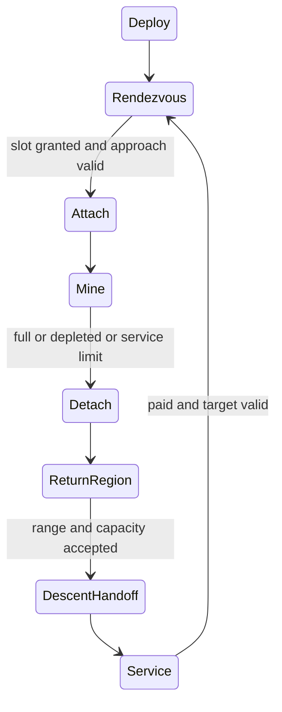

# R2MLVS10 - Asteroids and Mining Probes

## Global Mandatory Reading

> **Execution protocol**
>
> - Read this Global Mandatory Reading section before the first task and again
>   after every context compaction.
> - Before starting or resuming a task group, read the nearest preceding Area
>   Mandatory Reading block whose `Applies to` label includes that group. Area
>   blocks appear immediately before the first group they govern.
> - A referenced heading or exported symbol is authoritative. Global navigation
>   hints and Area line ranges are for navigation only; if they drift, relocate
>   the named section or symbol rather than expanding to the whole file.
> - Mandatory reading is non-transitive. Do not preload a linked file's own
>   Mandatory Reading, Consult on Demand, or Planning Provenance entries unless
>   this plan names them directly for the current area.
> - Do not read Consult on Demand or Planning Provenance merely because those
>   sources are listed. Use a Consult on Demand source only when its trigger
>   occurs.
> - No created source file, test file or JSON file should start with same prefix as a planning MD file (such as r2). Only MD files can have that prefix. No MD file should be created anywhere in source directories unless specifically asked.
> - After EVERY CONTEXT COMPACTION, you must add a note above the task group
>   which is currently in execution. The note will say: "Context has compacted
>   X times while executing this group.". If the compaction occurs before any
>   meaningful work was done (this can happen when there is a lot of baggage
>   from the previous compaction), then and ONLY then you can skip this step.
> - When exceeding 3 context compactions, YOU MUST ask yourself if you're not 
>   chewing more than we can handle :). Heck, plans change! :). In such a case, 
>   the way out is to split the group on the spot,
>   in the plan, into more groups, 
>   by appending B, C, D as a suffixes to those groups (splitting sub-groups 
>   themselves is also allowed). When you do this, create Local Mandatory
>   Reading areas so you can optimize your context only for the
>   ACTUAL task at hand.
>   Before starting or resuming a task group, read the nearest preceding Area
>   Mandatory Reading block whose `Applies to` label includes that group. Area
>   blocks appear immediately before the first group they govern.

| File name | Line Ranges | Description |
| --- | --- | --- |
| [docs/zz-reach2/upgrades/2026-10/r2mlvs-multilayer-vehicles-and-structures.md](r2mlvs-multilayer-vehicles-and-structures.md) | 276-280 | `AD-11` supplies the canonical gameplay/ownership decision for every group of this plan. It constrains fixed-point moving targets, finite reserves and conserved probe cargo; a consumer must not redefine it locally. |
| [src/map_layer.h](../../../../src/map_layer.h) | 78-85 | `MultiLayerMap` ownership preamble: `Map` owns packed storage/geometry and this controller owns layer semantics. Every group uses world tiles/explicit layer helpers; camera selection and ad hoc plane offsets cannot define gameplay. |
| [src/vehicle_func.h](../../../../src/vehicle_func.h) | 192-204 | `VehicleServiceInDepot`, `CallVehicleTicks`, `ResetVehicleHash`, `ViewportAddVehicles` are public tick/service/spatial-render boundaries for orbital vehicles. |

Status: proposed. Parent: [R2MLVS master](r2mlvs-multilayer-vehicles-and-structures.md). Depends on r2mlvs9.

## Outcome and Boundaries

Slowly moving asteroids are finite deposits. A launched robot intercepts, attaches, mines and returns within the 20-tile orbital drop radius of its home launch center to send cargo down for train/lorry collection.

## Public Handoff Contract

Proposed public owner: `src/asteroid.h`. Publish `AsteroidBody`, `MiningProbeMission`, `AdvanceAsteroidMotion`, `AdvanceProbeMining`. These symbols are producer obligations, not existing code. Keep one authority for the fields/commands they expose; downstream plans consume the public contract rather than private pools or copied tables.

## Implementation Tasks

Deepening pass, 2026-10-04: implementation groups use only SIMPLE, MEDIUM or HARD difficulty, with at most eight pending tasks each. Sketches describe proposed implementation contracts; verify the named earlier producers at each assumption gate. No gameplay or asset implementation is marked complete by this planning pass.

Groups are chronological and contain consecutive tasks of one difficulty. Each difficulty batch has at most eight tasks; area reading changes only when the implementation boundary or source of truth changes.

### Area Mandatory Reading - Asteroid generation and motion

_Applies to Groups 1-7._

**Entry gate.** The following public contracts must exist before dependent implementation in this area: `src/multilayer_content.h`: `MultiLayerGameplayProfile`, `LayerVehicleCapability`, `GetMultiLayerContentProfile`, `CheckDeepLayerAvailability`, `UtilityPowerAccount`; `src/space.h`: `SpaceVehicle`, `OrbitalBodyID`, `SpaceMission`, `SpaceStructure`, `SpaceTransition`; `src/launch_center.h`: `LaunchCenterAnchor`, `LaunchCollectionHub`, `SurfaceHandlingJob`, `SpaceDescentJob`, `CanReleaseOrbitalCargo`, `CommitOrbitalCargoRelease`.
Verify each public file/export/schema field with `rg` in the current workspace and inspect its command/field ownership. For a same-plan contract, compile its type/signature fixture or validate its artifact after the preceding producer groups. For cross-plan behavior, also run the producer's focused executable boundary test; declarations alone cannot authorize dependent mutations or runtime claims.
If a required export is absent, stop the dependent implementation, mutation and runtime claims in Groups 1-7. Read-only characterization, source/range verification, test-case design and asset-template work that does not assume the missing behavior may continue.
Do not bypass this gate by copying private pool/tile state, inventing local IDs or cargo registries, using a historical plan as a delivered implementation, opening user-wide content stores, substituting a second utility/accounting authority, or adding an unreviewed fallback path. Finish the named producer or revise the shared contract and its direct consumers first.

| File name | Line Ranges | Description |
| --- | --- | --- |
| [src/core/random_func.hpp](../../../../src/core/random_func.hpp) | 24-43 | `Randomizer` and simulation versus interactive state constrain feature-seed generation: preserve Surface simulation RNG and exclude presentation randomness. |
| [src/tests/map_layer.cpp](../../../../src/tests/map_layer.cpp) | 162-183 | Complete `Plane distances ignore the layer` test fixes projected geometry but grants no cross-layer transfer authority. |
| [src/timer/timer_game_calendar.h](../../../../src/timer/timer_game_calendar.h) | 15-39 | `TimerGameCalendar` technology-clock contract and date conversions govern 1980/model/factory introductions; economic/realtime scheduling cannot unlock a technology. |
| `src/multilayer_content.h` (planned public contract; link after implementation) | Live definitions; no fixed range | [r2mlvs1-gameplay-contracts-and-content.md](r2mlvs1-gameplay-contracts-and-content.md) Groups 1-6, ending with Group 6's public-contract task, publish `MultiLayerGameplayProfile`, `LayerVehicleCapability`, `GetMultiLayerContentProfile`, `CheckDeepLayerAvailability`, `UtilityPowerAccount`. These exports/schema fields are authoritative for this area. Same-plan consumers follow those earlier groups; cross-plan consumers verify the producer's required implementation/tests as well. Proposed names alone do not prove delivery. |
| `src/space.h` (planned public contract; link after implementation) | Live definitions; no fixed range | [r2mlvs8-space-world-and-construction.md](r2mlvs8-space-world-and-construction.md) Groups 1-7, ending with Group 7's public-contract task, publish `SpaceVehicle`, `OrbitalBodyID`, `SpaceMission`, `SpaceStructure`, `SpaceTransition`. These exports/schema fields are authoritative for this area. Same-plan consumers follow those earlier groups; cross-plan consumers verify the producer's required implementation/tests as well. Proposed names alone do not prove delivery. |
| `src/launch_center.h` (planned public contract; link after implementation) | Live definitions; no fixed range | [r2mlvs9-launch-centers-and-rockets.md](r2mlvs9-launch-centers-and-rockets.md) Groups 1-7, ending with Group 7's public-contract task, publish `LaunchCenterAnchor`, `LaunchCollectionHub`, `SurfaceHandlingJob`, `SpaceDescentJob`, `CanReleaseOrbitalCargo`, `CommitOrbitalCargoRelease`. These exports/schema fields are authoritative for this area. Same-plan consumers follow those earlier groups; cross-plan consumers verify the producer's required implementation/tests as well. Proposed names alone do not prove delivery. |

**ASSUMPTION: this was already built previously. If not, re-asses at runtime**. This applies only to the producer contracts named in this area's gate, after their listed producer groups have run. Verify their actual exports and focused tests before using the sketches below; proposed types and helper names in sketches are not evidence of delivered code.

**Motion sketch (proposed).** Consume the earlier Space coordinate, edge and slot contracts. One ordered body-motion step publishes positions before probe decisions; attached craft use the same body transform.

```text
for body in stable_body_ID_order:
    body.position, body.velocity = shared_edge_step(body.saved_motion)
    update_derived_bucket(body)
for attached_probe in stable_probe_ID_order:
    probe.position = body.position + saved_attachment_offset
then advance mission decisions and bounded mining
```

Body motion and reserve extraction are independent: a depleted body still follows the chosen persistence/motion policy.

### Group 1 - Define finite asteroid records

{{MEDIUM}}
- [ ] 1.1 Define metallic/Nickel, carbonaceous/Water Ice and rich/Rare Earth body records using r2mlvs8 `OrbitalBodyID`, fixed-point position, shape/visual size and attachment-slot capacity.
- [ ] 1.2 Resolve each main output through the selected cargo profile, reusing terrestrial Nickel Ore and Rare Earth meanings. Save initial/remaining reserve and deterministic composition; a visual sprite variant cannot change the cargo.
- [ ] 1.3 Give each class a fixture with one slot, finite reserve and a compatible probe hold. Separate authoritative mining fields from derived spatial/render data.

### Group 2 - Asteroid generation and motion

{{MEDIUM}}
- [ ] 2.1 Generate bodies from the saved Space feature seed without Surface RNG draws.
- [ ] 2.2 Specify counts and an initial reachable target; do not rely on building a station to discover the first asteroid.

### Group 3 - Advance slow body drift on the shared Space schedule

{{HARD}}
- [ ] 3.1 Choose and publish fixed-point velocity and update interval from profile tuning, slow enough for the basic probe to catch. Save motion phase/remainder and use the r2mlvs8 edge policy unchanged.
- [ ] 3.2 Advance bodies in stable ID order once per declared simulation step, then update their spatial buckets and attached craft positions before probe work decisions. Rendering interpolates between results only.
- [ ] 3.3 Validate a candidate edge/corner step against the permitted drift band. Apply the shared reflection/wrap semantics to the body and its attachment offsets together; never detach or teleport a probe independently.
- [ ] 3.4 Test body motion and declared attachment-offset boundary records across an edge/corner and save/reload, with the layer hidden. Real latched-probe mission acceptance waits for the later controller groups; these early geometry fixtures do not claim it.

### Group 4 - Asteroid generation and motion

{{SIMPLE}}
- [ ] 4.1 Publish the initial numerical speed and deterministic edge policy; attached probes follow the same authoritative motion.

### Group 5 - Keep depleted body identity and attachment safety

{{HARD}}
- [ ] 5.1 Make zero reserve stop mining without refilling on detach/reload. Default depleted bodies persist visibly until a declared safe removal policy applies; generation does not respawn them silently.
- [ ] 5.2 If removal is supported, first resolve all leases/mission references and release the spatial entry in deterministic order. Prevent a reused body ID from becoming an old probe target.
- [ ] 5.3 Test depletion with slot/reference boundary records and publish the invalid-target notification contract. Run the real attached/approaching probe detach/retarget/return cases after the later mission-controller groups.

### Group 6 - Asteroid generation and motion

{{MEDIUM}}
- [ ] 6.1 Enforce the space-band/approach policy from r2mlvs8 so bodies cannot invalidate static module footprints or teleport latched probes through edges.

### Group 7 - Asteroid generation and motion

{{HARD}}
- [ ] 7.1 Publish `src/asteroid.h` with the exact exports/schema fields in `Public Handoff Contract`; document authoritative fields, invalid-ID semantics and command/estimate boundaries. Register any created C++ source in the existing build list. If the chosen implementation uses a different public location, update this contract and every direct consumer before declaring the producer ready.

### Area Mandatory Reading - Probe mission controller

_Applies to Groups 8-13._

**Entry gate.** The following public contracts must exist before dependent implementation in this area: `src/asteroid.h`: `AsteroidBody`, `MiningProbeMission`, `AdvanceAsteroidMotion`, `AdvanceProbeMining`.
Verify each public file/export/schema field with `rg` in the current workspace and inspect its command/field ownership. For a same-plan contract, compile its type/signature fixture or validate its artifact after the preceding producer groups. For cross-plan behavior, also run the producer's focused executable boundary test; declarations alone cannot authorize dependent mutations or runtime claims.
If a required export is absent, stop the dependent implementation, mutation and runtime claims in Groups 8-13. Read-only characterization, source/range verification, test-case design and asset-template work that does not assume the missing behavior may continue.
Do not bypass this gate by copying private pool/tile state, inventing local IDs or cargo registries, using a historical plan as a delivered implementation, opening user-wide content stores, substituting a second utility/accounting authority, or adding an unreviewed fallback path. Finish the named producer or revise the shared contract and its direct consumers first.

| File name | Line Ranges | Description |
| --- | --- | --- |
| [src/cargopacket.h](../../../../src/cargopacket.h) | 458-489 | `VehicleCargoList::Append`, `AgeCargo`, `Stage`, `Return`, `Unload`, `Shift` move accountable packets; exchange/descent/processing must not clone packet age or feeder shares. |
| [src/cargopacket.h](../../../../src/cargopacket.h) | 596-603 | `StationCargoList::Reserve`, `Load`, `Truncate`, `Reroute` provide bounded station moves and destination reservations; hub inventory has one physical owner. |
| [src/command.cpp](../../../../src/command.cpp) | 301-328 | `CommandHelperBase::InternalExecuteValidateTestAndPrepExec` defines refusal/estimate before execution; no validation phase may consume inventory, RNG or funds. |
| `src/asteroid.h` (planned public contract; link after implementation) | Live definitions; no fixed range | [r2mlvs10-asteroids-and-mining-probes.md](r2mlvs10-asteroids-and-mining-probes.md) Groups 1-7, ending with Group 7's public-contract task, publish `AsteroidBody`, `MiningProbeMission`, `AdvanceAsteroidMotion`, `AdvanceProbeMining`. These exports/schema fields are authoritative for this area. Same-plan consumers follow those earlier groups; cross-plan consumers verify the producer's required implementation/tests as well. Proposed names alone do not prove delivery. |
| [src/source_type.h](../../../../src/source_type.h) | 19-56 | Canonical cargo source identities have no asteroid type; use the agreed provenance extension rather than aliasing an industry ID. |
| [src/cargopacket.cpp](../../../../src/cargopacket.cpp) | 246-285 | Complete `VehicleCargoList::Append` does not enforce hold capacity and may merge/delete pointers; mining preflights capacity and initializes provenance first. |

**ASSUMPTION: this was already built previously. If not, re-asses at runtime**. This applies only to the producer contracts named in this area's gate, after their listed producer groups have run. Verify their actual exports and focused tests before using the sketches below; proposed types and helper names in sketches are not evidence of delivered code.

**Mission sketch. ASSUMPTION: this was already built previously. If not, re-asses at runtime**. The preceding asteroid groups provide saved motion/leases and r2mlvs9 provides tested deployment/release/descent. Verify those producer behaviors at the entry gate; neither a sprite nor a declared API proves delivery.



Implement one transition family per group. Failure paths retain the last authoritative cargo owner and release only reservations they own; the diagrams do not replace those guards.

### Group 8 - Configure the delivered small-probe shell

{{MEDIUM}}
- [ ] 8.1 Consume the minimal probe hull/carry/deployment identity already delivered by r2mlvs9; add mining capability to that same engine/unit rather than create another probe registry or launch mechanism.
- [ ] 8.2 Add home-center/body-target mission commands, hold/refit choice, speed, extraction rate, running costs and service budget from the selected profile. Validate missing target as an idle/unassigned state before a mission begins.

### Group 9 - Deploy and pursue a moving target

{{HARD}}
- [ ] 9.1 Activate the carried small probe only through the r2mlvs9 deployment handoff and validate its home center/body target. Start Rendezvous from the saved deployment position; no orbital station is required.
- [ ] 9.2 Use bounded deterministic pursuit of the target current approach position, updating by target ID each simulation step. Define craft speed greater than supported body drift, fixed-point step rounding and finite approach timeout; an optimal orbit solver is unnecessary.
- [ ] 9.3 Revalidate target/slot availability during pursuit; on disappearance, timeout or exhausted service budget choose the explicit blocked/retarget/return state without losing cargo.
- [ ] 9.4 Test a body crossing its initial tile and edge while approached; the probe follows current coordinates rather than an old tile order.

### Group 10 - Lease an attachment slot and mine finite reserve

{{HARD}}
- [ ] 10.1 Acquire a body attachment lease through r2mlvs8 stable request/ID ordering. Attach only within approach tolerance with valid relative position and free slot; two competing probes cannot both own it.
- [ ] 10.2 Save body ID, slot and attachment offset; derive latched position from the body after each motion update rather than independently integrating probe velocity.
- [ ] 10.3 At each mining step, preflight the minimum of work allowance, remaining body reserve and compatible hold room plus packet capacity. Commit reserve debit, hold credit and service/work cost once.
- [ ] 10.4 Initialize new cargo through the canonical provenance contract: record extraction-plane coordinates and age at production, never cast `OrbitalBodyID` to `IndustryID`. Account for reserved hold capacity and `Append` merging/deleting packet pointers; moving the body later cannot rewrite existing cargo origin.
- [ ] 10.5 Handle full hold, depleted body, low service and cancellation by requesting detachment after the last committed extraction. A failed packet allocation must not debit reserve.

### Group 11 - Detach and return to an authorized release region

{{HARD}}
- [ ] 11.1 Release the attachment lease and choose a safe approach-exit position via the shared occupancy policy; preserve held cargo and saved work history.
- [ ] 11.2 Route toward a deterministic reachable point inside the home center circular region rather than the exact anchor. Recompute when the craft is still outside, and check current position at command execution.
- [ ] 11.3 Wait or request explicit retargeting if the home center is invalid/full; overlap with another circle does not authorize foreign delivery. Keep exact service-docking orders separate from cargo-only returns.

### Group 12 - Hand off descent and repeat after paid service

{{HARD}}
- [ ] 12.1 Call r2mlvs9 release preflight/commit, retaining the probe hold until descent ownership actually commits. Record the returned descent/job identity so a retried mission tick cannot release twice.
- [ ] 12.2 Implement paid servicing, rearming/pod replacement and budget exhaustion from the profile. The probe stays in orbit and can repeat without another rocket launch or station.
- [ ] 12.3 Enter the next rendezvous only after the cargo handoff/service conditions succeed. Save/reload at that boundary and verify no duplicated pending hold or free service.

### Group 13 - Reconcile mission exits and recovery

{{MEDIUM}}
- [ ] 13.1 Build a transition table covering timeout, removed target/home, full hold, reserve exhaustion, low service and cancellation for every phase; connect each to the previously implemented recoverable exit.
- [ ] 13.2 Verify the same home/target/hold/refit rules in UI, commands and saved mission validation. Keep failed handoffs in their current phase with cargo intact.
- [ ] 13.3 Check the basic repeat loop uses the published paid service path without requiring a later station; precise docking/service remains a separate mission when requested.

### Area Mandatory Reading - UI, art and acceptance

_Applies to Groups 14-22._

**Entry gate.** The following public contracts must exist before dependent implementation in this area: `src/asteroid.h`: `AsteroidBody`, `MiningProbeMission`, `AdvanceAsteroidMotion`, `AdvanceProbeMining`.
Verify each public file/export/schema field with `rg` in the current workspace and inspect its command/field ownership. For a same-plan contract, compile its type/signature fixture or validate its artifact after the preceding producer groups. For cross-plan behavior, also run the producer's focused executable boundary test; declarations alone cannot authorize dependent mutations or runtime claims.
If a required export is absent, stop the dependent implementation, mutation and runtime claims in Groups 14-22. Read-only characterization, source/range verification, test-case design and asset-template work that does not assume the missing behavior may continue.
Do not bypass this gate by copying private pool/tile state, inventing local IDs or cargo registries, using a historical plan as a delivered implementation, opening user-wide content stores, substituting a second utility/accounting authority, or adding an unreviewed fallback path. Finish the named producer or revise the shared contract and its direct consumers first.

| File name | Line Ranges | Description |
| --- | --- | --- |
| [src/saveload/vehicle_sl.cpp](../../../../src/saveload/vehicle_sl.cpp) | 1119-1196 | `VEHSChunkHandler` and registration construct the vehicle class from saved type before member loading; protect old enum meanings and validate new references. |
| [src/network/network_command.cpp](../../../../src/network/network_command.cpp) | 256-288 | `NetworkExecuteLocalCommandQueue` executes agreed frame order/company authority; all jobs use deterministic simulation time. |
| [src/network/network_server.cpp](../../../../src/network/network_server.cpp) | 670-687 | `ServerNetworkGameSocketHandler::SendSync` compares RNG seeds, not a full gameplay checksum; validate orbital/geology/cargo ledgers in addition to a no-desync result. |
| `src/asteroid.h` (planned public contract; link after implementation) | Live definitions; no fixed range | [r2mlvs10-asteroids-and-mining-probes.md](r2mlvs10-asteroids-and-mining-probes.md) Groups 1-7, ending with Group 7's public-contract task, publish `AsteroidBody`, `MiningProbeMission`, `AdvanceAsteroidMotion`, `AdvanceProbeMining`. These exports/schema fields are authoritative for this area. Same-plan consumers follow those earlier groups; cross-plan consumers verify the producer's required implementation/tests as well. Proposed names alone do not prove delivery. |
| [Sprite Contract and delivery owner](r2mlvs13-graphics-and-asset-pipeline.md#public-handoff-contract) | Live definitions; no fixed range | `Sprite Contract Handoff` defines manifest fields `asset_id`, `consumer`, `directions`, `frames`, `anchor`, `source`; the matching authoring/conversion/runtime groups deliver actual assets. Verify the requested family and packed loading fixture before graphics integration; template/manifest publication alone is not final art. |

**ASSUMPTION: this was already built previously. If not, re-asses at runtime**. This applies only to the producer contracts named in this area's gate, after their listed producer groups have run. Verify their actual exports and focused tests before using the sketches below; proposed types and helper names in sketches are not evidence of delivered code.

**Scoped graphics gate. ASSUMPTION: this was already built previously. If not, re-asses at runtime**. Final graphics tasks in this area require the corresponding r2mlvs13 manifest entries, delivered sprites and packed loading fixture. Verify them before binding/review; if absent, stop only those art tasks and their acceptance claims, continue independent code/state tests, and never count placeholders as finished assets.

### Group 14 - UI, art and acceptance

{{MEDIUM}}
- [ ] 14.1 Add asteroid selection, reserve/composition/drift information, assignment controls and mission status. Show clear attachment/mining and return-pod states using r2mlvs13 art.

### Group 15 - Test interception and exclusive attachment

{{HARD}}
- [ ] 15.1 Run deterministic moving-target pursuit from multiple initial offsets and across the body edge policy. Assert finite completion or the declared timeout with bounded per-tick work.
- [ ] 15.2 Issue two attachment requests for one slot in the same simulation tick and in reversed command order; verify the documented tie rule, one lease and recoverable waiting for the loser.
- [ ] 15.3 Save/reload while approaching and latched near an edge; compare body position, attachment offset and next-step decision.

### Group 16 - Test mining exits and lost mission references

{{HARD}}
- [ ] 16.1 Test partial/full holds, last-unit reserve and service exhaustion separately; compare exact extracted quantities and retained cargo for each exit.
- [ ] 16.2 Cancel at approach, mining, detachment and pending descent; validate lease release and packet ownership without repeat extraction.
- [ ] 16.3 Remove/reassign home and deplete/remove the body through supported commands; check the mission never follows a reused ID and selects only explicit valid recovery alternatives.

### Group 17 - Verify mission conservation through saved phases

{{HARD}}
- [ ] 17.1 Track each resource separately: initial reserve equals remaining reserve plus probe/descent/Surface inventory plus recorded final consumption/disposal. Do not equate product units from later processing with unconverted ore.
- [ ] 17.2 Round-trip Rendezvous, Attach, Mine, Detach and DescentHandoff with their phase/lease/service remainder; compare the next exact simulation step.
- [ ] 17.3 Repeat multiple return cycles and reconcile split/merged packet quantities, age/provenance and one container owner at a time; no new reserve appears after docking or reload.

### Group 18 - UI, art and acceptance

{{MEDIUM}}
- [ ] 18.1 Run one full mission for each asteroid class, including drops away from the center and at the 20-tile boundary.

### Group 19 - UI, art and acceptance

{{SIMPLE}}
- [ ] 19.1 Collect returned cargo through both linked Surface train and lorry stations and deliver it to useful receivers.

### Group 20 - UI, art and acceptance

{{HARD}}
- [ ] 20.1 Compare visible/hidden layer results and multiplayer replay.

### Group 21 - UI, art and acceptance

{{MEDIUM}}
- [ ] 21.1 Measure target search and per-body/per-probe costs at the proposed population limits; avoid all-pairs scanning every tick.

### Group 22 - UI, art and acceptance

{{SIMPLE}}
- [ ] 22.1 Record the implemented public exports, focused test commands/results and remaining runtime/art/network gaps in this plan; retain original supplied saves and repository-local evidence.
- [ ] 22.2 Update affected architecture/handoff documentation to describe delivered behavior and reconcile the parent index only when this plan's Completion Conditions are met. Keep every unfinished task unchecked.

## Consult on Demand

| Trigger | File name | Start at | Expand only when | Consultation purpose |
| --- | --- | --- | --- | --- |
| A probe follows a stale target tile after asteroid movement | [../../architecture/vehicles/archi-vehicles.md](../../architecture/vehicles/archi-vehicles.md) | `Code map` | The stable body ID and fixed-point motion ledger agree but order/controller routing differs | Locate the live order/vehicle controller responsible for typed moving targets; this broad index is a triggered navigation aid, not a new mandatory preload. |
| A required public export is absent and its owner/location is disputed | [r2mlvs-multilayer-vehicles-and-structures.md](r2mlvs-multilayer-vehicles-and-structures.md) | `Requirements and ownership` and `Plan Index` | The named producer confirms an intentional contract/ownership change | Find the responsible producer and reconcile its public handoff with direct consumers; the hub cannot substitute for missing implementation. |
| Current behavior contradicts a historical subsystem description | [../../architecture/map-layers/archi-map-layers.md](../../architecture/map-layers/archi-map-layers.md) | `Invariants` and the relevant named source in `Code map` | The live symbol and executable test do not explain the difference | Locate layer addressing or lifecycle rationale. Live code/tests govern delivered behavior; this architecture page does not prove future interfaces exist. |

## Planning Provenance

This is not an execution reading queue. Do not preload it after context compaction. It is non-transitive; ranges record planning use, not runtime authority.

| File name | Sections or Line Ranges used while planning | Planning contribution |
| --- | --- | --- |
| [docs/zz-reach2/architecture/initial-inventory.md](../../architecture/initial-inventory.md) | 185-220 | `Command as the only world mutation`, `Pool-indexed game objects`, `Tile map as a packed array` and `File-suffix modules` oriented command/pool/header ownership and source registration. This historical inventory is a location survey, not authority for current layer behavior. |
| [docs/zz-reach2/architecture/@archi-ttd-level0.md](../../architecture/@archi-ttd-level0.md) | 24-63 | `How the program fits together` and `Source and runtime boundaries` located shared simulation, data/presentation, CMake targets and subsystem handoffs used to choose the live reading sources. |
| [docs/zz-reach2/upgrades/2026-10/r2mlvs-multilayer-vehicles-and-structures.md](r2mlvs-multilayer-vehicles-and-structures.md) | 119-140 | `Requirements and ownership` assigned this plan's feature responsibilities; it shaped the decomposition without making every sibling plan a mandatory reading dependency. |
| [src/vehicle_func.h](../../../../src/vehicle_func.h) | 192-204 | The inspected live boundary helped separate characterization, public-contract production, implementation and acceptance batches. It materially constrained fixed-point moving targets, finite reserves and conserved probe cargo; this entry records planning influence rather than an additional reading obligation. |
| [User planning-format instructions](<C:/Users/Axonn/.codex/attachments/cd59b20a-3a96-4d54-b4bd-1e8f37639e7d/Pasted text.txt>) | `Global Mandatory Reading`, `Area Mandatory Reading`, `Consult on Demand`, `Planning Provenance`, `Final validation` | Supplies the exact protocol, chronological difficulty batches of at most eight tasks, reading gates and validation format. |
| [src/source_type.h](../../../../src/source_type.h) | 19-56 | Deeper planning pass, 2026-10-04: Existing source identity limits require canonical asteroid provenance and a fixed extraction-position snapshot. |

## Completion Conditions

Asteroid movement is observable, slow and deterministic. Probes physically attach and mine moving bodies, then return into the correct center's 20-tile drop zone and deliver accountable Surface cargo through its collection hub. The first useful mission completes without an orbital station, and all interrupted states can recover.
