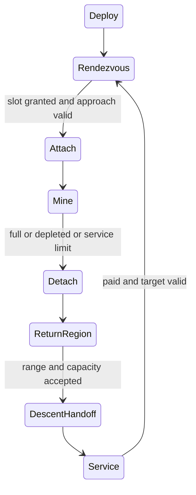

# R2MLVS10 - Asteroids and Mining Probes

## Global Mandatory Reading

> **Execution protocol**
>
> - Read this Global Mandatory Reading section before the first task and again
>   after every context compaction.
> - Before starting or resuming a task group, read the nearest preceding Area
>   Mandatory Reading block whose `Applies to` label includes that group. Area
>   blocks appear immediately before the first group they govern.
> - A referenced heading or exported symbol is authoritative. Global navigation
>   hints and Area line ranges are for navigation only; if they drift, relocate
>   the named section or symbol rather than expanding to the whole file.
> - Mandatory reading is non-transitive. Do not preload a linked file's own
>   Mandatory Reading, Consult on Demand, or Planning Provenance entries unless
>   this plan names them directly for the current area.
> - Do not read Consult on Demand or Planning Provenance merely because those
>   sources are listed. Use a Consult on Demand source only when its trigger
>   occurs.
> - No created source file, test file or JSON file should start with same prefix as a planning MD file (such as r2). Only MD files can have that prefix. No MD file should be created anywhere in source directories unless specifically asked.
> - After EVERY CONTEXT COMPACTION, you must add a note above the task group
>   which is currently in execution. The note will say: "Context has compacted
>   X times while executing this group.". If the compaction occurs before any
>   meaningful work was done (this can happen when there is a lot of baggage
>   from the previous compaction), then and ONLY then you can skip this step.
> - When exceeding 3 context compactions, YOU MUST ask yourself if you're not 
>   chewing more than we can handle :). Heck, plans change! :). In such a case, 
>   the way out is to split the group on the spot,
>   in the plan, into more groups, 
>   by appending B, C, D as a suffixes to those groups (splitting sub-groups 
>   themselves is also allowed). When you do this, create Local Mandatory
>   Reading areas so you can optimize your context only for the
>   ACTUAL task at hand.
>   Before starting or resuming a task group, read the nearest preceding Area
>   Mandatory Reading block whose `Applies to` label includes that group. Area
>   blocks appear immediately before the first group they govern.

| File name | Line Ranges | Description |
| --- | --- | --- |
| [docs/zz-reach2/upgrades/2026-10/r2mlvs-multilayer-vehicles-and-structures.md](r2mlvs-multilayer-vehicles-and-structures.md) | 276-280 | `AD-11` supplies the canonical gameplay/ownership decision for every group of this plan. It constrains fixed-point moving targets, finite reserves and conserved probe cargo; a consumer must not redefine it locally. |
| [src/map_layer.h](../../../../src/map_layer.h) | 78-85 | `MultiLayerMap` ownership preamble: `Map` owns packed storage/geometry and this controller owns layer semantics. Every group uses world tiles/explicit layer helpers; camera selection and ad hoc plane offsets cannot define gameplay. |
| [src/vehicle_func.h](../../../../src/vehicle_func.h) | 192-204 | `VehicleServiceInDepot`, `CallVehicleTicks`, `ResetVehicleHash`, `ViewportAddVehicles` are public tick/service/spatial-render boundaries for orbital vehicles. |

Status: proposed. Parent: [R2MLVS master](r2mlvs-multilayer-vehicles-and-structures.md). Depends on r2mlvs9.

**Artifact-layout migration (2026-10-09):** this plan consumes the parent [Development artifact layout](r2mlvs-multilayer-vehicles-and-structures.md#development-artifact-layout), implemented by [R2FC](r2fc-file-cleanup.md). It supersedes earlier docs asset/review/helper placement and fixed runtime-config destinations below. New native homes use `mlm/runtime/`, generated feature reviews use `mlm/reviews/`, logs remain under `logs/`, and reusable code/curated inputs keep their code/test owners. Paths and focused native/cold verification are complete; R2FC records the results and retained-input identities. Repository-relative executable commands run from the checkout root through their context-aware wrappers. Historical pass records remain dated evidence and are not new acceptance claims. No gameplay task is completed by this migration and the separate post-demo fixture-pruning gate remains.

## Outcome and Boundaries

Slowly moving asteroids are finite deposits. A launched robot intercepts, attaches, mines and returns within the 20-tile orbital drop radius of its home launch center to send cargo down for train/lorry collection.

## Public Handoff Contract

Proposed public owner: `src/asteroid.h`. Publish `AsteroidBody`, `MiningProbeMission`, `AdvanceAsteroidMotion`, `AdvanceProbeMining`. These symbols are producer obligations, not existing code. Keep one authority for the fields/commands they expose; downstream plans consume the public contract rather than private pools or copied tables.

The body contract must expose class, cargo composition, initial/remaining per-cargo reserve, and the shared authoritative position/velocity/phase state. Publish the generation-version and saved-tuning ownership needed to reproduce a new world and continue a loaded one; motion fields remain owned by the r2mlvs8 record rather than duplicated locally.

## Implementation Tasks

Deepening pass, 2026-10-04: implementation groups use only SIMPLE, MEDIUM or HARD difficulty, with at most eight pending tasks each. Sketches describe proposed implementation contracts; verify the named earlier producers at each assumption gate. No gameplay or asset implementation is marked complete by this planning pass.

Groups are chronological and contain consecutive tasks of one difficulty. Each difficulty batch has at most eight tasks; area reading changes only when the implementation boundary or source of truth changes.

### Area Mandatory Reading - Asteroid generation and motion

_Applies to Groups 1-7._

**Entry gate.** The following public contracts must exist before dependent implementation in this area: `src/multilayer_content.h`: `MultiLayerGameplayProfile`, `LayerVehicleCapability`, `GetMultiLayerContentProfile`, `CheckDeepLayerAvailability`, `UtilityPowerAccount`; `src/space.h`: `SpaceVehicle`, `OrbitalBodyID`, `SpaceMission`, `SpaceStructure`, `SpaceTransition`; `src/launch_center.h`: `LaunchCenterAnchor`, `LaunchCollectionHub`, `SurfaceHandlingJob`, `SpaceDescentJob`, `CanReleaseOrbitalCargo`, `CommitOrbitalCargoRelease`.
Verify each public file/export/schema field with `rg` in the current workspace and inspect its command/field ownership. For a same-plan contract, compile its type/signature fixture or validate its artifact after the preceding producer groups. For cross-plan behavior, also run the producer's focused executable boundary test; declarations alone cannot authorize dependent mutations or runtime claims.
If a required export is absent, stop the dependent implementation, mutation and runtime claims in Groups 1-7. Read-only characterization, source/range verification, test-case design and asset-template work that does not assume the missing behavior may continue.
Do not bypass this gate by copying private pool/tile state, inventing local IDs or cargo registries, using a historical plan as a delivered implementation, opening user-wide content stores, substituting a second utility/accounting authority, or adding an unreviewed fallback path. Finish the named producer or revise the shared contract and its direct consumers first.

| File name | Line Ranges | Description |
| --- | --- | --- |
| [src/core/random_func.hpp](../../../../src/core/random_func.hpp) | 24-43 | `Randomizer` and simulation versus interactive state constrain feature-seed generation: preserve Surface simulation RNG and exclude presentation randomness. |
| [src/tests/map_layer.cpp](../../../../src/tests/map_layer.cpp) | 162-183 | Complete `Plane distances ignore the layer` test fixes projected geometry but grants no cross-layer transfer authority. |
| [src/timer/timer_game_calendar.h](../../../../src/timer/timer_game_calendar.h) | 15-39 | `TimerGameCalendar` technology-clock contract and date conversions govern 1980/model/factory introductions; economic/realtime scheduling cannot unlock a technology. |
| [r2mlvs1-a-content-contract.md](r2mlvs1-a-content-contract.md#group-2---draft-cargo-meanings) | `Group 2 - draft cargo meanings` | Canonical `NORE`, `WICE` and `RARE` meanings, units and carrier forms constrain composition and finite reserve; do not allocate alternate asteroid cargo meanings. |
| [r2mlvs1-e-ground-and-space-budgets.md](r2mlvs1-e-ground-and-space-budgets.md#group-14---launch-returns-and-surface-supplied-orbital-assembly) | `Group 14 - launch, returns and Surface-supplied orbital assembly` | The 20-tonne hold, 2-tonne/74-work-tick extraction bound, two-return/service budget and paid pod supplies constrain starter reserves and movement/interception tuning. |
| `src/multilayer_content.h` (planned public contract; link after implementation) | Live definitions; no fixed range | [r2mlvs1-gameplay-contracts-and-content.md](r2mlvs1-gameplay-contracts-and-content.md) Groups 1-6, ending with Group 6's public-contract task, publish `MultiLayerGameplayProfile`, `LayerVehicleCapability`, `GetMultiLayerContentProfile`, `CheckDeepLayerAvailability`, `UtilityPowerAccount`. These exports/schema fields are authoritative for this area. Same-plan consumers follow those earlier groups; cross-plan consumers verify the producer's required implementation/tests as well. Proposed names alone do not prove delivery. |
| `src/space.h` (planned public contract; link after implementation) | Live definitions; no fixed range | [r2mlvs8-space-world-and-construction.md](r2mlvs8-space-world-and-construction.md) Groups 1-7, ending with Group 7's public-contract task, publish `SpaceVehicle`, `OrbitalBodyID`, `SpaceMission`, `SpaceStructure`, `SpaceTransition`. These exports/schema fields are authoritative for this area. Same-plan consumers follow those earlier groups; cross-plan consumers verify the producer's required implementation/tests as well. Proposed names alone do not prove delivery. |
| `src/launch_center.h` (planned public contract; link after implementation) | Live definitions; no fixed range | [r2mlvs9-launch-centers-and-rockets.md](r2mlvs9-launch-centers-and-rockets.md) Groups 1-7, ending with Group 7's public-contract task, publish `LaunchCenterAnchor`, `LaunchCollectionHub`, `SurfaceHandlingJob`, `SpaceDescentJob`, `CanReleaseOrbitalCargo`, `CommitOrbitalCargoRelease`. These exports/schema fields are authoritative for this area. Same-plan consumers follow those earlier groups; cross-plan consumers verify the producer's required implementation/tests as well. Proposed names alone do not prove delivery. |

**ASSUMPTION: this was already built previously. If not, re-asses at runtime**. This applies only to the producer contracts named in this area's gate, after their listed producer groups have run. Verify their actual exports and focused tests before using the sketches below; proposed types and helper names in sketches are not evidence of delivered code.

**Motion sketch (proposed).** Consume the earlier Space coordinate, edge and slot contracts. One ordered body-motion step publishes positions before probe decisions; attached craft use the same body transform.

```text
for body in stable_body_ID_order:
    body.position, body.velocity = shared_edge_step(body.saved_motion)
    update_derived_bucket(body)
for attached_probe in stable_probe_ID_order:
    probe.position = body.position + saved_attachment_offset
then advance mission decisions and bounded mining
```

Body motion and reserve extraction are independent: a depleted body still follows the chosen persistence/motion policy.

### Group 1 - Define resource content and finite asteroid records

{{MEDIUM}}

#### Resource-content defaults

These are editable design defaults. Each asteroid supplies one cargo, with one tonne removed from its finite reserve for each tonne loaded into a probe. Inert material produces no cargo. Choose a size, sample an inclusive whole-tonne reserve from the Small range, then apply the Medium x2 or Large x4 multiplier.

| Asteroid class / cargo | Small reserve | Medium reserve | Large reserve |
| --- | --- | --- | --- |
| Metallic / Nickel Ore (`NORE`) | 400-800 t | 800-1,600 t | 1,600-3,200 t |
| Carbonaceous / Water Ice (`WICE`) | 800-1,600 t | 1,600-3,200 t | 3,200-6,400 t |
| Rich / Rare Earth concentrate (`RARE`) | 100-200 t | 200-400 t | 400-800 t |

| Size | Chance | Body diameter | Mining-probe slots |
| --- | --- | --- | --- |
| Small | 50% | 0.5 tile | 1 |
| Medium | 35% | 1 tile | 1 |
| Large | 15% | 2 tiles | 1 |

| Class | Complete 20-tonne loads per body | Average reserve per body |
| --- | --- | --- |
| Metallic | 20-160 | 1,080 t |
| Carbonaceous | 40-320 | 2,160 t |
| Rich | 5-40 | 270 t |

The average size multiplier is 1.8. Even the smallest rich body supports five full loads, exceeding the two-return starter requirement of 40 tonnes. Class proportions and total population are set in Group 2; size and reserve are sampled independently and saved once. Art selection never changes resource content.

**Configuration:** author these class/size/reserve records in planned `src/multilayer_asteroid_catalogue.cpp`, exposed as immutable typed definitions through [src/multilayer_content.h](../../../../src/multilayer_content.h), following the [logical vehicle catalogue](../../../../src/multilayer_vehicle_catalogue.cpp) style. Cargo meanings remain in [media/multilayer/cargo_catalogue.json](../../../../media/multilayer/cargo_catalogue.json). During planning, edit these tables; implementation transfers their values into the definition records. No configuration code is delivered by this document.

- [ ] 1.1 Define metallic/Nickel, carbonaceous/Water Ice and rich/Rare Earth body records using r2mlvs8 `OrbitalBodyID`, fixed-point position, shape/visual size and attachment-slot capacity.
- [ ] 1.2 Resolve the single class output from the Resource-content defaults through the selected cargo profile, reusing terrestrial Nickel Ore and Rare Earth meanings. Implement the 100% mineable-content and 1:1 reserve-debit policy; save initial/remaining reserve per cargo and generated composition. A visual sprite variant cannot change the cargo.
- [ ] 1.3 Give each class a fixture with one slot, finite reserve and a compatible probe hold. Separate authoritative mining fields from derived spatial/render data.
- [ ] 1.4 Add the class/size/reserve definition records at the planned content-catalogue location and expose them through the selected profile. Implement the Resource-content defaults' inclusive sampling and multipliers; verify per-class full-hold counts, expected reserves and extraction durations against the 20-tonne/2-tonne-per-74-tick probe budget. Group 2 combines these reserves with its exact population table into a whole-field resource budget.

### Group 2 - Generate the field from the population defaults

{{MEDIUM}}

#### Population defaults

**Each number below is the total number of asteroids generated on the Space layer. Normal is the default.** Edit the numbers directly to change the desired population.

| Map size | Sparse | Normal (default) | Dense |
| --- | --- | --- | --- |
| 64 x 64 | 6 | 10 | 14 |
| 64 x 128 | 12 | 20 | 28 |
| 128 x 128 | 24 | 40 | 56 |
| 128 x 256 | 48 | 80 | 112 |
| 256 x 256 | 96 | 160 | 224 |
| 256 x 512 | 192 | 320 | 448 |
| 512 x 512 | 384 | 640 | 896 |
| 512 x 1,024 | 768 | 1,280 | 1,792 |
| 1,024 x 1,024 | 1,536 | 2,560 | 3,584 |
| 1,024 x 2,048 | 2,304 | 3,840 | 5,376 |
| 2,048 x 2,048 | 3,072 | 5,120 | 7,168 |
| 2,048 x 4,096 | 4,608 | 7,680 | 10,752 |
| 4,096 x 4,096 | 6,144 | 10,240 | 14,336 |

Rectangular maps use the row with the same total number of tiles: **64 x 1,024 uses the 256 x 256 row**, and 128 x 512 uses that same row. Rotating a map does not change its count. All supported power-of-two dimensions from 64 to 4,096 are covered by these rows. The largest-map counts intentionally grow more slowly to bound simulation work; the hard maximum is the table's largest entry, **14,336 bodies**.

| Class | Population share | Bodies on a Normal 64 x 64 map |
| --- | --- | --- |
| Metallic / Nickel Ore | 60% | 6 |
| Carbonaceous / Water Ice | 30% | 3 |
| Rich / Rare Earth concentrate | 10% | 1 |
| **Total** | **100%** | **10** |

| Placement / lifetime choice | Default |
| --- | --- |
| Distribution | Spread across the permitted travel band using seeded selection of 4-tile grid positions. |
| Minimum initial center separation | 4 tiles; future drift may bring bodies closer. |
| Starter targets | Place one of each class first, preferably within 32 tiles of a valid launch-site candidate; use the nearest admissible grid positions when the band is farther away. |
| Depleted bodies | Remain visible and keep drifting. |
| New bodies during play | None; no replacement on depletion, new-center construction or reload. |
| Generation version | 1; save with feature seed, population selection and generated records. |

The smallest map has 105 admissible 4-tile grid positions, enough for its 14-body Dense setting. Exact class counts use the percentages above: round down with a minimum of one body per class, then award remaining bodies by largest fractional remainder, breaking ties in class-ID order. The smallest Sparse field therefore has 3 metallic, 2 carbonaceous and 1 rich body. The first three body IDs hold the three starter classes; assign the remaining class labels with a seeded shuffle. Keep content, placement and motion draws separate.

**Resource-budget example:** a Normal 256 x 256 map contains **160 asteroids**: 96 metallic, 48 carbonaceous and 16 rich. Group 1's average reserves give 103,680 t Nickel Ore, 103,680 t Water Ice and 4,320 t Rare Earth concentrate: **211,680 t total**, with an absolute 78,400-627,200 t bound. Save/report the actual generated quantities per cargo.

**Configuration:** store the map-size rows, exact Sparse/Normal/Dense counts and class shares as definition records in planned `src/multilayer_asteroid_catalogue.cpp`, exposed through the selected profile. Add the saved new-game **Asteroid population** dropdown (`game_creation.asteroid_density`: Sparse=0, Normal=1, Dense=2) in [src/table/settings/world_settings.ini](../../../../src/table/settings/world_settings.ini), with storage in [src/settings_type.h](../../../../src/settings_type.h). The dropdown chooses a table column. Editing the count table changes definition defaults; the player chooses the column when starting a world.

The travel band only constrains placement and capacity; it does not recalculate the selected count. Generate exactly the table count or report that the chosen geometry cannot fit it. These defaults apply to Multilayer Industry; Classic has no asteroid field. Targets continue drifting before the player launches, so missions use their current positions and Group 8's adaptive approach timeout. The 32-tile starter preference is not a guarantee for every later center.

- [ ] 2.1 Implement the exact map-size/count table and class shares in Population defaults. Add the synchronized saved new-game population dropdown at its named location; verify every Sparse/Normal/Dense cell and same-area rectangular maps. There is no tiles-per-body density formula or silent count reduction.
- [ ] 2.2 Implement the Population defaults' seeded 4-tile grid placement, spacing and three starter targets within the shared travel band. Validate legal launch-site access and publish the actual initial approach-distance bound, using the 32-tile preference when feasible and Group 3's adaptive timeout for more distant targets. Validate tiny-map capacity and refuse unsupported geometry rather than silently losing a class. Discovery and the first mission require no orbital station; building a launch center must not create extra bodies.
- [ ] 2.3 Generate the complete body list, class/content and initial positions from the saved Space feature seed, generation version and selected tuning without Surface RNG draws. Save the generated records and generation inputs; load, view changes and target selection never reroll them. Group 3 extends this generator with seeded initial motion before producer readiness.
- [ ] 2.4 Test repeat generation for the same seed/version/settings and changed-seed fixtures: exact total/per-class counts, reserve bounds and aggregate budget, spacing/band validity, geometric starter accessibility/approach-distance bounds and bounded generation work. Include tiny/narrow-map capacity refusal and maximum-population cases; actual motion/interception checks follow in Group 3.

### Group 3 - Implement trajectory and speed on the shared schedule

{{HARD}}

#### Movement-trajectory defaults

| Trajectory choice | Default |
| --- | --- |
| Path between boundaries | Straight-line drift. |
| Initial direction | One of eight compass directions, equally likely. |
| Direction changes | Reflect at travel-band boundaries; reverse both components at a corner. |
| Random turns / orbit simulation | None. |
| Movement with an attached probe | Carry the probe at its saved attachment offset; reflection does not rotate the body. |
| Collisions / impact damage | None; keep bodies inside the dedicated travel band. |
| Depleted body movement | Continues at its saved speed and direction. |

The shared [Space geometry and reflection defaults](r2mlvs8-space-world-and-construction.md#shared-space-geometry-and-motion-defaults) are implemented by r2mlvs8 Group 10. For example, a body two tiles from a boundary moving toward it at 0.25 tile/day reaches it after eight economy days, then reflects at the same speed.

#### Movement-speed defaults

| Body speed | Chance | Tiles per economy day | Time to move one tile |
| --- | --- | --- | --- |
| Slow | 1/3 | 0.0625 | 16 days |
| Medium | 1/3 | 0.125 | 8 days |
| Fast | 1/3 | 0.25 | 4 days |

Choose the speed once at generation, independently of class and size. Group 8's basic probe travels at 4 tiles/day, 16 times the fastest body. Filling its 20-tonne hold takes 10 mining days; a fastest body drifts 2.5 tiles during that work.

**Configuration:** headings, speed choices and their chances belong to the planned asteroid catalogue exposed through the selected profile. Coordinate precision, travel bounds and edge behavior belong to the shared `MultiLayerSpaceTuning` record in [src/multilayer_content.h](../../../../src/multilayer_content.h) / [src/multilayer_content.cpp](../../../../src/multilayer_content.cpp), implemented by r2mlvs8. Probe tuning lives with its vehicle model in Group 8.

**Implementation notes:** one economy day is 74 synchronized simulation ticks. Update once per tick, in body-ID order, then update attached transforms and probe decisions. Use the shared Q16 coordinates (65,536 units/tile); nominal speed numerators are 4,096 / 8,192 / 16,384 Q16 units per 74 ticks. Heading components use 65,536 for axial directions and 46,340 for diagonals, rounding diagonal speed down. Start phase/remainders at zero; divide each unsigned component magnitude plus its saved remainder by 74, retain remainder 0..73 and apply the velocity sign to whole displacement. Reflection changes the sign while preserving fractional travel. Rendering only interpolates.

- [ ] 3.1 Implement the Movement-trajectory defaults' equal eight-heading distribution and shared `linear_reflect` behavior. Extend Group 2's seeded generator to assign heading and speed without changing already generated content/positions; no fresh random turns per tick or full orbit solver. Publish worked initial-position/vector, edge and corner trajectories using the r2mlvs8 shared defaults unchanged.
- [ ] 3.2 Implement the three body-speed choices, one-tick schedule and per-axis fractional accumulation from Movement-speed defaults. Compare with Group 8's declared probe speed, tolerance and adaptive timeout; actual probe-model binding follows in Group 8. Save velocity/phase/remainders through the shared motion record and validate the numerical interception examples and travel upkeep without platform-dependent floating point.
- [ ] 3.3 Advance bodies in stable ID order once per declared simulation step, then update their spatial buckets and attached craft positions before probe work decisions. Rendering interpolates between results only.
- [ ] 3.4 Validate a candidate edge/corner step against the permitted drift band. Apply the shared reflection rule to velocity/overshoot and translate attached craft with the body's saved offset unchanged; never detach or teleport a probe independently.
- [ ] 3.5 Test exact displacement at minimum/maximum speeds and cardinal/diagonal headings, fractional-step accumulation, and declared attachment-offset boundary records across an edge/corner and save/reload, with the layer hidden. These early geometry fixtures do not claim real latched-probe mission acceptance; that waits for the later controller groups.
- [ ] 3.6 Validate the 32-tile numerical interception fixture and the actual generated starter-distance bounds, including more distant targets using the adaptive deadline. Use the fastest supported body and basic-probe speed, and account for pursuit/return upkeep in the two-return budget. Later Group 15 runs these fixtures through the actual pursuit/attachment controller.

### Group 4 - Publish the population, resource and motion tuning

{{SIMPLE}}
- [ ] 4.1 Reconcile these default tables with the implemented definition records/settings and record worked map-population, finite-resource and interception validation plus the consumed r2mlvs8 band/edge contract. Document any deliberate tuning changes and their version handling before Group 7 producer readiness; attached probes follow the same authoritative motion.

### Group 5 - Keep depleted body identity and attachment safety

{{HARD}}
- [ ] 5.1 Make zero reserve stop mining without refilling on detach/reload. Default depleted bodies persist visibly until a declared safe removal policy applies; generation does not respawn them silently.
- [ ] 5.2 If removal is supported, first resolve all leases/mission references and release the spatial entry in deterministic order. Prevent a reused body ID from becoming an old probe target.
- [ ] 5.3 Test depletion with slot/reference boundary records and publish the invalid-target notification contract. Run the real attached/approaching probe detach/retarget/return cases after the later mission-controller groups.

### Group 6 - Asteroid generation and motion

{{MEDIUM}}
- [ ] 6.1 Enforce the space-band/approach policy from r2mlvs8 so bodies cannot invalidate static module footprints or teleport latched probes through edges.

### Group 7 - Asteroid generation and motion

{{HARD}}
**Saved-definition policy:** population, resource and motion tuning use the selected profile's existing public owner. Version simulation-affecting definition changes through the profile/content compatibility contract before load/network use; generation-algorithm changes also increment the generation version. Retain actual generated counts, reserves and saved motion in existing worlds. Reject incompatible definitions unless an explicit migration is implemented.

- [ ] 7.1 Publish `src/asteroid.h` with the exact exports/schema fields in `Public Handoff Contract`; document authoritative fields, invalid-ID semantics and command/estimate boundaries. Register any created C++ source in the existing build list. If the chosen implementation uses a different public location, update this contract and every direct consumer before declaring the producer ready.
- [ ] 7.2 Validate the public generation/tuning and body-state contract against Groups 1-4 fixtures: population inputs/version, class/composition, per-cargo reserves and shared saved motion are accessible through their named owners. Loading continues existing bodies without regeneration or replacing saved velocities with new profile defaults.

### Area Mandatory Reading - Probe mission controller

_Applies to Groups 8-13._

**Entry gate.** The following public contracts must exist before dependent implementation in this area: `src/asteroid.h`: `AsteroidBody`, `MiningProbeMission`, `AdvanceAsteroidMotion`, `AdvanceProbeMining`.
Verify each public file/export/schema field with `rg` in the current workspace and inspect its command/field ownership. For a same-plan contract, compile its type/signature fixture or validate its artifact after the preceding producer groups. For cross-plan behavior, also run the producer's focused executable boundary test; declarations alone cannot authorize dependent mutations or runtime claims.
If a required export is absent, stop the dependent implementation, mutation and runtime claims in Groups 8-13. Read-only characterization, source/range verification, test-case design and asset-template work that does not assume the missing behavior may continue.
Do not bypass this gate by copying private pool/tile state, inventing local IDs or cargo registries, using a historical plan as a delivered implementation, opening user-wide content stores, substituting a second utility/accounting authority, or adding an unreviewed fallback path. Finish the named producer or revise the shared contract and its direct consumers first.

| File name | Line Ranges | Description |
| --- | --- | --- |
| [src/cargopacket.h](../../../../src/cargopacket.h) | 458-489 | `VehicleCargoList::Append`, `AgeCargo`, `Stage`, `Return`, `Unload`, `Shift` move accountable packets; exchange/descent/processing must not clone packet age or feeder shares. |
| [src/cargopacket.h](../../../../src/cargopacket.h) | 596-603 | `StationCargoList::Reserve`, `Load`, `Truncate`, `Reroute` provide bounded station moves and destination reservations; hub inventory has one physical owner. |
| [src/command.cpp](../../../../src/command.cpp) | 301-328 | `CommandHelperBase::InternalExecuteValidateTestAndPrepExec` defines refusal/estimate before execution; no validation phase may consume inventory, RNG or funds. |
| `src/asteroid.h` (planned public contract; link after implementation) | Live definitions; no fixed range | [r2mlvs10-asteroids-and-mining-probes.md](r2mlvs10-asteroids-and-mining-probes.md) Groups 1-7, ending with Group 7's public-contract task, publish `AsteroidBody`, `MiningProbeMission`, `AdvanceAsteroidMotion`, `AdvanceProbeMining`. These exports/schema fields are authoritative for this area. Same-plan consumers follow those earlier groups; cross-plan consumers verify the producer's required implementation/tests as well. Proposed names alone do not prove delivery. |
| [src/source_type.h](../../../../src/source_type.h) | 19-56 | Canonical cargo source identities have no asteroid type; use the agreed provenance extension rather than aliasing an industry ID. |
| [src/cargopacket.cpp](../../../../src/cargopacket.cpp) | 246-285 | Complete `VehicleCargoList::Append` does not enforce hold capacity and may merge/delete pointers; mining preflights capacity and initializes provenance first. |

**ASSUMPTION: this was already built previously. If not, re-asses at runtime**. This applies only to the producer contracts named in this area's gate, after their listed producer groups have run. Verify their actual exports and focused tests before using the sketches below; proposed types and helper names in sketches are not evidence of delivered code.

**Mission sketch. ASSUMPTION: this was already built previously. If not, re-asses at runtime**. The preceding asteroid groups provide saved motion/leases and r2mlvs9 provides tested deployment/release/descent. Verify those producer behaviors at the entry gate; neither a sprite nor a declared API proves delivery.



Implement one transition family per group. Failure paths retain the last authoritative cargo owner and release only reservations they own; the diagrams do not replace those guards.

### Group 8 - Configure the delivered small-probe shell

{{MEDIUM}}

#### Mining-probe defaults

| Probe quantity | Default |
| --- | --- |
| Travel speed | 4 tiles per economy day. |
| Approach tolerance | 0.25 tile from the authorized approach point. |
| Approach timeout | At least 20 economy days; extend for distant targets using the rule below. |
| Cargo hold | 20 t of one selected compatible asteroid cargo. |
| Mining rate | At most 2 t per economy day. |
| Time to fill a hold | 10 mining days. |
| Upkeep while mining | 500 money/day. |
| Upkeep while pursuing, returning or waiting | 100 money/day. |
| Initial return pods | 2; one expended per completed cargo return. |
| Service interval | After two cargo-return batches. |
| Service time / materials | 2 economy days; RFMT 1 + ELEC 1. |
| Replacement pod | 1 t shell; SCMP 1 + 2,000 money + one day of Surface assembly. |
| Cargo descent time | 2 economy days. |
| Separate elapsed-travel-time endurance cutoff | None; pods, service state and the saved approach deadline constrain missions. |

The [r2mlvs1 launch/probe budget](r2mlvs1-e-ground-and-space-budgets.md#group-14---launch-returns-and-surface-supplied-orbital-assembly) remains the authority for shared hold, work, cost and service values. r2mlvs9 owns paid pod replacement and cargo descent. No orbital station is required for the basic loop.

**Configuration:** extend logical model 15 (Mining probe) through [src/multilayer_vehicle_catalogue.cpp](../../../../src/multilayer_vehicle_catalogue.cpp) / [src/multilayer_content.h](../../../../src/multilayer_content.h). The r2mlvs9 hull and this controller consume the same model's tuning. These are typed content definitions, following the existing vehicle catalogue style; implementation still needs to add the physical tuning fields.

**Timeout rule:** measure upward-rounded Q16 distance `D_fp` to the current approach point when rendezvous begins, then save `max(1480, ceil(D_fp * 74 / (3 * 65536)) + 148)` ticks as that attempt's deadline. This allows at least 20 days, or travel at a conservative 3-tile/day closing speed plus two days. Target-position updates cannot keep extending the deadline. Group 15 must verify the controller meets this allowance on unblocked paths. A 32-tile approach needs 632 ticks under ideal straight pursuit or 790 ticks under the conservative bound, within the 1,480-tick minimum.

Charge travel/wait upkeep in addition to the existing 26,420-money two-return collection ledger: add `100 * assigned_idle_ticks / 74`, retaining the accrual remainder. A saved descent job owns and charges its cargo once.

- [ ] 8.1 Consume the minimal probe hull/carry/deployment identity already delivered by r2mlvs9; add mining capability to that same engine/unit rather than create another probe registry or launch mechanism.
- [ ] 8.2 Bind the Mining-probe defaults to the existing model's tuning and add home-center/body-target commands, hold/refit choice, speed, extraction rate, upkeep, timeout and service budget. Use Group 3's body-speed bounds and the canonical r2mlvs1 cost/service budget. Validate missing target as an idle/unassigned state before a mission begins.

### Group 9 - Deploy and pursue a moving target

{{HARD}}
- [ ] 9.1 Activate the carried small probe only through the r2mlvs9 deployment handoff and validate its home center/body target. Start Rendezvous from the saved deployment position; no orbital station is required.
- [ ] 9.2 Use bounded deterministic pursuit of the target current approach position, updating by target ID each simulation step. Consume Group 3's body-speed bounds and Group 8's probe speed/timeout, with fixed-point step rounding; validate them against the actual approach geometry and service budget. An optimal orbit solver is unnecessary.
- [ ] 9.3 Revalidate target/slot availability during pursuit; on disappearance, timeout or exhausted service budget choose the explicit blocked/retarget/return state without losing cargo.
- [ ] 9.4 Test a body crossing its initial tile and edge while approached; the probe follows current coordinates rather than an old tile order.

### Group 10 - Lease an attachment slot and mine finite reserve

{{HARD}}
- [ ] 10.1 Acquire a body attachment lease through r2mlvs8 stable request/ID ordering. Attach only within approach tolerance with valid relative position and free slot; two competing probes cannot both own it.
- [ ] 10.2 Save body ID, slot and attachment offset; derive latched position from the body after each motion update rather than independently integrating probe velocity.
- [ ] 10.3 At each mining step, preflight the minimum of work allowance, remaining body reserve and compatible hold room plus packet capacity. Commit reserve debit, hold credit and service/work cost once.
- [ ] 10.4 Initialize new cargo through the canonical provenance contract: record extraction-plane coordinates and age at production, never cast `OrbitalBodyID` to `IndustryID`. Account for reserved hold capacity and `Append` merging/deleting packet pointers; moving the body later cannot rewrite existing cargo origin.
- [ ] 10.5 Handle full hold, depleted body, low service and cancellation by requesting detachment after the last committed extraction. A failed packet allocation must not debit reserve.

### Group 11 - Detach and return to an authorized release region

{{HARD}}
- [ ] 11.1 Release the attachment lease and choose a safe approach-exit position via the shared occupancy policy; preserve held cargo and saved work history.
- [ ] 11.2 Route toward a deterministic reachable point inside the home center circular region rather than the exact anchor. Recompute when the craft is still outside, and check current position at command execution.
- [ ] 11.3 Wait or request explicit retargeting if the home center is invalid/full; overlap with another circle does not authorize foreign delivery. Keep exact service-docking orders separate from cargo-only returns.

### Group 12 - Hand off descent and repeat after paid service

{{HARD}}
- [ ] 12.1 Call r2mlvs9 release preflight/commit, retaining the probe hold until descent ownership actually commits. Record the returned descent/job identity so a retried mission tick cannot release twice.
- [ ] 12.2 Implement paid servicing, rearming/pod replacement and budget exhaustion from the profile. The probe stays in orbit and can repeat without another rocket launch or station.
- [ ] 12.3 Enter the next rendezvous only after the cargo handoff/service conditions succeed. Save/reload at that boundary and verify no duplicated pending hold or free service.

### Group 13 - Reconcile mission exits and recovery

{{MEDIUM}}
- [ ] 13.1 Build a transition table covering timeout, removed target/home, full hold, reserve exhaustion, low service and cancellation for every phase; connect each to the previously implemented recoverable exit.
- [ ] 13.2 Verify the same home/target/hold/refit rules in UI, commands and saved mission validation. Keep failed handoffs in their current phase with cargo intact.
- [ ] 13.3 Check the basic repeat loop uses the published paid service path without requiring a later station; precise docking/service remains a separate mission when requested.

### Area Mandatory Reading - UI, art and acceptance

_Applies to Groups 14-22._

**Entry gate.** The following public contracts must exist before dependent implementation in this area: `src/asteroid.h`: `AsteroidBody`, `MiningProbeMission`, `AdvanceAsteroidMotion`, `AdvanceProbeMining`.
Verify each public file/export/schema field with `rg` in the current workspace and inspect its command/field ownership. For a same-plan contract, compile its type/signature fixture or validate its artifact after the preceding producer groups. For cross-plan behavior, also run the producer's focused executable boundary test; declarations alone cannot authorize dependent mutations or runtime claims.
If a required export is absent, stop the dependent implementation, mutation and runtime claims in Groups 14-22. Read-only characterization, source/range verification, test-case design and asset-template work that does not assume the missing behavior may continue.
Do not bypass this gate by copying private pool/tile state, inventing local IDs or cargo registries, using a historical plan as a delivered implementation, opening user-wide content stores, substituting a second utility/accounting authority, or adding an unreviewed fallback path. Finish the named producer or revise the shared contract and its direct consumers first.

| File name | Line Ranges | Description |
| --- | --- | --- |
| [src/saveload/vehicle_sl.cpp](../../../../src/saveload/vehicle_sl.cpp) | 1119-1196 | `VEHSChunkHandler` and registration construct the vehicle class from saved type before member loading; protect old enum meanings and validate new references. |
| [src/network/network_command.cpp](../../../../src/network/network_command.cpp) | 256-288 | `NetworkExecuteLocalCommandQueue` executes agreed frame order/company authority; all jobs use deterministic simulation time. |
| [src/network/network_server.cpp](../../../../src/network/network_server.cpp) | 670-687 | `ServerNetworkGameSocketHandler::SendSync` compares RNG seeds, not a full gameplay checksum; validate orbital/geology/cargo ledgers in addition to a no-desync result. |
| `src/asteroid.h` (planned public contract; link after implementation) | Live definitions; no fixed range | [r2mlvs10-asteroids-and-mining-probes.md](r2mlvs10-asteroids-and-mining-probes.md) Groups 1-7, ending with Group 7's public-contract task, publish `AsteroidBody`, `MiningProbeMission`, `AdvanceAsteroidMotion`, `AdvanceProbeMining`. These exports/schema fields are authoritative for this area. Same-plan consumers follow those earlier groups; cross-plan consumers verify the producer's required implementation/tests as well. Proposed names alone do not prove delivery. |
| [Sprite Contract and delivery owner](r2mlvs13-graphics-and-asset-pipeline.md#public-handoff-contract) | Live definitions; no fixed range | `Sprite Contract Handoff` defines manifest fields `asset_id`, `consumer`, `directions`, `frames`, `anchor`, `source`; the matching authoring/conversion/runtime groups deliver actual assets. Verify the requested family and packed loading fixture before graphics integration; template/manifest publication alone is not final art. |

**ASSUMPTION: this was already built previously. If not, re-asses at runtime**. This applies only to the producer contracts named in this area's gate, after their listed producer groups have run. Verify their actual exports and focused tests before using the sketches below; proposed types and helper names in sketches are not evidence of delivered code.

**Scoped graphics gate. ASSUMPTION: this was already built previously. If not, re-asses at runtime**. Final graphics tasks in this area require the corresponding r2mlvs13 manifest entries, delivered sprites and packed loading fixture. Verify them before binding/review; if absent, stop only those art tasks and their acceptance claims, continue independent code/state tests, and never count placeholders as finished assets.

### Group 14 - UI, art and acceptance

{{MEDIUM}}
- [ ] 14.1 Add asteroid selection, initial/remaining per-cargo reserve and composition, trajectory direction and speed in the published units, assignment controls and mission status. Show clear attachment/mining and return-pod states using r2mlvs13 art.

### Group 15 - Test interception and exclusive attachment

{{HARD}}
- [ ] 15.1 Run deterministic moving-target pursuit from multiple initial offsets and across the body edge policy, including Group 3's maximum-drift/basic-probe interception fixture and guaranteed starter-distance bound. Assert starter interception within its budget, and finite completion or the declared timeout for other cases, with bounded per-tick work.
- [ ] 15.2 Issue two attachment requests for one slot in the same simulation tick and in reversed command order; verify the documented tie rule, one lease and recoverable waiting for the loser.
- [ ] 15.3 Save/reload while approaching and latched near an edge; compare body position, attachment offset and next-step decision.

### Group 16 - Test mining exits and lost mission references

{{HARD}}
- [ ] 16.1 Test partial/full holds, last-unit reserve and service exhaustion separately; compare exact extracted quantities and retained cargo for each exit.
- [ ] 16.2 Cancel at approach, mining, detachment and pending descent; validate lease release and packet ownership without repeat extraction.
- [ ] 16.3 Remove/reassign home and deplete/remove the body through supported commands; check the mission never follows a reused ID and selects only explicit valid recovery alternatives.

### Group 17 - Verify mission conservation through saved phases

{{HARD}}
- [ ] 17.1 Track each resource separately: initial reserve equals remaining reserve plus probe/descent/Surface inventory plus recorded final consumption/disposal. Do not equate product units from later processing with unconverted ore.
- [ ] 17.2 Round-trip Rendezvous, Attach, Mine, Detach and DescentHandoff with their phase/lease/service remainder; compare the next exact simulation step.
- [ ] 17.3 Repeat multiple return cycles and reconcile split/merged packet quantities, age/provenance and one container owner at a time; no new reserve appears after docking or reload.

### Group 18 - UI, art and acceptance

{{MEDIUM}}
- [ ] 18.1 Run one full mission for each asteroid class, including drops away from the center and at the 20-tile boundary.

### Group 19 - UI, art and acceptance

{{SIMPLE}}
- [ ] 19.1 Collect returned cargo through both linked Surface train and lorry stations and deliver it to useful receivers.

### Group 20 - UI, art and acceptance

{{HARD}}
- [ ] 20.1 Compare visible/hidden layer results and multiplayer replay.

### Group 21 - UI, art and acceptance

{{MEDIUM}}
- [ ] 21.1 Measure generation, target search and per-body/per-probe costs at Group 2's 10/160-body small/normal examples, 10,240-body largest Normal map and 14,336-body Dense maximum, including clustered drift and narrow-map cases. Record those exact counts and work bounds; avoid all-pairs scanning every tick.

### Group 22 - UI, art and acceptance

{{SIMPLE}}
- [ ] 22.1 Record the implemented public exports, focused test commands/results and remaining runtime/art/network gaps in this plan; retain original supplied saves and repository-local evidence.
- [ ] 22.2 Update affected architecture/handoff documentation to describe delivered behavior and reconcile the parent index only when this plan's Completion Conditions are met. Keep every unfinished task unchecked.

## Consult on Demand

| Trigger | File name | Start at | Expand only when | Consultation purpose |
| --- | --- | --- | --- | --- |
| A probe follows a stale target tile after asteroid movement | [../../architecture/vehicles/archi-vehicles.md](../../architecture/vehicles/archi-vehicles.md) | `Code map` | The stable body ID and fixed-point motion ledger agree but order/controller routing differs | Locate the live order/vehicle controller responsible for typed moving targets; this broad index is a triggered navigation aid, not a new mandatory preload. |
| A required public export is absent and its owner/location is disputed | [r2mlvs-multilayer-vehicles-and-structures.md](r2mlvs-multilayer-vehicles-and-structures.md) | `Requirements and ownership` and `Plan Index` | The named producer confirms an intentional contract/ownership change | Find the responsible producer and reconcile its public handoff with direct consumers; the hub cannot substitute for missing implementation. |
| Current behavior contradicts a historical subsystem description | [../../architecture/map-layers/archi-map-layers.md](../../architecture/map-layers/archi-map-layers.md) | `Invariants` and the relevant named source in `Code map` | The live symbol and executable test do not explain the difference | Locate layer addressing or lifecycle rationale. Live code/tests govern delivered behavior; this architecture page does not prove future interfaces exist. |

## Planning Provenance

This is not an execution reading queue. Do not preload it after context compaction. It is non-transitive; ranges record planning use, not runtime authority.

| File name | Sections or Line Ranges used while planning | Planning contribution |
| --- | --- | --- |
| [docs/zz-reach2/architecture/initial-inventory.md](../../architecture/initial-inventory.md) | 185-220 | `Command as the only world mutation`, `Pool-indexed game objects`, `Tile map as a packed array` and `File-suffix modules` oriented command/pool/header ownership and source registration. This historical inventory is a location survey, not authority for current layer behavior. |
| [docs/zz-reach2/architecture/@archi-ttd-level0.md](../../architecture/@archi-ttd-level0.md) | 24-63 | `How the program fits together` and `Source and runtime boundaries` located shared simulation, data/presentation, CMake targets and subsystem handoffs used to choose the live reading sources. |
| [docs/zz-reach2/upgrades/2026-10/r2mlvs-multilayer-vehicles-and-structures.md](r2mlvs-multilayer-vehicles-and-structures.md) | 119-140 | `Requirements and ownership` assigned this plan's feature responsibilities; it shaped the decomposition without making every sibling plan a mandatory reading dependency. |
| [src/vehicle_func.h](../../../../src/vehicle_func.h) | 192-204 | The inspected live boundary helped separate characterization, public-contract production, implementation and acceptance batches. It materially constrained fixed-point moving targets, finite reserves and conserved probe cargo; this entry records planning influence rather than an additional reading obligation. |
| [User planning-format instructions](<C:/Users/Axonn/.codex/attachments/cd59b20a-3a96-4d54-b4bd-1e8f37639e7d/Pasted text.txt>) | `Global Mandatory Reading`, `Area Mandatory Reading`, `Consult on Demand`, `Planning Provenance`, `Final validation` | Supplies the exact protocol, chronological difficulty batches of at most eight tasks, reading gates and validation format. |
| [src/source_type.h](../../../../src/source_type.h) | 19-56 | Deeper planning pass, 2026-10-04: Existing source identity limits require canonical asteroid provenance and a fixed extraction-position snapshot. |

## Completion Conditions

Population, resource content, trajectory and speed match the editable tables in their owning groups and have deterministic fixtures, including supported map-size/class coverage, aggregate initial resource budgets and basic-probe interception bounds. Generated state and subsequent saved motion survive reload without rerolling or replenishment.

Asteroid movement is observable, slow and deterministic. Probes physically attach and mine moving bodies, then return into the correct center's 20-tile drop zone and deliver accountable Surface cargo through its collection hub. The first useful mission completes without an orbital station, and all interrupted states can recover.
