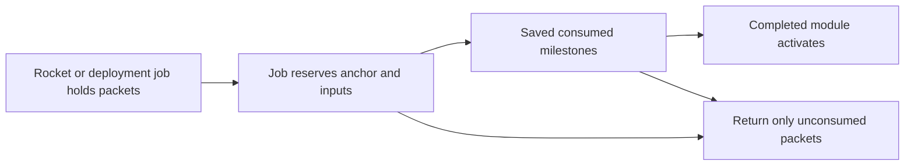

# R2MLVS11 - Orbital Stations and Manufacturing

**Current recovery and dispatch,2026-10-23.** Use the [current Space handover](r2mlsp-z-z-z-z-z-q-launch-center-source.md#current-boundary) and [shared artifact architecture](../../architecture/archi-historical-debug.md#checkpoints-cleanup-and-transfer). GZVEEIis complete through actual native query/ordinary reloads in both configurations, zero ticks/all121families unchanged; the selected exported successor needs no historical EXE. Cash182302/debt5000000and closed GZVEEH32windows/64000ticks/no033remain exact. All requested Goods capital lots are affordable, but only2Goods wait at13while mixed52has50empty Goods spaces. **Next: Group15CSGZVEEJread-only incremental-usefulness gate.** Affordability alone grants no purchase, income window or other mutation. Both30000exceptions are spent; normal40000operating/100000capital floors remain. Original15.1/.2 and useful-route/human acceptance stay open. Dated log/EXE paths below describe history; the sole producer catalogue and current source-plan dispatch remain authoritative.

## Global Mandatory Reading

> Current recovery: read the [live dispatch](r2mlsp-z-z-z-z-z-q-launch-center-source.md#current-boundary) and only its selected [durable-input/rebuild contract](../../architecture/archi-historical-debug.md#checkpoints-cleanup-and-transfer); older execution paths in completed groups remain historical.

> **Execution protocol**
>
> - Read this Global Mandatory Reading section before the first task and again
>   after every context compaction.
> - Before starting or resuming a task group, read the nearest preceding Area
>   Mandatory Reading block whose `Applies to` label includes that group. Area
>   blocks appear immediately before the first group they govern.
> - A referenced heading or exported symbol is authoritative. Global navigation
>   hints and Area line ranges are for navigation only; if they drift, relocate
>   the named section or symbol rather than expanding to the whole file.
> - Mandatory reading is non-transitive. Do not preload a linked file's own
>   Mandatory Reading, Consult on Demand, or Planning Provenance entries unless
>   this plan names them directly for the current area.
> - Do not read Consult on Demand or Planning Provenance merely because those
>   sources are listed. Use a Consult on Demand source only when its trigger
>   occurs.
> - No created source file, test file or JSON file should start with same prefix as a planning MD file (such as r2). Only MD files can have that prefix. No MD file should be created anywhere in source directories unless specifically asked.
> - After EVERY CONTEXT COMPACTION, you must add a note above the task group
>   which is currently in execution. The note will say: "Context has compacted
>   X times while executing this group.". If the compaction occurs before any
>   meaningful work was done (this can happen when there is a lot of baggage
>   from the previous compaction), then and ONLY then you can skip this step.
> - When exceeding 3 context compactions, YOU MUST ask yourself if you're not 
>   chewing more than we can handle :). Heck, plans change! :). In such a case, 
>   the way out is to split the group on the spot,
>   in the plan, into more groups, 
>   by appending B, C, D as a suffixes to those groups (splitting sub-groups 
>   themselves is also allowed). When you do this, create Local Mandatory
>   Reading areas so you can optimize your context only for the
>   ACTUAL task at hand.
>   Before starting or resuming a task group, read the nearest preceding Area
>   Mandatory Reading block whose `Applies to` label includes that group. Area
>   blocks appear immediately before the first group they govern.

| File name | Line Ranges | Description |
| --- | --- | --- |
| [docs/zz-reach2/upgrades/2026-10/r2mlvs-multilayer-vehicles-and-structures.md](r2mlvs-multilayer-vehicles-and-structures.md) | 352-376 | `AD-12` supplies the canonical gameplay/ownership decision for every group of this plan. It constrains delivered module/robot construction and bounded orbital processing; a consumer must not redefine it locally. |
| [src/map_layer.h](../../../../src/map_layer.h) | 81-89 | `MultiLayerMap` ownership preamble: `Map` owns packed storage/geometry and this controller owns layer semantics. Every group uses world tiles/explicit layer helpers; camera selection and ad hoc plane offsets cannot define gameplay. |
| [src/cargopacket.cpp](../../../../src/cargopacket.cpp) | 96-121 | Complete `CargoPacket::Split` and `Merge` define quantity/feeder-share ownership and allocation failure. Every construction, production and transport group must conserve actual packet quantities; station vehicle-loading reservations are not a generic orbital inventory API. |

Status: construction prerequisite Groups1-6 delivered,2026-10-14; Assembly activation6B, reservations7, native materialization8 and ordinary purchases8B delivered,2026-10-15; paid clones8BB and replacement settlement8BC delivered,2026-10-16. The current429 consumer is `logs/manufacturing-replacement-verification.json`; its428 clone,427 purchase/materialization and earlier422/425/426 proofs remain immutable dated handoffs. Original aggregate7.3 is complete. Plan10 Group8B is now complete in both430 builds. Its8C.3 consumer requires remaining mining/processor/freight producers. Group9's immutable per-miner contract now passes both430 builds; paid commissioning/content compatibility9B is now complete in both431 builds (logs/heavy-commissioning-verification.json); Group9C finite heavy mining/precise orbital return is now complete in both432 builds (`logs/heavy-mining-runtime-verification.json`); Group9CB original paid supply/custody is now complete in both433 builds (`logs/heavy-supply-custody-verification.json`;275 focused/2,259 native/2,212 resumed assertions each,30 owners/630 comparisons). Group9CBBA genuine433 descent input is now complete in both builds (logs/legacy-descent-verification.json;145 focused/6,024 native/5,980 resumed assertions each,30owners/420 comparisons). Group9CBB heavy Surface descent is now complete in both434 builds (logs/heavy-descent-verification.json;257 focused/6,734 native/2,449 resumed assertions each,30 owners/600 comparisons). Onboard service 9CC, genuine legacy producer 9CCB and contained Core service 9CCC now pass both builds; the current 436 handoff is `logs/heavy-contained-service-verification.json`. Paid Dock service 9CCCC and original service aggregate 9CC.1 are now complete in both 436 builds (`logs/heavy-dock-service-verification.json`). Joined validation/disclosures9CD are now complete in both437 builds (`logs/heavy-joined-verification.json`). Original two-miner role9D acceptance now passes both437 builds (`logs/heavy-role-runtime-verification.json`). Actual paid heavy mission cycle9DB now passes both437 builds (`logs/heavy-cycle-verification.json`). Integrated heavy native network acceptance9DC and original9.1 now pass both437 builds (`logs/heavy-network-verification.json`). Shared staged electrical-work prerequisite10 is now complete in both builds (`logs/orbital-recipe-work-verification.json`). Orbital packet participant10B now passes both builds (`logs/orbital-inventory-verification.json`). Native processing/runtime10C now passes both438builds (`logs/orbital-runtime-verification.json`). Groups11/12/12B,13/13K/13L and14 are now delivered in both configurations. Plan9task16.2 also passes its separate scoped presentation gate. Original15.1/.2 and15CS.2/.3 remain open. Group16documentation and subsequent15CSGZQ/GZR/GZRB/GZSare complete. The latest explicitly approved arrival scope stops at actual Goods payment after386ticks,45,080cash/debt5m; original40,000default remains and this exception is closed. Source-plan/parent completion remains open. Parent: [R2MLVS master](r2mlvs-multilayer-vehicles-and-structures.md).

**Artifact-layout migration (2026-10-09):** this plan consumes the parent [Development artifact layout](r2mlvs-multilayer-vehicles-and-structures.md#development-artifact-layout), implemented by [R2FC](r2fc-file-cleanup.md). It supersedes earlier docs asset/review/helper placement and fixed runtime-config destinations below. New native homes use `mlm/runtime/`, generated feature reviews use `mlm/reviews/`, logs remain under `logs/`, and reusable code/curated inputs keep their code/test owners. Paths and focused native/cold verification are complete; R2FC records the results and retained-input identities. Repository-relative executable commands run from the checkout root through their context-aware wrappers. Historical pass records remain dated evidence and are not new acceptance claims. No gameplay task is completed by this migration and the separate post-demo fixture-pruning gate remains.

## Outcome and Boundaries

**Delivered definition/queue handoff,2026-10-12:** Plan1 Group12B publishes
`multilayer_space_content.h` revision2 recipes, mass, budgets and paid-facility
admission; Plan8 Group6B publishes native `space_orders.h` queue/generation
ownership. Save410 carries exact `SDEF` content identity and separate bounded
`SPOR` transport, preserving ground/profile/package1 and paid old objects.
Both builds and focused native save/replay/refusal gates pass; see
`logs/space-content-orders-verification.json`. These handoffs grant no missing
commissioning, survey, blueprint, processing, descent, service, UI/art or network
producer. Consume their public definitions/commands; retain unfinished tasks.

Earth-launched construction probes deliver Steel and Goods to orbital
blueprints. Completed stations process mined ore into Steel/Goods and may
consume that output in further construction or vehicle assembly, haul it to
another station or send it to Earth through the authorized drop service.

**User revision,2026-10-12:** consume the canonical
[Space economy contract](../../../zz-rhr/upgrades/2026-10/r2mlvs1-d-recipes-and-bootstrap.md#space-economy-revision---2026-10-12)
and [revised numerical defaults](../../../zz-rhr/upgrades/2026-10/r2mlvs1-e-ground-and-space-budgets.md#space-economy-revision---2026-10-12).
All orbital builds require Steel/Goods; initial station/module recipes use
those two inputs. Later advanced equipment may add declared inputs. The former
Surface-preassembled Core recipe is superseded: a construction probe builds
the first Core from delivered packets at a placed blueprint. Earth-built
probes remain launch-center payloads until deployed; local probe manufacture
requires a completed orbital Assembly. These requirements are not yet delivered.

## Module contract

| Module | Role | Bootstrap input |
| --- | --- | --- |
| Core | Anchor, initial assembly/service capacity and ownership | Construction-probe-delivered Steel/Goods; no earlier station |
| Dock | Rocket/hauler service and explicit cargo exchange | Steel/Goods |
| Storage | Bounded cargo inventory | Steel/Goods |
| Utility | Station power/service capacity | Steel/Goods to construct; separately declared operating supplies |
| Assembly | Builds mining/survey/construction probes, later heavy robots and haulers | Steel/Goods to construct; each vehicle's paid recipe/capacity gate |
| Steelworks | Bounded metallic-ore conversion to Steel | Steel/Goods to construct; NORE feedstock and utility grant |
| Goodsworks | Bounded Steel/rare-earth conversion to Goods | Steel/Goods to construct; STEL and RARE feedstock and utility grant |
| Advanced processor | Later Refined Metals/Water Ice alternatives | Both common construction materials plus any declared advanced inputs |

Exact quantities, footprints and service consumption belong to r2mlvs1's
revised numerical tables. The first Core/Assembly/processor/probe path must
accept entirely Earth-delivered inputs. No processor supplies the materials
needed for its own first construction. GOOD keeps its crate unit and native
weight; displays, holds and recipe caps must not silently treat crates as tonnes.

## Public Handoff Contract

[src/orbital_station.h](../../../../src/orbital_station.h) publishes
`OrbitalModule`, `OrbitalConstructionJob`, `ReserveOrbitalConstructionInputs`
and `CommitOrbitalConstructionStep`, contained by the native `SpaceStructure`
in [src/space_structure.h](../../../../src/space_structure.h). Groups1/1B/2/3
have RelWithDebInfo/Debug producer evidence. Groups4/4B/4C/5/5B/5C now also
have both configurations' focused and native boundaries. The final exact type/
signature fixture passes with3,605 assertions in26 focused cases per configuration;
22 bounded Debug native phases cover activation, shared approaches, delivered
Dock services, removal, evacuation, company lifecycle and independent refusals.
`logs/orbital-handoff-debug-verification.json` freezes this422 handoff and the
repaired current Release freight fixture. Earlier dated Release proofs remain
immutable. Plan9 task11.3 now verifies423 direct rocket-to-module delivery and
original-hull recovery/failure acceptance in RelWithDebInfo/Debug
(`logs/module-flight-verification.json`). Orbital
Assembly activation and its explicit work connection are now delivered by
Group6B in both425 configurations (`logs/assembly-facility-verification.json`).
That425paragraph is a dated facility handoff. Current438 manufacturing/processing, freight, presentation and persistence exports are recorded in the current runtime handoff below.

| Native authority | Published contract |
| --- | --- |
| `SpaceStructure` / `SpaceStructureRef` | One paid static footprint, phase and monotonic generation. IDs may be reused only with a new generation; absent, stale or zero-generation references resolve to no owner. `FrameComplete` alone grants no facilities. |
| `OrbitalConstructionJob` | Two exclusive actual STEL/GOOD packet containers, consumed receipts, bounded whole/fractional work and saved native tick/allocation receipts. Final completion consumes one whole canonical recipe once; cancellation preserves only unconsumed material and refunds no work. |
| `ReserveOrbitalConstructionInputs(SpaceStructure &, SpaceVehicle &, bool)` | Actual precise admitted builder and matching typed Construct order. Estimate moves nothing; execution reserves only physically delivered still-missing material. `CmdReserveOrbitalModuleInputs` separately fills all missing labels atomically from actual adjacent Core stock. |
| `CommitOrbitalConstructionStep(SpaceVehicle &)` | Normal prepared native opportunity only. Portable paid tooling bootstraps Core; extensions consume the original Core's shared allocation. Queries, pauses and repeated callbacks earn no work. |
| `OrbitalModule` | Sole contained role-bounded stock, at most1,024 units/64 packet references per label. Explicit paid-frame activation begins empty. Core/Storage/Power/Dock/Assembly facilities and delivered processor roles retain their own activation/recipe gates; FuelStore remains an inert frame. Assembly has no general cargo stock or probe-service berth. Connection never expands another module's container. |
| `OrbitalServiceJob` / `GetServiceJobs()` | Core capacity1, activated Dock capacity2. Each contained job owns one RFMT/ELEC pair, exact craft generation/service serial and once-only750J work receipt. Onboard/contained jobs cannot overlap. Cancellation preserves actual parts and spent energy; it grants no return allowance. |
| `OrbitalFacilityState` | Original typed producer/work/construction consumer IDs; `UINT32_MAX` means absent. Core30kW and Power60kW use the shared Space electricity ledger. Dock/Assembly have no panel: explicit `utility_source` binds an adjacent owned original Core/Power and `consumer`, bounded to1,500J for Dock or750J for Assembly. `assembly_consumer` remains the separate Core-only construction slot. Old inventory-only Cores commission explicitly. |
| `space_approach.h` / contained `SpaceOrderQueue` | Shared generation-qualified admission, stable saved priority, precise physical slot and safe waiting point. This is the berth authority; service and freight consume it rather than create another registry. Dependency loss blocks handling; zero panel generation blocks service work. Both retain paid Dock geometry. |
| Removal/evacuation (422; RelWithDebInfo verified) | Exact owned empty removal preflights every physical/dependency/utility owner. `SpaceStructureRetirementHistory` remains beside native generation issuance, preserving spent material/service totals without retired-object inventory. Whole packet evacuation cancels jobs into one safe adjacent native inventory; hull holds/poses remain actual until explicit departure. |

Schema422 preserves the421 module row and appends no new inventory owner.
Its SPST header stores next generation(8bytes), live count(2), removed count(8),
spent STEL(8), spent GOOD(8) and completed services(8). Older schemas start
with zero retired aggregates. Native capture/install/digest and independent
preview use the same bounded history; rejected snapshots cannot borrow live
modules or reactivate retired utility identities.

Schema425 `OrbitalAssemblyFacilities` retains the SPST byte layout and admits
explicit activation of a fully paid Assembly. Earlier schemas can retain inert
Assembly frames but reject activated Assembly rows. Activation requires the
actual adjacent owned operational Core, the complete STEL8/GOOD16 receipt,
592 construction ticks and74 activation ticks. `CmdConnectOrbitalServices`
and `CmdDisconnectOrbitalServices` supply the same estimate/execute boundary
for Dock and Assembly; `GetOrbitalServicePowerSite` resolves the exact original
adjacent owned Core/Power. Loading issues no connection, energy, cargo or hull.
Source outage retains identity and gives no work. Copied and full-load
validation resolve their own snapshot's source/consumer and reject aliases,
unfinished activation or service history. These exports supply the facility
prerequisite for Group7; they do not reserve manufacturing stock or create a
vehicle.

Downstream consumers use these actual owners and command estimate/execute
boundaries. They cannot replace them with copied pools, private utility/cargo
tables, blueprint capacity, implicit activation or another capital/material
debit. The existing `orbital_removal.cpp` fixture binds exact exported types,
packet containers, contained ownership and function signatures at compile time;
the native producer fixtures verify their physical behavior.

**Construction batch,2026-10-13:** `space_structure.h` is the native Plan8
identity/occupancy owner; `orbital_station.h` owns its contained construction
job. The coordinated Plan8 Group13B / Plan10 Group8C batch implements those
missing producers before claiming their handoff. Job inventories contain real
packets; completion consumes the full canonical material batch atomically.
A finished frame is explicitly awaiting activation, with no storage, dock,
assembly or utility grant. Operational Core activation and those facilities
remain required by Groups1-5 and are not completed by the owner foundation.

## Current runtime handoff - 2026-10-20

Owner: Group16 and AD-12. This supersedes earlier future-tense producer/status descriptions; dated schema/proof paragraphs remain historical. Public types below describe delivered behavior. Their original paid sources remain immutable, and their acceptance scope is narrower than original Group15's continuous Surface-made chain.

| Owner and actual public exports | Delivered boundary and accepted evidence |
| --- | --- |
| `space_structure.h`, `orbital_station.h`: `SpaceStructureRef`, `OrbitalConstructionJob`, `OrbitalModule`, `ReserveOrbitalConstructionInputs`, `CommitOrbitalConstructionStep` | Original generation-qualified site owns construction and contained module stock. Actual STEL/GOOD delivery, normal paid work and explicit activation create usable facilities; blueprint/frame/load grants none. [Construction handoff](../../../../logs/orbital-handoff-debug-verification.json), [current construction persistence](../../../../logs/orbital-construction-save-verification.json). |
| `orbital_manufacturing.h`: `AppendOrbitalManufacturingRequests`, `TickOrbitalManufacturingReservations`, `TickOrbitalManufacturingWork`, `QueueOrbitalReplacement`, `ValidateOrbitalManufacturingProductionLinks` | The actual Assembly owns one paid job and exclusive reserved packets. The shared utility grant earns bounded work; final admission consumes one full recipe and creates one original Vehicle-pool hull, retaining its paid serial/incarnation. Replacement preflights without using future sale proceeds. [Replacement](../../../../logs/manufacturing-replacement-verification.json), [materialization persistence](../../../../logs/orbital-materialization-save-verification.json). |
| `orbital_recipe.h`: `OrbitalRecipeInventory`, `OrbitalRecipeState`, `TickOrbitalRecipes`, `ConnectOrbitalRecipePower`, `ValidateOrbitalRecipeRecords` | The shared batch/work executors use the actual module's sole `stock` packet lists. Native processing metadata owns work/history and exact utility references; it supplies no second warehouse/account. Selected OSTL/OGDS batches require real electrical work; OREF/PICE retain their genuinely unpowered canonical alternatives. [Runtime](../../../../logs/orbital-runtime-verification.json), [congestion](../../../../logs/orbital-processor-verification.json), [processing persistence](../../../../logs/orbital-processing-save-verification.json). |
| `space_vehicle.h`, `space_orders.h`, `multilayer_space_content.h`, `space_mining_tuning.h` | One native Vehicle/incarnation, saved typed queue and exact supported content revision own navigation, commissioning and finite mining. Current content3 appends heavy21; legacy2 receipts keep their original role meanings, including construction robot16. Definitions alone grant no hull, materials or facility. [Heavy role](../../../../logs/heavy-role-runtime-verification.json), [network command/replay boundary](../../../../logs/heavy-network-verification.json). |
| `orbital_freight.h`: `GetOrbitalModuleFreightBlock`, `CommitOrbitalModuleFreight`; original pod/descent/Surface handling owners | Whole native packets move through the exact admitted original berth/hold/module, paid passive shell and linked Surface station. No layer transition pays final income. [Explicit hauler](../../../../logs/processor-freight-verification.json), [useful returns/collection](../../../../logs/processor-returns-verification.json). |
| `orbital_sprite.h`, `space_sprite.h`, `launch_assembly_gui.h`, `space_survey_gui.h` | Drawing and GUI selection consume current native work/cargo/custody. Ten orbital families/976 appended sprites and actual inventory/wait disclosures pass42ordinary processes/98screenshots; launch/fleet source and actual selected-window/pod integration now also pass the independent Plan9gate. [Ordinary orbital review](../../../../logs/orbital-art-ordinary-verification.json), [refusals](../../../../logs/orbital-art-refusal-verification.json), [launch presentation](../../../../logs/proofs/mlm/native-art/space/launch-presentation-v1/verification.json). |

Focused commands are rooted at this checkout. Preserve the original game/general-test applications and paid inputs; use explicit output names and fresh repository-local run contexts. Existing completed native boundaries are reused for this documentation handoff, with no historical graph replay or full regression:

- `python src/tests/multilayer/orbital_handoff_checks.py` audits current actual exports, accepted aggregate identities, documentation links and the remaining funding/chain boundary; output `logs/orbital-current-handoff-verification.json` and `logs/orbital-current-handoff.log`.
- `python src/tests/multilayer/launch_presentation_closure_checks.py` rebuilds the separate current launch gate:14,943assertions/20producer-selector cases and163,073assertions/one complete native decoder case per configuration, without a native rebuild. Native processes have60second limits; logs `logs/launch-presentation-*`.
- Original orbital refusal requalification, when necessary: `python src/tests/multilayer/acceptance/orbital_final_art_checks-6.py --configuration <configuration> --output logs/<new-name>.json`; its recorded focused result is5,320assertions/36cases per build. It does not establish procurement or broaden native producer acceptance.
- Original save matrices: `orbital_save_checks-4.py` (construction), `-5.py` (materialization) and `-6.py` (processing), under `src/tests/multilayer/acceptance/`, retain their explicit source/case selectors. Their existing aggregate receipts bind40construction ordinary processes,12ordinary plus18resumed materialization processes, and24processing processes/768exact comparisons. Current-format codec/full-buffer cases remain labelled fixtures and cannot become Group15predecessors.

**Remaining acceptance.** Plan10's joined TCP mining evidence and Plan11's actual serialized/frame-admitted heavy commands retain their own scopes. Neither proves multiplayer/reload/payment convergence of an unbuilt continuous Group15chain. Final personal/gallery acceptance and unrelated whole-game performance remain outside these focused proofs. FuelStore has no active fuel-storage producer; unsupported robot/hauler service roles remain explicit. The closed GZP originals retain47,839cash/5,000,000debt, working gap52,161 and incomplete module-base gap462,161. The fifth fully priced interval refuses before work; no completed Goods cycle or profit is claimed. [Closed GZP receipt](../../../../logs/surface-entry-joint-cycle-reserve-verification.json). That closed GZP scope admitted no later window, savings loop, liquidation, rebuild or capital-policy change. The subsequently user-authorized single15CSGZQbridge now closes at its2,000tick cap without a Goods payment:46,491cash, working gap53,509/module-base gap463,509,162real Goods aboard train49. Its [bound result](../../../../logs/surface-entry-reserve-bridge-verification.json) authorizes no second window and leaves the native40,000default exact. Original15.1/.2,15CS.2/.3 and full source-plan/parent completion remain unchecked. Group16's documentation may close independently; its parent reconciliation condition remains unsatisfied and therefore performs no completion update.

## Implementation Tasks

Deepening pass, 2026-10-04: implementation groups use only SIMPLE, MEDIUM or HARD difficulty, with at most eight pending tasks each. Sketches describe proposed implementation contracts; verify the named earlier producers at each assumption gate. No gameplay or asset implementation is marked complete by this planning pass.

Groups are chronological and contain consecutive tasks of one difficulty. Each difficulty batch has at most eight tasks; area reading changes only when the implementation boundary or source of truth changes.

### Area Mandatory Reading - Delivered construction

_Applies to Groups 1-6._

**Entry gate.** The following public contracts must exist before dependent implementation in this area: `src/multilayer_content.h`: `MultiLayerGameplayProfile`, `LayerVehicleCapability`, `GetMultiLayerContentProfile`, `CheckDeepLayerAvailability`, `UtilityPowerAccount`; `src/multilayer_industry.h`: `LayerIndustryCapability`, `ValidateMineDepositClaim`, `ProduceLayerMineCargo`, `PrepareLayerRecipeBatch`, `CommitLayerRecipeBatch`; `src/space.h`: `SpaceVehicle`, `OrbitalBodyID`, `SpaceMission`, `SpaceStructure`, `SpaceTransition`; `src/launch_center.h`: `LaunchCenterAnchor`, `LaunchCollectionHub`, `SurfaceHandlingJob`, `SpaceDescentJob`, `CanReleaseOrbitalCargo`, `CommitOrbitalCargoRelease`; `src/asteroid.h`: `AsteroidBody`, `AdvanceAsteroidField`, plus `SpaceVehicle`, `SpaceMission`, `AssignSpaceMiningMission` and `SpaceVehicle::Tick` in `src/space_vehicle.h`.
**Delivered owner locations:** `space.h` supplies geometry and world types.
Native fleet/mission owners are in `space_vehicle.h`, static sites and contained
module identity in `space_structure.h`, and flights in `space_transition.h`.
The historical `space.h` navigation row below does not relocate those owners.
Use these actual headers with `orbital_station.h` and their compiled producer
fixtures; no consumer should add replacement declarations or a second pool.

Verify each public file/export/schema field with `rg` in the current workspace and inspect its command/field ownership. For a same-plan contract, compile its type/signature fixture or validate its artifact after the preceding producer groups. For cross-plan behavior, also run the producer's focused executable boundary test; declarations alone cannot authorize dependent mutations or runtime claims.
If a required export is absent, stop the dependent implementation, mutation and runtime claims in Groups 1-6. Read-only characterization, source/range verification, test-case design and asset-template work that does not assume the missing behavior may continue.
Do not bypass this gate by copying private pool/tile state, inventing local IDs or cargo registries, using a historical plan as a delivered implementation, opening user-wide content stores, substituting a second utility/accounting authority, or adding an unreviewed fallback path. Finish the named producer or revise the shared contract and its direct consumers first.

| File name | Line Ranges | Description |
| --- | --- | --- |
| [src/command.cpp](../../../../src/command.cpp) | 301-328 | `CommandHelperBase::InternalExecuteValidateTestAndPrepExec` defines refusal/estimate before execution; no validation phase may consume inventory, RNG or funds. |
| [src/industry.h](../../../../src/industry.h) | 75-106 | `ProducedCargo`, `AcceptedCargo`, `ProducedCargoes`, `AcceptedCargoes` expose bounded inventory and economy-time history; conserve materials and avoid narrow-counter overflow. |
| [src/vehicle_cmd.h](../../../../src/vehicle_cmd.h) | 20-42 | Build/refit/clone/depot-autoreplace commands and traits expose all purchase paths; `CloneVehicle` is `NoTest`, so do not rely on a generic estimate to enforce capability/commissioning. |
| `src/multilayer_content.h` (planned public contract; link after implementation) | Live definitions; no fixed range | [r2mlvs1-gameplay-contracts-and-content.md](r2mlvs1-gameplay-contracts-and-content.md) Groups 1-6, ending with Group 6's public-contract task, publish `MultiLayerGameplayProfile`, `LayerVehicleCapability`, `GetMultiLayerContentProfile`, `CheckDeepLayerAvailability`, `UtilityPowerAccount`. These exports/schema fields are authoritative for this area. Same-plan consumers follow those earlier groups; cross-plan consumers verify the producer's required implementation/tests as well. Proposed names alone do not prove delivery. |
| `src/multilayer_industry.h` (planned public contract; link after implementation) | Live definitions; no fixed range | [r2mlvs6-mines-and-resource-chains.md](r2mlvs6-mines-and-resource-chains.md) Groups 1-6, ending with Group 6's public-contract task, publish `LayerIndustryCapability`, `ValidateMineDepositClaim`, `ProduceLayerMineCargo`, `PrepareLayerRecipeBatch`, `CommitLayerRecipeBatch`. These exports/schema fields are authoritative for this area. Same-plan consumers follow those earlier groups; cross-plan consumers verify the producer's required implementation/tests as well. Proposed names alone do not prove delivery. |
| `src/space.h` (planned public contract; link after implementation) | Live definitions; no fixed range | [r2mlvs8-space-world-and-construction.md](r2mlvs8-space-world-and-construction.md) Groups 1-7, ending with Group 7's public-contract task, publish `SpaceVehicle`, `OrbitalBodyID`, `SpaceMission`, `SpaceStructure`, `SpaceTransition`. These exports/schema fields are authoritative for this area. Same-plan consumers follow those earlier groups; cross-plan consumers verify the producer's required implementation/tests as well. Proposed names alone do not prove delivery. |
| `src/launch_center.h` (planned public contract; link after implementation) | Live definitions; no fixed range | [r2mlvs9-launch-centers-and-rockets.md](r2mlvs9-launch-centers-and-rockets.md) Groups 1-7, ending with Group 7's public-contract task, publish `LaunchCenterAnchor`, `LaunchCollectionHub`, `SurfaceHandlingJob`, `SpaceDescentJob`, `CanReleaseOrbitalCargo`, `CommitOrbitalCargoRelease`. These exports/schema fields are authoritative for this area. Same-plan consumers follow those earlier groups; cross-plan consumers verify the producer's required implementation/tests as well. Proposed names alone do not prove delivery. |
| `src/asteroid.h` (planned public contract; link after implementation) | Live definitions; no fixed range | [r2mlvs10-asteroids-and-mining-probes.md](r2mlvs10-asteroids-and-mining-probes.md) Groups 1-7, ending with Group 7's public-contract task, publish `AsteroidBody`, `AdvanceAsteroidField`, plus `SpaceVehicle`, `SpaceMission`, `AssignSpaceMiningMission` and `SpaceVehicle::Tick` in `src/space_vehicle.h`. These exports/schema fields are authoritative for this area. Same-plan consumers follow those earlier groups; cross-plan consumers verify the producer's required implementation/tests as well. Proposed names alone do not prove delivery. |

**ASSUMPTION: this was already built previously. If not, re-asses at runtime**. This applies only to the producer contracts named in this area's gate, after their listed producer groups have run. Verify their actual exports and focused tests before using the sketches below; proposed types and helper names in sketches are not evidence of delivered code.

**Assembly ownership sketch (proposed).** The earlier blueprint and rocket producers supply occupancy and physical delivery. This plan adds assembly/function; it cannot accept a delivery into an imaginary completed station.



**ASSUMPTION: this was already built previously. If not, re-asses at runtime**. Later groups use completed core/module and public inventory ownership from these construction groups. Verify the actual completion/cancellation fixture before using it as a manufacturing predecessor; blueprint presence is insufficient.

Context has compacted 1 times while executing this group.

### Group 1 - Build the first Core from construction-probe deliveries

{{HARD}}
- [X] 1.1 Add the Fund Industry-style Space station/module selector and blueprint placement through r2mlvs8 occupancy commands. Show money, Steel/Goods required/delivered/missing and assigned probes; validate empty anchor/owner/recipe before reserving the site.
- [X] 1.2 Keep deliveries in one saved construction-job inventory while no Core exists. Accept Earth-launched construction probes with actual Steel/Goods; reserve progress without inventing completed storage/docking or teleporting material from Earth.
- [X] 1.3 Construct the first Core using probe work without its own Dock/Storage/Utility/heavy robot. Verify the28t two-material recipe through two capacity-checked Earth launches or subsequent actual resupply; publish starter capacity for the next module.

**Resumed batch,2026-10-13; both configurations verified.** The native selector now
uses the canonical static recipe catalogue, shows available funds and separate
required/delivered/missing/consumed materials, and places typed module blueprints.
Extensions require an owned operational Core edge. Explicit Core activation
retains its74-tick countdown and a separate real packet inventory in save416's
bounded `SPST` extension; genuine415 frames migrate inert. The shared1,024-unit
stock cap and64 packet slots per label are preflighted before precise exchange.
`orbital_core.cpp` and `orbital_core_checks-1.py` / `-2.py` cover activation,
actual paid resupply, stock exchange, continuation and malformed transport.
Each configuration passes77 contract assertions in four cases, exact18-family
activation/populated-stock continuation and paused resaves, and eight independent
full-load plus preview refusals. The real software-rendered selector capture
and registered artifact export pass. See `logs/orbital-core-verification.json`;
the genuine paid415 predecessor is unchanged. The focused native bursts take
approximately11 and36 seconds in RelWithDebInfo; Debug is also focused and
bounded. Precise berth/service
work, shared utility publication and the Plan9 rocket-to-module delivery path
remain required; an inventory-only Core does not complete task1.4 or Group4.

**Saved owner verified,2026-10-13; paused.** Plan8 Group13B's save415 `SPST`
family owns the real job packets, progress and consumed-material receipt.
RelWithDebInfo verifies two paid launches,740 single-slot working ticks,
interrupted replay, cancelled-job return/collection and company lifecycle.
`logs/space-construction-verification.json` records the exact binaries, input,
reports and native captures. Debug is deferred to the next substantial batch.
The user requested stopping at that earlier checkpoint. Its415 finished frame
remains inert until explicit activation. The later416 batch above completes
module selection and starter inventory; the417 Group1B checkpoint below completes
the initial Core service portion of task1.4.

### Local Mandatory Reading - Core service and shared power

_Applies to Group 1B; this splits the remaining service portion of original task1.4 after the verified selector/activation/inventory handoff._

Read the actual exports and owners below before service mutation. The shared
utility producer's `[utility-power-mutation]` fixture passes61 assertions in
two cases in both configurations; source/epoch proposals must still be
revalidated together with actual physical work. Declarations alone grant no power.

| Source | Relevant section or exports | Why required |
| --- | --- | --- |
| `../../../zz-rhr/upgrades/2026-10/r2mlvs1-e-ground-and-space-budgets.md` | Revised Space defaults: Core panel30,000W, station work750J/tick, serviceRFMT1/ELEC1 and148 ticks | Owns quantities, units and costs; no feature-local retuning. |
| `src/orbital_station.h`, `src/space_structure.h/.cpp` | `OrbitalModule`, `OrbitalConstructionJob`, generation-qualified site ownership and physical packet validation | Service is contained by the same native module; reserved service inputs are separate from stock and construction. |
| `src/space_manifest.cpp` | `GetSpaceSupplyCapacity`, `CmdServiceLaunchProbe`, `IsSpaceServiceWorkTick`, `TickSpaceManifests` | Existing paid supplies, service count and bounded return allowance remain authoritative; no duplicate renewal or timer. |
| `src/space_vehicle.cpp` | `SpaceVehicle::Tick`, `ValidateAsteroidPacketCustody` | One eligibility decision determines active upkeep and actual work; all extracted packets retain one physical owner. |
| `src/utility_power.h` | `RegisterUtilityPowerProducer`, `RegisterUtilityPowerConsumer`, `PublishUtilityGeneration`, `GetUtilityAllocation`, `PrepareUtilityMutation`, `CommitUtilityMutation`, `UtilityMutationParticipant` | Native IDs, source lineage and atomic750J work settlement; no local energy account. |
| `src/transport_tube_runtime.cpp`, `src/vehicle.cpp` | `PrepareTubePowerTick`, call before native vehicle iteration | Existing common per-tick source/request/allocation owner must include Core panels and jobs before vehicle work. |
| `src/saveload/space_structure_sl.cpp`, `src/saveload/afterload.cpp` | Bounded417 `SPST` decoder retaining415/416 and native-owner acceptance before shared utility validation | Explicit schema/migration, copied preview, and final validation after both physical sites and utility IDs resolve. |
| `src/space_manifest.cpp`, `src/space_descent.cpp`, `src/orbital_station.cpp` | `OtherPacketOwners`, `PhysicalDescents`, `InsertOrbitalPacketOwners` | Reserved service packets cannot simultaneously belong to a craft, descent, module stock or construction job. |

**Execution notes.** The delivered common interval driver already allocates once
per synchronized simulation tick; the older1-f Group16 table's74-tick cadence is
not this controller's cadence. Join that driver instead of opening another
interval. The30-kW generic AssemblyWork ceiling does not replace the revised
Space750J exact work debit. A Core service job owns RFMT/ELEC packets until
completion/cancellation, retains one generation-qualified craft/berth reference,
and renews the existing craft allowance to its declared maximum, never adds to it.
Old416 inventory-only Core records must not acquire power or service stock on load.
The retained415/416 builders were launched without a spare RFMT/ELEC preload.
Their paid Steel/Goods hull recipe is embodied hardware, separate from service
stock. The native service fixture imports actual RFMT/ELEC on an additional paid
flight of the same rocket; never turn a hull's assembly receipt into service parts.

Context has compacted 1 times while executing this group.

### Group 1B - Complete the first Core's paid service functions

{{HARD}}
- [X] 1B.1 Add one contained service/berth job per Core with real reserved RFMT/ELEC packets, saved progress and typed craft identity. Pause and cancellation retain or explicitly return only unconsumed material.
- [X] 1B.2 Register the actual Core panel and service consumer with the shared utility owner, join common source/request gathering, and settle750J with each actual service tick. Zero grants preserve progress/materials; no second utility authority or free service.
- [X] 1B.3 Add precise same-owner supply exchange and service start/pause/resume/cancel commands and native controls. One predicate controls active upkeep and work; completion consumes inputs once and renews the existing craft service allowance without stacking it.
- [X] 1B.4 Add explicit bounded persistence/migration and copied/full-load packet/reference checks. Verify partial work, pauses, cancellation, missing either input, lost/foreign references and exact continuation in focused bursts.
- [X] 1.4 Complete Core construction once, then activate only its declared initial inventory/service functions. Test missing either material, cancelled/partial delivery and saves before/after activation; returned unconsumed packets and recorded consumption must balance.

**Verified417 Core service checkpoint,2026-10-13.** RelWithDebInfo and Debug
build the game and focused test executable with two outer workers and
`CL_MPCount=2`. Each passes5,463 assertions in14 focused cases. Native paid
resupply supplies the real service parts;148 working ticks settle111,000J and
consume RFMT1/ELEC1 once, renewing the existing allowance to two. Manual pause,
zero generation, cancellation, foreign commands, takeover, company deletion
and ID reuse preserve their declared material/energy owners. Four interrupted
service phases and ordinary paused resaves match all26 owner families; completed
Release/Debug service state also matches across those families. Ten service and
eight Core malformed cases fail full load and independent copied preview.
Both construction-material shortages and cancellation return actual unconsumed
packets. Every focused burst stays below two minutes (Debug maximum about93s).
`logs/orbital-service-verification.json` binds sources, binaries, immutable paid
predecessors, reports and the native controls capture. Groups2-6 and direct
rocket-to-module delivery remain required for Plan9 task11.3.

### Local Mandatory Reading - Module construction after Core commissioning

_Applies to Groups 2-6. The Delivered construction entry gate above remains applicable._

Read `SpaceConstructionDefinition` in `src/multilayer_space_content.h`, actual
site/approach overlap and ownership commands in `src/space_structure.cpp`, and
`ReserveOrbitalConstructionInputs` / `CommitOrbitalConstructionStep` in
`src/orbital_station.cpp`. Consume the verified native `OrbitalModule` inventory
and Core service owner rather than creating another station, cargo pool or
energy meter. Re-read only the relevant command estimate/execute boundary in
`src/command.cpp` and packet split/merge/transfer semantics in `src/cargopacket.cpp`
and `src/hub_cargo.h` when those paths are changed. Repeat current focused
`[space-construction-contract]` / `[orbital-core-contract]` or their native
boundary producer as required by the actual changed dependency.

### Group 2 - Reserve module footprint and delivered inputs

Context has compacted 1 times while executing this group.

{{HARD}}
- [X] 2.1 Validate module type, adjacency/dependency, footprint, approach clearance and owner against the completed core. A blueprint grants no production/storage/service capacity.
- [X] 2.2 Select actual delivered packets for the module recipe and reserve them exclusively to a typed construction job; competing jobs cannot count the same quantity.
- [X] 2.3 Preflight the blueprint's reserved output identity/footprint and canonical assembly time, then atomically reserve every still-missing Steel/Goods input from adjacent Core stock. Refuse missing materials without partial inventory loss; accept imported and locally produced stock under the same recipe.

**Existing-owner clarification.** Paid blueprint placement already reserves the
native module identity and footprint while granting no function. Input
reservation fills that same job atomically; it must not allocate another site
or require a second capital payment. Physical builder deliveries remain valid
and can supply part of the recipe before this all-missing-input reservation.

**Verified, 2026-10-13.** Release and Debug each pass77 focused construction/Core
assertions and the native paid-import reservation observer. A real additional
rocket flight imports10 Steel; the existing paid Storage job reserves8 Steel
and8 Goods exclusively, leaving2 Steel in the Core. Missing either input,
competing jobs, foreign/stale references and repeated reservation preserve all
owners. The split retains provenance, age and total feeder share; reservation
earns no second capital charge or delivery payment. Ordinary paused resaves
and74-tick continuations match all26 packet/job/company/vehicle/utility owner
families. The frame remains inert with no assigned builder. Both native
controls captures were inspected, including the corrected selected recipe.
Evidence: `logs/orbital-module-reservation-verification.json`.

**Provenance scope.** The reservation boundary admits actual canonical cargo
containers without filtering Earth versus Space production origin. The native
acceptance here uses genuine imported stock; end-to-end local manufacture
remains in the later manufacturing groups and is not claimed by this result.

Context has compacted 1 times while executing this group.

### Group 3 - Advance saved assembly milestones and cancellation

{{HARD}}
- [X] 3.1 Define monotonic assembly milestones with explicit input quantities consumed at each step, saved progress/remainder and one commit marker. Preview/reservation consumes nothing.
- [X] 3.2 At each milestone, revalidate remaining inputs and utility/service capacity, then consume the exact inputs and advance progress once. Save at either side of the milestone and compare next-step behavior.
- [X] 3.3 On cancellation, return only unconsumed reserved packets through the explicit inventory-transfer path. Already consumed materials remain recorded as consumption or a declared bounded salvage recipe; never regenerate the original cargo.

**Assembly milestone contract.** Reservation and partial work retain both full
recipe inputs. Only final frame completion consumes both lists together and
records their exact canonical quantities. Save418 appends Q16 work, its exact
division remainder, the native work tick and original utility interval; these
describe physical progress, not another energy balance. Each operational Core
has one bounded construction consumer competing with its separate service
berth for the actual paid panel. Partial grants advance only their useful work,
and the last request cannot exceed the remaining work. Paid portable builders
still bootstrap a Core independently. Old415-417 records receive zero new work
receipts and no implicit consumer, cargo, energy or functionality. Cancellation
retains spent work and exposes only actual unconsumed packets for collection.

**Verified, 2026-10-13.** Release and Debug build both native targets and each
pass3,173 assertions in10 focused cases. Real810J panel competition supplies
60J partial work, then exact30J final use; Storage consumes Steel8/Goods8 once
and settles222,000J of assembly. Four interrupted continuations and ordinary
resaves preserve all26 owner families; both configurations agree at every
checkpoint and completed frame. Cancellation physically returns only the
unconsumed packets, with no energy refund or freight payment. Ten malformed
receipts/consumer/material/schema cases fail full load and copied preview.
Genuine415 first-Core work still bootstraps independently and migrates exactly.
The132-second Debug wrapper was split into `-3-1` and `-4-1` companion files;
all replacement bursts finish within two minutes. Frozen evidence:
`logs/orbital-assembly-verification.json`. Implementation stops after this
group at the user's2026-10-13 request; Groups4 onward remain unchecked.

**Activation ordering clarification.** Former task3.4 is now4.0 below because
its functionality preflight requires Group4's actual module owner. Assembly
finishes an accountable inert frame and keeps its exact native identity and
footprint reserved; the following group owns once-only functional activation.

Context has compacted 1 times while executing this group.

### Group 4 - Activate completed module functions

**Execution split,2026-10-13:** this group supplies atomic Core/Storage/Power
activation, bounded physical stock and the actual shared-ledger panel. Group4B
retains the shared approach prerequisite; Group4C retains Dock activation/berths
and dependency acceptance. Plan8 Group11's generic approach producer must pass
its public boundary before the Dock consumer is claimed.
The current user instruction resumes execution after the earlier Group3 pause.

{{MEDIUM}}
- [X] 4.0 Activate fully consumed Core/Storage/Power frames once through a synchronized, generation-checked command and saved countdown. Prepare native functionality and any shared producer before committing activation; preserve the native footprint/identity. No construction consumption, activation or refund generates a second delivery payment. Dock activation remains in Group4B.
- [X] 4.2 Activate Storage with a declared capacity and Utility with explicit power/service inputs and grants. Connecting modules does not create unlimited shared inventory or free energy.

**RelWithDebInfo verified,2026-10-13; paused at the user's request.** Save419
retains the418 byte layout and admits explicit74-tick Storage/Power activation;
old-version non-Core activation is refused. Storage has its own bounded1,024-unit
stock and no panel/work consumers. Power has no freight stock and publishes its
original60kW panel through the shared utility owner; the Core retains30kW.
The focused producer/consumer contracts pass285 assertions in11 cases. Native
activation and actual typed Core-to-Storage transport of one existing Steel
packet preserve26 owner families through interrupted replay and ordinary resave,
without another material debit or freight payment. Four malformed schema,
panel, stock-cap and work-consumer cases fail both full load and independent
preview, with live authority unchanged. All four native bursts finish under10s.
`logs/orbital-activation-verification.json` freezes sources, binaries, the
unchanged paid418 input, exact reports and logs. Debug remains explicitly
deferred to the next substantial Dock/approach/removal/handoff batch, following
the user's instruction to bundle costly builds. Group4B and later groups remain
unchecked; this checkpoint does not claim their functionality.

### Local Mandatory Reading - Shared approach prerequisite

_Applies to Group4B. Read the Global and Delivered construction Area gates,
the module-construction Local reading above, Plan8 Global/Orbital world and
construction Area reading, and its Group11 shared approach contract. Inspect
the actual `space_approach.h/.cpp`, contained native `SpaceOrderQueue`, SPOR
decoder/full-load/copied-preview boundaries and ordinary native movement.
Existing asteroid mining leases remain the physical attachment authority.
Reconcile and verify this producer before implementing its Dock consumer._

### Group 4B - Deliver shared approach reservations

**Execution split,2026-10-13:** the missing shared approach producer includes
saved priority, exclusive slots, local staging, actual movement and independent
loader/preview acceptance. Give it its own prerequisite group; original4.1/4.3
continue unchanged in Group4C. This preserves the original order while keeping
each active group and its reading focused.

{{HARD}}
- [X] 4B.1 Complete Plan8 Group11's actual shared approach producer, publish its native request/admission/release boundary and verify simultaneous contention, removed targets and queued reload before the Dock consumer.

**RelWithDebInfo verified,2026-10-14.** Plan8 Group11 publishes the contained
native queue request and `space_approach.h` admission/release/precise-berth
queries in save420. Focused contracts pass3,369 assertions in16 cases. Real
paid craft demonstrate static/body contention, actual departure, target
cancellation and moving-body tracking without acquiring mining/survey rights.
Both queued continuations and ordinary resaves preserve26 owner families;
four malformed cases fail both full load and copied preview with live owners,
cash and RNG unchanged. Frozen evidence: `logs/space-approach-verification.json`.
Debug remains queued with the next substantial batch. This completes the
shared prerequisite only; original4.1/4.3 remain unchecked in Group4C.

### Local Mandatory Reading - Dock functions and completed-module dependencies

_Applies to Group4C. Read the Global and Delivered construction Area gates,
the module-construction Local reading above, the verified Group4B/Plan8 Group11
approach handoff and Group4 activation/save validation. Inspect the actual
`OrbitalModule`, `SpaceStructureRef`, contained service jobs, precise admitted
berth queries and shared utility registration/settlement. Dock capacity must
consume explicit physically connected original sources and actual service
packets; no second inventory, berth registry or energy balance may bypass them._

### Group 4C - Activate Dock services and verify module dependencies

Context has compacted 1 times while executing this group.

{{MEDIUM}}
- [X] 4.1 Activate Core/Dock services only after completion; expose bounded berth and handling capacity through the r2mlvs8 approach contract. Complete the missing shared approach producer and its focused fixtures before claiming this consumer.
- [X] 4.3 Recompute adjacency/dependency queries from authoritative completed modules; unfinished modules remain inert. Verify activation/source outages against actual owners. Actual removal's dependent-only acceptance continues as task5.4 after the safe-removal producer.

**RelWithDebInfo verified,2026-10-14.** Focused Dock/activation/approach/
construction/Core contracts pass294 assertions in12 cases. Genuine418 paid
builders and the same recovered rocket import STEL8/GOOD12 plus two actual
RFMT/ELEC service pairs. Native shared work completes the444-tick Dock frame,
then explicit74-tick activation supplies two precise berths without a panel.
The one1,500J consumer binds the original adjacent Core; two real jobs compete
for its810J generation and settle750J once per admitted working tick, with
matching upkeep. Job pause and zero generation retain parts. Interrupted
service, completion and cancellation ordinary resaves preserve26 owner
families. Cancellation returns both unconsumed pairs and retires an idle
connection without refunding settled power. Four malformed source/hull/part/
schema cases fail full load and independent preview with active owners
unchanged; the older-schema case reaches the explicit Dock-version refusal.
The native inspector was inspected and shared module labels corrected through
a language-only build. Frozen evidence: `logs/orbital-dock-verification.json`.
Debug remains queued with Groups4/4B for the next substantial batch. This
handoff supplies Dock functions and outage queries; Group5 owns actual removal.

### Local Mandatory Reading - Safe module removal and evacuation

_Applies to Group5. Read the Global and Delivered construction Area gates,
the module-construction Local block, Group4C's contained service/connection
handoff and actual `SpaceStructure` generations, packet owners and job receipts.
Inspect `utility_power.cpp` source/share retirement and operation-sequence
preflight before retiring physical bindings. Whole refusal preserves every
packet, ledger, field and reference; only unconsumed material can be evacuated.
Preserve spent construction/material history while permitting generation-safe
native ID reuse. Read native queue/approach cancellation and company lifecycle
only where removal changes those owners. No copied ledger or private cargo
registry may replace the shared native authority._

### Group 5 - Classify and safely remove empty modules

**Execution split,2026-10-14:** retain original task order while separating
whole empty removal/retired receipts, packet evacuation, and lifecycle
acceptance. These changes share the next build batch; each group is checked
only after its own focused evidence passes.

{{HARD}}
- [X] 5.1 Classify dependent berths, vehicles, assembly jobs and stored packets before removing a module. Refuse final Core/Dock/Storage removal if an accountable item has nowhere valid to go.
- [X] 5.1B Remove only fully preflighted empty native owners, preserving aggregate spent-material/service receipts and exact utility history. Save issuance/retired history together through explicit schema422; old saves gain zero retired history.
- [X] 5.1C Verify estimate/refusal purity, empty removal, receipt conservation and generation-safe identity reuse at the native owner boundary.

**RelWithDebInfo verified,2026-10-14.** Focused dependency/removal contracts pass3,559 assertions in24 cases. The genuine paid Storage frame is removed through the actual command, preserving STEL8/GOOD8 in native retirement history. Its reused numeric ID receives a new generation and another capital payment; the old saved queue remains TargetRemoved. Stocked Core/occupied Dock and stale/foreign requests refuse unchanged. Ordinary resave preserves26 owner families. Four malformed issuance/material/service history cases fail both full load and independent preview, leaving active owners/cash/RNG unchanged. Exact construction signatures/contained types compile in the same fixture. Frozen evidence: `logs/orbital-removal-verification.json`. Debug remains queued; evacuation/lifecycle still require their own gates.

### Local Mandatory Reading - Explicit module evacuation

_Applies to Group5B. Read Global/Delivered construction and module-construction
Local reading, Group5's exact removal classifier/history handoff, actual
`HubCargoTransfer` station-to-station preflight/move, native module stock limits
and contained construction/service jobs. Preflight every destination label,
packet bound and held craft before moving anything. Return only unconsumed
parts/materials and leave spent source history and unrelated owners unchanged.
Packet evacuation cancels contained jobs and preserves actual hull holds,
poses and surviving berth admission. Craft departure remains an explicit
native order/movement step; occupied modules remain protected from removal._

### Group 5B - Evacuate unconsumed module inventory explicitly

Context has compacted 1 times while executing this group.

{{HARD}}
- [X] 5.2 Implement a deterministic explicit evacuation/cancellation path where possible, using the public cargo/job APIs and preserving unconsumed components.

**RelWithDebInfo verified,2026-10-14.** Focused evacuation contracts pass46 assertions in2 cases, including full replacement inventory and unsafe last-Core destination refusal. Native paid Dock-job and unfinished-assembly evacuation preserve actual packet quantity/provenance/feeder share, spent work/energy, hull holds/poses and manifest allowances. Both ordinary resaves preserve26 owner families; occupied completed Dock still refuses removal. Both native inspector captures were reviewed. Frozen evidence: `logs/orbital-evacuation-verification.json`. Debug remains queued.

### Local Mandatory Reading - Module removal lifecycle acceptance

_Applies to Group5C. Read Global/Delivered construction, the verified Group5
removal and Group5B evacuation handoffs, actual company ownership hooks and
native generation-qualified queue/approach/service owners. Exercise actual
removal and takeover commands; copied fixture deletion is not gameplay proof.
Inspect copied/full-load validators only for changed cross-family owners.
Reuse the frozen paid Dock421 predecessor and exact identity-bound reports._

### Group 5C - Verify removal dependencies and company lifecycle

{{HARD}}
- [X] 5.3 Test full replacement storage, occupied last dock, active assembly and company transfer. Reused module IDs cannot inherit old berth/recipe assignments.
- [X] 5.4 Test actual safe module removal changes only its dependents, using authoritative completed-module queries. This is the removal-acceptance portion of original4.3; it follows the producer that makes removal possible.

**RelWithDebInfo verified,2026-10-14.** Actual takeover/loss/company-ID reuse, occupied last-Dock refusal followed by native hull departure/empty removal, and dependency-local Core removal pass924 assertions in3 native cases. Completed Dock removal retains spent STEL8/GOOD12 and two completed services while its original Core panel survives. Actual Core stock leaves in paid native hull compartments; removing that empty Core disables only its empty Storage/Dock, preserving independent paid inert blueprint, queues, cargo, manifest, cash and spent source history. All three ordinary resaves preserve26 owner families. Group5/5B supply full destination/active assembly and generation-reuse boundaries. The original replacement-flight test design was narrowed because the immutable input has only8 fuel; no fuel/material was fabricated. Frozen evidence: `logs/orbital-lifecycle-verification.json`. Debug remains queued.

### Local Mandatory Reading - Delivered construction publication

_Applies to Group6. Read Global/Delivered construction and module-construction
Local reading, the Public Handoff Contract above, and the verified5/5B/5C
producer evidence when available. Inspect exact public owner/signature/schema
fields in `orbital_station.h`, `space_structure.h`, `space_structure_cmd.h`,
`orbital_service.h` and `space_approach.h`; use their actual compiled fixture.
Publish only delivered behavior and scoped configuration evidence. Keep direct
rocket-to-module integration and later manufacturing gates explicit. Update
direct consumer references if an actual owner/signature differs from the
contract, rather than aliasing a second registry or a private mutation path._

### Group 6 - Delivered construction

{{HARD}}
- [X] 6.1 Publish `src/orbital_station.h` with the exact exports/schema fields in `Public Handoff Contract`; document authoritative fields, invalid-ID semantics and command/estimate boundaries. Register any created C++ source in the existing build list. If the chosen implementation uses a different public location, update this contract and every direct consumer before declaring the producer ready.

**Delivered,2026-10-14.** The native public owner/signature/schema table above matches `orbital_station.h`, `space_structure.h`, commands, service jobs and shared approaches. Exact type/function bindings compile in both configurations. Focused handoff contracts pass3,605 assertions/26 cases per configuration; all22 bounded Debug native phases and repaired Release freight replay/resave pass. Sixteen malformed schema/ownership/history cases refuse in both independent load paths. Actual Debug Dock/evacuation captures were inspected. This closes deferred Debug for4/4B/4C/5/5B/5C; earlier dated pending statements are superseded by this checkpoint. Frozen evidence: `logs/orbital-handoff-debug-verification.json`. Return to Plan9 task11.3. Later recipes and final source-plan acceptance remain open.

### Area Mandatory Reading - Orbital manufacture and processing

_Applies to Groups 6B-12B._

**Entry gate.** The following public contracts must exist before dependent implementation in this area: `src/orbital_station.h`: `OrbitalModule`, `OrbitalConstructionJob`, `ReserveOrbitalConstructionInputs`, `CommitOrbitalConstructionStep`.
Verify each public file/export/schema field with `rg` in the current workspace and inspect its command/field ownership. For a same-plan contract, compile its type/signature fixture or validate its artifact after the preceding producer groups. For cross-plan behavior, also run the producer's focused executable boundary test; declarations alone cannot authorize dependent mutations or runtime claims.
If a required export is absent, stop the dependent implementation, mutation and runtime claims in Groups 7-12. Read-only characterization, source/range verification, test-case design and asset-template work that does not assume the missing behavior may continue.
Do not bypass this gate by copying private pool/tile state, inventing local IDs or cargo registries, using a historical plan as a delivered implementation, opening user-wide content stores, substituting a second utility/accounting authority, or adding an unreviewed fallback path. Finish the named producer or revise the shared contract and its direct consumers first.

| File name | Line Ranges | Description |
| --- | --- | --- |
| [src/industry_cmd.cpp](../../../../src/industry_cmd.cpp) | 1152-1240 | `ProduceIndustryGoodsHelper` and `ProduceIndustryGoods` expose complete rate/callback production paths; augment output once before authoritative monthly accounting. |
| [src/cargopacket.h](../../../../src/cargopacket.h) | 458-489 | `VehicleCargoList::Append`, `AgeCargo`, `Stage`, `Return`, `Unload`, `Shift` move accountable packets; exchange/descent/processing must not clone packet age or feeder shares. |
| [src/economy_base.h](../../../../src/economy_base.h) | 20-38 | `CargoPayment`, `PayTransfer`, `PayFinalDelivery` own transport income. Visiting an origin station, a descent, or handling transfer is not automatic final payment. |
| `src/orbital_station.h` (planned public contract; link after implementation) | Live definitions; no fixed range | [r2mlvs11-orbital-stations-and-manufacturing.md](r2mlvs11-orbital-stations-and-manufacturing.md) Groups 1-6, ending with Group 6's public-contract task, publish `OrbitalModule`, `OrbitalConstructionJob`, `ReserveOrbitalConstructionInputs`, `CommitOrbitalConstructionStep`. These exports/schema fields are authoritative for this area. Same-plan consumers follow those earlier groups; cross-plan consumers verify the producer's required implementation/tests as well. Proposed names alone do not prove delivery. |
| `src/multilayer_industry.h` (planned public contract; link after implementation) | Live definitions; no fixed range | r2mlvs6 `Publish layer-industry and recipe boundaries` declares `PrepareLayerRecipeBatch` and `CommitLayerRecipeBatch`; its following production groups implement and test inventory-view/commit participants. Consume those behaviors for orbital processing, not an `Industry*`-only private implementation. |
| [src/core/pool_type.hpp](../../../../src/core/pool_type.hpp) | 331-368 | `Create`, `CreateAtIndex` and `CanAllocateItem` separate runtime materialization from save reconstruction; exhausted allocation leaves a saved manufacturing job. |
| [src/vehicle.cpp](../../../../src/vehicle.cpp) | 829-895 | Complete `Vehicle::PreDestructor` truncates cargo and cleans accounting; orbital sale/replacement must settle holdings and mission references before generic destruction. |
| `src/utility_power.h` (planned public contract; link after implementation) | Live definitions; no fixed range | [r2mlvs12](r2mlvs12-solar-farms-mirrors-and-eti.md) `Useful Power Handoff`, produced by its native-ledger, atomic-mutation and consumer-effect groups, supplies `PublishUtilityGeneration`, `AllocateUtilityPower`, `GetUtilityAllocation`, `UtilityGrantID`, `UtilityMutationKind`, `PrepareUtilityMutation`, `CommitUtilityMutation`. Verify its allocation, consume/release/layer-transfer, effect and save/retry fixtures before dependent power mutations; no private account writes or duplicate grid. |

**ASSUMPTION: this was already built previously. If not, re-asses at runtime**. This applies only to the producer contracts named in this area's gate, after their listed producer groups have run. Verify their actual exports and focused tests before using the sketches below; proposed types and helper names in sketches are not evidence of delivered code.

**Shared batch sketch.** r2mlvs6 owns the all-input recipe algorithm. This area supplies an orbital inventory participant plus local service grants and commits through that same contract.

```text
proposal = PrepareLayerRecipeBatch(recipe, orbital_inventory_view, service_grant)
if proposal cannot fit every input/output: retain stock and wait
else CommitLayerRecipeBatch(proposal, orbital_inventory_commit_participant)
```

The helper names are proposed public exports, not evidence of delivery. **ASSUMPTION: this was already built previously. If not, re-asses at runtime**. Verify their definitions and r2mlvs6 atomic-batch tests before implementing processor mutation; if absent, stop processing work but continue module UI/test design. Do not copy an industry-private loop or invent a second utility authority.

**Scoped electricity gate. ASSUMPTION: this was already built previously. If not, re-asses at runtime**. Any recipe/service participant using common electrical grants must verify r2mlvs12 Useful Power Handoff and its mutation fixtures first. If absent, stop those power mutations while independent module/cargo tests continue; do not mutate `UtilityPowerAccount` privately. Local non-electrical service inputs remain explicit recipe inventory.

### Local Mandatory Reading - Paid Assembly activation prerequisite

_Applies to Group6B only._ Read the Global block and the Orbital manufacture/processing Area above, limiting recipe/industry material to the later producer gate: this group activates a physical Assembly and its electrical connection, not a processor. Before6B, `IsSupportedOrbitalModuleKind` activated only Core/Dock/Storage/Power; an Assembly definition or inert frame is not a manufacturing facility. Read `orbital_station.h`, `IsOrbitalModuleOperational`, `CmdActivateOrbitalModule`, `CmdConnectOrbitalServices`/`CmdDisconnectOrbitalServices`, `GetOrbitalServicePowerSite`, `ValidateOrbitalServiceUtilityRecords`, and their copied `SPST` preview validation. Verify actual construction/module and shared utility allocation/mutation/effect/save boundaries before dependent mutation. Use original paid Core/Power panel IDs and one750J bounded consumer; no Assembly panel, service allowance, freight stock or vehicle is granted. Preserve precise approaches, removal/takeover, immutable inputs and old readers. Group7 owns saved material reservations; Group8 owns work and vehicle materialization.

Context has compacted 1 times while executing this group.

### Group 6B - Activate the paid Assembly manufacturing facility

{{HARD}}
- [X] 6B.1 Activate a physically constructed STEL8/GOOD16 Assembly after its paid592-tick frame and74-tick activation. Require its real adjacent owned Core; grant no vehicle, cargo, panel or service berth.
- [X] 6B.2 Connect one bounded AssemblyWork consumer to an explicitly chosen adjacent owned Core/Power panel through the shared utility owner. Preserve original source identity, zero generation/outage behavior, native removal/takeover and exact save/preview validation; loading never commissions a connection.
- [X] 6B.3 Verify actual paid construction/activation/connection and interrupted ordinary reload in both configurations, including estimates, missing/foreign/reused dependencies, exhausted source, disconnect/removal and malformed copied/full-load boundaries. Publish the exact manufacturing entry contract before Group7 consumes it.

**Delivered,2026-10-15.** Both configurations pass3,341 focused assertions/15 cases,7,006 physical assertions and100 interrupted-activation assertions. Original paid418 input supplies actual rocket freight,592 construction ticks and74 activation ticks; no hull, packet or receipt is fabricated. Nine ordinary checkpoints preserve26 owners, including company loss and the removed Assembly;260 cross-configuration owner comparisons also pass. Seven malformed copies each refuse full load and independent preview. The retained native controls were inspected. `logs/assembly-facility-verification.json` binds46 acceptance reports/62 native processes (48 successful,14 expected full-load refusals),108 nested reports and192 current identities. Ordinary console copies' complete executable bytes are verified against the matching product with only PE output routing changed. Core stock correctly takes priority over its connection removal reason; unsafe last-Core evacuation refuses unchanged, while isolated empty-Core contracts prove the connection guard. Continue at Group7 with the public entry contract above.

### Local Mandatory Reading - Manufacturing reservations

_Applies to Group7 only._ Read Global and the Orbital manufacture/processing Area, deferring industry-recipe implementation until Group10. Consume the delivered6B Public Handoff Contract and its exact verification index; `OrbitalFacilityState::consumer` is the external750J Assembly work owner, while `assembly_consumer` is Core construction only. Inspect `GetSpaceVehicleConstruction`/`CanCommissionSpaceVehicle` and the four-input heavy recipes in `multilayer_space_content.h/.cpp`, actual `orbital_station.h` contained packet owners, `space_approach.h` berth authority, `launch_operations.h/.cpp` paid commissioning, ordinary purchase/clone/replacement entry points, shared utility demand/allocation/mutation ownership, and SPST capture/full/copied-preview validation. Reserve actual Surface-delivered or orbital stock once, with explicit bounded role/model/source/berth/job identities. No private cargo registry, Earth-origin fabrication, free hull or work advancement belongs in this reservation group; Group8 supplies exact progress/materialization. Read complete packet movement and pool functions only where used, and company/removal hooks for the new contained job. Preserve original current and historical accepted inputs.

Context has compacted 1 times while executing this group.

### Group 7 - Prepare heavy-robot and hauler manufacturing orders

{{HARD}}
- [X] 7.1 Add typed manufacture requests at completed Assembly modules for mining/survey/construction probes and later heavy robots/haulers. Resolve the profile recipe, role and compatible berth; preserve Earth commissioning as the only pre-station path.
- [X] 7.2 Validate actual Steel/Goods, declared extra inputs, funds, service grants and free berth before reserving stock. A paid queued request owns no material until a normal shared allocation supplies its actual work grant; idle facilities allocate no speculative power. All first vehicle recipes accept entirely Surface-delivered inputs; local production is an alternate source, not a prerequisite.

**Public Handoff Contract - Manufacturing reservations,426.** Both configurations pass. `logs/manufacturing-reservation-verification.json` freezes the exact producer evidence; [manufacturing notes](../../../zz-rhr/upgrades/2026-10/r2mlsp-z-a-manufacturing-notes.md) retain the implementation and resumption boundary.

- `orbital_station.h` contains one optional `OrbitalManufactureJob` per actual Assembly, its monotonic `manufacture_serial`, the `Queued`/`Reserved` phase and four native packet containers. `OrbitalManufactureRecord` carries only copied quantities/references for save/preview validation. The original module incarnation plus job serial, model, stock-source incarnation, capital, berth and reservation interval remain explicit.
- `CmdQueueOrbitalManufacture`/`CmdCancelOrbitalManufacture` in `space_structure_cmd.h` are the synchronized admission/cancellation owners. A request validates every profile input, funds, real adjacent owned operational Core/Storage, free native berth and original connected panel, then charges recipe capital once. It creates a packet-free queued job. Cancellation preflights one explicit destination for the whole reserved batch, returns the original packets, retains the issuance serial and refunds no capital.
- `AppendOrbitalManufacturingRequests` and `TickOrbitalManufacturingReservations` in `orbital_manufacturing.h` participate in the existing normal common allocation. Only an eligible queued job requests its actual external750J `consumer`; an idle facility requests none. A full current grant admits all declared inputs atomically after aggregate split-pool preflight. Reservation spends no energy, material or work and creates no vehicle. `assembly_consumer` remains Core construction only.
- `space_approach.h` owns the exclusive output berth through existing physical occupancy/admission. Removal, source dependencies, disconnection, evacuation, takeover, company loss and company-ID reuse preserve the actual job and sole packet owners. `ValidateOrbitalManufacturingRecords` and SPST full/copied validation use the same snapshot's models, owners, packets and utility epoch; loading never commissions or reserves a job. Schema426 appends the bounded job within SPST; older accepted inputs remain immutable.
- Supported recipes are15/20 STEL4/GOOD8,19 STEL2/GOOD4,16/17 STEL6/GOOD12/RBPT4/ELEC2. Native tests declare starting Surface test stock consistently with the retained launch acceptance conditions, then use four actual rocket freight flights and actual command payment/allocation. This proves the wholly Surface-delivered manufacturing path from prepared content; it does not prove Surface procurement or a factory-to-launch production chain. Group8 still owns saved work, consumption and canonical vehicle materialization; Group8B follows that producer for generic fleet requests.

**Delivered,2026-10-15.** Each426 configuration passes309 focused assertions/four cases,11,729 native assertions/19 scenarios and209 resumed assertions/five reservations. Four actual rocket flights supply all declared labels from prepared Surface content; all five model requests/reservations and heavy-model cancellation, power outage/recovery and company lifecycle pass. Fourteen ordinary checkpoints preserve26 owners each;19 checkpoints also pass494 cross-configuration owner comparisons. Twelve malformed copies each refuse full load and independent preview. Actual queued/reserved controls were inspected and are pixel-identical between configurations. The verification index binds92 acceptance reports,218 nested JSON reports,530 identities and126 native processes (102 successful,24 expected full-load refusals), including36 current source identities and the immutable425 Assembly boundary. Both native builds and whitespace checks pass. Surface procurement/factory-chain acceptance remains outside this group. The user requested a break after7; resume at8 without replaying completed reservation work.

**Consumer ordering correction,2026-10-15.** Original7.3 is now Group8B after the materialization producer. Native purchase/clone callbacks and autoreplacement require an immediate vehicle identity; Group7 deliberately creates only a saved request and exclusive packet reservation. Implementing those consumers before8 would require a fake hull or incompatible success result. Existing generic Space refusals remain safe but do not complete8B's routing task.

### Local Mandatory Reading - Paid manufacture progress and materialization

_Applies to Group8 only._ Read Global and the Orbital manufacture/processing Area, deferring industry-recipe implementation until10. Consume Group7's Public Handoff Contract and exact426 verification index, preserving its dated source/binary boundary after new edits. Inspect `OrbitalManufactureState`, `TickOrbitalManufacturingReservations`, native shared grant mutation/effect ownership, `SpaceConstructionState`, actual `SpaceVehicle`/Engine commissioning and free-unit allocation, `space_approach.h` physical admission, and complete SPST/SVST capture/full/copied-preview validation. Read pool `Create`/`CreateAtIndex`/`CanAllocateItem` and native destruction/accounting where used. Work must consume actual common energy once per opportunity; hold the complete recipe until the prepared completion milestone can consume every input and create one actual hull together. Exhausted pool/engine/unit/berth admission retains paid work and original inputs in AwaitingMaterialization. Give orbital hulls a real original factory-generation/job-serial receipt, never a fictitious Earth launch origin. Publish a completion receipt and exact repeat/load/failed-admission proof before8B consumes the producer. New saved fields require bounded, append-only same-snapshot validation; loading reconstructs existing owners without replaying production. Verify all five model definitions, preserving Earth commissioning and leaving later heavy mission differences to9.

Context has compacted 1 times while executing this group.

### Group 8 - Materialize one built vehicle without duplicate inputs

{{HARD}}
- [X] 8.1 Advance saved assembly progress with explicit consumption milestones and reserve vehicle-pool/engine/berth capacity before the completion commit.
- [X] 8.2 Create the canonical r2mlvs8 Space vehicle, bind it to the owned berth and mark the manufacturing job complete in one prepared action. On pool/unit/berth exhaustion retain a saved AwaitingMaterialization state; do not restart consumed work. `CreateAtIndex` on save loading reconstructs the vehicle without replaying manufacture.
- [X] 8.3 Test save immediately before/after completion, unavailable berth, insufficient final input and a repeated completion tick; assert one vehicle ID and one recipe consumption.

**Public Handoff Contract - Paid native materialization,427.** Both configurations pass. `logs/manufacturing-materialization-verification.json` freezes the current producer; [materialization notes](../../../zz-rhr/upgrades/2026-10/r2mlsp-z-b-materialization-notes.md) retain exact identities and continuation guidance.

- `OrbitalManufactureState` appends `Working`, `AwaitingMaterialization` and `Complete` progress, exact `work_ticks`/`last_work_interval`/`work_energy_j`, one generation-qualified `product` and four-label `consumed` receipt. Original factory incarnation/job serial, stock source, capital, berth and reservation epoch remain authoritative. Work holds the entire original packet batch; the single final consumption milestone embodies every label in the actual product together.
- `TickOrbitalManufacturingWork` in `orbital_manufacturing.h` follows normal grant-qualified reservation. Each new work opportunity consumes exactly750J through the existing common utility mutation participant. The reservation interval earns no work; pause/outage/repeated callbacks preserve existing work. `AppendOrbitalManufacturingRequests` requests power only for eligible queued or unfinished work; awaiting/complete jobs request none. No private utility debit or second capital payment occurs.
- Final admission preflights actual global fleet/Vehicle pool, original generation issuance, native Engine capacity, company free unit, full material bill and original facility/source/connection/physical berth. Exhausted admission retains paid work and original inputs in `AwaitingMaterialization`. One synchronous commit creates the canonical `SpaceVehicle`, consumes the whole bill, records completion and uses `BindSpaceManufactureBerth` in `space_approach.h` for its actual native slot. Repeated callbacks and ordinary reconstruction cannot issue another hull or consume the bill twice.
- `SpaceConstructionState::assembly`/`assembly_serial` in `space_production.h` name the actual original factory/job. Orbital products have no fabricated Earth home/origin/Surface tile. `ValidateOrbitalManufacturingProductionLinks` validates same-snapshot unique provenance and live completion links, while retaining legitimate dated receipts after factory/product removal. Schema427 appends40 bytes to each contained SPST job and18 to each SVST receipt; old readers remain version-bounded, old saves gain no work/hull/provenance and native `CreateAtIndex` reconstructs existing hulls without manufacture.
- `CmdCancelOrbitalManufacture` returns the complete unconsumed batch after unfinished work without refunding capital or electricity. A completed-job acknowledgement clears only its receipt; the actual paid product survives. Native company transfer/loss and ID reuse preserve these owners. All five models15/19/20/16/17 materialize through their declared immutable recipes; later heavy mission/service/extraction differences remain9 and ordinary purchase/clone/replacement routing remains8B.

**Delivered,2026-10-15.** Each final427 configuration passes1,060 focused assertions/six cases,4,639 native assertions/26 scenarios and270 resumed assertions/five final completions. Actual64-hull fleet and company-unit exhaustion, late physical berth obstruction and missing final heavy input retain the same paid batch; capacity unit layouts are explicit contract fixtures. Native gameplay uses the exact accepted426 Surface-delivered reservations, then actual normal work, all five products, repeat, outage/recovery, cancellation, departure, second paid manufacture and completed-product company lifecycle. Twenty-six ordinary checkpoints preserve26 owners each;26 native and five resumed checkpoints pass806 cross-configuration owner comparisons. Ten malformed copies each refuse independent full load and preview. All ten before/after native controls are pixel-identical between configurations; heavy-model controls were inspected. The index binds126 acceptance reports,305 nested JSON reports,729 identities,46 current source files and156 native processes (136 successful,20 intended full-load refusals), with exact ordinary console/product PE equivalence. Both final builds and whitespace checks pass. The declared starting Surface content/procurement boundary from7 remains unchanged. Continue at8B.

### Local Mandatory Reading - Paid ordinary purchase consumers

_Applies to Group8B only._ Read Global and the Orbital manufacture/processing Area, then delivered7/8 contracts and the exact427 verification index. Inspect `CmdBuildVehicle` in vehicle_cmd.cpp, `CcBuildPrimaryVehicle`/`CcBuildWagon`, build_vehicle_gui.cpp, command return/callback serialization and actual launch/Assembly commands. The existing generic command requires a real ordinary depot and returns an immediate VehicleID; Space facilities are separate physical owners. Preserve the original paid Earth producer. Identify an admitted asynchronous request through its actual saved job/result contract and handle callbacks safely, with no proxy hull or invalid-ID dereference. The existing command framework can supply original command arguments to a callback; resolve its actual freshly admitted physical job where that existing contract suffices before widening generic return tuples. Resolve actual world-layer facility/source/model ownership before any mutation; never use camera selection or a private inventory. Check native Engine catalogue availability without registering definitions during estimates/load. Industry processing remains deferred to10. All supported purchases consume the existing physical recipe/facility owner; a generic refusal does not complete routing. Clone/replacement ownership is scoped to8BB/8BC below.

Context has compacted 1 times while executing this group.

### Group 8B - Route ordinary purchases through paid facilities

{{HARD}}
- [X] 8B.1 Adapt the ordinary purchase command/result/callback boundary to the actual paid Earth or queued orbital facility owner. Resolve original world-layer facility, source and canonical model without a fake hull, temporary refit purchase, speculative Engine registration or a second bill.
- [X] 8B.2 Verify pure estimates/refusals, actual paid request and native completion/reload for supported models, callback handling, insufficient/foreign/ambiguous dependencies and repeated requests. Publish the concrete purchase result/producer contract before clone or replacement consumes it.

Native acceptance may declare initial Surface test content for an independent second heavy/Earth purchase scenario, consistently with7's prepared-content boundary. Record those starting packets explicitly before traffic/purchase, then use actual loading, fuel, flights, reservation and work; grant no orbital stock, capital, hull or paid receipt and claim no Surface procurement/factory-chain proof. Existing valid Engine mappings come from the exact real producer checkpoints; estimates/UI must not manufacture catalogue identities.

**Public Handoff Contract - Ordinary paid purchases,427.** Both configurations pass. `logs/manufacturing-purchase-verification.json` freezes the delivered consumer; [purchase notes](../../../zz-rhr/upgrades/2026-10/r2mlsp-z-c-purchase-notes.md) retain exact identities, fixture cleanup findings and clone entry guidance.

- `space_purchase.h` publishes `SpacePurchaseResult`, `IsSpacePurchaseEngine`, `GetSpacePurchaseAssembly` and `PurchaseSpaceVehicleAtFacility`. Lookups accept existing canonical native Engines and actual world-layer footprints. They register no speculative Engine and create no camera-derived facility, proxy hull, private stock owner or second ledger.
- Surface requests resolve the actual LaunchCenter station's rotated Workshop zone and delegate `CmdAssembleLaunchCraft`, retaining its genuine immediate Assembling VehicleID and Earth provenance. Orbital requests quote actual inventory candidates through `CmdQueueOrbitalManufacture`; a generic command with no source argument requires exactly one eligible source. Ambiguity refuses unchanged and leaves the existing explicit source-selection command available. Accepted execution creates one actual paid contained job; its result identifies the real factory/issued serial and has no VehicleID until Group8 materializes the actual product.
- `CmdBuildVehicle` retains its original five-field return tuple. `CcBuildPrimaryVehicle` uses the existing return-plus-original-command-arguments callback framework: an actual Earth/ordinary hull opens its vehicle view, while queued orbital success resolves the actual original tile/Engine/job and opens `ShowSpaceConstructionWindow` without dereferencing Invalid. Command finance charges the original capital once; common work/final input consumption remain exclusively Group8's producers.
- Pure quotes, including mixed Execute/QueryCost, preserve packets, work, identities, money and RNG. Default/INVALID cargo is supported; unsupported refits and context-free AutoReplace flags refuse before a temporary purchase. Foreign/missing/ambiguous facility/source, insufficient capital/power/last input and repeated requests preserve original owners. Clone intent and old-hull replacement settlement remain8BB/8BC. No saved layout changed;427 remains current.

**Delivered,2026-10-15.** Each configuration passes615 focused assertions/four cases,26,841 native assertions/44 scenarios and255 resumed assertions/five actual ordinary-resave completions. Twenty-one ordinary checkpoints preserve26 families;44 native and five resumed checkpoints pass1,274 cross-configuration comparisons. Two malformed provenance copies per configuration refuse independent full load and preview. All15 queued/before/complete native control pairs match pixels. One shared-fixture check passes1,369 assertions/ten cases each after correcting bulk-cleanup viewport hashes. The index binds138 acceptance reports,291 nested JSON,768 identities,56 current sources and152 processes (148 accepted/four expected full-load refusals). Explicit initial Surface additions precede genuine freight/work and retain the procurement limitation above.

**Consumer split,2026-10-15.** Original7.3 is the joint acceptance of8B/8BB/8BC. Read-only characterization found independent immediate-ID purchase/clone callbacks and an immediate native replacement swap. A queued physical job cannot be returned as a fabricated vehicle. Purchase admission/result handling is delivered above; clone intent and replacement settlement retain their separate sequential groups and Local reading. The original aggregate checkbox remains unchecked below8BC.

### Local Mandatory Reading - Paid clone intent

_Applies to Group8BB only._ Read Global, applicable Area and delivered7/8/8B contracts plus exact current producer fixtures. Inspect `CmdCloneVehicle`, `CcCloneVehicle`, native Space typed orders/cargo/service/paid receipts and original source generation/owner lifecycle. Consume8B's actual delivered request/result contract, not its proposed shape. Preserve the source hull and its actual cargo/service owners; a new clone must pay a fresh full recipe. Capture only supported clone configuration/order intent with bounded save/full/preview ownership, and settle it once on the actual product. Do not copy freight/service packets, silently share an unsupported order list or return a proxy hull. Check cancellation, source loss/transfer/reuse and actual callbacks before claims.

Context has compacted 1 times while executing this group.

### Group 8BB - Clone through one new paid manufacture job

{{HARD}}
- [X] 8BB.1 Route supported ordinary clone requests through the delivered physical purchase/job owner, preserving source hull/assets and explicit supported configuration/order intent until one actual new paid product exists.
- [X] 8BB.2 Verify fresh payment/full recipe consumption, safe callback and order/configuration application, source mutation/loss/reuse, cancellation and exact interrupted completion without duplicate hulls or transferred source cargo/service allowances. Publish the concrete clone handoff.

**Supported intent scope,2026-10-16.** Clones commission the real paid canonical model with default cargo/subtype0, captured custom name and independent typed instruction entries. A source's dynamically assigned freight label and every actual freight/service packet stay with their original owner; a different current payload label is not a refit request. Shared lists, invalid cargo identities and unsupported subtypes refuse before payment. Current native queue validation allows instructions only on deployed orbital hulls: an immediate Earth Assembling clone therefore requires an empty source queue; nonempty Surface intent refuses unchanged rather than discarding instructions or inventing a deferred owner. Orbital intent starts stopped with fresh action progress and its own factory berth. Capture the original source incarnation as history; later source mutation/loss/transfer/reuse cannot retarget its immutable name/instructions. Any still-live foreign target at final preflight retains the original full paid work/bill for retry or cancellation. The delivered verification below covers this scope.

Native clone acceptance may declare initial Surface scenario content before new traffic, consistently with7/8B's explicit prepared-content boundary. Then use real loading, fuel-paid flights, typed berth-clearing navigation, original reservation/work and actual source asset transfers. Model15 may retain a separate starting Earth bill;20 may ship Goods/RFMT/ELEC into its real source compartments separately from the clone bill. Record all initial additions and keep procurement/factory-chain acceptance false; grant no orbital stock, money, hull, recipe receipt, utility grant or geometric pose.

**Source-loss fixture boundary,2026-10-16.** A pending manufacture job reserves its factory approach. An older product therefore cannot return to that original home berth to satisfy the current native sale command. Exercise source loss explicitly by destroying one actual empty stopped source through its native destructor; verify original-generation retirement and later numeric-ID reuse without granting a refund, replacement hull or work. This is a destruction/lifecycle contract fixture, not player-triggered sale acceptance. Actual company takeover remains a normal native ownership operation.

**Public Handoff Contract - Paid independent clones,428.** Both configurations pass. `logs/manufacturing-clone-verification.json` freezes the delivered consumer; [clone notes](../../../zz-rhr/upgrades/2026-10/r2mlsp-z-d-clone-notes.md) retain exact identities, supported configuration and fixture boundaries.

- `space_clone.h` publishes `SpaceCloneIntent`, bounded pure `ValidateSpaceCloneIntent`, current-target `CanApplySpaceCloneIntent`, prepared product configuration and `CloneSpaceVehicleAtFacility`. The original source incarnation is historical provenance. The existing optional contained manufacturing job owns its independent name/instructions; it owns no source packet, action progress, approach, service allowance or shared mutable queue.
- `CmdCloneVehicle` routes actual Space sources before ordinary temporary-build/refit logic and delegates the original physical purchase once. Command finance charges fresh capital; the original producer reserves/consumes every new recipe input. Its unchanged cost/VehicleID return contains Invalid only while the actual orbital job has no product. `CcCloneVehicle` uses original tile/source/share arguments to show that fresh real factory/job safely. Earth clones retain their actual Assembling ID and original paid work; the supported empty queue needs no deferred owner.
- Materialization prepares unique legal naming and independent instruction storage, then checks surviving target rights before native allocation or input consumption. One actual new stopped hull receives fresh action progress, its own factory berth and the original factory/job receipt. Source rename/reorder, removal, takeover or numeric-ID reuse cannot retarget the snapshot; foreign targets retain the original full paid milestone/bill for retry or cancellation. Completed receipts never apply configuration or consume inputs again. `MakeClonedVehicleName` also preserves the ordinary padded-suffix/unique-name convention with checked bounds and default-name fallback.
- Schema428 appends SPST's strict presence byte and optional original source12/name length1/up to124 UTF-8 bytes/order count1/up to32 typed14-byte entries. Every original job gains one absence byte; maximum extra587 bytes. Full/copied-preview/save validation uses same-snapshot issued epochs, immutable paid source model when surviving, and a product generation newer than its historical source. Earlier427 saves infer no clone/configuration/hull. SVST and native queue ownership remain unchanged.

**Delivered,2026-10-16.** Release/Debug pass1,289 focused assertions/six cases each,50,667/50,666 native assertions across73 bounded scenarios respectively, and543 resumed assertions/eight actual ordinary-resave completions each. All five roles use independent Surface-delivered bills and original shared work; loaded-source assets, mutation, native destruction/fresh-generation numeric reuse, real company takeover, cancellation, Earth work and pure refusals pass. Thirty-three ordinary checkpoints per configuration preserve26 owners;81 native/resumed pairs pass2,106 cross-configuration comparisons. Fourteen malformed copies per configuration refuse independent full load and copied preview; both exact427 upgrade and legacy last-tick comparisons normalize only absent-intent bytes. All27 native/resumed control pairs match pixels; queued15 and heavy16 before/after controls were inspected. The index binds246 accepted reports,543 nested JSON,1,344 identities,64 current sources and286 native processes (258 accepted,28 intended full-load refusals). Both builds, documented source boundaries and whitespace checks pass. Source destruction and prepared Surface content retain the explicit fixture limits above; procurement, pending-job sale and replacement are not claimed. Continue at8BC; original aggregate7.3 stays open.

### Local Mandatory Reading - Paid replacement settlement

_Applies to Group8BC only._ Read Global, applicable Area and exact delivered7/8/8B/8BB handoffs. Inspect `CmdAutoreplaceVehicle`, `BuildReplacementVehicle`, `GetNewEngineType`, native sell/destruction/accounting, actual Space orders/manifest/service/approach owners and company lifecycle. The ordinary replacement path expects immediate native identities and can construct temporary estimate vehicles; that behavior must not authorize orbital recipes. Retain the old real hull/assets while its paid physical replacement waits; preflight the complete final ownership/accounting settlement and commit it once. Resolve the actual current producer exports before mutation. Pool/unit/berth refusal, cancellation, old source loss/ownership change and reloaded jobs cannot sell/refund twice, discard cargo or manufacture a second hull.

Context has compacted 2 times while executing this group.

### Group 8BC - Settle one paid replacement without losing the old hull

{{HARD}}
- [X] 8BC.1 Route supported native replacement/renewal requests through the actual paid facility/job owner, with explicit original hull identity and no temporary estimate hull or early old-hull destruction.
- [X] 8BC.2 Prepare and commit the final native old/new accounting, unit, orders and permitted asset settlement once; retain the old hull and paid pending job on unavailable capacity or unsafe holdings. Verify cancellation/lifecycle, ordinary/replayed completion, full/preview malformed ownership and repeated settlement.
- [X] 7.3 Route ordinary purchase/clone/replacement requests for these models through the same physical-input facility gate. No generic vehicle command may bypass assembly or clone a paid recipe for free. Aggregate closes only after8B/8BB/8BC pass their own evidence.

**Public Handoff Contract - Paid replacement settlement,429.** Both configurations pass. `logs/manufacturing-replacement-verification.json` freezes the current consumer; [replacement notes](../../../zz-rhr/upgrades/2026-10/r2mlsp-z-e-replacement-notes.md) retain exact selectors, contracts and fixture limits.

- `space_replacement.h` publishes native policy admission, pure `PrepareSpaceReplacement`, once-only `CommitSpaceReplacement` and same-snapshot `ValidateSpaceReplacementLinks`. The actual orbital job or actual Earth Assembling hull contains `SpaceReplacementIntent`: original incarnation/model, running intent and settled sale receipt. No parallel inventory, hull pool or finance owner exists. `CmdAutoreplaceVehicle` routes Space before ordinary temporary estimate/build logic and consumes actual native company/group/age policy. Both producers charge their original full capital and recipe; projected sale proceeds cannot fund admission.
- Final preparation requires the current original at the same real Earth center or the job's precise owned adjacent Core/Storage berth. Preserve its current name/instruction index, native group/unit/statistics, complete permitted freight/service holdings, used return allowance and service/flight history. Active work, carried bodies/pods, reserved returns, incompatible whole holdings, missing/foreign source or unsafe rights retain the paid final milestone for retry/cancellation. Per-packet provenance is checked as well as total capacity. Configuration remains with the original until settlement, so supported later edits are assessed then. Native sale/destruction/accounting runs once inside a private prepared retirement scope; ordinary manual sale keeps its home-berth rules.
- Genuine typed Visit arrival offers the existing native automatic-replacement queue after a pure successful policy/facility quote. Explicit start/stop and native order/mission commands that implicitly start retain the same pending orbital running choice. Source departure holds the final full paid bill until genuine return. Orbital cancellation returns only the original unconsumed packets, with no capital/work refund. `CmdCancelEarthSpaceReplacement` and the workshop's Keep both hulls action detach intent; the already paid new body finishes as an ordinary purchase and the old hull/assets survive.
- Schema429 appends one strict presence byte plus20 payload bytes when present to each SPST job and each SVST receipt; clone and replacement intent are exclusive. SVST's428 fixed67-byte rows become bounded68..88-byte rows. Full load and independent copied preview share the strict codec and validate unique original authority, immutable surviving paid receipts, relative issuance and settled original absence against their own complete snapshot. Loading creates no replacement, payment or work. Older428 input gains only absent-intent bytes.
- Native `StartupNewEngine` initializes genuinely new canonical mappings through the original engine startup/reliability owner while preserving simulation RNG. The native ENGN loader initializes only proven wholly unstarted pre429 canonical Space histories after saved fields are restored, preserving user-hidden flags; retained availability/preview/history is never reopened. This supplies real native replacement eligibility for original paid428 sources without registering speculative definitions during quotes or load.

**Delivered,2026-10-16.** Each configuration passes611 focused assertions/nine cases,71,933 native assertions/54 scenarios and474 resumed assertions/nine continuations. All five orbital roles pay their full independent bills; Earth assembly, automatic arrival, current asset/configuration handover, native company takeover, source departure/return, cancellation, repeated settlement and unavailable final admission pass. Twenty-five ordinary checkpoints each preserve30 owner families;63 native/resumed pairs pass1,890 cross-configuration comparisons. Twenty-four malformed copies each refuse full load and independent copied preview; two exact428 upgrades each preserve all owners after absent-intent normalization. The adjacent purchase boundary passes615 assertions/four cases each. The index binds214 acceptance reports,503 nested JSON,1,145 identities,83 current sources and280 native processes (232 accepted,48 intended full-load refusals). Both builds, console/product byte equivalence and final identity/whitespace checks pass. This group supplies runtime and persistence acceptance; later presentation/art/processing gates remain open. Original aggregate7.3 closes with the separately retained8B/8BB producers. Continue at Plan10 task8B.1 in the master queue.

**Bounded renewal-age acceptance fixture,2026-10-16.** Native same-model rules always enforce when-old. Isolated tests declare age explicitly; loaded-world acceptance invokes each actual original's `OnNewCalendarDay`10,980 times before replacement, reporting the exact count while proving money, value, packets, RNG, hull count, work and issuance unchanged. This covers native age-policy admission; it does not simulate the corresponding calendar/economy. Paid work, ordinary aging/depreciation during subsequent real ticks, physical handover and final credit retain their actual owners. Original accepted traffic/material checkpoints remain immutable independent inputs. The source-loss branch explicitly destroys one empty native hull and proves blocked paid work/cancellation; it supplies no sale/refund claim or fabricated successor. Surface procurement and artwork are outside this acceptance.

### Local Mandatory Reading - Heavy mission role and native controller

_Applies to Group9 only._ Read Global and the Orbital manufacture/processing Area, limiting recipe-executor and electrical producer reading to their later Groups10-12 gate. Read the shared revised Space body/material tables, `multilayer_vehicle_catalogue.cpp` model15/16/17 roles, `multilayer_space_content.h/.cpp` construction/service budgets, `space_vehicle.h/.cpp` native mission work and `space_orders.h/.cpp` role/target admission. Consume the exact delivered7/8/8B/8BB/8BC paid factory and current Plan10 Group8B430 action/disclosure handoffs. Catalogue model16 is a heavy construction robot with no freight hold; the historical task9.1 mining wording conflicts with that role. Resolve the shared role/tuning contract explicitly before changing a native model, rather than silently repurposing a paid saved hull or borrowing another hull's cargo/service owner. New models, if required, append logical IDs and version content/save admission. Use actual native hull/manifest/lease/approach/packet owners; no second inventory, free commissioning, pods, service allowance or private utility state. Current processor definitions are not executable processing producers; keep later processor unload claims pending until Groups10-12 pass._

### Group 9 - Orbital manufacture and processing

{{MEDIUM}}

**Execution refinement and confirmed role decision,2026-10-16.** Original9.1 combines a missing role contract, paid commissioning, native mining/service and acceptance. The delivered catalogue defines model16 as a cargo-less construction robot. The user confirmed keeping16 for construction and adding the separate heavy miner21; this confirms the working implementation already in progress. Groups9/9B/9C/9D execute those four bounded stages in order, preserving original9.1 as the final aggregate. Processor-specific receiving behavior remains gated on Groups10-12; a definition or inert frame is not an operational receiver.

- [X] 9.1A Publish one immutable per-miner contract for existing15 and appended21, retaining model15's exact delivered tuning and the existing construction16/hauler17 roles.
- [X] 9.1B Record heavy21's full recipe, cargo mass, extraction/upkeep/service defaults and Earth/orbital commissioning rights in the shared catalogue/numerical contract; do not invent free pods or service allowance.
- [X] 9.1C Verify the current paid factory/type/role producer boundary and the immutable contract in focused tests. Publish exact public exports and the content/save compatibility policy before consumers mutate native state.

**Public Handoff Contract - Immutable mining roles,2026-10-16.** `space_mining_tuning.h` publishes `SPACE_HEAVY_MINER_MODEL=21`, immutable `SpaceMiningTuning` and pure `GetSpaceMiningTuning(uint16_t)`. Only15/21 have definitions; unrelated roles return nullptr. Model15 derives every operating value from the delivered shared budget. The shared numerical contract records21's independently paid Assembly recipe and operating ledger, plus pending content3/save431 admission preserving old content2 receipts without rewriting their embodied inputs. Native21 commissioning, SDEF changes and Mine execution are not enabled by this query. Both current430 builds pass1,294 focused assertions/11 cases across the new contract and existing content/order/materialization boundary. `logs/heavy-mining-tuning-verification.json` freezes ten source identities and both actual process reports. Continue at9B; original9.1 remains pending under9D.

### Local Mandatory Reading - Paid heavy-miner commissioning and compatibility

_Applies to Group9B only._ Read Global, the Orbital manufacture/processing Area and the delivered Group9 per-miner contract. Inspect `multilayer_space_content.h/.cpp`, `multilayer_content.h`, `multilayer_vehicle_catalogue.cpp`, actual `space_production`, `orbital_manufacturing`, `space_vehicle` Engine identity and their native/copy save readers. Reuse accepted paid factory429 inputs. Append model21 and construction-kind identity without changing0..20 or repurposing16; version the new content/save contract explicitly. Old content2 receipts, embodied recipes, work, native hulls and paid pending clone/replacement history must remain conserved under a documented compatibility rule. No generic purchase, quote, clone or load may commission a free hull. Native mining/service remains the next Group9C consumer._

Context has compacted 1 times while executing this group.

### Group 9B - Commission the appended heavy miner through the paid factory

{{HARD}}
- [X] 9B.1 Append catalogue21 and its full actual Assembly recipe, native Engine definition and paid factory/purchase admission. Keep Earth assembly unavailable unless the shared contract explicitly adds it.
- [X] 9B.2 Version SDEF/content and save admission; preserve old0..20 recipe receipts and exact native2-to-current reconstruction without granting parts, work, pod shells, allowance or money. Validate the same-file copied preview independently.
- [X] 9B.3 Preserve native clone/replacement, owner/generation/unit/berth/cancellation and paid materialization boundaries for the new model; unsupported operations must refuse before payment or input reservation.
- [X] 9B.4 Verify actual independently paid commissioning, legacy input reconstruction, once-only completion and focused full/preview malformed admission; publish the immutable consumer input for9C.

**Public Handoff Contract - Paid heavy commissioning,2026-10-16.** Content3/save431 appends model21 and its full four-input Assembly recipe, native Engine/40t mineral hold and original factory/purchase/clone/replacement admission. Existing0..20 receipts retain their original content2 fields and embodied bills;21 requires3. Versioned SDEF hashes the exact original2 table set independently of new3, and both native/copy decoders reject future hull/job/frame provenance in older files. The already accepted pre429 repair of never-started Engine definitions is matched byte-for-byte against its immutable429 input/output; initialized/denied/hiding history is retained. Both builds pass1,600 focused assertions/14 cases,2,160 native assertions/eight stages,2,075 resumed assertions/six own-resave continuations, eight ordinary checkpoints, four genuine legacy upgrades and eleven independent full/copy refusal pairs each. Thirty owner families agree across750 cross-build comparisons. `logs/heavy-commissioning-verification.json` SHA256 `bbe592959ba830cbfd24ba3c84f4f0d5b78743c4defd64c6d498c0e5ae42ffde` binds34 source identities,286 references and48 processes per build, including eleven intended full-load refusals. The actual complete consumer is model21 VehicleID22/generation8,40t, initial allowance2/history0, no physical shells or loose service parts. Both431 complete saves have SHA256 `7af4ff879e03fe147614cda081e16640ecb93dba0df2e4c141d9d65617fe320b`; resolve matching configuration's complete report from that index. Its full bill was delivered by the original paid rocket and independently consumed here; inherited declared Surface starting content remains explicit and procurement acceptance is false. No free Engine/hull comes from quotes/load. Mine/service21 and useful processor receiving remain9C/9D and10-12. The user confirmed retaining construction16 and adding separate miner21. [Current handoff notes](../../../zz-rhr/upgrades/2026-10/r2mlsp-z-h-heavy-miner-notes.md) retain the exact inputs and fixture limits.

### Local Mandatory Reading - Heavy extraction, return and real service

_Applies to Group9C only._ Read Global, applicable Area and exact delivered9/9B exports. Inspect native `space_vehicle`/`space_orders` work and upkeep, `space_manifest`/`orbital_service` parts and allowance, `space_order_actions` freight/service adapters, `space_pod`/`space_descent` and generation-qualified approach/target owners. Consume per-model tuning through the shared contract, preserving model15 behavior. Each heavy hold, lease, pod and service material remains owned by the actual paid hull or existing physical producer. Keep refinery/processor mutation out until Groups10-12; unavailable receivers retain the whole hold. No private service countdown, duplicate allowance or second packet registry._

Context has compacted 1 times while executing this group.

### Group 9C - Execute heavy mining, return and paid service

{{HARD}}
**Execution refinement,2026-10-16.** Source inspection shows separate native mining, freight/descent and reserved-service boundaries. Split original9C top-to-bottom into9C/9CB/9CC/9CD before implementation, keeping each physical owner and its save admission review bounded. Each mutation group validates its own newly possible saved states;9CD completes the joined audit and disclosures. Original9D remains the integrated paid/native acceptance gate.

- [X] 9C.1 Extend actual typed Mine admission, pursuit, exclusive attachment, finite extraction, mass-limited refits and upkeep to21 through the immutable per-model contract. Include the explicit podless operational-module return route and atomic one-batch allowance settlement needed for sustainable orbital mining, focused checks and native/full/copied admission for newly possible heavy mining states.

**Public Handoff Contract - Heavy finite mining and orbital return,2026-10-16.** Save432 `SpaceHeavyMinerMissions` retains content3 and existing wire owners. Typed21 Mine consumes immutable per-model capacity/extraction/upkeep through the original native hull, finite body, shared approach/exclusive attachment and actual packets. `IsSpaceMiningStateSupported` checks native/copy role, partial work and source admission;431 permits no typed21 history or extraction progress. The copied native preview reads actual mission target/phase/work/extraction fields. A podless21 needs its own explicit first subsequent handling action to be Unload at a real owned operational mineral-capable module; intervening Visits do not create receiving headroom. Actual positive orbital unload requires21's precise shared berth and spends one original manifest allowance atomically; quotes/refusals retain the whole hold/quota. Manual positive partials each count as a batch. The queue-clearing legacy mission command cannot borrow then discard that sole podless route. Existing15 tuning/pod/unload behavior and construction16/hauler17 roles are retained; useful processors remain10-12.

Both final432 builds pass14,258 focused assertions/12 cases,5,219 native assertions/four milestones,5,179 resumed assertions/three actual own-resave continuations and222 copied-preview assertions/six independent full/copy refusal pairs each. Four actual ordinary game checkpoints preserve30 physical families;330 cross-build comparisons agree. The original inherited construction probe's occupied Core berth is a real blocked40t checkpoint, then its normal Visit departure permits the whole return without a pose/lease edit. `logs/heavy-mining-runtime-verification.json` SHA256 `36c4f1680a1d63a01832cee9a2185cb2567979bc9fd66433835f08dc761d3799` freezes18 source identities,126 direct references and24 processes/configuration (six intended full-load refusals). The same paid21 Vehicle22/generation8 now has40 extracted units in the original Core stock, empty hold, allowance1/history0 and no physical shells/loose parts. Inherited declared Surface starting content remains explicit, procurement acceptance false. Heavy Surface descent/resupply and service remain9CB/9CC; joined inspector/validation and integrated network/paid-cycle acceptance remain9CD/9D. [Runtime notes](../../../zz-rhr/upgrades/2026-10/r2mlsp-z-i-heavy-mining-runtime-notes.md) preserve current exact evidence and fixture limits. Continue at9CB.

### Local Mandatory Reading - Heavy cargo return

_Applies to Group9CB only._ Read Global/applicable Area and exact9/9B/9C handoffs. Inspect `space_manifest` real resupply, `space_pod` custody/position, original `space_transition` and native/copy pod/manifest readers. A factory-built hull has no Surface workshop tile: retain the paid shell's actual last Surface location, not a fabricated carrier home. Use original paid pods/parts and the same rocket; resupply grants no allowance or service history. Preserve15 and factory product provenance. Actual larger Surface release remains9CBB; processors remain10-12._

Context has compacted 1 times while executing this group.

### Group 9CB - Supply paid pods to the orbital heavy miner

{{HARD}}
**Execution refinement,2026-10-16.** Actual source inspection found that factory products have no Surface storage tile, while old pod custody copies/requires that tile. Original9CB.1 therefore needs a separately bounded resupply/custody producer before larger descent. Execute9CB first, then9CBB, retaining original9C.2 below. No new private packet/pod registry or guessed home is permitted.

**Acceptance fixture boundary,2026-10-16.** The retained native input has insufficient remaining declared Surface propellant for another round trip. A separate saved starting-fuel fixture phase may declare only that one trip's missing Surface fuel, retaining existing packets and all original paid pods/parts/hulls. This is an explicit continuation of the inherited starting-content fixture, not a gameplay procurement producer or procurement acceptance. Subsequent packing, supply, fuel burn, flight fee, busy/capacity refusals and recovery use actual public commands and owners; no orbital stock, shell, parts, pose, work or allowance is granted.

- [X] 9CB.1 Admit21 through the original actual rocket resupply and physical pod/part custody. Preserve each shell's real last Surface location for paid orbital factory products, exact native/copy owner/position/source-version joins, whole capacity refusals and unchanged allowance/history. Verify actual paid supply, once-only handover and ordinary reconstruction before larger descent.

**Public Handoff Contract - Heavy paid supply and original shell custody,2026-10-16.** Save433 `SpaceHeavyMinerSupplies` retains content3 and unchanged SPOD/SPSU/SPFL framing. Original rocket resupply admits21 through the same whole-payload/capacity/idle-receiver preflight and once-only actual handover. It grants no service or return allowance. `IsSpacePodCarrierSurfaceTileValid` and `SyncSpacePods` preserve each shell's actual last Surface custody tile when a genuine paid orbital factory carrier has no Earth tile/home; actual Space position still follows that exact carrier. Native/copy checks join original paid carrier/manifest/shell identity, owner and position. No invented Earth home or drifting-shell recovery teleport is introduced. `IsSpaceHeavyResupplyStateSupported` rejects pre433 heavy shells/parts and rejects unavailable heavy pending descent/service history in every current native/full/copied path; corresponding producers remain9CBB/9CC. Pre433 in-flight heavy supply requests also refuse while the receiver is still empty.

Both final builds pass275 focused assertions/nine cases,2,259 native assertions/seven milestones,2,212 resumed assertions/six own-resave next actions and430 copied-preview assertions/ten independent full/copy refusal pairs each. Seven ordinary checkpoints and one genuine432 upgrade retain30 physical families;630 cross-build comparisons agree. `logs/heavy-supply-custody-verification.json` SHA256 `02160a11c6f8ce663eefd1e78cedb32799155a559900243cf0bef72d8f2724d6` freezes15 source identities,214 direct references and42 processes/configuration (ten intended full-load refusals). The immutable complete433 consumer remains paid21 Vehicle22/generation8, empty hold/extracted40, allowance1/history0, now carrying two original paid shells and two original RFMT/two ELEC, with no Earth home/tile. The original rocket recovered once. Both complete saves have SHA256 `69e0f8ceb5ad0329c0bae5a0cf301d1a89d2cc2c94d99657bd7cdab3813ead31`; resolve the matching configuration's complete report from the index. The separate starting-fuel phase declared15 Surface PROP because the inherited fixture retained0; inherited starting content and this bounded extension remain explicit, with procurement acceptance false. [Supply/custody notes](../../../zz-rhr/upgrades/2026-10/r2mlsp-z-j-pod-custody-notes.md) preserve exact evidence and fixture limits. Continue at9CBB.

### Local Mandatory Reading - Genuine pre-heavy descent input

_Applies to Group9CBBA only._ Read Global/applicable Area and exact9CB433 paid-world handoff. Inspect original `space_descent`/SPDJ, `space_orders` Earth Unload and public rocket/passenger/mining commands. Before changing save433 or any descent wire/runtime admission, use the original existing paid small miner15, its actual shells and original rocket to produce an actual current433 partial descent and recovery. The bounded one-trip Surface starting-fuel fixture policy from9CB remains explicit; no hull, shell, service part, cargo hold, pose, quota or work is granted. Capture finite extraction and original native packet custody through normal commands/ticks, ordinary current433 reconstruction and own-resave recovery. Freeze exact report/save membership for the later434 consumer; dated producer executables/source paths can subsequently change. Do not relabel a new-format save as an old input._

### Group 9CBBA - Preserve a genuine pre-heavy Surface descent

{{MEDIUM}}
**Execution refinement,2026-10-16.** A larger heavy hold needs a new immutable sender-role receipt in SPDJ. Preserve a genuine current433 small-miner descent before changing that format, keeping its compatibility proof independent of older engine/module-wire migrations. This bounded producer precedes9CBB; original9CBB.1 remains below.

- [X] 9CBBA.1 Deploy the original paid small miner with its existing shells through the original actual rocket; mine finite20t and release through its authorized Earth order. Keep the explicit bounded Surface starting-fuel fixture separate from actual fuel burn/payment and retain the heavy miner's original assets/history.
- [X] 9CBBA.2 Capture genuine433 partial descent/recovery, exact ordinary reconstruction and recovery from its own resave in both configurations. The paid shell is expended once at recovery, packets reach actual Surface inventory, and pending/used allowance settles once.
- [X] 9CBBA.3 Freeze exact current433 report/save/executable membership and physical owner comparisons as the immutable legacy input for9CBB, before any descent-format or heavy-release runtime mutation.

**Public Handoff Contract - Genuine433 small-miner descent,2026-10-16.** The unchanged433 game/descent transport produced a real partial20t return from original paid small15 Vehicle16/generation2, deployed by original rocket15, finite-mined and returned through its actual Earth Unload. Original heavy22/generation8 keeps its two shells/two RFMT/two ELEC, empty hold/extracted40 and allowance1/history0. The old SPDJ row is genuinely57 fixed bytes plus six packet references; partial remaining work111, pending1/remaining allowance2. Actual recovery transfers20t to Surface, expends the exact original shell once and leaves pending0/remaining allowance1. No heavy-release or descent-format mutation preceded this capture. The separate15 Surface PROP starting-content extension remains explicit and procurement acceptance false.

Both builds pass145 focused assertions/four cases,6,024 native assertions/five milestones and5,980 resumed assertions/four own-resave continuations each, with five ordinary checkpoints. Thirty physical families match across420 cross-build comparisons. `logs/legacy-descent-verification.json` SHA256 `dc10eb579476c65df77cf7c52cde4b40876c1d3c80f38dea6269060174c095e5` freezes12 source identities,92 direct references and15 successful processes/configuration. Both original partial433 saves have SHA256 `d6fd1b106f54ad376fdddc6d859eb73de4599a6165f1c8508657ece7e2983c73`; both recovered saves SHA256 `b4a0bf12cc210ca967032b22e54ca89417fc121796e64e85423798b51b765094`. Resolve matching configuration's actual partial report/save from that index and retain it as a dated producer boundary when later source/executable paths change. [Legacy descent notes](../../../zz-rhr/upgrades/2026-10/r2mlsp-z-k-legacy-descent-notes.md) preserve exact evidence. Continue at9CBB.

### Local Mandatory Reading - Heavy Surface descent and recovery

_Applies to Group9CBB only._ Read Global/applicable Area and exact9C/9CB/9CBBA handoffs. Inspect actual `CanReleaseOrbitalCargo`/`CommitOrbitalCargoRelease`, `space_orders` Earth Unload, `space_descent`/SPDJ transport and same-file sender/manifest/pod joins. Forty-tonne heavy release needs per-model admission that survives sender loss; version any immutable sender receipt inside the existing pod job without rewriting genuine old15/20 descent owners. Consume9CBBA's actual433 partial descent rather than relabelling a new-format save. Pending quota remains reserved until real recovery; full/lost/foreign receivers retain packets. Precise module berths and inclusive20-tile Earth release remain distinct. Service execution stays9CC._

Context has compacted 1 times while executing this group.

### Group 9CBB - Return the heavy hold through paid Surface descent

{{HARD}}
- [X] 9CBB.1 (original9C.2/9CB.1) Carry heavy holds through existing whole-freight and authorized paid-pod release/descent owners; retain cargo on unavailable capacity or target loss. Precise module docking and inclusive20-tile Surface release remain distinct. Validate and check new saved release/recovery states and genuine legacy descents before service changes.

**Public Handoff Contract - Heavy Surface descent and retained provenance,2026-10-16.** Save434 `SpaceHeavyMinerDescents` retains content3 and the original pod-owned SPDJ job, appending immutable sender model, actual cargo unit weight and total mass. Shared per-model admission permits heavy21's40t while retaining15/20's original20t mass bound; precise orbital berths remain distinct from the inclusive20-tile Earth circle. Genuine pre434 jobs retain explicit unknown role/zero new dimensions and conservative old rights; no original field, packet, work or quota is rewritten. Native full validation matches actual cargo dimensions and any surviving original sender. Copied preview independently joins same-file paid/native sender/company/quota/receiver, shell custody and original CAPA packet identities/counts; it checks immutable receipt arithmetic without borrowing active-world cargo specifications. Broader ordinary/hub packet exclusivity and arbitrary GRF weight reconstruction remain joined9CD scope. A missing native Space company now rejects during pointer fixing before generic vehicle initialization can dereference it; failed-load cleanup remains nonthrowing. Mixed QueryCost release/retarget commands preserve actual state.

Both final434 builds pass257 focused assertions/seven cases,6,734 native assertions/seven milestones,2,449 resumed assertions/five own-resave actions and348 copied-preview assertions/twelve independently paired full/copy refusals each. Eight ordinary checkpoints preserve30 physical families;600 cross-build comparisons agree. Full-storage, retired-target and foreign-target40t boundaries are explicit isolated unit scenarios. The separate native sender-destruction fixture destroys its onboard2RFMT/2ELEC and leaves its remaining paid shell drifting, while the actual40t descent retains provenance and recovers once. Genuine433 small20t input upgrades with only five explicit absent-provenance bytes added per job, then actually recovers from its own resave. The malformed missing-company case cleanly refuses; its earlier diagnostic crash is excluded from acceptance, and malformed full-load children now time out/terminate after30seconds rather than waiting indefinitely for a dialog.

`logs/heavy-descent-verification.json` SHA256 `73dfd9264f301f1b2a0a35c6bf53823cd737439f77f47721dc704c5b7e99dba7` freezes20 source identities,254 direct references and45 processes/configuration, including twelve intended clean full-load refusals. The regular recovered consumer is the original paid21 Vehicle22/generation8, empty hold/extracted80, allowance0/pending0/history0, one remaining original shell and two RFMT/two ELEC for9CC. Both recovered434 saves have SHA256 `b707d58a437c4c74165af3ad497839145673ac7b7ef18f6a207bc1ec11a55956`; resolve matching configuration's actual recovered report/save from the index. Its exact paid shell is expended once and40t reaches actual Surface stock. Inherited declared starting content and the accepted9CB fuel extension remain explicit; procurement acceptance is false. [Descent notes](../../../zz-rhr/upgrades/2026-10/r2mlsp-z-l-heavy-descent-notes.md) retain final proof membership and the excluded provisional crash. Continue at9CC.

### Local Mandatory Reading - Heavy paid service

_Applies to Group9CC only._ Read Global/applicable Area and exact9/9B/9C/9CB/9CBB handoffs. Inspect `space_manifest` onboard service, `space_order_actions` reached Return/Service, per-model upkeep and native/copy SPSU/CAPA joins. Consume the exact regular recovered434 original heavy from9CBB with quota0, one remaining shell and actual2RFMT/2ELEC. Use immutable296-opportunity/two-part tuning in the existing native manifest; retain pause/resume history, refuse premature top-up and validate actual copied packet quantities independently. Model15/19/20 keep accepted service behavior; a factory-only heavy hull gains no Earth workshop/deployment rights. No private countdown, free parts/shells or early allowance. Contained Core/Dock and shared-power mutation remain 9CCC; preserve a genuine pre-change contained job first in9CCB._

Context has compacted 1 times while executing this group.

### Group 9CC - Service the exhausted heavy miner with real parts

{{HARD}}
**Execution refinement,2026-10-16.** Existing onboard work lives on the native manifest, while Core/Dock work owns contained reserved packets and an independent SPST receipt capped at148ticks/one part. Execute9CC onboard first,9CCB genuine old contained-job input next, then 9CCC contained heavy work/compatibility. This prevents an inferred sender role or a relabelled new-format job from replacing old paid service history. Original9CC.1 remains the final aggregate below 9CCC.

- [X] 9CC.1A Execute heavy onboard service through the original manifest/typed action with actual2RFMT/2ELEC,296 earned opportunities and exhausted allowance. Retain pause/resume/lost-target work, mixed-query purity, model15 behavior and factory-only placement; validate current/source-era full/copied state and actual packet quantities. Verify ordinary reconstruction and completion from its own resave in both builds, freezing the exact paid heavy continuation.

**Public Handoff Contract - Original heavy onboard service,2026-10-16.** Save435 `SpaceHeavyMinerOnboardServices` retains content3 and unchanged SPSU/SPST/SPDJ/CAPA framing. `GetSpaceServiceTuning` derives15/21 quantities from their immutable mining contract;19/20 retain148/one-part service. The actual original manifest earns296 normal unpaused opportunities for21, retains both real2RFMT/2ELEC inputs until final consumption and replaces exhausted allowance with2 exactly once. Pause/resume, physically reached typed ReturnService and explicitly marked lost-target continuation retain that same owner. Successful mixed queries, paused/editor callbacks and premature sufficient-parts top-up grant no work or allowance. Factory-only heavy hulls gain no Earth workshop rights. Native/full/copied readers enforce source-era/per-model work and actual same-file packet quantities.

Both435 builds pass1,028 focused assertions/14cases,3,842 native assertions/eleven milestones,2,536 resumed assertions/eight own-resave actions and372 preview assertions/twelve independent clean full/copied refusal pairs each. Twelve ordinary checkpoints preserve30physical families;930 cross-build comparisons agree. `logs/heavy-onboard-service-verification.json` SHA256 `fbe4b7c9dd43788bb473c137806ac5f94b02a32e5d834d52d9e6c3fa1099596c` freezes22sources,318direct references and56processes/configuration, including12 intended clean full refusals. The manual completed consumer is original21 Vehicle22/generation8, empty hold/extracted80, history1/allowance2/pending0, no loose parts and one remaining original paid shell; both complete435 saves have SHA256 `ba9f99653e229d02d232ed8cbfd31320616d2a9365818e90e22a6fa4f66b9994`. Target retirement/reinstallation is a declared same-paid-footprint hook fixture, with normal recovery of the original Surface rocket; it claims no newly paid infrastructure. Inherited Surface starting content/fuel extension remain explicit; procurement acceptance is false. [Onboard notes](../../../zz-rhr/upgrades/2026-10/r2mlsp-z-m-heavy-onboard-service-notes.md) retain exact final membership and excluded diagnostic failures. Continue9CCB genuine old contained service before 9CCC; contained heavy acceptance and original9CC.1 aggregate remain open.

### Local Mandatory Reading - Genuine pre-heavy contained service input

_Applies to Group9CCB only._ Read Global/applicable Area and exact9CBB/9CC handoffs. Inspect original `orbital_service`, SPST service transport and actual `CmdMoveOrbitalSupply`/typed approach owners. Before changing the contained job format, fork the immutable regular9CBB recovered434 world: the original paid Core already retains one RFMT and one ELEC in its physical stock. Service original deployed construction20 Vehicle18/generation4 through its original one-part/148tick command/shared750J work. Original small15 Vehicle16/generation2 is not a deployed orbital consumer on this branch; its loose parts remain untouched. The previously suggested CmdExchangeProbeSupply does not exist; CmdMoveOrbitalSupply does not yet admit heavy21, whose2RFMT/2ELEC stay untouched. This is a separate compatibility producer branch, not the continuing heavy consumer or free material. Preserve its genuine current-format partial job, actual quantities/work/history, ordinary reconstruction and own-resave completion. Do not change service wire/runtime rules merely to manufacture a legacy input; no starting fuel, private ledger mutation, fabricated stock or hull is needed._

### Group 9CCB - Preserve a genuine pre-heavy contained service

{{MEDIUM}}
- [X] 9CCB.1 Use only the exact original paid Core, hulls and existing Core stock of one RFMT/one ELEC on the separate9CBB branch to capture a real old one-part partial Core service before changing its job format. Preserve actual shared-power work, once-only completion and all other physical owners, including untouched heavy parts; freeze exact legacy report/save membership in both configurations.

**Public Handoff Contract - Genuine pre-heavy contained service,2026-10-16.** Production/content/save rules remain unchanged435/content3. The regular9CBB recovered434 branch already contains one paid RFMT and one paid ELEC in originalCore0/generation1 stock. Actual deployed construction20 Vehicle18/generation4 reaches that Core by normal Visit and receives the unchanged one-part/148-opportunity contained job. After37 real750J opportunities its genuine partial job retains111ticks, original RFMTpacket13/ELECpacket11, serial0 and last_work_interval22047. Original small15's one part per label and heavy21's two parts per label remain aboard their own hulls. No new fuel, packet, deployment, panel, work or allowance fixture was needed. The existing legacy20 quota2 behavior remains unchanged while history0 becomes1 once; original Core history1 becomes2.

Both435 builds pass448 focused assertions/13cases (actual shared allocation/mutation/effect/saved retry and original Core contract),651 native assertions/four milestones and469 resumed assertions/three own-resave actions. Four ordinary checkpoints preserve30families;330 cross-build comparisons agree. `logs/legacy-contained-service-verification.json` SHA256 `042474085fd47f9750430043494901ee648c24e0712ec64d710a614d2a2cf698` freezes19sources,76direct references and12processes/configuration. Both genuine partial435 saves have SHA256 `44c904bc8ec91f56950b850762a2dd47fe76b92dde64f49793b42e202f922993`; the old active SPST job has39fixed bytes plus two6-byte references (51total), with no immutable sender-role field. Resolve configuration-matched actual partial report/save from the index;9CCC must upgrade/complete this real producer from its own ordinary resave before claiming compatibility. [Legacy service notes](../../../zz-rhr/upgrades/2026-10/r2mlsp-z-n-legacy-contained-service-notes.md) retain exact membership and corrected earlier source assumptions. Inherited procurement remains unverified. Continue 9CCC.

### Local Mandatory Reading - Heavy contained Core and Dock service

_Applies to Group 9CCC only._ Read Global/applicable Area and exact9/9CB/9CBB/9CC/9CCB handoffs. Inspect contained `OrbitalServiceState/Job/Record`, original Core/Dock readiness/reservation/cancellation, shared utility allocation/mutation and SPST native/copy joins. Consume immutable model tuning, actual two-part reservations and296 exact750J work opportunities. Retain immutable original role after sender loss; version changed job framing, preserve genuine9CCB old receipts without guessing missing roles and keep15/19/20 behavior unchanged. Core's one berth and Dock's two precise shared berths remain actual owners; no private countdown, premature heavy top-up, packet registry or utility account. Verify the delivered useful-power boundary before new electrical mutations. Implement the common Core/Dock contract and isolated berth checks here, with actual paid Core/native/full/copied/ordinary/own-resave and genuine435 upgrade acceptance. The regular recovered434 world contains no Dock (only Core, two Storage frames and Assembly); actual paid Dock construction/native acceptance follows 9CCCC. Joined disclosures and integrated network/paid-cycle acceptance remain9CD/9D._

Context has compacted 1 times while executing this group.

### Group 9CCC - Deliver contained heavy service and genuine legacy upgrades

{{HARD}}
- [X] 9CCC.1 Reserve/consume actual heavy2RFMT/2ELEC through the original contained Core/Dock jobs over296 earned shared750J opportunities, preserving pause/cancellation/loss history and exact berth/owner/serial admission. No premature top-up or duplicate completion; model15/19/20 retain their existing behavior.
- [X] 9CCC.2 Publish versioned immutable contained-job role admission and native/full/copied packet/work joins; preserve genuine9CCB old jobs and actually complete them from their own ordinary upgrade resaves without rewriting original paid fields.
- [X] 9CCC.3 Verify actual heavy Core work and refusals, isolated common Dock berth behavior, ordinary/own-resave next actions and independent full/copied malformed admission in both builds; freeze exact paid Core and genuine435 upgrade consumers. Actual Dock construction/native acceptance remains 9CCCC.

**Public Handoff Contract - Contained heavy service and genuine upgrades, 2026-10-16.** Save 436 `SpaceHeavyMinerContainedServices` appends the immutable `OrbitalServiceState::model` to each complete original contained-job row; content revision 3 remains unchanged. `GetOrbitalServiceJobTuning` binds new heavy jobs to two RFMT, two ELEC and 296 shared 750 J opportunities. Genuine older jobs retain unknown role `UINT16_MAX`, their original one-part bill, earned interval and serial, including after an ordinary upgrade resave. The original Core/Dock jobs, native packet containers, utility mutation participant and shared berth owner retain all authority. Cancellation returns only unconsumed parts and refunds no spent power; lost senders retain their original bill. Heavy allowance must be exhausted, and completion replaces it with two exactly once. Model 15/19/20 admission remains preserved.

Both builds pass 1,006 focused assertions in 20 cases, 3,568 native, 1,452 resumed and 354 preview assertions each. Sixteen native checkpoints, 19 ordinary reconstructions, 13 actions from their own resaves and twelve independent clean full/copied refusal pairs preserve 30 owner families; all 1,440 cross-build comparisons agree. `logs/heavy-contained-service-verification.json` SHA256 `5fced76266f959fb98e79a713561d54a189d629668af32a2b6c3419b603ef9bb` binds 31 sources, 544 direct references and 73 processes per build, including twelve intended clean full-load refusals. Executable and retained terminal-log identities are verified; ordinary console copies differ from their matching product only in PE subsystem output routing. Actual paid Core work and genuine 435 job completion pass without new fuel or infrastructure fixtures. Sender destruction is a declared casualty fixture; its remaining original shell drifts without compensation. Inherited starting-content procurement remains unverified. [Acceptance notes](../../../zz-rhr/upgrades/2026-10/r2mlsp-z-p-contained-service-acceptance-notes.md) retain exact scope membership and the excluded successful smoke selector. Continue at 9CCCC: this original recovered world has no Dock, so actual paid Dock construction/native acceptance and original 9CC.1 aggregate remain open, followed by 9CD/9D and 10-12.

### Local Mandatory Reading - Actual paid heavy Dock service

_Applies to Group 9CCCC only._ Read Global/applicable Area, exact9CBB/9CCC handoffs and original delivered Dock construction/activation/connection/approach contracts. The regular recovered434 heavy world contains no Dock. Build one through actual paid blueprint, Earth-delivered STEL/GOOD and original construction probes, then explicit activation/common Core connection; a definition or invented module cannot prove this consumer. Use original remaining Surface material and exact original rocket/builder identities; inspect available fuel first. Any additional starting-fuel-only fixture must be separately saved/disclosed and procurement acceptance remains false; never grant orbital material, construction work, completed modules or utility accounts. Use the original heavy's two parts per label and existing original Core's one-part pair for a second genuine legacy-role Dock job. Exercise the two precise shared berths, common750J contention, source outage, once-only completion and ordinary/own-resave continuation in both builds. Preserve accepted 9CCC role/transport gates; broad joined disclosures remain9CD._

**Physical-site refinement, 2026-10-16.** The original empty Storage blueprint 2/generation 3 at (2,4) reserves the usable Dock footprint; builder 18/generation 4 physically occupies its approach. First move that original builder to the actual Core, then cancel the empty blueprint through `CmdCancelSpaceBlueprint`, preserving its paid capital and zero consumed/held material. Place a separately paid Dock in the released footprint through `CmdBuildSpaceBlueprint`; no replacement identity, work, inventory or material refund is assigned. Inspect exact Surface fuel first; two actual material flights require their own paid fuel consumption. The original completed Storage 1/generation 2 and Assembly remain intact.

### Group 9CCCC - Verify heavy service at a newly paid Dock

{{HARD}}
- [X] 9CCCC.1 Deliver and build one actual paid Dock from the exact original heavy recovery branch through native rocket/builder commands and original common construction work, with explicit activation/source connection and no free orbital material or infrastructure.
- [X] 9CCCC.2 Verify actual heavy service and an original legacy probe in both precise shared Dock berths,750J contention/outage/pause and once-only completion, preserving each original input/serial/allowance owner.
- [X] 9CCCC.3 Verify ordinary reconstruction and next real actions from own resaves in both builds; freeze exact paid Dock producer/consumer membership, malformed berth admission where newly required and honest starting-content limits.
- [X] 9CC.1 (original9C.3 aggregate) Use original onboard/Core/Dock service owners with heavy21's real parts, saved work and used allowance; actual rocket resupply/pod producers remain required. No premature top-up, work during pause or duplicate completion. Include focused checks and saved service admission. Closes after9CC/9CCB/9CCC/9CCCC pass.

**Public Handoff Contract - Actual paid heavy Dock service, 2026-10-16.** Save 436/content revision 3 needs no new framing. The original rocket 15/generation 1 and builder 18/generation 4 physically deliver eight Steel and twelve Goods into the separately paid Dock 4/generation 5 at (2,4). Its original common construction job earns 444 work opportunities, consumes the full recipe once, then completes 74 activation opportunities and explicitly connects its 1,500 J consumer to original Core 0/generation 1. No panel or vehicle is added. The unused empty Storage blueprint 2/generation 3 is first cancelled after its original builder departs; its paid capital remains spent, with no material refund. Completed Storage 1 and Assembly 3 remain intact.

The original heavy 21, Vehicle 22/generation 8, contributes its actual two RFMT/two ELEC bill; original construction probe 20, Vehicle 18/generation 4, physically carries the original Core's separate one-part pair. Both roles are verified in both precise Dock berth positions. Normal 810 J Core generation admits one 750 J job opportunity per interval; pausing the first lets the second work. Source outage preserves both berths without work. Completion consumes each immutable 296/148-opportunity bill once; cancellation returns all three units per label into actual Dock stock without refunding energy or restoring heavy allowance. Both completed manifests reach service history 1/allowance 2, Dock history reaches 2 and original Core history remains 1. Original small-miner parts remain untouched. The manual heavy-first completed saves both have SHA256 `1c867acda2c107d1a64155fcbb35892be61cb7c996e5802dafe74b2ab42a07ae`; resolve their matching report/save members from the final index.

Both builds pass 1,006 focused assertions/20 cases, 12,608 native assertions/28 checkpoints, 12,575 resumed assertions/27 own-resave actions and 392 preview assertions/eight independent clean full/copied refusal pairs. Thirty-one ordinary reconstructions preserve 30 physical families; all 2,580 cross-build comparisons agree. `logs/heavy-dock-service-verification.json` SHA256 `2b70758f523be0bbdbdb825f4b392ab22f3e9e07c894764968df213dc4a31d3a` binds 35 sources, 776 direct references and 103 processes per build, including eight intended clean full-load refusals. The audit verifies actual saved construction/job/packet/berth identities, original reserved packet retention, exact material-flight fuel burn, terminal logs and matching executable bytes, including ordinary console routing. Inspection found sufficient original Surface materials but no fuel; a separately saved declared 30-unit Surface PROP fixture funds the two real round trips. Inherited starting-content procurement remains unverified. The failed station-family-name diagnostic and earlier producer binaries are excluded from current final membership. [Dock notes](../../../zz-rhr/upgrades/2026-10/r2mlsp-z-q-heavy-dock-service-notes.md) retain exact selectors and disclosures. Original 9CC.1 is now complete; continue 9CD/9D and 10-12. Joined presentation/network and processor acceptance remain open.

### Local Mandatory Reading - Joined heavy validation and disclosures

_Applies to Group9CD only._ Read Global/applicable Area and exact9C/9CB/9CBB/9CC/9CCB/9CCC/9CCCC handoffs, changed full/copied cross-family joins and source-linked inspector/service presentation. Audit only relevant native owners, preserving15 and unimplemented processor gates. Integrated paid/native/network proof remains9D._

Context has compacted 1 times while executing this group.

### Group 9CD - Publish joined heavy validation and disclosures

{{HARD}}
- [X] 9CD.1 (original9C.4) Extend native/full/copied cross-family validation and source-linked inspector/service disclosures for these saved heavy states without changing model15's accepted behavior.

**Public Handoff Contract - Joined heavy admission and service disclosures,2026-10-16.** Save437 `SpaceCargoDimensions` retains content3 and all existing physical owners/receipt layouts. The bounded `CDIM` metadata family captures actual configured cargo ordinal, label and unit mass for the selected profile; Classic writes an empty family. Full reconstruction matches it against actual required-content definitions, while independent copied preview compares known descent receipts to that same file's configured dimensions. Genuine older files retain their original full native weight checks, and unknown historical receipts keep their absent role/dimensions without invented provenance. Copied native Station goods, ordinary carrier freight and Surface handling now join all original Space freight, compartments, construction, stock, both service berths, manufacture and descent references for actual positive CAPA identity/exclusive ownership. Existing full native inventory authority remains unchanged; metadata grants no cargo, capacity, utility or work.

Service/mining controls now use shared model admission, including21. Actual inspector/service windows disclose canonical mining capacity/rate, original partial/lifetime work, per-role bills and the saved contained job's reserved parts. Genuine legacy jobs display their original unknown one-part/148-opportunity bill; lost senders retain their own reservation disclosure. The universal148 denominator and one-part wording are removed. These sixteen real captures per build prove UI only; final artwork remains a later presentation gate.

Both437 builds pass1,029 focused assertions/23cases,328 native,192 own-resave and160 preview assertions each. Twelve original checkpoints, twelve ordinary reconstructions, twelve admissions from their own resaves and ten independent clean full/copied refusal pairs preserve30 physical families; all1,080 cross-build physical comparisons and36 separate configured-metadata comparisons agree. `logs/heavy-joined-verification.json` SHA256 `255a3cf940bc341a0145e1b0283cd12d56f298f09be3e1bf4288c4a7be5d3dfe` binds39 sources,488 direct references and57 processes per build, including ten intended clean full-load refusals. The audit verifies current executable/terminal identities, exact PNG/native-PPM/process provenance and immutable dated input membership. The genuine423 handling sample normalizes only explicit absent provenance/starter fields, content2-to3 identity and the established native startup of four demonstrably unstarted engines; every other original byte remains exact. No new fuel, material or facility fixture was introduced; inherited procurement remains unverified. [Joined notes](../../../zz-rhr/upgrades/2026-10/r2mlsp-z-r-heavy-joined-validation-notes.md) retain exact scopes and excluded comparison diagnostics. Continue at9DB/9DC for integrated paid mission/next-action/network acceptance, then10-12 for processors.

### Local Mandatory Reading - Heavy native acceptance and publication

_Applies to Group9D only._ Read Global/applicable Area and exact completed9/9B/9C/9CBBA/9CBB/9CD handoffs. Use the actual437 upgrade of genuine433 small-miner descent, original15/21 hulls, native mining/approach admission, finite body motion/lease, actual cost accrual and current full/copied validators. Recover the original pending descent through normal ticks before competing with the original small miner; no deployment, hull, pod, pose, quota or resource grant. Verify unchanged15 work/budget alongside21, then ordinary/own-resave continuation in focused bursts. Retain service/processor implementation with its delivered owners and later consumer groups. Bind exact dated input report/save identities; do not requalify overwritten producer binaries or relabel current files as legacy._

### Group 9D - Verify and publish the heavy mission controller

{{HARD}}
**Execution refinement,2026-10-16.** Joined9CD exposed distinct actual paid inputs for two-miner lease acceptance and the reserved Dock cycle. Split original9D top-to-bottom into9D role/mining,9DB paid cycle and9DC network/publication, preserving the original task order. Each producer freezes its own bounded actual checkpoints before later source/binary paths change;9DC consumes these dated boundaries for the final aggregate.

- [X] 9D.1 Verify heavy capacity/extraction/upkeep and exclusive lease against a moving finite body, including service/slot/cargo refusals and unchanged small-miner behavior.

**Public Handoff Contract - Original two-miner role and lease acceptance,2026-10-16.** Both437/content3 builds pass the actual current upgrade of genuine433 small-miner descent. Its original20t/111-opportunity job recovers once through normal native ticks, expending its exact paid shell and reducing the original15 Vehicle16/generation2 allowance once. Original21 Vehicle22/generation8 then pursues a real moving metallic body, earns37 partial opportunities and a complete4-unit/74-tick batch while the original small miner waits outside its exclusive lease. Commanded heavy recall releases only its own lease and retains its four real units; original15 subsequently reaches that body and earns its unchanged2-unit/74-tick batch. Native40t/20t capacity, finite reserve debits, actual active/idle rates1000/200 versus500/100, original pods/parts/quota and mixed-query/refusal/paused behavior pass. Costs use each actual hull's financial records and normal economic-year carry; no date, pose, lease, body, work, hull or supply fixture is assigned.

Each configuration passes8,272 focused assertions/12cases,2,436 native and2,068 own-resave assertions. Seven native/ordinary checkpoints, six actual own-resave next actions and one terminal native admission preserve30 physical families; all630 cross-build physical comparisons and21 separate CDIM comparisons agree. `logs/heavy-role-runtime-verification.json` SHA256 `586029c49f5cfab79a02900b5ccfa87478e905b1ccbe4b9e0ae232cf293f14a7` binds28 sources,155 direct references and22 successful processes per build. Actual CAPA quantities, native mining targets/work/extraction, original manifests and ASTR lease IDs are independently qualified, alongside current executable/terminal and ordinary console byte identity. Production code/schema remains437; the change supplies native acceptance only. [Role notes](../../../zz-rhr/upgrades/2026-10/r2mlsp-z-s-heavy-role-runtime-notes.md) retain exact scope/input boundaries. Original9.1 aggregate remains open through9DB/9DC; processor-specific output remains10-12. Continue at9DB.

### Local Mandatory Reading - Actual paid heavy mission cycle

_Applies to Group9DB only._ Read Global/applicable Area and exact9CB/9CBB/9CC/9CCC/9CCCC/9CD/9D handoffs. Consume the original437 heavy-first partial Dock upgrade, actual two-role reserved bills, common750J work and original remaining paid shell. Finish service once, then mine and return through actual authorized Surface descent/module handling using native commands/ticks. Preserve explicit inherited starting-content/fuel disclosure; no additional orbital stock, work, shell, quota, panel or infrastructure grant. Check actual available Surface fuel before any new flight and retain procurement limits. Compare ordinary/own-resave next actions in bounded scopes. Processor-specific receiver/useful-output acceptance remains10-12; network dispatch/publication follows9DC._

### Group 9DB - Verify the actual paid heavy mission cycle

{{HARD}}
- [X] 9DB.1 (original9D.2) Verify actual paid heavy parts/pods/resupply, interrupted work, authorized return/descent and once-only service; retain explicit processor-receiver prerequisites until their producers pass.

**Public Handoff Contract - Actual paid heavy mission cycle,2026-10-16.** Both437/content3 builds consume the exact original9CD heavy-first partial Dock. Pause13 lets the legacy job earn13 while heavy259 stays reserved; resume17 leaves heavy242/legacy135. The remaining377 actual750J opportunities consume both original bills once, leaving both histories1/allowances2, Dock history2 and Core history1. Normal finite mining earns40t (heavy lifetime80->120); actual Earth Unload creates the40t/model21/weight16/mass640 receipt with111 remaining work. Recovery transfers40t to original Surface station4, expends its exact last paid shell and settles quota2->1 once. Original serviced builder18 physically occupies Core; a second finite40t (lifetime160) stays aboard the podless heavy with quota1 while that precise berth is busy. Its commanded departure to Dock admits the whole Core unload once, leaving heavy hold0/quota0/history1, Core NORE80 and Surface NORE80. Original small16 stays SurfaceStored with its two shells/one part per label. No additional fuel, material, infrastructure, pose, work, quota or shell fixture is used; inherited starting-content/fuel disclosures and procurementfalse remain explicit.

Release/Debug pass1,006 focused assertions/20cases each,10,520/10,519 native and10,487 own-resave assertions each. Eight original/ordinary checkpoints, seven actual own-resave next actions and terminal native admission preserve30 physical families; all720 cross-build comparisons plus24 separate CDIM comparisons agree. `logs/heavy-cycle-verification.json` SHA256 `587d80b60cf6bbb20b488e7ae3394e10d5a1c65213f2517264aaf25633332432` binds33 sources,177 direct references and25 successful processes/configuration. Independent CAPA/VEHS/SPSU/SPST and all original station4goods16 next-hop buckets qualify physical quantities, reserved role bills, history and quota. Production code/schema remains437; only native acceptance was added. [Paid-cycle notes](../../../zz-rhr/upgrades/2026-10/r2mlsp-z-t-heavy-cycle-notes.md) retain exact selectors/inputs. Continue9DC network/publication before closing original9.1; useful processor receivers/outputs remain10-12.

### Local Mandatory Reading - Heavy native network acceptance and publication

_Applies to Group9DC only._ Read Global/applicable Area and exact9D/9DB runtime handoffs plus9/9B/9C/9CB/9CBBA/9CBB/9CC/9CCB/9CCC/9CCCC/9CD dated boundaries. Inspect original native server command serialization/distribution/frame admission/PostFromNet and only changed full/copied validators. Match actual local/network twins and ordinary/own-resave next actions across physical owners, retaining original paid inputs and no private work/cargo/utility authority. Pair each malformed role/content/progress/owner candidate with independent clean full and copied refusal. Bind exact report/input/source/executable identities without requalifying overwritten producer graphs. Preserve processor prerequisites and inherited procurement/art limits; close original9.1 only after all required heavy runtime groups pass._

### Group 9DC - Publish integrated heavy mission and network acceptance

{{HARD}}
- [X] 9DC.1 (original9D.3) Compare ordinary/own-resave next actions and native network dispatch in both configurations; reject malformed heavy role/content/progress/owner states independently in full load and copied preview.
- [X] 9.1 Extend the mining mission controller with heavy-robot capacity, service and extraction differences. Return orders may unload at a compatible station processor or launch-center descent point. Original aggregate closes only after9/9B/9C/9CB/9CBBA/9CBB/9CC/9CCB/9CCC/9CCCC/9CD/9D/9DB/9DC pass; processor-specific receiver/output acceptance remains explicitly owned by10-12.

**Public Handoff Contract - Integrated heavy native network acceptance, 2026-10-16.** Both 437/content 3 builds pass four actual local/native-server twins: original moving-body mining, reserved heavy Dock resume/completion, last-shell paid Surface release/recovery and original builder departure admitting the whole podless Core return. Native `SendNet` serializes the actual typed arguments; server distribution/frame admission and `PostFromNet` execute them. Same-frame dispatch earns nothing, repeated queue draining cannot settle twice, and native opportunities alone move craft or earn work. Matching commands/opportunities agree exactly with the immutable 9D/9DB results. Every initial twin also loads ordinarily and executes its actual next action from its own resave. Original paid bills, hull incarnations, shell, finite stock, quota and utility owners remain intact; no additional fixture is introduced.

Each configuration passes 1,006 focused assertions/20 cases, 9,482 native, 7,874 own-resave and 64 copied-preview assertions. Four malformed actual heavy role/content/progress/packet-owner candidates independently refuse clean full startup and copied preview, preserving the valid world's authority, money and RNG. Thirty physical families agree across 960 cross-build comparisons and 480 local/server comparisons per configuration, with 32 cross-build and 16 per-configuration metadata comparisons kept separate. `logs/heavy-network-verification.json` SHA256 `e2587e78690a8e31643e17cdf92e4e6f38c53efff02c4e716dab4c17a1d15d03` binds 46 sources, 300 direct references, 13 dated producer indexes and 41 processes/configuration, including four intended clean full refusals. Eight ordinary checkpoints and eight actual own-resave next actions pass per configuration. The first Debug broad reload scope exceeded two minutes; subsequent scope membership is partitioned by case without repeating or changing original process reports, and the runner supports those smaller scopes directly. [Network notes](../../../zz-rhr/upgrades/2026-10/r2mlsp-z-u-heavy-network-notes.md) retain exact evidence and this refinement. Production/schema remains 437; inherited starting-content procurement and later art remain unverified. Original 9.1 is now complete through 9DC. Continue at 10-12 for useful processor receivers and outputs.

### Local Mandatory Reading - Orbital recipe inventory participant

_Applies to Group 10 only._ Read Global/applicable Orbital manufacture and processing Area and AD-12. Read only the delivered `multilayer_industry.h` inventory/proposal/commit interfaces, `layer_industry_recipe.cpp` shared algorithm and its focused `[layer-recipe-batch]`/`[utility-power-recipe]` producer fixtures. Read r2mlvs6's complete-batch handoff, r2mlvs12 Useful Power Handoff public use/ordering, actual grant/mutation/work interfaces and focused allocation/mutation/effect/saved-retry fixtures before electrical mutation. Resolve OSTL/OGDS's exact published work/power bill from profile content and the shared Space budget. Extend staged paid physical work through the same public shared batch/utility owners; copied scalar power/work cannot authorize it. Keep existing whole-grant and unpowered callers compatible, and publish bounded receipt/save-validation invariants before orbital mutation. Actual module stock/activation/removal, native paid inputs and processor packet adaptation move to10B; runtime/full/copied file integration moves to10C. Do not preload those deferred implementation areas for this shared producer group._

### Group 10 - Bind orbital inventory to the shared recipe executor

{{HARD}}
**Execution refinement, 2026-10-16.** Source inspection confirms the shared batch executor requires one current grant for a batch's full electrical cost, while OSTL/OGDS require 55,500 J earned over 74 actual 750 J work opportunities. Introduce a shared, recipe-bound receipt of already consumed electrical work before implementing the orbital participant. Such a receipt records physical progress and cannot store, transfer or refund electricity. The original utility ledger remains the only energy owner, and the original all-input/output batch algorithm remains the only material planner. Split this work into 10 shared contract, 10B orbital inventory and 10C runtime/save integration, preserving original 10.1-10.4 order. Current whole-grant and unpowered callers must retain their existing behavior.

- [X] 10.1A Extend the shared recipe work/commit boundary to earn bounded, recipe-bound paid progress through actual atomic utility mutations and settle that progress once in the original complete-batch executor. Scalar copied power/work cannot authorize a prepaid batch.
- [X] 10.1B Verify partial grants, complete work, missing inputs/full output, owner/recipe mismatch, stale/repeated proposals, failed physical participants and unchanged old whole-grant callers in focused shared producer tests. Publish the public work receipt and its save-validation invariants before orbital mutation.

**Public Handoff Contract - Shared staged electrical recipe work, 2026-10-16.** `layer_recipe_work.h` publishes noncopyable `LayerRecipeElectricalWork`, its bounded read-only `LayerRecipeElectricalWorkRecord`, `LayerRecipeElectricalWorkParticipant`, `PrepareLayerRecipeWork`, `CommitLayerRecipeWork` and `ValidateLayerRecipeElectricalWork`. The existing inventory and commit interfaces expose optional pointers to the same private receipt; default whole-grant/unpowered callers expose none. The original complete-batch algorithm remains authoritative. A receipt binds immutable recipe/rate and an existing consumer, records at most one pending batch's already consumed work, and retains exact sequence/opportunity use. It cannot allocate, transfer or refund electricity. Actual native utility mutations alone earn progress; 300 J then 450 J retain exact progress and earn one 750 J work tick. A large genuine grant cannot compress the recipe into one opportunity. Moving the receipt invalidates its original object.

Complete material settlement revalidates all original stocks/work and the same private receipt, debits paid progress once and charges no second electrical grant. Failed physical participants retain both materials and paid work. Missing inputs, full outputs, changed owner/recipe/layer, invented scalar work, stale/tampered quotes, moved receipts and invalid record arithmetic refuse unchanged. Whole-grant callers retain their existing actual electrical-token path. Staged work currently supports positive integral joules per work tick and refuses thermal/geological/nonintegral alternatives; existing other paths retain their contracts. Source-independent record validation supplies the arithmetic boundary; 10B/10C must add actual module/consumer-incarnation joins, native restore/cancellation and file admission before using it in a game.

Both configurations pass 2,447 focused assertions in 23 cases. `logs/orbital-recipe-work-verification.json` SHA256 `d263e286fcc6b443f13b46ed024f477d774b01185452b2f62c60bd42d10274ac` binds 22 current sources, six direct references and one passing actual process per configuration, including executable and terminal identities. Release build3/work2 and Debug build1/work1 are final. The missing test include and reversed isolated generator arguments are corrected; their failed build1/work1 diagnostics are excluded. [Recipe notes](../../../zz-rhr/upgrades/2026-10/r2mlsp-z-v-orbital-recipe-notes.md) retain exact scope and saved-state invariants. No native module state or saved wire layout changes here; schema remains437. Continue10B packet inventory, then10C runtime/file integration and11/12 useful-output acceptance.

### Local Mandatory Reading - Orbital packet inventory adapter

_Applies to Group 10B only._ Read Global/applicable Area and the completed Group10 shared staged-work handoff. Read OrbitalModule/SpaceStructure physical stock, activation, construction and removal validation, actual cargo units, GetMultiLayerManufacturingRecipes Space alternatives and native packet allocation/ownership APIs. Bind the adapter to one actual generation-qualified structure and native packet inventories; use the shared planner/commit participant and tested utility boundary. Original recipe choices, storage caps and progress receipts must have bounded owners. Keep scheduling, new file transport and complete paid native processor construction in10C/11 until their producers pass._

Context has compacted 1 times while executing this group.

### Group 10B - Implement the orbital inventory participant

{{HARD}}
- [X] 10.1 Implement an orbital inventory view/commit participant for r2mlvs6 `PrepareLayerRecipeBatch`/`CommitLayerRecipeBatch`; `SpaceStructure` is not an `Industry*` and must not duplicate the batch algorithm.
- [X] 10.2 Resolve profile recipes, physical cargo forms and local utility/service requirements. Keep input/output packet storage bounded and attach an explicit owner to every reserved amount.

**Public Handoff Contract - Native orbital packet participant, 2026-10-16.** `orbital_recipe.h` publishes canonical defaults/alternatives/capacity, generation-qualified `OrbitalRecipeState` and `OrbitalRecipeInventory`. Every actual input/product stays in the existing `OrbitalModule::stock`; all original outputs are allocated under temporary exclusive ownership before any material debit. Query and failed allocation preserve physical stocks, private paid progress, history, money and source energy. The original shared executor owns all-input planning/revalidation and paid-work settlement; its extracted pure `ValidateLayerRecipeBatchProposal` also guards preallocation. Explicit actual native utility consumers and original adjacent panel incarnations supply work, with no replacement energy account. Powered OSTL/OGDS consume 74 real750-J opportunities before one actual complete packet settlement. PICE/OREF retain their published unpowered baseline-work path and family alternatives. Role buffers retain the published1024-unit/64-reference bounds. Native validation resolves actual configured cargo meanings; copied validation resolves same-file CDIM meanings, independently of the active world. No new wire field/version is introduced.

Both builds pass3,549 focused assertions/26cases. `logs/orbital-inventory-verification.json` SHA256 `c0209f73c3c2bdc0c9833841f66b6a97cd8d326a4d68fd78bed80c8d9b0ea652` binds36sources, six direct identities and two dated producer indexes. Exact Releasebuild5/inventory3 and Debugbuild1/inventory1 pass, with one actual process/terminal per configuration. Fixtures explicitly declare isolated consumed frames, actual command activation/ticks and native input packets; they establish the packet/utility participant rather than paid gameplay procurement. Native metadata attachment, consumer uniqueness, scheduling, restore/cancellation and ordinary full/copied processing-file admission remain10C; paid native processor/congestion/useful freight acceptance remains11/12. [Inventory notes](../../../zz-rhr/upgrades/2026-10/r2mlsp-z-w-orbital-inventory-notes.md) retain the bounded handoff.

### Local Mandatory Reading - Orbital batch runtime and persistence

_Applies to Group 10C only._ Read Global/applicable Area and completed10/10B public receipt/packet-adapter handoffs. Inspect native construction/activation/utility source connection and tick ordering, actual packet-stock movement, safe removal, copied physical-owner joins and current save framing before adding scheduler/transport. Every partial work, committed batch and historical consumed/produced/residue counter must have one bounded native owner and independent full/copied admission. Legacy saves acquire explicit empty processing state only, never free work or output. Useful native congestion/recovery/output freight stays11/12._

Context has compacted 1 times while executing this group.

### Group 10C - Execute and persist bounded orbital batches

{{HARD}}
- [X] 10.3 Prepare the batch from all transported inputs, all output headroom and actual service grants. If any bound is zero, preserve inputs and show the limiting reason.
- [X] 10.4 Commit consumed materials, utility use, output creation and progress once with checked integer remainders. Record a material ledger per recipe/cargo and avoid using ordinary delivery callbacks as construction consumption.

**Public Handoff Contract - Native bounded processing and persistence, 2026-10-16.** `OrbitalModule::processing` owns one generation-qualified recipe choice, private paid-work receipt, opportunity stamp and exact batch/material/residue history; actual packets remain solely in `OrbitalModule::stock`. Original typed connection/control commands, common utility allocation and the native inventory tick execute one bounded opportunity through the shared work/batch participants. Pause retains work; cancellation records exact discarded spent work without refund or opportunity renewal. Every output is preallocated before input debit. Native wait reasons expose missing inputs, output congestion, work, power and allocation/history limits for the later presentation consumer. Safe evacuation/removal preserve physical cargo and bounded retired processing history; takeover/liquidation retain their original owner rules.

Schema438 adds required bounded `SPRC` metadata, retaining original `SPST` framing and all30physical owners. Full restore and independent copied admission join the same file's actual module/source incarnation, unique original consumer, immutable recipe, utility epoch/settled work and exact historical arithmetic before restoring any private receipt. Legacy files acquire disabled empty metadata only. Both builds pass3,738focused assertions/32cases and4,165native assertions across34processes each: six explicit unit exports,12ordinary original/own-resave loads, seven independent full/copied refusal pairs and one genuine437paid-world upgrade. `logs/orbital-runtime-verification.json` SHA256 `95b892b2c0d6c5abc9f5885764eb15de858cd403020ea0d2157d5857b8f6edbd` binds46sources/234direct identities/two dated producer indexes,540physical+36metadata comparisons per build and900physical+60metadata comparisons between builds. Releasebuild3/Debugbuild1 and final audit1 pass. Explicit unit processor frames, input packets and date setup establish runtime/file ownership; actual paid processor procurement/congestion/useful freight remains11/12. [Runtime notes](../../../zz-rhr/upgrades/2026-10/r2mlsp-z-x-orbital-runtime-notes.md) preserve exact accepted membership and excluded diagnostics. Player presentation remains13.

### Local Mandatory Reading - Paid processor congestion and recovery

_Applies to Group 11 only._ Read Global/applicable Orbital manufacture and processing Area and completed10/10B/10C public handoffs. Consume the exact438 runtime index above as a dated boundary; later builds must not requalify its historical executable/source graph. Inspect actual paid blueprint placement, delivered construction reservations, builder assignment/work, processor activation and native connection/control APIs, plus the original paid factory/heavy-mission source saves and their retained report identities. Inspect the original shared recipe definitions and current processor stock/work/status/retirement owners. Construct specialized processors through paid native commands and transported/reserved physical inputs; no declared prefab, free inventory/work/source account, forced date or edited native pose can supply this acceptance. Use actual native mining/transport for resource inputs, including the secondary input, with explicit saved recipe alternatives. Exercise congestion, utility loss and allocation refusal through existing public participants, keeping native procurement proof distinct from any deterministic additional refusal veto. Ordinary midpoint/commit/cancel/restart saves must preserve the same actual material and spent-work owners. Useful product freight and downstream construction/export remain12._

Context has compacted 1 times while executing this group.

### Group 11 - Verify recipe congestion and recovery before scaling

{{HARD}}
- [X] 11.1 Test NORE-to-Steel and Steel/RARE-to-Goods batches in constructed specialized processors, with bounded output and residue ledgers. Also retain Water Ice/Propellant and mineral/Refined Metals alternatives with saved explicit choices.
- [X] 11.2 Test missing secondary input, full output, utility loss and failed packet allocation; no input disappears when output cannot be represented.
- [X] 11.3 Save midway through work and after output commit, then cancel/restart the order. Compare input/output/consumed quantities and prevent a repeated batch from the same reserved input.

**Public Handoff Contract - Paid native processor congestion and recovery, 2026-10-17.** Both438 builds construct actual Steelworks, Goodsworks and Refinery through original220000-capital blueprints, transported10STEL/16GOOD bills,740 shared paid work opportunities and74 activation opportunities. Original416 paid Core inventory supplies inherited starting stock only; real reusable rocket flights, original builders and finite metallic/rich/carbonaceous mining supply every later delivery. Eight actual first-stage SpaceSteel units help build Goodsworks; ten later units build Refinery, while two distinct units fund Goods production. Explicit OREF/PICE choices retain their own saved baseline work and material histories. No new stock, hull, date, pose, source account or processing work is installed.

Ten OSTL batches consume40NORE/produce20STEL/residue320 sixteenths; one OGDS consumes2STEL+1RARE/produces4GOOD crates/residue16. One OREF consumes4NORE/produces2RFMT and one PICE consumes2WICE/produces1PROP, with zero canonical residue and no electrical account. Missing secondary input earns no work. Actual panel outage retains partial paid work and all inputs; restoration completes once. Cancellation records12750 already spent joules without refund; restart spends a fresh55500J and settles one actual batch. Existing focused physical-participant tests separately cover1024-unit/64-reference congestion and deterministic failed whole-output allocation; these component vetoes are not native procurement evidence.

`logs/orbital-processor-verification.json` SHA256 `45ddf32a5b13afccea72e1af6753cfe87cfcea5119d351ba063f9ee875406747` freezes63 current sources,379 direct identities and two dated producer indexes. Each configuration passes49 actual processes:29 native checkpoints,12 unchanged ordinary own-resaves, seven actual own-resave next actions and one focused3738-assertion/32-case boundary. Release passes46664 and Debug46663 native/save assertions. All30 physical families plus CDIM/SPRC agree across570 physical/38 metadata comparisons per configuration and1440 physical/96 metadata comparisons between builds. Independent same-file CDIM/CAPA/SPST/SPRC decoding verifies actual stock, original paid construction bills and exact consumed/produced/residue/paid-work arithmetic. Final Releasebuild18/Debugbuild1 and audit1 pass; preliminary incremental builds are excluded. [Processor notes](../../../zz-rhr/upgrades/2026-10/r2mlsp-z-y-orbital-processor-notes.md) retain the acceptance boundary. Starting-content procurement remains unverified. Continue12 useful freight/Surface collection; presentation remains13.

### Local Mandatory Reading - Explicit processor product freight

_Applies to Group12 only._ Read Global/applicable Orbital manufacture and processing Area and completed11 public handoff. Consume the exact438 processor index as a dated boundary; later executable/source builds cannot requalify its historical graph. Read original Space order/manifest/module stock/refit command APIs, canonical cargo units/handling and existing typed precise-berth versus inclusive20-tile release admission. Inspect original launch/descent, returned packet custody and linked Surface collection producer tests before extending their consumers. Existing paid11 output may supply a real downstream construction or authorized return branch, but one physical quantity cannot fund both. Resolve current transport capability explicitly; no proximity CargoDist links, alternate packet account, fake Surface stock, edited pose or free flight. Verify interrupted freight/reservations and ordinary own-resave next actions before closing12. Keep inherited starting-content procurement and later artwork claims separate.

### Group 12 - Connect processor outputs to explicit orbital freight

**Execution refinement,2026-10-17.** The catalogue already admits common product forms, but actual hauler loading and retained-packet validation are incomplete. Keep original12.1/12.2 together for that shared transport boundary and its actual paid-hauler save proof; original12.3/12.4 follow in12B for paid product return/Surface collection. Both must pass before Plan10task8C.3 closes.

{{MEDIUM}}
- [X] 12.1 Verify Steel/Goods and the later Propellant/Refined Metals recipe identities, output provenance and transport refits from the preceding batch groups. Extend rocket/hauler/pod/collection admission for STEL and Express-class GOOD; keep crates and tonnes distinct.
- [X] 12.2 Give haulers/robots explicit typed dock destinations and loading/unloading rules. Declare whether orbital CargoDist endpoints are supported; absent such support, use explicit orders rather than fabricate proximity-based graph links.
**Public Handoff Contract - Explicit native hauler freight, 2026-10-17.** Paid model17 haulers now load their canonical cargo labels through the original module exchange command, retain physical mass limits and preserve imported or processed packet provenance. Empty holds retain a declared refit; loaded holds cannot change labels. Original constructors retain STEL/GOOD and miners retain extraction-only loading rules. Actual shared berths authorize hauler handling, while the destination's published stock role remains authoritative: an Assembly berth supplies no general inventory. Orbital CargoDist endpoints are unsupported; typed navigation/orders and explicit packet commands own each exchange. Rocket, hauler, constructor and passive-pod catalogue tests retain STEL/GOOD and Express-class Goods, with distinct tonne/crate capacities and the later RFMT/PROP hauler alternatives. Existing Surface handling admission retains these common labels; useful returned collection follows in12B.

The actual dated ordinary-purchase producer contains two haulers. The native observer resolves its current completed factory job's exact product and serial, preserving the older hull. Its real Core holds two Steel units; an existing120000-capital Storage frame already consumed8STEL/8GOOD and296 construction work. Native activation earns74 real opportunities before creating its empty buffer. Original Core/Storage occupants depart through actual navigation. The same two Steel units and20 feeder-credit units travel Core->hauler->Storage->hauler->Core through precise typed destinations, including an interrupted order. No stock, hull, pose, date or work source is supplied. Component fixtures separately declare physical cargo dimensions and reached Storage geometry; they verify all canonical packet forms and the direct replacement-retention caller rather than gameplay procurement.

Copied preview reads original VEHS cargo label/capacity fields and independently joins paid17 receipts, same-file CDIM meanings/weights and actual CAPA quantities. Unsupported labels, invented headroom and excessive physical packet mass independently refuse full startup and copied preview; the valid world retains money, RNG, clock, stock and utility state. No wire/schema version changes:438 and all30 physical families remain intact. `logs/processor-freight-verification.json` SHA256 `6b6479c4e5ee1c8ba31b3329253c67fc487bc56036171229e793efb95c5a9fc0` freezes74 current sources,155 direct identities and two dated producer indexes. Each configuration passes22 actual processes,916 focused assertions/12cases and2073 native/save/refusal assertions: six native checkpoints, five unchanged ordinary resaves, four own-resave next actions, one focused burst and three independent full/copied pairs. Both builds agree across450 physical/30 metadata comparisons, with270 physical/18 metadata own/resume comparisons per build. Independent saved-state decoding verifies the paid Storage bill, original factory identity, quantities and feeder credit. Releasebuild7/Debugbuild1 and audit1 pass; excluded fixture/berth and recorder-input diagnostics are retained in [freight notes](../../../zz-rhr/upgrades/2026-10/r2mlsp-z-z-processor-freight-notes.md). Inherited starting-content procurement remains unverified. Continue12B with the accepted11 processor-product world; its packets remain separate from this paid-hauler fork.

### Local Mandatory Reading - Paid product return and Surface collection

_Applies to Group12B only._ Read Global/applicable Orbital manufacture and processing Area, completed11 paid processor handoff and12 hauler contract. Consume their exact dated indexes without reopening historical binaries. Read existing paid-shell packing/resupply, native20-tile circular release, separate precise orbital berths, descent metadata/packet custody and linked Surface train/lorry handling APIs and focused producer boundaries. Drive actual11 product packets through original paid carrier/shell/flight owners; never add fuel, materials, poses or release work. Preserve distinct construction-versus-export packet owners and saved interrupted next actions. Required common Steel/Goods returns and collection close this group; later RefinedMetal/Propellant remain explicit canonical transport alternatives.

Context has compacted 1 times while executing this group.

### Group 12B - Return useful products and collect them at Surface members

{{MEDIUM}}
- [X] 12.3 Carry processed Steel/Goods into an actual next blueprint/vehicle recipe or r2mlvs9 authorized descent service. Reserve each quantity for one chosen use; construction and export cannot both consume it. All craft retain the inclusive20-tile release rule and distinct precise docking/service requirements.
- [X] 12.4 Collect returned products through linked Surface train/lorry stations. Treat later Mantle Forge supplies as an additional recipe source, never a first-station prerequisite.

**Public Handoff Contract - Actual paid product returns and Surface collection,2026-10-17.** The accepted11 world supplies the original five hulls, constructed processors, finite deposits and paid shells. A fresh actual20NORE extraction earns370 shared opportunities, consumes277500J and produces10Steel. Two selected Steel and the original four Goods travel in original constructors18/19; eight Steel remain at the Steelworks. Previous20Steel already financed18 construction and two Goods inputs and cannot finance these exports. Two original stored shells reach those constructors through actual reusable rocket flights, burning30 of38 original Surface Propellant. No new input, hull, shell, pose, work or allowance is installed.

Both typed Unloads release from actual nonanchor points within the inclusive20-tile circle, independently of precise orbital handling berths. Original descent owners retain exact sender20, twoSteel/16weight and fourGoods/8weight, each32sixteenths mass. Actual countdown recovery expends the two paid shells once, leaving eight original pods/next generation11 and one remaining return per constructor. Original Surface36Steel/64Goods are first handled to an old separate member and unlinked; the earlier note's4Steel was stale and initial native inspection exposed it. New processor packets retain their actual source-invalid industry provenance and cannot masquerade as those historical supplies or automatic asteroid pickup demand.

Actual newly built/linked train and lorry members each receive oneSteel/twoGoods through four explicit original handling reservations. An ordinary save precedes throughput, then one real opportunity completes all six units, charging four currency plus independently observed native spacecraft upkeep; delivered-cargo counters do not change. `logs/processor-returns-verification.json` SHA256 `0a2006417589f3b28cd5149ee1cbad417aa0a15f2104cb95d48c77bf5f45c6d2` binds both438 builds:31 processes each,261 focused assertions/nine cases and23476 native/save assertions,11 native stages,ten unchanged own-resaves and nine resumed next actions. Thirty physical families plus CDIM/SPRC match570physical/38metadata own/resume comparisons per build and900physical/60metadata cross-configuration comparisons. Independent STNN/CAPA/SPST/SPRC/SPOD/SPDJ/LCHB/LHND decoding verifies quantities, original provenance, feeder credit, paid custody and exact receipt arithmetic. Releasebuild2/Debugbuild1/audit1 pass. Inherited starting-content procurement remains unverified; schema438 is unchanged. Continue Plan10task8C.3, then8C.4; presentation remains13.

### Area Mandatory Reading - Presentation and acceptance

_Applies to Groups 13-16._

**Entry gate.** The following public contracts must exist before dependent implementation in this area: `src/orbital_station.h`: `OrbitalModule`, `OrbitalConstructionJob`, `ReserveOrbitalConstructionInputs`, `CommitOrbitalConstructionStep`.
Verify each public file/export/schema field with `rg` in the current workspace and inspect its command/field ownership. For a same-plan contract, compile its type/signature fixture or validate its artifact after the preceding producer groups. For cross-plan behavior, also run the producer's focused executable boundary test; declarations alone cannot authorize dependent mutations or runtime claims.
If a required export is absent, stop the dependent implementation, mutation and runtime claims in Groups 13-16. Read-only characterization, source/range verification, test-case design and asset-template work that does not assume the missing behavior may continue.
Do not bypass this gate by copying private pool/tile state, inventing local IDs or cargo registries, using a historical plan as a delivered implementation, opening user-wide content stores, substituting a second utility/accounting authority, or adding an unreviewed fallback path. Finish the named producer or revise the shared contract and its direct consumers first.

| File name | Line Ranges | Description |
| --- | --- | --- |
| [src/saveload/vehicle_sl.cpp](../../../../src/saveload/vehicle_sl.cpp) | 1119-1196 | `VEHSChunkHandler` and registration construct the vehicle class from saved type before member loading; protect old enum meanings and validate new references. |
| [src/network/network_command.cpp](../../../../src/network/network_command.cpp) | 256-288 | `NetworkExecuteLocalCommandQueue` executes agreed frame order/company authority; all jobs use deterministic simulation time. |
| [src/network/network_server.cpp](../../../../src/network/network_server.cpp) | 670-687 | `ServerNetworkGameSocketHandler::SendSync` compares RNG seeds, not a full gameplay checksum; validate orbital/geology/cargo ledgers in addition to a no-desync result. |
| `src/orbital_station.h` (planned public contract; link after implementation) | Live definitions; no fixed range | [r2mlvs11-orbital-stations-and-manufacturing.md](r2mlvs11-orbital-stations-and-manufacturing.md) Groups 1-6, ending with Group 6's public-contract task, publish `OrbitalModule`, `OrbitalConstructionJob`, `ReserveOrbitalConstructionInputs`, `CommitOrbitalConstructionStep`. These exports/schema fields are authoritative for this area. Same-plan consumers follow those earlier groups; cross-plan consumers verify the producer's required implementation/tests as well. Proposed names alone do not prove delivery. |
| [Sprite Contract and delivery owner](r2mlvs13-graphics-and-asset-pipeline.md#public-handoff-contract) | Live definitions; no fixed range | `Sprite Contract Handoff` defines manifest fields `asset_id`, `consumer`, `directions`, `frames`, `anchor`, `source`; the matching authoring/conversion/runtime groups deliver actual assets. Verify the requested family and packed loading fixture before graphics integration; template/manifest publication alone is not final art. |

**ASSUMPTION: this was already built previously. If not, re-asses at runtime**. This applies only to the producer contracts named in this area's gate, after their listed producer groups have run. Verify their actual exports and focused tests before using the sketches below; proposed types and helper names in sketches are not evidence of delivered code.

**Scoped graphics gate. ASSUMPTION: this was already built previously. If not, re-asses at runtime**. Final graphics tasks in this area require the corresponding r2mlvs13 manifest entries, delivered sprites and packed loading fixture. Verify them before binding/review; if absent, stop only those art tasks and their acceptance claims, continue independent code/state tests, and never count placeholders as finished assets.

### Group 13 - Presentation and acceptance

{{MEDIUM}}
- [X] 13.1 Integrate module construction stages, adjacency connectors, docking foregrounds, heavy robots, haulers and process animations from r2mlvs13. Show required/delivered/consumed inventory and blocked reasons. Ordinary13L.1 binds42actual processes/98screenshots in both configurations; exact source phases, registered foregrounds and original owned inventory/status disclosures pass.
- [X] 13.2 Test insufficient deliveries, overlapping blueprints, competing jobs reserving the same stock, missing utilities, full buffers, invalid dock references and unsafe removal. Current focused refusals pass5320assertions/36cases per configuration, joined to the qualified native producer boundaries without replaying their dated executable/source graphs.

**Sequential source split,2026-10-17.** Plan10 final art is complete. This area's actual module/heavy/hauler sources remain planned. The public draft also assigns2x2/four-view geometry to every module, while actual Core/processors are3x3 and native sites save no orientation. Heavy mining uses model21; model16 is the distinct retained construction robot and cannot borrow model20's construction work. Complete the bounded producer/consumer children below in order before checking original13.1/.2. Preserve every existing identity/range and all seven activated Plan10 families; placeholders never count as delivered source.

### Local Mandatory Reading - Actual orbital presentation contract

_Applies to Group13B only._ Read Global/Presentation Area, AD-12, current `SpaceStructureState`, `GetSpaceConstructionDefinitions`, `GetSpaceVehicleModel`, `SPACE_HEAVY_MINER_MODEL`, actual `ReadyProbe` and the selected public module/model16/17 rows. Read Plan13 Public Handoff Contract and only Plan14 Groups65/66/70-75 while reconciling their producer dispatch. Current same-plan construction exports and dated accepted438 producers supply the public entry boundary. This group is source/geometry/identity work: no raster authoring, native range allocation, new gameplay, full regression or historical executable graph replay.

### Group 13B - Publish actual orbital art contracts

{{HARD}}
- [X] 13B.1 Verify current public exports, actual model/kind/footprint/orientation ownership and every missing source; retain a bounded audit before changing any public draft.
- [X] 13B.2 Correct only the affected planned source contracts, add the actual model21 heavy-miner family and preserve model16/17 meanings, existing ranges and delivered Space families. Reconcile source-producer locals and separate missing fuel-store/retained-robot ownership.
- [X] 13B.3 Run focused geometry/identity/refusal fixtures and scoped public-contract checks, prove protected delivered rows/payloads unchanged and publish the source handoff before authoring.

**Native source contract accepted,2026-10-17.** [Bounded verification](../../../../logs/orbital-art-contract-verification.json) binds8 focused drift/refusal cases,10 planned families/944 poses and8 directly protected Space packing cases. Core/processors retain actual3x3 fixed layouts; other sites retain2x2. No saved module rotation is invented. Model21 appends distinctly; model16 cannot borrow builder20 work, and model17 keeps independent stopped/moving load cues. All138 other families, every old packed identity/range, the exact GRF and seven activated Plan10 rows are unchanged. Plan14 now has family-specific Locals and separate retained16/FuelStore producer groups. No raster, native build, sprite allocation, gameplay mutation or new runtime art is claimed. Continue13C/Plan14 Group65 actual heavy-miner source.

### Local Mandatory Reading - Remaining individual orbital sources

_Applies to Groups13C-13J, including13CB/13HB._ Read Global/Presentation Area, completed13B exact native/public contract, and only the executing Plan14 family's Global/Source generation Area and nearest family Local. Source authoring uses that family's actual approved native geometry, immutable originals and framed ImageGen extraction rules. Read the imagegen skill before raster work. Complete each family before the next; defer compiled packing/selection/review to13K/13L.

Context has compacted 1 times while executing this group.

### Group 13C - Deliver heavy mining robot source

- [X] 13C.1 Complete Plan14 Group65 for actual model21 with all required original views/states; retain packing/runtime pending.

**Heavy source accepted,2026-10-17.** [Full source verification](../../../../logs/space-heavy-source-verification.json) binds128reviewed source poses,72actual components/32explicit static frame aliases and byte-identical independent native conversion. All78focused heavy-source cases plus11direct existing-carrier cases pass;147other public rows,7prior source families/98candidate entries and exact GRF remain unchanged. Public21 source is authored; packing/runtime13K/L remain pending. Continue13CB retained16 without borrowing heavy21 or builder20 work/cargo.

Context has compacted 1 times while executing this group.

### Group 13CB - Deliver retained construction robot source

- [X] 13CB.1 Complete the separately reconciled Plan14 retained model16 source owner, preserving its distinct native capability and explicit unreachable-work aliases.

**Retained robot source accepted,2026-10-17.** [Full source verification](../../../../logs/space-robot-source-verification.json) binds80reviewed poses/48actual components/24static frame aliases and byte-identical independent conversion. All53focused cases pass, including2direct prior-role samples. Every working pose is exact idle; native16role/cargo_cap0 grants no builder20work or21mining. All8prior source families/127candidate entries,147other public rows and exact GRF remain unchanged. Public16 source is authored; packing/runtime13K/L remain pending. Continue13D actual hauler17 source.

Context has compacted 2 times while executing this group.

### Group 13D - Deliver orbital cargo hauler source

- [X] 13D.1 Complete Plan14 Group66 and bounded66B-66D for actual model17, using native cargo/capacity, navigation and unsupported-service facts.

**Hauler source accepted,2026-10-17.** [Full source verification](../../../../logs/space-hauler-source-verification.json) binds160reviewed logical poses/96actual compositions/56static aliases,15focused family cases and byte-identical independent conversion. Unsupported service stays exactly empty; every moving/blocked load retains its actual cargo. All9prior source families/147candidate records/147other public rows and exact GRF are unchanged. Public17source is authored; packing/runtime13K/L remain pending. Continue13E actual fixed3x3 Core.

Context has compacted 1 times while executing this group.

### Group 13E - Deliver Core source

- [X] 13E.1 Complete Plan14 Group70 at the actual3x3 fixed layout, with source parts and native connector/berth anchors.70.1/70.2/70.3 are complete; native packing/runtime remain13K/L.

**Core source accepted,2026-10-17.** [Full source verification](../../../../logs/space-core-source-verification.json) binds144logical parts,72explicit static aliases, five selected originals,15new focused cases and exact independent native reconstruction. Complete art/coupling and the previous accepted cuts remain exact; blocked changes eight window pixels only. All ten prior families/163prior candidates/147other public rows and exact GRF remain unchanged. Continue13F actual Dock source; broader13.1/.2 and packing/runtime13K/L remain open.

Context has compacted 1 times while executing this group.

### Group 13F - Deliver Dock source

- [X] 13F.1 Complete Plan14 Group71 at its actual fixed layout, including genuine back/front berth geometry.71.1/71.2/71.3 are complete; native packing/runtime remain13K/L.

**Dock source accepted,2026-10-17.** [Full source verification](../../../../logs/space-dock-source-verification.json) binds64logical parts,32explicit static aliases, four owned originals plus one explicitly reused unchanged amber-glass original and15focused cases/6.500s. Blueprint/partial are genuinely authored; accepted complete pixels/cuts remain exact. Blocked changes only three cabinet pixels and preserves both physical clamps. All11prior families/177prior candidates/147other public rows and exact GRF remain unchanged. Continue13G actual Storage source; broader13.1/.2 and packing/runtime13K/L remain open.

### Group 13G - Deliver Storage source

- [X] 13G.1 Complete Plan14 Group72 at its actual fixed layout and bounded physical stock presentation.72.1/72.2/72.3 are complete; native packing/runtime remain13K/L.

**Storage source accepted,2026-10-18.** [Full source verification](../../../../logs/space-storage-source-verification.json) binds64logical parts,32explicit static aliases, three owned originals plus two explicitly reused unchanged hardware/material originals and15new focused cases/6.468s. Planning and physical construction are genuinely authored; complete preserves every accepted base/cut pixel. Blocked changes only three existing glass pixels and retains both cabinets, passive coupling and original native stock ownership. All12prior families/189prior candidates/147other public rows and exact GRF remain unchanged. Continue13H actual Power, with FuelStore separate13HB. Original13.1/.2, packing/runtime13K/L and14-16 remain open.

Context has compacted 1 times while executing this group.

### Group 13H - Deliver Power source

- [X] 13H.1 Complete Plan14 Group73 for actual Power, using original native panel/service/utility owners.

**Power source accepted,2026-10-18.** [Full source verification](../../../../logs/space-power-source-verification.json) binds64logical parts,32explicit static aliases, three owned originals/two explicitly reused unchanged originals and15focused state cases/6.410s. Blueprint and physical partial are genuinely authored; complete is PNG-byte-identical to accepted base/cuts. Blocked changes only three existing glass pixels, retaining both PV banks and the passive coupling. The one original paid60kW producer, its own availability and shared publication alone own output; no-demand or merely pausing a neighbouring Core panel cannot block it. All13prior families/195prior candidates/147other public rows/exact GRF remain unchanged. Continue13HB actual FuelStore source; packing/runtime13K/L and original13.1/.2/14-16 remain open. [Full handoff](../../../zz-rhr/upgrades/2026-10/r2mlsp-z-z-z-p-power-complete-source-notes.md).

### Group 13HB - Deliver Fuel Store source

- [X] 13HB.1 Complete the separately reconciled Plan14 FuelStore source owner without combining it with the Power building.

**FuelStore source accepted,2026-10-18.** [Full source verification](../../../../logs/space-fuel-store-source-verification.json) binds64logical parts,24physical canonical parts,32static-frame aliases and8additional blocked-to-complete aliases. Three own originals plus one explicitly reused unchanged coupling pass15new state cases/5.836s (43focused cases across base/cuts/states). Blueprint shows the correct four-tile grid/two vessel contours; partial has open lower vessel shells, an open manifold and genuinely missing front floor. Complete preserves accepted base/cut PNG pixels exactly; blocked is PNG-byte-identical to complete. Native activation excludes FuelStore, so no operating warning/fuel/stock/service/utility capacity is claimed. All14prior families/204prior candidates/147other public rows/exact GRF remain exact. Continue13I actual Assembly source. Source completion does not close original13.1/.2, packing/runtime13K/L or broader14-16 behavior. [Full handoff](../../../zz-rhr/upgrades/2026-10/r2mlsp-z-z-z-r-fuel-store-complete-source-notes.md).

### Group 13I - Deliver Assembly source

- [X] 13I.1 Complete Plan14 Group74 for actual Assembly and its native manufacturing slot.

**Assembly source accepted,2026-10-18.** [Full source verification](../../../../logs/space-assembly-source-verification.json) binds64logical parts/40canonical entries/24static aliases, four own originals plus two explicit unchanged hardware/material reuses and20new state cases/7.574s (49distinct focused cases across base/cuts/states). Blueprint and physical partial are genuinely authored; complete is PNG-byte-identical to accepted base/cuts. Work and blocked each alter only three existing console glass pixels, protecting30,717other canvas pixels and every original jaw foreground. Native paid job/input/berth/panel/dedicated750J consumer owners alone admit work; the graphic creates no job, product, stock or energy. Idle/no-job stays canonical complete. All15prior families/208candidate records/147other public rows/exact GRF stay exact. Continue13J actual shared3x3 processors. Packing/runtime13K/L, original13.1/.2 and broader14-16 remain open. [Full handoff](../../../zz-rhr/upgrades/2026-10/r2mlsp-z-z-z-t-assembly-complete-source-notes.md).

### Group 13J - Deliver processor source

- [X] 13J.1 Complete Plan14 Group75 against the actual3x3 fixed processor layouts and explicit Steelworks/Goodsworks/Refinery/IceProcessor mapping; source animation cannot supply work or a new inventory.

**Processor source accepted,2026-10-18.** [Full source verification](../../../../logs/space-processor-source-verification.json) binds144logical parts/90canonical entries/54static aliases and50focused cases. Three own selected originals and three unchanged hardware/material reuses preserve all nine fixed world cells and explicit Steelworks/Goodsworks/Refinery/IceProcessor mapping. OSTL/OGDS each spend55500J over74native opportunities; OREF/PICE use74genuinely unpowered ticks and their shared alternative family. Actual saved choice, packets, work/batch receipt and typed native wait own display; no Assembly manufacture job, art-local clock, free output or hidden utility is introduced. Complete preserves accepted base/cut PNG pixels. Work/blocked each change only three existing glass pixels, preserving49,149others and every original near-jaw foreground pixel. All16prior families/221candidate records/147other public rows/exact GRF remain unchanged. Continue13K packing/native selectors; original13.1/.2, ordinary review13L and14-16 remain open. [Full handoff](../../../zz-rhr/upgrades/2026-10/r2mlsp-z-z-z-u-processor-source-notes.md).

### Local Mandatory Reading - Orbital native packing and selection

_Applies to Group13K only._ Read Global/Presentation Area, accepted13B-13J source receipts, Plan14 Remaining conversion and packing Local and only the existing final Space/native pack and actual module/craft draw owners. Preserve every old sprite, protected payload and gameplay field. Require reproducible actual GRF builds, generator-free exact decoded loading and focused original-owner selectors in both configurations before completing original13.1's integration portion.

Context has compacted 1 times while executing this group.

### Group 13K - Pack and bind orbital presentation

- [X] 13K.1 Append the actual delivered module/model16/17/21 families through protected native packing and source owners.
- [X] 13K.2 Bind pure native stage/connector/foreground/role/load/work selectors and original inventory/blocked disclosures; consolidate both bounded builds and exact packed/native owner checks.

**Orbital packing inputs accepted,2026-10-18; task13K.1 only.** [Source packing verification](../../../../logs/orbital-pack-source-verification.json) binds976logical sprites across ten families at native5167..6142/exclusive6143, two byte-identical clean conversions and16focused source/corruption cases in11.906s. Separate orbital PNG/NFO/header preserve all11protected earlier source outputs,17source families/230candidate records,138other public rows and exact shippedGRF. All976crops/anchors round-trip; genuinely absent fronts retain transparent native cells. Existing native build inputs now include the separate append and range bound; no GRF build, native selector or decoded/runtime acceptance is claimed. Continue13K.2 actual native selectors/disclosures, both bounded builds, reproducible GRF/generator-free exact loading. Group13K/master and original13.1/.2 remain open. [Working handoff](../../../zz-rhr/upgrades/2026-10/r2mlsp-z-z-z-v-orbital-packing-notes.md).

**Native integration accepted,2026-10-18; Group13K complete.** [Final verification](../../../../logs/orbital-art-final-verification.json) binds both sequential two-worker game/focused builds,31behavior cases plus3actual decoder processes/118,749assertions per configuration, two byte-identical actual GRF builds and exact generator-disabled packaging. All976appended sprites and5,140protected published sprites decode with exact pixels/anchors. Pure selectors and original factory/processor disclosures preserve actual work, stock, actor and RNG; unsupported16/17service and FuelStore activation stay explicit. All17source families/230candidates/138other public rows remain unchanged, allowing only50proved native whole-container hash refreshes. Original MLVI namespace/offset/hash remain unchanged. Original13.1/.2 and13L/14-16 remain open; continue13Lordinary paid-game presentation/refusal review. [Accepted native handoff](../../../zz-rhr/upgrades/2026-10/r2mlsp-z-z-z-w-orbital-selector-notes.md).

### Local Mandatory Reading - Ordinary orbital presentation and refusal review

_Applies to Group13L only._ Read Global/Presentation Area, original13.1/.2, accepted13K packed/native evidence and only the actual paid module/manufacturing/processor/hauler producer saves needed for current views/refusals. No fixture work/cargo/pose grants may count. Preserve dated producer boundaries, current original quantities and all supplied saves. Keep later14-16 acceptance separate.

Context has compacted 1 times while executing this group.

### Group 13L - Review native presentation and blocked boundaries

- [X] 13L.1 Review actual ordinary module construction, connectors, docking foregrounds, heavy/hauler and processing states with final sprites in both configurations; then complete original13.1.
- [X] 13L.2 Verify original13.2's exact delivery/overlap/reservation/utility/output/dock/removal boundaries in a focused burst, reuse qualified producer evidence and reconcile Group13/master before14.

**Ordinary presentation accepted,2026-10-18; task13L.1/original13.1 complete.** [Ordinary verification](../../../../logs/orbital-art-ordinary-verification.json) binds42actual processes/98screenshots, all ten native families, unique earned heavy/hauler/processor/factory phases and13exact indexed/RGB configuration counterparts. Both actual paid producers pass:11Power/FuelStore milestones/11092assertions and nine paid Assembly/product milestones/6758assertions each, with640cross-configuration owner/metadata comparisons and352earlier Release equivalences. Focused display/runtime checks pass15cases/1127assertions each. Both game links and actual language packs match the [separate correction receipt](../../../../logs/orbital-art-ordinary-binary-verification.json); the dated13K proof and exact GRF remain unchanged. Native outage text now survives global pause; FuelStore explicitly remains a frame. All18Dock foreground indices match, with109covered heavy pixels explained by the nearer original builder. Post-inspector saves preserve all30physical owners/CDIM/SPRC. Runtime metadata changes only the ten reviewed families, preserving138other public rows, original MLVI identities and source pixels. Inherited starting-content procurement and unsupported16/17service/FuelStore functionality retain their explicit boundaries. Continue13L.2/original13.2; Group13L/master and14-16remain open.

**Original refusal boundaries accepted,2026-10-18; Group13L/original13.2 complete.** [Refusal verification](../../../../logs/orbital-art-refusal-verification.json) binds36focused current cases/5320assertions each and the qualified module reservation, manufacturing, processor, Dock and removal/evacuation/lifecycle native boundaries. Component declarations test refusal semantics only and grant no new paid-procurement claim. The22-phase two-configuration construction handoff supersedes the old individual removal/evacuation/lifecycle Debug-pending notes; those dated indexes remain unchanged. All seven original boundary areas are covered. No rebuild, historical source/binary graph replay or full regression was needed. Continue14.1 with the Local below;14-16remain open.

### Local Mandatory Reading - Orbital save boundaries

_Applies to Group14 only._ Read Global/Presentation Area, accepted13L presentation/refusal receipts and only the actual original paid Core/module/manufacturing/processor checkpoints needed for the current task. Inspect current `SpaceStructureRecord`, `OrbitalManufactureRecord`, `OrbitalRecipeRecord`, their native save/full-load and independent copied-preview owners before claiming an unchanged restore. Use genuine original legacy saves and explicit native normalization; never forge an older header or count a declared prefab as paid delivery. Preserve original reserved/consumed packets, inactive/completed functionality, physical hull/berth identity, original utility receipts and exact recipe history. Reuse qualified dated producer boundaries without reopening their historical executable/source graphs. Keep end-to-end/performance16and15 acceptance separate.

### Group 14 - Verify construction and processing save boundaries

{{HARD}}
- [X] 14.1 Round-trip first-core delivery and every module type at a partial milestone, checking reserved versus consumed inventory and inactive/completed functionality. Both current ordinary products pass20cases each across10kinds; four explicitly declared processor-kind codec cases per build remain separate from paid construction and initial-content procurement.
- [X] 14.2 Round-trip robot/hauler materialization boundaries and compare vehicle count/IDs, berth occupancy and recipe ledger. Original16/17/21 jobs pass12ordinary and18current native processes,423native assertions per build and exact32-family interrupted/control convergence.
- [X] 14.3 Round-trip processor partial inputs/full outputs and unsafe-removal refusals; reconcile packet ownership, utility grants and consumed totals before the end-to-end acceptance chain. Both builds pass12ordinary processor cases each/768exact family comparisons, independent packet/material/energy audits and unchanged current refusal contracts. Declared full-buffer fixtures retain their explicit scope.

**Construction persistence accepted,2026-10-18; task14.1 complete.** [Construction save verification](../../../../logs/orbital-construction-save-verification.json) binds40current ordinary load/save processes, original415first-Core delivery, fractional418Storage reservations and all ten module kinds at partial/completed milestones. All original material/work/capital/facility semantics survive; only explicit native empty legacy appends and the exact previously qualified old-Core Engine repair are admitted. Four cases per build are declared current-format processor-kind codec copies: Goodsworks/Refinery partial and IceProcessor partial/frame. They grant no paid role, activation or initial-content procurement claim. Actual paid Goodsworks/Refinery completion and Refinery PICE processing retain their own producer evidence. FuelStore remains a spent inert frame. No rebuild, C++ change or full regression was needed. Continue14.2, then14.3; Group14/master remains open.

**Materialization persistence accepted,2026-10-18; task14.2 complete.** [Materialization save verification](../../../../logs/orbital-materialization-save-verification.json) binds original paid robot16, hauler17 and heavy-miner21 before/complete checkpoints in both current builds. Six ordinary milestone pairs preserve every original paid receipt; each actual resumed final opportunity converges with its current control across all32families, creates exactly one generation-qualified hull at the original berth and consumes the reserved complete bill once. Repeated completion ticks preserve hull count/identity, berth and job ledger. Existing old completed hulls retain content2; new current materialization correctly publishes3. Each repaired legacy Engine row must equal its exact qualified role-specific native migration; initialized history stays exact. All423native assertions per configuration pass. Starting-content procurement remains unclaimed. Continue14.3; Group14/master and15-16remain open.

**Processor persistence accepted,2026-10-18; Group14 complete.** [Processing save verification](../../../../logs/orbital-processing-save-verification.json) binds24current ordinary processes across actual primary/secondary inputs, pending/completed electrical and baseline recipes, original outage and declared full Steel/Goods buffers. All768owner/metadata comparisons are exact; independent same-file CAPA/stock and published recipe bills reconcile consumed/produced/residue counters and paid/pending/discarded energy. Current36-case/5320-assertion refusal receipts per build remain valid against identical binaries/sources, covering full output and unsafe removal/evacuation without granting new paid procurement. [Joined Group14 verification](../../../../logs/orbital-save-boundaries-verification.json) binds all94accepted processes and helper documentation/AST checks. Codec inventories and inherited starting-content limits remain explicit;15/16remain open.

### Local Mandatory Reading - Unassisted orbital acceptance chain

_Applies to Group15 only._ Read Global/Presentation Area, AD-12 and the completed Group14 joined boundary. Read only the actual original Surface production/launch procurement, first-Core delivery, paid Dock/Assembly, heavy-miner21, finite asteroid processing and useful output producers needed for the continuous acceptance chain. Inspect each original input declaration before selecting a predecessor. Declared starting stock, paid-but-prefabricated facilities and codec fixtures cannot count toward15.2; paid activity after an inherited fixture does not prove its procurement. Use actual commands, physical packets and normal work throughout; preserve every original input save. Reuse qualified native behavior without replaying historical executable/source graphs. If an unassisted producer is absent, expose the exact missing prerequisite and split bounded producer work before checking the original15.1/.2. Source ownership/public contracts remain authoritative; do not substitute a second inventory or utility account.

### Group 15 - Presentation and acceptance

{{MEDIUM}}
- [ ] 15.1 Demonstrate a complete chain: Surface-made components -> rocket -> Core/Dock/Assembly -> heavy robot -> asteroid -> processor -> useful Surface or orbital output.
- [ ] 15.2 Use no cheat-built predecessor in the acceptance run.

**Entry prerequisite discovered,2026-10-18.** [Direct current entry audit](../../../../logs/orbital-chain-entry-audit.json) finds that launch/workshop/manufacturing preparations inject declared initial Surface packets, while isolated Surface factories force construction completion. These cannot satisfy original15.2. Its definition-only procurement finding is historical: Plan6 now implements and verifies the scheduled four-material paid bootstrap. The user has explicitly retained literal physical Surface factory production for final Group15. Preserve all qualified downstream behavior and deliver the genuine entry below; no route clarification is pending. [Historical entry handoff](../../../zz-rhr/upgrades/2026-10/r2mlsp-z-z-z-z-b-orbital-chain-entry-audit.md).

### Local Mandatory Reading - Genuine Surface and launch entry prerequisite

_Applies to Group15B only._ Read Global/Presentation Area, AD-12, original15.1/.2, the completed14 joined boundary and the direct current entry audit. Inspect only `space_logistics.cpp`/`launch_production.cpp` preparation, `manufacturing_reservation_native.cpp`/`PurchaseSurfaceStartingContent`, `ProcessorRig`/`SurfaceManufacturingRig` and `GetMultiLayerSurfaceSupplies` plus the actual selected route's native producers. Definitions, fixture packet appends and force-completed facilities cannot supply procurement. Preserve initial-source limits and resolve any cross-plan producer through its actual owner before runtime claims. Use only public paid commands and ordinary physical work; no private stock/hull/work/utility substitutes. A user route choice may refine the entry; it does not authorize fabricated contents or completing original15 before its chain passes.

### Group 15B - Deliver a genuine Surface and launch entry

{{HARD}}
- [X] 15B.1 Audit the current candidate Surface/launch predecessors and distinguish declared starting content/prefab facilities from real procurement. The direct source audit identifies the missing entry producer without replaying historical executable graphs.
- [X] 15B.2 Deliver the selected legitimate Surface-input route and a fresh actual launch-entry checkpoint, preserving the written Surface-production requirement unless the user chooses the canonical paid external route. Use no injected cargo, prefab facility, synthetic work/hull or fixture cash. [Genuine entry join](../../../../logs/surface-entry-gateway-entry-verification.json) binds359exact original source/output receipt links per build back to the ordinary100000cash/100000debt/zero-packet New Game. Actual paid factories, finite Salt/CHEM/PCHM, conventional haulage, center/hub and workshop work supply the selected loaded paid hulls. No historical fixture predecessor enters either selected lineage.
- [X] 15B.3 Verify and bind the entry producer's actual quantities, funds/capital, limits and packet ownership in both configurations before handing it to the continuous orbital chain. Keep original15.1/.2 and Group16 unchecked until their own acceptance passes. Both builds retain20Steel/26Goods/42PROPphysical plus16Steel/24Goods genuinely embodied; Constructor38generation2holds16Steel and Rocket54generation1holds30fuel, reciprocal carried refs/native24t mass. Original ordinary reload/exact3000tick continuations preserve all32wagons/11useful services. Actual878761cash/4960000debt/918761spendable admits remaining870000Core/missions/work/reserve target under unchanged5mceiling.55exact current tested products retained; no historical native reruns. Continue15Cfirst actual deployment mission, then the remaining original15chain.

**Bounded entry split,2026-10-18.** Original15B.2/.3 remain aggregate obligations. The delivered procurement scenario intentionally declares starting capital/floor and cannot become this entry's predecessor. Start with15BB below, retaining a real ordinary new-game/company baseline and its actual bank/financial authority. Characterize the actual Surface raw-material/factory/fuel route there before writing further bounded construction/freight groups. Natural world generation is declared native game setup; the selected output factories and launch center must be funded/built through normal player commands, with real construction and transport work. Do not reuse fixture packet appenders or completion flags.

### Local Mandatory Reading - Authentic Surface starting world

_Applies to Group15BB only._ Read relevant Global/Presentation Area and AD-12, the immediate completed13CD procurement receipt and15B.2's no-fixture conditions. Inspect only ordinary `openttd_main` new-game arguments, production world-generation/profile/settings and company startup/loan owners needed to create the original world. Use existing native runner/data-home helpers. Read actual Surface industry availability/recipe/source contracts only to characterize the next route. No raster history or old assertion graph replay is required.

### Group 15BB - Establish an authentic Surface starting world

{{HARD}}
- [X] 15BB.1 Retain a deterministic ordinary new-game/native-company baseline with exact settings, initial cash/loan provenance and no supplied cargo, prepared excavation, paid hull or launch/module facility. Acquire any later credit only through original native banking commands. Ordinary GUI New Game, seed420/year2000/native profile1/64x64x4, creates one human company with100,000cash and matching100,000bank debt, zero expenses/income/packets/owned vehicles/stations. The normal pre-game loan ceiling is5,000,000, not an upfront grant. Ten naturally generated Surface industries and two ambient smoke vehicles remain declared native generation. [Original membership](../../../../logs/surface-entry-original-RelWithDebInfo.json).
- [X] 15BB.2 Characterize real Surface Steel/Goods/Propellant inputs, native factory construction/availability/capital and conventional source/receiver routes in that world; expose any genuinely missing producer and split the next bounded group before mutation. [Pure native query membership](../../../../logs/surface-entry-queries-RelWithDebInfo.json) binds22assertions and121unchanged native families. Actual original IORE-to-STEL and STEL-to-GOOD multipliers are256; example whole funding quotes are629,882/609,375, and native Chemical works703,125. Fuel needs2SALT+2OIL_ ->2CHEM, then2CHEM ->2PROP. Genuine Underground Salt access/freight remains required. All16,384launch tile/rotation queries refuse the untouched world; later paid terrain/canal commands must establish a legal site. The next bounded construction producer is15BC below.
- [X] 15BB.3 Verify original baseline load/resave and zero-grant/financial ownership in both configurations; publish exact original inputs before advancing15B.2's factories/freight/launch work. Keep15B/15/16unchecked. [Baseline proof](../../../../logs/surface-entry-baseline-verification.json) binds7actual native processes,120exact cross-build gameplay families, unchanged100,000cash/debt and exact second resaves. Only the ordinary Debug build's same-commit clean/modified revision append differs in GLOG; original actions and all clocks/settings/cash remain exact. Both pure query cases pass22assertions and121unchanged native families. Continue15BC.1 native credit.

### Local Mandatory Reading - Paid Surface factory foundations

_Applies to Group15BC only._ Read relevant Global/Presentation Area, the authentic15BBbaseline and its exact native query receipt. Read actual company IncreaseLoan, shared BuildIndustry funding/placement, original industry tile construction and native game-loop tick owners. Use public command finance and original actual field owners; the selected Steel/Goods factories must be newly paid and earn all construction progress. Re-query real candidate sites before payment: earlier example quotes are characterization, not spending authority. Preserve original inputs; read the conventional freight producer only when selecting the following bounded transport group.

Context has compacted 1 times while executing this group.

### Group 15BC - Fund and build the actual Surface factories

{{HARD}}
- [X] 15BC.1 Acquire only the necessary initial construction credit through native IncreaseLoan; retain exact cash/debt/ceiling/zero-stock receipts without a fixture balance or free refund. [Both-build bank proof](../../../../logs/surface-entry-credit-verification.json) binds4native processes and121exact cross-build native families. Actual1,900,000borrowing raises cash/debt to2,000,000; pure estimate/over-cap refusal preserve all owners, and ordinary reload never borrows again. Tested focused products are explicitly retained before subsequent relinking.
- [X] 15BC.2 Select and fund actual new Steel/Goods output factories through ordinary player commands near real raw-material/freight routes. Record actual invoices, empty native stocks and original incomplete construction cells; generated raw providers remain explicit world ancestry. Both native cases pass374assertions; all121paid output families match exactly across builds. Original iron mine2568supplies the route predecessor; new Steel industry10at2268costs629,882and Goods11at2380costs609,375, leaving760,743cash/2,000,000debt. All26machinery cells start stage/counter0and all output histories/stocks remain empty. [Rel receipt](../../../../logs/surface-entry-factories-fund-RelWithDebInfo.json), [Debug receipt](../../../../logs/surface-entry-factories-fund-Debug.json).
- [X] 15BC.3 Drive only native game-loop construction until those funded facilities are genuinely ready; verify paid ownership, cash/debt, dates and no supplied product in both configurations. [Factory proof](../../../../logs/surface-entry-factories-verification.json) binds8factory/12credit-plus-factory processes,481exact cross-build native-family comparisons,374funding/295readiness assertions per build and6,000ordinary ticks per build. All26cells complete through original tile loops. Cash754,026/debt2,000,000and native founder/date/empty histories agree; the6,717ordinary overhead debit is fully ledgered. Explicit retained products/harnesses preserve earlier phases. Subsequent transport is split into15BDbelow;15B.2/.3/15/16remain unchecked.

### Local Mandatory Reading - Physical Surface production freight

_Applies to Group15BD only._ Read relevant Global/Presentation Area, the immediate15BCfactory proof and exact selected paid/ready saves. Read original `CmdBuildRoad`, `CmdBuildRoadDepot`, `CmdBuildRoadStop`, their shared command finance, native model7/8 cargo availability and conventional orders/road movement. Read `TransportIndustryGoods`, original `DeliverGoodsToIndustry`, native baseline Steel delivery/work/dispatch and original Factory multipliers before claiming actual production. Preserve naturally generated raw sources, native payment/packet ownership and newly funded10/11factory identities. Road selection uses pure actual commands; all infrastructure, hulls and any terrain adjustments must be normally purchased. Only native game-loop work may create/load/move/deliver products. No fixture cargo, private route/pose/progress writes or preassembled launch/module substitution. Read fuel/Underground/launch producers only when splitting those later groups.

### Group 15BD - Physically supply and collect the Surface products

{{HARD}}
- [X] 15BD.1 Establish actual paid conventional stations, connecting routes and depot access for natural iron mine2568, newly funded Steel10and Goods11. Requery every candidate against original terrain; preserve factory identities/readiness and record all native infrastructure invoices. Both cases pass176assertions;120native gameplay families and all invoices agree across builds. Actual stations0/1/2at2504/2204/2442, physical roads and depot2443cost10,674, leaving743,352cash/2,000,000debt. Complete INDY owners remain exact; zero packets/paid hulls/ticks. [Rel receipt](../../../../logs/surface-entry-roads-RelWithDebInfo.json), [Debug receipt](../../../../logs/surface-entry-roads-Debug.json). Tested products/CMake are retained under `test-cache/surface-entry/road-products/` before adding carrier sources.
- [X] 15BD.2 Buy suitable native conventional carriers, set legal original cargo/refit/orders and establish actual loading demand without creating stock. Both cases pass123assertions;120native gameplay families match across builds. Five actual purchases cost26,433, leaving716,919cash/2,000,000debt. Native model7legally carries32IORE; original engines151/138carry18STEL/14GOOD. Legal full-load/delivery orders and product depot-halt orders preserve future physical stock. Exact catalogue refusals remain: model7cannot carrySTELand model8cannot carryGOOD. All trucks/packets remain empty, factories/stations/depot and clocks unchanged. Refit estimates use the command kernel's nesting scope to prevent temporary test sales from becoming refunds. [Rel receipt](../../../../logs/surface-entry-fleet-RelWithDebInfo-2.json), [Debug receipt](../../../../logs/surface-entry-fleet-Debug.json).
- [X] 15BD.3 Drive genuine raw ore production and physical delivery, native Steel production and Steel-to-Goods delivery/production/collection. [Physical-production proof](../../../../logs/surface-entry-production-verification.json) binds20actual processes,1,200exact cross-build native-family comparisons and242complete replay comparisons.12,000ordinary ticks per build deliver128ore, produce128Steel and deliver36Steel to actual Goods11. Depot trucks retain36Steel/14Goods, with original industry10/11packet provenance. Cash699,555/debt2,000,000and2,596native freight income agree. Full-load pickup initially blocked input: normally paid separate ore intake2070and native order edits resolve it without supplied cargo/pose. Ordinary reload preserves all products. Four further native continuations earn exact3,000game ticks each, allowing the sole routing worker owner to clear its real pause; original/resaved outputs match all121native families per build. Retained tested sources/products bind earlier phases after relinking.14Goods is interim useful stock, not a completed launch/Core supply. Genuine Underground entry is split into15BEbelow;15B/15/16remain unchecked.

### Local Mandatory Reading - Genuine Underground Salt access

_Applies to Group15BE only._ Read relevant Global/Presentation Area and the immediate15BDproduction proof plus its exact ordinary paused product checkpoints. Read `src/excavation.h` original finite deposit/public planning/packed terrain contracts, `src/layer_portal_cmd.h` and actual portal funding/commissioning owners, actual TBM purchase/commissioning/project commands, and native spoil material exchange/disposal before implementation. Current geological deposit `surveyed_companies` explicitly records optional information: Native planning is public/free and supplies no excavation permission. Do not invent a paid survey or use revealed information to open floor. Read current Plan2/3/4/5/7 producer contracts only for actual acquisition/commissioning/cutting/haulage boundaries used by this group; public export plus the producer's focused behavior must exist before dependent mutation. Existing prepared fixtures are component examples, never this world's predecessor. Preserve genuine Steel/Goods, company cash/debt, real raw providers and world identity; query legal original Surface/Underground access and requery before normal payment. All new capital comes from matching native bank credit. Native work, finite spoil custody and normal receiver settlement must open every required rock cell; no terrain/progress/cargo/vehicle grants.

### Group 15BE - Establish actual Underground Salt access

Context has compacted 1 times while executing this group.

{{HARD}}
- [X] 15BE.1 Characterize original Salt seams, legal Surface-Underground portal approaches, real TBM/haulage/service availability and capital/spoil constraints in the exact authentic productive game. [Salt/access proof](../../../../logs/surface-entry-salt-verification.json) binds6native processes: both38assertion genuine-world queries/121unchanged native families and both-build11portal/TBMcases/1,242assertions plus13spoilcases/33,313assertions. Cross-build120gameplay families and all quotes agree. Actual unclaimed Salt4coversx29-36/y32-35,32,000t untouched. Example housing1,723, each actual spoil receiver703,125, cutter400,000plus585per hopper; native4hauler164,062/native5Saltwagon468, Surface service quote900while solid rock service refuses. Complete commissioning correctly refuses an unbuilt housing. Tests now measure current cut capacity and charge actual finite deliveries/retain incomplete batches; production tuning is unchanged. Original products/cash699,555/debt2,000,000remain exact. Housing examples are not accepted whole commissioning/spending authority: next task must jointly select/requery actual source floor, origin/disposal and haulage geometry before payment.
- [X] 15BE.2 Acquire only necessary matching native bank credit and fund real sealed portal housing, TBM commissioning/haulage/service infrastructure and useful spoil disposal through original player commands. [Paid-access proof](../../../../logs/surface-entry-access-verification.json) binds12native processes/720cross-build gameplay-family comparisons. Actual1.5m matching bank credit,1,413,852infrastructure and568,742machinery leave200,956cash/3.5mdebt. Original Surface portal1949/station4/depot1373and completed actual Earth12/Rock13receivers support fingerprint-bound commissioning of actual cutter7/hauler13. Eleven physical empty paid train parts and15reserved solid cells/zero cut cursor are independently decoded; every floor cell remains unexcavated.36Steel/14Goods and all finite deposit reserves remain exact. Original tested products/source aliases remain explicit. Cutting/haulage/disposal is15BE.3.
- [X] 15BE.3 Earn genuine native portal commissioning/first excavation through real work and finite spoil exchange/haulage/disposal, preserving useful Surface products. [First-excavation proof](../../../../logs/surface-entry-excavation-verification.json) binds12actual processes/720cross-build gameplay-family comparisons/240physical continuation comparisons.6,000earned ticks per build complete two cuts/15floor cells,45Earth/90Rock and450native lining cost. One real exchange sends the original loaded hoppers to Surface station4;360fees buy finite disposal/crushing:40Earthdisposed,88Rockcrushed,66aggregate/22residue,5Earth/2Rock retained incomplete batches. All physical trains are empty. Cutting four original seam cells correctly destroys4,000Salt reserve, leaving28,000unclaimed tonnes; this is not mined product. Ordinary applications preserve all gameplay owners; original/resaved3,000tick continuations match120gameplay families per build, with individually verified actual load/revision entries. Actual products remain36Steel/14Goods and debt3.5m. Continue the bounded mining-floor group15BF below;15B/15/16remain unchecked.

### Local Mandatory Reading - Genuine Salt mine floor and service access

_Applies to Group15BF only._ Read relevant Global/Presentation Area, the immediate15BEpaid-access/first-excavation proofs and exact6,000tick finished checkpoints. Read actual `multilayer_industry.h`/`layer_industry_policy.cpp` machinery/loading/seam admission, installed Salt definition and finite extraction/dispatch; actual `tbm_area_preview.h`, project retirement/reuse and source settlement commands; and actual Underground station/depot/rail/catalogue capability owners used by the selected layout. Reuse the already accepted15BEcut/spoil gates; run only newly consumed mine/admission/reuse producer boundary cases before dependent mutation. Prepared mine fixtures only validate contracts, never supply floor/capital/stock to this game. An earned tunnel does not prove a whole9cell machinery/fourcell loading site or usable pickup/service geometry. Public quotes must cover every required floor cell and preserve original paid tracks/housing, finite reserve, cash/debt and useful products. No free floor, packet, vehicle pose or restored job progress. Retire/reuse the actual paid machine through its original controls only after actual settlement permits it.

### Group 15BF - Prepare genuine Salt mine floor and service access

{{HARD}}
- [X] 15BF.1 Characterize the actual Salt machinery/loading footprint, native seam/contact and physical pickup/service requirements in the exact finished first-excavation world. [Mine preparation proof](../../../../logs/surface-entry-mine-preparation-verification.json) binds12native processes/360cross-build gameplay comparisons. Both builds pass12admission cases/2646assertions,9production/dispatch cases/912assertions and1actual cutter-reuse case/16992assertions. Genuine pure footprint refusals preserve original stock/floor; normal zero-cost retirement then releases the completed project without deleting/moving any paid part or changing cash170698/debt3.5m. Both exact retained-machine quotes agree: StraightTunnel6045→6429, sixadvances,12additionalcells/36Earth/72Rock/zero purchase; mine machinery6236and separate loading floor fit the canonical sweep, with two-tile pickup before the mine and existing Surface service1373. Side-room rail-turn refusals remain authoritative; no routing setting changed. Actual additional cutting and infrastructure admission remain15BF.2/.3.
- [X] 15BF.2 Settle/release the actual completed project as permitted by public controls, reuse the paid machine where admitted, and commission only the additional genuine floor required by the selected mine/access arrangement. [Earned-gallery proof](../../../../logs/surface-entry-mine-gallery-verification.json) binds8native processes/480exact cross-build gameplay comparisons. Actual released-support conversion costs150; the same cutter7/hauler13and all11original parts recommission without a new purchase.6,000earned native ticks/build add12floor cells/36Earth/72Rock/360lining, giving27total floor cells x28..30/y29..37. A first unconverted-support trial correctly held Obstruction with no new floor and is excluded. Both jobs' original historical yield balances81Earth/162Rock:80disposed/160crushed,1Earth/2Rock retained,120aggregate/40residue and648total fees. Four further seam-cell quanta are destroyed, leaving24000Salt; no mined cargo exists. Cash140087/debt3.5m and useful36Steel/14Goods agree. Paid pickup/foundation clearance and ordinary reload remain15BF.3.
- [X] 15BF.3 Establish the actual paid rail pickup/service approach on the earned floor and verify whole-site native mine admission plus ordinary reload/continuation in both builds. [Mine-floor proof](../../../../logs/surface-entry-mine-floor-verification.json) binds10native processes/480exact cross-build gameplay comparisons/240physical replay comparisons. Both3case/3103assertion native station gates pass. Real retirement/conversion/foundation rail removal and Underground station5at6109(length2/AxisY) cost755net, including native159rail salvage. All9machinerycells6236are clear;13cell whole-site native admission quotes616584against24000remainingSalt.27earned floor cells, all11paid train parts, both geological histories and36Steel/14Goods remain exact. Cash139332/debt3.5m. Ordinary applications preserve all gameplay owners and exact3000tick original/resaved continuations match120families/build, with separately verified load revisions. No mine is funded. Continue15BGbelow;15B/15/16remain unchecked.

### Local Mandatory Reading - Genuine Salt funding, extraction and Surface custody

_Applies to Group15BG only._ Read relevant Global/Presentation Area, immediate15BFpreparation/gallery/floor proofs and the exact actual paid-facilities checkpoints (not later replay branches). Read actual `multilayer_industry.h`, `layer_industry_mine.cpp` finite claim/construction/work/output and exact station dispatch contracts; `industry_cmd.h` mine funding; current Salt recipe and native4locomotive/native5mineral-wagon capabilities; and original depot purchase/refit/coupling/order/portal owners used by this real route. Reuse the already accepted mine/admission/finite-production/reuse/station producer gates; rerun only a newly changed/consumed boundary. Borrow only required matching native credit within the current actual ceiling; estimates must preserve finance and supplied balances are prohibited. Fund the existing fully admitted site, earn every construction/production tick, buy only empty native hulls and move original Salt packets through the real portal to Surface custody. Quantities must reconcile finite deposit, mine output, station/vehicle packets and delivered cargo; work or capacity cannot be fabricated. Native mine output is distinct from Salt destroyed during excavation. No CHEM/Propellant or launch completion follows from an empty admitted mine site or an uncollected buffer.

### Group 15BG - Fund and physically supply genuine Salt

{{HARD}}
- [X] 15BG.1 Requery actual admitted mine funding, legal native Salt carriers, original route/service and required operating capital; acquire only necessary matching native bank credit and retain the exact financial boundary. [Route/credit proof](../../../../logs/surface-entry-salt-mine-credit-verification.json) binds4native processes/240exact cross-build gameplay comparisons. Ordinary connection correctly refuses a station on the portal door: real90cost shortening retains station5at6173/length1and restores plain owned approach6109, then the original earned pair connects normally. One locomotive/one60Saltwagon fits; actual refitted wagon costs497, total mine/carrier quote781143. Minimum750000matching loan with100000working buffer yields889242cash/4250000debt under unchanged5mceiling. Pure quotes preserve every native family; bank changes only cash/matching debt. The underfunded mine command refuses before borrowing and succeeds as a pure616584quote afterward. Earlier diagnostic bank/route assumptions are excluded. No mine, hull or Salt is supplied.
- [X] 15BG.2 Fund the actual selected Salt mine through the original command, retaining its native claim, incomplete machinery and empty stock. [Genuine mine proof](../../../../logs/surface-entry-salt-mine-construction-verification.json) binds6native processes/360exact cross-build gameplay comparisons. Actual616584funding creates mine14/type17at6236, claims original Salt4without a reserve debit, and leaves9incomplete native machinerycells/zero work/output/dispatch.6,000earned ticks/build complete every cell and genuinely extract159Salt into industry output, leaving23841finite reserve; no packets are dispatched before service. Independent LMNR/INDY/GDEP/CAPA/map decoding conserves all original stock/work, cash and4250000debt; prior36Steel/14Goods survive. No construction or output was supplied. Actual paid carrier/Surface custody remains15BG.3.
- [X] 15BG.3 Buy empty suitable native carriers, establish legal original pickup/Surface custody orders and earn finite Salt extraction, station dispatch and physical portal haulage to Surface stock. [Physical Salt proof](../../../../logs/surface-entry-salt-haul-verification.json) binds4native processes/240exact cross-build gameplay comparisons. Actual empty locomotive18/wagon19cost164559including normal initial refit; native length16fits the repaired one-tile pickup. Original full-load station5and depot1373halt orders earn3000native ticks/build, leaving60actual mine14Salt in stopped Surface depot packets. Total finite extraction321/remaining23679balances original industry output and every dispatched packet; no Salt/pose/work is supplied. Original36Steel/14Goods and4250000debt survive. Ordinary reload/continuation remains15BG.4; fuel/launch remain open.
- [X] 15BG.4 Verify ordinary reload and native continuation of actual mined/transported Salt in both builds. [Salt reload proof](../../../../logs/surface-entry-salt-reload-verification.json) binds6native processes/360exact cross-build gameplay comparisons/240physical continuation comparisons. Both ordinary applications preserve all actual mine/deposit/output/packet/vehicle/financial owners and the original60Salt Surface custody. Four further real3000tick native branches retain those packets while finite extraction rises321→484/reserve23679→23516; all output and actual dispatched packets still balance. Original/resaved120gameplay families match/build, with each actual load/revision transition separately verified. This group totals20native processes/1200cross-build gameplay comparisons. Selected next source remains each original firstSurface60Salt checkpoint, not its later replay branch. Real CHEM/Propellant follows15BH;15B/15/16remain unchecked.

### Local Mandatory Reading - Genuine Surface chemical production

_Applies to Group15BH only._ Read relevant Global/Presentation Area, immediate15BGcredit/mine/haul/reload proofs and exact original firstSurface60Salt checkpoints. Read `layer_industry_processor.h`, actual Surface processor definition/capability, `layer_industry_recipe.cpp`/`layer_industry_processor.cpp` native input/work/output and recipe-selection commands; current CHEM/PCHM recipe rows; actual natural Oil provider and original conventional purchase/refit/route/station/cargo delivery owners used by this selected world. Public exports plus newly consumed focused recipe/processor behavior must exist before dependent mutations. Prepared fixtures only prove producer boundaries; actual Salt14packets, natural Oil, paid factories/transport and earned native work must produce all useful chemicals. Query complete nonoverlapping first/second facility footprints, real route/catchment and capital/operating terms before spending. Matching native bank credit and real ordinary income/capital recovery retain their sole original owners; never install money, inputs, work, progress or hull poses. A facility's own output cannot be relabeled as external input; verify actual original delivery/source eligibility for the selected CHEM→Propellant continuation. No chemical buffer, new loan ceiling assumption or paid-seed stock can stand in for an earned producer.

Context has compacted 1 times while executing this group.

### Group 15BH - Produce genuine Surface chemicals

{{HARD}}
- [X] 15BH.1 Characterize the actual CHEM/PCHM facilities, original Salt/Oil routes, input/output provenance and full capital/work constraints in the authentic Surface-Salt world. Validate newly consumed producer boundaries and select a complete legal initial chemical-production arrangement before spending. [Initial-arrangement proof](../../../../logs/surface-entry-chemical-plan-verification.json) binds4native processes,11producer cases/1517assertions per build and240exact cross-build gameplay comparisons. All121native families survive pure quotes. Actual year2001/type25supports both74tick recipes; original source refusal requires distinct facilities. Selected nonoverlapping16cell sites1566/1639cost703125each; current multiple-per-town setting already permits them. First lies in actual Salt station4catchment; second lies outside. Natural Oil8at2738and original132tankers support Oil/CHEM/PROPwith21capacity. Complete5bay/93roadcell layout costs21513; first factory+twoOil/oneCHEMtankers total738253. Actual retired cutter7sale quotes350868; minimum400000matching credit with100000buffer leaves100889cash/4650000debt. This is an admitted initial arrangement only: no payment/output yet, second factory still needs actual later capital recovery, no new ceiling or stock.
- [X] 15BH.2 Acquire only necessary matching native credit or actual ordinary earned/recovered capital; fund and genuinely construct the selected chemical works plus useful original transport. Deliver actual mined Salt and natural Oil and earn native chemical output without supplied stock or work. [Actual construction](../../../../logs/surface-entry-chemical-construction-verification.json) binds10native processes/480cross-build comparisons:350868real cutter sale,400000matching loan,703125factory/21513roads+bays,6000earned construction ticks. [Actual chemical output](../../../../logs/surface-entry-chemical-production-verification.json) binds10further native processes/600exact cross-build gameplay comparisons:86real ticks bring retired hauler13to1373before normal139602sale; three empty original132tankers cost13615.6000native production ticks deliver60original mine14Salt and21natural industry8Oil; seven complete batches genuinely produce/dispatch14CHEM, physically held at pickup in original tanker9. Remaining46Salt/7Oil stay solely in Industry15; own-inputCHEM0. Actual196458cash/4650000debt, original36Steel/14Goods survive. Ordinary unserved surplus Salt loss is separately reconciled to actual station5packet ownership and never useful input. No source cargo, pose or work was supplied. Useful depot collection and ordinary reload remain15BH.3.
- [X] 15BH.3 Physically collect useful original CHEM, verify finite input/output/capital/custody and ordinary reload/continuation in both builds, then split the immediate Propellant/launch producer. Leave15B/15/16unchecked. [Actual custody/reload proof](../../../../logs/surface-entry-chemical-custody-verification.json) binds10further native processes/600cross-build gameplay comparisons/240physical continuation comparisons. A further3000earned ticks produce42CHEMfrom42Oil/42Salt; original tanker9holds21while travelling, then732actual road ticks reach real2443depot halt with21Source15CHEM. Selected first-custody cash181985/debt4650000, original36Steel/14Goods preserved. Both ordinary applications restore every material/capital owner; original/resaved3000tick branches preserve21held CHEM while total genuinely produced rises60. Every actual load/revision transition is individually qualified. Group15BHtotals34native processes/1920cross-build comparisons, with all121families retained across its pure query. Continue15BIactual Propellant finance, then its bounded manufacture/launch producers; no fuel/launch or15B/15/16completion is claimed.

### Local Mandatory Reading - Genuine Propellant finance

_Applies to Group15BI only._ Read relevant Global/Presentation Area, immediate15BHinitial-arrangement/construction/production/custody proofs and exact first-collected21CHEM checkpoints. Read `Company::GetMaxLoan`, original bank loan commands, actual native stopped-empty-train sale admission and original industry funding costs. Read actual `GetTransportedGoodsIncome`/native final-delivery/payment and any original station/cargo/transport/production owners needed by the selected real commercial route. Native quoted income is a planning bound, never earned cash. Check actual industry providers, production rates, accepted catchments, vehicle availability/refit and complete nonoverlapping route capital before choosing an income network. Run newly consumed producer boundaries before dependent mutations. Keep actual selected36Steel/14Goods/21CHEM separate from ordinary freight offers and declared bootstrap supplies. Company money, matching debt, original expense/payment counters and real packet delivery remain sole owners. Requery actual prices/asset values/headroom after earned work; do not silently change5mceiling, install money, waive interest/operating costs, count unsold book values as cash or rely on unverified profitability. Genuine second chemical factory and earned Propellant/launch work remain later explicit producers.

Context has compacted 1 times while executing this group.

### Group 15BI - Finance genuine Surface Propellant

{{HARD}}
- [X] 15BI.1 Requery complete original PCHM factory/transport/work capital, actual bank headroom and legal empty Salt-train recovery in the genuine collected-CHEM world. If current ordinary capital is insufficient, characterize and select a bounded genuinely profitable existing-production freight arrangement through original quotes and actual accepted catchments before spending. [Complete original arrangement](../../../../logs/surface-entry-fuel-income-plan-verification.json) binds2new native processes/240cross-build comparisons and the accepted88assertion ordinary-payment boundary per build. All121families survive pure queries. Farm7 to naturalFactory5, distinct Goods to Town0 and Coal0 to Power1railways have6complete platforms,3depots,191plain track cells and one native1535type9overpass. Infrastructure44861+empty fleet126807=171668; actual empty18/19sale145769would leave156086cash/4650000debt without new credit. Both farm inputs and second-stage Goods/Coal collection are each forecast at70% with32transit periods; original tariff gross121368less93000interest/8682new+4513oldrunning/300overhead/10000contingency leaves4873conditional annual margin. Maintenance/inflation are actually disabled. This conditional bound earns no cash:15BI.2must prove actual native profitability and full PCHM affordability before completion.
- [X] 15BI.2 Execute only the selected actual asset recovery, matching native credit and useful original freight/infrastructure purchases. Earn actual ordinary company income until the complete genuine Propellant arrangement and declared operating buffer are affordable; preserve every selected construction/fuel input and exact original debt/payment/material ownership.
- [X] 15BI.3 Verify the selected financial/transport boundary in both builds with ordinary reload/native continuation as needed, then split the bounded genuine PCHM manufacture/physical collection and paid launch producers. Leave15B/15/16unchecked.

**Sequential financial continuation,2026-10-18.** Original15BI.2/.3remain unchecked aggregate acceptance. The genuine3line purchase and first13native years are accepted in [financial history](../../../../logs/surface-entry-income-history-verification.json):28processes/3360cross-build comparisons,351000actual ticks per build,144293net earned after all real expenses. [Coal service](../../../../logs/surface-entry-income-coal-replacement-verification.json) binds8processes/960comparisons:6102earned empty-return ticks, four original29wagon purchases/sales, same paid head/route/platforms and actual200speed. The longer real financial continuation now runs in15BIBbelow before either original aggregate can close. Source15BH/finite Salt/physical reserved stock remain accepted, never replayed as new inputs.

### Local Mandatory Reading - Actual financing costs and continuing capital

_Applies to Group15BIB only._ Read relevant Global/Presentation Area; accepted financial-history/bank/service checkpoints and the completed15BICfleet purchase/reload proofs plus exact selected annual27outputs. Consult [current continuation notes](../../../zz-zhr/upgrades/2026-10/r2mlsp-z-z-z-z-r-renewed-capital.md), not the entire earlier construction history. Original year19and maintenance26are accepted historical predecessors, no longer the current dispatch. Read `CmdDecreaseLoan`/`CmdIncreaseLoan` in `misc_cmd.cpp`, `Company::GetMaxLoan`, native company interest/yearly-expense/quarter rollover and actual named transport/packet owners. If a paid station-rating improvement is considered, first read original `CmdDoTownAction`/`TownActionBuildStatue`/`GetTownActionCost` and the actual station-rating statue rule; query actual source-station town associations and full native command costs before selecting any purchase/credit. No statue/marketing effect or forecast profit is assumed delivered. Keep5mceiling unchanged. A real repayment must debit cash/debt equally, preserve cash plus headroom and leave actual histories/materials unchanged; its interest saving is earned only in subsequent native time. Original vehicle renewal may change moving-truck pool IDs: verify native names, cargo meanings, original packet provenance and actual charges. Selected36Steel/14Goods/21CHEM depot owners, finite mine and processor lifetime counters remain exact. Use per-tick original annual/quarter deltas across rollovers;13month/3year windows cannot stand in for lifetime totals. No forced dates, supplied money/material/work/poses or unverified asset value. Ordinary restore/continuation must qualify each actual GLOG transition. Genuine PCHM manufacture/launch and15B/15/16closure stay later unchecked producers.

### Group 15BIB - Earn the remaining genuine Propellant capital

{{HARD}}
- [X] 15BIB.1 Reconcile the actual post-service financial/transport checkpoint in both builds and select bounded original treasury/service changes through real current quotes. Preserve full future PCHM/tanker/100000buffer affordability, exact bank authority and all selected material owners; count no quoted saving or unsold value as income. [Actual bank checkpoint](../../../../logs/surface-entry-income-bank-verification.json) binds14further native processes/1680cross-build comparisons:162000additional real ticks each, native renewal/material custody and230000matching native loan repayment. Actual105143cash/4420000debt, unchanged5mceiling/685143spendablecapital;4600annual interest reduction is only a future saving. All native families exceptPLYRsurvive the repayment exactly. Current remaining actual shortfall123806. Selected treasury policy repays only cash above100000roundeddown10000; further paid source-station service, if considered, must pass fresh whole quotes before any purchase and is not yet selected.
**Selected continuing treasury policy,2026-10-18.** Renewal producer15BICis complete. Continue its original annual27world (188353cash/4760000debt) with150000operating reserve; repay only actual cash above that reserve rounded down10000through original matching bank commands. Earlier100000default remains reproducible for accepted historical producers. Full final PCHM/fresh available tanker plus100000buffer remains a distinct808949current bill; actual funds/headroom control every stop.

- [X] 15BIB.2 Execute only those admitted original bank/service commands and earn real ordinary income until fresh complete PCHM/available-PROP-transport capital plus100000operating buffer is affordable. Verify every native payment, debt, expense rollover and packet/material owner; stop on actual current funds/headroom, never a projection. [Actual complete capital](../../../../logs/surface-entry-income-capital-verification.json) binds48native processes/5760cross-build comparisons after renewed annual27:297814actual further ticks per build,173908cash/4360000debt and813908spendable at2040/month7. Fresh current bill809359is affordable; it includes703125PCHMfactory,6234currently available PROP tanker and100000buffer. Native matching repayments total400000with150000operating reserve; all held materials, per-tick income/expenses and source/packet ownership reconcile exactly. Ordinary reload/continuation remains15BIB.3.
- [X] 15BIB.3 Verify ordinary reload and native continuation in both builds, bind the complete financial lineage and close original15BI.2/.3only when their full obligations pass. Then split bounded genuine PCHM construction/production/physical collection and paid launch producers; leave15B/15/16unchecked. [Full capital reload](../../../../logs/surface-entry-income-capital-reload-verification.json) binds6further native processes/360cross-build and240exact native replay comparisons. Both actual/resaved branches earn74real ticks and retain173876cash/4360000debt/813876spendable againstfresh809359bill. All36Steel/14Goods/21CHEM owners survive. Groups15BID/15BIEbelow own the next genuine material and launch mutations; no Propellant or launch completion is claimed by finance.

**Measured maintenance continuation,2026-10-18.** Paid one-town service is real ([purchase](../../../../logs/surface-entry-income-town-purchase-verification.json):6processes/720comparisons); later native results remain weak. [Current maintenance checkpoint](../../../../logs/surface-entry-income-maintenance-verification.json) binds18further processes/2160comparisons/189000earned ticks each: actual97842cash/4530000debt at2028/month5, all original held materials preserved. All3income heads exceed7320daylife; two reliability0and old model22is no longer purchasable. Native renewal is enabled but requires an available model and adequate treasury. Complete bounded fleet producer15BICbefore continuing15BIB.2; neither financial aggregate is complete. No alternative earlier-save branch is selected and no time is reset.

### Local Mandatory Reading - Actual conventional freight renewal

_Applies to Group15BIC only._ Read relevant Global/Presentation Area and [fleet notes](../../../zz-zhr/upgrades/2026-10/r2mlsp-z-z-z-z-q-freight-renewal.md), accepted maintenance checkpoint and exact original year26outputs. Read original `Engine` availability/cost/power/running-cost/default-cargo APIs; `CmdBuildVehicle` genuine owned-depot/railtype admission, `CmdConvertRail`, `CmdSellRailWagon`/`CmdMoveRailVehicle`, actual station extension and ordinary orders/depot arrival. Zero-capacity conventional engines normally receive a valid livery cargo through original `newgrf.cpp`engine finalization; do not weaken depot, date, cargo or type guards. Reuse accepted commerce-plan coordinates only as a bounded test purchase selection, validate every actual current tile/owner/layer and run original commands; do not paint terrain, invent routing, transfer cargo privately or install replacement poses. Requery complete actual models/track compatibility/whole current costs and necessary matching bank credit before buying. Every removed part must genuinely arrive stopped/empty; old useful wagons and original depot36Steel/14Goods/21CHEM remain actual sole owners. Keep5mceiling unchanged and original native finance/quarter/year accounting. Adjust the declared operating reserve if necessary for genuine future renewal, while preserving the final PCHM100000buffer obligation. Run focused native producer/command boundaries, ordinary restore and exact native continuation for this new owner boundary. No full regression or unrelated art/older construction-history replay.

Context has compacted 1 times while executing this group.

### Group 15BIC - Renew the genuine conventional freight fleet

{{HARD}}
- [X] 15BIC.1 Characterize currently available real locomotives, original infrastructure compatibility/whole conversion and useful capacity, genuine vehicle retirement and required operating capital in the verified year26world. Select a complete bounded legal renewal arrangement through actual owners/quotes; no purchased asset, service benefit or future income is assumed. [Actual renewal plan](../../../../logs/surface-entry-income-fleet-plan-verification.json) binds2pure native processes/240cross-build comparisons and121unchanged families each:230owned Surface cells/11832conversion, three available original26electric heads/151170, two admitted native five-tile Coal platform extensions/1377and four original29wagons/4124. Whole168503capital plus150000renewal reserve requires230000matching credit at current97842cash/4530000debt. Current normal-rail depot correctly refuses the electric heads; a real converted depot must freshly admit each whole purchase before expense. No retirement, credit or conversion has run.
- [X] 15BIC.2 Earn actual empty depot arrivals, acquire only admitted matching credit and buy/convert/couple the selected useful original fleet/infrastructure. Reconcile all actual payments, retained wagons, physical cargo, input histories and exact bank ownership without supplied material, money, time, work or poses. [Actual renewal purchase](../../../../logs/surface-entry-income-fleet-purchase-verification.json) binds8native processes/960cross-build comparisons:5186real empty-return ticks in each build,230000matching credit,229original conversion actions, two normal station extensions, three empty original26head purchases and four original29Coal wagons. All28previous useful wagons and36Steel/14Goods/21CHEM remain their original owners. Ordinary restore and subsequent reliable earned income remain15BIC.3.
- [X] 15BIC.3 Verify actual reliable transport/earned income and ordinary reload/native continuation in both builds, then return to15BIB.2for complete current PCHM affordability. Keep15BIB.2/.3, original15BI.2/.3and15B/15/16unchecked until their full obligations pass. [Ordinary restore/earned replay](../../../../logs/surface-entry-income-fleet-reload-verification.json) binds6further native processes,360cross-build and240exact replay gameplay comparisons:27000earned ticks on each actual/resaved branch,135274real freight income/27992net after all charges, cash188353/debt4760000at2029/month7. All four commercial cargoes were delivered; each head remains within age life and reliable. The ordinary loader alone may set native LinkGraph pause bit6 for an original scheduled due job; every other DATE/RNG/tick field and both complete native continuation families agree. Continue15BIB.2with the selected original annual27output, never the replay branch.

### Local Mandatory Reading - Genuine Surface Propellant

_Applies to Group15BID only._ Read relevant Global/Presentation Area and [current Propellant handoff](../../../zz-zhr/upgrades/2026-10/r2mlsp-z-z-z-z-s-propellant-production.md), accepted capital/reload proofs and exact original capital-continued outputs. Earlier bank/service/renewal and Salt/CHEM histories are accepted ancestors; consult only an immediate owner detail needed now. Read actual `multilayer_recipe.cpp` PCHM alternative (2CHEM to2PROP/74work), `layer_industry_processor.h` physical stock/lifetime contracts, `CmdSelectLayerIndustryRecipe` and native processor delivery/work/output implementation; original road depot purchase/refit, road orders/loading and actual current station/catchment/road ownership. Reuse accepted CHEM/source-delivery gates and run only newly consumed PCHM selection/work boundaries before dependent mutations. Query whole current factory footprint, recipe admission, necessary original matching credit, available empty PROP transport, native route and useful collection terms. The second factory must have its actual native allocated IndustryID, never an assumed next pool ID. Existing21Source15CHEM may move and be consumed only through actual deliveries/commits;36Steel/14Goods remain protected. Ordinary input/output buffers, vehicle/station packets and LPCC lifetime counters are sole owners. Native default loading cannot be assumed to fill a25unit tanker from20units of output: query/select a legal whole loading arrangement before work. No supplied cargo, money, forced construction/work/vehicle pose, private inventory transfer or own-source delivery bypass.

### Group 15BID - Manufacture and collect genuine Surface Propellant

{{HARD}}
- [X] 15BID.1 Characterize the actual affordable second Chemical works, selectable PCHM, original source-eligible21CHEM transfer, available PROP carrier and complete native routing/loading/capital terms. Select a bounded legal arrangement through fresh actual owners/quotes and focused producer gates; do not assume output or full-load admission. [Actual PCHM arrangement](../../../../logs/surface-entry-propellant-plan-verification.json) binds4native processes/240cross-build comparisons,573focused recipe/selection assertions in2cases per build and121unchanged pure-query families. Whole factory703125+available original134PROP tanker6234/cap27+100000buffer809359requires640000matching credit. Existing stations9/10cover the proposed site;45/46edge existing road routes each cross two rail tracks. Three original explicit receiver/temporary-depot order quotes admit traffic protection before releasing21Source15CHEM. Normal depot departure services the existing overage chemical truck; no head/cargo/pose is replaced. Select PCHM on the new actual allocated industry, earn20PROPfrom20CHEM, preserve1CHEMand use normal non-full loading after real production.
- [X] 15BID.2 Acquire only necessary original matching bank credit, fund/build the actual factory, select PCHM, deliver original external CHEM and earn real native processing. Buy only admitted empty transport and physically collect useful original PROP; reconcile consumed CHEM, produced/dispatched/held PROP, all costs/debt, finite Salt and protected36Steel/14Goods exactly. [Actual physical fuel custody](../../../../logs/surface-entry-propellant-custody-verification.json) binds32further native processes/3840cross-build comparisons. Three genuine rail depot arrivals protect the existing crossings; Goods267partial load is released through its normal next-receiver order after the feeder parks. Original21Source15CHEM reaches actual Industry6,20consumed by10PCHMbatches produce20PROP,1CHEM remains. Original empty134tanker/cap27costs6234; two real non-full pickup trips collect all20Source6PROP at halted road depot2443, original36Steel/14Goods preserved. Original two-order income routes resume through native commands. Actual46630cash/5mdebt; ordinary restore/continuation remains15BID.3.
- [X] 15BID.3 Verify ordinary reload and native continuation in both builds, bind the useful physical fuel lineage and then hand only actual materials/capital to15BIE. Keep15B/15/16unchecked. [Actual ordinary fuel restore](../../../../logs/surface-entry-propellant-reload-verification.json) adds6native processes/360cross-build and240exact replay comparisons: both actual/resaved branches earn3000ticks, preserve all20Source6PROP/1CHEM/36Steel/14Goods and run all3original two-order freight routes. Both configurations match all120gameplay families; actual GLOG revisions and the sole original due-worker pause bit are individually checked. Continue15BIE.1from each selected original continued output, never a replay branch.

**Actual paid machinery checkpoint,2026-10-18.** 15BID.2remains open for traffic protection/external chemical delivery/useful fuel collection. [Funding](../../../../logs/surface-entry-propellant-funding-verification.json) and [earned readiness](../../../../logs/surface-entry-propellant-construction-verification.json) bind6native processes/720cross-build comparisons. Native allocated Industry6at1639,640000matching credit,703125factory expense and original recipe selection leave110751cash/5mdebt;3060actual construction ticks finish all16cells,102689cash/5mdebt. PCHMinputs/production/dispatch remain zero; original21CHEM/36Steel/14Goods stay parked. Continue from first built-2outputs in each configuration; empty ready machinery is not useful Propellant.

### Local Mandatory Reading - Genuine launch financing service

_Applies to Group15BIEB only._ Read relevant Global/Presentation Area and [current launch-capital handoff](../../../zz-zhr/upgrades/2026-10/r2mlsp-z-z-z-z-t-launch-capital.md), accepted physical fuel reload and pure launch characterization. Read original town-rating/station admission and tree-plant/clearing costs and limits, road-stop/depot/model purchase, actual passenger production/acceptance catchments, road connectivity, orders and native payment owners before the selected service. Query a complete affordable arrangement in the actual world; no predicted revenue or unsold book value counts as capital. Earn only native time, preserve5mceiling and every actual interest/running charge. Extend current physical observations explicitly for new passenger owners; retain original36Steel/14Goods/20PROP sole custody and processor counters. Run newly consumed focused boundaries before dependent mutation and ordinary continuation for the new service. Do not assume profitable service from definitions, town population or speed alone.

### Group 15BIEB - Earn genuine launch capital through useful service

{{HARD}}
- [X] 15BIEB.1 Query complete actual native civic prerequisites, earn necessary initial funds through existing freight and buy only fully admitted civic work; then select a fully admitted affordable passenger service using actual town catchments, original vehicles, stops, depot and road connections. Keep full launch arrangement15BIE.1open while its capital/material producers are incomplete. [Actual civic/service plan](../../../../logs/surface-entry-passenger-plan-verification.json) binds10native processes/600cross-build gameplay comparisons. Original freight earned32067net/27000ticks; actual124trees cost26910and raised Town0rating-992to-124. Complete832infrastructure+3actual119buses19686=20518leaves30718cash, exceeding20000reserve. Actual stops2546/2789connect17road edges with14producing catchment weights each; depot2984/entrance2920is freshly admitted. No bus or passenger income yet.
- [X] 15BIEB.2 Buy only the admitted arrangement and earn bounded actual native work. Reconcile real passenger deliveries, payments, interest, running costs and protected materials; expand or adjust only from measured original results and fresh full costs. [Actual service](../../../../logs/surface-entry-passenger-service-verification.json) binds4native processes/240cross-build gameplay comparisons. Paid20518for2stops/1depot/road connection/3empty119buses; first27000ticks delivered1324passengers and earned1289582/256net native bus profit, whole-company34983net, cash65701/debt5m. No additional buses assumed useful. Initial Rel native purchase was recovered read-only after observer field/RNG qualification fixes; all5original purchase RNG transitions are checked, no expense replayed.
- [X] 15BIEB.3 Verify ordinary restore and exact continuation in both builds; bind the actual service/capital checkpoint and any remaining genuine launch-capital producer before returning to15BIE.1. [Ordinary passenger restore](../../../../logs/surface-entry-passenger-reload-verification.json) binds6further native processes/360cross-build and240exact replay comparisons. Original/resaved branches each earn27000ticks, deliver1666passengers and retain all36Steel/14Goods/20PROP/1CHEM. Selected original cash96465/debt5m; bus native profit1868589/256is earned once. Launch remains unfunded; requery actual current site admission after civic improvement before selecting the next bounded producer.

### Local Mandatory Reading - Actual paid launch-site preparation

_Applies to Group15BIEC only._ Read relevant Global/Presentation Area, [current actual site handoff](../../../zz-zhr/upgrades/2026-10/r2mlsp-z-z-z-z-u-genuine-launch-site.md), accepted passenger ordinary/replay and fresh actual launch characterization. Read `GetLaunchCenterTerrainTileBlock`/`GetLaunchCenterSiteGeometryBlock`, `GetLaunchCenterFootprint`/`HasLaunchCenterWaterAccess`, whole `CmdBuildCanal` and original clearing/company/station/handling admission needed by the selected footprint/access. A complete affordable canal/terrain producer may be staged explicitly before the still-unfunded launch facility; query its complete real cost, preserve50000cash and all useful material owners, and buy only native admitted work. Never paint a hypothetical slab, water, station, private routing or balances for a whole center quote. Only freshly quoted actual post-preparation geometry can establish complete center admission. Quote member access through actual station geometry and collection radius, with original explicit handling still the future cargo owner. Preserve all ordinary restore/native continuation obligations.

### Group 15BIEC - Prepare a genuinely paid launch site

{{HARD}}
- [X] 15BIEC.1 Query and select a fully affordable native water/terrain prerequisite beside an actual flat complete launch footprint and useful material station access. Bound the whole preparation expense and50000cash reserve; do not claim the missing-water center command has admitted later predicates. [Actual site plan](../../../../logs/surface-entry-launch-site-plan-verification.json) binds2pure processes/120cross-build comparisons,121unchanged query families each. Complete flat3x4anchor2890(10,45)/rotation1has existing freight member0fully inside its public collection circle. Original single canal2826(10,44)costs3780including clearing; current96465cash preserves92685afterward, above50000reserve. Actual full center still needs real water;500480is only the current clearing/base bound until that prerequisite is bought.
- [X] 15BIEC.2 Purchase only admitted native site preparation, then freshly query the complete original launch-center command and actual handling/member geometry. Keep facility/assembly purchases unfunded and unbuilt until their whole capital/material bill is available. [Actual paid canal](../../../../logs/surface-entry-launch-site-prepared-verification.json) binds2processes/120cross-build comparisons. Native CmdBuildCanal paid3780and created exactly one owned Canal2826; unchanged terrain heights, all material/vehicle/station/processor owners preserved and exactly one original MakeCanal RNG transition verified. Complete original center quote onactual2890/rotation1succeeds at500480; no station, membership or workshop was supplied. Cash92685/debt5m, full center remains unbuilt.
- [X] 15BIEC.3 Verify ordinary restore and exact continuation in both builds, bind the real prepared-site checkpoint and select the next bounded capital/material producer before returning to15BIE.1. Keep15B/15/16/master open. [Actual prepared-site reload](../../../../logs/surface-entry-launch-site-reload-verification.json) binds6more native processes/360cross-build/240exact replay comparisons. Both ordinary applications preserve the actual owned canal and complete flat clear/tree footprint; original/resaved branches each earn27000ticks and retain all useful materials. Selected original cash137814/debt5m; no launch center supplied. Next bounded15BIEDearns an initial supply/maintenance capital milestone before remaining materials/full launch funding.

### Local Mandatory Reading - Initial actual launch savings

_Applies to Group15BIED only._ Read relevant Global/Presentation Area, [current initial-capital handoff](../../../zz-zhr/upgrades/2026-10/r2mlsp-z-z-z-z-v-initial-launch-capital.md), accepted prepared-site ordinary/replay proof and exact selected original saves. Read original `Company::GetMaxLoan`, `CmdDecreaseLoan`, native interest/year/quarter expense rollover and original currently available head purchase admission. Current original26freight engines have25year maximum life; do not reuse the old22model's20year limit. Query full current native renewal costs and ages without counting unsold book values as cash. Earn at most27000native ticks/process in batches of at most2periods; actual company books, native per-tick profit/expense/delivery observations and matching debt repayments are sole owners. Select325000spendable as an initial explicit capital milestone, not the unfunded1.7mcomplete launch arrangement. Keep150000cash operating reserve when repaying original10000loan steps, unchanged5mceiling, and protect every actual36Steel/14Goods/20PROP/1CHEMowner. Requery fleet safety/current models before extending work into an actual renewal need; split a bounded original renewal producer instead of running expired stock or changing reliability. No bank/clock/material/terrain override, forecast income or extra accounting owner. Read original highscore_gui.cpp EndGameWindow/HighScoreWindow Close and ending-year timer: ordinary play past2050must close both real end-game/score screens through their public native handlers, never change ending_year or assign pause bits. Ordinary restore/replay must preserve the prepared canal and complete site geometry too.

### Group 15BIED - Earn initial actual launch supply capital

{{HARD}}
- [X] 15BIED.1 Query current native capital, real loan repayment reserve and full next ordinary freight renewal/model-age costs in the actual prepared-site world; select the explicit325000initial spendable milestone while keeping full launch/material affordability open. [Actual savings plan](../../../../logs/surface-entry-launch-savings-plan-verification.json) binds2pure native processes/120cross-build comparisons,121unchanged families each. Current137814cash/5mdebt; original26headsage6226/max9150,7safe annual periods. Model26is no longer buildable; fresh original24quotes admit35156in each actual electric depot, gross105468before any unearned sale proceeds. Its5000hp/176speedexceeds the earlier delivered diesel role; no future profit is assumed. Selected325000initial milestone exceeds gross renewal+150000reserve, with full launch still unfunded.
- [X] 15BIED.2 Earn bounded actual freight/passenger work and repay only native matching debt above150000cash reserve. Stop on actual initial325000spendable or split a necessary genuine renewal producer; preserve exact useful materials and original running service. [Actual initial capital](../../../../logs/surface-entry-launch-savings-capital-verification.json) binds22successful native processes/1320cross-build gameplay comparisons. Both actual sequences earn162000ticks/232719net and repay160000matching debt, reaching210533cash/4840000debt/370533spendable. The standard2050end-game/score screens are closed through original public native handlers at2051; no ending-year, pause-bit, money or clock override. Unsaved timed-out diagnostic branches contribute nothing. All useful material owners and prepared canal survive; this partial milestone does not fund the complete launch.
- [X] 15BIED.3 Verify ordinary restore and exact continuation in both builds, bind the actual initial capital checkpoint and select the next genuine supply/maintenance/full-capital producer. No first-Core/launch completion follows from this partial milestone. [Actual initial-capital reload](../../../../logs/surface-entry-launch-savings-reload-verification.json) binds6more native processes/360cross-build/240exact replay comparisons. Both ordinary apps preserve all materials, prepared site and original services; original/resaved branches each earn9000ticks. Selected original cash220447/debt4840000/spendable380447. Next bounded15BIEErefreshes real conventional freight before its remaining lifetime/model availability becomes a producer blocker, then remaining supplies/full launch capital stay explicit.

### Local Mandatory Reading - Continuing actual freight service

_Applies to Group15BIEE only._ Read relevant Global/Presentation Area, [current renewal handoff](../../../zz-zhr/upgrades/2026-10/r2mlsp-z-z-z-z-w-continuing-freight-service.md), accepted initial-capital ordinary/replay and exact original selected saves. Read original engine availability/railtype/default-cargo/cost/life APIs, `CmdBuildVehicle`, `CmdSellRailWagon`/`CmdMoveRailVehicle`, original order clone/insert/delete/skip/depot arrival and actual bank loan commands. Reuse accepted15BICnative renewal and15BIDordinary explicit depot-order admission; inspect only those immediate owner details needed now. Query full current original replacement head costs and required matching credit without counting unsold value. Every original useful wagon and actual cargo packet must survive; old heads may be sold only after genuine stopped-empty arrival, with original handling of multihead rear engines. Existing wagon capacities/track/platforms stay their real native owners. Original26is retired for new purchase; requery an actual available compatible model (24was the last admitted candidate), without waiving native year/cargo/depot checks or assuming future profits. Keep5mceiling and150000purchase operating reserve. Use original native work and per-tick finance observers, ordinary restore and exact continuation before claiming useful renewed service. Protect36Steel/14Goods/20PROP/1CHEM and paid Canal2826/site2890. No forced poses, private cargo/orders/pool writes, extra headroom, supplied money or full regression.

### Group 15BIEE - Renew actual conventional freight for continuing launch work

{{HARD}}
- [X] 15BIEE.1 Query and select a currently available compatible whole three-head renewal, real recall/order arrangement and complete purchase/credit reserve in the actual initial-capital world. Unsold vehicle value is not cash; future profitability remains unclaimed. [Actual whole renewal plan](../../../../logs/surface-entry-freight-refresh-plan-verification.json) binds2pure native processes/120cross-build comparisons and121unchanged query families each. Each original electric depot admits current24head35156, gross105468;40000matching credit preserves150000cash without counting unsold value. Original26headsage8537/max9150and all2station orders remain intact; original appendDepotHalt2and receiverSkip1admission establish the actual recall arrangement. Original32useful wagons remain their sole paid capacity owners.
- [X] 15BIEE.2 Recall every old head to its actual depot stopped/empty through original orders, fund/buy only admitted heads, retain every useful wagon and restore original service. Reconcile all real deliveries, capital/refunds/debt and actual earned renewed work; no forced vehicle state or cargo. [Actual renewal and income](../../../../logs/surface-entry-freight-refresh-purchase-verification.json) binds10native processes/600cross-build comparisons. Real empty arrivals took5405ticks; actual recall net7887. Fresh30000matching credit,105468grossheads/2637actual refunds/net102831leave155503cash/4870000debt. Native CO_COPY/DeleteOrder preserve original2orders; all32useful wagon IDs/cargo/capacity survive. Single24heads42/10/11normally replace old26front/rear pairs, actual chains13/13/9. First27000renewed ticks earn55986net/166945income and real deliveries, cash211489/debt4870000. Protected materials/canal remain sole native owners; all3purchase RNG steps are checked.
- [X] 15BIEE.3 Verify ordinary restore and exact native continuation in both builds; bind the real renewed service and select remaining physical supplies/full capital producers. Keep15BIE/15B/15/16/master unchecked. [Actual renewed-freight reload](../../../../logs/surface-entry-freight-refresh-reload-verification.json) binds6further native processes/360cross-build/240exact replay comparisons. Both ordinary apps restore all new heads/32original wagons,2orders and protected material/site owners; original/resaved branches each earn27000ticks. Selected original cash253032/debt4870000/spendable383032, second actual annual net41543. Next15BIEFcollects additional genuine Goods; finite Salt/CHEM/extra Propellant and complete launch capital remain later bounded producers.

### Local Mandatory Reading - Additional genuine Surface Goods

_Applies to Group15BIEF only._ Read relevant Global/Presentation Area, [current remaining-supply handoff](../../../zz-zhr/upgrades/2026-10/r2mlsp-z-z-z-z-x-remaining-surface-supplies.md), accepted renewed-service ordinary/replay and exact selected original saves. Read original available road purchase/refit/capacity, actual depot/road/stop/catchment/native loading/order/source-factory owners needed for paid Goods11collection. Reuse accepted15BDreal Steel-to-Goods production/collection and original commands; consult only the immediate pickup/path detail needed now. Query the complete actual useful carrier/route/loading arrangement and necessary matching credit with100000cash reserve before spending. Preserve original36Steel/14Goods/20PROP/1CHEM; explicitly name/count additional Source11Goods carriers. No source5commercial Goods or declared paid seed stock can replace this selected literal factory output. Original native cargo packets/stations/vehicles and company books remain sole owners; do not create/transfer packets privately, force partial loads or count discarded monthly histories as lifetime production. Run only newly consumed focused owner boundaries and ordinary/native replay for actual additional useful Goods. Salt/CHEM/PCHM expansion and the full launch arrangement remain later producers.

Context has compacted 1 times while executing this group.

### Group 15BIEF - Collect additional genuine Surface Goods

**Native discovery:** The first actual3000tick collection exposes a two-position shared-bay deadlock: both empty Goods pickups wait at Station2while the18Steel delivery truck cannot enter. Original quotes admitted geometry/orders but did not establish continuing input capacity. Reopen15BIEF.1for a separately paid Source11pickup/road connection, with fresh whole quote/reserve before construction and normal order rerouting before further work. Existing11484paid trucks remain useful; no repurchase or fake stock. Exact original products are retained at `test-cache/surface-entry/goods-initial-products/retained.json`.

{{HARD}}
- [X] 15BIEF.1 Query and select original currently available Goods carriers, complete genuine pickup/return route/loading and whole capital/reserve needed to obtain at least34additional Source11Goods in useful actual custody. [Current original Goods plan](../../../../logs/surface-entry-goods-plan-verification.json) binds2native pure queries/120cross-build gameplay comparisons and all121unchanged families per query. Original model140/capacity18,2empty carriers/11484gross,36useful Goods,0matching credit and100000cash reserve are admitted. Actual Station2/tile2442 covers Source11, five existing road edges from depot2443/no crossings/no infrastructure; native FullLoad/DepotHalt orders are admitted. No prior stock or factory owner changed. Actual first work exposed the shared-bay deadlock recorded above. [Complete separate-pickup plan](../../../../logs/surface-entry-goods-access-plan-verification.json) now binds8selected processes/480cross-build comparisons, including2further pure queries/121unchanged families each: real bay2377/entrance2441,307stop+71road=378,0credit and100000cash reserve. Native new station identity leaves original Steel input Station2free; existing two empty paid trucks are rerouted rather than repurchased.
- [X] 15BIEF.2 Buy only admitted native empty carriers and earn original pickup/return work; collect enough actual additional Goods while conserving all original reserves, source eligibility, payments and native cargo owners. Accept useful extra units explicitly rather than forcing a partial load. [Actual Goods custody](../../../../logs/surface-entry-goods-collection-verification.json) binds20native processes/1200cross-build gameplay comparisons. Original empty model140trucks25/38cost11484; separate original Station19/bay2377plus road378clears the observed shared-bay deadlock through normal Skip/Delete/Insert orders.13066real ticks yield36additional Source11Goods,18in each truck genuinely stopped inside2443; final sixth observation earns0ticks and changes no quantity. Actual company cash262766/debt4870000, no new credit; original36Steel/14Goods/20PROP/1CHEM and all original packet owners remain conserved. Total useful Source11Goods50explicitly includes2surplus above the48recipe bill.
- [X] 15BIEF.3 Verify ordinary restore and exact continuation in both builds; bind the actual additional Goods and select the next bounded finite Salt/CHEM/extra-fuel producer before full launch funding. [Actual Goods reload](../../../../logs/surface-entry-goods-reload-verification.json) binds6further processes/360cross-build/240exact replay comparisons; both ordinary apps restore all50Source11Goods and protected owners. Original/resaved branches each earn3000ticks identically; selected original cash268867/debt4870000/spendable398867. Exact tested products retained in `test-cache/surface-entry/goods-collected-products/retained.json`. Next15BIEGquotes the finite Salt/actual CHEM refill, then later extra Propellant/full capital. [Current handoff](../../../zz-zhr/upgrades/2026-10/r2mlsp-z-z-z-z-y-additional-goods-and-chemical-refill.md).

### Local Mandatory Reading - Genuine chemical refill

_Applies to Group15BIEG only._ Read relevant Global/Presentation Area and [current Goods/refill handoff](../../../zz-zhr/upgrades/2026-10/r2mlsp-z-z-z-z-y-additional-goods-and-chemical-refill.md), accepted Goods ordinary/replay and its exact selected original saves. Read only actual Salt carrier purchase/capacity/portal/rail orders from `src/tests/surface_entry_salt_mine.cpp:189-222`, original chemical receiver/order and empty tanker from `src/tests/surface_entry_chemical.cpp:240-290`, CHEM/PCHM recipes in `src/multilayer_recipe.cpp`, actual mine finite counters/industry buffers, original traffic recall/depot protection and current empty tanker/native service/road path. Resolve actual Oil label and useful buffer, not raw slot guesses. For the next fuel bill read `src/multilayer_space_content.h:28-37`, `src/space_manifest.cpp:GetSpaceResupplyBlock` and `src/space_transition.cpp:CmdBeginLaunchFlight`: one builder may receive the second material delivery from the same reusable rocket; two flights require30PROP. The numerical two-builder example in `launch_economics.cpp` is an alternative, not mandatory second-hull procurement. Preserve original36Steel/50Goods/20PROP/1CHEM. Quote the complete actual Salt carrier, native loading/delivery/empty return, chemical pickup/return and any necessary traffic protection/matching credit with100000cash reserve before spending. Ordinary packets, native buffers/lifetime recipe counters and company books remain sole owners. Introduce an explicitly named phase-aware read-only observer for actual extra Salt and up to21new Source15CHEM; default closed original21CHEM/20PROP/60Salt assertions must remain strict. No new input, private transfer, forced load/pose, raw reliability reset, forecast sale credit or monthly-history lifetime account. Actual sale may recover a newly bought carrier only after genuine empty return.

### Group 15BIEG - Refill actual Surface chemical custody

{{MEDIUM}}
- [X] 15BIEG.1 Query and select the complete current original finite Salt carrier/loading/delivery/empty-return and useful chemical pickup/return arrangement, with actual Oil/input room, crossing protection, whole cost and100000cash reserve. Bind pure both-build queries before spending. [Complete current refill plan](../../../../logs/surface-entry-resupply-plan-verification.json) binds2native pure processes/120cross-build gameplay comparisons/121unchanged families each. Native260loco164062+261hopper497=164559gross, capacity60,0credit at cash268867/debt4870000,100000cash reserve; no future sale value counted. Same-file labels prove actual843OIL_ in CHEM15and actual mine14buffer>=60. Existing empty tanker9/cap21uses actual Source15Station8/bay1825,40existing road edges/one crossing2714(26,42); all3native income-depot orders admit protection. Selected full Salt pickup/return first, then chemical source staging and short original Surface delivery rail1373..1565(four owned cells/no crossings). Named chemical-refill read-only phase keeps default original21/20/60assertions strict, preserves plant20PROP/1CHEM and protected36Steel/50Goods/20PROP.
- [X] 15BIEG.2 Buy/order only admitted empty carriers, genuinely protect crossing traffic and earn actual Salt delivery and useful new Source15CHEM custody; conserve original materials and finite production, reconcile every actual payment/credit/refund and resume useful services. Keep surplus and ordinary offer losses explicit. [Actual refill custody](../../../../logs/surface-entry-resupply-custody-verification.json) binds24native processes/1440cross-build gameplay comparisons. Native recall4216ticks/3734net reaches all3empty depots; actual LeaveStation returns115reserved Farm/Coal units through qualified source/cargo/quantity/share-conserving splits, with no useful reserve mutation. New original260/261pair2/24cost164559/0credit, actual60Salt pickup/return1135ticks; existing tanker9reaches Source15bay1825empty after2637ticks. Short original Salt delivery and3829ticks real processing/return produce21new Source15CHEMin tanker9inside2443; all60new Salt delivered, finite24000claim conserved. Genuine empty pair sale156997and restoration of all3original2order income services leaves cash244935/debt4870000. Total11817real ticks,27702actual income,16370net work expense,7562net command cost. Original36Steel/50Goods/20PROP/1CHEM remain; surplus/offer loss stays in native buffers/packets/lifetime counters, never a second stock.
- [X] 15BIEG.3 Verify ordinary restore and exact continuation in both builds; bind the actual selected chemical refill and define the next bounded extra-PROPproducer before full launch funding. [Actual refill reload](../../../../logs/surface-entry-resupply-reload-verification.json) binds6further processes/360cross-build/240exact replay comparisons; both ordinary apps restore all original/new sole owners and original/resaved3000ticks agree. Selected original cash245858/debt4870000/spendable375858; actual CHEM15Oil783/Salt0, lifetime120CHEMfrom120Salt+120Oil, new21held in tanker9. Exact tested products retained at `test-cache/surface-entry/resupply-custody-products/retained.json`. Next15BIEHquotes native PCHMconversion/current fuel pickup, then later full launch capital; original15BIE/15B/15/16/master remain open. [Current handoff](../../../zz-zhr/upgrades/2026-10/r2mlsp-z-z-z-z-z-chemical-refill-and-extra-fuel.md).

### Local Mandatory Reading - Additional genuine Propellant

_Applies to Group15BIEH only._ Read relevant Global/Presentation Area and [current chemical/fuel handoff](../../../zz-zhr/upgrades/2026-10/r2mlsp-z-z-z-z-z-chemical-refill-and-extra-fuel.md), accepted actual chemical-refill ordinary/replay and exact selected original saves. Read only original PCHMdelivery/processing/pickup owners in `src/tests/surface_entry_propellant.cpp` and `src/layer_industry_processor.cpp:DispatchLayerProcessorCargo`, native recipe/cargo/road/vehicle commands needed for current additional fuel and actual income-depot protection. Source6PCHMremains at1639complete,20CHEMconsumed/20PROPproduced/dispatched,1CHEMinput; actual Source15tanker9nowholds21new CHEM. Query complete current admitted empty PROPcarrier/useful capacity, real1895input/1896output/catchments/roads, native loading/return, full100000cash reserve and necessary original credit before spending. Reuse native staged traffic protection and preserve original36Steel/50Goods/20PROP. Add an explicit propellant-refill observation contract: all42external chemicals must reconcile across real feed/plant/consumption, with actual old/new PROPowners, native lifetime42maximum production and explicit output/offer loss if any. Do not weaken original closed21/20/60or completed chemical-refill contracts, assume an old buildable model, force a full27load from22products, create/move packets privately, install reliability/poses/work/cash or use monthly histories as lifetime. Actual first-Core two-flight fuel requirement30remains a planning requirement until real loading/launch admission; preserve old20and collect at least10additional useful PROP, counting actual surplus explicitly.

### Group 15BIEH - Collect additional genuine Propellant

{{MEDIUM}}
- [X] 15BIEH.1 Query and bind the complete original current PCHMdelivery/conversion/additional fuel carrier/loading/return and crossing-protection arrangement, with whole costs/100000cash reserve and real output availability semantics before spending. [Complete current extra-fuel plan](../../../../logs/surface-entry-fuel-refill-plan-verification.json) binds2pure native processes/120cross-build comparisons/121unchanged families each. Current original134/cap27cost6234/0credit,100000reserve at245858cash/debt4870000; actual21held CHEM+1input+20consumed reconcile all42external units, expected22additional PROP and minimum10against two-flight30fuel bill. Source6PCHM20/1unchanged; actual inputStation9/bay1895and outputStation10/bay1896have native catchment/orders,45/46existing edges/two crossings each(four route incidences), all3native income-depot protection quotes admitted. Original LoadIfPossible/NoUnload+actual depot return avoids impossible27full-load demand. Exact dispatch retains refused output in native plant buffers; any later ordinary station loss remains explicit. Named propellant-refill observation preserves strict original and completed chemical-refill defaults. No source stock, money or simulation tick changed.
- [X] 15BIEH.2 Genuinely protect traffic, deliver the actual new chemicals and earn native PCHMwork, buy only admitted empty original fuel transport and collect useful additional PROPinto depot custody. Reconcile all42external chemicals, original/new fuel packets, native money/credit, surplus/loss and resumed services. [Actual additional fuel custody](../../../../logs/surface-entry-fuel-refill-custody-verification.json) binds28native processes/1680cross-build comparisons.5617real ticks protect all3empty income-depot arrivals;7306ticks actual21CHEMdelivery/empty return earn22new PROP, cumulative42CHEMconsumed/42PROPproduced/21batches/0input. Original available134/cap27truck2boughtempty6234/0credit with100000reserve. First3000tick non-full pickup returns empty before the cold stop dispatches; all22remain physical and then wait in Source6Station10packets. Normal same-carrier repeat2288ticks collects all22naturally into depot2443, no forced27load or synthetic partial; total42fuel,12explicit surplus over the30two-flight bill,0loss, native output0/dispatched42. All3original2order income services resume. Total18211ticks/35727actual income/34133net work expense, cash205491/debt4870000; all original36Steel/50Goods/20PROPremain protected.
- [X] 15BIEH.3 Verify ordinary restore and exact continuation in both builds; bind actual additional fuel and select the next bounded full-launch capital/facility producer before returning to15BIE. [Actual whole-fuel reload](../../../../logs/surface-entry-fuel-refill-reload-verification.json) binds6further processes/360cross-build/240exact replay comparisons; both ordinary apps restore all42fuel and protected material/recipe owners, original/resaved3000ticks agree. Selected original cash214369/debt4870000/spendable344369. Old20/new22fuel are held separately in real trucks3/2, PCHM42consumed/42produced/0CHEMinput/0output/21batches, chemical tanker9empty. Exact tested products retained at `test-cache/surface-entry/fuel-refill-custody-products/retained.json`. Next15BIEIcharacterizes the complete current launch arrangement/capital before actual savings and original15BIEpurchase; no full launch/capital claim yet. [Current handoff](../../../zz-zhr/upgrades/2026-10/r2mlsp-z-z-z-z-z-a-additional-fuel-and-launch-capital.md).

### Local Mandatory Reading - Whole actual launch arrangement and capital

_Applies to Group15BIEI only._ Read relevant Global/Presentation Area and [current fuel/capital handoff](../../../zz-zhr/upgrades/2026-10/r2mlsp-z-z-z-z-z-a-additional-fuel-and-launch-capital.md), accepted whole-fuel ordinary/replay and exact selected original saves. Read the actual `launch_center.h`, `launch_center_cmd.h`, relevant placement/handling/hub ownership in `launch_center.cpp` and native implementation file located by symbols; actual workshop/assembly/stock in `launch_operations.cpp`; selected Rocket14/ConstructionProbe20/Core recipes and two-flight loose-freight resupply in `space_manifest.cpp`/`space_transition.cpp`, plus `orbital_station.cpp:ReadyProbe`/first-Core delivery. Use public symbols to relocate implementations, not guessed paths or expanded histories. Inspect actual214369cash/4870000debt/5mceiling and36Steel/50Goods/42PROPowners, actual prepared Canal2826/site2890rotation1, existing member0physical footprint/radius/native roads and ordinary carrier transfer orders. Query complete legal facility/material handling/hull/blueprint/flight arrangement and explicit operating reserve without creating nonexistent predecessor owners. A definition-derived future price is a planning bound until the actual owner can freshly admit its command; no fake center/hull/packet, forecast sale/income, raw dates/work/positions/money or second account. Newly consumed public owner boundaries must be verified before later dependent mutation; do not replay old executable graphs. Existing geometry/payment/material/job/generation owners remain authoritative. Actual capital must be earned through original company activity, matching bank commands or genuine paid asset settlement before original15BIEpurchase.

### Group 15BIEI - Bind the complete current launch arrangement and funding target

{{MEDIUM}}
- [X] 15BIEI.1 Characterize the complete current genuine site/workshop/hub/material-delivery/handling arrangement and selected first-Core hull/material/fuel/fee/work bill, verifying actual public owners and original legal command boundaries without supplied predecessors. [Complete current gateway characterization](../../../../logs/surface-entry-gateway-plan-verification.json) binds actual paid-water site2890/rotation1/3x4/current500495quote;4real prospective pad/workshop/recovery/storage zones; original member0/tile2504/one physical cell in radius20,4existing road edges/0crossings. All7real carriers quote native Transfer/NoLoad+depotreturn, original128units36Steel/50Goods/42PROP. Shared native throughput8gives16handling ticks and103mass-based fee for3bounded jobs. Rocket14+oneConstructor20future recipe capital500000/work296, actual current Core blueprint700000at11274(local10,48), first16Steel+8tConstructor=24t/30tcapacity; second24Goods=12t/20thold,30fuel/40hold. The directly projected10,45Core site correctly refuses in the moving-body strip; public command selection finds nearby legal static48band. Assembly remains correctly refused without an actual funded owner; no placeholder was made. ReadyProbe/initial assembly require no RFMT/ELECstartup stock. Clear the first active Construct order after reserving16Steel before direct same-builder Goods resupply, then restore it; active pending non-service orders legitimately block resupply.
- [X] 15BIEI.2 Bind pure both-build current-world queries and select the whole original capital requirement, explicit operating reserve and exact remaining genuine funding gap. Distinguish available current quotes from future commands requiring actual funded owners. The same proof binds2pure native processes/120cross-build comparisons/121unchanged families each. Current center500495+future hull500000+actual Core700000+handling103+two mission fees10000+canonical pad3000+active Core-builder work bound5000+explicit150000operating reserve=1868598; native10000bank-step rounded funding target1870000. Current214369cash/4870000debt/5mceiling yields344369spendable and1525631genuine remaining gap. Stored/assembling/in-transit hulls do not accrue orbital craft upkeep; navigation/idle/ground finance variations stay in the declared reserve, not invented actual charges. Requery current placement/owner-dependent commands after real funding.
- [X] 15BIEI.3 Define the next bounded actual funding/service producer using current company, vehicles and material owners; keep original15BIE.1/.2/.3and continuous15/16/master unchecked until their actual obligations pass. Native current2056service evidence finds3passenger buses age4912/life5490/578days remaining, income train heads1434/8418/6984remaining, ore9102/10980/1878remaining and Steel3321/5490/2169remaining. Next15BIEJrefreshes actual short-life passenger income before longer native savings; it cannot count future refunds/profits as current capital. [Current capital/service handoff](../../../zz-zhr/upgrades/2026-10/r2mlsp-z-z-z-z-z-b-gateway-capital-and-passenger-service.md).

### Local Mandatory Reading - Actual passenger service for launch funding

_Applies to Group15BIEJ only._ Read relevant Global/Presentation Area and [current gateway/service handoff](../../../zz-zhr/upgrades/2026-10/r2mlsp-z-z-z-z-z-b-gateway-capital-and-passenger-service.md), accepted current gateway pure quotes and exact selected original inputs. Read only current original bus119/passenger0/Station17and18orders/owned depot2984/native roads from the completed passenger producer, actual available Road PASSmodels/build/refit/capacity, original ModifyOrderNoLoad/explicit DepotHalt/real empty return and CO_COPY/native sale/rename/start contracts. Query the whole3bus original current renewal with150000cash reserve and necessary matching bank credit before spending; no projected old sale value or future fare income funds that admission. Preserve actual2stop bidirectional service and real passenger sources; prevent new pickups through native order controls while delivering existing passengers and genuinely arriving empty before sale. Restore normal native load behavior in the copied2orders, buy empty only, sell old only after true empty return and follow new pool IDs by names/type. Protect all36Steel/50Goods/42PROP, PCHM42/0CHEM and existing native train/wagon owners. All payments/refunds/operating income/debt are original books, all movement/loading/work is actual StateGameLoop; no raw pose/reliability/date/quantity/clock/balance changes. Use only focused current renewal/ordinary/exact replay boundaries, retain tested products before future source changes, then define bounded actual savings with vehicle-age guards before claiming full capital.

### Group 15BIEJ - Preserve actual passenger earnings for launch funding

Context has compacted 1 times while executing this group.

{{MEDIUM}}
- [X] 15BIEJ.1 Query and bind original currently available replacement PASSmodels, actual capacities/whole3bus cost, real empty-delivery/depot/order restoration and150000cash reserve before spending. [Both native pure queries](../../../../logs/surface-entry-bus-plan-verification.json) retain121families unchanged each/120cross-build comparisons. Current sole admitted40-seat model119costs6562each/19686gross for3;214369cash admits all3plus150000reserve with0credit and0projected refunds. Original ModifyOrderNoLoad at both stops17/18and explicit owned-depot2984halt admit real empty return; copied orders restore native normal loading only after return.
- [X] 15BIEJ.2 Genuinely deliver existing passengers and return all3old buses empty, buy only admitted empty original replacements with preserved2stop service, settle original sales/credit and resume actual fares while preserving all launch stock and useful freight. [Actual paid custody](../../../../logs/surface-entry-bus-custody-verification.json):8native/480cross-build comparisons;794real recall ticks deliver passengers/return all3empty to2984. Native19686gross/2139actual refunds/0credit; new model119buses39/48/49retain40seats and original17/18normal2orders. Cash188953/debt4870000before subsequent fare work; no forecast funds admission.
- [X] 15BIEJ.3 Verify ordinary restore and exact continuation in both builds; bind actual renewed passenger service and select the next bounded genuine savings/service producer toward the current1870000funding target. [Ordinary restore/replay](../../../../logs/surface-entry-bus-reload-verification.json):6processes/360cross-build/240exact replay comparisons,3000actual ticks each deliver220PASSplus useful freight and earn8511net. Selected cash197464/debt4870000/spendable327464;36Steel/50Goods/42PROP/PCHM42remain actual. Exact focused products retained under `test-cache/surface-entry/bus-renewal-products/retained.json`. Next15BIEKuses bounded annual native earnings/matching repayments and every active vehicle's safe-life guard; no full-capital claim.

### Local Mandatory Reading - Bounded genuine remaining launch savings

_Applies to Group15BIEK only._ Read relevant Global/Presentation Area and completed15BIEJcurrent327464spendable checkpoint/whole gateway1870000target. Reuse original `surface_entry_launch.cpp:EarnSurfacePassengerService` and `RepaySurfaceLaunchSavings` through their existing native console/test phases, without recompiling or changing their original books/ticks/windows. Do not call the obsolete savings-query contract which requires previous model26heads; current useful heads are24. Use the explicit42external-CHEM/whole-fuel observer from15BIEH/J, retain all36Steel/50Goods/42PROP, actual train/wagon identities and2normal bus orders. Inspect actual current ages of all8named active services before each at-most27000tick interval; require more than366days remaining, and stop before a due service renewal. Repay only actual cash above150000in native10000steps, preserving spendable capital and unchanged5mceiling; projected income/unsold value is never capital. Run one/two annual intervals per focused invocation, qualify actual expense/cargo/replay/worker-pause owners, and inspect measured margin before extending further. If the target remains unfunded at a service-life boundary or service is unprofitable, define the next bounded genuine service/earnings producer before returning to originalBIE.1; do not silently run obsolete stock or count a partial milestone as funded. Verify ordinary/native exact continuation in both builds at the accepted savings/service checkpoint.

### Group 15BIEK - Earn bounded genuine remaining launch savings

{{MEDIUM}}
- [X] 15BIEK.1 Bind current327464spendable funds, original remaining1870000target, actual eight-service age guards and native annual/repayment admission from the completed passenger-service checkpoint. [Read-only eligibility](../../../../logs/surface-entry-capital-plan-verification.json) binds120cross-build families, actual197464cash/4870000debt/unchanged5mceiling,40000matching repayment leaves157464cash and unchanged327464spendable. All8active services admit a full year; earliest ore road43has1827days remaining. Native CmdDecreaseLoan/annual contracts are inspected; each mutation still freshly queries its original command. No native pure query is claimed by this read-only eligibility artifact. Stop annual batching at732remaining days so real recall/renewal retains its own service margin.
- [X] 15BIEK.2 Earn bounded original freight/passenger income and settle matching actual repayments; preserve complete launch stock and useful service. Continue only while measured service is useful and all active vehicle ages admit another full interval; stop at full funding or the next genuine service prerequisite. [Actual three-year custody](../../../../logs/surface-entry-capital-custody-verification.json):12native processes/720cross-build comparisons,81000earned ticks; yearly net28136/38085/39374,110000actual matching repayments,193059cash/4760000debt/433059spendable. Ore road43reaches732remaining days; annual batching stops for genuine service renewal instead of pretending full funding.
- [X] 15BIEK.3 Verify both ordinary restorations/exact native continuations, bind actual selected savings and either freshly admit full launch entry or define the next bounded genuine service prerequisite. Keep15BIE/15/16/master open until their actual acceptance passes. [Ordinary exact handoff](../../../../logs/surface-entry-capital-reload-verification.json):6processes/360cross-build/240exact replay comparisons;3000further genuine ticks earn14627net. Selected207686cash/4760000debt/447686spendable; all36Steel/50Goods/42PROP/PCHM42and original train/wagon owners survive. Earliest actual ore43has691days and Steel52has983days remaining. Continue15BIELwhole paid road-freight renewal before long savings. Current products retained under `test-cache/surface-entry/capital-savings-products/retained.json`, reusing unchanged bus-renewal binary/source aliases.

### Local Mandatory Reading - Genuine useful road-freight renewal

_Applies to Group15BIEL only._ Read relevant Global/Presentation Area, completed15BIEKwhole-fuel/capital handoff and live original `surface_entry_fleet.cpp:BuySurfaceProductionTruck`, `surface_entry_roads.cpp`ore receiver replacement, original ModifyOrderNoLoad/CO_COPY/native empty sale/build/start contracts. Current ore43/model263/cap32serves pickup0/receiver3; Steel52/model151/cap18serves1/2. Both use original pickupFullLoad/NoUnload and receiverNoLoad/normal unload/FarEnd. The original ore receiver3was built by the earlier real road producer; retain actual two orders rather than reconstructing obsolete geometry. Bind whole2truck currently available native Surface build/refit/capacity admission at owned depot2443, all gross costs plus150000reserve and actual matching credit if needed; no future refund/income funds the quote. Native BuildVehicle at this Surface depot owns layer/cargo compatibility; do not reject an actually admitted original32unit bulk model merely because it also has an underground capability. Suppress only pickup loading, leave receiver unload and original station identities intact, append actual2443DepotHalt, genuinely deliver all existing cargo and return empty before any sale. Buy empty, copy old3orders, delete only temporary halt, restore original pickupFullLoad, sell empty only, rename freed names and start normal service. Preserve all36Steel/50Goods/42PROP/PCHM42, train/wagon owners and three current passenger buses. Use focused actual movement/payment/RNG and ordinary exact replay evidence; retain tested products before source changes, then define the next actual funding producer toward1870000.

### Group 15BIEL - Renew genuine useful road freight

{{MEDIUM}}
- [X] 15BIEL.1 Query and bind current two-truck native compatible models/capacities, complete gross renewal/credit/reserve, retained physical service orders and genuine empty depot-return admission. [Pure original admission](../../../../logs/surface-entry-road-renewal-plan-verification.json):2native processes/120cross-build comparisons/121unchanged families each. Actual current ore263/cap32/cost5434and Steel152/cap20/cost5947total11381/0credit with150000reserve. Original current routes0to3and1to2, pickupFullLoad/NoUnload and receiverNoLoad/normal unload, actual2443halt admitted. Initial query correctly rejected a stale expected ore receiver1; corrected from actual saved ORDL0receiver3, no world mutation.
- [X] 15BIEL.2 Genuinely deliver current ore/Steel and return both old trucks empty, buy admitted empty replacements, preserve actual two-stop service and settle native sales/credit while conserving complete launch stock and all other useful service. [Native paid custody](../../../../logs/surface-entry-road-renewal-custody-verification.json):8processes/480cross-build comparisons;2711actual recall ticks return both empty. Native11381gross/973actual refunds/0credit; new ore50/model263/cap32and Steel43/model152/cap20retain exact original0to3/1to2orders and restart useful service. Cash194906/debt4760000before replay work, all complete launch stock conserved.
- [X] 15BIEL.3 Verify ordinary restoration/exact continuation in both builds and bind the renewed road service/current funds before the next bounded original savings producer; keep full launch and aggregate acceptance open. [Ordinary exact handoff](../../../../logs/surface-entry-road-renewal-reload-verification.json):6processes/360cross-build/240exact replay comparisons,3000actual ticks deliver32IORE/20STEL/167PASSplus original freight and earn7365net. Selected202271cash/4760000debt/442271spendable;36Steel/50Goods/42PROP/PCHM42remain actual. Current minimum service life4237days(PASS), useful trains5720/5721,Steel5449,ore10939. Products retained under `test-cache/surface-entry/road-renewal-products/retained.json`. Continue15BIEMusing existing native annual work/current whole-fuel guards; full gateway target1870000remains open.

### Local Mandatory Reading - Continuing genuine launch savings

_Applies to Group15BIEM only._ Read relevant Global/Presentation Area and completed15BIELactual442271spendable handoff/whole1870000gateway target. Reuse existing `surface_entry_capital_checks-1.py:execute/lives` and `-2.py:execute/boundary` with currentLoriginal receipt, global annual sequence starting at completed period3. Their original native `surface_entry_launch.cpp:EarnSurfacePassengerService/RepaySurfaceLaunchSavings` contracts remain unchanged. Do not call obsolete initial-plan/query paths. Every native step freshly quotes its matching command; all actual receipts retain complete36Steel/50Goods/42PROP/PCHM42, native wagon/head identities and all8current service ages. Batches contain at most2native27000tick intervals; compare configurations before extending. Continue only measured positive useful service, actual cash/unused5mbank capacity,150000reserve/matching10000step repayments; stop annual batching at732remaining days to leave real renewal margin, or at1870000funded. No projected income, forced work/pose/reliability/date/RNG or additional capital ceiling. Use current Loriginal eight-service owners (ore50/model26332,Steel43/model15220,PASS39/48/49,rail10/11/42); after any native renewal follow names/type instead of historical slots. At the funding/service boundary verify ordinary restoration/exact3000tick continuation and retain tested products before any future changes, then freshly admit launch or define the actual next service prerequisite.

### Group 15BIEM - Continue genuine launch savings with renewed road freight

{{MEDIUM}}
- [X] 15BIEM.1 Bind current actual442271spendable treasury, full1870000target, eight useful service-life guards and original matched repayment/annual contracts from completed15BIEL. [Current read-only eligibility](../../../../logs/surface-entry-savings-plan-verification.json) compares120cross-build gameplay families and binds202271cash/4760000debt/50000matching repayment with152271cash remaining. Earliest service life4237days(PASS); whole-year guards/732day service margin apply. Existing native commands freshly quote at each actual mutation; no native pure query or projected future income is claimed.
- [X] 15BIEM.2 Continue short sequential actual annual earnings/matching repayments in both configurations, comparing their native owners before extending, until full funding or an actual service-renewal boundary; protect all complete launch stock and useful service. [Complete actual boundary](../../../../logs/surface-entry-savings-boundary-13-verification.json):40native processes/2400cross-build comparisons,10actual27000tick years,355783net additional capital/380000matching repayments. Native798054spendable/178054cash/4380000debt; PASS reaches the planned587day renewal margin. Each two-year batch is compared across both builds before extending; all36Steel/50Goods/42PROP/PCHM42and useful owners remain actual.
- [X] 15BIEM.3 Verify ordinary/native exact continuation and bind full actual launch funding or the next explicit genuine service prerequisite; keep all original full launch/continuous orbital/aggregate acceptance open until proved. [Ordinary exact handoff](../../../../logs/surface-entry-savings-reload-verification.json):6processes/360cross-build/240exact replay comparisons;3000additional native ticks earn16424net. Selected194478cash/4380000debt/814478spendable, unchanged5mceiling; still1055522short of full1870000target. PASS548days remaining is the next real service prerequisite15BIEN; trains2031/2032,Steel1760,ore7250. Products retained under `test-cache/surface-entry/continuing-savings-products/retained.json` with unchanged currentLbinary/source aliases. No full launch claim.

### Local Mandatory Reading - Continuing genuine passenger renewal

_Applies to Group15BIEN only._ Read relevant Global/Presentation Area, completed15BIEMcurrent814478spendable handoff and the accepted15BIEJnative empty-passenger renewal contract in existing `surface_entry_bus_renewal.cpp` / `surface_entry_bus_checks-1.py:execute`. Existing current binaries include those phases; reuse them without recompiling. Current PASS39/48/49are119/cap40, original17/18normal2orders,548days remaining, actual owned depot2984. Purely query current available models/whole3cost/150000reserve before spending; no projected refund or income funds admission. Native NoLoad on both existing stops, preserve normal unload, append actual2984halt, genuinely deliver all passengers/return empty, buy admitted empty originals, CO_COPY3orders/delete only temporary2/restore both normal loads, sell empty only, rename freed names/start. All36Steel/50Goods/42PROP/PCHM42, native useful rail chains and current ore50/Steel43remain actual. Bind new exact predecessor receipts from15BIEM, not J's historical gateway foundation; independent original/ordinary replay branches contribute only original capital. At completion freshly characterize the next complete genuine funding route before another long savings run; native paid pre-Core mining/returns are a delivered independent gameplay contract, but a planning price/capability or projected return cannot count as funded facilities/income or replace physical first-Core supplies. Keep original full launch/aggregate acceptance open.

### Group 15BIEN - Renew continuing genuine passenger service

{{MEDIUM}}
- [X] 15BIEN.1 Query and bind current available PASSmodels/whole3bus cost/150000reserve and actual empty-return/copied-order admission from the completed15BIEMcheckpoint. [Current native pure admission](../../../../logs/surface-entry-passenger-renewal-plan-verification.json):2processes/120cross-build comparisons/121unchanged families each. Current model119/cap40costs6562each/19686gross;194478cash admits all3plus150000reserve/0credit/0projected refunds. Actual17/18NoLoad/normal unload and real2984halt retain original empty-return contract; existing binaries are reused without recompilation.
- [X] 15BIEN.2 Genuinely deliver all existing passengers/return old3empty, buy admitted empty original replacements, preserve17/18service and settle actual sales/credit while protecting all launch stock and other useful service. [Native custody](../../../../logs/surface-entry-passenger-renewal-custody-verification.json):8processes/480cross-build comparisons,653actual ticks return all3empty;19686gross/2121actual refunds/0credit. New24/39/48model119/cap40retain original17/18normal2orders. Cash177063/debt4380000before replay; all complete reserves/native freight owners preserved.
- [X] 15BIEN.3 Verify both ordinary restorations/exact continuations, bind current renewed service/funds and select the next complete genuine funding prerequisite before returning to full launch admission. [Ordinary exact handoff](../../../../logs/surface-entry-passenger-renewal-reload-verification.json):6processes/360cross-build/240exact replay comparisons; selected175831cash/4380000debt/795831spendable. Three new PASS24/39/48retain normal17/18service; current Steel1711days/rail1982are the next native service guards. Native commissioning permits only rocket14at the LaunchCenter; miner15requires the same400000rocket plus100000paid miner. Even an optimistic500000center+500000hulls+150000reserve is1150000before a buyer/route/fuel/pods/work. Current world has no Surface industry accepting NORE/WICE/RARE, and native pod return gives custody, not income (`cargo_return_native.cpp`; payment requires actual original freight delivery). No immediately funded mining bridge is proved; continue bounded actual earnings15BIEO and freshly re-evaluate complete admission at its service/funding boundary. Exact11products retained under `test-cache/surface-entry/passenger-renewal-products/retained.json`; no new C++ build.

### Local Mandatory Reading - Continuing actual capital after passenger renewal

_Applies to Group15BIEO only._ Read relevant Global/Presentation Area and completed15BIENactual795831spendable/current service handoff. Reuse current `surface_entry_capital_checks-1.py:execute/lives` / `-2.py:execute/boundary`, with global earned period13as the last completed annual interval and the new Noriginal continued receipts as immediate predecessors. No C++ changes/builds are needed. Current earliest useful service is Steel43/model152/cap20with1711days remaining, rail10/11/42with1982; PASS24/39/48are newly paid40-seat119,ore50/model263/cap32has7201days. Preserve all36Steel/50Goods/42PROP/PCHM42and native owners. Every at-most2annual interval uses original actual positive income/matching repayments/150000reserve/unchanged5mceiling and full age guard; compare both builds before extending. Stop at732remaining days, complete1870000funding, or an actual1150000optimistic mining-entry re-evaluation milestone; the latter does not prove a complete mining bill or replace full Core admission. Native pod custody alone is not income and current world has no NORE/WICE/RAREindustry receiver; no projected mining or extra buyer/fuel/route may fund a purchase. At the actual boundary, verify ordinary/exact continuation and select the actual next service/full-funding prerequisite before further mutation.

### Group 15BIEO - Continue actual launch capital after passenger renewal

{{MEDIUM}}
- [X] 15BIEO.1 Bind current795831spendable funds, original1870000target, explicit unfunded mining lower bound/current missing receiver and all8actual service-life guards from the renewed passenger checkpoint. [Current read-only eligibility](../../../../logs/surface-entry-continuation-plan-verification.json):120cross-build comparisons,175831cash/4380000debt;20000matching repayment preserves795831spendable and leaves155831cash. Actual earliest Steel1711days; native Space type6absent, current industries accept none of NORE/WICE/RARE. Immutable500000center (`CmdBuildLaunchCenter`)+400000rocket+100000miner+150000reserve gives only an optimistic1150000floor, not funded or complete admission. Native effect type4is legitimately present and excluded from empty-Space inference. Continue original actual earnings with existing verified binaries.
- [X] 15BIEO.2 Earn only bounded actual annual income/matching repayments in both configurations, comparing native owners before extending, until the next genuine service or complete-funding/re-evaluation boundary; conserve complete launch stock and useful service. [Three actual years](../../../../logs/surface-entry-continuation-boundary-16-verification.json):12processes/720cross-build comparisons,81000earned ticks,yearly net23626/24830/32605and70000matching repayments. Selected876892spendable/186892cash/4310000debt; Steel reaches the planned service margin and annual batching stops. All complete launch stock/useful native owners survive.
- [X] 15BIEO.3 Verify ordinary restoration/exact native continuation, bind actual treasury/service and define the next complete genuine prerequisite without closing unfunded launch/continuous orbital/aggregate acceptance. [Ordinary exact handoff](../../../../logs/surface-entry-continuation-reload-verification.json):6processes/360cross-build/240exact replay comparisons;3000native ticks earn808net, selects187700cash/4310000debt/877700spendable. Steel43has576days remaining; rail10/11/42have847. Continue15BIEPcoordinated required Steel/rail renewal, retaining healthy ore50with6066days. Current source/products retained under `test-cache/surface-entry/service-boundary-products/retained.json`; full1870000funding and all launch/aggregate acceptance remain open.

### Local Mandatory Reading - Required coordinated Steel and rail service

_Applies to Group15BIEP only._ Read relevant Global/Presentation Area, completed15BIEOcurrent877700spendable handoff and live original `surface_entry_renewal.cpp:QuerySurfaceRenewalBudget/RecallSurfaceRenewalFleet/BuySurfaceRenewalFleet/CheckSurfaceRenewalCapacity`, `surface_entry_road_renewal.cpp`native empty-road renewal, original CO_COPY/MoveRailVehicle/empty sale/build/start and current available-depot/refit contracts. Current Steel43/model152/cap20has576days; three original model24rail heads10/11/42have847days, with original12Farm/12Goods/8Coalwagons and two commercial orders. Renew these four together within their actual service window, retain healthy ore50/model263/cap32(6066days) and new PASS24/39/48. Existing rail query's historical old-model26assumption is stale: actual24must be admitted without inventing wagon identities or relabelling an unsupported head. Freshly query current compatible original heads in each paid electric depot and the actual selected Steel-only carrier at2443. Bind whole4gross/necessary matching credit/150000cash reserve before any purchase; no unsold value/future earnings funds admission. Native due-road selection must leave healthy ore intact. Append actual depot halts, deliver all existing cargo/return empty before sale; native SkipToOrder/LeaveStation may return loading reservations, so qualify exact per-source/cargo/origin/age/feeder-share conservation as in acceptedG/Hrecalls. Preserve all32actual wagons and actual original orders through native copies/sale/recoupling; restore only temporary halts/NoLoad changes, buy empty and sell empty only. Protect all36Steel/50Goods/42PROP/PCHM42. Compile only changed focused sources sequential Rel thenDebug/parallel2; run only current pure/recall/purchase/ordinary/replay boundaries. Retain exact products before source changes, then return to bounded actual capital toward1870000.

### Group 15BIEP - Renew required Steel and rail service

{{MEDIUM}}
- [X] 15BIEP.1 Query and bind current compatible three-head/Steel-only replacement models, actual gross whole4bill/native credit/150000reserve and genuine empty depot/order/wagon restoration; preserve healthy ore and passenger service. [Whole native pure admission](../../../../logs/surface-entry-coordinated-plan-verification.json):4processes/240cross-build comparisons/121unchanged families each. Current available24heads35156each/105468total plus actual152Steel/cap20/5947 gives111415whole gross. Native80000matching credit from187700cash/4310000debt admits all4and150000reserve without future sale value; independently quoted Steel matches native combined budget. Due-road scope retains healthy ore. Default earlier scopes remain available; current24fronts are explicitly admitted alongside historical26, preserving actual32wagons.
- [X] 15BIEP.2 Genuinely deliver current cargo/return required four vehicles empty, buy admitted empty originals, retain all32wagons/exact commercial orders and settle actual credit/sales while conserving full launch stock and healthy service. [Actual paid custody](../../../../logs/surface-entry-coordinated-custody-verification.json):18processes/1080cross-build comparisons;3688actual ticks return all3trains empty, Steel genuinely arrives during that same work. Actual11514net earnings make fresh whole4credit70000. Three native24heads105468gross/2925actual refunds plus Steel152/cap20/5947gross/651refund; total107839net purchase. Current Farm49/Goods42/Coal10retain all32original wagons, Steel11retains exact1to2orders; healthy ore50/PASS24/39/48survive. Paid cash161375/debt4380000, all36Steel/50Goods/42PROP/PCHM42conserved.
- [X] 15BIEP.3 Verify ordinary restoration/exact continuations in both builds, bind current paid renewed service/funds and the next actual funding prerequisite; keep all unfunded launch/continuous orbital/aggregate acceptance open. [Ordinary exact annual proof](../../../../logs/surface-entry-coordinated-reload-verification.json):6processes/360cross-build/240exact replay comparisons;27000native ticks each deliver2677PASS/720Coal/1110LVST/1500Goods/783Grain/288IORE/260STELand earn32552net. Actual source/timetable/order fields are copied, only temporary halt/pickupNoLoad changes restored; no active service is crashed. Selected193927cash/4380000debt/813927spendable; global annual17includes this genuine proof year. Current minimum life3900days(PASS),Steel5125,ore5651,rail8053. Exact13products and all executed driver/source versions retained under `test-cache/surface-entry/coordinated-service-products/retained.json`. Continue15BIEQactual capital; full1870000first-Core funding/launch/aggregate acceptance remain open.

### Local Mandatory Reading - Actual capital with all useful service renewed

_Applies to Group15BIEQ only._ Read relevant Global/Presentation Area and completed15BIEPcurrent813927spendable/global annual17handoff. Reuse unchanged native `surface_entry_launch.cpp:EarnSurfacePassengerService/RepaySurfaceLaunchSavings` through `surface_entry_capital_checks-1.py:execute/lives` / `-2.py:execute/boundary`; next native annual index starts17from the P original continued receipt, not a nonexistent capital-earned17alias. Use a reusable read-only treasury binder tied to the exact current foundation/start period; do not copy stale fixed former-company/model/period assumptions. Current roles are Farm49/Goods42/Coal10model24with32original wagons,Steel11/model152/cap20,ore50/model263/cap32,PASS24/39/48model119/cap40. Protect all36Steel/50Goods/42PROP/PCHM42and current owners; match all120gameplay families between configurations before extending each at-most2annual interval. Original150000reserve/matching10000step repayments/unchanged5mceiling, positive measured annual service and actual eight-service life guards govern every step; stop at732remaining days or1870000actual spendable. A planning mining floor is not a funded complete alternative, native pod custody is not income, no projected return/buyer/route may fund spending. At the actual funding/service boundary verify ordinary restoration/exact short native continuation and retain current tested products without unnecessary recompilation, then freshly admit actual full launch or the next real service prerequisite.

### Group 15BIEQ - Earn actual capital with renewed useful service

{{MEDIUM}}
- [X] 15BIEQ.1 Bind current813927spendable treasury, full1870000target, native repayment/annual eligibility and all8actual service-life guards from completed15BIEPusing its exact current source/product lineage. [Explicit current treasury/demand](../../../../logs/surface-entry-treasury-plan-verification.json) binds120cross-build comparisons,193927cash/4380000debt/40000matching repayment and3900minimum remaining days; all13current tested products match retained bytes. Native completed monthly history1to12shows Town0produced13753PASS/transported2927, Town1produced866/transported0. Before another long fixed-income run, query affordable real regional service15BIEQA; future fares cannot fund it. **OriginalQ.2/.3remain required below as15BIEQB.1/.2**, after this measured earning-capacity producer. No original funding or acceptance obligation is removed.

### Local Mandatory Reading - Additional useful regional passenger service

**Live civic refusal,2026-10-19.** Initial native new-stop admission refuses actual Town0rating-1000(error4308);129existing depot-connected road tiles and17new producing house tiles exist. Original native tree admission finds only108available clear/natural-shore sites against129needed for the proposed-100rating; even the minimum>-200needs115trees. Do not spend on a civic treatment that cannot admit the stop. Characterize that refusal15BIEQA.0a, then resolve it15BIEQA.0bby genuinely reusing actual owned terminal17/tile2546and depot2984. Town1is the new catchment; no claim of additional Town0house coverage is allowed. The complete actual service/route quote must still pass before any purchase. Protect prepared center2890/3x4, member2504and all useful service. This evidence-driven refinement supersedes the new-Town0-stop preference below.

_Applies to Group15BIEQA only._ Read relevant Global/Presentation Area, completed15BIEQactual treasury/demand and current original P checkpoint. Consult only live `surface_passenger_layout.h`, `surface_entry_launch.cpp:PrepareSurfacePassengerTown/BuySurfacePassengerService/EarnSurfacePassengerService`, public native road/depot/station/vehicle/order commands, `town.h` / `misc/history_type.hpp` completed monthly history and native catchment/house-supply queries needed for actual stops. Town0center46,40produced13753PASS/transported2927last12completed months; Town1center28,13produced866/transported0. Price an actual new Town0catchment and Town1connection, preserving existing17/18local service; a low waiting count at existing stops does not describe unserved houses or Town1. Prefer existing paid/town roads and a genuine Surface route without level crossings; if a bridge is actually required, quote/build it through native commands and preserve all existing useful traffic. Query the whole feasible road/stops/depot/current3empty40-seat PASSbus bill plus150000reserve and original matching credit before spending; exclude every projected fare/refund. Actual infrastructure/vehicle/order commands own construction, ownership, names, movement and payments. Reuse actual depot2984if it admits the route; a useful Village depot must have an explicit paid quote. Current old3busesremain their original names/sources; new names `Surface Regional passenger 1/2/3` use actual Town0/1PASSsources and real new stop identities. Publish a specifically named additional-service observer before dependent saves; default original/chemical/fuel contracts must remain strict, preserve all36Steel/50Goods/42PROP/PCHM42and all existing useful vehicles/32wagons. No source/owner/cargo/clock/pose/reliability edits or unreviewed acceptance fallback. Earn actual paid service and measure new vehicles' native fractional profit separately from total company books across rollovers; no forecast proves profitability. Retain useful service if demonstrated, or genuinely recall empty/sell if the measured experiment is unprofitable. Verify ordinary restoration/exact native continuation in both builds and retain products before future changes, then return to original capital15BIEQBwith all active vehicle ages included.

### Group 15BIEQA - Establish measured useful regional passenger income

Context has compacted 1 times while executing this group.

{{MEDIUM}}
- [X] 15BIEQA.0a Query the actual civic prerequisite and its complete native tree/credit/150000reserve bill. [Pure actual refusal](../../../../logs/surface-entry-regional-civic-verification.json):two native processes/120cross-build comparisons/121unchanged families each. Actual-1000rating needs129trees for proposed-100target; only108native clear/shore sites exist, costing17400without reaching admission. No tree, cash, rating or time changed. Conditional future stop rights cannot override the authority.
- [X] 15BIEQA.0b Resolve the real civic refusal by binding actual ownership/paid depot connectivity of reused terminal17, with zero civic/new-Town0-stop cost and no expanded-Town0-catchment claim; freshly admit the actual Town1connection before any service purchase. [Actual reuse admission](../../../../logs/surface-entry-regional-plan-verification.json) checks owned17/tile2546and paid depot2984through reciprocal real roads; no civic purchase was required or executed.
- [X] 15BIEQA.1 Query and bind actual stops/catchments/current unserved supply, compatible connected Surface route and complete infrastructure/3emptybus/credit/150000reserve bill before spending; preserve all existing service and launch stock. [Whole native admission](../../../../logs/surface-entry-regional-plan-verification.json):two processes/120cross-build/121unchanged families each. Actual Town1tile796has14new producing houses and native acceptance; stop150plus31road-shape purchases gives14166infrastructure,65connected edges/49direct tiles/0rail crossings. Three native119/40seat buses6562each give33852whole gross;193927cash/4380000debt admits all and150000reserve with zero credit/projected fares. Old local service and all36Steel/50Goods/42PROPremain exact.
- [X] 15BIEQA.2 Build only admitted native road/stops/depot infrastructure and publish its actual identities/ownership/access, retaining all existing useful routes and complete launch stock. [Paid native infrastructure](../../../../logs/surface-entry-regional-infrastructure-verification.json):two processes/120cross-build comparisons. New owned Town1station20/tile796and31admitted native road shapes cost exactly14166; reused17and2984remain intact. Actual179761cash/4380000debt leaves the admitted three-bus bill and150000reserve. Every packed map change lies within admitted purchase sites; all vehicles, packets, freight routes, clock and protected launch stock survive. One actual Station::AddFacility RNG draw is verified exactly.
- [X] 15BIEQA.3 Buy only admitted empty original passenger buses, install actual2stop regional service and names, preserve real Town0/1sources and settle original payments/credit; bind the explicit additional-service observation contract without weakening original phases. [Actual empty purchase](../../../../logs/surface-entry-regional-purchase-verification.json):two processes/120cross-build comparisons. Three actual119/40seat buses cost19686, with normal17to20orders and new regional names;160075cash/4380000debt remains. All old native vehicle rows are exact; three actual body RNG draws and zero earned ticks are verified. Explicit `surface_regional_ledger.observe/lives`admits only the new names/Town0or1sources and all11service ages; original default phases and old local Town0sources remain strict. Full36Steel/50Goods/42PROP/PCHM42survives.
- [X] 15BIEQA.4 Earn a bounded actual service year in both builds, record real fares/vehicle profit/company income/expenses and assess measured useful profitability before claiming additional funding capacity. [Actual annual books](../../../../logs/surface-entry-regional-annual-verification.json):two native processes/120cross-build comparisons/27000real ticks each. Native company income158912and54042net cash increase gives214117cash/4380000debt; actual regional fractional profit4253849/256=16616.60, all three buses individually positive. Actual3897PASS/720Coal/1140LVST/1500Goods/724Grain/288IORE/280STELdeliveries and full protected36Steel/50Goods/42PROP/PCHM42survive. This is measured useful service, not a forecast; ordinary/exact continuation remains15BIEQA.5.
- [X] 15BIEQA.5 Verify ordinary restoration/exact continuation, retain useful demonstrated service or genuinely empty-recall/withdraw an unprofitable experiment, and bind actual treasury/products/complete launch reserves before resuming original capital obligations. [Ordinary exact continuation](../../../../logs/surface-entry-regional-reload-verification.json) binds16actual processes across the whole group,360final cross-build/240exact replay comparisons, ordinary whole-world restoration and3000native ticks on original/ordinary branches. All11commercial routes, old8identities, full36Steel/50Goods/42PROP/PCHM42and actual Town1transport survive; only unflagged native wait/travel estimates change during service, while ordinary/cross-build comparisons retain every byte. Selected214932cash/4380000debt/834932spendable, global annual18plus3000partial ticks. Profitable service remains active. Exact15products/current binaries and executed driver bytes are retained under `test-cache/surface-entry/regional-service-products/retained.json`. Continue original15BIEQBcapital with all11age guards;1870000funding/paid launch/continuous orbital/master acceptance remain open.

### Local Mandatory Reading - Actual capital after measured additional service

_Applies to Group15BIEQB only._ Read relevant Global/Presentation Area and completed15BIEQAactual service/funds/observer export. Use its current native original continuation, actual annual index and every active service age; declarations or projected new fares do not authorize dependent financial claims. Reuse original native income/repayment commands with the delivered specifically named current observer, retaining all36Steel/50Goods/42PROP/PCHM42and real useful wagon/vehicle owners. Each batch has at most2actual annual intervals,150000reserve/matching10000step repayments/unchanged5mceiling, positive measured useful service and732day renewal margin; compare all120gameplay families across builds before extending. Stop at full actual1870000funding or the next real service prerequisite; ordinary restoration/exact continuation and current product retention precede full launch admission. These are the uncompleted original15BIEQ.2/.3obligations; no new group replaces the first-Core or continuous orbital/master acceptance.

### Group 15BIEQB - Earn actual capital after measured additional service

{{MEDIUM}}
- [X] 15BIEQB.1 Continue short sequential native earnings/matching repayments in both builds, comparing complete native owners before extending, until full funding or the next actual service boundary; preserve complete launch stock and useful service. This retains original15BIEQ.2. [Actual annual18to26capital](../../../../logs/surface-entry-regional-capital-verification-26.json):32native processes/1920cross-build gameplay comparisons, eight real27000tick intervals each, compared after every at-most2annual batch. Actual355850net earned,360000matching principal repaid;210782cash/4020000debt/1190782spendable, unchanged5mceiling and150000reserve. All11useful owners/32wagons and full36Steel/50Goods/42PROP/PCHM42remain. Stop at actual local PASS24/39/48minimum575days, before expiry;1870000funding remains open. Native financial driver now accepts explicitly named regional observe/lives callbacks, preserving original strict eight-service defaults. Ordinary/current-product boundary follows15BIEQB.2before any due-three renewal.
- [X] 15BIEQB.2 Verify ordinary restoration/exact continuations, bind actual treasury and current products, then freshly admit the full paid launch or explicitly define the next genuine service prerequisite without closing unproved aggregate work. This retains original15BIEQ.3. [Current ordinary boundary26](../../../../logs/surface-entry-capital-boundary-26-verification.json):six actual processes/360cross-build/240exact replay comparisons; whole-world ordinary restoration and3000real ticks preserve all11commercial routes/32wagons and full36Steel/50Goods/42PROP/PCHM42. Selected211677cash/4020000debt/1191677spendable, global annual26and this additional3000tick proof; actual local PASS24/39/48have535days, regional43/51/52have2125,Steel1761,ore2286,rail4688or4689. Exact19products/current financial sources retained under `test-cache/surface-entry/capital-boundary-26-products/retained.json`, reusing byte-identical QA native products. Native funding remains short of1870000; execute actual due-three local renewal15BIEQCbefore further annual savings. No aggregate launch/orbital/art/network obligation is closed.

### Local Mandatory Reading - Renew due local buses while preserving regional service

_Applies to Group15BIEQC only._ Read relevant Global/Presentation Area and completed15BIEQBcurrent boundary26original continuation. Inspect actual `surface_entry_bus_renewal.cpp` current native fleet quote, recall, empty return, sale/build/copy/restore/start functions and original public vehicle/order commands. Only old local names `Surface Launch passenger 1/2/3`are due: actual24/39/48at535remaining days. Current119/40seat admission must be queried; no old historical purchase quote or future refund funds spending. Preserve healthy regional43/51/52(2125days),Steel11(1761),ore50(2286),three rail heads/all32wagons(4688/4689) and every actual commercial policy. Use explicit `surface_regional_ledger.observe/lives`; default old eight-service/fuel phases remain strict. Query whole due-three bill/matching credit/150000reserve before purchase, genuinely deliver current packets/recall empty through native NoLoad/depot orders, copy the original lists and restore only temporary local halts/loading policy. Current actual36Steel/50Goods/42PROP/PCHM42must remain protected. Existing native producer is already compiled in both current QA products: do not rebuild without a native source change. Focused both-build pure/recall/work/purchase and ordinary exact continuation/current-product retention precede renewed actual savings toward1870000. Actual clock/order estimates evolve only through native work; no owner, pose, reliability, income or time is supplied.

### Group 15BIEQC - Renew only the due local passenger service

{{MEDIUM}}
- [X] 15BIEQC.1 Query and bind the current compatible three-local-bus whole bill, native matching credit/150000reserve and exact original commercial-order/empty-return contract in both builds; retain all eight healthy useful services and launch stock. [Whole actual pure quote](../../../../logs/surface-entry-local-renewal-plan-verification.json):two processes/120cross-build comparisons/121unchanged families each. Current native119/40seat buses6562each/19686gross, zero necessary credit,211677cash/4020000debt and150000reserve exclude all future refunds. Actual old24/39each hold40Town0PASS, old48empty; genuine original17/18delivery/depot2984return is admitted. Regional43/51/52and all five freight services/32wagons remain healthy and exact. Query wrapper bytes are retained in each invocation; the temporary-local-order observer correction preserves those exact versions, and the former binder is retained under `test-cache/surface-entry/local-renewal-source-versions/before-order-fix-checks-2.py`. Native producer/binaries are unchanged.
- [X] 15BIEQC.2 Genuinely deliver existing local passenger cargo and return the three due buses empty to owned depot2984through native orders/work; conserve protected stock and healthy regional/freight service. [Actual native empty custody](../../../../logs/surface-entry-local-renewal-custody-verification.json):six processes/360cross-build comparisons across pure/recall/work. Native NoLoad17/18and appended depot halts, followed by1918real ticks, deliver existing cargo and return all24/39/48genuinely empty/stopped at2984with509days remaining. Actual11144net earnings gives222821cash/4020000debt. All eight healthy services,32wagons and full36Steel/50Goods/42PROP/PCHM42remain intact; no cargo, pose, age or clock was supplied.
- [X] 15BIEQC.3 Buy admitted empty replacements, copy/restore exact original commercial policy, sell only genuinely empty due originals and settle actual costs/credit/refunds while preserving healthy service. [Actual paid renewal](../../../../logs/surface-entry-local-renewal-purchase-verification.json):eight processes/480cross-build comparisons across the full native chain. Native119/40seat replacements54/24/39are empty/age0with copied original17/18commercial orders; only temporary halts/NoLoadflags are restored. Three actual old empty sales return699each/2097total after19686gross purchase; actual17589net cost gives205232cash/4020000debt, zero added credit and150000reserve retained. Every eight-healthy-service native vehicle/wagon row is unchanged at this same-tick boundary; three actual body RNG draws are verified. All36Steel/50Goods/42PROP/PCHM42remain exact.
- [X] 15BIEQC.4 Verify ordinary restoration/exact continuation/current products, bind all11actual service ages/funds and resume bounded real savings; keep full1870000paid launch/continuous orbital/master acceptance open. [Current both-build ordinary proof](../../../../logs/surface-entry-local-renewal-reload-verification.json) binds14native processes across the group,360final cross-build/240exact replay comparisons and3000real ticks on each original/ordinary branch. Actual207085cash/4020000debt/1187085spendable; local54/24/39have5449/5450days, regional43/51/52have2059,Steel11has1694,ore50has2220andall3rail heads/32wagons have4622. All11commercial policies and full36Steel/50Goods/42PROP/PCHM42survive. Exact25current products, original query-driver/binder versions and unchanged QA native binaries are retained under `test-cache/surface-entry/local-renewal-products/retained.json`. Global annual remains26plus actual recall1918and this3000tick proof. Continue15BIEQDreal capital with all11age guards; no unfunded aggregate closes.

### Local Mandatory Reading - Actual capital after due local renewal

_Applies to Group15BIEQD only._ Read relevant Global/Presentation Area and completed15BIEQCcurrent original continuation/25products. Use `surface_entry_treasury_checks-1.py:plan/bind`with explicit regional observer/lives and current foundation/start annual26; the selected source is `surface-entry-local-renewal-continued-{configuration}-original.json`, not old capital-earned26. Native `surface_entry_capital_checks-1.py:execute`/`-2.py:execute`already deliver explicit callbacks and unchanged original defaults. Only real earnings/matching10000step repayments with150000reserve/unchanged5mceiling count. All11useful services and36Steel/50Goods/42PROP/PCHM42are required; Steel11currently1694days governs the next margin, regional2059/ore2220/rail4622/local5449or5450remain healthy. Each batch at most2actual annual intervals, compare all120gameplay families across builds before extending, stop at1870000actual spendable or732day renewal margin/negative measured service. Reuse `surface_regional_replay.replay`for whole-world ordinary/exact3000tick boundary and retain exact current tested products before the next producer changes them. No rebuild without source changes; no forecast income, cash, pose, age or time may be supplied. Original full launch/continuous orbital/art/network/master obligations stay open.

### Group 15BIEQD - Earn actual capital after due local renewal

{{MEDIUM}}
- [X] 15BIEQD.1 Continue short sequential native income/matching repayments with all11age/material guards and both-build comparisons until full funding or the next actual service prerequisite. [Actual annual26to29](../../../../logs/surface-entry-local-renewed-capital-verification-29.json):12native processes/720cross-build comparisons, three genuine27000tick intervals each in batches of2then1. Actual173698net earned/170000matching principal repaid gives210783cash/3850000debt/1360783spendable; unchanged5mceiling/150000reserve. All11services/32wagons and36Steel/50Goods/42PROP/PCHM42survive. Stop at actual Steel11remaining599days; regional43/51/52have964,ore50has1125,rail3527andlocal4355. Ordinary boundary29follows15BIEQD.2; full1870000funding is still open.
- [X] 15BIEQD.2 Verify ordinary restoration/exact continuation/current products, bind actual funds/service ages and freshly admit full launch or explicitly identify the next genuine service prerequisite; keep unfunded aggregate work open. [Current ordinary boundary29](../../../../logs/surface-entry-treasury-boundary-29-verification.json):six additional native processes/360cross-build/240exact replay comparisons and3000genuine ticks each preserve all11routes/32wagons and36Steel/50Goods/42PROP/PCHM42. Selected223852cash/3850000debt/1373852spendable; global annual29with this additional3000tick proof. Actual Steel11has559days, regional43/51/52have923/924andore50has1084: all five road services reach the732day margin by the next annual interval, so coordinated15BIEQErenewal is the next prerequisite. Healthy local54/24/39have4314/4315days, all3rails/32wagons3486/3487. Exact26current products/native binaries are retained under `test-cache/surface-entry/treasury-boundary-29-products/retained.json`. Full1870000paid launch/continuous orbital/master acceptance remain open.

### Local Mandatory Reading - Coordinated imminent road service renewal

_Applies to Group15BIEQE only._ Read relevant Global/Presentation Area and completed15BIEQDcurrent boundary29original continuation/26retained products. Actual Steel11is due at559days; regional43/51/52at923/924andore50at1084will also cross the732day margin within the next366day annual interval. Coordinate these five, preserving healthy local54/24/39(4314/4315days),three rail heads/all32wagons(3486/3487) and full36Steel/50Goods/42PROP/PCHM42. Inspect native `surface_entry_road_renewal.cpp:SurfaceRoadFreight/VerifySurfaceRoadOrders/QuoteSurfaceRoadFleet/RecallSurfaceRoadFreight/SurfaceRoadFreightEmptyHome/RenewSurfaceRoadFreight`default two-freight scope, and `surface_entry_bus_renewal.cpp:SurfaceBuses/VerifySurfaceBusOrders/QuoteSurfaceBusFleet/RecallSurfaceBuses/SurfaceBusesEmptyHome/RenewSurfaceBuses`. Existing bus producer accepts only local names/17to18; first deliver a specifically named explicit regional mode for real names/17to20, preserving default local behavior, then compile only the changed focused target sequential Rel/Debug/parallel2and verify both pure boundaries before dependent mutations. No owner/name/route may be faked to bypass that producer. Freshly query both native freight and three regional full gross bills from the same current world; bind whole5/matching credit/150000reserve before any purchase, excluding future refunds/fares. Actual current223852cash may admit the full bill with zero credit only if the real summed quotes prove it. Native NoLoad/real receiver/depot orders and actual work must deliver all current cargo/return empty before sale. Copy/restore actual commercial policy, preserve six healthy useful services and all original packet provenance. Use explicitly named regional observer/all11age guards, qualify only native unflagged time estimates across work, and preserve exact ordinary/replay gameplay bytes. Existing products are retained before any source change. After actual five-road renewal verify ordinary/exact useful service, retain fresh tested native/source products and resume real capital; no original first-Core or aggregate obligation closes here.

### Group 15BIEQE - Renew the imminent freight and regional road fleet

{{MEDIUM}}
- [X] 15BIEQE.1 Deliver/verify explicit native regional renewal mode without changing default local behavior, then query/bind complete current two-freight/three-regional gross bill, native credit/150000reserve and real empty-return/commercial-order contracts in both builds before spending. [Actual whole-five admission](../../../../logs/surface-entry-imminent-plan-verification.json):six native pure processes/360cross-build/121unchanged families per process. Explicit `OTTD_SURFACE_BUS_SERVICE=regional`selects actual43/51/52and17to20; absent selection retains default local54/24/39and17to18, independently verified in both builds. Current native ore263/cap32/5434plusSteel152/20unit5947andthree119/40seat buses6562each gives31067whole gross. Actual223852cash/3850000debt admits all five/150000reserve with zero credit/future refunds/fares. Steelcurrently20STEL;regional35/4/40actual PASSmust be delivered before sale. Native bus source/focused binaries were rebuilt sequential Rel/Debug/parallel2with compiler flags unchanged; all exact prior26products remain retained. No service purchase or owner/clock/packet change occurred in these pure phases.
- [X] 15BIEQE.2 Genuinely deliver existing cargo and return both freight lorries and three regional buses empty to their actual2443/2984depots through native orders/work, preserving all six healthy services and full launch reserves. [Actual whole-five empty custody](../../../../logs/surface-entry-imminent-custody-verification.json):18native processes/1080cross-build comparisons across pure/recall/work. Freight returns after3000+648=3648real ticks; regional returns after3000+1116=4116more ticks. Native orders deliver all actual cargo; all five are empty/stopped in2443/2984before any sale. Actual6567net earnings gives230419cash/3850000debt. All six healthy services/32wagons and36Steel/50Goods/42PROP/PCHM42survive; no cargo, pose, reliability, age or clock was supplied.
- [X] 15BIEQE.3 Buy only admitted empty replacements, copy/restore genuine commercial policy, sell only empty due originals and bind real payments/credit/refunds plus healthy-service/material custody. [Whole-five actual purchase](../../../../logs/surface-entry-imminent-purchase-verification.json):22native processes/1320cross-build comparisons across the complete chain. New ore48/model263/cap32,Steel50/model152/cap20andregional11/43/51/model119/cap40are empty/age0with copied original commercial orders; only temporary halts/loading flags are restored. Actual31067gross/3234old-empty refunds gives27833net cost;202586cash/3850000debt, zero added credit and150000reserve retained. Current fresh native individual bills equal the original admitted whole5quotes. Six healthy services/32wagons and36Steel/50Goods/42PROP/PCHM42remain exact at each same-tick boundary; only two plus three actual body RNG draws occur. Ordinary/year-service proof and fresh current products remain15BIEQE.4.
- [X] 15BIEQE.4 Verify ordinary restoration/exact useful continuation/current tested products, bind real funds/all11service ages and resume bounded actual capital; keep full1870000paid launch/continuous orbital/master acceptance open. [Actual both-build annual service/ordinary proof](../../../../logs/surface-entry-imminent-reload-verification.json):28native processes across the group,360final cross-build/240exact replay comparisons; original/ordinary branches each earn27000real ticks/147954income/53690net cash. Regional fleet profit3404472/256=13298.72andall three individually positive. Actual4039PASS/720Coal/1200LVST/1260Goods/790Grain/256IORE/265STELdeliveries preserve all11commercial routes/32wagons and36Steel/50Goods/42PROP/PCHM42. Selected256276cash/3850000debt/1406276spendable, global annual30. Minimum life3017days(rail); local3844/3845,Steel5125,regional5125/5126,ore10615. Exact30current products retained under `test-cache/surface-entry/imminent-service-products/retained.json`:only five explicitly observed/tested changes replace their old retained versions(native bus source/driver,two focused binaries,annual-capable replay helper); old bytes remain linked and all unchanged products exact. Default short replay/local renewal semantics remain unchanged. Continue15BIEQFactual capital; full1870000funding/launch/continuous orbital/master acceptance remain open.

### Local Mandatory Reading - Actual capital with all imminent road service renewed

_Applies to Group15BIEQF only._ Read relevant Global/Presentation Area and completed15BIEQEcurrent original annual30continuation/30retained products. Use explicit regional `surface_entry_treasury_checks-1.py:plan/bind`and `surface_entry_capital_checks-2.py:execute`, starting from `surface-entry-imminent-service-continued-{configuration}-original.json`at annual30, not nonexistent capital-earned30. Native actual cash256276/debt3850000/spendable1406276, target1870000. All11service ages and36Steel/50Goods/42PROP/PCHM42must survive; original rail10/42/49/all32wagons at3017days govern the next margin,local3844/3845,Steel5125,regional5125/5126,ore10615remain healthy. Each batch at most2actual annual intervals and matching10000step repayments with150000reserve/unchanged5mceiling; compare all120gameplay families across builds before extending. Stop at full actual funding,732day margin or negative measured annual service. Current reusable `surface_entry_regional_boundary_checks-1.py`takes explicit foundation/products and uses the default short3000tick `surface_regional_replay.replay`; its explicit annual mode does not change default short semantics. Ordinary exact continuation and current-product retention precede full launch admission or the next actual prerequisite. Do not rebuild without a source change or count projected fares/refunds. No continuous orbital/art/network/master obligation closes through these financial steps.

### Group 15BIEQF - Earn actual capital with renewed road service

{{MEDIUM}}
- [X] 15BIEQF.1 Continue short sequential actual earnings/matching repayments with all11age/material guards and both-build comparisons until full funding or the next real service boundary. [Actual annual30to37](../../../../logs/surface-entry-road-renewed-capital-verification-37.json):28native processes/1680cross-build comparisons, seven real27000tick intervals each in batches2/2/2/1. Actual405357net earned/450000matching principal repaid gives211633cash/3400000debt/1811633spendable, unchanged5mceiling/150000reserve. All11services/32wagons and36Steel/50Goods/42PROP/PCHM42survive. Stop at actual three-rail463day margin; local1290/1291,regional/Steel2571/2572andore8061remain useful. Full1870000funding is not yet complete; ordinary boundary37/current products follow15BIEQF.2before the real rail prerequisite.
- [X] 15BIEQF.2 Verify ordinary restoration/exact continuation/current products, bind real funds/all11service ages and freshly admit full launch or identify the next genuine prerequisite without closing unproved aggregate work. [Current ordinary boundary37](../../../../logs/surface-entry-treasury-boundary-37-verification.json):six more native processes/360cross-build/240exact replay comparisons;3000real ticks on each original/ordinary branch earn10399net and preserve every gameplay owner. Selected222032cash/3400000debt/1822032spendable, global annual37and this additional3000tick proof. Actual rail10/42/49have422/423days; all32wagons/11commercial policies and36Steel/50Goods/42PROP/PCHM42survive. Exact current tested products remain retained under `test-cache/surface-entry/treasury-boundary-37-products/retained.json`(the generic controller also retains its identical own copy). Execute15BIEQGonly the due3railheads, retaining healthy eight-road service; full1870000funding/paid launch/continuous orbital/master acceptance remains open.

### Local Mandatory Reading - Renew due rail heads with all road service intact

_Applies to Group15BIEQG only._ Read relevant Global/Presentation Area and completed15BIEQFcurrent boundary37original continuation/products. Inspect native `surface_entry_renewal.cpp:FindSurfaceRenewalTrain/QuerySurfaceRenewalBudget/RecallSurfaceRenewalFleet/SurfaceRenewalFleetArrived/WaitSurfaceRenewalFleet/BuySurfaceRenewalFleet/CheckSurfaceRenewalCapacity`and original public rail/vehicle/order commands. The current native producer already admits model24fronts and retains all32actual wagon IDs; its absent `OTTD_SURFACE_RENEWAL_SCOPE`uses original three-rail scope, while explicit `rail-and-steel`belongs to the earlier Pproducer and must not renew healthy currentSteel50. Current due rail10/42/49have422/423days, allmodel24; retain healthy road local54/24/39(1250days),regional11/43/51(2530/2531),Steel50(2530),ore48(8020). Deliver an explicit Python caller for original rail-only mode/current regional material observer while preserving old coordinated-driver defaults; no native rebuild is needed unless a native source changes. Freshly query whole3heads/native matching credit/150000reserve before spending, excluding future refunds/fares. Genuinely deliver current cargo/return empty through native temporary halts/SkipToOrder/LeaveStation; qualify exact native reservation-return splits as accepted P/refill contracts, never blanket CAPA differences. Preserve all32original wagons, original commercial policy, healthy eight-road identities/capacities and36Steel/50Goods/42PROP/PCHM42. Native empty-head sale/CO_COPY/MoveRailVehicle recoupling restores actual paid service; only temporary halts/loading constraints may change. Both-build pure/recall/work/purchase and ordinary/exact useful continuation/current-product retention precede renewed real capital or full launch admission. No owner, cargo, pose, reliability, clock, floor, ceiling or price is supplied or changed.

### Group 15BIEQG - Renew only the due three rail heads

Context has compacted 1 times while executing this group.

{{MEDIUM}}
- [X] 15BIEQG.1 Query and bind current original rail-only whole3head bill, native matching credit/150000reserve and actual empty-return/wagon/order restoration contracts in both builds; preserve all eight healthy road services and launch stock. [Actual original three-rail pure admission](../../../../logs/surface-entry-rail-only-plan-verification.json):two native processes/120cross-build/121unchanged families each. Three current compatible24heads35156each/105468gross, native40000matching credit/150000reserve from222032cash/3400000debt/unchanged5mceiling; no future sales/fares counted. Explicit `with_steel=False`caller selects delivered absent native renewal scope/zero road gross and named regional material observer; prior coordinated default remains unchanged. All32actual wagons/eight-road identities/capacities/policies and36Steel/50Goods/42PROP/PCHM42remain exact. No native source changed or rebuild occurred.
- [X] 15BIEQG.2 Genuinely deliver current cargo and return all three trains empty to their actual paid depots, qualifying native reservation returns and preserving every original wagon/material/healthy-road owner. [Actual three-train empty custody](../../../../logs/surface-entry-rail-only-custody-verification.json):eight native processes/480cross-build comparisons. Native temporary halts/SkipToOrder/LeaveStation preserve exact reservation-return quantities/provenance/feeder shares; actual3000+2348=5348ticks deliver current cargo and halt all49/42/10empty at1638/3224/3161. All32original wagons, eight healthy road services and36Steel/50Goods/42PROP/PCHM42survive. Actual7091net earnings gives229123cash/3400000debt; no pose, cargo, age, clock or reliability was supplied.
- [X] 15BIEQG.3 Buy admitted empty heads, retain/recouple all32actual wagons, copy/restore genuine commercial orders, sell only empty old heads and bind native payment/credit/refunds with full material/healthy-road custody. [Actual original32wagon renewal](../../../../logs/surface-entry-rail-only-purchase-verification.json):ten native processes/600cross-build comparisons across the chain. Fresh actual30000matching credit from229123cash admits105468gross; empty old-head sales return2421, giving103047net cost/156076cash/3430000debt. New model24Farm52/Goods49/Coal42retain all32actual wagons,180GRAI/150LVST/300GOOD/240COALcapacity and104/104/72native length; original first-two order fields copy exactly, only temporary halts deleted. All eight healthy road rows/36Steel/50Goods/42PROP/PCHM42are exact; only three native body RNG draws occur at purchase. No native source/rebuild or reliability/pose/age/time override.
- [X] 15BIEQG.4 Verify ordinary restoration/exact useful continuation/current tested products, bind actual funds/all11service ages and resume real capital or freshly admit the complete launch; keep unproved aggregate work open. [Accepted ordinary annual service](../../../../logs/surface-entry-rail-only-reload-verification.json):16native processes across the group,360final cross-build/240exact replay gameplay comparisons. Both original/ordinary branches genuinely work27000ticks; selected original earns59653net/145520income, all seven delivered cargo labels and all three regional buses profitable. Actual215729cash/3430000debt/1785729spendable, annual38; local24/39/54have813days, other eight services2093to8053days. All32original wagons/36Steel/50Goods/42PROP/PCHM42survive.35unique current products retained under `test-cache/surface-entry/rail-only-service-products/retained.json`; ordinary applications unchanged. Continue15BIEQHreal savings, preserving renewal margin; full launch/continuous orbital/master remain open.

### Local Mandatory Reading - Actual capital after rail-only renewal

_Applies to Group15BIEQH only._ Read relevant Global/Presentation Area and completed15BIEQGoriginal annual38continuations/35retained products. Use delivered `surface_entry_treasury_checks-1.py:plan/bind` and `surface_entry_capital_checks-2.py:execute` with explicit regional observer/all11lives. Start from `surface-entry-rail-only-service-continued-{configuration}-original.json`, not an invented capital-earned38. Actual215729cash/3430000debt/1785729spendable,1870000target; local24/39/54at813days governs margin, other eight services healthy. At most2actual27000tick annual intervals per batch/configuration; compare all120gameplay families before extending. Only measured earnings and original matching10000step repayments with150000reserve/unchanged5mceiling count. Stop at1870000actual funding,732day margin or negative service. Retain36Steel/50Goods/42PROP/PCHM42,32wagons and every useful commercial service. Ordinary exact continuation/current-product retention precede next paid prerequisite. Reuse existing native/Python producers; no source/build change without a demonstrated need. No forecast income/refunds, cash, ages, clock or pose supplied. Continuous orbital/art/network/master remain open.

### Group 15BIEQH - Measure remaining launch capital after rail-only renewal

{{MEDIUM}}
- [X] 15BIEQH.1 Bind current original annual38funds/products/service ages, execute bounded real earnings/matching repayments and compare both builds before extending or stopping at the actual funding/service boundary. [Actual annual38to39](../../../../logs/surface-entry-rail-renewed-capital-verification-39.json):four native processes/240cross-build comparisons;60000matching original repayment and73473actual net earned.229202cash/3370000debt/1859202spendable. Stop at448local service days; all11services/32wagons/launch stock survive.
- [X] 15BIEQH.2 Verify ordinary restoration/exact continuation/current products, bind real spendable funds/all11ages and freshly admit full launch or the next genuine prerequisite. [Ordinary boundary39](../../../../logs/surface-entry-treasury-boundary-39-verification.json):six native processes/360cross-build/240exact replay comparisons. Actual3000ticks per original/ordinary branch earns287net,229489cash/3370000debt/1859489spendable. Local24/39/54have407days, other eight1687to7647; all stock/services preserved. Current products retained under `test-cache/surface-entry/treasury-boundary-39-products/retained.json`. Continue15BIEQIonly due local buses before further savings/paid launch; all unproved aggregate obligations stay open.

### Local Mandatory Reading - Final due local buses before launch admission

_Applies to Group15BIEQI only._ Read relevant Global/Presentation Area and completed15BIEQHboundary39original continuation/products. Existing native `surface_entry_bus_renewal.cpp` default local scope preserves actual names/17to18orders, native full gross/matching credit/150000reserve, NoLoad+third depot halt, real empty arrival, BuildRoadVehicle/CO_COPY/empty sale/order restoration. Delivered `surface_entry_bus_checks-1.py:execute(...observe_fn=surface_regional_ledger.observe)` selects that original local scope; all11life observer and `surface_entry_regional_renewal_checks-1.py:all_orders/healthy` protect actual eight healthy services. Previous QCwrapper's renew phase hardcodes its historical query receipt: use a specifically named current-cycle wrapper/binder without altering that accepted historical source. Current local24/39/54are407days; other eight1687to7647days. Query current whole3bill excluding future fares/refunds; genuinely deliver all held passengers and return empty to2984. Restore exact current order fields/native loading flags, preserve32original wagons/36Steel/50Goods/42PROP/PCHM42. Both-build phases compare120gameplay families before dependent action; ordinary exact annual service after renewal may count its selected actual income toward1870000while copies prove only equality. Retain all current tested products; no native rebuild or source change is needed. No time, age, cargo, finance or pose supplied. Full launch and continuous orbital/master remain open until separately proved.

### Group 15BIEQI - Renew the final due local buses and prove useful service

{{MEDIUM}}
- [X] 15BIEQI.1 Query/bind current full3bus bill/native reserve and preserve every healthy useful service/material owner in both builds. [Current original pure admission](../../../../logs/surface-entry-local-refresh-plan-verification.json):two native processes/120cross-build comparisons/all121families unchanged each. Three model119/40seat buses6562each/19686gross, zero credit,150000reserve from229489cash/3370000debt. Current-cycle wrapper preserves all eight healthy services/32wagons/material stock and binds current17to18commercial orders without changing the historical QCwrapper/native producer or rebuilding.
- [X] 15BIEQI.2 Actually deliver current passengers/return all three empty, then buy admitted replacements/copy commercial orders/sell only empty old buses, binding payment/refunds/custody across both builds. [Actual paid renewal](../../../../logs/surface-entry-local-refresh-purchase-verification.json):eight native processes/480cross-build comparisons;1345real ticks deliver all passengers/halt all three empty at2984and earn1464net. Actual19686gross/2007empty-sale refunds/17679net, zero credit,213274cash/3370000debt. New model119/40seat local10/53/24restore exact current commercial orders; all eight healthy services/32original wagons/36Steel/50Goods/42PROP/PCHM42survive.
- [X] 15BIEQI.3 Verify ordinary/exact useful service/current tested products, bind actual full-launch funding/all11ages and continue genuine paid launch admission or the measured next prerequisite. [Ordinary annual paid-service proof](../../../../logs/surface-entry-local-refresh-reload-verification.json):14native processes across group/360final cross-build/240exact replay comparisons. Each original/ordinary branch works27000ticks and earns83112net/167770income with all seven cargo labels delivered. Selected296386cash/3370000debt/1926386spendable, global annual40; every useful service remains1305days or more. Full36Steel/50Goods/42PROP/PCHM42/32original wagons preserved;36unique current products retained under `test-cache/surface-entry/local-refresh-products/retained.json`. Actual1870000planning funding is complete; freshly query the complete current launch arrangement in15BIEQJbefore spending. No native rebuild/flags change here; launch/Core/continuous/master remain open.

### Local Mandatory Reading - Funded current launch admission

_Applies to Group15BIEQJ only._ Read relevant Global/Presentation Area, completed15BIEQIoriginal annual40continuations/36retained products and the Genuine paid launch entry Local below. Read `surface_entry_gateway.cpp:QuerySurfaceGateway` and its earlier gateway checker; that dated producer prints complete_capital=false and only eight original services. Correct actual funded disclosure/all11service audit without altering native prices, ceiling, geometry or authority. Preserve original unfunded checker default through explicit funded/regional parameters. Existing `launch_center.h` footprint/water/zones/collection/stock/handling contracts, `launch_center_cmd.h`, `launch_operations.cpp:CanAssemble/CmdAssembleLaunchCraft` and selected Rocket14/Constructor20/Core definitions govern complete admission. Freshly quote actual center2890rotation1, native static Core site, current own member0physical road route, seven actual128unit carriers, full32Steel/48Goods/two-flight30PROP/capital/handling/work/reserve before spending. No blueprint can be a deployment-flight destination: actual center target then native constructor travel; initial16Steel inside constructor, later24Goods via rocket resupply after native order clearance. Preserve actual128material units/producer counters/32wagons/all11service ages. Retain prior exact products before sequential Rel/Debug/parallel2focused builds. Compare both current pure boundaries/all121unchanged families, bind current funding using actual company/unchanged5mceiling, retain new tested products. No full regression/ordinary-app rebuild or absent-facility mutation. Then admit the next bounded real facility/custody producer; source aggregate remains open until corresponding proof.

### Group 15BIEQJ - Admit the complete currently funded launch arrangement

{{MEDIUM}}
- [X] 15BIEQJ.1 Correct funded-capital/all11service native disclosure, preserve unfunded caller behavior through explicit current parameters and build only the focused target sequentially in both configurations. `surface_entry_gateway.cpp` reports actual native spendable-versus-target funding and named regional services. Python caller adds explicit funded/observer/service-count parameters while retaining the original unfunded/eight-service defaults. Sequential RelWithDebInfo/Debug focused builds pass (`logs/surface-entry-funded-gateway-build-{configuration}.log`), parallel2; no price, ceiling, gameplay authority, compiler setting or ordinary application changes.
- [X] 15BIEQJ.2 Freshly query/compare the complete current legal arrangement, full bill/reserve, actual carriers/material provenance and useful service in both builds without changing any gameplay owner. [Current funded admission and original unfunded compatibility](../../../../logs/surface-entry-funded-gateway-verification.json):four actual native processes/240cross-build comparisons/all121families unchanged each. Current center500525at2890rotation1/3x4and Core700000at11274(local10,48), paid hulls500000,103handling/10000missions/3000pad/5000builder work/150000reserve give1868628planned/1870000rounded target. Actual1926386spendable fully admits it. All seven128unit carriers/36Steel/50Goods/42PROP,32wagons/all11services remain exact. Owned member0/tile2504uses4existing reciprocal road edges/0crossings; no additional road/terrain bill. Original unfunded/default eight-service boundary remains valid in both current builds.
- [X] 15BIEQJ.3 Retain exact current tested products and bind actual full-launch admission/next real paid facility and custody task; keep every unproved aggregate open.39unique exact tested products retained under `test-cache/surface-entry/funded-gateway-products/retained.json`; only two newly tested focused applications replace prior retained binaries, every other inherited product remains exact. Both ordinary applications retain original SHA256. Selected current source is `surface-entry-funded-gateway-query-{configuration}.json`,296386cash/3370000debt/global annual40; native pure query consumes no tick/material. Continue15BIEQKactual paid center/exclusive hub before material dispatch and hull assembly. Original complete arrangement15BIE.1is now proved;15BIE.2/.3and all continuous/aggregate obligations remain open.

### Local Mandatory Reading - Actual paid center and exclusive hub

_Applies to Group15BIEQK only._ Read relevant Global/Presentation Area, completed15BIEQJcurrent funded original query/39retained products, and Genuine paid launch entry Local. Read actual `station_cmd.cpp:CmdBuildLaunchCenter`, `launch_hub.cpp:IsLaunchHubEligible/CmdSetLaunchHub`, `launch_center.h:GetLaunchCenterReference/GetLaunchHubMembership`, current native query's legal site2890rotation1/owned canal2826/member0tile2504/four existing road edges. Add explicitly selected native pure center/hub admission and paid center phase to the existing gateway producer without changing default whole-arrangement query. Full first-Core1868628planned/1870000target is admitted from296386cash/3370000debt/1926386spendable; native whole-target matching10000step credit is1580000, still below unchanged5mceiling, excluding future income/refunds. Fresh center quote then actual BuildLaunchCenter/SetLaunchHub must own creation, payment and monotonic generation. Never guess new StationID (20belongs to Village); resolve the actual newly created center at the admitted anchor and bind actual native generation/member reference. All128earned shipment units remain with original seven carriers at2443during this group, full PCHM42/32wagons/all11useful services unchanged. Before any cargo moves, publish a separately named sole-owner gateway material contract for later vehicle/station/handling/assembly phases; old closed-stock observers remain strict. Retain prior products before changes, build focused target sequentially/parallel2, compare pure and paid phases in both builds. Ordinary reload/exact short continuation/current products bind actual facility/hub before next cargo producer. No source aggregate closes through a center alone.

### Group 15BIEQK - Build and link the genuine paid Surface launch center

{{MEDIUM}}
- [X] 15BIEQK.1 Implement/verify current original pure center/hub/bank admission and actual paid native center/exclusive hub phase; preserve default whole-arrangement query and all material/service owners. [Current pure whole-budget bank/facility admission](../../../../logs/surface-entry-paid-center-plan-verification.json):two native processes/120cross-build/all121unchanged families each. Whole1870000target admits1580000matching native credit from296386cash/3370000debt; center500525, no future refund/income. Explicit center-query/center modes reuse the unchanged default whole query; separately named facility ledger decodes native LCTR/LCHB/empty LCOP plus strict original128unit carrier contract. Sequential focused Rel/Debug builds pass (`logs/surface-entry-paid-center-build-{configuration}.log`), parallel2; no ordinary application/settings changes.
- [X] 15BIEQK.2 Build only the admitted native facility, bind actual matching loan/whole invoice/new native station and generation/exclusive member in both builds, with no cargo/clock/pose changes. [Actual paid center and hub](../../../../logs/surface-entry-paid-center-purchase-verification.json):four native processes/240cross-build comparisons. Original1580000matching credit/500525paid construction creates station21generation1at2890rotation1/12native cells; member0generation1exclusively links through actual SetLaunchHub.1375861cash/4950000debt/1425861remaining spendable. All128shipment units/32wagons/all11vehicles remain byte-exact; map changes confined to12admitted cells, only one native Station::AddFacility RNG draw and no tick/pose/height change. Independent decoder corrected native20bit invalid VehicleID; successful optimized purchase was recovered without repeating commands. Exact earlier pure-observer bytes are preserved under `test-cache/surface-entry/paid-center-source-versions/before-empty-slot-fix-ledger.py`, qualified only for its absent-center pure branch.
- [X] 15BIEQK.3 Verify ordinary restoration/exact useful continuation/current tested products and carry only the actual center/hub/material owners into the next physical supply producer. [Ordinary paid-center proof](../../../../logs/surface-entry-paid-center-reload-verification.json):ten native processes across group/360final cross-build/240exact replay comparisons. Both actual/ordinary branches genuinely work3000ticks;9026net earnings leaves1384887cash/4950000debt/1434887remaining spendable. Exact native center21generation1/member0generation1/empty slots and all128original shipment units/32wagons/11useful services survive; minimum useful service1264days.42unique current tested products retained under `test-cache/surface-entry/paid-center-products/retained.json`. Ordinary application hashes/settings unchanged. Continue15BIEQLphysical packet delivery/handling before paid assembly; no launch/continuous/aggregate closure.

### Local Mandatory Reading - Genuine launch-hub material delivery

_Applies to Group15BIEQL only._ Read relevant Global/Presentation Area and completed15BIEQKcurrent original short continuations/42retained products, plus Genuine paid launch entry Local. Center21generation1at2890rotation1/member0generation1at2504are actual paid owners; selected1384887cash/4950000debt/1434887remaining spendable. Read `surface_handling.cpp:CanStartSurfaceHandling/StartSurfaceHandling/TickSurfaceHandling/CmdStartSurfaceHandling`, native Transfer/NoLoad+DepotHalt/StartStop orders for the seven current carriers, and `launch_center_sl.cpp` LHND transport. Deliver a separately named sole-owner gateway material contract before moving anything. Preserve old closed-stock regional/fuel defaults: they demand reserves parked at2443and cannot admit cargo transfer/handling or hull consumption. Track selected original Source10Steel36/Source11Goods50/Source6PROP42across the seven named carrier bodies, member0waiting storage, center21storage and LHND jobs; independently enforce global packet sole ownership, exact sources/feeder shares, PCHMconsumed42/produced42/no hidden input/output. Active commercial Steel50uses other Source10packets and is not selected launch stock; member0's existing IOREfreight is unrelated. No SpaceVehicle/assembly consumption belongs to this group. Quote/execute native orders without selling, renaming or forcing loaded reserves; physically deliver via existing4edge route then return empty. Start real reverse=true native handling only for actual waiting selected stock, respecting64/job/shared8units per tick, generations, capacity, bounded work and actual whole-ton fees. Compare both builds before dependent phases; ordinary exact continuation/current tested products bind full36/50/42at center with no shipment loss. All11useful services/32wagons/PCHM42remain required; no synthetic packet, cargo offer, pose/time/finance or copied owner. Then freshly admit actual paid hull assembly.

### Group 15BIEQL - Deliver actual factory products into the paid launch hub

{{MEDIUM}}
- [X] 15BIEQL.1 Publish/verify the explicit original gateway material conservation contract and current native shipment/handling admission before any cargo leaves its original carrier. [Current pure original shipment admission](../../../../logs/surface-entry-gateway-supply-plan-verification.json):two native processes/120cross-build comparisons/all121families unchanged each. Separate `surface_gateway_material_ledger.py`reconciles all54live packet owners and original36Steel/50Goods/42PROPacross named seven carriers/member0/center21/LHND; actual PCHM42/chemical120/finite Salt histories and all11useful services survive. Earlier closed observers remain unchanged. Native original DeleteOrder/InsertOrder/StartStopquotes admit replacement of obsolete pickup0withTransfer/NoLoadto0while preserving original second depot halt; no packet/clock/owner changed. Real reverse handling remains explicitly stock-backed and is freshly queried only after actual arrival. Sequential focused Rel/Debug/parallel2builds pass (`logs/surface-entry-gateway-supply-build-{configuration}.log`), ordinary applications/settings unchanged.
- [X] 15BIEQL.2 Dispatch original carriers through native commercial orders, physically deliver the128earned units, perform actual bounded native handling and bind exact center storage/empty returns/payment/custody in both builds. [Actual center-owned stock](../../../../logs/surface-entry-gateway-supply-stored-verification.json):12native processes/720cross-build comparisons across six boundaries. Actual1635ticks delivers all36Source10Steel/50Source11Goods/42Source6PROPto member0and returns all seven empty to2443. Existing native depot renewal policy replaces aged stock carriers during actual work and charges22932NewRoadVeh; no helper sells, renames or supplies a replacement/cargo. Actual company net22039cost leaves1362848cash. Current stock-backed handling queries/reservations preserve all feeder credit/CAPA; three real reverse jobs then128units/shared8throughput complete in16ticks,103handling plus3native road running cost. Actual1362742cash/4950000debt/1412742remaining spendable, zero packet loss. Independent all-stage35rail body identity checks preserve every original32wagon/chain/model/capacity; all11useful commercial policies/PCHM42survive. Ordinary final remains15BIEQL.3.
- [X] 15BIEQL.3 Verify ordinary restoration/exact continuation/current tested products, preserve all useful service and carry only actual center-owned36Steel/50Goods/42PROPinto the next paid assembly producer. [Actual ordinary center storage](../../../../logs/surface-entry-gateway-supply-reload-verification.json):18native processes across group/360final cross-build/240exact replay comparisons. Both original/ordinary branches work3000ticks, retain full36Steel/50Goods/42PROPat actual center21and all35original rail bodies/32wagons/all11useful services. Actual795net service cost leaves1361947cash/4950000debt/1411947remaining spendable.46unique current tested products retained under `test-cache/surface-entry/gateway-supply-products/retained.json`; earlier closed-stock observers/ordinary applications/settings unchanged. Continue15BIEQMfresh whole remaining-budget/stock-backed paid hull assembly. No craft/blueprint/flight/Core exists yet; unproved aggregate remains open.

### Local Mandatory Reading - Genuine paid rocket and constructor assembly

_Applies to Group15BIEQM only._ Read relevant Global/Presentation Area, completed15BIEQLcurrent original stored-stock continuation/46retained products and Genuine paid launch entry Local. Actual center21generation1/member0generation1owns36Source10Steel/50Source11Goods/42Source6PROP; source1361947cash/4950000debt/1411947spendable. Read `launch_operations.cpp:CanAssemble/CmdAssembleLaunchCraft/TickLaunchOperations`, `multilayer_space_content.cpp`Rocket14/Constructor20/Core definitions, native SVST/LCOP transport in `space_production_sl.cpp`, actual `SpaceVehicle`/generation/model/manifest creation and public ordinary loan command. Publish a separately named assembly observer before consuming stock: default delivery/facility observers must remain strict. Independently reconcile actual remaining packets plus embodied inputs of each actually paid native hull; no packet history is physical inventory, and no absent craft/paid work may be supplied. Freshly quote both current stock-backed hulls and whole remaining full first-Core bill/reserve (500000hulls+700000Core+10000missions+3000pad+5000builder+150000reserve=1368000, round1370000); match only necessary native10000step credit from current cash/unchanged5mceiling. Only original CmdAssembleLaunchCraftcreates the paid body, consumes actual packets and registers its exact native generation/model/capital. One exclusive workshop means148actual rocket work must finish before fresh constructor admission/100000payment/148actual constructor work. Preserve all32original wagons/all11useful services/PCHM42/42PROP; final unconsumed20Steel/26Goodsremain actual station stock. Ground/assembling craft receive no orbital upkeep; never manually ready them or supply service inputs. Sequential both-build pure/paid/work phases, whole ordinary reload/exact service/current-product retention precede launch preparation. No synthetic cargo, hull, pose/clock/reliability/material work or money. Keep flight/blueprint/Core/continuous/master open.

### Group 15BIEQM - Assemble the real paid rocket and construction probe

{{MEDIUM}}
- [X] 15BIEQM.1 Publish/verify explicit original assembly material/craft/slot conservation, query complete current stock-backed hull/remaining-Core/reserve bill and native matching credit in both builds before spending. [Current real stock-backed admission](../../../../logs/surface-entry-gateway-assembly-plan-verification.json):two native processes/120cross-build/all121families unchanged each. Both actual CmdAssembleLaunchCraftquotes admit Rocket14/400000/148andConstructor20/100000/148from current owned stock/workshop. Whole remaining1368000planned/1370000rounded target requires10000native matching credit from1361947cash/4950000debt/unchanged5mceiling. New explicit assembly observer cross-checks actual SVSTpaid receipts/SPORissued generations/Vehicle/LCOPand embodied inputs against remaining sole packet owners; strict default delivery/empty-facility snapshots remain identical to their accepted original receipts in both builds. Sequential focused Rel/Debug/parallel2builds pass (`logs/surface-entry-gateway-assembly-build-{configuration}.log`); ordinary applications/settings unchanged. No craft, material consumption or work yet.
- [X] 15BIEQM.2 Buy only the native admitted Rocket14, earn148actual workshop ticks, freshly admit/buy Constructor20and earn its148actual work; bind payment/material consumption/actual generations and original service across both builds. [Actual paid stored hulls](../../../../logs/surface-entry-gateway-assembly-stored-verification.json):ten native processes/600cross-build comparisons across five boundaries. Real10000matching credit/400000Rocket/100000Constructor payments; Rocket54generation1andConstructor38generation2each earn148actual workshop ticks, then store at native pad-queue2891/storage2890. Remaining20Source10Steel/26Source11Goods/42Source6PROPplus actual embodied16Steel/24Goodsreconcile original stock; native immutable paid receipts total500000. Current872316cash/4960000debt/912316spendable; no initialRFMT/ELECdebit or orbital upkeep. All32original wagons/all11useful services/PCHM42survive. Independent decoder now models actual one-entry rocket pad queue before flight; exact earlier empty-queue facility/assembly decoders are preserved under `test-cache/surface-entry/gateway-assembly-source-versions/`and qualified only for earlier pure/initial paid boundaries. Successful optimized work was recovered without repeating ticks. No craft, stock, work, RNG, pose or money supplied.
- [X] 15BIEQM.3 Verify ordinary restoration/exact useful continuation/current tested products and hand only actual stored paid hulls/remaining20Steel/26Goods/42PROPto the next genuine launch producer. [Ordinary actual paid hulls](../../../../logs/surface-entry-gateway-assembly-reload-verification.json):16native processes across group/360final cross-build/240exact replay comparisons. Both original/ordinary branches earn3000actual ticks/11944net income, preserve paid Rocket54generation1/Constructor38generation2/remaining20Steel/26Goods/42PROPplus embodied16Steel/24Goods. Selected884260cash/4960000debt/924260spendable; minimum useful service1157days. All32original wagons/all11commercial policies/PCHM42survive.50unique current tested products retained under `test-cache/surface-entry/gateway-assembly-products/retained.json`, with exact earlier observer versions; old default delivery still rejects paid/occupied consumption states. Ordinary applications/settings unchanged. Continue15BIEQNreal ground payload/fuel/flight admission; no flight/blueprint/Core/continuous/master closure.

### Local Mandatory Reading - Original loaded constructor and first-flight fuel

_Applies to Group15BIEQN only._ Read relevant Global/Presentation Area, completed15BIEQMcurrent original paid-hull continuation/50retained products and Genuine paid launch entry Local. Actual center21generation1owns20Steel/26Goods/42PROP; Rocket54generation1/model14stored in pad queue and Constructor38generation2/model20stored in native storage. Current884260cash/4960000debt/924260remaining spendable, min11service1157days. Read `space_manifest.cpp:CmdMoveLaunchFreight/CmdMoveSpaceSupply/CmdCarryLaunchProbe/GetSpacePayloadMass`, actual SVST/LCOP/SPSU paid/compartment ownership, `space_transition.cpp:ResolveDestination/CmdBeginLaunchFlight`and native selected fuel/mass/capital definitions. Publish an explicitly named ground-payload observer before moving cargo; assembly/delivery defaults must retain their existing strict modes. Track all actual packet owners including SpaceVehiclehold and generation-qualified native manifest supply compartments, while total physical20Steel/26Goods/42PROPplus genuinely embodied16Steel/24Goods remains unchanged. Query complete current Core/two-flight/pad/builder/reserve bill and original matching credit; no projected income, resale or fee omission. Actual native MoveLaunchFreight loads16Steel into constructor, MoveSpaceSupplyloads30PROPinto rocket, then fresh actual CmdCarryLaunchProbe admits24tpayload against30tcapacity. First rocket must have no loose freight. No initialRFMT/ELECservice is required. Every query precedes its dependent commit; public native commands alone move packets/carry relationships and physical placement. Freshly query actual first flight targetcenter21generation1after loading, not an unbuilt blueprint. This group stops with loaded stored rocket/carried constructor; no BeginLaunchFlight/fuel burn/blueprint or flight work. Ordinary exact paused restore plus actual bounded ground-service continuation/current tested products precede first launch. Preserve all32wagons/all11useful services/PCHM42/native fees/generations and actual remaining Core/reserve funds.

### Group 15BIEQN - Prepare the real loaded constructor and reusable rocket fuel

{{MEDIUM}}
- [X] 15BIEQN.1 Publish/verify explicit original payload/compartment/carry conservation and query current actual loading/carry/full remaining mission/Core/reserve admission in both builds before moving cargo. [Current original ground-payload admission](../../../../logs/surface-entry-gateway-payload-plan-verification.json):two native processes/120cross-build/all121unchanged families each. Native actual16Steelconstructor/30PROProcket/paid carry quotes pass; complete prospective384sixteenths(24t)payload fits480(30t), real Core11274quote700000valid. Remaining868000planned/870000rounded Core/missions/pad/work/reserve bill fits884260cash/924260spendable, zero credit. Explicit payload observer decodes actual variable SPSUcompartments/reciprocal carried refs and real SpaceVehiclehold, retaining20/26/42physical plus16/24embodied conservation; accepted assembly snapshot remains exact in both builds before loading. Original delivery/assembly modes remain strict. Sequential focused Rel/Debug/parallel2builds pass (`logs/surface-entry-gateway-payload-build-{configuration}.log`); ordinary applications/settings unchanged. No packet, carry link or flight changed at this pure boundary.
- [X] 15BIEQN.2 Execute only admitted native16Steelconstructor loading/30PROProcket fuelling/actual24tpayload carry, bind full physical custody and freshly query the actual first flight without beginning it. [Actual loaded payload/first-flight admission](../../../../logs/surface-entry-gateway-payload-ready-verification.json):six native processes/360cross-build comparisons. Native actual moves place16Source10Steelin Constructor38generation2and30Source6PROPinto Rocket54generation1fuel; original reciprocal carry refs bind actual24t/30tcapacity, no loose rocket freight. Remaining station4Steel/26Goods/12PROPplus constructor16Steel/rocket30PROPand embodied16/24conserve every original selected unit and feeder share. Actual costs/credit/ticks/RNGzero,884260cash/4960000debt unchanged. Fresh original CmdBeginLaunchFlightquote admits actualcenter21generation1/5000mission fee, without beginning flight or burning fuel. All32wagons/all11useful service/PCHM42survive; no blueprint or orbital mission yet.
- [X] 15BIEQN.3 Verify ordinary restoration/exact ground-service continuation/current tested products and hand only the actual loaded paid rocket/constructor/fuel into the next genuine first-flight producer. [Ordinary actual loaded entry](../../../../logs/surface-entry-gateway-payload-reload-verification.json):12native processes across group/360final cross-build/240exact replay comparisons. Both original/ordinary branches earn3000actual ground-service ticks, retain reciprocal paid Rocket54generation1/Constructor38generation2carry refs/constructor16Steel/rocket30PROP/no loose rocket cargo or fuel burn. Actual5499net service cost leaves878761cash/4960000debt/918761spendable; min11service1116days. All20Steel/26Goods/42PROPphysical plus16/24embodied stock/32original wagons/PCHM42preserved.55unique exact current tested products retained under `test-cache/surface-entry/gateway-payload-products/retained.json`; original assembly/delivery defaults remain strict, ordinary applications/settings unchanged. Bind this genuine Surface/launch entry to original15BIE.2/.3and15B.2/.3before continuing original15's orbital chain; no flight/blueprint/Core/continuous/master closure here.

### Local Mandatory Reading - Genuine paid launch entry

_Applies to Group15BIE only._ Read relevant Global/Presentation Area, the completed15BIDphysical fuel proof and current original selected saves. Read actual `launch_center.h` placement/water access/handling contracts, `launch_center_cmd.h`, `launch_operations.h`/`launch_operations.cpp` assembly/storage consumption and the exact native rocket/probe/pod model requirements selected for the next first-Core route. Read original terrain/canal/road/station, company credit and material vehicle delivery owners only as needed for that paid layout. Verify newly consumed focused launch producers before dependent mutation. Quote all legal Surface footprint/water/perimeter/road/handling/workshop/empty-hull requirements and original available capital before spending. The native sea/river/canal perimeter rule permits genuine paid terrain/water construction; no painted slab or hidden stock. Materials must arrive from the actual earned factory/fuel carriers through original custody/handling and assembly commits. No synthetic packets, supplied balances, prefab facility, forced work/hull pose or second accounting owner. Preserve original generations, exact consumed/unconsumed quantities and all ordinary reload/network obligations before final Group15handoff.

### Group 15BIE - Build the genuine paid launch entry

Context has compacted 2 times while executing this group.

Historical initial characterization used46079cash/no headroom and missing Goods/fuel/site producers: [dated launch quotes](../../../../logs/surface-entry-launch-characterization-verification.json). QJthroughQNnowdeliver complete paid admission, center/hub, physical supply/handling, paid hull work, actual loading/carry/fuel and ordinary exact continuation. [Genuine entry join](../../../../logs/surface-entry-gateway-entry-verification.json) closes this bounded entry; first actual flight remains15C.

{{HARD}}
- [X] 15BIE.1 Query and select a complete legal launch-center/workshop/material-access layout and first-Core launch craft/material/fuel bill in the actual15BIDworld. Verify native public producer gates, current terrain/water construction, original transport/custody and complete capital before any purchase. Completed by15BIEQJcurrent pure admission: legal paid2890rotation1center/member0four-edge route/static11274Core; complete actual36Steel/50Goods/42PROP bill and1926386spendable exceed1868628full first-Core/reserve plan. [Both-build current native admission](../../../../logs/surface-entry-funded-gateway-verification.json). Actual facility, supply, assembly, launch and ordinary continuation remain15BIE.2/.3.
- [X] 15BIE.2 Build/fund only admitted real facilities and routes, deliver actual factory/fuel products through original owners and earn paid assembly work for the selected launch entry. Conserve every useful remaining and consumed material, native payment and generation; no fixture predecessor may enter the selected chain. QKpaid500525center21generation1/member0generation1, QL128actual units/103handling fee, QMpaid400000rocket+100000constructor/148native workshop ticks each and QNactual packet loading/carry satisfy this entry. The359-link original lineage in each build reaches the genuine baseline; physical20/26/42plus embodied16/24conserve original36/50/42.
- [X] 15BIE.3 Verify ordinary reload/native continuation in both builds and bind the exact actual launch-entry checkpoint before closing original15B.2/.3and returning to the continuous orbital Group15. Keep original15/16/master open until their own acceptance passes. [Original loaded ordinary proof](../../../../logs/surface-entry-gateway-payload-reload-verification.json) supplies12native processes/360cross-build/240exact replay comparisons,3000real ground-service ticks per branch and55exact retained products. [Read-only aggregate join](../../../../logs/surface-entry-gateway-entry-verification.json) checks actual save ancestry/current sole ownership/funds in both builds, without rerunning earlier native graphs. Continue15C; no flight/Core/continuous-chain closure is claimed.

All original15Bentry prerequisites are now delivered through the bounded children above. Historical characterization/splits remain provenance, not current missing work. The ordinary native canal/waterside center and literal factory/mining route are retained as the starting owners for the orbital chain.

### Local Mandatory Reading - First original constructor deployment mission

_Applies to Group15C only._ Read relevant Global/Presentation Area, AD-12, completed15B/15BIE aggregate join and QNoriginal ordinary payload checkpoint. Read `space_transition.h:SpaceTransition`, `space_transition.cpp:ResolveDestination/CmdBeginLaunchFlight/TickSpaceTransitions/ResetFlight`, native `space_manifest.cpp` payload/fuel/reciprocal passenger owners and `space_transition_sl.cpp` actual SPFL fields. Read existing strict ground material/assembly/payload ledgers before adding an explicitly named mission observer: ground defaults must continue to reject flight/deployed states. Current paid Rocket54generation1/model14contains30Source6PROP; carried Constructor38generation2/model20contains16Source10Steel, actual mass24t/30t. Actual center21generation1is the first deployment target; a blueprint cannot substitute for that target. Native BeginLaunchFlight alone charges5000and creates the saved flight. Earn only normal synchronized work; observe preparing/in-transit/deployed/recovered phases, exact15total fuel burn and same paid rocket recovery. No new hull, packet, pose, work, credit or inventory owner. Keep Core11274unbuilt during this mission. Ordinary restore/exact continuation and both-build native owner comparison must precede dependent Core funding/construction. Preserve all32wagons/11useful services and remaining funds. Define the next bounded Core producer after this mission's real output exists.

### Group 15C - Deploy the original paid constructor and recover its rocket

{{HARD}}
- [X] 15C.1 Publish an explicit sole-owner mission observer, verify current paid payload/fee/fuel/target admission and build only the focused target sequentially in both configurations. Preserve all original strict ground modes and exact prior tested products. [Current native admission](../../../../logs/surface-entry-first-mission-plan-verification.json):two actual processes/120cross-build comparisons/all121families unchanged each. Real24tconstructor/freight/30fuel,target21generation1/5000fee and remaining870000full budget pass at918761spendable/zero credit. Explicit mission observer joins actual SVST/SPSU/SPFL, selected packets, burned versus physical fuel and exact original paid identities; default delivery/assembly/payload snapshots remain bit-exact in both builds. Sequential Rel/Debug focused builds pass (`logs/surface-entry-first-mission-build-{configuration}.log`), parallel2; earlier55product copies remain exact and only explicitly extended producer/observer/application versions are qualified replacements. No mission begun yet.
- [X] 15C.2 Begin the actual native first mission, earn bounded real flight work, deploy the original loaded constructor and recover the same rocket. Bind native payment, generation-qualified phase receipts and exact packet/fuel conservation in both builds without building a Core. [Actual first flight](../../../../logs/surface-entry-first-mission-flight-verification.json):12actual native processes/720cross-build owner comparisons bind pure admission, paid Preparing, Ascent, OrbitalDelivery, deployed ReturnRecovery and completed recovery. Native5000fee/zero added credit;148+222+1+296=667actual ticks. Exact original Constructor38generation2becomes Orbital/deployed with16Source10Steel; same Rocket54generation1returns SurfaceStored with15Source6PROP, lifetime15fuel burn and missions1started/1completed/0canceled. Actual877129cash/4960000debt/917129spendable; physical20Steel/26Goods/27PROPplus embodied16/24and15burnedPROPconserve original selected stock. All32wagons/11services/PCHM42preserved; no Core blueprint. Ordinary acceptance remains15C.3.
- [X] 15C.3 Verify ordinary restoration/exact native continuation/current tested products and hand the original deployed16Steelconstructor plus recovered15fuelrocket into the next bounded Core/material-supply producer. Keep original15/16/master unchecked until the whole chain passes. [Ordinary original mission proof](../../../../logs/surface-entry-first-mission-reload-verification.json):18native processes across group,360final cross-build/240exact replay comparisons,3000actual service ticks per branch. Genuine4723net service earnings leaves881852cash/4960000debt/921852spendable; exact original constructor16Steel/rocket15PROP/15burned/one completed mission and all32wagons/11services survive.60unique current tested products retained under `test-cache/surface-entry/first-mission-products/retained.json`. JSON tuple/list normalization in final read-only join corrected without rerunning native work; exact successful earlier ordinary-helper bytes retained under `test-cache/surface-entry/first-mission-source-versions/before-flight-tuple-join-checks-3.py`, SHA256730581fea77cf75346ae201bd01c5e454b813ff858c3b655067c08517b8f8eba. Ordinary applications/settings unchanged. Continue15CBactual Core blueprint/constructor material reservation; no Core/continuous/master closure yet.

### Local Mandatory Reading - Original first Core blueprint and delivered Steel

_Applies to Group15CB only._ Read relevant Global/Presentation Area, AD-12 and completed15Ccurrent ordinary original continuations/60retained products. Read `space_structure.cpp:CmdBuildSpaceBlueprint`, current native Core definition, `space_orders.cpp:CmdEditSpaceOrder/TickSpaceOrders` and actual Construct target dispatch, `orbital_station.cpp:ReadyProbe/ReserveOrbitalConstructionInputs/CommitOrbitalConstructionStep`, `space_structure_sl.cpp` actual input-owning SPST fields. Current original Constructor38generation2is Orbital/deployed at actual center navigation point with16Source10Steel. Same Rocket54generation1is stored,15Source6PROPremaining/15burned/one completed mission. Station21retains4Steel/26Goods/12PROP; actual881852cash/4960000debt/921852spendable. Freshly quote real Core11274/local10,48capital700000and full remaining mission/work/reserve bill before spending; no fixture capital or stock. Native paid BuildSpaceBlueprint allocates the actual module identity/generation and its saved construction job. Native typed constructor orders/navigation must deliver actual16Steel into that job; no teleport, copied stock or synthetic work. Its remaining24Goods cannot be invented: stop at genuinely reserved Steel/materials-blocked native job before the next real resupply mission. Preserve native builder/service/phase ownership and exact physical/embodied/reserved quantities. Publish an explicit original Core observer before mutation; older strict ground and first-mission defaults must retain their bounds. Ordinary restoration/exact short continuation/current products precede dependent Goods loading/resupply and completion. Define those later bounded groups only after the actual paid blueprint/material job exists.

### Group 15CB - Fund the original Core and deliver its constructor Steel

{{HARD}}
- [X] 15CB.1 Publish an explicit original Core/job sole-owner contract and verify native current site/capital/constructor-order admission in both builds; build only the focused target sequentially and preserve all earlier strict modes/products. [Actual current Core admission](../../../../logs/surface-entry-first-core-plan-verification.json):two accepted native processes/120cross-build comparisons/all121families unchanged each. Native11274Core700000quote and863000planned/870000rounded mission/pad/work/reserve bill fit actual921852spendable/zero credit; actual original paid model20constructor disclosed. An unbuilt blueprint has no orderable identity: native generation-bound order quote is explicitly deferred until15CB.2creates it. The initial absent-target role probe correctly refused before mutation and was removed, with only focused sequential Rel/Debug rebuilds. Explicit Core/job/SPORobserver counts physical SPSTinput references as sole owners using current440's unchanged438layout; original strict mission snapshot remains exact in both builds. All60prior retained products remain exact; only declared producer/observer/application replacements admitted. Ordinary applications/compiler settings unchanged.
- [X] 15CB.2 Fund only the freshly admitted actual Core blueprint, assign native constructor orders and earn real navigation/material delivery until the original16Steel is reserved by the saved job, blocked only on actual missing Goods. Bind exact payment/native identities/packet custody in both builds. [Actual paid Steel-backed Core](../../../../logs/surface-entry-first-core-prepared-verification.json):ten accepted native processes/600cross-build owner comparisons. Native700000payment creates actual site0generation1/Core11274, then fresh actual generation-bound order quote/zero-cost Insert;112real navigation ticks move all16original Source10Steel into its sole SPSTjob. Constructor38holdempty, native MaterialsMissing9,0Goods/0work/0consumed/no module. Physical20Steel/26Goods/27PROPplus16/24embodiedand15burnedPROPunchanged;32wagons/11services/PCHM42survive. Actual181907cash/4960000debt/221907spendable. Disk exhaustion occurred before starting Steel work; specific rebuildable in-repository ILKscratch files freed1.3GB, no accepted save/binary/evidence deleted. Ordinary acceptance remains15CB.3.
- [X] 15CB.3 Verify ordinary restoration/exact native continuation/current tested products and hand only the actual paid Steel-backed Core job into the next real24Goodsloading/resupply producer. Keep all original aggregate obligations open. [Ordinary original Core/job proof](../../../../logs/surface-entry-first-core-reload-verification.json):16accepted native processes across group/360final cross-build/240exact replay comparisons. Actual original/ordinary branches each earn3000ticks with16Steelsolely in site0generation1job/0Goods/0work/no module and the native MaterialsMissing9wait; same recovered rocket15fuel/15burned/one completed mission retained. Actual4121net service cost leaves177786cash/4960000debt/217786spendable; min11service1024days, all32wagons/PCHM42preserved.66unique exact current tested products retained under `test-cache/surface-entry/first-core-products/retained.json`; current440SPSTlayout/default strict modes and ordinary application hashes unchanged. Continue15CCactual24Goodsloading/native constructor-order release/resupply before any Core work/completion.

### Local Mandatory Reading - Actual first Core Goods resupply

_Applies to Group15CC only._ Read relevant Global/Presentation Area, AD-12 and completed15CBcurrent original ordinary continuations/66retained products. Read `space_manifest.cpp:CmdMoveLaunchFreight/GetSpacePayloadMass/GetSpaceResupplyBlock/CommitSpaceResupply`, `space_orders.cpp:CmdEditSpaceOrder`, `space_transition.cpp:CmdBeginLaunchFlight/TickSpaceTransitions/ResetFlight`, actual SPSU/SPFL/SPORand input-owning SPSTschemas. The paid native Core0generation1at11274holds16Steel/0Goods/0work; Constructor38generation2is precisely approached there, empty, held by its real Construct order/MaterialsMissing9. Rocket54generation1is stored at actual center21generation1with15PROP/15burned/one completed mission. Station21contains4Steel/26Goods/12PROP. Actual177786cash/4960000debt/217786spendable. Fresh native Clear must release the original constructor's pending order before actual Craft resupply admission; never alter saved queue/pose privately. Native MoveLaunchFreight must load24Source11Goods into the real rocket, with actual12tfreight/30tlimit and untouched separate15fuel. Query fee/current target/fuel/full remaining work/reserve budget before every dependent commit. Native actual Craft target38generation2and a5000paid mission move original packets into that same deployed constructor; no passenger, clone, new hull, granted fuel or duplicate Core stock. Exact additional15burn makes30lifetime/12physicalPROPremaining; two missions started/completed. Preserve the existing16Steelsole job and zero Core work during this resupply. Publish a separately named explicit resupply observer before mutation; earlier strict Core/mission/ground modes remain bounded. Ordinary restore/exact short continuation/current products precede restoring Construct and building/activating the first Core in the next bounded group.

### Group 15CC - Deliver the original Core Goods by reusable rocket

{{HARD}}
- [X] 15CC.1 Publish explicit original second-mission cargo/job/fuel custody and verify current native Goods loading, constructor-order release, budget and actual Craft target admission in both builds before dependent commits; build only the focused target sequentially. [Current actual resupply admission](../../../../logs/surface-entry-core-resupply-plan-verification.json):two native processes/120cross-build comparisons/all121families unchanged each. Native actual Clear and24Goodsloading quotes pass; actual existing Construct order correctly gives ReceiverBusy before release, so fresh BeginLaunchFlight quote is deferred until actual loading/release. Real12t/30tprospective freight,15fuel and161500planned/170000rounded remaining mission/work/reserve bill fit177786cash/217786spendable/zero credit. Explicit resupply observer joins native same hulls/SPFL/SPSU/SPST/SPORand all packets; ten earlier strict accepted default snapshots remain exact. Sequential focused Rel/Debug builds pass, parallel2;66prior product copies exact, only declared source/application replacements admitted. No cargo/order/flight mutated at this pure boundary.
- [X] 15CC.2 Clear only the native constructor order, load actual24Goods into the recovered rocket and execute the freshly admitted paid Craft resupply mission. Earn real synchronized flight/recovery; bind exact same paid hulls, original packet custody,30total fuel burned and two completed missions in both builds while Core work remains zero. [Actual ready payload/receiver](../../../../logs/surface-entry-core-resupply-ready-verification.json) binds six native processes/360cross-build comparisons; native Clear/24Goodsloading costzero, fresh actual Craft38generation2/5000quote passes with12t/30tfreight. [Actual second mission](../../../../logs/surface-entry-core-resupply-flight-verification.json):eight accepted processes/1080cross-build owner comparisons including five separately saved native phases in one flight invocation per build. Native5000fee/148+222+1+296=667real ticks transfer all24Source11Goods into same deployed constructor38 and recover same Rocket54with missions2started/2completed/0canceled,0fuel/30lifetime burned. Core0generation1retains16Steel/0Goods/0work; physical20Steel/26Goods/12PROPplus16/24embodiedand30burnedPROPconserved. Actual170513cash/4960000debt/210513spendable;32wagons/11services/PCHM42survive. Ordinary acceptance remains15CC.3.
- [X] 15CC.3 Verify ordinary restoration/exact continuation/current tested products and hand only the actual constructor24Goods/Steel-backed native Core job into the next real construction/activation producer. Keep original15/16/master open. [Ordinary original Goods resupply](../../../../logs/surface-entry-core-resupply-reload-verification.json):14accepted native processes across group/360final cross-build/240exact replay comparisons,3000actual service ticks per branch. Same original constructor38retains24Goods/empty queue, Core0generation1job16Steel/0Goods/0work, rocket54stored/0fuel/30burned/two completed missions. Actual6298net service cost leaves164215cash/4960000debt/204215spendable, all32wagons/11services/PCHM42and original physical/embodied conservation retained.70unique current tested products retained under `test-cache/surface-entry/core-resupply-products/retained.json`; earlier strict defaults and ordinary application hashes unchanged. Continue15CDnative constructor Goods delivery/paid work/explicit Core activation; no Core completion or aggregate closure claimed here.

### Local Mandatory Reading - Original first Core construction and activation

_Applies to Group15CD only._ Read relevant Global/Presentation Area, AD-12 and completed15CCcurrent original ordinary continuations/70retained products. Read `space_orders.cpp:CmdEditSpaceOrder/TickSpaceOrders`, `orbital_station.cpp:ReadyProbe/ReserveOrbitalConstructionInputs/CommitOrbitalConstructionStep/IsOrbitalModuleOperational/TickOrbitalConstructionInventory`, `space_structure.cpp:CmdActivateOrbitalCore/CmdActivateOrbitalModule`, current Core recipe/work/activation definitions and actual SPST/SPOR/shared utility transport. Actual paid Core0generation1at11274holds16Steel/0Goods/0work/no module. Same Constructor38generation2is precisely approached and holds24Source11Goods with an empty queue; same Rocket54is stored/0fuel/30burned/two completed missions. Actual164215cash/4960000debt/204215spendable. Query the real generation-bound Construct order and remaining native5000work/150000reserve budget before committing; no additional module capital or construction inputs are charged. Restore native Construct, earn real Goods transfer to the sole job and740canonical work ticks, then bind once-only16Steel/24Goodsconsumption and paid frame completion. Native explicit ActivateOrbitalCore alone creates its saved countdown/shared panel; earn actual activation before claiming functionality. Publish an explicit construction/activation observer that counts job-reserved and genuinely consumed materials once, preserves original paid hull/flight history and checks real shared utility owner without a second energy account. Earlier strict Core/resupply/mission/ground defaults retain their bounds. Ordinary restore/exact short continuation/current products precede the next real Dock/Assembly/material/capital producer; no inherited fixture stock/facility may enter the continuous chain.

### Group 15CD - Construct and activate the original first Core

{{HARD}}
- [X] 15CD.1 Publish an explicit original Core construction/consumption/activation owner contract and verify actual native constructor-order/remaining-work admission in both builds. Build only the focused target sequentially and preserve prior strict products. [Current original work admission](../../../../logs/surface-entry-core-construction-plan-verification.json):two native processes/120cross-build comparisons/all121families unchanged each. Actual Construct quote targets paid Core0generation1for original constructor38generation2; native5000work/150000reserve=155000planned/160000rounded target fits164215cash/zero added credit. Explicit construction observer joins job packets, once-only consumed16/24receipts, variable completed orders and real UPLDpanel; older Core/resupply accepted snapshots remain exact. Sequential focused Rel/Debug builds pass, parallel2;70prior product copies exact, only declared producer/observer/application replacements admitted. No delivered Goods, work, frame, module or panel changed at this pure boundary. Reversible old runtime language compression finished with every SHAunchanged, about6.98GBobserved drive-free recovery; no accepted bytes/paths were removed.
- [X] 15CD.2 Restore the real Construct order, earn physical24Goodsdelivery and740canonical work, consume each real input once and activate the actual paid Core through its native command/countdown. Bind original money/material/work/module/shared panel identities in both builds. [Actual original operational Core](../../../../logs/surface-entry-core-construction-built-verification.json):four accepted native processes/960cross-build owner comparisons including six saved actual ordered/reserved/half-work/frame/activating/operational states. Native zero-cost Insert and ActivateCore;1real Goods delivery tick/370+370work/74activation=815actual ticks. Full inputs remain physically reserved at370work, then consume exactly16Steel/24Goods once at740; native actual module/panel0created only by explicit activation. Core0generation1operational at11274, no prefab predecessor. Original physical4Steel/2Goods/12PROPplus16/24hullembodied,16/24Coreconsumedand30burnedPROPconserve every selected input. Actual161586cash/4960000debt/201586spendable; all32wagons/11services/PCHM42and original rocket/constructor/two completed flights preserved. Panel is registered active before first operational publication; actual30kWpublication is checked during15CD.3ordinary continuation.
- [X] 15CD.3 Verify ordinary restoration/exact native continuation/current tested products and hand the actual operational Core and remaining original packets/funds into the next bounded Dock/Assembly chain. Keep original15/16/master open until their own complete acceptance passes. [Ordinary original operational Core](../../../../logs/surface-entry-core-construction-reload-verification.json):ten accepted native processes across group/360final cross-build/240exact replay comparisons. Both original/ordinary branches earn3000real service ticks, preserve consumed16Steel/24Goods/740work and operational module/panel0; native panel publishes30000Wwith positive shared lifetime generation and zero consumption, no second account. Actual2984net service earnings leaves164570cash/4960000debt/204570spendable; all original4Steel/2Goods/12PROPphysical,16/24hullembodied,16/24Coreconsumed,30burnedPROP/32wagons/11services/PCHM42survive.74unique exact current tested products retained under `test-cache/surface-entry/core-construction-products/retained.json`; older strict modes and ordinary applications/settings unchanged. Continue15CEfresh complete actual Dock/Assembly admission and bounded capital/material prerequisites before any purchase; original continuous chain remains open.

### Local Mandatory Reading - Actual Core expansion admission

_Applies to Group15CE only._ Read relevant Global/Presentation Area, AD-12 and completed15CDcurrent original ordinary continuations/74retained products. Read actual `multilayer_space_content.cpp` Dock/Assembly definitions, `space_structure.cpp:CmdBuildSpaceBlueprint`, `orbital_station.cpp` adjacency/Core construction/service dependencies, `orbital_freight.cpp` actual module freight admission and `space_manifest.cpp` original rocket hold/fuel owners. Read actual selected Surface Steel/Goods/PCHM/chemical/finite Salt producer and conventional freight/credit owners only as needed to characterize the next missing producer. Current real Core0generation1at11274is operational with shared panel0; constructor38empty/completed order, rocket54stored/0fuel/30burned/two missions. Station21retains4Steel/2Goods/12PROP; actual164570cash/4960000debt/204570spendable under unchanged5mceiling. Before spending, freshly quote legal native adjacent Dock/Assembly sites and complete module/material/fuel/work/service/reserve/capital requirements. Inspect actual current production/custody/service life rather than forecasting future income or treating codec/declared stock as available. Quote transport/berth constraints against real owners; do not guess future module IDs or borrowed facilities. Preserve literal Surface factory procurement and all original quantities/generations/paid receipts. If capital/material/fuel or another public producer is missing, define bounded producer groups before mutation; no source inspection or planned price closes physical procurement, original15/16/master or this admission's future dependents.

### Group 15CE - Admit the actual Core Dock and Assembly expansion

{{HARD}}
- [X] 15CE.1 Characterize current original native Dock/Assembly legal layout, whole capital/material/fuel/work/service/reserve bill and actual existing packet/producer/transport/service owners; publish the exact missing prerequisites without mutating the world. [Current original membership](../../../../logs/surface-entry-expansion-membership-verification.json) joins both exact original Core continuations, real industry/station/vehicle buffers, all service lives and current books without native reruns. Published Dock8Steel/12Goods/160000/444work and Assembly8Steel/16Goods/180000/592work require total16/28: original stock4/2leaves12Steel/26Goods missing. Two one-label rocket flights need30PROP, held12leaves18(nine full two-unit batches). Salt mine14has1024genuine Salt buffered at6236; chemical15at1566has783Oil/0Salt/0CHEM, PCHM6at1639empty. Steel10at2268and Goods11at2380currently have no waiting buffers; actual collection/production/transport remains required. Known module/mission/pad/work/reserve base is510000versus204570spendable/305430shortfall; supply logistics remain explicitly unpriced, with no projected income or claimed whole funding. Layout proposals are not yet native-admitted;15CE.2must freshly quote them. Initial candidate batch-count metadata was corrected before task acceptance; its separate candidate artifact remains historical only.
- [X] 15CE.2 Deliver focused current native pure expansion queries and independent both-build ownership/budget/geometry verification, preserving all existing Core, paid hull, useful freight and input receipts. Keep unfunded/missing-input branches explicit. [Both-build actual expansion queries](../../../../logs/surface-entry-expansion-query-verification.json):two accepted native processes/120cross-build comparisons/all121families unchanged each. Dock11277/local13,48quote160000and Assembly11467/local11,51quote180000share the actual operational Core edge and have disjoint native footprints/approaches. Initial Assembly11466correctly refused for covering the Core's reserved south approach; moved one tile east and rechecked with public SpaceStructureSitesOverlap, no gameplay mutation. Native16Steel/28Goodsloading and30fuel quotes refuse missing stock, current empty-rocket freight returnsReceiverFull and BeginFlightrefuses actual missing fuel/payload. Known510000base bill/350000matching credit remains unfunded under actual5mceiling; additional logistics explicitly unpriced. Sequential focused Rel/Debug builds pass/parallel2, no ordinary/compiler changes; all native Core/panel/hull/material/funds/service owners remain exact.
- [X] 15CE.3 Retain current exact tested products, bind the selected original expansion admission and define the next bounded genuine capital/material/fuel producer in written order before any dependent purchase. Keep all original aggregates open. [Current retained expansion admission](../../../../logs/surface-entry-expansion-verification.json) preserves all74previous immutable copies and81unique current tested/source-authority products under `test-cache/surface-entry/expansion-products/retained.json`; only new CPP/material documentation/two tested applications replace prior versions. Both ordinary applications remain exact. Selected original `surface-entry-expansion-query-{configuration}.json` outputs retain actual operational Core/panel/original paid hulls/4Steel/2Goods/12PROP/164570cash/4960000debt/11services/32wagons without any tick or purchase. Geometry is admitted; supplies/full logistics/whole funding and paid expansion remain explicitly false. Continue15CFgenuine additional factory collection with original empty carriers, then actual fuel/capital producers before Dock/Assembly purchases. No original15/16/master closure.

### Local Mandatory Reading - Additional actual factory components

_Applies to Group15CF only._ Read relevant Global/Presentation Area, AD-12 and completed15CEcurrent original queries/81retained products. Read only actual Steel/Goods original native production and pickup commands, `surface_entry_goods.cpp:SurfaceGoodsPickupOrder/QuerySurfaceGoods`, the selected original Steel reserve producer's native station/catchment/orders, and existing current gateway carrier discovery/order helpers. Current paid Industry10Steel at2268and Industry11Goods at2380have zero buffers; pickup/production must be earned through original ownership. Five real empty named reserve carriers are halted at original depot2443: two Steel roles of18units each and Goods roles14/18/18. Their former gateway Transfer/NoLoad order must be replaced through native order commands by the actual paid factory pickup, preserving actual depot halt, identities/capacities and existing useful routes. Query present road connections/crossings/source catchment/current useful lives and whole management/handling/work capital before commits; do not buy unnecessary carriers or count projected revenue. Exact future batch follows real whole hold capacities, with every useful surplus retained. Publish an explicit new component-procurement ledger before cargo/production changes; older closed first-Core cohorts and defaults stay strict. Current original Core0generation1/panel0is operational, constructor38empty/completed, rocket54stored/0fuel/30burned/two missions. Station21retains4Steel/2Goods/12PROP; actual164570cash/4960000debt/204570spendable under5mceiling, min11service923days. Preserve literal factory provenance, original36/50/42history/consumption, all32wagons/11services and actual finance. Real bounded work/ordinary restoration/exact continuation precede subsequent gateway delivery/handling and additional fuel/capital producers; no synthetic packet, work, pose or declared stock may enter the chain.

**Current pickup correction.** Actual station19at2377, named `Surface Launch Goods pickup`, is the already paid separate Goods bay. Use it for all three Goods carriers. Old source2is still needed by the useful Steel delivery and must remain clear. Steel uses actual station1at2204. Query their current connections before dispatch.

**Crossing prerequisite.** Fresh both-build queries found one Steel route crossing and zero Goods route crossings. Read `surface_entry_resupply.cpp:SurfaceResupplyTraffic/SurfaceResupplyTrafficProtected/RecallSurfaceResupplyTraffic/SettleSurfaceResupply`. Reuse that normal-command pattern: append depot halt2 after each original receiver, earn actual empty arrival of all three income consists, then dispatch. Keep all32wagons and restore the original two commercial orders after both actual Steel carriers return; the remaining Goods route has no crossing. Query recall/restore zero command costs and include real management work in the existing8000bound.

Context has compacted 1 times while executing this group.

**Actual monthly finance correction.** After36Steelreturned and the three trains resumed, native work reached46Goods. Current500tick admission's4000buffer did not cover a lump8333monthly interest debit: work07earned303ticks and retained actual146831cash/5000000debt, exposing a3230shortfall against the former150061target. Native command/work itself passed; the Python reserve assertion failed. Preserve this original successful native checkpoint and recover it without repeating paid work. The operational Core milestone is complete; use an explicitly repriced100000working reserve for this bounded collection,61future handling,14000short-window or18000full-window allowance including actual monthly interest, and stop before112061cash. Later Dock/Assembly admission still requires its own150000reserve and remains unfunded. No loan ceiling, cash, stock or history is edited. This is a corrected planning budget, not a second inaccessible cash account. Both builds'work07now bind the same303ticks/146831cash; exact native/recovery consumer versions are retained in `before-monthly-interest-budget.json`. Freshly query the corrected next window before continuing from work07.

### Group 15CF - Collect additional genuine factory components

{{HARD}}
- [X] 15CF.1 Characterize and freshly quote current original factory pickup/road/depot/five-carrier/whole work budget, publish explicit additional component custody/conservation and verify both builds before changing orders or cargo. `logs/surface-entry-components-protected-query-verification.json`:two accepted pure processes/all121families unchanged per build/120cross-build comparisons. Existing pickups1/19cover sources10/11; roads29edges/one crossing and5edges/zero crossings. All five native capacities36Steel/50Goods, all three native train recall quotes and zero-cost order changes pass. Actual158061target includes8000bounded management/work,61future handling and150000reserve versus164570cash. Explicit component observer preserves original4/2/12physical,16/24embodied,16/24Core-consumed and30burned; old defaults remain strict. Proceed through actual traffic protection before dispatch.
- [X] 15CF.1B Append only native temporary depot orders and earn actual empty arrival of all three original income consists before crossing traffic; retain their two useful orders and all32wagons. `logs/surface-entry-components-traffic-verification.json`:eight accepted native processes/480cross-build comparisons,3000+803real ticks, all three empty/halted in original depots. Actual cash157267/debt4960000, original stocks/paid Core/hulls unchanged. The initial8000management allowance is now mostly spent; freshly re-quote the remaining bounded window and normal unchanged-ceiling matching bank credit before dispatch. Exact successful pre-funding producer/driver/two-binary versions are retained at `test-cache/surface-entry/components-source-versions/before-current-work-funding.json`; no prior paid action or earned work is repeated.
- [X] 15CF.2 Restore only admitted native source pickup/depot orders on the existing five empty carriers and earn actual Source10Steel/Source11Goods collection to their full native capacities. Conserve original stock/consumption and useful surplus, actual costs, owner generations and useful traffic; retain bounded partial progress if necessary. Restore all three original useful train routes as soon as both full Steel carriers return; remaining Goods use only the already verified crossing-free bay road. Native work pauses at the reserve boundary and may use shorter bounded windows. `logs/surface-entry-components-collected-verification.json`:38accepted native processes/2280cross-build comparisons. Ten actual work bursts earned whole36Steel/50Goods on the original five full/halted bodies; original center4/2/12plus embodied16/24and consumed16/24/burned30conserve exactly. All32wagons/35rail bodies/11useful services and actual Core/panel/hulls survive; trains resumed after Steel cleared. Actual145942cash/5000000debt, four real10000bank steps and retained monthly-interest shortfall fully disclosed. No cargo/work/pose/grant or replayed paid action.
- [X] 15CF.3 Verify ordinary restoration/exact continuation/current tested products and bind only original actual collected packets before defining their real gateway delivery/handling and subsequent fuel/capital producers. Keep all original aggregate obligations open. `logs/surface-entry-components-reload-verification.json`:44accepted native processes/2640cross-build family comparisons/240exact-replay comparisons,85current retained products. Both ordinary restorations and independent original/copy3000tick continuations preserve all five actual full carriers and total40Steel/52Goods/12PROP. Selected originals now148280cash/5000000debt/min591service days; original paid Core/panel/hulls/32wagons/11services retained. Continue15CG; no Dock/Assembly/fuel/capital completion claim.

### Local Mandatory Reading - Additional components to original launch storage

_Applies to Group15CG only._ Read relevant Global/Presentation, AD-12 and completed15CF original continuations/current85products in `logs/surface-entry-components-reload-verification.json`. Read `surface_entry_gateway.cpp:SurfaceGatewayTransferOrder/DispatchSurfaceGatewaySupply/HandleSurfaceGatewaySupply` for original native command semantics; their default zero-Space guard must remain strict. Read current `SurfaceGatewayAssemblyCenter(true)`, generation-qualified `GetLaunchHubMembership/ResolveLaunchHubMember`, `launch_center.h:GetLaunchStockHeadroom/SurfaceHandlingJob`, and `surface_handling.cpp:CanStartSurfaceHandling/CmdStartSurfaceHandling/TickSurfaceHandling` for native packet reservation, eight-unit shared throughput and actual fractional mass fees. Read current material/facility/construction ledgers and native STNN/CAPA/VEHS/LHND ownership only as needed. Selected actual center21generation1/member0generation1 retains4Steel/2Goods/12PROP; five original full depot2443carriers hold newly acquired36Steel/50Goods. Operational Core0generation1/panel0, empty constructor38generation2and stored empty rocket54generation1/two missions/30burn stay unchanged. Current148280cash/5000000debt/min591service days. All three income trains are running and32wagons/11services survive. Freshly verify depot-to-member reciprocal Surface roads/crossings, both actual generation-qualified receiver headrooms and full bounded work/handling/working-reserve capital before dispatch. Preserve the corrected100000collection working reserve and include actual monthly interest; future module150000reserve/fuel/capital admissions remain separate and unfinished. Publish an explicitly named delivery contract with FIXED actually acquired36Steel/50Goods before moving cargo; default collection remains bounded to real carrier holds, old original cohorts stay strict. Native Transfer/NoLoad alone unloads to member0; native reverse handling alone reserves/transports packets into existing center storage. Retain original4/2/12, every useful surplus, actual feeder shares and once-only embodied/consumed/burned quantities. No new facility/hull/packet/credit ceiling, private pose or claimed future stock. Ordinary restore/exact short continuation/current products precede additional fuel/capital producer groups and module purchase.

**Ordinary-offer attrition discovered during15CG.2.** Native Relwork invocation20261019-071559-031f88edc8passed3000ticks and returned all five trucks empty, but station0retained28Steel/48Goods: actual8Steel/2Goods abandoned while waiting. Its exact output is retained, not replayed or topped up. Read `station_cmd.cpp:TruncateCargo/UpdateStationRating`, `cargopacket.cpp:StationCargoList::TruncateAbandonedOffers/TruncateImpl` and `source_type.h:Source::IsCompanySupply`. Ordinary factory Industry-source packets are commercial offers; only separately bought CompanySupply stock has abandonment protection. This is normal freight attrition, not an excuse to relabel original provenance or alter rating/RNG. Account original acquired36/50as actual retained28/48plus explicitly unavailable8/2loss, inferred from hash-qualified native before/output custody; do not claim a persisted loss counter. Earlier modes remain lossless. Verify the same actual native boundary in Debug, recover the original Relwithout repeating paid work, and immediately reserve the remaining28/48in real handling. New physical center target32Steel/50Goods/12PROPstill exceeds Dock+Assembly16/28. Reprice actual handling mass832/fee52/shared10ticks; former61quote applied to the full proposed86units, not the real retained76. No cargo grant, native rating change, CompanySupply conversion, extra factory purchase or hidden stock. Exact pre-attrition nine source/binary versions are retained in `test-cache/surface-entry/component-delivery-source-versions/before-native-abandonment.json`.

### Group 15CG - Deliver additional real components to the original launch center

{{HARD}}
- [X] 15CG.1 Freshly query the five full original carriers, actual depot-to-member road/crossing/headroom/generation/budget admission and publish fixed acquired36Steel/50Goods sole-owner delivery conservation in both builds before mutation. `logs/surface-entry-component-delivery-query-verification.json`:two accepted pure native processes/all121families unchanged per build/120cross-build comparisons. Four existing road edges/zero crossings, exact center21generation1/member0generation1, member headroom1024each/center1020Steel/1022Goods. All five native Transfer/NoLoad/depot/restart quotes pass; full118061target versus148280cash/5mdebt needs0credit. Fixed acquired36/50conservation agrees with the completed original collection; mass976/fee61/shared11ticks quoted without stock or work mutation.
- [X] 15CG.2 Replace only the five pickup0orders with native member0Transfer/NoLoad, preserve depot halt1 and earn actual full unload/empty return while useful traffic survives. `logs/surface-entry-component-delivery-arrival-verification.json`:six accepted native processes/360cross-build comparisons. Both worlds earned3000actual ticks and returned all five original carriers empty/halted, with original train routes/32wagons/11services/Core/panel/hulls intact. Actual waiting batch is28Steel/48Goods after ordinary-offer attrition; acquired36/50history is preserved separately from the unavailable8/2. Actual141515cash/5mdebt, no additional credit.
- [X] 15CG.2B Bind actual native ordinary-offer attrition/retained stock in both builds and recover the original successful Relwork without repetition; preserve acquired36/50history and unavailable8/2loss before immediate real handling. The same arrival proof binds exact native before/output custody deficits and four unchanged owner source authorities. Original Relinvocation20261019-071559-031f88edc8was recovered, not rerun. Only explicitly named after-boundary observers admit exact8Steel/2Goodsabandonment; no persisted counter, private packet grant, buyer conversion or rated-stock protection is invented. Earlier lossless snapshots and exact pre-attrition nine products remain retained. Immediately reserve current actual28/48and charge only their52fee.
- [X] 15CG.3 Freshly quote and start only real stock-backed reverse handling for retained28Steel/48Goods; earn actual shared throughput/52mass fee and center totals32Steel/50Goods/12PROP with no duplicate packet or invented selected-batch income. `logs/surface-entry-component-delivery-stored-verification.json`:12accepted native processes/720cross-build comparisons. Two pure actual-stock quotes precede two native reverse reservations and10real shared-throughput ticks. Native Other65minus actual13Spaceupkeep equals52handling, independently decoded from original bodies' fixed-point native profit deltas; other vehicle costs3make total68. Both original centers physically hold32Steel/50Goods/12PROP, member0has none of this batch, all five carriers empty/halted and no LHNDjobs remain. Actual141447cash/5mdebt; original paid Core/panel/hulls/useful services/wagons preserved, acquired36/50and actual8/2abandonment stay explicit.
- [X] 15CG.4 Verify ordinary restoration/exact continuation/current products from selected originals, then define genuine additional fuel and capital producers before Dock/Assembly purchases. Keep original aggregate obligations open. `logs/surface-entry-component-delivery-reload-verification.json`:18accepted native processes/1080cross-build family comparisons/240exact replay comparisons/94current products. Both ordinary restorations and independent original/copy3000tick continuations preserve actual center32Steel/50Goods/12PROP, original acquired36/50and unavailable8/2abandonment. Selected originals143673cash/5mdebt/min509service days; all32wagons/11services and paid Core/panel/hulls survive. Reloriginal continuation passed before an ordinary-receipt format adapter was needed; only the missing restored branch resumed, with exact original retained. Shared generic replay/native helpers and compiler settings remain unchanged. Continue15CHcurrent fuel/funding admission; no new fuel, funding or module purchase claimed.

### Local Mandatory Reading - Current fuel and funding prerequisite admission

_Applies to Group15CH only._ Read relevant Global/Presentation, AD-12 and completed15CG original ordinary continuations/current94products in `logs/surface-entry-component-delivery-reload-verification.json`. Read only `surface_entry_gateway.cpp:QuerySurfaceGatewayExpansion`, current literal `surface_entry_resupply.cpp:QuerySurfaceResupply/SurfaceResupplyTraffic` and actual owner headers for the bank, conventional build quotes, finite Salt/chemical/PCHM production and current original chemical/fuel carriers. Inspect actual current clocks/expenses/vehicle profits/service lives and native producer prices/capacities/roads before proposing any paid step. Use explicit retained-stock observation with fixed acquired36/50and unavailable8/2native ordinary-offer abandonment; no generic original-cohort widening or bought CompanySupply substitution. Current original center21generation1has32Steel/50Goods/12PROP, operational Core0generation1/panel0, empty constructor38generation2at Core approach/completed order, stored empty rocket54generation1/30burned/two missions, all32wagons/35rail bodies/11running useful services. Cash143673/debt5000000/unchanged5mceiling/min509service days. Dock/Assembly recipes need16Steel/28Goods so current materials suffice; two original-rocket flights need30PROP, missing18. Known module/mission/pad/work/future150000reserve base510000is still separate from unpriced additional fuel logistics. Collection working reserve100000does not fund later modules. Query actual whole finite-input/transport/handling/work/traffic/service/credit prerequisites; declared definitions or projected income do not count as cargo or cash. Pure typed queries only in this group. If funding/life/capability blocks the real next fuel producer, define a bounded genuine producer before it; do not spend unfunded capital or keep speculating about future economics. No source inspection alone closes a paid producer. Preserve native material provenance, original owner generations and actual receipts.

Context has compacted 1 times while executing this group.

### Group 15CH - Admit current actual fuel and funding prerequisites

{{HARD}}
- [X] 15CH.1 Characterize current original retained-stock/finance/producer buffers/carrier identities and lives, then identify the exact next genuine fuel and funding prerequisites from actual owners without mutation. `logs/surface-entry-supply-admission-membership-verification.json` joins both exact current original continuations without native reruns: center32Steel/50Goods/12PROP, actual143673cash/5mdebt/min509useful-service days, known future510000base bill/366327shortfall before unpriced fuel logistics. Salt14at6236has1024real buffered units; chemical15at1566has783Oil/0Salt/0CHEM; PCHM6at1639has0inputs/output. Crucial stale assumptions corrected: original parked chemical9has21capacity but remaining life-30527days and needs genuine renewal; both renewed fuel bodies2/39are capacity27, not historical20/22. Native body profits/quarter expenses are observations only. Preserve literal Source14/15/6procurement and actual unavailable8Steel/2Goods; next pure admission must price renewal/actual capacities instead of dispatching an expired21unit tanker. Exact pre-admission producer source was reconstructed by reversing only its new pure-query patch, then verified against the recorded pre-edit SHA32b8108b97ab2680a5da450e580662ebcf25aef3bbdf750feb480d020d9726ea; retained under supply-admission-source-versions. Current working source and all worlds were untouched by that recovery.
- [X] 15CH.2 Freshly quote the actual current module/material/fuel/bank boundary and complete bounded literal finite-Salt/chemical/PCHM transport/working-capital admission in both builds; disclose any native refusal or missing pricing before dependent execution.
- [X] 15CH.3 Bind unchanged original worlds/current tested products and define the next bounded genuine paid fuel or funding producer groups in required order. Do not claim supplies, funds or purchased modules from admission alone.


**Current admission accepted,2026-10-19.** `logs/surface-entry-supply-admission-electric-verification.json` binds four pure native processes,240cross-build gameplay-family comparisons and107retained products. Both source/output maps retain all121families, original143673cash/5mdebt,32/50/12center stock and11services/min509days. Existing income depots are disconnected from Salt in both directions. Actual native conversion of13Salt-route tiles, including the portal pair once, quotes663; engine24quotes35156at already compatible depot1638. Salt depot1373must first be actually converted and freshly quoted. Whole converted-route window160576includes hopper497/CHEM replacement6234/handling26/work18000/working reserve100000; shortfall16903and matching20000loan refusal are explicit. Dedicated window288819remains the costlier alternative. Coupling, actual stock-backed handling and later duration/budget re-admission remain paid producer gates; no new fuel, carrier, funding or module was supplied. Continue15CIbefore15CJ. [Current execution notes](r2mlsp-z-z-z-z-z-p-current-fuel-admission.md).

### Local Mandatory Reading - Bounded actual fuel capital

_Applies to Group15CI only._ Read relevant Global/Presentation, AD-12 and current `logs/surface-entry-supply-admission-electric-verification.json`. Read only `surface_entry_gateway.cpp:FundSurfaceGatewayComponentWork/DeliverSurfaceGatewayComponents`, `surface_entry_work.h:EarnSurfaceEntryWork`, the retained-stock observer and existing component-delivery native/replay drivers. Current original selected worlds are the electric-refill receipts, cash143673/debt5m, center32Steel/50Goods/12PROP and11useful services/min509days. Reuse actual3000tick service work, native expense/interest/income deltas and all32wagons; no financial grant or reserve reduction. Target160576is the current fuel window, distinct from future module510000base. Start each burst only above118061cash and with at least90days of useful service life; stop after actual target admission or a due service boundary. Preserve all partial original work and define genuine renewal if necessary. Requote actual prices before closing funding; future income and unsold assets never count as cash.

### Group 15CI - Earn bounded actual fuel capital

{{HARD}}
- [X] 15CI.1 Admit the selected genuine worlds, current160576fuel-window target and useful-service-life/cash guards without mutation; reuse the existing native service producer rather than duplicating it.
- [X] 15CI.2 Earn bounded ordinary useful-service income and execute independently admitted sequential prerequisites in both builds until the freshly quoted remaining fuel window is funded or a genuine service-renewal prerequisite is reached. Reconcile actual company books and preserve all original material/paid owners. The explicit15CIB-E refinement uses actual paid Salt transport and banked empty sale; it never spends an anticipated refund or rebills an already completed purchase.
- [X] 15CI.3 Verify ordinary load/resave/continue and exact original/copy continuation, then publish current original selected worlds and retained sources. Re-admit the whole remaining current fuel window without claiming an unbought chemical replacement or additional fuel. The earlier partial3000tick exact replay remains accepted; completed15CIE adds current ordinary static reloads and fresh remaining admission after actual physical delivery/sale.

**Actual savings boundary,2026-10-19.** Admission15CI.1passed. Three3000tick original intervals and ordinary/original-copy3000tick replay preserve actual12000ticks,137667cash/5mdebt,32/50/12center stock,32wagons/11useful services/min347days. `logs/surface-entry-supply-capital-partial-verification.json` binds16processes/960cross-build gameplay comparisons/240exact replay comparisons/109products and explicitly `savings_complete=false`. Original gross fuel window160576is still short22909. No partial evidence report closes15CI.2/.3or permits an unfunded whole purchase. Before more long service intervals,15CIBmust examine sequential real cash requirements: future empty-train sale proceeds cannot be spent until actually earned, and all remaining stages require their own fresh admission.

### Local Mandatory Reading - Conditional sequential Salt liquidity

_Applies to Group15CIB only._ Read relevant Global/Presentation, AD-12 and the current partial savings proof above. Read only `surface_entry_resupply.cpp:QuerySurfaceResupplyPeak/QuerySurfaceResupplyElectrification`, actual train/road `GetRunningCost` and pending `running_ticks` settlement, `SpaceVehicle::Tick`, native economy/calendar time and current conversion/build quotes. Price only an explicit short first Salt window from actual137667cash, retaining100000working reserve and all original services/materials. Include present fractional/pending costs and prospective head upkeep; reject a monthly boundary rather than hide interest or infrastructure charges. A500tick cap supplies no proof that the real trip finishes in time. Do not count an unearned asset refund or use the expired chemical tanker. Chemical renewal can follow only an actual emptied-train sale and fresh cash admission. Preserve the original160576gross quote and original15CIcapital obligations until the new stages supply actual evidence.

### Group 15CIB - Admit conditional sequential Salt liquidity

{{HARD}}
- [X] 15CIB.1 Quote current peak cash for conversion, actual electric train and a capped native work interval in both builds, preserving the100000reserve; disclose calendar, completion-duration and later replacement/fuel gates without spending future resale.
- [X] 15CIB.2 Bind both unchanged original worlds/current tested products and refine the next bounded paid stages only if the actual first window is admitted. Leave unfunded savings and unproved real transport unchecked.

**Conditional first window accepted,2026-10-19.** `logs/surface-entry-staged-admission-verification.json` binds2pure processes/120cross-build gameplay comparisons and111current retained products. Both original worlds remain137667cash/5mdebt/min347days. Actual next-stage peak137400includes head35156/hopper497/route663/current500tick operating bound1084/full100000reserve, leaving267headroom. Actual native date admits8days without crossing a monthly boundary. No future refund is counted. The500tick cap does not prove the full Salt trip will finish; preserve any partial native progress and re-admit further work. The original gross160576fuel window remains unfunded, chemical purchase is deferred, and15CI.2/.3remain open. First execute bounded15CICas a prerequisite to resolving that original capital obligation; do not replay long savings intervals or price an unearned sale as cash.

### Local Mandatory Reading - Funded first Salt route window

_Applies to Group15CIC only._ Read relevant Global/Presentation, AD-12 and current staged admission proof/current111products. Read only `surface_entry_resupply.cpp` current500tick cost/clock query, actual single-tile `CmdConvertRail` including reciprocal portal handling, native build/coupling/order commands and explicit retained-stock/temporary-Salt observation. The actual first window is137400against137667cash; route conversion663must leave137004before train purchases and no gameplay tick is earned by management commands. Preserve100000working reserve and count all subsequent earned ticks against the same500tick cap. Requote before each paid command. The original11useful services/32wagons/Core/hulls and original Industry-source32/50/12must survive; no new floor, rail geometry, cargo or future refund is supplied. Chemical tanker9remains expired and unused. Ordinary static reload is permitted without extra work; actual partial Salt progress must be retained rather than replayed. Full subsequent transport/empty sale/chemical/fuel obligations retain their own admission gates.

### Group 15CIC - Execute the funded first actual Salt window

{{HARD}}
- [X] 15CIC.1 Re-admit the exact current first window and pay native conversion of the13existing route tiles, including the portal pair once; verify actual powered depot/portal/pickup connectivity and fresh train quotes in both builds.
- [X] 15CIC.2 Buy/couple only the admitted electric head/hopper through native commands, preserving original services and exact empty depot custody and original depot-return authority.
- [X] 15CIC.3 Earn at most the admitted500ticks toward real finite-Salt transport, reconcile all actual books and preserve any partial progress without spending a hypothetical sale.
- [X] 15CIC.4 Bind exact original/current products and ordinary static reload; define only the next actually funded transport/empty-sale/chemical step. Keep original15CIcapital/full fuel obligations open until actual remaining costs are admitted.

**First actual Salt window complete,2026-10-19.** `logs/surface-entry-salt-window-verification.json` binds6native processes/360cross-build gameplay comparisons/two ordinary static reloads. Original paid head55/wagon56are actual engine24/261, capacity60, real60Source14Salt held at Underground pickup6173after the full500tick cap; they have not yet returned. Actual conversion663/train35653/work gross1047minus560original useful-service income leave100864cash/5mdebt,32/50/12original center stock,32original wagons/11services/min340days. No chemical carrier renewal, delivery, sale or fuel was supplied. Both full paid first-window bounds passed. Ordinary console copies were checked byte for byte against their original GUI application, allowing only the existing runner's PE subsystem field and exact matching DLLs. Next15CIDmust admit and earn actual full Salt return; original15CI.2/.3remain open until remaining actual fuel costs are funded.

### Local Mandatory Reading - Short actual full-Salt return

_Applies to Group15CID only._ Read relevant Global/Presentation, AD-12 and `logs/surface-entry-salt-window-verification.json`. Read only current `QuerySurfaceResupplyPeak`, `FindSurfaceElectricSalt/SurfaceElectricSaltCollected/WorkSurfaceElectricSalt`, `EarnSurfaceEntryWork` and the explicit `observe_salt_window` contract. Current originals are `logs/surface-entry-salt-work-01-{configuration}.json`, actual head55/wagon56holding60Source14Salt at6173, cash100864/debt5m and original100000reserve. First500ticks are already consumed; never repeat them. Freshly quote only a new <=200tick owned-train return window with no train purchase, infrastructure, future refund or chemical use. Native calendar must admit every charged day without a hidden monthly interest/maintenance boundary. Stop on actual full depot return or cap, preserve partial progress and re-admit further work if needed. Only the original branch supplies later Salt; ordinary static copies supply loader evidence.

Context has compacted 1 times while executing this group.

### Group 15CID - Return the actual full Salt train

{{HARD}}
- [X] 15CID.1 Admit current original full hopper, owned powered route, actual pending upkeep and a new at-most200tick return window in both builds without mutation or counting refunds.
- [X] 15CID.2 Earn only that admitted bounded native interval until actual60Salt depot return, retaining partial progress and all original owners/finance if the cap is reached first.
- [X] 15CID.3 Verify ordinary static reload, bind current exact original products and define the next genuinely funded short delivery/empty-sale/chemical stage. Keep original capital and full fuel obligations open.

**Actual full return accepted,2026-10-19.** `logs/surface-entry-salt-return-verification.json` binds20 actual processes/1200 cross-build gameplay comparisons/two ordinary static reloads/129 retained products. Selected originals are `logs/surface-entry-salt-return-04-{configuration}.json`, operation.output. Freshly admitted200/180/200/100tick caps earned200/180/200/22ticks, preserving each partial original. One larger200tick proposal was refused by7 before a smaller180tick admission; no refused work ran. Actual depot return now has60 stored Salt and zero reservations, unlike the earlier full allocation at pickup. The original500tick first window was never repeated. Cash100397/debt5m; chemical factory15 still has only its original120 consumed/produced and no Salt/CHEM buffers. No sale or chemical renewal is accepted.

### Local Mandatory Reading - Actual Salt delivery and temporary capital recovery

_Applies to Group15CIE only._ Read relevant Global/Presentation, AD-12 and the current full-return proof above. Read only the current electric-Salt helpers, `EarnSurfaceEntryWork`, actual `CompaniesPayInterest`/`CompaniesGenStatistics`, train order/sale owners and the explicit Salt-delivery observation chain. The original60 Source14 Salt must physically unload at station4 for factory15, then return empty to depot1373 before any real sale. Preserve all original32wagons/11 useful services/Core/hulls and32/50/12 launch stock. The empty train's future sale contributes zero to admission. Factory counters may advance only through actual bounded Salt/Oil consumption, never a grant or relaxed historical default.

**Scoped working-reserve refinement.** Earlier first-window/return admissions retain their100000 floor. For this delivery/empty-return stage only, at most10000 of existing working reserve may pay actual operating and monthly charges: cash must remain at least90000 throughout an independently priced interval of at most900ticks. Include pending upkeep, the departing stopped head, loan interest and the native fixed monthly station charge even when infrastructure maintenance is disabled. Reject unsupported infrastructure charges or a larger cash requirement. Count no future fares, refunds or credit. After the real empty-train sale, restore100000 before any chemical-carrier purchase; if not restored, stop and define genuine funding. This explicit amendment replaces the earlier no-reserve-reduction restriction only for these bounded actual working costs. The separate future module150000 reserve and unfinished capital obligations remain unchanged.

### Group 15CIE - Deliver the actual Salt and recover temporary capital

{{HARD}}
- [X] 15CIE.1 Purely quote the actual receiver/empty-return route, zero-cost native orders, pending and prospective upkeep and every calendar charge for an at-most900tick interval; admit only actual cash above the scoped90000 floor in both builds. Both `logs/surface-entry-salt-delivery-query-01-{configuration}.json` preserve121families;120cross-build gameplay comparisons agree. Actual900tick/14day bound10274 comprises1915upkeep+8334interest+25fixed station fee, target100274/cash100397. Native order quotes cost0; no refund/credit counted.
- [X] 15CIE.2 Execute only admitted native orders/work toward physical60Salt delivery and empty depot return, retaining partial progress and re-admitting if capped. Preserve every original paid owner and finite source quantity. Both `logs/surface-entry-salt-delivery-work-01-{configuration}.json` earn761of900ticks: delivered60, empty/reservation-free train fully stopped at1373, cash96013/debt5m. Factory15 actually consumed20new Salt/Oil and produced20CHEM, with40Salt remaining. All original services/materials survive; no chemical carrier ran.
- [X] 15CIE.3 Sell only the actually empty returned temporary head/hopper through native commands, reconcile actual proceeds and restore100000 working reserve before any chemical purchase. Freshly price the remaining chemical/fuel obligation; never spend a projected refund. Actual native refund35212 restores131225cash; fresh remaining bill124260=6234new CHEM carrier+26handling+18000bounded work+100000reserve. Both pure quotes pass with zero future refund/credit.
- [X] 15CIE.4 Verify ordinary static reload/current exact products and define the next bounded genuine chemical renewal/production stage. Original15CI and full fuel obligations stay open until actual remaining costs are funded. `logs/surface-entry-salt-delivery-verification.json` binds12processes/720cross-build gameplay comparisons/two ordinary static reloads/136current retained products. Current remaining-window funding closes15CI under the explicit sequential refinement; actual chemical renewal/fuel remain unperformed and follow15CJ below.

**Actual capital reconciliation,2026-10-19.** The earlier partial-savings receipt remains immutable and correctly `savings_complete=false` for its own137667cash checkpoint. Sequential15CIB-E then genuinely paid663route+35653train, earned500+602+761ticks, physically delivered60finite Salt, and banked35212only after empty return. Current131225cash exceeds the fresh124260remaining bill by6965. The old160576gross bill included now-completed purchases and must not be charged a second time. This closes the funding prerequisite, not actual fuel delivery or the separate still-unfunded510000module/mission base. The100000reserve was restored before any chemical-carrier purchase.

### Local Mandatory Reading - Actual powered Salt route and renewed carriers

_Applies to Group15CJ only._ Read relevant Global/Presentation, AD-12 and completed15CIE proof/current136products. Current originals are `logs/surface-entry-remaining-fuel-query-{configuration}.json`, cash131225/debt5m, remaining124260bill including6234new model134 CHEM carrier/capacity27 and full100000reserve. Read only `surface_entry_resupply.cpp:QuerySurfaceRemainingFuel/FindSurfaceResupplyChemical/PaySurfaceResupply`, native road build/sale/name commands and explicit Salt-delivery observation. Actual route conversion, head/hopper purchase, finite collection,60Salt delivery and empty-train sale already passed15CIC-E; never repeat them. Factory15currently has20CHEM/40Salt/763Oil and exact lifetime140Salt/Oil/CHEM, while PCHM6remains42. Buy and identify the actual new27capacity CHEM carrier through native commands at2443; sell only the genuinely empty expired old tanker, counting its proceeds only after actual sale. Preserve original32wagons/11useful services/Core/hulls/32/50/12stock and100000reserve. No useful service or other reserve carrier may be retired here. Current renewal work must retain normal native clocks/RNG and no cargo; define fresh bounded chemical pickup after actual replacement.

### Group 15CJ - Convert the actual Salt route and renew required carriers

{{HARD}}
- [X] 15CJ.1 Re-admit the actual remaining CHEM replacement, traffic and bounded work costs from current originals in both builds; preserve future module funding as separate. Completed15CIE fresh remaining quotes pass124260against131225cash; actual conversion/train transport are already settled.
- [X] 15CJ.2 Pay actual existing-route electrification through native commands and verify the reciprocal portal pair, actual electric Salt depot/pickup route and fresh locomotive/wagon quotes without granting floor or track. Fully supplied by completed15CIC.1and15CID-Ereal movement; no second conversion or purchase is authorized.
- [X] 15CJ.3 Retain the genuinely paid Salt-consist lifecycle from15CIC-E and renew the expired chemical carrier with exact native expenses and physical empty depot custody. Preserve all useful original services and native cargo provenance; observe actual new capacity27rather than the old21. Native full6234purchase precedes255actual expired empty-tanker sale; new55/model134/capacity27/age0is empty and stopped at2443. Cash125246/debt5m, zero earned ticks; only legitimate native creation RNG draws change clock-chunk fields.
- [X] 15CJ.4 Verify original ordinary restoration and retain exact current products; define fresh bounded real CHEM pickup/PCHM production/launch delivery before claiming new fuel. Actual761tick delivery/empty return already supplies normal native continuation; new renewal management itself earns zero ticks. `logs/surface-entry-chemical-renewal-verification.json` binds4processes/240cross-build gameplay comparisons/two ordinary static reloads/140retained products. Next15CKadmits actual Source15pickup; no chemicals are loaded yet.

### Local Mandatory Reading - Actual renewed chemical pickup

_Applies to Group15CK only._ Read relevant Global/Presentation, AD-12 and the completed15CJ proof/current140products. Current originals are `logs/surface-entry-chemical-renewal-{configuration}.json`, cash125246/debt5m, new55/model134/capacity27 empty/stopped at2443; do not repeat renewal or Salt transport. Read only current `FindSurfaceResupplyChemical`, `QuerySurfaceElectricSaltDelivery` cost/calendar treatment, `EarnSurfaceEntryWork`, native station/depot order commands and the explicit Salt-delivery observation chain. The existing road source stop1825 serves original chemical15:20new CHEM buffered,40actual delivered Salt and763Oil remain, with lifetime140consumed/produced. A new explicit chemical-pickup observer may admit up to27actual Source15packets on this exact renewed carrier; historical defaults must remain empty and PCHM6must remain42consumed/produced/dispatched. Freshly price at most3000ticks including pending/departing-carrier upkeep, every monthly interest/fixed station fee and all11useful services; preserve100000working reserve and no new credit/refund. Real traffic may delay pickup, so preserve partial progress and re-admit if capped. Completion requires stored27/reserved0and actual depot halt, never TotalCount alone. Chemical delivery to PCHM and new fuel retain later explicit admission gates.

### Group 15CK - Collect actual chemicals with the renewed tanker

{{HARD}}
- [X] 15CK.1 Purely admit the current actual road/source route, native zero-cost pickup/return orders and a fully priced at-most3000tick work interval in both builds, preserving100000reserve and every original service/material owner. Both `logs/surface-entry-chemical-pickup-query-01-{configuration}.json` preserve121families/120cross-build comparisons. Actual3000tick/41day bound14467=6108upkeep+8334interest+25stationfee; target114467fits125246cash without credit/refund or annual/service-renewal boundary.
- [X] 15CK.2 Issue only admitted native FullLoad/NoUnload and depot-halt orders, then earn the separately bounded actual pickup/return. Preserve partial work and literal Source15packets; completion requires27stored/zeroreservedat2443. Both `logs/surface-entry-chemical-pickup-work-01-{configuration}.json` complete after2120of3000ticks with27stored/zeroreserved Source15CHEM and actual depot halt2443. Cash123753/debt5m/full100000reserve; factory15has actually consumed the full additional60Salt/Oil, with original PCHM42and launch12PROP unchanged.
- [X] 15CK.3 Verify ordinary static reload and current exact original products; define fresh bounded real CHEM-to-PCHM delivery/production before claiming new Propellant. `logs/surface-entry-chemical-pickup-verification.json` binds8processes/480cross-build gameplay comparisons/two ordinary static reloads/146current retained products. Current original27CHEM at2443supplies15CL; PCHM/fuel remain unchanged.

### Local Mandatory Reading - Actual chemical delivery and Propellant production

_Applies to Group15CL only._ Read relevant Global/Presentation, AD-12 and completed15CK proof/current146products. Current originals are `logs/surface-entry-chemical-pickup-work-01-{configuration}.json`, actual road55/model134/capacity27 holding27stored/zeroreserved Source15CHEM at2443, cash123753/debt5m/full100000reserve. Read only current renewed-chemical/cost/calendar helpers, `EarnSurfaceEntryWork`, native receiver/depot orders, `GetLayerProcessorState` and actual original PCHM6Industry/counter ownership in the explicit observation chain. The existing receiver1895serves PCHM6: its original42CHEMconsumed/42PROPproduced/dispatched and zero buffers remain strict until this explicit consumer runs. Admit only real27CHEM delivery, at most26new native PROP production through two-unit batches, one residualCHEM, and actual empty carrier return. Keep original12launchPROP/32Steel/50Goods,32wagons/11services/Core/hulls. All new PROP remains separate physical Industry/station stock until later pickup; output counters are not launch inventory. Freshly price an at-most3000tick interval with every monthly charge, prospective/pending upkeep, traffic and full100000reserve; preserve partial progress if capped. Historical defaults retain PCHM42and empty chemical custody. Later fuel carrier has capacity27but this batch yields26: do not assume an impossible full27pickup or fabricate the missing unit.

### Group 15CL - Deliver actual chemicals and produce Propellant

{{HARD}}
- [X] 15CL.1 Purely admit current27stored Source15CHEM, existing PCHM receiver route/zero-cost native orders, whole bounded work/calendar costs and unchanged100000reserve in both builds. Both `logs/surface-entry-chemical-delivery-query-01-{configuration}.json` preserve121families/120cross-build comparisons. Actual3000tick/42day bound14460=6101upkeep+8334interest+25stationfee, target114460against123753cash; receiver9at1895and actual27stored source load pass, with no credit/refund.
- [X] 15CL.2 Issue only admitted native no-load delivery/depot-halt orders, earn at most the separately priced3000ticks, and reconcile real27CHEM delivery/26PROP production/one residualCHEM and empty returned carrier. Re-admit retained partial progress if capped; no production counter is spendable cargo. Both `logs/surface-entry-chemical-delivery-work-01-{configuration}.json` complete2366of3000ticks: delivered27/produced26, actual empty returned55at2443, plant6has26PROPbuffer/oneCHEMinput and no additional dispatch. Cash126408/debt5m/full100000reserve; original12launchPROP/32Steel/50Goodsand all useful owners survive.
- [X] 15CL.3 Verify ordinary static reload/current exact original products and define fresh bounded native pickup/launch-hub delivery of actual new PROP, keeping original module funding separate. `logs/surface-entry-chemical-delivery-verification.json` binds8processes/480cross-build gameplay comparisons/two ordinary static reloads/151current retained products. Actual26newPROP stays buffered in Industry6, dispatched delta0; next15CMmust physically collect it.

### Local Mandatory Reading - Actual partial-capacity fuel collection

_Applies to Group15CM only._ Read relevant Global/Presentation, AD-12 and completed15CL proof/current151products. Current originals are `logs/surface-entry-chemical-delivery-work-01-{configuration}.json`, cash126408/debt5m/full100000reserve. PCHM6has26actualPROPoutput/oneCHEMinput, lifetime68consumed/produced/42dispatched; newroad55CHEMemptyat2443. Existing fuel reserve2/model134/capacity27and refill39/model134/capacity27are empty/stopped at2443and retain useful life. Read only current cost/calendar and native road/depot order helpers, `OrderLoadType::LoadIfPossible`, PCHMphysical output/dispatch ownership, and explicit component/material conservation. Use only the named original reserve2for actual Source6pickup at existing output bay1896. Quote its own pending/departing upkeep and every monthly charge for <=3000ticks, retaining100000reserve/all11services. Only26newPROPexists; never request an impossible full27load or count the production counter as cargo. Native available-load/no-unload orders and depot halt may produce a partial round: stop at actual depot return, preserve real cargo, and freshly admit/start another unchanged round if needed. Extend original12PROPcohort only by actual Source6packets on this exact carrier; original center12remains untouched, all old default observers stay strict. Later launch delivery needs a fixed completed acquisition receipt and its own handling/work admission.

### Group 15CM - Collect actual new Propellant

{{HARD}}
- [X] 15CM.1 Purely admit physical26PROPoutput, current existing reserve2/capacity27, actual reciprocal output road/native available-load/return orders and fully priced <=3000tick work with100000reserve in both builds. Both `logs/surface-entry-propellant-pickup-query-01-{configuration}.json` preserve121families/120cross-build comparisons. Actual3000tick/42day bound14456=6097upkeep+8334interest+25stationfee, target114456against126408cash; actualreserve2/capacity27/buffer26and native available-load orders pass. Its own pending/departing upkeep is charged, with no refund/credit.
- [X] 15CM.2 Earn only admitted native collection rounds until actual26stored/zeroreserved Source6PROP is stopped at2443; preserve any partial round and freshly admit further work rather than waiting for a nonexistent27thunit. Keep original center12and all original useful owners intact. Both first2278tick rounds returned empty while26actualSource6units became waiting at native station10. Fresh second3000tick quotes target114486against120753cash, with actual26waiting packets verified before orders. Both second2413tick rounds really collect26stored/zeroreservedin reserve2at2443, cash124864/debt5m/full100000reserve/min198service days. Current selected originals are `logs/surface-entry-propellant-pickup-work-02-{configuration}.json`.
- [X] 15CM.3 Verify ordinary static reload/current exact original products and define freshly funded physical launch-member delivery/reverse handling, keeping new fuel separate from the later module capital obligation. `logs/surface-entry-propellant-pickup-verification.json` binds14processes/840cross-build gameplay comparisons/two ordinary static reloads/156current retained products. Both original26storedSource6depot loads are verified; first empty rounds and subsequent actual26waiting station10packets remain bound rather than replayed or discarded.

### Local Mandatory Reading - Actual launch fuel delivery and stock-backed handling

_Applies to Group15CN only._ Read relevant Global/Presentation, AD-12 and completed15CM proof/current156products. Current originals are `logs/surface-entry-propellant-pickup-work-02-{configuration}.json`, actual reserve2/model134/PROPcapacity27 holding26stored/zeroreservedat2443; cash124864/debt5m/full100000reserve/min198useful days. Read only current explicit fuel/cost helpers and observation chain, `Vehicle::NeedsAutorenewing` in `src/vehicle.cpp` (signed months), `Company::engine_renew_list/settings`, `CmdStartSurfaceHandling`/`TickSurfaceHandling` in `src/surface_handling.cpp`, and generation-qualified launch hub0-to21public commands. Native positive renew_months6means six months AFTER maximum age; the previous fixed186day early guard was deliberately conservative and is now stale. Replace it with the actual signed policy plus positive useful-life coverage, requiring no explicit replacement list; no settings or ages may change. Quote actual carrier2departure/route to member bay2504and <=3000ticks, all monthly charges and26handling-fee allowance with100000reserve. Handling is not stock-admitted until26actuallyunloads at member0. Preserve a fixed26completed Source6acquisition through vehicle/member/reverse-job/center ownership, separate from original12; no present-hold relabelling. After actual empty depot return, freshly quote generation-bound reverse handling for real member stock, start through its native zero-cost command, and earn only its actual bounded ticks/fees (8units per tick,26units require4ticks). Original center ultimately needs38PROP/32Steel/50Goods, with original32wagons/11services/Core/hulls and unused refill39intact. Later module/mission capital remains separate.

### Group 15CN - Deliver actual new fuel into original launch storage

{{HARD}}
- [X] 15CN.1 Purely admit current real26stored fuel, original member route/native no-load/return permissions, actual signed renewal policy and complete <=3000tick work/calendar/26handling-fee bound above100000reserve in both builds; disclose handling's still-missing stock gate. Both `logs/surface-entry-propellant-delivery-query-01-{configuration}.json` preserve121families/120cross-build comparisons:3000ticks/41days,14495bound=6110upkeep+8334interest+25stationfee+26future handling allowance, target114495against124864cash. Native signed+6months yields early lead0with every active life covering the window and no replacement list. Actual member0gen1stock0/center21gen1stock12correctly refuses stock-backed handling; no stock authority is inferred from the fee allowance.
- [X] 15CN.2 Issue only admitted native delivery/depot-halt orders and earn bounded actual transport until26Source6PROP is at member0and reserve2returns empty, preserving any capped partial progress. Both `logs/surface-entry-propellant-delivery-work-01-{configuration}.json` complete528of3000ticks: actualmember26/center12, original reserve2empty/stopped2443, cash124601/debt5m/full100000reserve. No handling was started; every fixed26Source6packet remains conserved.
- [X] 15CN.3 Freshly admit actual member26stock and generation-qualified reverse handling, preserve original center12and full working reserve, then issue only the native stock-backed start command. Both `logs/surface-entry-propellant-handling-query-{configuration}.json` preserve121families/120cross-build comparisons:10tick bound96=70pending/current upkeep+26fee, target100096against124601cash, no monthly charge. Actual0gen1-to21gen1reverse26quote succeeds only after delivery. Both native start receipts move exactly26Source6packets into one remaining4tick job at zero command cost/zero elapsed time, with center12unchanged.
- [X] 15CN.4 Earn the separately admitted actual handling ticks, reconcile native26fees and physical center38PROP/32Steel/50Goods, with member/job/road empty and every original useful owner intact. Both `logs/surface-entry-propellant-handling-work-{configuration}.json` earn exactly4ticks; actualfee26is independently reconciled from native Otherexpenses after original Space upkeep/monthly charges. Physical center21now38PROP/32Steel/50Goods, member/job/roadempty, cash124567/debt5m/full100000reserve. Total handling interval expense34includes26handling+8actual Space upkeep; no new cargo or module was supplied.
- [X] 15CN.5 Verify ordinary static reload/current exact original products; re-admit actual remaining Dock/Assembly materials/fuel/mission/capital separately before any module purchase. `logs/surface-entry-propellant-delivery-verification.json` binds16processes/960cross-build gameplay comparisons/two ordinary static reloads/164current retained products. Actual center38fuel supplies the quoted30needed across two flights;16Steel/28Goods are available. Fresh native510000module/mission/future150000reserve base remains unfunded against124567cash; rounded390000bank credit is refused at unchanged5mceiling. No Dock/Assembly was bought. A focused read-only sample in `logs/surface-entry-legacy-default-observation.log` confirms both pre-train original worlds still pass strict historical120chemical/42PCHM/12launch-fuel defaults; no full regression ran.

### Local Mandatory Reading - Genuine remaining module capital admission

_Applies to Group15CO only._ Read relevant Global/Presentation, AD-12, original15.1/.2and completed15CN proof/current164products. Current originals are `logs/surface-entry-modules-after-fuel-query-{configuration}.json`, cash124567/debt5m/max5m, actualcenter38PROP/32Steel/50Goods, useful11services/min191days and all32wagons/Core/hulls. Read only `QuerySurfaceGatewayExpansion`, current company income/expense histories, actual primary vehicle costs/profits/orders/lives, existing station cargo/demand/roads, current public conventional buy/order quotes, and native signed renewal policy. Actual fuel logistics are complete; native expansion's dated `logistics_costed=false` still means its510000base is not a complete future operating/renewal-duration bill. Separate340000modules/10000missions/3000pad/7000modulework/150000future reserve from current100000working reserve. Inspect actual service capacity/demand and measured past original cash deltas before selecting further income; earlier blind long savings lost cash. No projected fares, unsold assets, new bank ceiling, settings/age edits or fixture grants may fund a purchase. Price one concrete next genuine improvement and its complete bounded operating/renewal/cash requirements from current money, preserving every original11useful service and material owner. For a passenger coverage proposal, reuse only delivered `SurfaceRegionalLayout::DepotComponent/NewSupply`, actual station catchments and current `CmdBuildRoadStop`/ordinary vehicle quotes; protect all current buildings/roads/industry and price a real joined stop, not a passenger grant. An actual profitable-income producer must be measured before claiming the later capital target reached.

**Read-only reserve comparison.** Price the full proposal with both the existing100000working floor and a candidate40000startup floor. The candidate may support only a separately defined genuine income-investment phase after the whole bill is shown: actual joined-stop/new-vehicle purchases, all four services due within one year, and two at-most3000tick intervals including every monthly charge/pending cost. This group spends nothing. Preserve the unchanged150000future module reserve and forbid modules until their own complete bill is funded. If the candidate is selected after exact quotes, record the bounded working-reserve amendment explicitly before its paid producer; real profits must restore100000before module work. A smaller reserve cannot substitute for an unpriced renewal or future fare.

Context has compacted 1 times while executing this group.

### Group 15CO - Admit genuine remaining module capital work

{{HARD}}
- [X] 15CO.1 Characterize current actual company/service income, costs, demand, capacity, routes and imminent renewal needs in both selected worlds without mutation; reconcile the real remaining module/mission base and unchanged bank refusal. Actual last full recurring year lost18486; one-time vehicle refunds are excluded. Actual local waiting29/55, Town0completed production1317/transport249 and all11active routes/lives are retained in both native receipts.
- [X] 15CO.2 Quote one concrete genuine income improvement and a bounded actual startup/renewal/work bill from present cash, including monthly costs and both explicit working-reserve comparison cases above. Preserve existing11useful services/all32wagons/paid Space/material owners; no projected income or credit may pay startup. All75candidate joined stops are genuinely refused by civic authority4308. The admitted alternative is ONE model119/cap40bus on existing17/18from depot2984:6562buy+25633all four near-due replacements+37259cost-only6000tick work+40000temporary floor=109454against124567cash. Existing100000floorcase169454is refused; all speculative additional buses remain unadmitted.
- [X] 15CO.3 Bind both unchanged originals/current exact products and define only the next funded genuine income/renewal producer. Keep actual module capital, paid Dock/Assembly and original15.1/.2open until their real downstream evidence passes. `logs/surface-entry-module-capital-verification.json`:four processes/240cross-build gameplay comparisons/two ordinary reloads; current exact authorities retained under `test-cache/surface-entry/module-capital-products/`. Continue15CP only.

**Bounded startup policy amendment,2026-10-19.** During15CPand its four already priced near-due service renewals only, permit40000working floor after reserving every unpaid part of the admitted109454whole bill. The unchanged150000future module reserve is separate; real profits must restore100000before any module work. No new credit, future fare, refund, age/settings change, civic permission or increased loan ceiling contributes to admission. The6000ticks are TWO separately capped3000tick intervals,82calendar days/three monthly interest charges25002/fixed station charges75, with all active/pending/upkeep costs bounded12182. Startup selects only ONE extra bus; measure its actual native paid fares/profit before further fleet growth or capital claims. All original roles/32wagons/paid Space/material owners remain mandatory.

### Local Mandatory Reading - Genuine existing-route income investment

_Applies to Group15CP only._ Read relevant Global/Presentation, AD-12and accepted15COcurrent quote/240comparison proof, not the superseded refused-stop-only intermediate receipt. Consume `logs/surface-entry-module-capital-startup-query-{configuration}.json`, unchanged124567cash/38PROP/32Steel/50Goods/11services. Read only `surface_entry_module_capital.h`, existing public model119depot2984buy/order/start commands, actual local17/18orders, bounded `EarnSurfaceEntryWork`, and the material/resupply/construction/component observer chain. Add only explicit named `Surface Capital passenger 1` withPASS/Town0cargo; preserve strict default observers and original11service identities. Native work retains all cash/time/packet owners. Preserve exact prior authorities before editing consumed sources. Keep reserve40000PLUS every unpaid near-due renewal25633and second3000tick operating allowance; no refunds/income may pay startup. More buses/modules are not admitted. If actual profit does not support further expansion, retain the real outcome and reprice the next bounded improvement.

### Group 15CP - Buy and measure one genuine existing-route income improvement

{{HARD}}
- [X] 15CP.1 Add explicit paid additional-PASS observation and native one-bus buy/order/start/work boundaries; preserve all original11roles/32wagons/Space/material custody and default observer contracts. Only explicit `allow_capital_service` admits the sole named119/Town0PASSbody; historical defaults remain exact.
- [X] 15CP.2 Freshly quote/pay one model119/cap40bus at2984, native orders17/18and normal start in both current originals; reconcile the actual6562invoice without extra credit or a duplicate body. Actual vehicle9, cash118005, no ticks earned; only native purchase RNGwords change in DATE.
- [X] 15CP.3 Earn only the first at-most3000ticks, retaining exact ordinary fares/running costs/native demand and useful lives. Preserve all unpaid renewals and the remaining separately priced operating allowance; measure actual improvement without claiming the385433module capital gap closed. Actual3000ticks/company+2079cash120084; extra bus actualprofit99704/256(~389.47),15Town0PASSheld. Min originaluseful150days; unpaid25633renewals+22823remaining operating+40000floor=88456stillfunded. No extrapolated annual/capital claim.
- [X] 15CP.4 Bind current originals/products and ordinary reloads; define the next genuine near-due service renewal from the current funded bill. Original module/15/16/master remain open. `logs/surface-entry-capital-income-verification.json`:six processes/360cross-build comparisons/two ordinary reloads/current exact products under `test-cache/surface-entry/capital-income-products/`. Continue15CQfrom actual `capital-income-work-01`originals.

### Local Mandatory Reading - Genuine funded near-due service renewals

_Applies to Group15CQ only._ Read relevant Global/Presentation, AD-12and15CPproof/current `logs/surface-entry-capital-income-work-01-{configuration}.json`; cash120084/debt5m/center38PROP/32Steel/50Goods/32wagons/original11roles+extra9/min150days. Read only delivered `surface_entry_bus_renewal.cpp` public NoLoad/append-home/empty-guard/copy/delete-home/buy-before-sale flow and `surface_entry_road_renewal.cpp` actual Steel1/2orders, plus native capital renewal/cost quote and strict current observer chain. Original three regional119buses and Steel152/cap20are still unpaid25633gross; actual refunds may be recorded only AFTER fresh gross admission. Retain every passenger/Steelpacket until its native receiver and sell only genuinely empty stopped depot bodies. Use ONLY the second already priced at-most3000tick interval for their real return; preserve a partial endpoint if necessary and quote any further interval separately before work. No extra income-bus purchase, forced load discard, age/settings edit, raise in loan ceiling or module spending. Copy actual orders before selling, restore canonical loading and the original service names; all original11roles and added bus remain present at final boundaries. Preserve exact consumed native/source authorities before edits. Temporary40000startup floor remains until this funded renewal phase ends; restore100000for subsequent module admission.

### Group 15CQ - Renew the four genuinely funded near-due road services

{{HARD}}
- [X] 15CQ.1 Quote all four current gross replacement invoices and real empty-return orders, preserving the40000floor and complete bounded3000tick costs without future fares/refunds/credit. Native fresh bill88456against120084passes in both originals; already-NoLoadSteelreceiver needs no redundant command.
- [X] 15CQ.2 Execute only native NoLoad/depot-halt orders and actual bounded empty return; retain all actual cargo receipts/partial work and positive original service life. Actual2290ticks/all four empty/home, cash114488/min119days; no cargo discarded or work repeated.
- [X] 15CQ.3 Buy each matching paid useful body before selling its empty predecessor, copy/restore actual orders and original names, and reconcile gross25633plus only subsequently realized refunds; preserve every original role/material/wagon/Space owner. Actual gross25633/refunds2352/cash91207/debt5m, new regional56/11/43and Steel51all age0/5490remaining; original useful minimum3940days. Extra bus9and all32wagons/38PROP/32Steel/50Goods/Space survive.
- [X] 15CQ.4 Bind current exact products/originals/ordinary reloads and actual new service lives; require100000working-floor admission before further purchases or module work, retaining any real restoration shortfall. Modules/original15/16/master remain open. `logs/surface-entry-capital-renewal-verification.json`:ten processes/600cross-build comparisons/two ordinary reloads/current products under `test-cache/surface-entry/capital-renewal-products/`. Actual cash91207is8793below100000; this group does not claim reserve restoration. Continue15CRread-only recovery/throughput admission.

### Local Mandatory Reading - Genuine post-renewal recovery and throughput admission

_Applies to Group15CR only._ Read relevant Global/Presentation/AD-12and accepted15CQcurrent originals `logs/surface-entry-capital-renewal-pay-{configuration}.json`, cash91207/debt5m/32wagons/11originalroles+extra9/38PROP/32Steel/50Goods. Current full module base remains510000and unfunded; actual working-reserve shortfall8793must not be hidden. Read only actual current rail consist capacities/orders/packet demand, existing paid rail/depot connectivity, current native vehicle/attachment quotes and renewal/capital cost owners needed for one concrete recovery proposal. Existing profitable services may produce genuine income while a separately bounded recovery phase protects40000and all actual running/monthly/life costs; this exception authorizes no further purchases or modules before their own100000-floor whole admission. Inspect real waiting cargo and route throughput before selecting additional capacity or more savings; no blind annual profit projection. Preserve all original32wagons and11roles/material/Space owners. Reuse only public commands and original held inventory; any new wagons/rolling stock need fresh paid gross and explicit observer contracts. This group is read-only and must define only a funded bounded next producer, retaining any native refusal and exact current worlds/products.

### Group 15CR - Admit genuine post-renewal recovery and freight throughput

{{HARD}}
- [X] 15CR.1 Characterize both actual post-renewal finances, rail consists/capacities/orders, real waiting cargo, existing depot access and remaining useful lives; reconcile8793working-reserve shortfall and unchanged module gap. All32wagons already allocated:8COALcap240/held200,12GOODcap300/held300,6LVSTcap150and6GRAIcap180empty. All six depot/terminal connections pass native follower; farm already FullLoadAny. Actual further GOODwaiting155at12and PASS54/23/97at17/18/20; minimum original life3940days.
- [X] 15CR.2 Quote one concrete bounded recovery/income improvement from actual current cash, preserving every original role/wagon/paid owner and all native monthly/running/life costs. Existing inventory, prices and demand alone may authorize the next proposal; projected fares/refunds/credit grant nothing. Admit only current freight/service work, no purchases/order changes:3000tick maximum/42days/two months/upkeep6098+interest16668+station50=22816whole operating+40000floor=62816against91207. Goal100000is only an actual cash stop predicate; no guarantee or fare is counted toward admission. Full module base gap418793remains.
- [X] 15CR.3 Bind both unchanged originals/current products and define only the next genuinely funded recovery/throughput producer. Keep100000full admission for further purchases/modules,150000future module reserve and original15/16/master open. `logs/surface-entry-capital-recovery-verification.json`:four processes/240cross-build comparisons/two ordinary reloads/current products under `test-cache/surface-entry/capital-recovery-products/`. Continue15CSonly.

### Local Mandatory Reading - Genuine bounded working-reserve recovery

_Applies to Group15CS only._ Read relevant Global/Presentation/AD-12and accepted15CRcurrent `logs/surface-entry-capital-recovery-query-{configuration}.json`, actual91207cash/debt5m/32wagons/original11+extra9/center38PROP/32Steel/50Goods. Read only delivered `QuoteSurfaceCapitalRecovery`, current original useful-life guard, `EarnSurfaceEntryWork` and the strict capital-income observer. Native ordinary income alone may restore8793shortfall; no purchase/order/stock/age/settings/loan changes. At most3000ticks per explicit invocation, freshly price the full interval from its actual predecessor, protect40000and all current operating costs without future income, and stop immediately when actualcash>=100000. Preserve any partial actual endpoint; another interval needs a fresh full native quote before advancing, never replay paid work. Existing in-flight300Goods motivate recovery but are not a promised fare. Reaching100000restores only the working floor, not the510000incomplete module/mission base; do not start modules or claim original15complete. Preserve exact consumed authority before editing.

### Group 15CS - Recover the working reserve through genuine existing services

{{HARD}}
- [X] 15CS.1 Add a separately bounded original-work consumer with fresh full cost/life admission and an actual100000cash stop predicate; preserve every service/wagon/Space/material/financial owner. Both native consumers/qualified partial proof pass; current first3000ticks lost11050toactualcash80157. No reserve/capital completion is claimed.
- [X] 15CS.2 Execute only freshly funded native intervals, at most3000ticks each, retaining exact actual fares/expenses/partial endpoints and positive useful lives. Stop when real cash restores100000; no future fare or clock grant may close the gap.
- [X] 15CS.3 Bind both current originals/products/ordinary reloads and restore the100000working-floor policy only on actual money evidence; retain the genuine remaining module/mission capital gap and define the next bounded capital producer.

**Measured partial,2026-10-19.** First actual3000ticks delivered300GOOD/200COAL/120LVST/43GRAI/304PASS/20Steelbut received only11714against22764native operating charges, including two interest charges. Cash91207->80157; actual working gap19843/module-base gap429843. `logs/surface-entry-reserve-recovery-partial-verification.json` binds four processes/240cross-build comparisons/two ordinary reloads/current qualified partial products under `test-cache/surface-entry/reserve-recovery-partial-products/`, explicitly `actual_reserve_restored=false`. Do NOTblindlyrepeat savings. Original15CS.2/.3remain open; complete prerequisite15CSBbelow before further native work. Keep exact current `logs/surface-entry-reserve-recovery-work-01-{configuration}.json` originals; paid/earned progress must not repeat.

### Local Mandatory Reading - Genuine freight efficiency after measured recovery loss

_Applies to Group15CSB only._ Read relevant Global/Presentation/AD-12and the accepted explicit partial15CSproof/current80157cash/debt5m/32originalwagons/11originalroles+extra9/38PROP/32Steel/50Goods. Read only actual current freight station platform geometry, linked consist lengths/weights/capacities/cargo/order state, native overlength loading/curve/acceleration owners, and public native ModifyOrder quotes. All actual platforms already fit their complete trains:7tiles for13parts and5tiles for9parts; resizing supplies no overlength-loading saving. Price instead a zero-cost original pickup-policy change from actual FullLoad/FullLoadAny to LoadIfPossible to measure more frequent actual freight delivery, retaining ALL32wagons coupled, every original capacity/route/receiver/name and all current cargo. Default observers remain strict; no new body/stock or settings/age edits. Native time/stock/cargo/refund/credit cannot be fabricated. This proposal neither sells nor buys anything, and future fares cannot pay its full bounded operating bill. Scope resizing/paid-town/Space-upkeep alternatives only if the concrete order-only investigation fails; stopped Orbital constructors still owe100/day, carry/recovery commands do not teleport Orbital20toSurface. Preserve40000floor plus every bounded work charge; no new purchases/modules before their full100000-floor admission. This group is read-only and must define one concrete funded next prerequisite, preserving any refusal and actual partial evidence.

### Group 15CSB - Admit genuine freight efficiency before further savings

{{HARD}}
- [X] 15CSB.1 Characterize actual platform lengths, consist lengths/weights/capacities, cargo/demand, native loading/curve delays and all current useful lives; reconcile the measured recovery loss without projecting fares. Native9/13/13parts have lengths72/104/104against5/7/7tile platforms, no overhang,5000power each and current straight-rail curve limit65535/realistic acceleration. Coal/goods pickup actually FullLoad2, farm FullLoadAny3; all original35bodies/32wagons survive.
- [X] 15CSB.2 Quote one concrete zero-purchase efficiency prerequisite from present cash: native available-load pickup policies and a full bounded operating bill, retaining all original32coupled wagons/capacities/11roles/receivers and paid owners. No coupling/removal, future fare or guessed payment may fund this proposal. All three native ModifyOrder quotes accept0cost LoadIfPossible0; proposed3000tick operating14476(6117upkeep+8334interest+25station)+40000floor=54476against80157. No orders actually changed or income promised.
- [X] 15CSB.3 Bind both unchanged current originals/products and define only the next funded actual return/efficiency producer; leave15CSworking-reserve restoration, module capital and original15/16/master open. `logs/surface-entry-freight-efficiency-verification.json`:four processes/240cross-build comparisons/two ordinary reloads/current products under `test-cache/surface-entry/freight-efficiency-products/`. Continue15CSConly.

### Local Mandatory Reading - Genuine available-load freight trial

_Applies to Group15CSC only._ Read relevant Global/Presentation/AD-12and accepted15CSBoriginals `logs/surface-entry-freight-efficiency-query-{configuration}.json`, unchanged80157cash/debt5m/32coupled wagons/original11roles+extra9/38PROP/32Steel/50Goods. Read only delivered freight-efficiency/native recovery quote, public CmdModifyOrder loading propagation and `EarnSurfaceEntryWork` plus the unchanged strict capital-income observer. Freshly quote/apply exactly three0cost first-pickup LoadIfPossiblechanges (coal/goods fromFullLoad2, farmfromFullLoadAny3), keeping all receiver orders/stock/capacities/links/names unchanged. Then at most3000native ticks with a fresh full operating/life quote above40000; actual100000cash is a stop predicate, never projected funding. Preserve actual partials and report operating fares/expenses separately from lumpy interest; positive cash alone does not prove a normalized annual improvement. If measured trial remains lossy, stop further blind savings and reprice another concrete genuine producer. No new purchases/sales/coupling/age/settings/loans; reserve restoration and larger mission capital remain open until actual evidence passes. Preserve consumed authorities before editing.

### Group 15CSC - Measure genuine available-load freight operation

{{HARD}}
- [X] 15CSC.1 Freshly quote and apply only the three native0cost available-load pickup changes in both current originals; preserve all other orders/cargo/roles/wagons/paid owners and clocks. Exactly three native commands/zero cash/time/packet changes; all32wagons/capacities/receivers survive.
- [X] 15CSC.2 Earn at most3000freshly funded ticks with actual working-reserve stop/partial retention; reconcile real freight/passenger receipts, running costs and monthly charges without projected income. Actual intervals3000/3000/2500ticks, each freshly funded; last shortened to preserve the existing price-year guard. Cash80157->96631->95723->95487, combined actual fares57595/operating17265/interest25000/net+15330. Last two intervals were slightly negative; do not extrapolate or continue blind savings. Actual PATS inflation0/interest2observed unchanged, not edited.
- [X] 15CSC.3 Bind current originals/products/ordinary reloads and actual measured timeliness/cash outcome; close15CSreserve restoration only if true100000cash is reached, otherwise define the next bounded genuine prerequisite. Keep modules/original15/16/master open. `logs/surface-entry-freight-trial-verification.json` binds ten processes/600cross-build comparisons/two ordinary reloads/current products under `test-cache/surface-entry/freight-trial-products/`; explicitly actual_reserve_restored=false. Current originals `logs/surface-entry-freight-trial-work-03-{configuration}.json`, cash95487/debt5m/all original roles/wagons/stock. Working gap4513and module-base gap414513remain. Continue15CSDread-only actual Salt-income admission.

### Local Mandatory Reading - Genuine sustainable income capitalization

_Applies to Group15CSD only._ Read relevant Global/Presentation/AD-12and accepted15CSCcurrent originals `logs/surface-entry-freight-trial-work-03-{configuration}.json`, actual95487cash/debt5m/32wagons/11originalroles+extra9/38PROP/32Steel/50Goods. Read only qualified15CIEactual60Salt delivery/work receipt and that real head's profit/cargo/cost deltas before selecting further income; no future fare may fund startup. Reuse actual paid electric13tile route/depot1373/Source14station5/Factory15receiver4and public model24/261build/refit/order/connectivity quotes, current finite extraction/waiting cargo and actual factory Oil/Salt/input/output buffers. Never replay old conversion/purchase/work or old current-admission phases requiring the retired21CHEMcarrier. Price a fresh genuine head/hopper and a complete first delivery/empty-return bound from current cash, preserving every original32wagon/11role/Space/material owner; all asset refunds/future income/credit contribute0. Native fixed-pricing year admission requires actual inflation0plus callback-free priced engines and the real AddInflation/CompaniesPayInterest/running-cost owners; retain the year-boundary fact rather than forging it away or weakening historical chemical guards. Query candidate bounds near2200/2300/3000ticks and retain every funding refusal. A coupled new body may exist only after actual native buy; later extra Salt consumption/CHEMproduction needs an explicit narrowly bounded trade observer, preserving the old60Salt/27CHEM/26PROP/Core receipts and all strict defaults. This group remains read-only; define only a fully funded next genuine producer after measured past profit and current whole-bill proof. Working100000/mission510000remain unfunded; no new bank ceiling/settings/ages/packet grants or speculative annual returns.

**First candidate rejected before spending.** The old Salt work crosses a native profit-year rollover. Its correct delivery-leg head profit is `(33927-39929+29824)/256=93.0546875`; the complete pickup/return/delivery cycle ends at `(33927-39929)/256=-23.4453125`before any purchase/depreciation. Aggregate train revenue4522is not this Salt head's revenue. A new35653asset cannot be justified as a Salt-income upgrade by that measured operating loss. Do not buy it or widen the Salt/CHEMobserver for income. Continue the same bounded read-only group with current town-authority/demand/station-capacity or fixed-price existing-service recovery admission, retaining every current owner.

**Scoped next readings.** Read current Town0/1ratings, actual passenger queues/road-stop occupancy/catchments, `CheckIfAuthorityAllowsNewStation`, town-rating update rules and actual public CmdBuildRoadStop quotes for existing17/18extensions or genuinely unserved connected coverage. Protect buildings/roads/industry and every existing stop/route; no private rating edits or assumed civic permission. All initial new-stop refusals are dated evidence, so use actual current authority. Price a candidate fully above both100000and40000working cases before any paid producer. If no construction proposal is admitted, the existing available-load portfolio's measured+15330supports only another separately costed zero-purchase native cash-stop interval; price year crossing only from actual inflation0and callback-free native cost owners as specified above. No annual projection or future fare funds a purchase.

**Current authority/alternative boundary.** Actual Town0rating−996stillfails the unconditional native road-stop authority check; Town1rating1000may admit connected genuinely unserved coverage, including a native-lawful border catchment, without changing any rating. Exclude all actual17/18/20catchments when measuring additional producing houses. If that small road opportunity is absent, inspect only public Surface model15construction/first-launch/basic mining/useful-return cash contracts under AD-12's independently playable pre-station route; qualified behavior does not supply a fixture-built probe or inherited stock. Do not assume that construction20can mine, that recovered cargo pays cash, or that a future sale funds startup. Before any dependent work, verify the actual public producer and the complete first-cycle money/material/fuel/service/ordinary-return bill against current owned stock/cash; otherwise retain its explicit refusal and the bounded existing-service recovery alternative. No Spacecraft retirement is admitted here.

Context has compacted 1 times while executing this group.

### Group 15CSD - Admit genuine sustainable income capitalization

{{HARD}}
- [X] 15CSD.1 Reconcile actual earlier Salt-delivery head profit/costs across its year rollover and reject an unprofitable trading asset; characterize current genuine town demand/permissions/queues and useful lives without mutation. Correct Salt cycle profit−6002/256excludes aggregate other-train revenue4522. Actual queues17/18/20hold38/3/17PASS; all seven buses/eleven original roles retain native occupancy/lives.
- [X] 15CSD.2 Quote one concrete sustainable-income prerequisite or a native refusal from95487actualcash, with the complete bounded operating bill and explicit100000/40000cases; count no future fare/refund/credit and preserve all original owners. Native fixed-price year admission must prove its actual rate/callback prerequisites. Of184real connected-road quotes,28succeed/156refuse. Tile1055joined20costs150and reaches eight previously unserved Town1producing houses. Actual inflation0/callback-free14priced bodies/exhausted Space queues permit retained year_boundary=true. Whole3000tick operating22831plus construction150and40000floor=62981funded;100000case122981refused.
- [X] 15CSD.3 Bind both unchanged current originals/products and define only the next genuinely funded producer; leave15CSreserve restoration, module capital and original15/16/master open. `logs/surface-entry-income-capitalization-verification.json`:four processes/240comparisons/two ordinary reloads/216retained products. Both current unchanged originals still95487. Continue only the freshly quoted150station extension and bounded measurement15CSDE; no Salt purchase/mining/retirement or future income funds startup.

### Local Mandatory Reading - Lawful paid passenger catchment

_Applies to Group15CSDE only._ Read relevant Global/Presentation/AD-12and accepted15CSDpure receipts `logs/surface-entry-income-capitalization-query-{configuration}.json`, exact62981whole bill and existing fixed-price guard in `src/tests/surface_entry_income_capitalization.h`. Read only public CmdBuildRoadStop/CheckIfAuthorityAllowsNewStation and current Station catchment ownership. Native station20extension at1055on existing reciprocal road reaches eight actual unserved Town1producing houses, costs150and changes no original route/bus/cargo. Preserve all original32coupled wagons/11roles+extra9/38PROP/32Steel/50Goods/Core/craft. Explicit policy: extend the existing temporary40000income-investment floor only for this150whole-invoice purchase plus newly priced at-most3000ticks;100000startup case remains refused122981. Future fares/refunds/credit count0. Requote before purchase/work, preserve actual year_boundary and inflation0/callback-free costs, stop native work immediately at100000or cap; retain partial state if not restored. Old chemical year guards remain strict. No new bus, rating/settings edits, speculative earnings, module purchase or existing paid-work replay.

### Group 15CSDE - Buy and measure lawful genuine passenger coverage

{{HARD}}
- [X] 15CSDE.1 Freshly quote and pay only the150native station20extension at1055in both selected originals, preserving every original service/material/Space owner and simulation clocks. Native invoice150, cash95487->95337; all vehicle/packet/order families and non-RNG calendar fields unchanged.
- [X] 15CSDE.2 Earn one freshly funded at-most3000tick interval with actual100000cash stop and40000floor; reconcile actual fares/running costs/monthly interest and retain genuine partial results. Actual3000ticks/11983fares/6129other operating/16666interest gives−10812to84525. Station20queue grows17->75; neither future fares nor a restored reserve is claimed.
- [X] 15CSDE.3 Bind exact originals/products/ordinary reloads and measured outcome before choosing the next actual capital prerequisite. Close15CS.2/.3only if the100000working reserve is genuinely reached; keep module/original15/16/master open. `logs/surface-entry-passenger-coverage-verification.json`:six processes/360comparisons/two ordinary reloads/222products, actual_reserve_restored=false. Continue only bounded15CSDFadmission of the current physical116Coal/150Livestock/63Grain already travelling to actual receivers and75waiting station20PASS. No more construction or asset purchases.

### Local Mandatory Reading - Actual new-catchment service and freight receipts

_Applies to Group15CSDF only._ Read relevant Global/Presentation/AD-12and accepted15CSDEoriginals `logs/surface-entry-passenger-coverage-work-01-{configuration}.json`:84525cash/5mdebt/32wagons/11roles+extra9/38PROP/32Steel/50Goods. Station20native catchment now includes paid1055; actual75PASSwait, not a forecast. Independently saved linked consists retain116Coal bound for16and150Livestock/63Grain bound for13; original Goods train returns to pickup12. Read only existing `WorkSurfacePassengerCoverage`, fixed-price admission and strict `saved_consists`/passenger observers. One new at-most3000tick interval must pay its complete freshly quoted costs above40000from84525before advancing. Actual first interval earns25211fares/6076other costs/8334interest, net+10801to95326. This actual positive interval admits only one further independently fully funded at-most3000ticks from95326, no guarantee of profit. Actual100000cash stops work; retain its partial endpoint otherwise. No purchase, sale, original route change, credit, forecasted fare or annual extrapolation. Do not repeat blindly if the measured new-catchment portfolio still fails to restore cash; define the next genuine prerequisite from actual books. Static/pre-station mining15capital100000already exceeds84525before any first-flight/material/upkeep/floor, while constructor20has no mining tuning; neither supplies a funded alternative or free income.

### Group 15CSDF - Measure funded actual new-catchment and freight receipts

{{HARD}}
- [X] 15CSDF.1 Independently retain actual loaded freight/new-catchment passenger queues and freshly quote one complete unchanged-service interval against84525cash, with no future-income credit. Saved linked original bodies retain116Coal/150Livestock/63Grain, actual75PASSat20; fresh complete native costs are funded before both intervals.
- [X] 15CSDF.2 Earn at most3000newly funded native ticks, stopping on actual100000cash and retaining all real partial results, costs and sole cargo/Space owners. Actual first interval+10801to95326permits only one further separately fully quoted/funded at-most3000ticks; no additional assets or projected fare funding. Second3000ticks earn15505fares/6101other costs/8333interest, net+1071to96397. Actual100000remains3603short; no further savings admitted here.
- [X] 15CSDF.3 Bind both originals/products/ordinary reloads and actual financial outcome; close15CSreserve restoration only on its genuine goal, otherwise define the next bounded prerequisite without repeating blind savings. Keep module/original15/16/master open. `logs/surface-entry-coverage-recovery-verification.json`:six processes/360comparisons/two ordinary reloads/225products, actual_reserve_restored=false. Current originals `logs/surface-entry-coverage-recovery-work-02-{configuration}.json`. Continue only read-only15CSGGoods-income route admission; no actual route/owner change yet.

### Local Mandatory Reading - Genuine Goods income route admission

_Applies to Group15CSG only._ Read relevant Global/Presentation/AD-12and accepted15CSDFcurrent originals96397cash/5mdebt/32coupled wagons/11roles+extra9/38PROP/32Steel/50Goods. Read only current real station19/Factory11Goods production/input/offer ownership, station20Town1native Goods acceptance/authority and public CmdBuildRoadStop quotes on existing reciprocal roads. Inspect two actual empty stopped140/cap18Goods reserves3/25at2443, remaining4087/4090days, versus antique reserve6(age37293/max5490), which cannot become useful service. Price native road connectivity from2443/source19to an actual admitted receiver joined20; no assumed depot component or new cargo/roads. If disconnected, retain that refusal before considering a separately fully quoted connection or original Goods49longer rail receiver. Native existing Goods49source12/receiver11is a separate current service and all32wagons/original11roles must survive. All original fiftyGoods remain at center21and cannot fund trade. New industry11income cargo/working reserve3/25needs a later narrowly explicit observer flag and producer preserving historic component receipts/strict defaults; no such mutation is admitted by this read-only group. Quote complete asset/infrastructure/first operating bill above both100000and40000cases from96397, no fare/refund/credit funding, no year-price bypass. If no actual funded producer exists, record its complete refusal rather than inventing income. Mining15capital100000alone already exceeds current cash; constructor20cannot mine.

### Group 15CSG - Admit a genuine Goods income route

{{HARD}}
- [X] 15CSG.1 Characterize current real Factory11Goods source, original freight route, native connected roads/receiver acceptance/authority and two useful empty Goods reserve bodies without mutation. Actual native road bits give401reciprocal tiles including depot2443/source19/passenger-depot2984. Factory11Goods/native input buffers currently0; active original Steel51remains the real producer input. Two real140/cap18reserves3/25are empty/stopped/useful; antique6excluded. No production or fare granted.
- [X] 15CSG.2 Quote a concrete complete Goods-income prerequisite or its actual native refusal, including retained original services and the entire first bounded operating bill above explicit100000/40000cases; count no future fare/refund/credit. Five of105native Truck-stop quotes succeed; tile731joined20costs150, distance44from source19and actual Goods acceptance. Each reused truck adds126to whole3000tick operating23074. Complete40000floor bill63224funded from96397;100000case123224refused. Original Goods49route12->11and all32wagons/11roles unchanged.
- [X] 15CSG.3 Bind both unchanged originals/products/ordinary reloads and define only a genuinely funded next producer with explicit strict material/cargo ownership. Leave15CSworking reserve, module capital and original15/16/master open. `logs/surface-entry-goods-income-verification.json`:four processes/240comparisons/two ordinary reloads/current retained products. Next15CSGBmay pay only150native Truck member and reuse two real empty reserves with an explicit narrow trade observer; original acquired50Goods remain strictly at center21. No paid producer yet.

### Local Mandatory Reading - Actual paid Goods trade on existing reserves

_Applies to Group15CSGB only._ Read relevant Global/Presentation/AD-12and accepted15CSGpure originals96397/5m/38PROP/32Steel/50Goods, actual native731Truck-stop quote150joined20/44distance/401reciprocal roads/source19zero-current-offer. Read only `QuerySurfaceGoodsIncome`, native BuildRoadStop and ordinary road-order/start commands, current four `surface_gateway_{material,resupply,construction,component_delivery}_ledger.py` selected packet/returned-carrier ownership, and `observe_propellant_delivery`. Two real empty140/cap18reserve3/25names remain original; no new vehicle or change to original11roles/32wagons. Explicitly extend temporary40000investment floor for total63224(150construction+23074full3000ticks+40000floor), with100000case123224refused; future fare/refund/credit0. Freeze50originalGoodsat21and all other Core/fuel/material identities. Add only default-false `allow_goods_income` through four observers: exclude actual new Source11Goods on only3/25from the original acquired shipment cohort, retain all sole physical owners/provenance/capacity, and expose actual trade holds/route/delivery separately. Do not claim those two carriers returned while operating. Original component custody completion can rely on its fixed center stock and prior immutable delivered proof; actual component_carriers_returned remains false when real trucks move. Every old default must stay strict and reject later trade-state mutations. No broad extra-road/cargo waiver. First actual paid invoice/order/start must freshly reprice before spending and preserve all non-RNG clocks and existing packets/other vehicles. Then at most3000freshly funded actual ticks, retaining actual pickup/delivery/partial/cash outcome; actual zero factory buffers do not guarantee cargo. Preserve any successful native paid/work result if postprocessing fails; recover its exact run, never replay. No blind savings or module spending.

### Group 15CSGB - Start and measure genuine Goods trade on paid reserves

{{HARD}}
- [X] 15CSGB.1 Add the narrowly explicit default-false Goods-income custody observer, preserving original fiftyGoods/Core/fuel/eleven useful roles/all32wagons and truthful original-carrier return flags. Only real3/25Source11trade is excluded from acquired original material; all sole packet owners remain claimed. Original completed-carrier defaults reject actual new duty, while components_at_center relies only on fixed32/50/38stocks and the explicit new flag. Actual component_carriers_returned=false.
- [X] 15CSGB.2 Freshly quote and pay only150native731Truck member joined20, then configure/start only real empty reserves3/25on source19->receiver20; preserve original clocks/packets/other vehicles and all existing routes. Native150invoice/zero elapsed/packets/other vehicles unchanged, cash96397->96247. Two actual140/cap18bodies retain names/identity; no new vehicle bought.
- [X] 15CSGB.3 Earn at most3000fully funded native ticks and measure actual Goods pickup/delivery/profit, whole-company fare/cost/interest/cash and genuine partial endpoints without a guaranteed-income claim. Actual3000ticks give11366fares/6351other/16667interest,−11652to84595. Both trucks made only their initial empty receiver visit and are returning to19; head profits−31687/−31922fixed256, route_demonstrated=false. Source19nowholds9actualGoods. No Goods fare/restored reserve claimed.
- [X] 15CSGB.4 Bind exact current originals/products/ordinary reloads and strict-default rejection after trade; close15CSworking reserve only if actually100000cash, keeping module/original15/16/master open. `logs/surface-entry-goods-trade-verification.json`:six processes/360comparisons/two ordinary reloads/238products, strict_default_rejected=true, actual_reserve_restored=false. Current originals `logs/surface-entry-goods-trade-work-01-{configuration}.json`; working gap15405/module-base gap425405. Continue only read-only15CSGCactual producer/longer productive freight admission before further work or purchases.

### Local Mandatory Reading - Actual productive freight capitalization

_Applies to Group15CSGC only._ Read relevant Global/Presentation/AD-12and accepted15CSGBcurrent originals84595cash/debt5m/original32coupled wagons/11roles+extra9/38PROP/32Steel/50Goods/Core/craft, active3/25empty returning to19after initial empty visit. Source19actual9Goods/Factory11recent20Steel per accepted month yields a small native Goods stream; do not repeat empty work blindly or assume full18loads. Read only actual current INDY/STNN/CAPA/VEHS source/receiver buffers, original48Ore/51Steel/49Goods routes and current dormant4/5Steel reserve age/capacity before choosing the next income route. Inspect native Factory3/other already existing consumers and all actual source10Steel/source9Ore supply; do not assume identities, depot connectivity or cargo acceptance. A longer legal Steel delivery to the original Goods49provider may both earn genuine freight fares and supply useful Goods, but needs complete native Truck-member/road/empty-compatible-carrier quotes from current84595and unchanged public authority. If dormant4/5are over-age, price full replacement invoices before any sale/refund; future fares/refunds/credit0. Keep original11roles/all32wagons/material/Space owners and existing3/25duty valid. Reuse only existing public native commands/callback-free fixed-price work; any new stock/cargo/carrier observer exception must be explicitly narrow/default-false and separately produced after admission. If that concrete road proposal is refused, characterize only a legal longer seven-tile Goods49rail receiver joined20first, with the complete connection separately priced before paid construction; no standalone platform quote counts as a funded whole route. No purchase, work, route change, loan/settings edit or projected annual profit is admitted by this read-only group.

### Group 15CSGC - Admit genuine productive freight capitalization

**Read-only candidate refinement.** Actual4/5Steel reserves are37334days/max5490and source10Steel/source9Ore offers are empty; renewing two bodies cannot be justified by assumed abundant stock. Native Goods49provider is actual Factory5(anchor3344), not Oilwell3. Factory5recent production200and station12waiting91are real; original Goods49currently carries111Goods, Coal/Farmholds0. Source19has9actual newly producedGoods after the paid activation. Reprice at most6000total remaining ticks on the already paid16active bodies, with each subsequent at-most3000interval freshly funded/cash-stopped. Complete6000cost must fit current84595above40000before any of those steps; no future fare, new purchase or long-term profit claim. Existing fixed-price3000guard can verify unchanged engines/rates/Space queues, then the authoritative6000shared cost/life/calendar quote supplies the longer whole bound. Do not change that guard's3000limit or the older chemical guards. Include actual recent source0/7transport/production and station ratings in the audit so temporary cargo receipts cannot conceal a declining producer. A funded continuation is only remaining first-delivery/reserve observation, never proof of a sustainable510000module bill.

{{HARD}}
- [X] 15CSGC.1 Decode actual finite/current industry/station offers, producer input/output history, useful carrier lives and native original freight routes; identify one concrete unused productive freight opportunity without mutation. Physical9Goodswait at19, original49carries111Goods, source12has91Goods/source15has242Livestock/41Grain/source14has66Coal. Current/previous raw production is recorded separately from transported quantities and partial-month counts. Dormant4/5are over-age; no abundant source10Steel exists. No new asset admitted from assumed supply.
- [X] 15CSGC.2 Quote its actual legal connected receiver, compatible empty carrier or full replacement and entire first bounded operating bill above both100000/40000cases, or retain a complete native refusal. No future fare/refund/credit or unpriced route may fund startup. Actual existing16active bodies/real401road component/source19/paid receiver20require no purchase. Whole6000ticks/82days/two crossed months:upkeep12691+interest16668+station50=29409; explicit40000floor target69409funded from84595,100000case129409refused. Each actual next step remains capped3000and freshly repriced; no historical guard was weakened.
- [X] 15CSGC.3 Bind both unchanged originals/products/ordinary reloads and define only the genuinely funded next producer with strict original material/cargo/role ownership. Keep15CSreserve restoration, module capital and original15/16/master open. `logs/surface-entry-productive-capital-verification.json`:four processes/240comparisons/two ordinary reloads/current retained products. Continue only15CSGD's fully funded at-most6000remaining first-delivery/reserve observation; no further purchasing, blind repeated savings or sustainable module-capital claim.

### Local Mandatory Reading - Fully funded paid-producer continuation

_Applies to Group15CSGD only._ Read relevant Global/Presentation/AD-12and accepted15CSGCpure originals `logs/surface-entry-productive-capital-query-{configuration}.json`, actual84595/5m/38PROP/32Steel/50Goods/all32originalwagons/11roles+extra9/activeGoods3/25. Actual physical9Goodsat19(not the old statistic4),111Goodsaboard49/91at12/242Livestock/41Grainat15are motivation only, never startup funding. Complete6000work29409plus40000floor69409is covered now;100000case129409refused. Read only `WorkSurfacePassengerCoverage` and its actual fixed-price guard, `surface_entry_goods_trade_checks-1.py` explicit observer, current producer audit and ordinary binding. Existing native coverage-work can price all16bodies/advance at most3000and stop actual100000cash, while the new wrapper must retain explicit Goods-trade custody; old passenger worker correctly rejects the later trade state. Execute at most two sequential freshly priced/cash-stopped intervals, never replay actual paid/work state. Measure any actual3/25pickup/delivery/operating profit independently from aggregate train/road revenue and retain real partial endpoints. No purchase, sale, order/role/cargo/settings change or projection. If the initial fully funded6000bound ends below100000, stop and define an actual capacity/income prerequisite; do not extend this savings window blindly. OriginalFarm52current150Livestock capacity faces242physicalqueuedunits, but actual max_train_length7/platforms7forbid assuming six more wagons fit; any later extra head/passing capacity must be publicly quoted in full before a purchase.

### Group 15CSGD - Measure the funded paid-producer continuation

{{HARD}}
- [X] 15CSGD.1 Add a separate continuation wrapper retaining the explicit Goods trade observer and original full6000funding proof, with a fresh native cost/life/calendar quote before each at-most3000tick step. No native/executable/source mutation; the wrapper uses actual coverage-work with current explicit trade custody and validates the complete69409initial bill.
- [X] 15CSGD.2 Execute at most two sequential funded intervals, stopping on actual100000cash; retain actual Goods-body profit/physical custody, whole-company fares/costs/interest and any partial endpoint without extrapolation. Actual3000+3000ticks:84595->82220(−2375)->85710(+3490), net+1115; fares30457/other12676/interest16666. Actual operating29342fits29409whole bound. Both Goods bodies record positive own operating deltas89763/49059fixed256in the second interval, proving real payments; lifetime combined12093/256before150station cost is not a recouped-startup claim. No working reserve restored.
- [X] 15CSGD.3 Bind exact current originals/products/ordinary reloads and actual outcome; close15CSworking reserve only if truly100000cash, keeping module/original15/16/master open. `logs/surface-entry-paid-continuation-verification.json`:six processes/360comparisons/two ordinary reloads/248products, actual_reserve_restored=false. Current originals `logs/surface-entry-paid-continuation-work-02-{configuration}.json`; gap14290/module424290. The6000window is CLOSED; no further savings admitted. Actual source15queue259Livestock versus150capacity supports only the next pure bounded capacity admission15CSGE.

### Local Mandatory Reading - One native farm wagon within existing limits

_Applies to Group15CSGE only._ Read relevant Global/Presentation/AD-12and accepted15CSGDcurrent originals85710/5m/all original32coupled wagons/11roles+extra9/activeGoods3/25/Core/craft/32Steel/50Goods/38PROP. Read only current Train52empty consist (head24+six31LVST25+six33GRAI30), source15actual259LVST/41Grain, all native existing seven-tile Source15/receiver13platforms and depot1638directional connectivity. Actual saved max_train_length7and cached train length104permit at most one additional plain length8wagon (112total), not six and no setting change. Query one native engine31/cap25invoice and ordinary empty-depot recall; all32original wagons remain coupled and Grain capacity180stays useful. Verify plain engine/callback-free length and zero unpowered running cost from native owners; price up to6000total existing16bodycosts plus actual wagon invoice above100000/40000cases, no future fare/refund/credit. Native public Train::GetRunningCost includes only powered running classes, and existing fixed-price prerequisites/Space queues must remain valid. First paid producer may only recall empty52, actually purchase then natively append the one new body in its stopped owned depot, and measure later useful service after separately fresh quotes; no new head, passing-loop assumption, extra platform, new cargo registry, private ID or source-setting edit. Later observer allowance must be default-false and validate only one new31LVST25tail after the exact original13Farm bodies, all original other35body identities and global sole packet/stock conservation; old defaults must reject the extra body. This group is read-only: no recall, purchase, coupling, work or route change until fully quoted/bound.

### Group 15CSGE - Admit one useful native farm wagon

{{HARD}}
- [X] 15CSGE.1 Characterize the actual259Livestock queue, empty original Farm52, seven-tile platforms/max length, directional owned-depot connectivity and one compatible length8/cap25native wagon without mutation. Native current13bodies/104length/LVST150/GRAI180, one31/cap25/length8proposes14bodies/112length/LVST175/GRAI180, exactly within max7and both seven-tile platforms. Original depot1638reachable; native halt-recall query0. No extra head, platform or setting.
- [X] 15CSGE.2 Quote the complete gross wagon/empty-recall/at-most6000operating bill with unchanged original roles/wagons and explicit100000/40000cases, no future fare/refund/credit or settings change. Native invoice1125; callback-free unpowered31has zero running cost. Whole6000ticks/82days/three months cost37772plus1125purchase+40000floor=78897funded from85710;100000case138897refused. No future fare/refund/credit.
- [X] 15CSGE.3 Bind both unchanged originals/products/ordinary reloads and define only the genuinely funded recall/purchase/coupling producer with a narrowly explicit later extra-wagon observer. Keep15CSreserve restoration, module capital and original15/16/master open. `logs/surface-entry-farm-capacity-verification.json`:four processes/240comparisons/two ordinary reloads/255products. Both unchanged pure originals `logs/surface-entry-farm-capacity-query-{configuration}.json`. Continue only15CSGF; no paid recall/purchase yet.

### Local Mandatory Reading - Paid single-wagon farm upgrade

_Applies to Group15CSGF only._ Read relevant Global/Presentation/AD-12and accepted15CSGEpure originals85710/5m/all32oldwagons/11roles+extra9/activeGoods3/25/32Steel/50Goods/38PROP/Core/craft. Native complete1125+37772+40000=78897already funded,100000case138897refused. Read only `QuerySurfaceFarmCapacity`, ordinary CmdSendVehicleToDepot(flags{},halt)/Vehicle::IsStoppedInDepot(fullchain), CmdBuildVehicle(engine31,LVST)/CmdMoveRailVehicle(actualnewID,oldtail23,false)/StartStop and current outer component-delivery total-train-body guard. Add only default-false allow_farm_capacity at that outer observer/propellant-delivery wrapper: allow0beforebuy or exactly one31/cap25LVSTSource7tail after immutable originalFarm prefix[52,12..23]; total35or36native bodies, originalotherCoal/Goods/head roles and all32oldwagons remain. Global material/cargo ownership is unchanged and needs no new registry or four-layer blanket waiver. Keep actual3/25trade flag and all original50Goodsstrict. Old default must reject extra body even empty. Never invent newID; native pool may assign0, which is valid (savedNextrefs are one-based). Recall only empty52and retain both persistent orders15load0/13NoLoad4; at most3000freshly funded actual ticks to stoppedemptydepot1638. Protect unpaid1125and a further3000measured ticks above40000using actual whole6000forecast; retain partial return if cap. Only then freshly pay1125and actually appendonebody/verify112length/LVST175/GRAI180/release service. Beforepurchase add the stopped Farm head's future/pending running cost to the fifteen-active-body forecast; starting it is not free upkeep. Fresh subsequent at-most3000service must price all16activepowered bodies, protect40000and observe actual new-wagon pickup/working100000cash, retaining any real partial result. No future fare/refund/credit, setting, loan, original wagon removal, hidden route change or public-ID bypass. Preserve every successful native paid/work result on postprocessing failure; recover exact run, never replay.

### Group 15CSGF - Buy and work one genuine farm wagon

{{HARD}}
- [X] 15CSGF.1 Add a narrowly explicit default-false single-tail capacity observer, retaining all original wagon identities/cargo ownership and rejecting the extra body under historical defaults. OriginalFarm13IDs remain exact; only actual31LVST25tail is admitted, total36bodies. Old35body default rejects even the empty added wagon; global material/packet owners stay unchanged.
- [X] 15CSGF.2 Freshly quote/execute only free empty Farm52recall and at most3000fully funded actual return ticks into owned stopped depot1638, protecting the unpaid wagon and future measurement bill. Native0command/zero clock then727actualticks, empty/fullchain halted1638, cash85710->76463; actual646fares/1559other/8334interest. First test guard failed before issuing any command because source unload policy was incorrectly expected0; corrected to originalNoUnload4without changing orders, exact failed authorities retained under before-farm-source-guard-correction.
- [X] 15CSGF.3 Freshly pay only1125for one actual31LVST25wagon, append its real native ID after oldtail23, verify112length/LVST175/GRAI180/all original bodies and release unchanged useful service; preserve clocks/packets/other vehicles. Real native newID50/cost1125; both original orders and all old32wagons retained, zero clock/packet/other-vehicle changes, cash76463->75338. Fresh future service14732includes327stopped-head restart/pending cost; full55857targetfunded before purchase.
- [X] 15CSGF.4 Earn at most3000freshly funded service ticks with actual new-wagon pickup and100000cash target, reporting real financial/custody/partial outcomes without projection. Actual3000ticks/new50picked up and delivered realLivestock; aggregate175LVST/60Grain/225Goods/82Coal/586PASSdelivered. Fares21011/other6354/interest8333give+6324to81662. Working100000notrestored; gap18338/modulebase428338.
- [X] 15CSGF.5 Bind current original stages/products/ordinary reloads and old-default extra-body rejection; close15CSworking reserve only on actual100000cash, leaving module/original15/16/master open. `logs/surface-entry-farm-upgrade-verification.json`:ten processes/600comparisons/two ordinary reloads/261products, actual_reserve_restored=false/strict_default_rejected=true. Current originals `logs/surface-entry-farm-upgrade-service-01-{configuration}.json`. Continue read-only15CSGGfor actual additional farm capacity/refit/head-price admission; no more savings or new purchase here.

### Local Mandatory Reading - Further farm freight capacity admission

_Applies to Group15CSGG only._ Read relevant Global/Presentation/AD-12and accepted15CSGFcurrent originals81662/5m/32originalwagons+onepaid50/11roles+extra9/activeGoods3/25/32Steel/50Goods/38PROP/Core/craft. NativeFarm52now112length/max7and both platforms7, so no further appended body fits. Read actual current queues/producer history, plain engine33refit_mask for Livestock, and native currently buildable compatible powered head/wagon31prices at actual1638. No assumption of unlimited trains, retired cheap engines, wagon refit permission, spare road or passing capacity. Compare three/six newLVSTwagons and current-compatible heads, their real first2000/3000operating costs above100000/40000; both complete head units must be counted for a multihead and any built-in cargo compartment disclosed. Native Engine.GetGRFnull/actualinflation0and fixed existing16bodycosts govern; future fare/refund/credit0. If a known asset+operating lower bound already exceeds81662even with zero infrastructure, retain that complete funding refusal. Otherwise a new head is NOTadmitted until the actual full safe passing/terminal/route arrangement is natively priced; explicitly mark that infrastructure unpriced and wholefunded=false in preliminary quotes. Originalsingle-train farm line cannot silently accept another opposing train. Public refit availability may characterize an alternative, but a moving consist's private/depot guard cannot be bypassed for an invented quote. Preserve all original35bodies plusnew50/roles/material/Space owners; original Grain role remains useful. Group stays read-only and actual working/module goals remain open.

### Group 15CSGG - Admit further useful farm freight capacity

**Native refusals and explicit cheaper-scope refinement.** Both pure builds find only current-compatible head24available:35156invoice, with threeLVSTwagons/full2000first work/40000floor requiring91358before even one infrastructure expense,9696more than81662. The3000case93574also fails; all24other candidate heads refuse, and engine33cannot refit Livestock. No passing work or second head is admitted. Query instead an existing-train balance: actual269LVST/49Grainwait versus175/180current capacity, raw farm production ratio234:81. Retain every original32wagon physically/owned, but explicitly permit only originalGrain18/19/20to be parked as one coupled empty reserve in owned depot1638; three other originalGrainwagons retain the active Grain role (90capacity), while three new31/cap25wagons raise activeLVST175->250. This is an explicit amendment to earlier groups' active-all32coupling constraint: all original bodies remain owned and the three parked bodies are neither sold nor counted as useful active capacity/refund/capital. Active train remains112/max7, both seven-tile platforms/old routes/head/no new passing work unchanged. Price the full3375gross plus at-most6000return/service costs above40000from81662, and retain the100000case refusal. All depot moves remain public-command guarded until the real whole train is stopped/empty; a pure proposal cannot bypass that guard. No paid mutation until the exact whole-bill/custody proof binds.

{{HARD}}
- [X] 15CSGG.1 Characterize current farm queues/max-length constraint, actual wagon refit permission and native currently purchasable compatible heads/three-or-six wagon invoices without mutation. Actual269LVST/49Grain/max112; engine33refitLVSfalse. Native25head candidates give24refusals/only24available35156. Three-wagon/2000known minimum91358already exceeds81662by9696before infrastructure; no second train admitted.
- [X] 15CSGG.2 Quote one complete safe additional-capacity prerequisite and first bounded operating bill, or retain its actual funding/compatibility/authority refusal. Any unpriced passing/terminal work prevents whole-route admission; count no future fare/refund/credit. Explicit retained-asset balance uses one existing head/route/112length: originalGrain18/19/20may later park together, activeGrain90/parked90retain all180owned; three new31wagons3375raiseLVST250. Full6000operating37754+3375+40000=81129funded from81662;100000case141129refused. Actualyear_boundary=trueis retained under unchangedinflation0/CF/noSpacequeues. No existing body sold/discarded or parked yet.
- [X] 15CSGG.3 Bind both unchanged originals/products/ordinary reloads and define only the genuinely funded next producer, preserving original roles/wagons/material/Space ownership and keeping15CS/module/original15/16/master open. `logs/surface-entry-farm-fleet-verification.json`:six processes/360comparisons/two ordinary reloads/270products. Both unchanged currentpure originals `logs/surface-entry-farm-balance-query-{configuration}.json`. Continue only15CSGHwith explicitly owned coupled reserve/strict Grain role/actual native purchases. Working18338/module428338gapsremain.

### Local Mandatory Reading - Native retained-asset farm balance

_Applies to Group15CSGH only._ Read relevant Global/Presentation/AD-12and accepted15CSGGpure originals81662/5m/all32oldwagons+new50/all11roles+extra9/activeGoods3/25/32Steel/50Goods/38PROP/Core/craft. Exact3375+37754+40000=81129whole6000bill is funded before any mutation;100000case141129refused. The explicit scope amendment above permits only originalGrain18/19/20to become one owned empty coupled reserve at1638, retaining originalGrain21/22/23active90and all old32physical identities. Do NOTclaim parked90active, refund or money. Read only current pure `QuerySurfaceFarmBalance`, existing `QuoteSurfaceFarmUpgrade` (can protect unpaid3375/future3000and stopped-head restart), Vehicle::IsStoppedInDepot, ordinary native MoveRailVehicle/BuildVehicle/StartStop and outer component observer's fixed farm prefix/total-body guard. Source/receiver routes/112length/max7/platforms/oldheads unchanged; no new track/head/settings. Before each move allFarmcargo must be0and whole train actually stopped1638. Native moves0:18->Invalid(false)createsfreechain,19->18(false),20->19(false); check actual18->19->20/freewagon/fullchainDepot (freewagons need no stopped-status bit). Actualactiveprefix becomes[52,12..17,21..23,50], length88/LVS175/Grain90. Then freshly protect3375plus3000service above40000including stopped-head future/pending cost, buy three actual31/cap25native IDs and append sequentiallyafter50, returning active14/112/LVS250/Grain90. Keep all3parkedGrainempty/owned/coupled. Add only default-false outer allow_farm_balance: validate exactotherCoal chain42,7,8,40,41,44..47/Goods49,26..37 and alloldFarmIDs in active+parked, old50active/new3Source7LVStails, globaltotal39whencomplete. Beforebalance retain old farm_capacity metadata plus newfarm_balance; afterpark switch explicitly to new truthful balance metadata rather than invoking the old contiguous-prefix helper. All material/resupply/construction/cargo claims unchanged. Olddefaults must reject the new park/extra-body state. At most3000fully funded emptyreturn, then zero-timepark, actual3375purchase/couple/release, then at most3000freshservice measuring allnew3real pickups/deliveries and actual100000cash/partial result. No body sale/removal, fake IDs, loan/price edits, future fare/refund/credit or paid-work replay. Keep all physical successful progress on parser failure and recover its exact invocation.

Context has compacted 1 times while executing this group.

### Group 15CSGH - Buy and work the retained-asset farm balance

{{HARD}}
- [X] 15CSGH.1 Add the narrow default-false balance observer for truthful active/coupled-reserve/original-owned/new-wagon states, with old defaults rejecting the changed prefix/body count. Both existing original observers match exactly before mutation; both focused native builds pass. New outer flag does not relax any underlying material/Space/cargo contract; final changed-state rejection remains part of15CSGH.6.
- [X] 15CSGH.2 Freshly recall onlyempty52and earn at most3000fully funded return ticks into stopped owned1638, protecting gross3375and future3000work above40000. Both builds: native0recall,271actualticks/552cost/cash81110; whole37754+3375+40000=81129funded beforehand. No paid-work replay.
- [X] 15CSGH.3 Natively park only originalemptyGrain18/19/20as onecoupled owned reserve, retaining all old32physical identities and90activeGrain; preserve clocks/packets/other vehicles. Both native0three-move stages pass: exact18->19->20ownedemptyDepot1638; activeprefix11bodies/88length/175LVST/90Grain. AllCAPA/ORDL/nonRNGclocks/otherVEHSunchanged, olddefaults reject; parked90is notactive or refund.
- [X] 15CSGH.4 Freshly buy three native31LVST25wagons3375gross, append actual IDs after retained50, verify250LVST/90active+90parkedGrain/112length/max7/old persistent routes and release service without any refund credit. Both native actualIDs57/58/59cost1125each/cash77735;250LVS/90active+90parkedGrain/112length. Freshpurchase target66473includes23098operating with328stopped-head restart, fundedfrom81110. ZeroCAPA/ORDL/nonRNGclock/otherVEHSchanges, all32oldwagonsremainowned.
- [X] 15CSGH.5 Earn at most3000freshly funded service ticks, recording actual new-wagon pickup/delivery/wholecompany fares/costs/interest/cash and genuine partial endpoints without projection. Both3000ticks:57/58/59eachactualpickup/delivery; actual250LVS/63Grain/124Goods/71Coal/418PASS/40Steel deliveries. Fares17567/other6376/interest16667(net-5476)leave72259; no annualprojection. Workinggap27741/modulebase437741stillOPEN.
- [X] 15CSGH.6 Bind current original stages/products/ordinary reloads/default rejection; close15CSreserve only on actual100000cash and keep module/original15/16/master open. `logs/surface-entry-farm-rebalance-verification.json`:12processes/720comparisons/two ordinaryreloads/276products. Both exactcurrent originals `logs/surface-entry-farm-rebalance-service-01-{configuration}.json`; olddefault rejects park/pay/service, all32oldwagons remainowned. Working27741/modulebase437741gapsremain;15CS.2/.3/15/16/masterOPEN. Continue15CSGIphysical productive-chain characterization/fresh funded-cycle admission; no automatic continuation or replay of prior paid work.

### Local Mandatory Reading - Retained farm-to-factory paid cycle

_Applies to Group15CSGI only._ Read current15CSGH receipts/proof:72259cash/debt5m, all32oldwagonsowned with18..20emptycoupledDepot1638, active52prefix[52,12..17,21..23,50,57,58,59]/250LVS/90Grain/112length; all3newtails actuallydelivered250LVS. Read only `VerifySurfaceFarmRebalance`, `QuoteSurfaceFarmUpgrade`, `WorkSurfaceFarmRebalance`, `QuoteSurfaceFixedPriceIncome` and shared capital quote plus current outer observer. Last3000net-5476includes16667interest across two months, so do not mistake that interval for a steady annual loss or future profit. Actualcurrentphysical Source12Goods170/Source15LVS192+Grain48/Source19Goods12 are sole native offers, not capital. Source5Factory lastfullmonth313Goods/170transported; partialcurrent0is not a decline. Farm7full208LVS/72Grain, partial26/9not fullmonth. ExistingGoods49cap300 is empty returning to source12; Farm52at1702justafterreceiver13, not a stationary invented producer. Native station town references are ONE-BASED: primarysources12/14/15town1meanTown0, which ALREADY owns company statuebit1. Do not propose a duplicate statue or count a paid rating boost that already exists. Keep original11useful services, paid9/3/25, material32/50/38 and Core/craft owners exact. Price one complete further6000ticks before any continuation, using current native calendar/all actual operating+interest+station/life bill and no newassets/anticipated fare/refund/credit; emit actual100000and40000floor cases. Only an actually funded whole case may authorize at most two freshly quoted3000intervals, each preserving floor40000and recording real producer/loaded/delivered/profit/cash endpoints. Stop early only on actual100000plus actual newtaildelivery endpoint; do not replay prior work or chain beyond this fixed6000window without new admission. A pure quote refusal must stay a refusal. Observe current active/parked states under explicit balance flag; earlier defaults still reject. Ordinary reloads and exact current products bind all accepted native stages before closure.

### Group 15CSGI - Measure the retained farm-to-factory paid cycle

{{HARD}}
- [X] 15CSGI.1 Characterize current physical offers, active/reserve ownership, actual producer histories and rail cash/load endpoints without mutation or speculative yearly income. Both native/independent packet observers match170Goods12/192LVS+48Grain15/12Goods19; producer partial/full histories, actual headload/profit/current receiver and already-owned Town0statue recorded. No assets/orders/packets/clocks changed.
- [X] 15CSGI.2 Natively price one complete6000tick producer-cycle window at actual calendar/current operating costs, retaining both100000and40000floor admission or refusal and unchanged originals. Both whole82days/two crossedmonths/year_boundaryTRUEquotes:upkeep12684+interest16668+station50=29402;40000target69402fundedfrom72259,100000target129402refused. Actual inflation0/CF/noSpacequeues preserved; all121familiesunchanged.
- [X] 15CSGI.3 Only after whole-window funding, earn at most3000freshly quoted ticks on existing paid producers and record actual newtailpickup/delivery/Goods flow/costs/interest/cash. Both3000actualticks/19457fares/6336other/8333interest add4788to77047; real192LVS/175Goods/74Coal/48Grain/588PASS/32Ore/20Steel paid deliveries, all material/asset owners unchanged.
- [X] 15CSGI.4 Freshly quote and earn only the remaining at most3000ticks within that same admitted6000window; preserve genuine partial outcomes and stop on actual reserve restoration. Bothsecond3000ticks/13542fares/6347other/8333interest lose1138to75909. Whole6000actual operating29349<=29402bound; fares32999/net+3650. At endpoint actual49holds214Goods/52holds234Farmcargo, unpaid potential is not cash. Working24091/modulebase434091remainOPEN.
- [X] 15CSGI.5 Bind both configurations, unchanged query/real earned originals/products and ordinary reloads with all material/role/parked-asset/default-rejection checks. `logs/surface-entry-farm-cycle-verification.json`:8processes/480comparisons/two ordinaryreloads/282products. Actual current `logs/surface-entry-farm-cycle-work-02-{configuration}.json`; original materials/roles/32ownedwagons/parked90Grain/defaultrejection remain exact.
- [X] 15CSGI.6 Reconcile15CSworking reserve only if genuine100000cash survives current checks; otherwise retain actual gap and require a newly characterized/admitted next producer. Module/original15/16/master remain open. Current75909cash/5mdebt, working24091/modulebase434091short. Positive measured whole-cycle3650and actual loaded214Goods/234Farmcargo authorize only newly priced conditional recovery windows in15CSGJ; no future fare counts as cash.

### Local Mandatory Reading - Conditional paid-producer working reserve

_Applies to Group15CSGJ only._ Read15CSGIproof/current75909cash/debt5m/actual214Goods aboard49and234Farmcargo aboard52, original11roles+paid9/3/25, original32ownedwagons(18..20parkedempty1638), actual active250LVS/90Grain/112length, material32Steel/50Goods/38PROP/Core/craft exact. Read only `ObserveSurfaceFarmCycle`, `VerifySurfaceFarmRebalance`, `QuoteSurfaceFarmUpgrade`, fixed-price wrapper/shared full operating quote, native earned-work owner and outer explicit balance observer. Previous bounded6000cycle gained3650after29349actualcosts; this is actual historical output, never a forecast or funding credit. This explicit refinement permits at most THREE conditional further windows, each at most6000ticks split into individually freshly quoted3000intervals. A new native pure query must protect each WHOLE next6000cost+40000floor from actual current cash before that window starts; every later window is conditional on then-current cash/loaded-producer/life/price evidence and must refuse if unfunded. Initialcash does NOTpurport to fund the possible18000maximum and no future fare can admit a later window. Stop all recovery immediately on actual100000cash; previous GH already proved real use of all3newtails, so do not wait for another three-tail pickup/delivery to delay this working-cash stop. Every running tick must retain40000floor; no assets/orders/ratings/settings/loans/cargo/ticks are supplied. Keep the actual year-boundary flag under unchanged inflation0/CF/exhaustedSpacequeues. Preserve all successful paid progress and recover exact invocations on parser failure. Bind all actually executed stages/current ordinary reloads; skipped later intervals/windows are unnecessary only when actual100000was reached. If three windows fail, preserve actual partial and characterize a new producer instead of extending this cap silently.15CS.2/.3may close only on real100000cash/current proof; module/mission capital remains a separate unmet gate.

**Explicit shorter-window refinement after actual refusal,2026-10-19.** Both first6000queries require37759cost+40000=77759from75909, unfundedby1850; they remain immutable refusals and authorize no work. Within each of the same at most3conditional windows, a separate unchanged-world3000query may now price one shorter WHOLE window only after its6000case refused. That distinct whole3000bill must fit actual present cash; it permits only one fresh interval, never an unpriced second interval. Later windows again require new actual quotes. This narrows spent work without counting future fare, reducing the reserve floor or admitting the refused6000proposal.

### Group 15CSGJ - Recover working cash from established paid producers

{{HARD}}
- [X] 15CSGJ.1 Add a reusable strict current-asset native whole6000quote and actual100000cash-only stop, preserving all original/material/Space owners, actual calendar prices, current lives and40000floor. Both builds/unchanged121families pass: first whole6000refusal77759>75909retained. Separately priced whole3000/41days/two months cost6368upkeep+16668interest+50station=23086,40000target63086funded/100000target123086refused. Actual prices/lives/CF/noSpacequeues remain strict; no futurefare credit.
- [X] 15CSGJ.2 Admit and execute only the first actually funded whole window (6000or separately priced3000after refusal), at most two freshly priced3000intervals, retaining all actual loaded/unloaded/profit/fare/cost/interest/cash endpoints. Both separately admitted whole3000run actual17582fares/6365other/16667interest(net-5450)to70459; real216Goods/174LVS/60Grain/538PASS/32Ore/20Steel deliveries. No unpriced second interval followed the refused6000case; second window requires new actual funding.
- [X] 15CSGJ.3 If still below100000, newly characterize/admit and execute only a second whole funded window of at most6000; otherwise mark this conditional continuation unnecessary using actual cash evidence. Both whole6000cost29401+40000target69401fundedfrom70459. Actual3000+3000:70459->70075(-384)->73346(+3271);32248fares/12694other/16667interest=2887net. Whole actual29361<=29401quoted; reserve not restored.
- [X] 15CSGJ.4 If still below100000, newly characterize/admit and execute only a third/final whole funded window of at most6000; otherwise retain actual early-stop evidence. No fourth window is authorized here. Both whole6000refuse77748>73346; separate whole3000cost23073+40000=63073funded. Actual3000/12394fares/6348other/16666interest lose10620to62726. Three windows total12000ticks, actual-13183from75909; no fourth or unpriced second short interval ran.
- [X] 15CSGJ.5 Bind every actually executed native stage in both configurations and exact current ordinary reloads/products; reconcile original15CS.2/.3and100000floor only on actual money/current proof. `logs/surface-entry-paid-recovery-verification.json`:20processes/1200comparisons/two ordinaryreloads/289products; both current `logs/surface-entry-paid-recovery-03-work-01-{configuration}.json`. Actual reserve NOTrestored:15CS.2/.3remainOPEN, working37274/modulebase447274short. All32oldwagons/11roles/material/Spaceowners retained; full6krefusals preserved.
- [X] 15CSGJ.6 Define the next remaining module/mission capital producer from actual reserve/cash, preserving its full cost gap and original15/16/master completion conditions. Do not repeat unchanged saving windows. Continue15CSGKonly: characterize/quote the already-paid extra9SourceTown0PASSbus for a genuine longer17->20NoLoadreceiver service on existing connected bus stops; no newbody/station/road/cargo source/loan/ratings. Query must prove current route/physicaloffers/receiver/lives/full2000operating funding; no projected fare or unsupported orbital recovery may close the gap. Native Orbital38still costs100/day even stopped; recovery does not teleport it toSurface.

### Local Mandatory Reading - Existing paid bus intertown delivery

_Applies to Group15CSGK only._ Read current15CSGJproof/current62726cash/debt5m/material32Steel/50Goods/38PROP, all32originalwagonsowned(active29/emptyreserve18..20at1638), original11roles+extra9/activeGoods3/25/Core/craft. Previous recovery exhausted3conditionalwindows/12000ticks/net-13183; NOmore unchanged savings admitted. Read only named extra-bus finder/model119cap40/current17/18orders, native Insert/Delete/Modify/SkipToOrder commands, full reciprocal road component from2443including17and existing Station20busstop1055, current PASSacceptance/source town/physicalpackets, fixed-price wrapper/shared operating quote, and outer material observer's explicit paid extra9SourceTown0PASScontract. The extra bus is separate from the original11services. Original global material flag already records9orders but does not require17/18; keep its strict PASS/sourceTown0only provenance by permitting pickup only17(NoUnload) and receiver20NoLoad/Unload. NEVERload Town1passengers under this unchanged contract. Native order changes0may reassign only extra9, retain all current passengers until normal receiver20and every other vehicle/order/stock/clock. Quote all actual company2000tick costs plus40000floor beforehand; preserve100000floor refusal. No new body, stop, road, civic/rating edit, cargo grant, refund, loan, guessed fare or Space-placement edit. The actual existing Town0statue already serves rail sources; advertising uses Manhattanradius20and primarysource15distance22/12distance39/14distance33, so no primary-source advertising benefit exists. No unsupported RecoverLaunchCraft may convert Orbital38toSurfaceStored. Measure real extra9profit/payments and whole-company fares/costs/interest/cash over at most2000new ticks, including genuine partial if first payment is late; do not project annual gain or close reserve from possible distance alone. Current observer/default/reload gates remain strict.

### Group 15CSGK - Improve the existing paid passenger service

{{HARD}}
- [X] 15CSGK.1 Characterize only extra9current physical passengers/orders, actual Town0pickup17offers and Town1receiver20acceptance/native road connectivity/lives, retaining original11services and existing SourceTown0PASScontract. Both currentnative/packet observers:40actualTown0passengersaboard9,55waiting17,119/cap40/4682remainingdays. Actualcurrentreciprocalroadcomponent403(includes2naturalnewroadtiles, prior401wasdated) connects17/1055bus20;20acceptsPASS/Town1. All11originalroles/owners unchanged.
- [X] 15CSGK.2 Purely quote a zero-cost17NoUnload->20NoLoadintertown reassignment plus full2000tick current company bill and both reserve policies; admit no speculative fare or new asset. Both native2000/28days/zero crossedmonths/fullcost4268:40000target44268fundedfrom62726,100000target104268refused. Native0Delete/Insert/Modifyorder quotes accept; all121familiesunchanged, no futurefarecredit.
- [X] 15CSGK.3 Apply only that funded extra-bus order change through native commands, with no elapsed time/changed packets/other vehicles/financial or Space ownership. Both native0change17NoUnload->20NoLoadandSkiploaded9toreceiver20; exact40Town0packets/CAPA/DATE/allotherVEHSandORDL/62726cash retained. No newobserverflag or material-contract relaxation.
- [X] 15CSGK.4 Earn only at most2000freshly funded native service ticks; record real delivery/new-route extra-bus profit and all company fares/expenses/interest/cash, preserving actual partial outcomes. Both actual2000/15152fares/4211other/zero crossedinterest add10941to73667; nativeextra9profit44233/256(172.79). FiveoriginalTown0passengers remainaboard during first20unload, full-empty deliverypredicateFALSE/partialTRUE. No claim of a full completedbuscycle or annualprofit; zero-interestcalendar is not recurring financing.
- [X] 15CSGK.5 Bind both current native stages/products/ordinary reloads and honest reserve/module gaps; keep15CS.2/.3/module/original15/16/master open unless actual required cash exists. `logs/surface-entry-intertown-verification.json`:8processes/480comparisons/two ordinaryreloads/295products. Actualcurrent `logs/surface-entry-intertown-work-01-{configuration}.json`; working26333/modulebase436333short. All originalroles/32ownedwagons/material/Spacecontracts strict. Continue15CSGLpure road-detour/cost characterization, no more unchanged saving loop.

### Local Mandatory Reading - Genuine road detour and shortcut admission

_Applies to Group15CSGL only._ Read current15CSGKproof/current73667cash/debt5m/extra9route17NoUnload->20NoLoad, actual5Town0passengers stillaboard during partial20unload/profit44233fixed256 over2000ticks, and all unchanged original11roles/32ownedwagons/material32Steel/50Goods/38PROP/Core/craft. Read only native reciprocal `SurfaceGoodsRoadComponent`/`SurfaceChemicalLayout::Step`, existing bus17->1055andGoods19->731 endpoints, `GetAnyRoadBits`/normal-road one-way rules, public BuildRoadLongcommand/signature and whole current operating quote. Currentcomponent403is observed, not a timelessconstant. Characterize exact static reciprocal shortest road steps before proposing paid work; do not promise a faster fare from geometric distance alone. Temporary candidate graphs may rank proposals but own no map tiles, cargo, cash or route rights. Scope only ONE straight same-axis shortcut of at most48edges between existing normal-road nodes, traversing native Surface Clear/Trees/normalRoadtiles ONLY; no house/station/depot/rail/water/bridge/portal demolition, terrain grant, private road-bit edit or route/settings/loan change. All native additions/tree clearing/civic consequences must be priced and obey command authority; no fabricated town rating. Quote entire public BuildRoadLongroute, including both joins, and a separately capped2000tick whole-company operating bill before any pay. Rank real accepted useful candidates by static step saving for extra9and bothGoods3/25, then native cost/deterministic tile order; count no future fare/refund/credit. Refusals are evidence, not authorization. Preserve100000floor comparison and explicit40000income-investmentfloor. This group is PUREread-only: all121families, clocks/packets/vehicles/orders/finances remain exact and ordinary reloads bind both products. Define a later actual road producer only if one complete shortcut+operating bill is genuinely funded. If no useful straight route exists, preserve refusal and refine a distinct later pure candidate; do not silently widen demolition/rail/bridge scope.

**Native completeness gate.** `CmdBuildLongRoad` with interactive `is_ai=false` can return successful partial construction after a later refusal. Use its public strict-drag mode `is_ai=true` for this whole-route proposal, preserving ordinary company authority; the boolean changes refusal/completeness behavior, not company permissions. Before any later actual tree-clearing pay, also check native whole-corridor clearing limits; no partial drag may be reported as a complete shortcut.

**Existing-structure measurement correction.** The first pure invocation `20261019-184230-9127e6ecd8` refused its bridge-free model before commands/work. Existing road bridges/tunnels must instead follow public `GetOtherTunnelBridgeEnd`, weighted by physical span length, with ground approaches excluded from inside abutments. Native reciprocal adjacency plus weighted shortest-path evidence now includes those existing assets. Construction scope still excludes every bridge/tunnel tile; no new structural connection or road bit is invented. Preserve the exact failed authorities under `before-existing-road-bridge-query`; current73667cash/packets/clocks are unchanged.

### Group 15CSGL - Admit a genuine existing-road shortcut

{{HARD}}
- [X] 15CSGL.1 Characterize actual static reciprocal bus/Goods road distances, endpoint acceptance/ownership, current paid cargo and native one-way/bridge limitations without advancing work. Both canonical weighted native/Python graphs403nodes: bus58steps/Goods88steps, no one-way restrictions. Existing structural endpoints are modeled; the current diagnostic bridge_jumps counter counts only non-unit spans, so zero does NOTclaim no bridge heads. All5Town0passengers/current owners/73667cash unchanged.
- [X] 15CSGL.2 Natively quote one complete useful dry straight-road shortcut and full2000tick operating bill, retaining actual authority/refusal and both reserve-policy cases without projected fares or map mutation. No scoped useful candidate exists:573potentially shorter corridors excluded by Clear/Trees/normalRoad-only scope, zero submitted complete quotes. Current2000operating12624leaves21043invoicecapacity above40000, but no physical road is admitted. Preserve scope refusal; no construction or income claim.
- [X] 15CSGL.3 Bind both unchanged current originals/products/ordinary reloads; define only the genuinely funded next road producer while all working/module/original15/16/master gaps remain open. `logs/surface-entry-road-shortcut-verification.json`:4processes/240comparisons/two ordinaryreloads/303products, road_producer_admittedFALSE. Currentpure originals `logs/surface-entry-road-shortcut-query-{configuration}.json`, same73667cash/26333working and436333modulebase gaps. Do not widen construction scope or repeat saving windows. Continue15CSGMpure paid civic-permission admission for currently refused Town0transport investment. Plan12SolarFarm10.1remains undelivered/draft and ETIadapterabsent, so neither can be invented as an income source.

### Local Mandatory Reading - Actual farm-road authority and investment

_Applies to Group15CSGM only._ Read current15CSGLproof/unchanged73667cash/debt5m/material32Steel/50Goods/38PROP/all32oldwagons/original11roles/extra9Town0PASSonly17NoUnload->20NoLoad/Goods3/25/Core/craft. No road shortcut is admitted and unchanged recovery windows are exhausted. Public authority is checked at each proposed tile within dist_local_authority;75old central-Town0stop refusals do NOTprove that remote farm/factory joins need paid civic recovery. Read only CheckIfAuthorityAllowsNewStation, current Station15Farm7pickup/Station13Factory5receiver goods/geometry, native BuildRoadStop/BuildVehicle public commands, SurfaceGoodsRoadComponent/normal-road orientation, engine default cargo/native road running cost and fixed-price/shared full operating quote. First scan actual existing reciprocal roads for legal joined truck stops at15and13 under CURRENT ordinary authority, with no NoTestTownRating/cheat/road/rating changes. Rail catchment already owns actual Source7Farm offers; one joined truck stop uses that same station's inventory rather than inventing catchment or cargo. Receiver13must actually accept Livestock. Quote only current native available default-LVSTroad models at owned2443depot, callback-free actual capacity/gross invoice/useful life and2000tick additional upkeep; retain unavailable-model/site/authority refusals. Prefer cheapest complete paid stops/truck, no sale/refund/future fare/credit. Reserve full current-company2000operating plus the proposed truck's independently rounded native annual rate and all gross invoices above40000; preserve100000policy refusal. This group is PURE: every native family/clock/order/cargo/vehicle/cash stays exact, with ordinary reloads. If either actual join is refused, retain exact cause and characterize its concrete prerequisite before any pay. NativePlantTreeis a possible PAIDcivic prerequisite only if that actual target needs it: +7to220on genuinely new grass; CURRENTquota must cover N+1 because --limit<1refuses the final token, with current whole cash/sites/cost admission and no direct rating setter/refill assumption. QuoteSurfaceResupply uses public Unsafeestimate mode, whose command owner guards TownRatingTest; never call bare CmdPlantTree as a supposedly pure estimate. Do not pay for civic recovery merely from old central-stop refusals. SurfaceSolarFarm/ETIincome remains undelivered (Plan12task10.1unchecked), so it cannot substitute for this actual producer.

**Scope correction,2026-10-19.** Initial read-only civic investigation identified native rating -1000/plant gain7/cap220/station threshold>-200, but no Civicproducer was quoted, paid or admitted. Current target-site authority comes first; legal remote joins may eliminate that prerequisite. Preserve this distinction and all unchanged73667cash.

### Group 15CSGM - Admit farm road freight under actual local authority

{{HARD}}
- [X] 15CSGM.1 Characterize actual Farm15/Factory13 joined-truck-stop authority/acceptance/road connectivity and available callback-free native LVSTroad models, retaining precise actual refusals and all paid/current owners. Both actual403roadnodes/205straightcandidates:15has13accepted/13has8accepted. Cheapest150each at1372(authorityTown1)/2572(noauthoritywithinradius20); oldTown0-1000does not block these real joins. Native137defaultLVS18/112speed/1125annual/5490life/5742invoiceavailable;135/136genuinelyunavailable4541. Source15actual14LVSavailable, receiver13accepts; no civic/tree/road/payment change.
- [X] 15CSGM.2 Quote one complete existing-road stops/truck/2000tick operating bill including new-truck upkeep from current cash, preserving100000comparison/40000floor; admit no guessed civic permission, cargo, refund, credit or future fare. Both exactgross6042(stops300+truck5742)+existing2000operating12624+newtruckrounded86+40000=58752fundedfrom73667;100000case118752refused. No projectedfare/refund/credit, no quota/rating edits or newroad. All121familiesunchanged; nativeEngineLife+renewlead preserves full future horizon.
- [X] 15CSGM.3 Bind both unchanged current originals/products/ordinary reloads; define only the genuinely funded actual farm-road producer or its concrete missing prerequisite, keeping working/module/original15/16/master open. `logs/surface-entry-farm-road-verification.json`:4processes/240comparisons/two ordinaryreloads/310products, farm_road_producer_admittedTRUE. Both actualunchanged `logs/surface-entry-farm-road-query-{configuration}.json`, same73667cash/26333working and436333modulebase gaps. Continue15CSGNonly: actual300stops+5742model137/defaultSource7LVS18+fullyfunded2000service. No civic recovery or new road is required or admitted.

### Local Mandatory Reading - Genuine paid farm-road pickup and delivery

_Applies to Group15CSGN only._ Read15CSGMproof/currentpurefarm-road-query originals73667cash/debt5m/all32oldwagons(29active/3parked18..20)/11originalroles/extra9Town0only17->20NoLoad/Goods3/25/32Steel/50Goods/38PROP/Core/craft. Read only farm_road.h actual native13acceptedsource/8accepteddelivery joined-stop quotes: pickup1372/directionSEjoin15/150underTown1authority, receiver2572/directionSEjoin13/150outsideauthorityradius20, both on actual403native reciprocalroadcomponent. Receiver13acceptsLVS; currentSource15real14LVSavailable, RailcatchmentalreadyownsFarm7inventory and native station membership shares it without cloning. Model137is the sole available defaultLVS18/112speed/1125annual/5490life/5742gross;135/136unavailable4541. Whole6042gross+12624old2000operating+86newtruck+40000=58752funded;100000case118752refused. Fresh actual command quotes/complete current bill must pass before any pay; no futurefare/refund/credit/civicgrant/road/tree/rating edit. Add only default-false allow_farm_road through material/components/construction/outerdelivery observers and propellant wrapper, recognizing exactly one named actual137/cap18Roadbody with Industry7LVSpackets and positive life. Beforepay it is absent; defaults must reject the actual added body, not silently permit unknown roles. Every physical CAPAowner/oldmaterial/paidSpace/original11service/32oldwagon guard remains unchanged. NativeBuildRoadStopowns each real site/membership/underlyingroadbits; BuildVehicleactualreturnedID/Rename/InsertOrders/StartStopown the new carrier. Newpickup15LoadIfPossible/NoUnload and receiver13NoLoad/Unload permit only real Source7LVS. Zero-timepay must retain all existing CAPA/VEHS/ORDL/nonRNGclocks and every existing road/station outside the two newly paid stop tiles, except normal new-vehicle/list/pool/company counters. Gross6042reducescash to67625withno imagined refund. Then at most2000freshly priced native ticks protect40000, record actualpickup/delivery/newtruckprofit/wholecompanyfare/cost/interest/cash and genuine partial if the first delivery is late. Preserve all successful command/work progress on parser failure and recover the exact invocation; no replays. Ordinaryreloads/current products/defaultrejection bind both builds before closure. Working/module/original15/16/master remain open until actual respective cash/producers pass.

### Group 15CSGN - Buy and measure genuine farm-road service

{{HARD}}
- [X] 15CSGN.1 Add only the narrow default-false actual137Source7LVSroad-body observation through the existing four-ledger ownership chain, preserving strict old defaults and all old owners before/after purchase. Actual chain is material->resupply->construction->outerdelivery (components_ledger is an older fixed helper). Both unchanged originals match previous observation exactly after removing explicit newfarm_roadNone; both focused native builds pass. Actual post-buy defaultrejection remains required in15CSGN.5.
- [X] 15CSGN.2 Freshly quote/pay only joinedtruckstops1372->15and2572->13,300gross, retaining all existing cargo/vehicles/clocks and native current authority. Both actual0time stages:150each/300gross/cash73367, all existing CAPA/VEHS/ORDL/nonRNGclocks exact. Existing roads retained; no newbody/civic/rating/tree change. Whole6042+12624+86+40000bill passed before payment; default oldrole observer still accepts this no-new-body boundary.
- [X] 15CSGN.3 Freshly quote/pay actual model137LVS18/5742gross, name/order/start its actual returned ID, reserve the whole2000bill above40000and retain all original roles/32wagons/material/Space assets. Both native actualID62/137LVS18/5742invoice,15Load0Unload4->13Load4Unload0/start, cash67625. Freshremaining target58452from73367includes12624oldwork+86newtruck+5742unpaid+40000floor. ZeroCAPA/oldVEHS/oldORDL/nonRNGclockchanges; olddefaultsreject newnamedrole. Actual returnedIDwas62, never presumed from pool position.
- [X] 15CSGN.4 Earn only at most2000freshly funded ticks, measuring actual Source7pickup/receiver13delivery/newtruckprofit and wholecompanyfare/cost/interest/cash without projection or discarded partial progress. Both2000actualticks:62pickeduprealSource7LVS,15held/deliveryFALSE/partialTRUE; truckprofit-20908/256. Company14089fares/4319other/8334interest(net+1436)to69061; actual12653cost is within the funded whole2000bill. Working30939/modulebase440939remainOPEN; no claimed firstpayment/annualprofit or startuprecoupment.
- [X] 15CSGN.5 Bind both original native stages/current products/ordinary reloads/default rejection and reconcile only actual working/module gaps, keeping original15/16/master open. `logs/surface-entry-farm-road-work-verification.json`:8processes/480comparisons/two ordinaryreloads/316products. Both current originals `logs/surface-entry-farm-road-work-01-{configuration}.json`;69061cash/debt5m/new62realSource7LVS15held/firstdeliverypending. All originalowners/strictdefaults pass. Working30939/modulebase440939OPEN. Continue15CSGOonly for one separately funded actual loaded-shipment followthrough; no blind saving extension.

### Local Mandatory Reading - Actual first farm-road delivery followthrough

_Applies to Group15CSGO only._ Read current15CSGNproof/69061cash/debt5m/actual62model137LVS18with15realSource7LVSloaded at paid1372/Station15. Receiver13paidtruckstop2572actually acceptsLVS; actual current order is loading at15 with0wait/travel timetable, next13NoLoad/Unload. The first2000cap ended at pickup, NOTat a first payment; ownprofit-20908/256does not recoup6042startup. Original32wagons/11roles/extra9/3/25/32Steel/50Goods/38PROP/Core/craft remain strict. Read only immutable farm_road_work.h `WorkSurfaceFarmRoadIncome` and `QuoteSurfaceFarmRoadWork`, native earned-work owner and explicit GNobserver; reuse delivered native phase without source/executable/ledger changes or rebuilding. ONE newly quoted at-most2000interval may carry this exact already-owned loaded batch to its existing native receiver, with whole current17activebody/Space/interest/station/life bill+40000funded BEFORE any ticks. Current loaded packets/capacity/Source7provenance are initial facts, not forecast income or a funding credit. Existing worker observes real pickup/receiver-side emptying and cash, keeping partial if late; its first predicate sees already-held15and must not fabricate another loading. No asset/order/road/civic/settings/loan/cargo/tick grant or paid replay. Record ownactualprofitfixed256withyear rollover and exact wholecompany fares/costs/interest/cash; no annualprojection/startuprecoupment or reserve completion without actual money. Bind both actual original outputs/current products/ordinary reloads. This specific2000followthrough is the entire new cap; further operating/investment requires new concrete admission.

Context has compacted 1 times while executing this group.

### Group 15CSGO - Measure the first genuine farm-road payment

{{HARD}}
- [X] 15CSGO.1 Reconcile the real15unit loaded Source7batch/current receiver/life/paid assets and freshly admit the whole next2000operating bill above40000from actual cash, without future fare credit. Both nativefresh2000/12710fullcurrentoperating+40000=52710fundedfrom69061; currentloaded15belongs62/Source7and alloldowners/lives remain strict. No newmoney/asset/order/road/civic change.
- [X] 15CSGO.2 Earn only that at-most2000native followthrough, preserving all original owners and recording actual first delivery/newtruckprofit/wholecompanycash or honest late partial. Both actual2000:62firstreceiver13deliveryTRUE/held0, ownprofitdelta60617/256/lifetime39709/256(155.11), startup6042NOTrecouped. Wholecompany4544fares/4317other/8333interest lose8106to60955; actual12650cost<=12710bound. Working39045/modulebase449045OPEN; no annualprojection or reserve completion.
- [X] 15CSGO.3 Bind both current original outputs/products/ordinary reloads and exact reserve/module gaps; define only a genuinely supported next producer while original15/16/master remain open. `logs/surface-entry-farm-road-delivery-verification.json`:4processes/240comparisons/two ordinaryreloads/320products; actualfirstdeliveryTRUE/reserveFALSE. Current60955cash/5mdebt, working39045/modulebase449045OPEN. Continue15CSGPpure short-feeder feasibility; no further unchanged longhaul interval admitted.

### Local Mandatory Reading - Actual short farm-road feeder admission

_Applies to Group15CSGP only._ Read current15CSGOproof/60955cash/5mdebt/real62emptyafterSource7delivery, Farm7actualINDYlocation1446(38,22),3x3, originalStation15anchor1702(38,26)/paidtruck1372 and rail52active250LVS/90Grain. Read only native `CmdBuildRoadStop`, strict complete `CmdBuildLongRoad`, catchment and `OrderUnloadType::Transfer` semantics, existing farm-road query/whole2000operating/life/authority owners. A possible shorter feeder must use a genuinely NEW Farm7pickup station and a distinct real joined Station15transfer stop connected by actual roads; original train52still delivers15to13. Verify actual tiles/catchment/reciprocal connection/authority/spread before naming any feasible geometry. Retain old stops and all original vehicles/materials/Core/craft. Reuse actual62, no new vehicle purchase. New-source packets must retain Industry7provenance through native transfer and final rail delivery; feeder credit is not company cash. Admit only complete native road/clearing/two-stop/order invoice plus whole2000company operating/life bill and40000floor from60955; no forecast fare/refund/loan/civic/cargo grant. Native road drag must use strict completeness, and any future clearing quota must be preflighted before paid mutation. Exclude industry/houses/rail/water/bridge/new tunnel/terraform demolition unless separately planned. This group is PURE characterization, zero commands paid and zero ticks; retain exact refusal if no candidate passes. No global contract widening or savings loop is authorized by a feasible quote.

### Group 15CSGP - Admit a genuine short farm-to-rail feeder

- [X] 15CSGP.1 Inspect the actual Farm7geometry, current62/rail15custody and native road-stop/transfer contracts; define a bounded candidate search with strict original ownership and zero paid changes. Native Farm7footprint/catchment bounds newpickup; adjacent parallel bay joins15, single straight <=24edge dry connector plus actual bay-facing branches. All native bit unions priced once; strict complete drag separately verifies corridor. Conservative whole clearing quota, native authority/spread and entire2000bill remain mandatory. Native transfer profit is explicitly virtual, final rail cash remains unearned. Both focused builds pass.
- [X] 15CSGP.2 Query both original worlds for complete native pickup/transfer/road geometry, actual catchment/authority/clearing quota and gross funding above the whole2000operating bill plus40000; keep an exact refusal if unavailable. Both purequeries PASS/all121families unchanged:120pickupquotes/130transferquotes/14wholecorridors/7accepted. Selected new1316(36,20)bay plus1380(36,21)joined15, bothentranceSWtoward37,20/21, actualexistinganchor1061(37,16), road1061..1381/AxisYwith two real bay branches. Native667+667+2509=3843gross/7conservativeclearings<=4096quota. Whole2000operating12712+3843+40000=56555fundedfrom60955;100k116555refused. No nativepayment/ticks/cargo orvirtualcredit counted.
- [X] 15CSGP.3 Bind pure before/after families, both original outputs/current products/ordinary reloads and actual reserve/module gaps; plan paid followthrough only for a fully admitted candidate. `logs/surface-entry-farm-feeder-verification.json`:4processes/240comparisons/two ordinaryreloads/326products, feederadmittedTRUE. Current60955cash/5mdebt/alloldownersunchanged. Working39045/modulebase449045OPEN. Continue15CSGQonly for the admitted complete3843invoice/reuse62/first2000actualfeeder interval.

### Local Mandatory Reading - Actual paid short farm-to-rail feeder

_Applies to Group15CSGQ only._ Read15CSGPaccepted nativeproposal and proof:60955cash/5mdebt,1316newpickupbay/1380joined15transferbay/bothSW, road1061..1381AxisYplus bay-facing branches at1317/1381, anchor1061existing depot-connected component. Complete native667+667+2509=3843; conservative7clearings/4096quota, whole2000operating12712+gross3843+40000=56555funded. Read only delivered `QuoteSurfaceFarmFeederRoad`, `QuoteSurfaceFarmFeederBay`, whole operating/life owner, native BuildRoad/BuildRoadStop/InsertOrder/DeleteOrder/SkipToOrder and CargoPayment::PayTransfer packet ownership. Archive exact currently consumed CPP/executables before changes. Separate zero-tick roads/stops/order receipts; derive new pickup StationID from actual paid tile1316, never guess it. Quote complete remaining unpaid invoice+whole2000operating+40000before each paid boundary, without expected fare/refund/credit. Per-tile final road unions include both real bay branches; retain exact native clearing/authority prices and recheck after construction. Reassign only empty actual62to NEWpickup LoadIfPossible/NoUnload then original15NoLoad/Transfer; old stops1372/2572, all32wagons/original11roles/extra9/3/25/materials/Core/craft unchanged. Newstation packets and actual62remain Industry7Livestock; no mixed industry/inventory/cargo grant. One freshly funded at-most2000native interval only. Observe real pickup/transfer while preserving packet quantities/feeder shares; virtual truck transfer profit does not prove final company payment. Record wholecompany actual fares/costs/interest/cash and honest partial if truck has not arrived or transferred. No newvehicle/civic/loan/settings/age/tick grant or paid replay. Bind all current originals/products/ordinary reloads before closing; original15CS.2/.3 and15/16/master stay open until their actual cash/material/mission conditions pass.

### Group 15CSGQ - Build and measure the genuine short farm feeder

- [X] 15CSGQ.1 Preserve exact prior authorities and implement narrow native road/stop/order/work boundaries plus explicit original-owner observations; keep all prior defaults strict. Exact3CPP/executable authorities retained before additions; native4paid/work phases/49capital modes and explicit reused137Source7observer/default rejection. Both focused builds pass after correcting the bay-direction accessor to nativeGetBayRoadStopDir. Drivers preserve allCAPA/oldVEHS/otherORDL/nonRNGDATE at command boundaries; virtual profit remains separate from cash.
- [X] 15CSGQ.2 Pay only the admitted complete native road unions with zero ticks, protecting the remaining two-stop bill and whole operating reserve. Both native2509actual invoice,58446cash/5mdebt/zeroelapsed, alloldVEHS/CAPA/ORDL/nonRNGDATEunchanged. Reciprocal real depot connection reaches both bay mouths with their actual branch bits; two-stop1334/full12712operating/40000floor still protected.
- [X] 15CSGQ.3 Pay both actual bay stops, derive the true newpickup station ID and reassign only empty62to pickup then original15NoLoad/Transfer with zero ticks. Both native1334bay invoices/actualnewStation22at1316/transfer15at1380;57112cash/5mdebt. Only62gets22Load0Unload4->15Load4Transfer2(flags4/66), no cargo/time/otherVEHS/otherORDL change. Rel nativeorders passed before a Python saved-field prefix error; retained caller corrected base->common and EXACT successful run20261019-195900-dea3ecaacf recovered without replay. Both independent actual order outputs PASS; old default rejection retained.
- [X] 15CSGQ.4 Earn only the freshly admitted first2000native ticks; record real Source7pickup/transfer or honest late partial and actual company cash, preserving all original owners. Both actual2000:62pickedup5realSource7LVS at actual22, no firsttransfer yet/partialTRUE/ownprofit-21303/256; native14111fares/4318other/8333interest/net+1460to58572cash. ExistingGoods3legitimatelypicked18naturalFactory5Goods at native implicitStation13/paid2572; original50Goods/source11unchanged. Exact five prior observers retained; newdefaultFALSEallow_factory_goods forwards only to actual3/25trade, Source5must retainfirst13/source_xy2572. Rel earned successful run20261019-195954-21f89c0269 recovered after that narrow observer change, without work replay; Debug independent nativePASS. Working41428/modulebase451428OPEN; virtual profit not cash.
- [X] 15CSGQ.5 Bind both original command/work products/ordinary reloads and reconcile actual reserve/module gaps without claiming virtual credits as final income. `logs/surface-entry-farm-feeder-work-verification.json`:10processes/600comparisons/two ordinaryreloads/334products; actualfirsttransferFALSE/reserveFALSE/strictFactoryGoodsdefaultrejectionTRUE. Current58572cash/5mdebt/62holds5Source7at22; working41428/modulebase451428OPEN. Continue15CSGRonly for separately funded actual loaded-batch transfer followthrough.

### Local Mandatory Reading - First real loaded short-feeder transfer

_Applies to Group15CSGR only._ Read the GQ proof: actual cash58572/debt5m and truck62holding five Source7Livestock at paid Station22/tile1316. Orders remain22LoadIfPossible/NoUnload then15NoLoad/Transfer; original rail52still delivers15to13. Read only `WorkSurfaceFarmFeeder`, its whole2000operating/life quote and native transfer packet ownership. Add a separate explicit loaded-five phase while preserving the existing empty-start contract; archive changed CPP/header/executables first. Reuse the GQobserver, including default-false Factory5commercial pickup strictly limited to3/25with first13/source_xy2572. Freshly fund the whole current2000bill above40000before work, then stop at the first real15transfer or retain an honest2000partial. Preserve quantity, first station and feeder share. Virtual truck profit is not final company cash. No new payments, route/civic/vehicle/loan/settings/cargo/age/tick grants or replay. Bind both original outputs/current products/ordinary reloads. This single followthrough admits no repeated unchanged saving windows; original15CS/15/16/master remain open.

### Group 15CSGR - Measure the first genuine short-feeder transfer

- [X] 15CSGR.1 Preserve current authorities and implement a separate loaded-five followthrough phase; freshly admit the whole next2000operating/life bill above40000from58572. ExactfourCPP/header/executable authorities retained; native50capital modes and explicit follow=true/initial5, oldwork defaultfalse/initial0unchanged. Both focused builds/native fresh2000operating12714+40000=52714fundedfrom58572; no future fare or virtualcredit admitted.
- [X] 15CSGR.2 Earn only that actual loaded-batch followthrough, stopping on first real15transfer or retaining an honest late partial; preserve all owners and separate virtual profit from cash. Both stop at firstreal15transfer after243native ticks; maximum9Source7LVS/held0/partialFALSE. Company0fares/0interest/528othercost/cash58044; truckprofitdelta-2367/256isnotcompanycash. Whole2000reserved bill not spent; no further unchanged operating window admitted. Working41956/modulebase451956OPEN.
- [X] 15CSGR.3 Bind both current original outputs/products/ordinary reloads and exact reserve/module gaps; keep original15CS/15/16/master open until actual conditions pass. `logs/surface-entry-farm-feeder-follow-verification.json`:4processes/240comparisons/two ordinaryreloads/339products. Native Station15sole packet19holds all9Source7units with first22/source_xy1316/feeder_share3preserved; these are virtual accounting units, not cash. Current58044/5m; working41956/modulebase451956OPEN. Continue15CSGSonly for freshly funded real onward rail pickup/final-delivery observation.

### Local Mandatory Reading - First real farm feeder and rail final delivery

_Applies to Group15CSGS only._ Read the GR proof/current58044cash/debt5m and actual Station15packet19:9Source7Livestock/first22/source_xy1316/feeder_share3. Train52has already left15for13with earlier cargo (tile2276/destination3280); none of these nine is aboard yet. Read only `VerifySurfaceFarmRebalance`, native `CargoPayment::PayFinalDelivery`, actual packet `GetFirstStation`/quantity and the complete2000operating/life quote. Preserve the current native road feeder62orders, original rail52two orders15LoadIfPossible/NoUnload->13NoLoad/UnloadIfPossible and all earlier owners. One separate phase may freshly fund the whole next2000bill above40000from58044and observe actual source22cargo boarding original52then reducing at the native accepting13receiver. Identify this cohort by real first22/Industry7packets across native split/merge, never fabricated packet IDs. A decrease can prove final delivery only under original final-unload policy at actual accepting13after observed boarding; preserve packet/feeder ownership and reconcile actual delivered-cargo/financial receipts. Stop on first such real final delivery or2000honestpartial. No fare forecast, virtual credit, new payment/order/vehicle/civic/loan/settings/cargo/age/tick grant or replay. Reuse the exact GQobserver and default-false Factory5commercial pickup contract. Archive changed CPP/executables first; bind both actual original outputs/current products/ordinary reloads. This is one physical followthrough, not a repeated unchanged saving allowance; original working/module/master gates depend on their actual conditions.

### Group 15CSGS - Observe the first genuine feeder-to-rail final delivery

- [X] 15CSGS.1 Preserve current authorities and implement a read-only native source22rail-cohort observer with complete fresh2000operating/life admission above40000. ExactthreeCPP/executable authorities retained; native51capital modes/header observer track quantities/feeder shares by actual first22/Industry7across native split/merge, with unchanged original52orders/accepting13/final-delivery counters. Both focused builds and fresh2000whole12707+40000=52707fundedfrom58044pass.
- [X] 15CSGS.2 Earn only that native followthrough, recording actual boarding/final delivery or honest late partial, preserved feeder shares and exact whole-company cash. Both actual2000: newSource22cohort boarded0/delivered0/partialTRUE. Older163LVSpaid does NOTclose newcohort delivery. Wholecompany9411fares/4328other/8334interest/net-3251to54793cash/5mdebt. Working45207/modulebase455207OPEN; no unchanged saving extension admitted.
- [X] 15CSGS.3 Bind both current original outputs/products/ordinary reloads and reconcile only actual working/module gaps; keep unfulfilled original gates open. `logs/surface-entry-farm-feeder-rail-verification.json`:4processes/240comparisons/two ordinaryreloads/345products. Both boarded0/delivered0for newcohort; native paid earlier cargo only. Current54793cash/5mdebt/working45207/modulebase455207OPEN. Native Station19Goods stock is now empty while Station13has genuine Source5offers and25already carries its realGoods; continue15CSGTpure direct-trade admission before further work.

### Local Mandatory Reading - Actual direct natural-factory Goods trade admission

_Applies to Group15CSGT only._ Read GS proof/current54793cash/debt5m and actual3empty/25loaded native commercial Goods roles. Station19has no Goods; Station13has real naturalFactory5offers and paid2572truckstop. Only current real3/25engine140/cap18may be considered, no purchase or refit. Read native reciprocal weighted road graph/Dijkstra, `CmdInsertOrder`, pickup NoUnload/final NoLoad and public non-stop order flags, current GQobserver/default-false Factory5allowance, whole2000operating/life quote. Query actual Source5/first13stock/quantity/available vs reserved, current real3/25packets, true weighted13to20vs19to20distances and final20acceptance. Price explicit13LoadIfPossible/NoUnload->20NoLoad/UnloadIfPossible orders, avoiding intermediate implicit pickups; old loaded Goods must finish at20before pickup, with no discard. No expected fare or future production funds the complete next2000bill plus40000from54793. Existing literal stock is a physical offer, never money. This group is PURE, all121before/after families unchanged, no orders paid/ticks/cargo/civic/loan/settings or grants. Reject if source/route/order/life/funding fails. Original50Goods and all other owners stay strict; newcohort rail first22delivery remains pending and cannot be claimed from earlier cargo payments. Archive changed CPP/executables, bind both pure originals/products/ordinary reloads before planning paid followthrough.

### Group 15CSGT - Admit direct actual Factory5Goods trade on paid reserves

Discovery: actual Station13stock is213Source5plus6Source11Goods, all first13. The initial pure Source5-only proposal is retained as an exact refusal. A second explicit pure quote may accept only the existing commercial5/11contract already allowed on3/25; original fiftyGoods stay at center21and unknown provenance still refuses. No material-observer default changes or extra producers are introduced by this refinement.

- [X] 15CSGT.1 Characterize actual Source5offers/current3/25cargo/receiver20and weighted route distances; implement only pure native order and complete2000funding admission. Both focused builds/native53capital phases pass; explicit no-intermediate-stop13Load0NoUnload4->20NoLoad4Unload0orders quote0on actual3/25model140cap18. Real410node weighted graph:19to20distance88vs13to20distance82. NativeSource5/11offers and exact current cargo/remaininglife independently read; no new contract or material default widened.
- [X] 15CSGT.2 Query both original worlds with no paid or earned change and retain exact whole-proposal admission/refusal. Both firstSource5-only purequotes refused actual6Source11alongside213Source5; exactfiveoldCPP/header/driver/executable authorities retained. Separate mixedpurequotes accept only existingknowncommercial5/11(first13), all219available/noreserved, original19available0, native fourorders0. Full2000operating12697+40000=52697fundedfrom54793;100k112697refused. All121families unchanged in each purecase. Actual3empty/25holds18retain their cargo; no future fare credited.
- [X] 15CSGT.3 Bind unchanged original families/current products/ordinary reloads and reconcile actual working/module gaps; plan paid followthrough only if fully admitted. `logs/surface-entry-factory-goods-verification.json`:6processes/360comparisons/two ordinaryreloads/352products, strictSource5refusalretained/mixedcommercialadmittedTRUE. Both current originals `logs/surface-entry-factory-goods-mixed-query-{configuration}.json`;54793cash/5mdebt/working45207/modulebase455207OPEN. Continue15CSGUonly for admitted zero-price13to20orders on3/25and one fully funded first2000interval.

### Local Mandatory Reading - Actual direct commercial Goods service

_Applies to Group15CSGU only._ Read GTproof/current54793cash/debt5m: real219Goods at13(213Factory5+6Factory11), original19empty, native weighted13to20route82vs88, explicit non-stop orders quote0, full2000cost12697+40000=52697funded. Current3empty;25holds18real Goods which must finish at20before its next pickup. Read only delivered `SurfaceFactoryGoodsOrder`, native DeleteOrder/InsertOrder/SkipToOrder, current GQmaterial observer and whole2000operating/life owner. Preserve original50Goods at center21, all actual cargo and all other owners. Separate zero-tick order and bounded-work receipts; change only actual3/25to13LoadIfPossible/NoUnload then20NoLoad/UnloadIfPossible, NonStopflag prevents implicit intermediate pickups. Loaded body starts at20, empty body at13; native order commands cannot discard cargo or teleport. Freshly fund whole2000cost above40000before both boundaries; no forecast fares/refunds/virtual credit. One at-most2000native interval only, actual pickup/delivery/profit/cash or honest latepartial. Read-only first22/Industry7rail-cohort observation may continue during these same authorized ticks, distinguishing earlier rail payments from actual new cargo delivery. No new vehicle/road/station/civic/loan/settings/age/cargo/tick grant or replay; no observer-default widening. Archive changed CPP/executables first and bind both original outputs/current products/ordinary reloads; original working/module/master gates remain open until actual conditions pass.

### Group 15CSGU - Work the actual direct natural-factory Goods route

- [X] 15CSGU.1 Preserve current authorities and implement narrow native zero-tick order and freshly funded2000work boundaries with explicit original-owner checks. ExactthreeCPP/executable authorities retained; native55capital modes/newfactory_goods_work.h and current strict GQobserver. Both focused builds pass. Native work distinguishes25initial18from later empty-then-new13pickup and observes real first22rail quantities during the same funded ticks.
- [X] 15CSGU.2 Reassign only actual3/25to the admitted direct13to20non-stop route, preserving all loaded Goods and all unrelated vehicles/orders/cargo/time. Both nativeinvoice0/elapsed0/cash54793;3emptyfirst13/25held18first20. New raw ordertype97=NonStop64+FarEnd32+GoToStation1, flags4/64, allCAPA/otherVEHS/otherORDL/fullDATEunchanged. Rel successful native20261019-203139-6e4dbcacad recovered after raw stopping-position parser correction, without replay; exact oldcaller retained. Both independent current order outputs PASS.
- [X] 15CSGU.3 Earn only the freshly admitted first2000ticks, recording actual new-policy pickup/delivery, optional real rail-cohort handoff and exact company cash or honest partial. Both nativefresh12697+40000funded/actual2000:3new13pickupTRUE/18held/notdelivered/profitdelta-21303/256;25old18deliveryTRUE/newpickupFALSE/held0/profitdelta125129/256, directroutepartialTRUE. During SAMEactualticks first22/Industry7railcohort boarded81/finaldelivered81/aboard0at accepting13; originalGSnewcohort finalpayment is now physically demonstrated. Wholecompany16939fares/4316other/8333interest/net+4290to59083cash/5mdebt; working40917/modulebase450917OPEN. No extra work, projected fares or virtual credit claimed.
- [X] 15CSGU.4 Bind both current original outputs/products/ordinary reloads and reconcile actual working/module gaps without forecasting future income. `logs/surface-entry-factory-goods-work-verification.json`:6processes/360comparisons/two ordinaryreloads/359products. Actualfirstdirect3deliveryFALSE/firstfeeder-railfinaldeliveryTRUE/reserveFALSE. Current59083cash/5mdebt/working40917/modulebase450917OPEN;3holds actual18first13Goods for20. Continue15CSGVonly for one freshly funded loaded direct-shipment followthrough using immutable nativework.

### Local Mandatory Reading - First actual direct Goods shipment payment

_Applies to Group15CSGV only._ Read GUproof/current59083cash/debt5m and real3holding18Goods loaded under the explicit13pickup policy, still awaiting20payment.25has delivered its preserved earlier18and is empty. Read only immutable `WorkSurfaceFactoryGoods`, its fresh whole2000operating/life owner and the GQobserver; keep both current non-stop13to20orders and every cargo owner unchanged. A narrow follow-aware driver may accept only the actual preceding work receipt, preserving historical order-start defaults. Archive the consumed Python caller before editing; no CPP/executable/ledger change or rebuild. Freshly fund the entire next2000bill above40000, then earn at most that one interval and record actual3delivery or honest latepartial, wholecompanycash and independent first22rail quantity conservation. A loaded batch is not cash, and native profit/delivered counters supply no forecast credit. Preserve all original50Goods/32Steel/38PROP/Core/craft/vehicles and default-false commercial source rules. Bind both current originals/products/ordinary reloads. No extra asset/order/civic/loan/settings/cargo/age/tick grant or replay; no repeated unchanged saving allowance follows this single shipment cap.

### Group 15CSGV - Measure the first actual direct Goods shipment payment

- [X] 15CSGV.1 Retain exact consumed caller and add a narrow follow-aware receipt entry; freshly admit the full next2000operating/life bill above40000from59083. One exact priorcaller retained; explicit follow=True accepts only preceding nativework, original order-start default unchanged. NativeCPP/executables/ledgers immutable/no rebuild. Both fresh2000whole12698+40000=52698fundedfrom59083; read-only initial railquantity now participates in conservation.
- [X] 15CSGV.2 Earn only that actual loaded direct-shipment followthrough; record real3final delivery or latepartial and whole cash while preserving all original owners. Both actual2000:3accepted18at20/held0, but actualCAPYfront4stillowns572route_profit/visual_profitand0transfer, so PAYMENTPENDING/ownprofitdelta-21303/256.25newpickup18held/undelivered. Newrail90boarded/0delivered/90aboard. Wholecompany3503cashfares/4321other/8333interest/net-9151to49932cash; pending572NOTcounted. Working50068/modulebase460068OPEN. Next needs a separately funded short native settlement cap; another full2000is not admitted.
- [X] 15CSGV.3 Bind both current original outputs/products/ordinary reloads and reconcile only actual working/module gaps; keep unfulfilled original gates open. `logs/surface-entry-factory-goods-follow-verification.json`:4processes/240comparisons/two ordinaryreloads/363products. ActualfirstacceptanceTRUE/paymentFALSE; nativeCAPYfront4/572retained through ordinary reloads. Current49932cash/debt5m/working50068/modulebase460068OPEN. Continue15CSGVBonly for separately priced64tick ordinary native payment settlement.

### Local Mandatory Reading - Actual pending Goods payment settlement

_Applies to Group15CSGVB only._ Read GVproof/current49932cash/debt5m: actual3empty at731/Station20/current native loading timer8and CAPYfront4with572route_profit/572visual_profit/0transfer. The cargo is accepted, but its money is not company cash yet. Read `src/economy_base.h` public `CargoPayment`, `CargoPayment::~CargoPayment` in economy.cpp, immutable direct3/25orders and shared `QuoteSurfaceFixedPriceIncome`/`QuoteSurfaceModuleCapitalWork`/`EarnSurfaceEntryWork`. New phase may quote only a whole64tick current company bill plus40000from49932without pending572as credit, then earn at most64ordinary ticks until native vehicle3cargo_payment becomes null. Never delete or edit that payment, company money, loading timer, order, cargo or position. Confirm native settlement through actual road-income expense, positive3profit change and exact company cash; retain honestpartial if not settled. All owners/defaults/materials remain strict; do not claim accepted cargo or a virtual share as money. Archive changed CPP/executables first; bind both actual original outputs/current products/ordinary reloads and preserve the no-replay rule. A full2000interval is currently unfunded and is not authorized here.

### Group 15CSGVB - Settle the actual pending first Goods payment

- [X] 15CSGVB.1 Preserve current authorities and implement only native64tick payment-settlement observation with whole operating/life admission above40000without pending-fare credit. ExactthreeCPP/executable authorities retained; native56capital phases/publicCargoPayment owner. Both focused builds and fresh64tick180wholecost+40000=40180fundedfrom49932pass; pending572supplies zero credit.
- [X] 15CSGVB.2 Earn at most64ordinary ticks until the actual3payment settles, or retain honestpartial; reconcile original CAPYowner, road income, vehicle profit and company cash. Both actual8ticks/nativeCAPYfront4gone/572road-income posted/profitdelta146432=572*256. Actual572fares/14other/0interest/net+558to50490cash/5mdebt; no payment/timer/order/cargo/money field edited. FirstdirectcashpaymentTRUE; working49510/modulebase459510OPEN.
- [X] 15CSGVB.3 Bind both current original outputs/products/ordinary reloads and actual working/module gaps; keep unfulfilled original gates open. `logs/surface-entry-factory-goods-settlement-verification.json`:4processes/240comparisons/two ordinaryreloads/370products, firstdirectcashpaymentTRUE. Current50490cash/5mdebt/working49510/modulebase459510OPEN. Original52stillcarries90first22Source7Livestock to accepting13. Continue15CSGVConly for one freshly funded <=1000interval, choosing a shorter complete affordable cap before any ticks.

### Local Mandatory Reading - Funded short continuation with the real rail shipment

_Applies to Group15CSGVC only._ Read GVBproof/current50490cash/debt5m and actual90first22/Industry7Livestock aboard original52toward accepting13. The direct Goods payment572is now posted; it is included in50490and must not be added again. Read only `WorkSurfaceFactoryGoods`, `QuoteSurfaceFixedPriceIncome`, native cohort `SurfaceFarmFeederRailStock` and current strict GQobserver. Preserve the historical default2000work contract. A separate liquidity phase may choose the longest wholly funded candidate from1000/500/250/64ticks, using the complete current company/life/month/interest/station bill plus40000and zero expected fares. Admit only ONE selected interval <=1000here; no implicit future window. Selection does not alter clocks: only original `EarnSurfaceEntryWork` earns the selected actual ticks. Preserve loaded rail and truck cargo, all non-stop orders, old owners, original50Goods/32Steel/38PROP/Core/craft and default-false source rules. Record new rail acceptance separately from pending CAPYsettlement and exact actual company fares/cash; honestpartial/refusal if not yet delivered or no cap is funded. No new payment/order/vehicle/civic/loan/settings/age/cargo/tick grant, no paid replay. Archive changed CPP/workheader/executables first; bind both original outputs/current products/ordinary reloads before any further continuation.

### Group 15CSGVC - Work one fully funded short rail and Goods continuation

- [X] 15CSGVC.1 Preserve current authorities and implement explicit maximum1000liquidity admission using the shared full operating/life owner, preserving default2000behavior. ExactfourCPP/workheader/executable authorities retained; native57capital modes. Native work retains default2000, explicit liquidity phase honors caller ceiling<=3000but current1000scope. Shared full cost/life quote selects before ticks and worker rechecks; no funded cap yields unchanged refusal. Both focused builds pass.
- [X] 15CSGVC.2 Earn only the longest fully funded <=1000candidate, or retain unchanged refusal; record actual rail/truck outcomes, pending payments and whole-company cash. Both fresh1000whole2195+40000=42195fundedfrom50490, actual1000. Real original52initial90first22Source7finaldelivers90/aboard0/CAPYfront53absent/profitdelta1238111/256, actualrailpaymentpostedTRUE.25new18Goodsdelivered/held0. Wholecompany11897fares/2135other/0interest/net+9762to60252cash/5mdebt; working39748/modulebase449748OPEN. No future cap or annual projection granted.
- [X] 15CSGVC.3 Bind both current original outputs/products/ordinary reloads and reconcile only actual reserve/module gaps, keeping unfulfilled original gates open. `logs/surface-entry-factory-goods-liquid-verification.json`:4processes/240comparisons/two ordinaryreloads/375products. Both originaloutputs/cash60252/debt5m/actual90newrailpaid preserved. Working39748/modulebase449748OPEN. Continue15CSGWonly for a finite measured recovery of the now-delivered direct Goods/feeder pipeline, with fresh whole funding for every individual interval.

### Local Mandatory Reading - Finite measured recovery with delivered productive routes

_Applies to Group15CSGW only._ Read current GVCproof/cash60252/debt5m and original15CS.2/.3, plus only the delivered liquidity selector/worker/current observer. Both new direct Goods and first22farm feeder have now actually paid; prior GJ/other savings caps remain closed. This new measurement uses their changed completed routing, with no new asset/order/producer. At most12explicit native invocations per configuration, each <=3000actual ticks and individually fully funded above40000by the shared current operating/life/month/interest/station quote. The delivered native selector tries complete3000/2000/1000/500/250/64caps below its explicit ceiling; no future fare/production/pending payment/refund is a funding credit. Stop immediately at actual100000cash, any unchanged funding refusal or failed useful-life gate. Work in bursts01..04,05..08,09..12; after each completed four-window burst, stop rather than extend if its actual ending cash did not exceed its starting cash. No13thwindow or automatic extension. All initial rail quantities and pending native payments remain separately conserved; original material/Space/vehicle/default owners remain strict. Reuse immutable current CPP/executables/ledgers/driver with explicit ceiling3000; no rebuild. Retain each original input/output/cost/expense/payment receipt sequentially and never replay work. Bind the actual completed sequence/current products/two ordinary reloads and exact working/module gaps. Only actual100000can close original15CS.2/.3; if the finite cap loses or expires, retain the honest partial and review productive economics before any next work.

### Group 15CSGW - Measure finite productive working-reserve recovery

- [X] 15CSGW.1 Admit the finite conditional twelve-window measurement using current actual paid-route receipts and immutable native whole-cost/life selector; preserve all original owners/defaults. Starts from actual60252/debt5m/GVCboth proof, now actual directGoods572and81+90newrailpayment posted. Immutable native57phases/selector/strict observer, per-invocation ceiling3000/fullactualbill+40000/no expected credit. Cap12and non-growingfour-window stop are explicit; original prior savings caps remain closed.
- [X] 15CSGW.2 Execute only freshly funded windows01..04, stopping on actual100000or refusal; review literal four-window cash growth before any next burst. Both native2000/1000/1000/3000caps allfreshfunded, cash60252->50744->42721->55016->54619. Actual7000ticks/34476fares/15109other/25000interest/net-5633. Pending rail126payment6915atwindow02settlesin03; no virtual credit counted. Window04ends90first22LVSaboard/unpaid. Burst gate CLOSED because actual cash lost5633.
- [X] 15CSGW.3 Execute windows05..08only if the preceding burst actually grew cash and the goal remains unmet; freshly price every interval and review cash growth again. ConditionFALSE: no05..08executed, because01..04lost5633. No repeated saving cap was opened.
- [X] 15CSGW.4 Execute windows09..12only if the preceding burst actually grew cash and the goal remains unmet; stop at the finite cap without any implicit extension. ConditionFALSE: no09..12executed. This finite measurement is CLOSED at04, not extended; working45381/modulebase455381OPEN.
- [X] 15CSGW.5 Bind only the actual completed original sequence/current products/ordinary reloads and exact working/module gaps; reconcile original15CS.2/.3only if their actual conditions pass. `logs/surface-entry-productive-reserve-verification.json`:10processes/600comparisons/two ordinaryreloads/378products. Exactly four windows/7000ticks lose5633to54619; nextburstNOTauthorized/05..12absent. Working45381/modulebase455381OPEN, originalCS.2/.3unchecked. Localbus last-year profits4275/4419/5010already exceed extra9one-way3944; do not assume reallocation helps. Continue15CSGXpure extra9Town1return-pickup admission, with actual nine SourceTown1passengers currently waiting at20.

### Local Mandatory Reading - Actual return passengers on the paid extra bus

_Applies to Group15CSGX only._ Read GWproof/current54619cash/debt5m and enforced non-growing-burst stop; no further savings window remains authorized. Inspect only actual9model119/cap40/empty/17NoUnload->20NoLoadand native `VerifySurfaceIntertown`, `CmdModifyOrder`, current weighted road graph, station acceptance and shared full2000operating/life quote. Current20has nine actual SourceTown1PASS(first20); the extra bus currently cannot collect them. Original local10/24/53and regional11/43/56remain unchanged; their actual profits do not justify blind reallocation. Purely quote changing only9pickup at20toLoadIfPossible and return unload17toUnloadIfPossible, keeping17pickup/20unload. Both directions need actual PASSacceptance/owned connected bus stops and actual native Town1stock/provenance. No new vehicle/road/station/civic/loan/settings/cargo/tick change or forecast fare credit. Price the complete current2000bill above40000from54619before any later operating proposal. This group is PURE and all121families must remain unchanged. Existing capital-passenger defaults require SourceTown0only: they must not be silently widened. If admitted, a later explicit default-false Town1return contract/native verifier must precede paid or earned followthrough. Bind both exact pure originals/current products/ordinary reloads before that followthrough.

Context has compacted 1 times while executing this group.

### Group 15CSGX - Admit actual return passengers on the existing extra bus

- [X] 15CSGX.1 Characterize actual9/17/20acceptance, real Town1return stock, existing weighted round-trip access and complete native order/operating prices without changing other buses or defaults. Native58capital phases/newreturn_passenger.h; both focused builds pass. Actualempty9/119cap40/currentoneway17NoUnload->20NoLoad, bothowned PASSacceptors/411node reciprocalgraph/58steps eachway. Only two nativeModifyOrderestimates:pickup20andunload17, both0; local/regional fleets/defaults unchanged.
- [X] 15CSGX.2 Query both original worlds with zero paid/earned change and retain literal complete admission/refusal; preserve all original owners. Both pureall121families unchanged; exact9availableTown1PASS/source_type1/id1/first20. Complete2000operating12707+40000=52707fundedfrom54619;100k112707refused. ProposaladmittedTRUEwith0invoice/no forecastfare/refund/credit. NewTown1passenger behavior is still a later explicit consumer, not a widened default.
- [X] 15CSGX.3 Bind unchanged original families/current products/ordinary reloads and exact working/module gaps; plan explicit scoped followthrough only if admitted. `logs/surface-entry-return-passenger-verification.json`:4processes/240comparisons/two ordinaryreloads/384products. Pure admission TRUE, actual54619cash/working45381/modulebase455381short. OriginalCS.2/.3remain OPEN; next GY alone admits actual Town1return transport on9.

### Local Mandatory Reading - Explicit return-passenger transport

_Applies to Group15CSGY only._ Read GX actual original proof/admission:54619cash, two zero-price orders on empty9, real Town1PASS9at20, reciprocal58edge road and full2000bill12707+40000funded. Read `VerifySurfaceIntertown`, `QuerySurfaceReturnPassenger`, `WorkSurfaceFactoryGoods`/Liquidity, actual `CargoPayment` settlement and the four actual gateway ledgers plus outer propellant wrapper. Only extra9/owner0/engine119/cap40 may gain explicit default-false `allow_capital_return`; Town1packets must be real Town/type1/id1/first20, original local and regional roles unchanged. Native verifier/work must keep false defaults for all old phases. Execute only ModifyOrder pickup20and unload17, with zero ticks/invoice/cargo/other-vehicle changes. A fresh fully funded interval at most2000may stop on first actual Town1pickup or reserve goal. This is pickup evidence, never a payment forecast; preserve pending native CAPY payments separately. Archive all consumed authorities before edits and bind both new native originals/current products/ordinary reloads before later delivery followthrough. No new body/road/station/civic/loan/settings/timer/pose/cargo grant; GW non-growing saving windows remain closed.

### Group 15CSGY - Carry actual return passengers on the existing extra bus

- [X] 15CSGY.1 Publish the explicit default-false Town1return observer/native verifier and funded first-pickup boundary, preserving every historical default. Both focused60phase builds pass; explicit flag forwarded through all four actual ledgers/outer wrapper; old phases remain false.
- [X] 15CSGY.2 Execute only the two admitted zero-price native extra9order changes in both original worlds; prove all cargo/time/other services unchanged. Both native twoModifyOrder0boundaries pass: all121families unchanged except extra9VEHS/ownORDL, fullDATE/cargo/cash/otherbodies/lists exact.
- [X] 15CSGY.3 Earn one freshly funded interval at most2000ticks, stopping on first actual Town1pickup or cash100000; distinguish physical cargo, pending payment and posted income. Both2000cap endpoints: noTown1pickup yet, no returnpayment, actual12293fares/4316other/8334interest/net-357to54262. Extra9naturally travels1516to17tile2546, still empty/approachingpickup; real20Town1waiting73. Qualified partial, not a returnfare claim.
- [X] 15CSGY.4 Bind the completed original sequence/current products/ordinary reloads and exact working/module gaps; retain actual pickup without claiming final payment or aggregate completion. `logs/surface-entry-return-passenger-work-verification.json`:6processes/360comparisons/two ordinaryreloads/389products. Actualpickup0/cash54262/working45738/modulebase455738short. Follow the newly activated physical route under GZ before any fare claim.

### Local Mandatory Reading - Bounded first return-pickup followthrough

_Applies to Group15CSGZ only._ Read GY actual partial proof:zero-price two-way policy installed, after2000extra9still empty arriving17/tile2546; realTown1stock73waiting20. Cash54262/debt5m/working45738/modulebase455738short. Read current return-passenger Work driver, native explicit-default-false verifier, actual packet quantity helper, funded Liquidity/Work worker and earned interval owner. Keep native/exes/ledgers unchanged. Extend only the caller with explicit false-by-default follow input, preserving historical order requirement. At most two separately priced windows, each <=2000and full operating bill plus40000from actual cash; stop at actual Town1pickup,100000cash, refusal or finite cap. No implicit saving extension: this follows the first cycle of a newly enabled real return route. SourceTown1first20must remain on actual9; prove defaultSource0observer rejects that actual checkpoint when pickup occurs. Pending CAPY/accepted cargo never pays admission. Bind actual windows only and ordinary reloads before later return delivery.

### Group 15CSGZ - Follow the first actual return pickup

- [X] 15CSGZ.1 Add only explicit first-pickup follow input while preserving historical defaults and all native/executable authorities. Caller-only follow=False default retains old order receipt gate; native/exes/ledgers unchanged.
- [X] 15CSGZ.2 Execute one freshly funded <=2000tick window in both original worlds; stop on actual Town1pickup or cash100000. Both select whole2000bill12711+40000from54262, actual1717ticks stop first real Town1PASS1aboard9at20(first20); old Source0observer rejects actual output. Actual1913fares/3712other/8333interest/net-10132to44130; no return delivery/payment.
- [X] 15CSGZ.3 Execute a second freshly funded <=2000window only if the first has no actual pickup/goal and admission remains funded; otherwise retain the conditional stop. ConditionFALSE: first window picked up realTown1cargo, no second window executed.
- [X] 15CSGZ.4 Bind only actual original windows/current products/ordinary reloads and exact gaps; distinguish pickup from final payment and keep aggregate gates open. `logs/surface-entry-return-passenger-follow-verification.json`:4processes/240comparisons/two ordinaryreloads/393products. Working55870/modulebase465870short, CS.2/.3OPEN. Continue GZA physical return delivery/payment only with fresh complete funding.

### Local Mandatory Reading - Actual return delivery and posted payment

_Applies to Group15CSGZA only._ Read GZ bound original actual Town1PASS1aboard9at20/first20, cash44130/debt5m, working55870/modulebase465870short. Read explicit return verifier/packet helper, `WorkSurfaceFactoryGoods`/Liquidity, `EarnSurfaceEntryWork`, native `CargoPayment` destructor and current return Python observer. Keep existing false defaults/first-pickup stop unchanged. A new delivery phase alone may continue real loading, movement, accepting17unload and native payment settlement; no order/cargo/body/timer/pose edits or extra fare credit. At most three freshly admitted windows, each <=2000using the longest whole funded cap from actual cash above40000; stop on first real return delivery whose whole unloading payment has posted, actual100000cash, refusal or finite cap. Native rail52is physically approaching accepting13(tile2965/speed107), while train49has real pending1848CAPY: these are observations, never startup funding. Separate accepted return quantity, actual9profit, CAPY and company expenses. Positive posted fare is distinct from net vehicle profit: the actual cohort contains only one passenger, so native upkeep can exceed its fare. Observe the real positive CAPY route_profit before its destructor, then require whole return unloading and that owner completion; do not require positive net profit as a substitute for payment. Preserve all historical defaults/materials/craft/32wagons/other services. Archive CPP/workheader/both exes before mutation; bind exact actual windows/current products/ordinary reloads before further planning.

### Group 15CSGZA - Deliver and settle the actual return passengers

- [X] 15CSGZA.1 Add explicit native return-delivery/payment completion with historical defaults intact; retain actual posted-payment and funding observers. Both focused61phase builds pass; old modes retain false defaults. Payment observes actual positive CAPY fare before native destructor/whole unloading, separately from net own profit.
- [X] 15CSGZA.2 Execute one whole freshly funded <=2000tick window in both original worlds; follow actual cargo toward accepting17and posted payment. Both first select500ticks/full1129operating+40000from44130; actual3536fares/1075other/0interest/net+2461to46591. Return1stillaboard.
- [X] 15CSGZA.3 Execute up to two more freshly funded <=2000windows only while actual payment/goal remains unmet and admission remains funded; stop at refusal or the finite cap. Both02select250ticks/full589operating+40000from46591, actual10010fares/533other/net+9477to56068. Both03fullyfund2000thenstop1746: real Town1PASS1finallyaccepted17/nativeCAPYfare15posted/empty0/pendingnone. Own9netprofit-14307/256afterupkeep; postedfare is not positive net profit. Whole03actual3877fares/3779other/8333interest/net-8235to47833. Total2496ticks/+3703cash; no04window.
- [X] 15CSGZA.4 Bind actual original windows/current products/ordinary reloads, reconcile real return payment and exact gaps without closing unachieved aggregate gates. `logs/surface-entry-return-passenger-delivery-verification.json`:8processes/480comparisons/two ordinaryreloads/399products; real return fare15posted. Actual47833cash/working52167/modulebase462167short; originalCS.2/.3remain OPEN. No fourth delivery window. Read-only next opportunity: existing Goods49only78/300loaded at12while adjacent separate Factory13holds508Goods (493Source5/15Source11); quote a small road transfer into actual49pickup12 rather than unchanged saving windows.

### Local Mandatory Reading - Actual factory Goods feeder into existing rail capacity

_Applies to Group15CSGZB only._ Read GZA bound actual47833cash/debt5m/working52167/modulebase462167short; return trip posted15but cannot restore working reserve. Native Goods49/engine24/original13body/300Goods has only78aboard from12heading accepting11. Actual pickup12rail3217(17,50),7x1, currently0waiting Goods. Nearby separate Factory13rail3280(16,51),7x1, has508actual Goods:493Industry5/15Industry11, all first13. Original rail lines are independent with native overpasses; do not join tracks or claim shared rail access. Inspect actual road13pickup2572, native existing weighted road graph and previous farm-feeder bay/branch quoting, `CmdBuildRoadStop`, `CmdBuildRoad`, fixed-price whole operating/life quote and actual station/packet/industry owners. Purely quote one new joined12truck bay on/adjacent to the existing connected road within native station spread, preferring short actual13to12road transfer for existing commercial3only. Preserve25direct20role, all loaded units/rail bodies/receivers/materials/craft/old source defaults. Native command estimates decide real permission and price; require reciprocal physical paths/branch geometry, accepting11Goods and actual waiting-source provenance. Price the full proposed bay/branch invoice plus each whole <=2000operating cap and40000from actual47833; no expected rail fare, held cargo or annual projection is funding. All121families unchanged. A later separate paid/transfer consumer requires bound admission; no new source defaults or transport changes here. Native12InsertOrder currently correctly refuses because12has no truck stop. Retain that exact refusal; identical transfer policy on real13quotes0. The quoted paid joined12bay is the actual prerequisite, and the later consumer must freshly pass real12facility/order admission after its construction. No fake current facility or successful12order estimate may be claimed.

### Group 15CSGZB - Admit actual factory Goods transfer to the existing train

- [X] 15CSGZB.1 Characterize real13Goods/12rail spare capacity and quote only one joined12short road bay/branch using current native permission and geometry. Both focused62phase builds pass; exact original49holds78/300, actual13stock508=493Source5+15Source11. Native411node reciprocal graph/one joined12bay2575facesSEto2639, completebits11branch71+bay307=378, five weighted edges from13/2572. No rail/vehicle/source-default mutation.
- [X] 15CSGZB.2 Query both original worlds with no paid/earned change; retain complete physical proposal and whole invoice/operating admission or honest refusal. Both pureall121families unchanged. 2000needs53082/1000needs50936refused from47833; whole500operating1124+invoice378+40000=41502funded (250/64alsofunded). Native12truck-order currentlyrefused for missingtruckbay; identical real13transferpolicy controlquotes0, afterpaidbay fresh12gate mandatory. ProposaladmittedTRUEconditionalonthatphysicalproducer; current3/25emptyreturning13/pendingnone.
- [X] 15CSGZB.3 Bind unchanged original families/current products/ordinary reloads and exact gaps before any paid transfer followthrough. `logs/surface-entry-goods-rail-feeder-verification.json`:4processes/240comparisons/two ordinaryreloads/405products. ProposaladmittedTRUEwith actual future12facility gate mandatory; cash47833/working52167/modulebase462167short. Continue GZC actual paid378bay/branch then fresh12order admission and first <=500funded work only.

### Local Mandatory Reading - Paid short Goods feeder into original rail pickup

_Applies to Group15CSGZC only._ Read GZB exact bound native proposal:13actual508Goods,49original300cap/78held from12to11, cash47833/debt5m. One newjoined12truckbay2575facesSE(1)toexistingroad2639; completebits11branch71+bay307=378, reciprocal five-edge13/2572trip. Full500operating1124+378+40000=41502funded; longer1000/2000refused. Read new pure Goods feeder selector/query, public `CmdBuildRoad`/`CmdBuildRoadStop`, `CmdInsertOrder`, `CanVehicleUseStation` and `GetVehicleCannotUseStationReason`, native fixed-price quote/EarnSurfaceEntryWork, current Goods order verifier and explicit GZA ownership observer. Current12order correctly refuses because noTruckStop; only actual paidbay construction may satisfy that gate. Current3/25both empty returning13, no CAPY. Archive CPP/Goods-order verifier/Goods-feeder header/both exes before edits. Pay exactly71branch then307joinedbay with zero time/cargo/body/order change. Recheck real12facility/compatibility and native InsertOrder quote, then change only3receiver20to12NoLoad/Transfer, keeping13pickup/nonstop/FarEnd;25direct20unchanged. New verifier flag must defaultfalse for all old phases. Existing explicit commercial Source5/11/first13road provenance stays strict; no ledger widening. Earn only one freshly funded cap <=500above40000, stop once actual3first13Goods have physically transferred into12and3is empty (or cash100000). Virtual feeder share is not cash; no rail pickup/final payment claim yet. Preserve all old rail lines/consists/receivers/materials/Space/settings/defaults. Bind exact paid/order/work originals and ordinary reloads before later followthrough.

### Group 15CSGZC - Build and start the admitted Goods rail feeder

- [X] 15CSGZC.1 Publish the explicit native feeder verifier, complete funding gate and first-transfer observation, preserving historical defaults. Both65phase focused builds passed; dedicated first-transfer worker/alloldGoods-verifier defaults false. Sparse GoodsEntryData absence is observed as empty; failed firstwork observer invoked no StateGameLoop/earned ticks, both paid/order originals retained without replay.
- [X] 15CSGZC.2 Pay only the quoted378road branch/joined12bay in both originals with zero time/cargo/body/order change; prove actual membership/access. Both exact71+307native invoices/zeroTick/fullDATE/cargo/VEHS/ORDL unchanged; actualjoined12bay2575/road2639bits11/five-edge reciprocal13access, cash47455.
- [X] 15CSGZC.3 Freshly pass actual12truck compatibility/order admission, then change only3receiver to12Transfer with zero invoice/time/cargo/other-service changes. Both real12compatibility/InsertOrdergate now pass; only3receiver12NoLoad/Transfer flags66/97NonStopFarEnd,13pickup4unchanged/25receiver20flags64unchanged. Two0invoices/fullDATE/cargo/otherbodies/lists/cash47455preserved.
- [X] 15CSGZC.4 Earn one freshly funded <=500tick first interval, stopping at real complete first13Goods transfer to12or cash100000; retain partials and virtual shares separately from cash. Both freshlyfunded500actualticks/1350fares/1078other/0interest/net+272to47727. Truck3still emptyapproaching13/last20; first13cohortat12/on49=0/share0, honestpartial/no railfareclaim. Originalmaterials/roles/rail and source defaults intact.
- [X] 15CSGZC.5 Bind the actual original sequence/current products/ordinary reloads and exact gaps; keep rail delivery and aggregate completion open unless actually proved. `logs/surface-entry-goods-rail-feeder-work-verification.json`:8processes/480comparisons/two ordinaryreloads/411products. Cash47727/working52273/modulebase462273short. First500has no first13transfer yet; oldGoods/Farm/Space/material defaults intact. Follow actual new route under finite GZD scope, not an unchanged saving extension.

### Local Mandatory Reading - Bounded first Goods transfer followthrough

_Applies to Group15CSGZD only._ Read GZC bound actual paid378bay/branch, zero-price3-only13->12Transfer, first500partial/0first13cohort, cash47727/debt5m. Read current Goods rail-feeder native stop/verifier/stock/funding/work helper and Python work caller/observer; HasData sparse-empty guard and all old source/route defaults remain unchanged. Keep all native/exes/ledgers immutable. Extend only explicit follow=False and original ceiling500defaults: later follow work may supply a separate ceiling<=2000and must consume a real preceding work receipt. At most four independently funded windows, each <=2000/full actual operating bill+40000; select only a complete affordable cap. Stop first actual complete first13Goods transfer12/3empty (or100000cash), unchanged funding refusal, or finite cap. An unfunded64cap must retain all121families unchanged and grant no time. This follows the new real feeder's first transfer; no repeated savings window opens. Source identity/virtual share and real company books remain distinct. Archive consumed caller before changes; bind only actual completed windows/current products/ordinary reloads. Preserve all original32wagons/39bodies/lines/receivers/materials/craft/other services/settings/defaults.

### Group 15CSGZD - Follow the first actual Goods rail transfer

- [X] 15CSGZD.1 Add explicit false-by-default follow input and separately bounded work ceiling; retain unchanged full-funding refusals and all historical/native defaults. Caller-only follow=False/ceiling500defaults preserved; explicit laterwork usesceiling2000, allnative/exes/ledgers unchanged. RefusalhasnoEarned/all121unchanged; actualtransfer separatelyfromcashgoal.
- [X] 15CSGZD.2 Execute the first freshly funded <=2000tick window in both original worlds, stopping at actual first complete transfer or cash100000. Both01canfundonly64ticks, actual0fares/123other/net-123to47604, no first13cohort.
- [X] 15CSGZD.3 Execute up to three more freshly funded <=2000windows only while first transfer/goal remains unmet and admission remains funded; stop at refusal or finite cap. Both02select64/realnet+23to47627; both03refuseallcaps, minimum64full8556operating+40000=48556short929. 03all121unchanged/0ticks, no04executed. Exactly128earnedticks/net-100/first13cohort0.
- [X] 15CSGZD.4 Bind only the actual original sequence/current products/ordinary reloads and exact gaps, without counting virtual share as cash or declaring unearned rail payment. `logs/surface-entry-goods-rail-feeder-follow-verification.json`:8processes/480comparisons/two ordinaryreloads/415products. Actual47627cash/working52373/modulebase462373short, originalCS.2/.3OPEN. No further first-transfer interval without a distinct real funding prerequisite. Read-only redundant emptyrefill39value2120may recover completed temporary capital while identical reserve2retains27PROPcapacity; investigate GZEpurely before any sale.

### Local Mandatory Reading - Redundant empty fuel-carrier capital admission

_Applies to Group15CSGZE only._ Read GZD bound refusal/current47627cash/debt5m:minimum64full operating8556+40000=48556short929, all121unchanged/0ticks. First Goods transfer still0; no further GZDwindow authorized. Read current native SellVehicle/RoadVehicle ownership/depot/cargo gates, actual39and2empty27PROP/model134/stopped2443, current value39=2120, fixed-price whole quote, actual material/handling/production owner contracts and GZDobserver. Original input15allows only native physical commands/work; prior15CIEbanked an actual completed temporary-train sale before spending its refund. Quote only retiring redundant emptyrefill39after completed physical26Source6fuel delivery; identical original reserve2and Chemical55remain for future procurement, all eleven useful services/32originalwagons/craft/activeGoods3feeder remain. Do not count a prospective2120refund as current money, advance time, weaken40000floor, delete any other vehicle, change settings/loan, or widen historical observers. Pure public SellVehicle estimate must determine actual legal refundable value, with original39empty/noCAPY/depot-owned and same-role2retained. Compare current full operating admission against a clearly conditional post-actual-sale balance; new actual sale/funding consumer needs a later explicit owner contract/default-false retirement allowance and bound native proof first. All121families unchanged and ordinary reloads required. No original working/module/chain gate closes on a quote or sale projection.

### Group 15CSGZE - Admit recovery of redundant empty fuel-carrier capital

- [X] 15CSGZE.1 Characterize only redundant empty39and retained identical2/other productive owners; quote native legal sale and complete actual current operating/life bills. Both focused66phase builds pass;39actualempty134/PROP27/stopped2443/value2120/noCAPY, retained2same27capacity/3223daysleft, uniqueChemical55kept. NativeSellVehicle estimatelegal/-2120only.
- [X] 15CSGZE.2 Query both originals without paid/earned/owner change; retain actual refund estimate/current refusal and conditional post-banked-sale funding, granting no work permission. Both pureall121families unchanged/current47627cash:all operatingcaps remainunfunded. Conditionalactualbanking2120wouldgive49747; full500needs9494+40000=49494andwouldfundonlyAFTERsale. No current refund credit, income forecast, workpermission or actualsale.
- [X] 15CSGZE.3 Bind unchanged original families/current products/ordinary reloads and exact gaps before any separately admitted actual retirement. `logs/surface-entry-refill-capital-verification.json`:4processes/240comparisons/two ordinaryreloads/421products. Nativequotelegal/conditional500fundingonlyafteractual2120banked, currentcash47627unchanged/working52373/modulebase462373short. No actualsale/work admitted by this pure group; GZF owns explicit real retirement and banked-funding proof.

### Local Mandatory Reading - Actual redundant refill retirement and banked funding

_Applies to Group15CSGZF only._ Read GZE bound exact native39salequote2120/empty134/PROP27/ownedstopped2443/noCAPY. Current47627cash/debt5m/all operatingcapsrefused; identical retained2has27PROPcapacity/3223daysleft, uniqueChemical55/eleven useful services/all32originalwagons/craft preserved. Full500bill9494+40000=49494wouldfundfrom49747onlyAFTERbanking actual2120sale. Read native Query/VerifySurfaceRefillCapital, SellVehicle and command adapter, material roles/SHIPMENTS result, all four gateway observer forwarders and component-delivery CAPACITIES/emptyProp checks plus outer propellant wrapper. Archive exact consumed authorities before editing. Add explicit allow_retired_refill=False only for39absent after real completed26Source6fueldelivery; default observers still require39and all original contracts. FlagTruewith39present must produce exact old observations, and after retirement only actual39role/empty shipment may disappear, with2/55retained and launch38PROP/32Steel/50Goods strict. Then use only actual native SellVehicle39(false,false,Server), zero ticks/cargo/otherbodies/other orders/loan/settings change; native retirement also removes only39sole owned orderlist15, as required by that lifecycle. Bank exact2120and freshly quote the whole500bill from real49747. No earned work belongs to this group. Old default observer must reject the actual post-sale original, proving no silent widening. Bind both paid originals/current products/ordinary reloads before any later feeder followthrough; original working/module/chain gates stay open.

### Group 15CSGZF - Recover actual redundant fuel-carrier capital

- [X] 15CSGZF.1 Publish explicit default-false39retirement ownership/native sale and actual banked-funding boundaries, preserving every historical observer/default. Both67phase focused builds pass; allow_retired_refill=False forwardedthroughfouractualledgers/outerwrapper, onlyexplicitpostactual39absenceallowsoneemptyroleomission. Before-saleobservationsidentical/defaultpost-saleobserverrejectsactualworld.
- [X] 15CSGZF.2 Execute only the legal empty39native sale in both originals; preserve all cargo/time/other owners and bank actual2120before any fresh operating admission. Both legalnative-2120invoice/cash49747/debt5m/0ticks/fullDATE/cargo/allotherVEHSandORDL preserved. Only39anditssoleORDL15retired. Fresh500bill9494+40000=49494fundedfromactual49747, no earnedwork. Relnative20261019-223242-b4a152a15cwasrecoveredafterPythonrecognizednativeown-listdeletion, no paidreplay; exactpriorcallerarchived1.
- [X] 15CSGZF.3 Bind exact paid originals/current products/ordinary reloads, strict historical rejection and actual fresh funded500quote without earning time or closing unachieved aggregate gates. `logs/surface-entry-refill-capital-sale-verification.json`:4processes/240comparisons/two ordinaryreloads/427products. Actual49747cash/working50253/modulebase460253short; source39/ownORDL15retired, all otherowners strict. NextGZGonly may consume actual banked-sale proof and freshly price real first-transfer work; originalCS.2/.3remain OPEN.

### Local Mandatory Reading - First Goods transfer after banked capital recovery

_Applies to Group15CSGZG only._ Read GZF bound actual39native retirement/refund2120/0ticks, current49747cash/debt5m, full500bill9494+40000=49494funded only after real banking. Read the current dedicated Goods feeder native stock/stop/funding/work helper and current explicit retired-refill observer. Keep all native/exes/other ledgers and historical GZDcaller immutable. A native smoke effect immediately reused retired39pool slot during the first real500ticks; the material observer must distinguish saved type4effect from the retired type1road body under explicit retirement mode. Admit only absent39or actual effect39, keep defaultFalse and reject any unqualified new road/Space body39. Archive exact old observer and recover that successful500tick original without replay. New caller must consume actual GZF sale receipt, carry that exact banked-sale identity through subsequent windows, and use only explicit retired-refill ownership. At most four fresh complete intervals, each <=2000/full actual bill+40000from current cash; longest whole affordable cap, no future fare/refund/virtual-share credit. Stop first actual complete first13Goods transfer12/3emptylast12 (or100000cash), unchanged funding refusal, or finite cap. No further retirement/order/infrastructure/purchase is authorized by this group. Preserve identical2/27PROPcapacity/Chemical55/eleven useful services/all32originalwagons/39trainbodies/Space/materials/settings/defaults. All old observers remain strict; raw retired39absence is a current-scope contract, so a later new native purchase reusing39would need its own qualified lifecycle consumer. Bind actual windows/current products/ordinary reloads before rail/final-payment claims or further work.

### Group 15CSGZG - Follow the first Goods transfer after actual capital recovery

- [X] 15CSGZG.1 Add a separate caller that requires and carries the actual banked-sale receipt; preserve all native/historical defaults and exact unchanged refusals. New caller carries exact actual GZFbanked-sale identity. Materialexplicitretirementmode admits raw39absentORnativeeffecttype4reuse only/defaultFalse unchanged; original roadrole39retirement retained and unqualified road/Space reuse stillrefuses. Native/exes/otherledgers unchanged.
- [X] 15CSGZG.2 Execute one freshly funded <=2000tick window in both original worlds, stopping at actual first complete transfer or cash100000. Both01fullyfund500/actual500, actual2530fares/1107other/8334interest/net-6911to42836; originalold78Goods paid at11separate,3real18Source5first13loaded. Relnative20261019-223926-9337043d93successful500recoveredaftereffect39observerfix/no earnedreplay; oldmaterialobserverarchived1.
- [X] 15CSGZG.3 Execute up to three more freshly funded <=2000windows only while first transfer/goal remains unmet and admission remains funded; stop at refusal or finite cap. Both02freshfullyfund1000/actual429stopfirst complete physical18Source5first13transfer12/3emptylast12. Actual6191fares/921other/0interest/net+5270to48106, native virtualshare30NOTcash. All18at12(two real packets10+8/source_xy2572), none49yet; no03/04. Total929earned/net-1641from49747.
- [X] 15CSGZG.4 Bind only actual original windows/current products/ordinary reloads and exact gaps; distinguish physical first transfer, virtual share and posted cash. `logs/surface-entry-goods-rail-transfer-verification.json`:6processes/360comparisons/two ordinaryreloads/432products. Actual18Source5first13Goods at12/share30virtual/3emptylast12/no rail pickup yet, cash48106/working51894/modulebase461894short. Only02windows/929ticks/net-1641from49747;03/04notexecuted afterfirsttransfer. ContinueGZHreal49pickup/11acceptance/nativepostedpayment with fresh full funding.

### Local Mandatory Reading - Actual new Goods rail acceptance and posted unloading payment

_Applies to Group15CSGZH only._ Read GZG bound actual18Source5first13Goods at12(two packets10+8/xy2572/share30virtual),3emptylast12/cash48106/debt5m. Read original49/engine24/13bodies/300Goods orders12LoadIfPossibleNoUnload->11NoLoadUnloadIfPossible, native packet split/merge, public CargoPayment owner/destructor, current fixed-price/funded-cap helper, first13station/rail cohort observation and explicit retired-refill/effect-safe observer. Native49returned empty from11after its old78paid; new cohort has not boarded. Add a separate actual rail delivery/payment observer and bounded phase, preserving all prior defaults. Track first13quantity across actual49wagons, new boarding, accepting11unload, sole CAPY/front50 and own profit/year rollover. Actual whole unloading payment may include native first12Goods alongside first13cohort: never attribute its entire fare to the new feeder. Pending payment is not cash. At most four fresh full-funded intervals, each <=2000/current full bill+40000, stop once real first13Goods accepted11and their whole unloading payment posts (or100000cash), refusal or finite cap. A separate explicit settlement mode may consume only an actual preceding accepted-cohort/pending49payment receipt, with fresh funding and no cargo/time/payment grant. Keep2/Chemical55/11usefulroles/all32originalwagons/39trainbodies/Space/materials/settings/defaults; no sale/purchase/infrastructure/order changes. Archive CPP/exes before new phases; bind actual originals/current products/ordinary reloads and exact gaps before further work or aggregate claims.

### Group 15CSGZH - Deliver the actual new Goods rail cohort

- [X] 15CSGZH.1 Publish read-only real first13rail boarding/acceptance/native payment observations and complete fresh funding gates, preserving all old defaults. Both focused69phase builds pass; new real49cohort quantity/share/boarding/acceptance and positiveCAPYwhole-fare-before-destructor observations. Defaulttransportmode ignores unrelatedoldpayments; explicitpaymentphase requires priorrealcohortacceptance/pendingpositive49receipt. No otheroldNativebehavior changed.
- [X] 15CSGZH.2 Execute the first freshly funded <=2000tick interval in both original worlds; distinguish physical stock from actual posted company cash. Both01select1000/actual1000/36first13Goodsboarded/share60/0accepted;5541fares/2134other/0interest/net+3407to51513. No pendingpayment or fareprojection.
- [X] 15CSGZH.3 Execute up to three more freshly funded <=2000intervals only while first accepted-cohort payment/goal remains unmet and admission remains funded; stop on refusal or finite cap. Both02actual1000/1660fares/2182other/8333interest/net-8855to42658,36aboard. Both03actual1000/7242fares/2136other/net+5106to47764,36aboard. Both04freshfull500/actual181stops36finallyaccepted11/0aboard/positivewholeCAPY3497posted/pendingnone. Whole3497alsoincludesnativefirst12Goods, no cohort-onlyfareclaim;04net+3095to50859/own49profit873809/256. Exactly3181ticks/17940actualfares/6854other/8333interest/net+2753from48106; no05.
- [X] 15CSGZH.4 Bind only actual original windows/current products/ordinary reloads and exact gaps; reconcile real new-cohort acceptance and whole unload payment without attributing unrelated fares or closing unmet aggregate gates. `logs/surface-entry-goods-rail-delivery-verification.json`:10processes/600comparisons/two ordinaryreloads/438products. Actual36first13Goodsaccepted11/whole3497unloadpaymentposted/pendingnone/0aboard, cash50859/working49141/modulebase459141short. Native new Goods feeder now has an actual paid end-to-end cycle; finite new productive-income measurement GZI may follow, originalCS.2/.3still OPEN.

### Local Mandatory Reading - Finite reserve recovery after the actual paid Goods feeder

_Applies to Group15CSGZI only._ Read GZH bound actual first13Goods36paid final11/whole unload3497includingotherGoods, current50859cash/debt5m, working49141/modulebase459141short. The new real road-to-rail feeder has completed genuine transfer/rail/final-payment production; GZH3181ticks yielded17940fares/6854other/8333interest/net+2753. Read current dedicated rail-delivery worker/fixed-price full quote/EarnSurfaceEntryWork and explicit retired-refill/effect-safe observer. Add only a separate reserve mode whose actual100000cash predicate owns completion; preserve historical stop-on-payment defaultTrue. No further sale, purchase, route, infrastructure, loan, stock, age, setting or pose changes. Each explicit interval <=2000must freshly cover its full current bill and40000from actual cash; no future fare, pending CAPY or virtual share funds admission. At most40ordered windows, reviewed in bursts of four: stop at actual100000, any funding refusal, first non-growing completed burst or finite cap. No next burst can follow a non-growing review, and no41stwindow is implicit. Carry exact actual paid-feeder root/banked-sale identity and actual burst-start cash; all other owner contracts stay strict. Read only active burst after compaction, preserve source versions before changes, bind only actual windows/current products/ordinary reloads and reconcile originalCS.2/.3only if real100000cash passes. Module/mission510000base is incomplete and remains separately unfunded until its own producer passes.

Context has compacted 1 times while executing this group.

### Group 15CSGZI - Measure finite reserve recovery from the actual paid Goods feeder

- [X] 15CSGZI.1 Add a separately scoped cash-goal consumer with fresh complete funding, exact paid-feeder anchor and hard40window/four-window cash-growth stops; preserve historical defaults. Both70phase focused builds pass; stop_on_payment=True defaultretained, new cash-onlyphaseFalse. Caller requiresactualGZHpaidroot/strictordinal<=40/actualfour-windowgrowth/refusal/goal/cap stops.
- [X] 15CSGZI.2 Execute windows01..08only in fresh fully funded intervals, reviewing actual growth after04and08; stop at actual goal/refusal/non-growth/cap. Both01..04actualcaps1000/500/500/500, cash50859->41629->41988->49199->49250. Exactly2500ticks/12126fares/5402other/8333interest/net-1609. After04non-growingburststopTRUE;05..08NOTexecuted. Rail86first13Goods/share141aboard49/unpaid, no forecastcredit.
- [X] 15CSGZI.3 Execute windows09..16only if every preceding completed burst grew cash and goal remains unmet; freshly fund each and review after12and16. ConditionFALSE: firstburstlost1609, no09..16executed.
- [X] 15CSGZI.4 Execute windows17..24only under the same actual growth/funding gates; review after20and24. ConditionFALSE: no17..24executed after firstburststop.
- [X] 15CSGZI.5 Execute windows25..32only under the same actual growth/funding gates; review after28and32. ConditionFALSE: no25..32executed after firstburststop.
- [X] 15CSGZI.6 Execute windows33..40only under the same actual growth/funding gates; review after36and40and enforce the finite cap without extension. ConditionFALSE: no33..40executed; this scope CLOSED at04/non-growth, no further saving window authorized.
- [X] 15CSGZI.7 Bind only the actual original sequence/current products/ordinary reloads and exact gaps; reconcile originalCS.2/.3only on actual working-reserve evidence and keep module/chain gaps explicit. `logs/surface-entry-feeder-reserve-verification.json`: 10 processes/600 comparisons/two ordinary reloads/443 products. Scope closed at04/non-growing burst, cash49250/working50750/modulebase460750short. Rail86first13Goods/share141aboard remain unpaid. Original CS.2/.3 remain OPEN; no further unchanged saving interval is admitted.

### Local Mandatory Reading - Exhausted constructor lifecycle and continuing cost admission

_Applies to Group 15CSGZJ only._ Read the GZI bound four-window loss/closed scope and actual cash 49250/debt 5000000. Read only `CmdSellVehicle` Space home/manifest policy, `SpaceVehicle::GetRunningCost`/`Tick`/destructor, `ResolveSpaceNavigationTarget`, `CmdEditSpaceOrder`, current launch-craft paid receipt and exact original constructor38 generation2/model20. It completed the Core and has exhausted its queue, with zero current speed and no freight/fuel/service parts. Its actual Stopped flag is FALSE (saved vehstatus0); native Orbital idle costs continue, and toggling Stopped alone would not remove them. The pure runtime check corrected an earlier handover assumption that idle meant stopped. Current position (10,51) differs from original home (10,45). A sale estimate must retain that actual position and all ordinary command flags; no private replacement scope or pose change is allowed. Purely quote a generation-qualified Visit to its real launch center21 and resolve its destination; neither a quote nor a prospective sale grants travel or money. Expose the real refundable value separately from its original100000capital, a future replacement's100000/material4Steel8Goods/work/launch/service prerequisites, and the incomplete510000module base. Retirement cannot count as net capital creation or erase embodied materials. Price current whole operating intervals from actual money and keep the40000floor. No sale, queue edit, start, tick, other vehicle/stock/order/loan/setting change is authorized here. All121families must remain unchanged; archive consumed CPP/exes, run both focused builds and pure original queries, bind current products/ordinary reloads. A later return or retirement needs its own explicit ownership contract and complete admission; never reopen GZI after its loss.

### Group 15CSGZJ - Admit exhausted-constructor lifecycle costs without mutation

- [X] 15CSGZJ.1 Verify actual original constructor placement/home/empty compartments/exhausted queue and continuing idle cost; quote public sale and exact launch-center Visit without modifying flags or pose. Both focused71phase builds pass. Actual38/gen2/model20 is motionless/exhausted, Stopped flagFALSE/vehstatus0, position(10,51)/home(10,45), empty freight/manifest assets and idle100/day. Pure runtime corrected the earlier idle-equals-stopped assumption. Native sale refuses; exact center21/gen1 Visit quotes0 and resolves the real home.
- [X] 15CSGZJ.2 Query both originals unchanged; distinguish available native actions, unbanked refundable value, current whole operating admission and additional future replacement prerequisites. Both all121families unchanged/0ticks/cash49250. Existing2000/1000/500whole bills52696/50548/49474refuse;250bill48938and64bill40179are affordable estimates only, with no workpermission. Current32606value is unbanked. Fresh native replacement invoice100000/material4Steel8Goods/148work leaves90750cash-plus40000floor gap before additional unpriced launch/service. No return/sale/replacement executed or admitted.
- [X] 15CSGZJ.3 Bind unchanged original families/current products/two ordinary reloads and publish the next legal producer or exact refusal, keeping original working/module/chain gates open. `logs/surface-entry-constructor-capital-verification.json`:4processes/240comparisons/two ordinaryreloads/450products. Current originals are constructor-capital-query receipts in each configuration. No legal sale at current state, no complete funded retirement/replacement path, and no earned income/cost saving from this pure group. OriginalCS.2/.3/15/16/master stay OPEN with50750working/460750incomplete-module-base gaps. No further unchanged savings trial is permitted after GZI closed; the next dependent module/chain task must wait for a separately priced real productive or lifecycle cost-reduction producer.

### Local Mandatory Reading - Second paid Goods carrier on the existing short rail feeder

_Applies to Group15CSGZK only._ Read Global/Presentation Area, AD-12, GZJ bound pure endpoint and current49250cash/debt5m. GZI is closed after its non-growing burst. Constructor retirement remains unadmitted. Current actual truck25/model140/cap18 already holds a genuine commercial first13Goods load while taking the long direct20route; truck3 alone runs the paid five-edge13/2572->12/2575feeder. Station13currently holds495Goods, station12holds18, and original49has86first13Goods aboard, all unpaid until native settlement. Read only actual25orders/cargo/current order, `VerifySurfaceFactoryGoodsOrders`, paid feeder stop/native compatibility, fixed-price whole operating quotes and `WorkSurfaceGoodsRailDelivery`. Purely quote replacing25receiver with12NoLoad/Transfer and native SkipToOrder1, without discarding or moving its loaded cargo. No extra vehicle/bay/road or sale is proposed. Preserve every historical route default: a separate both_feeders=False parameter may admit25only when explicitly True, with both original pickup13policies and original3feeder retained. Query current full operating funding from real money; future fares, existing aboard stock and virtual share contribute no credit. No order edit, tick, stock, position, age, loan, setting or observer broadening belongs to this pure group. Archive consumed CPP/factory-orders/rail-delivery header/exes before editing; build both focused targets, query both original worlds unchanged across all121families, and bind exact products/two ordinary reloads before any actual route/work consumer. A later group must carry this bound quote and preserve actual loaded25cargo through public commands; the earlier closed savings scope stays closed.

### Group15CSGZK - Admit a second existing Goods carrier on the paid rail feeder

- [X] 15CSGZK.1 Add a default-false second-feeder route contract and pure original25native order/skip/facility/full-funding query, preserving all old defaults and real loaded cargo.
- [X] 15CSGZK.2 Query both originals unchanged and retain exact demand/capacity/current funding and legal action estimates, granting no route change or earned work.
- [X] 15CSGZK.3 Bind unchanged original families/current products/two ordinary reloads; publish only a concrete funded route producer or exact refusal, with all original aggregate gates open. `logs/surface-entry-second-goods-feeder-verification.json`: four processes/240 comparisons/two ordinary reloads/456products. Both72phase focused builds pass. All121families unchanged; 25held18/current20/13waiting495/12waiting18/49first13aboard86. Native delete/insert0admit; Skip1refuses because alreadycurrent1, Skip0legal0. Fresh complete250target48938fits49250; larger capsrefuse. Separate GZLmay now consume this exact bound quote; no order or time was supplied.

### Local Mandatory Reading - Actual second-carrier orders and first physical transfer

_Applies to Group15CSGZL only._ Read Global/Presentation Area and boundGZK pure456products. Current49250cash/debt5m, 25holds18genuine first13Goods/current20, source13waiting495/12waiting18/49first13aboard86unpaid. Read only the new second-feeder query, default-false factory/Goods rail route verifiers, actual DeleteOrder/InsertOrder/SkipToOrder lifecycle and full current cost helper/EarnSurfaceEntryWork. Add actual25receiver12NoLoad/Transfer using public zero-cost commands only; preserve its loaded packets/native position/time and every other owner. The order replacement may require a zero-time native skip through0then1 so actual travel follows the new receiver; freshly quote each actual command against its resulting current index. Historical default False retains25direct20. Use a dedicated first25physical-transfer worker, not the closed GZIreserve consumer: at most12strictly ordered intervals, each <=2000and fully covered by current whole operating bill+40000, longest affordable complete cap. Never credit expected train fares, waiting cargo, virtual shares, resale or future income. Track only this loaded25cohort decreasing at real12underTransfer/NoLoad; stop as soon as25empty/last12, actual100000cash, unchanged funding refusal or12cap. Transfer produces virtual share rather than final cash; later original49acceptance/payment needs its own real proof. No vehicle purchase/sale, infrastructure, other order/settings/loan/age/stock/pose changes. Archive consumed CPP/second-feeder header/exes4, build both focused targets, run both real originals, bind only actual sequence/current products/two ordinary reloads. Do not replay successful commands/ticks after parser failures; recover the exact native run. Keep originalCS.2/.3/15/16/master OPEN unless their actual evidence passes.

### Group15CSGZL - Route the second existing Goods carrier through the paid feeder

- [X] 15CSGZL.1 Add only the actual25order command and dedicated fully funded first-transfer worker/caller, preserving all historical default routes and real loaded stock.
- [X] 15CSGZL.2 Execute zero-cost native receiver/skip commands and the first freshly funded <=2000interval in both originals; preserve cargo/pose/time at the order boundary and report actual work/cash.
- [X] 15CSGZL.3 Execute up to11more independently funded intervals only while first25transfer/goal remains unmet; stop on real transfer, funding refusal or finite cap without extending the scope.
- [X] 15CSGZL.4 Bind only actual original commands/windows/current products/two ordinary reloads, distinguishing physical transfer/virtual share from real final posted payment and leaving unachieved aggregate gates open. `logs/surface-entry-second-goods-feeder-work-verification.json`:22processes/1320comparisons/two ordinaryreloads/461products. Both74phase builds pass. Native zero-price25receiver/skip commands preserve all121families except ownVEHS/ORDL, all18loaded packets/pose/time/cash49250. Windows01..09actualcaps250/250/250/64/64/64/250/250/1000;09earns292and stops18actuallytransferred12/25empty. Total1734ticks/9500fares/3738other/8334interest/net-2572to46678; no10..12. All71first13Goods/share115at12waiting, including distinct25packet18/share28virtual, none49. Working53322/modulebase463322short; originalCS.2/.3OPEN.

### Local Mandatory Reading - Actual joint first13Goods rail acceptance and posted payment

_Applies to Group15CSGZM only._ Read Global/Presentation Area, AD-12 and GZL bound actual first25transfer/461products. Current originals second-goods-feeder-work09 in both configurations/cash46678/debt5m. Truck25emptylast12; original3/25both13->12NoLoad/Transfer. At12actual71first13Goods/share115wait, including25's18/share28; no first13Goods aboard49. Read only actual rail-delivery stock/native CargoPayment settlement/fixed-price whole quote/EarnSurfaceEntryWork and the default-false both_feeders verifier. Add separately named both-feeders work/payment modes; preserve all preceding defaults. Track real first13boarding/acceptance at11and whole posted unload payment. Packets from3/25may merge; never attribute a whole fare or all accepted quantity solely to25. Pending CAPY, transferred stock and virtual share remain noncash. At most8strictly ordered intervals, each <=2000/full current operating bill+40000from actual money. Stop first real first13Goods accepting11and their whole unloading payment posted, actual100000cash, unchanged funding refusal or8cap. Explicit settlement mode requires an actual preceding accepted-cohort/pending49payment receipt, not an unrelated earlier payment. No other command/stock/vehicle/route/infrastructure/loan/settings/age/pose changes. Archive consumedCPP/exes3, build both focused targets, bind actual originals/current products/two ordinary reloads and exact gaps before another reserve scope. Original working/module/chain gates remain unchecked unless real evidence passes.

### Group15CSGZM - Deliver the joint real Goods feeder cohort

- [X] 15CSGZM.1 Add explicit both-feeders rail/payment modes and exact original-root/cumulative-acceptance/finite-eight-window caller, preserving historical defaults and whole current funding.
- [X] 15CSGZM.2 Execute the first freshly funded <=2000interval in both original worlds; retain actual boarded/accepted/pending/posted distinctions and exact company books.
- [X] 15CSGZM.3 Execute up to7more freshly funded intervals only while the first real joint-cohort payment/goal remains unmet; stop on real posting, refusal or finite cap without extension.
- [X] 15CSGZM.4 Bind only actual original windows/current products/two ordinary reloads and exact gaps; never attribute merged3/25whole fares solely to one truck or close unachieved aggregate gates. `logs/surface-entry-joint-goods-rail-verification.json`:18processes/1080comparisons/two ordinaryreloads/466products. Both76phase builds pass. Eight windows actual500/64/64/1000/1000/250/64/64, total3006ticks/12312fares/6485other/8333interest/net-2506to44172. Real179first13Goods/share294aboard49/current11receiver/noneaccepted or paid. Scopeclosed08/window_cap, no09. Working55828/modulebase465828short; all originalgatesOPEN. NextGZNpurely prices a bounded settlement startup-reserve comparison; no workextension or lower floor is implied.

### Local Mandatory Reading - Fully priced short settlement startup-reserve comparison

_Applies to Group15CSGZN only._ Read Global/Presentation Area, AD-12 and GZM bound partial18processes/1080comparisons/two ordinaryreloads/466products. Current joint-goods-rail08 originals:cash44172/debt5m,179realfirst13Goods/share294aboard49, currentreceiver11/last12/noacceptedcohort/no pendingpayment. GZMclosed08/cap; GZIclosedloss; neither may extend. Read only current native whole fixed-price cost/life quotation, original active primary ground owners and renewal lead, and actual rail-delivery verifier. Current active-ground minimum life was2658days at the preceding quote, far beyond the next year; no capital purchase or near-due renewal belongs to the short proposed transport interval. Purely compare one complete <=2000tick operating interval under the historical40000startup floor and candidate30000settlement-only floor. Price every current owner/pending charge/month/interest and verify actual active services have no renewal trigger within the next365days, including company lead. The candidate is a planning reserve comparison, not a company setting or source of money; grant no work, cargo, tick, route, asset, loan or economic change. Actual100000working reserve must still be restored before module work, and150000future module reserve/510000incomplete base remain separately unfunded. A later paid consumer may adopt30000only after this exact complete bill is bound, for at most four fresh <=2000intervals ending at real first13acceptance/whole posted payment, goal/refusal/cap; all historical defaults retain40000and no general savings extension is authorized. Archive consumedCPP/rail-delivery header/exes4, build both focused targets, query both originals unchanged/all121families, and bind exact products/two ordinary reloads before any amendment or earned work.

### Group15CSGZN - Price a bounded joint-feeder settlement startup reserve

- [X] 15CSGZN.1 Add a pure actual179Goods/active-life/current-full-cost comparison for40000and30000startup floors, granting neither lower-floor work nor prospective-fare credit.
- [X] 15CSGZN.2 Query both unchanged originals and retain exact native whole bills, actual current money and absence of near-due service renewals under the real company lead.
- [X] 15CSGZN.3 Bind unchanged original families/current products/two ordinary reloads and exact remaining gaps; publish only a clearly bounded later settlement-budget amendment if its complete current bill is funded. `logs/surface-entry-joint-settlement-budget-verification.json`:4processes/240comparisons/two ordinaryreloads/471products, both77phase focused builds. All121families unchanged/0ticks/cash44172. Native2000bill12698/28days/one month; historical40000target52698refuses, candidate30000target42698fitsactual44172. Fifteenactiveground/minlife2657/actualrenewallead0/no next-yearrenewal. Candidate only, no work or policy change occurred here; GZO owns the explicit limited amendment.

**Bounded settlement startup-policy amendment, 2026-10-20.** The unchanged originals have44172cash, no near-due service renewals and179realGoods already physically aboard the existing train. GZN's complete2000tick bill12698includes all current costs and one monthly debit;30000+12698=42698is funded from current money. For GZO ONLY, adopt30000startup floor during at most four separately funded<=2000tick intervals toward the first actual joint-cohort rail payment. This amends a planning cash buffer; no native economic setting, debt, cash, asset, cargo, age or clock changes. Each later interval needs a fresh full bill from its actual balance; no prospective fare funds admission. Stop actual posted payment/100000cash/funding refusal/four-window cap. Historical defaults and any subsequent general income work retain40000. Actual100000working reserve before modules and150000future module reserve remain unchanged; no module or chain completion follows this amendment.

### Local Mandatory Reading - Bounded actual joint-cohort settlement under the priced startup reserve

_Applies to Group15CSGZO only._ Read Global/Presentation Area, AD-12, GZN bound pure471products and immediately preceding explicit startup amendment. Current originals joint-settlement-budget-query both configurations preserve179first13Goods/share294aboard49/current11/last12/noacceptance/noCAPY, cash44172/debt5m. Read only current QuoteSurfaceGoodsRailFeederWork, WorkSurfaceGoodsRailDelivery and GZM root/settlement/expense/quantity/posted-payment verification. Add an explicit reserve argument default40000; admit30000only for this both_feedersTrue/stop_on_paymentTrue transport mode, never general savings or any historical default. New dedicated work/payment phases pass30000and require the exact bound GZNcandidate root. At most four strict consecutive intervals each<=2000/full current bill+30000; stop actual first13acceptance11and whole posted unloading, actual100000, unchanged funding refusal or cap. Explicit payment-only mode requires real preceding accepted-positive-pending49receipt. Packet merges may include3/25and originalfirst12Goods: no truck-only/cohort-onlyfare claim. Preserve every paid owner/stock/route/vehicle/settings/loan/age/pose; only native StateGameLoopearns work/cash. Archive consumed CPP/feederheader/raildeliveryheader/exes5, build both focused targets, run both real originals, then bind actual windows/current products/two ordinary reloads. End this limited30000policy with the scope; later ordinary income must freshly cover40000and originalCS.2/.3stillneeds actual100000cash. Do not replay successful paid/earned work after parser failures.

### Group15CSGZO - Settle the real joint Goods rail cohort under its priced startup bill

- [X] 15CSGZO.1 Add explicit default40000reserve arguments and separately scoped30000joint work/payment modes/root-bound four-window caller, preserving all historical defaults.
- [X] 15CSGZO.2 Execute one freshly funded<=2000tick interval in both originals, retaining exact physical acceptance, pending/posted whole payment and company books.
- [X] 15CSGZO.3 Execute up to three further freshly funded intervals only while actual first-payment/goal remains unmet; stop on posting/refusal/cap and close this limited startup policy.
- [X] 15CSGZO.4 Bind actual originals/current products/two ordinary reloads, record exact remaining capital gaps and restore40000for any separately admitted subsequent income work. `logs/surface-entry-joint-settlement-work-verification.json`:4processes/240comparisons/two ordinaryreloads/476products; both79phase focused builds pass. Fresh2000fullbill12698+30000fundedfrom44172; actual1178ticks stops179accepted11/whole7211posted/noCAPY/noaboard. Company15974fares/2556other/8333interest/net+5085to49257; wholefare not attributed solelyto25orfirst13. No02..04afterfirstposting. Limited30000policyCLOSED, allhistorical40000defaults preserved, working50743/modulebase460743short and originalCS.2/.3OPEN.

### Local Mandatory Reading - Cycle-aligned reserve measurement after the actual paid two-carrier feeder

_Applies to Group15CSGZP only._ Read Global/Presentation Area, AD-12 and GZO bound actual179accepted11/whole7211posted/two ordinaryreloads/476products. Current originals joint-settlement-work01, cash49257/debt5m/empty49last11/noCAPY. GZOlimited30000policyclosed; native/exes/headers/oldcallers must stay immutable. Read only existing actual joint rail work/payment phases, packet/wholepayment/expense verification and current full40000floor quote. A new caller may use those historical40000default phases with a new exact paid-two-feeder root; do not reuse GZM's closed eight-window consumer or GZO's lower floor. Measure company cash growth at each actual completed next Goods rail unloading cycle, rather than at an arbitrary count of short funded windows while cargo is still aboard. An earlier tiny-cap four-window cash loss cannot authorize unchanged GZIextension; this scope owns the distinct actually paid second feeder. Each interval remains<=2000and must cover its entire fresh current bill+40000from actual cash; no future fare/stock/virtual share/resale/credit funds admission. At most12completed payment cycles,60000total actual ticks and200strictly ordered windows, whichever ends first. After each real posted cycle require strictly positive actual company cash growth before another cycle. Stop actual100000cash, any funding refusal, first non-growing completed cycle, cycle/tick/window cap. Carry immutable paid root, actual cycle-start cash, cycle ordinal/cumulative rail acceptance and total earned ticks. Pending-positive settlement needs actual preceding accepted-cohort ownership; reset acceptance only after a real completed cycle. Wholefares may combine3/25and originalfirst12Goods: no truck/cohort-onlyclaim. No route/asset/infrastructure/loan/settings/age/stock/pose changes and no native rebuild. After compaction read only active cycle/closest Local and relevant Global; split this group if it exceeds three compactions. Bind actual ordered originals/current products/two ordinaryreloads on GZO476foundation with no source-version changes. OriginalCS.2/.3only close on their real requirements;150000future module reserve and incomplete510000base remain separate.

### Group15CSGZP - Measure working-reserve growth at completed Goods rail cycles

- [X] 15CSGZP.1 Add a root-bound caller with fresh full40000funding, actual-cycle cash-growth reviews and hard12cycle/60000tick/200window stops; preserve all native/historical sources/defaults.
- [X] 15CSGZP.2 Follow completed cycles01..04only while every actual preceding cycle grows cash and funding remains complete; stop on actual goal/refusal/non-growth/cap.
- [X] 15CSGZP.3 Follow completed cycles05..08only under the same actual growth/funding/total-budget gates; do not grant unearned intervals or reuse lower startup reserves.
- [X] 15CSGZP.4 Follow completed cycles09..12only under the same gates and enforce all finite caps without implicit extension.
- [X] 15CSGZP.5 Bind only actual originals/current products/two ordinaryreloads and exact gaps; reconcile originalCS.2/.3only from actual reserve/safe-service evidence and keep unfunded module/chain gates open. `logs/surface-entry-joint-cycle-reserve-verification.json`:12processes/720comparisons/two ordinaryreloads/480products. Native/exes/headers/oldcallers unchanged. Only001..004funded, actual500/250/64/64=878ticks/451fares/1869other/0interest/net-1418to47839. 005refuses allcaps, minimum64cost8558+40000=48558short719; all121families unchanged/0ticks. Cycle01nevercompleted; laterconditionalcycles NOT executed. ScopeCLOSED/funding_refused/no006..200, not a negative completed-cycle finding. Working52161/modulebase462161short; originalCS.2/.3OPEN. No more unchanged cash work or liquidation follows from this scope; independent Plan9graphics gate remains actionable.

### Local Mandatory Reading - Authorized single-window reserve bridge

_Applies to Group15CSGZQ only._ Read Global/Presentation Area and AD-12 only for actual packet/work/payment ownership. The user explicitly authorized the single capped attempt on2026-10-20: one new window, temporary30,000reserve, at most2,000normal native ticks or first actual posted Goods payment, whichever occurs first. No second window is authorized. Read the bound GZP005 originals/whole2,000tick quote and approved reserve-bridge decision, existing `WorkSurfaceGoodsRailDelivery`/original30,000native phase, `surface_salt_native.execute`, original rail observer/expense reconciliation and `surface_original_evidence` restore/bind interfaces. Preserve closed GZP/GZO, default40,000, original native sources/executables and route/assets/loans/settings. No future fare admission, supplied stock/work/capital, changed native code or duplicated payment. A fresh bounded caller may reuse the existing native30,000phase on this exact newly authorized original; it may not reopen an old consumer or authorize any continuation. After execution retain exact original output, actual whole fare/expenses/cash, ordinary reload and both-build correspondence, then stop this scope regardless of result. This explicit user decision supersedes the old lower-floor prohibition only for this one new window.

### Group 15CSGZQ - Execute the authorized single startup bridge

{{MEDIUM}}
- [X] 15CSGZQ.1 Bind the explicit user authorization to exact GZP005 sources and the whole12,712operating bill plus30,000reserve from47,839cash; preserve existing40,000defaults and native applications.
- [X] 15CSGZQ.2 Execute one original native interval per configuration, at most2,000ticks/first real posted Goods payment, with no additional window or granted progress; reconcile actual packets and all cash movement.
- [X] 15CSGZQ.3 Bind both exact outputs/ordinary reloads and report actual working/module gaps, with the scope closed and any next mutation requiring its own authorization.

15CSGZQ complete,2026-10-20: the user's explicit single-window approval binds `logs/surface-entry-reserve-bridge-authorization.json` to exact GZP005 originals and the whole2,000tick bill12,712 plus30,000reserve=42,712 from47,839cash. Both original unrebuilt financial applications earn exactly2,000normal ticks and stop at the cap with NO posted Goods rail payment. Actual train49 boards162Goods, accepts0, retains162aboard/share263; the share is not money and no cohort-only fare is claimed. Actual whole company fares11,303 minus interest8,334/other4,317 give net-1,348 to46,491cash/debt5m. Working gap53,509/incomplete module-base gap463,509 remain. No completed rail cycle, restored working reserve, funded module base or completed original15chain is claimed. This scope is CLOSED: no second window, route/asset/loan/settings/source/native changes or further reserve exception is authorized.

[Bound bridge receipt](../../../../logs/surface-entry-reserve-bridge-verification.json): four actual native/ordinary processes,97,835native assertions/onecase per configuration,240exact cross-build gameplay-family comparisons, two paused ordinary reloads and482retained products. Original financial binaries, closed GZO/GZP and40,000defaults remain exact. Intervening graphics legitimately changed three old renderer paths and two build registrations: explicit `logs/surface-entry-reserve-bridge-renderer-versions.json` preserves their exact original archived bytes, qualified by the independent launch graphics receipt. No historical source golden was rebased. The new runner's first preflight refused those dated renderer hashes before any native run; the first actual Release invocation then passed but exposed a tuple/JSON-list comparison in the new Python observer. That comparison was normalized and the same exact successful native invocation recovered by its original input identity, without repeating work. Per-configuration attempt markers prevent a second native execution; `--recover-run <exact-run-id>` only re-reads existing actual artifacts.

Reproduce observation with `surface_entry_reserve_bridge_checks-1.py --configuration <configuration> --recover-run <exact-bound-run-id>` under `src/tests/multilayer/acceptance/`; the native window itself must never be rerun. `surface_entry_reserve_bridge_checks-2.py --phase restore --configuration <configuration> --output logs/<new-name>.json` runs only ordinary paused reconstruction; `--phase bind --output logs/<new-name>.json` verifies the explicit matrix without simulation, adding `--retain` only with a fresh designated retained directory. Existing bound outputs are immutable. Logs `logs/surface-entry-reserve-bridge-*`; actual native reports/saves under the exact `mlm/reviews/space/surface-entry-resupply-staged-chemical-capital-joint-settlement-work/<run-id>/` references; retained authorities `test-cache/surface-entry/reserve-bridge-products/`. New source/function/argument/business comments and whitespace checks pass. No full regression, build, Git write or live process remains. Group15/15CS stay open; Group16's earlier full-document hash observations remain dated after these authorized plan additions. No actual compaction occurred in15CSGZQ.

### Local Mandatory Reading - Loaded Goods arrival under the original reserve

_Applies to Group15CSGZR only._ Read relevant Global/Presentation Area, AD-12 and completed15CSGZQoriginals/ordinary bindings. User resumed the overall plan after the one30,000bridge: do not run another lower-reserve attempt. Read actual native `QuoteSurfaceGoodsRailFeederWork`, `QuoteSurfaceFixedPriceIncome`/`QuoteSurfaceModuleCapitalWork`, `WorkSurfaceGoodsRailDelivery`, original rail observer, and restore/bind helpers. Current source has46,491cash/debt5m,162real Goods/share263aboard train49, actual movement toward station11, and a different economic date/fraction. Use only the unchanged native40,000default and actual same-snapshot calendar/complete operating costs. Prior monthly-crossing refusal cannot be projected onto a later no-boundary short window. One freshly quoted interval has ceiling500ticks and stops on first posted Goods payment; refusal earns0ticks and changes no owners. No future fare/virtual share/loan/asset change funds admission. Preserve closed GZP/GZQ, originals, source/exe identities and all native orders/positions; no pose, time or resource assignment. Bind actual whole fare, original packets, books and ordinary reloads before the next scope. This is a new default-reserve physical arrival consumer of actually loaded cargo, not a second30,000bridge or an extension of a closed trial.

### Group 15CSGZR - Deliver the loaded Goods under the original reserve

{{MEDIUM}}
- [X] 15CSGZR.1 Characterize exact current paid train/cargo/receiver/clock and the unchanged native complete-cost admission; preserve the40,000reserve and spent bridge authorization.
- [X] 15CSGZR.2 Execute one newly and fully quoted native interval up to500ticks/first posted Goods payment in both configurations, or retain unchanged refusal; count no future fare toward its admission.
- [X] 15CSGZR.3 Bind exact packets, whole posted company income/expenses and ordinary reloads; report the actual remaining reserve/capital gate and close this arrival scope.

15CSGZR complete,2026-10-20: source train49actually moves toward11with162Goods and no pending payment. The native original40,000rule refuses500ticks/full9,492but admits250ticks/full598from46,491cash. Actual250ticks incur544other costs/262fares/0interest, net-282to46,209cash; all162Goods/share263remain aboard with no acceptance/payment. Both native/ordinary corpora bind in `logs/surface-entry-loaded-goods-verification.json`. Original monthly-crossing refusal was not a permanent funding fact: actual current calendar and whole interval price govern. Default40,000, old bridge/scopes/inputs/exes/routes stay exact. The independently resumed overall plan continues the physically advancing loaded arrival below, using only freshly admitted original-reserve intervals; no second30,000bridge or loan against an expected fare occurs.

### Local Mandatory Reading - Bounded original-reserve arrival followthrough

_Applies to Group15CSGZRB only._ Read relevant Global/Presentation Area, AD-12, bound15CSGZRpaid outputs and original native full-price/rail/packet/payment owners just characterized. Native complete interval quotes at the current actual date must independently cover all operating charges+40,000from current cash. Current train49retains162Goods/share263near its receiver and actual motion; cumulative acceptance may authorize payment-only mode only after real unloading/positive CAPY. New scope allows at most8sequential windows/2,000total actual ticks, each ceiling500and stopping at first posted payment, actual100,000cash, first funding refusal or scope cap. No automatic further window after any stop, future fare admission, reserve reduction, private stock/time/pose, changed orders/assets/loans/settings/native/source/exe. Preserve every previous closed scope and exact current originals. Recover a failed recorder only by its actual original native invocation. Bind both final originals and ordinary reloads before another scope.

### Group 15CSGZRB - Follow the loaded native arrival through freshly funded windows

{{MEDIUM}}
- [X] 15CSGZRB.1 Deliver the finite original-reserve arrival caller with exact paid root, cumulative work/acceptance and first-payment/refusal/cap stops; retain the40,000default and spent bridge scope.
- [X] 15CSGZRB.2 Execute strictly consecutive fully funded intervals in both builds until the first actual stated stop; reconcile whole packets/fares/expenses without repeating a native invocation.
- [X] 15CSGZRB.3 Bind final original outputs/ordinary reloads and actual remaining funding/chain gates, preserving all original unpaid-versus-posted income distinctions.

15CSGZRB complete,2026-10-20: both builds earn64actual ticks/145other costs/no fare to46,064cash, then the second window refuses every native candidate, including64ticks/full8,543+40,000=48,543. The refusal earns0ticks and preserves all121saved families. Train49still owns162Goods/share263with no accepted cohort or posted payment. [Bound original/reload result](../../../../logs/surface-entry-loaded-arrival-verification.json):six processes/360cross-build comparisons/two ordinary reloads/490retained products. Working gap53,936/incomplete module-base gap463,936. The finite scope closes on its first funding refusal; no third window or second lower-reserve bridge is authorized. Original15/CSremain unchecked. Native/executable/paid-source/default/order/route/asset/loan/settings identities remain exact.

### Local Mandatory Reading - Explicitly approved arrival-only settlement scope

_Applies to Group15CSGZS only._ Read relevant Global/Presentation Area and AD-12 for sole packet/native work/payment ownership. Read the bound GZRBcurrent originals, original complete500tick quote and [new arrival-only proposal](r2mlsp-z-z-z-z-z-s-arrival-settlement-decision.md), unchanged native dedicated30,000joint-settlement phases, original rail observer and original restore/bind helpers. GZRBclosed at funding refusal; GZQsingle approval is spent. The user explicitly approved this new exact scope on2026-10-20: "Authorize the bounded arrival-only scope". The separate proposal-bound authorization is `logs/surface-entry-arrival-settlement-authorization.json`; the read-only proposal remains its original unapproved snapshot. Approved scope: at most8strictly consecutive windows/4,000total normal ticks, each ceiling500; freshly fund every entire native operating bill+30,000from actual cash, stop first posted Goods payment, actual100,000cash, first funding refusal or cap. First current complete500tick bill9,479+30,000=39,479fits46,064cash; this is no promise of payment or profit. Payment-only mode requires this scope's actual earlier acceptance/empty hold/positive CAPY. No projected revenue, reserve setting change, source/native/exe rebuild, route/asset/loan/settings/pose/stock/time assignment, duplicated invocation or continuation after a stop. Preserve default40,000and every closed scope. Bind actual whole fares/books/packets/both originals/two ordinary reloads before another scope. Original15/CS/module gates remain open unless their actual evidence passes.

### Group 15CSGZS - Settle the existing loaded arrival only after a new explicit decision

{{MEDIUM}}
- [X] 15CSGZS.1 Retain a current exact read-only proposal with whole actual500tick bill, bound original receipts and finite arrival-only stops; grant no work.
- [X] 15CSGZS.2 Prepare a guarded caller/reload binder requiring a new exact proposal-bound user authorization; preserve all original applications, default40,000and spent approvals.
- [X] 15CSGZS.3 Only after that new explicit decision, execute sequential fully funded arrival-only windows in both builds until their first actual stated stop, with no repeated native invocation.
- [X] 15CSGZS.4 Bind final actual originals/ordinary reloads/whole cash flow and preserve remaining working/module/continuous-chain gates.

15CSGZS.1/.2 prepared,2026-10-20: exact bound first500tick quote/full9,479and proposed39,479against46,064cash; guarded callers, read-only original checks and both missing-authorization rejections pass with0native invocations/0ticks/no attempt markers. [Preparation evidence](../../../../logs/surface-entry-arrival-settlement-preparation.json). The later explicit user decision now admits only the exact proposed scope; .3/.4remain unchecked until their actual evidence passes. [Concrete arrival-only decision](r2mlsp-z-z-z-z-z-s-arrival-settlement-decision.md).

15CSGZS complete,2026-10-20. Group15CSGZS is complete: both original builds stop at first posted Goods payment after386normal ticks in window001. All162Goods accepted at11; whole train fare7,472posted, with no cohort-only money attribution or pending CargoPayment. Whole company fares8,193/interest8,333/other844give net-984to45,080cash/debt5m. [Bound actual originals/reloads](../../../../logs/surface-entry-arrival-settlement-verification.json):four processes/240cross-build comparisons/two ordinary reloads/496retained products. Working gap54,920/incomplete module-base gap464,920. The approved temporary30,000scope is CLOSED on payment; no002or further exception follows. Default40,000and every previous source/executable/paid-save/order/route/asset/loan/setting remain unchanged. Original15.1/.2/15CS.2/.3remain open. The actual completed cycle from GZOpaid49,257to45,080lost4,177over3,578ticks, so unchanged profitable-cycle continuation is not admitted; next characterize exact actual cost and a genuine productive/cost-reduction prerequisite.

### Local Mandatory Reading - Completed actual cycle and productive recovery boundary

_Applies to Group15CSGZT only._ Read relevant Global/Presentation Area/AD-12 and completed GZSposted-payment original/ordinary proof. Read only exact sequential GZP001..005/GZQ/GZR/GZRB001..002/GZS001 raw financial endpoints, DATE/VEHS/company expense decoding and retained original proof identities. Reconcile the actual complete interval from GZOpaid49,257toGZSpaid45,080; separate posted whole company/rail fares, interest and operating costs. Attribute actual native vehicle profit changes without forecasting future fares or pretending a fractional profit remainder is banked cash. Inspect original idle-constructorGZJonly to preserve its already-known home/manifest/ongoing100perday/replacement constraints: stopping alone cannot remove upkeep, no remote sale or free storage is legal, and later module construction still needs a genuine builder. This group is read-only: no game process/work/command/source or executable changes, no reserve exception, no liquidation or reset to an earlier world. Do not resume an unchanged losing trial. Publish a separate actual whole-cost native admission prerequisite for productive recovery, using current originals and exact protected products; original15/CSremain open.

### Group 15CSGZT - Reconcile the completed cycle before productive recovery

{{MEDIUM}}
- [X] 15CSGZT.1 Bind the exact chronological actual cycle, both configurations, real normal ticks and all posted whole fares/interest/operating expenses.
- [X] 15CSGZT.2 Reconcile actual per-vehicle native profit deltas and already-known constructor lifecycle constraints without claiming avoided costs, sale money or a future profitable cycle.
- [X] 15CSGZT.3 Preserve current originals and closed scopes, then define a focused whole-cost productive admission prerequisite; keep unachieved working/module/continuous-chain gates unchecked.

15CSGZT complete,2026-10-20: [actual complete-cycle ledger](../../../../logs/surface-entry-completed-cycle-verification.json) independently reconciles both exact ten-boundary original sequences:3,578earned ticks/20,209whole fares/16,667interest/7,719other costs/net-4,177from49,257to45,080. Constructor38alone actually costs4,835; GZJalready established stopping cannot avoid100/day, its remote sale is refused, and a later builder remains necessary. No avoided cost/refund/future profit is claimed. Sixteen actually changed native vehicle profit rows match both builds, with no new game process/tick. Native passenger engine119invoice6,562exceeds current5,080headroom even before operating costs; copying another bus cannot be assumed affordable or profitable. Continue pure current native demand/available-model/refit/whole-cost admission, preserving current originals and all original gates.

### Local Mandatory Reading - Current productive-service admission

_Applies to Group15CSGZU only._ Read relevant Global/Presentation Area/AD-12, GZSbound paid outputs and GZTactual cost ledger. Read only native Station GoodsEntry actual waiting/acceptance, actual owned road network/depot/stops/orders, currently buildable road engine/refit/native command quote owners and QuoteSurfaceFixedPriceIncome/QuoteSurfaceModuleCapitalWork. Preserve constructor38for later genuine module work; no stopping/sale/private storage can supply avoided idle costs. Query actual current unmet cargo demand, supported model capacity/cost and complete purchase plus current full company operating bill+40,000from45,080cash. Native119bus6,562is not affordable; seek only actually legal cheaper productive/refit/zero-cost existing-service options, without predicting fares. Deliver a separate minimal native admission target linked to current engine objects; do not overwrite/rebuild any original four game/general-test applications or two original financial applications. Archive changed build-file bytes and preserve all retained current authorities. New native query may load/resave originals but earns0ticks/changes no gameplay family; no purchase, refit, route, asset, loan, setting or lower-floor exception belongs to this group. Verify actual exports/source controls and exact original/ordinary/native process binding before any separate paid productive consumer.

### Group 15CSGZU - Query current affordable productive recovery

{{MEDIUM}}
- [X] 15CSGZU.1 Deliver an isolated native pure current demand/model/refit/whole-cost admission target and caller, preserving original applications and actual current observers.
- [X] 15CSGZU.2 Build the focused target sequentially with two workers per configuration; query both original worlds unchanged with no earned work or commands.
- [X] 15CSGZU.3 Bind exact native quotes/products/original families and ordinary reloads; select a genuinely affordable productive consumer or publish its exact prerequisite, keeping original funding/chain gates open.

15CSGZU complete,2026-10-20: [bound pure admission](../../../../logs/surface-entry-productive-admission-verification.json):four processes/240cross-build comparisons/two ordinary reloads/505retained products, all121families unchanged/0ticks/0commands. Both isolated targets link successfully with two workers; all six original game/general-test/financial apps remain byte-exact. Current500tick bill1,128(no month); only positive passenger-capacity model119has40seats/invoice6,562/added23upkeep/full47,713against45,080cash:unfunded. Zero-capacity model/refit successes grant no productive role. Actual waitingPASS17=53/18=7/20=83; Goods12=155/13=421. No passenger refit yields positive capacity. Parked Goods6has14capacity but age38,364/max5,490/remaining-32,874; it cannot pass positive-useful-life admission. No road consumer is admitted. Continue pure rail capacity/refit/connectivity ownership query; preserve builder/current routes/cargo/reserve and every closed original.

### Local Mandatory Reading - Existing rail productivity admission

_Applies to Group15CSGZV only._ Read relevant Global/Presentation Area/AD-12, GZUbound current originals and GZTactual cost ledger. Read only actual Train whole-consist/cargo/order owners, CmdRefitVehicle QueryCost GUI estimates versus ordinary depot requirements, native RefitVehicle supported capacity, SurfaceResupplyRailConnected/owned depot follower and existing full-company interval quote. Current rail49already has300Goods capacity; actual Goods13waiting421and existing farm/Coal services may expose usable shared capacity, but a partial snapshot or a zero-capacity successful quote does not authorize a changed role. Purely measure all actual consist capacities/held packets, positive supported refits with costs and ordinary admission/refusals, current depot/station connectivity and whole500tick operating cost+40,000. Preserve every loaded packet, all32original wagons/three heads and all old functional contracts; no purchase, sale, refit, detachment, route, stock, loan, setting, source-world rewind or earned tick. Archive the consumed isolated admission CPP/two isolated executables before adding a separately selected hidden rail-query header; never touch the six original applications or old financial sources. Qualify only actual changed current-product versions in the binder. Run focused sequential two-worker builds/current pure native queries and ordinary reloads; select a separately complete paid/native productive producer only from actual legal, funded positive-capacity evidence. No new reserve exception is authorized by this group.

### Group 15CSGZV - Query productive use of existing rail capacity

{{MEDIUM}}
- [X] 15CSGZV.1 Add a separately selected pure rail capacity/refit/connectivity/full-cost query and caller, preserving all loaded owners and exact previous current-product versions.
- [X] 15CSGZV.2 Build the isolated target sequentially with two workers per configuration and query both actual originals with0earned ticks and unchanged gameplay families.
- [X] 15CSGZV.3 Bind current products/exact originals/ordinary reloads and choose a separately funded productive rail consumer or expose its exact prerequisite without extending a losing trial.

15CSGZV complete,2026-10-20: [bound pure rail admission](../../../../logs/surface-entry-rail-productivity-verification.json):four processes/240cross-build comparisons/two ordinary reloads/513retained products, all121families unchanged/0ticks/0commands; both native originals pass4,426assertions/one case. Native actual coupled bodies are36(three trains), not the older35named protection set; three original Grain reserves are also separately parked. Rel's already successful native run was recovered after its recorder's incorrect35count, with exact subsequent comment correction separately archived in `logs/surface-entry-rail-productivity-recorder-versions.json`; no native rerun. Actual42Coal9parts/240cap/93held,49Goods13parts/300cap/empty,52FARM14parts/340cap/214held; all primary remaining lives4,732days. No positive different-cargo refit exists. Real Goods engine32costs1,113/25cap per wagon: three gross3,339+6added upkeep+1,128whole company500tick bill+40,000=44,473fits45,080cash; fourfull45,588refuse. Depot1638connects52to13and15, while other Goods line remains physically separate. Farm52currently15pickup->13unload, with250Livestock/90Grain and three paid Livestock tails57..59. A genuine reverse Goods13->15backhaul can retain existing route geometry, but needs physically empty return, three paid Goods wagons, parking exactly those three empty additional Livestock tails, and explicit later mixed-role observer/ordinary order admission. Max train length7alreadybinds current112pixels; no blind append/overlength/cargo discard is admitted. First preserve prospective3,339unpaid while physically returning the existing loaded farm train empty to1638; no lower reserve or native sale is needed by that proposal.

### Local Mandatory Reading - Original loaded farm delivery and empty depot return

_Applies to Group15CSGZVB only._ Read relevant Global/Presentation Area/AD-12, GZVbound pure original full3,339wagon invoice/44,473first500tick comparison and GZTactual cost ledger. Read only actual Train52/public station orders/InsertOrder/ModifyOrder/DepotHalt, native Deliver/CargoPayment/EarnSurfaceEntryWork, QuoteSurfaceGoodsRailFeederWork unpaid/full40,000admission, old VerifySurfaceFarmRebalance(true) exact actual14part/250Livestock90Grain/prefix/tail/depot contracts, and current component-delivery/material sole-owner observers. Current52holds214real crops en route from15to accepting13; preserve all of them through actual final delivery before depot1638. Original routes15pickup->13NoLoad/unload must retain loaded ownership: append only an actual depot halt after13and prevent another15pickup if required; query each native command first. Keep original depot-access/7tile112pixel bound, actual250/90capacity and three real added Livestock tails57..59unchanged. This group buys/parks/refits nothing. Each of at most8strict windows/4,000total earned ticks has ceiling500and must freshly cover all current operating charges+unpaid3,339+40,000from real cash. Stop first genuinely empty52halted1638, funding refusal or cap. A future mixed backhaul needs separate actual paid capacity and future reactivation full-cost admission; no fare prediction/refund/asset value admits return work. Old financial/native source/header defaults and six original apps remain unchanged. Archive only the isolated admission CPP/two isolated apps before its new selected native return header. Retain old observer behavior; inspect whether a temporary depot order requires an explicit new consumer wrapper without broadening cargo or reserve gates. Bind each actual original, whole fares/expenses and ordinary reloads before paid wagon/coupling work. Recover exact original invocations instead of repeating any successful command/work.

### Group 15CSGZVB - Deliver the loaded farm cargo and return empty for productive backhaul

{{MEDIUM}}
- [X] 15CSGZVB.1 Deliver the exact original loaded-cargo/empty-return contract and newly quoted public order/full unpaid3,339plus40,000cost admission, preserving old source/default authorities.
- [X] 15CSGZVB.2 Execute only admitted zero-cost order changes and the first fully funded native return interval in both configurations, conserving every original loaded packet until real delivery.
- [X] 15CSGZVB.3 Follow at most seven additional freshly funded intervals until the first genuine empty52depot halt/refusal/cap, retaining original useful roles and the whole prospective invoice.
- [X] 15CSGZVB.4 Bind actual current originals/products/whole posted fare/expenses and two ordinary reloads before any separately funded Goods-wagon/coupling producer; leave all unmet original working/module/chain gates open.

15CSGZVB complete at its first funding refusal,2026-10-20: [bound actual return preparation](../../../../logs/surface-entry-farm-return-verification.json) binds18processes/1,080cross-build comparisons/two ordinary reloads/520retained products. Actual public zero-cost orders preserve all214loaded crops, then five funded windows500/500/250/500/64earn1,814ticks, deliver all214at13with no pending farm payment, and generate10,607whole company fares/3,891other/0interest/net+6,716to51,796cash. Train52is empty but still physically travelling to depot1638(lastobservedtile2850/speed88/actual depot order2). Window006refuses even64full8,558+unpaid3,339+40,000=51,897against51,796; all121families unchanged/0ticks. No007and no wagon purchase/coupling occurred. Original32wagons/35named bodies/three extra Livestock tails/three parked Grain originals remain exact. Working gap48,204/incomplete modulebase458,204. A smaller minimum TWO-wagon first batch2,226can instead fully cover the freshly quoted500tick9,491operating bill+40,000=51,717from51,796; do not lower the reserve or promise an optional third wagon. Close this scope before the separate minimum-capital return below.

### Local Mandatory Reading - Smaller fully funded initial backhaul batch

_Applies to Group15CSGZVBC only._ Read relevant Global/Presentation Area/AD-12 and bound GZVB006originals. All214crops already really delivered;52empty/noCAPY/travelling existing depot order1638,51,796cash/debt5m. Read only existing mixed-farm-return verifier/worker, public Goods model32native1,113per25cap quote and original full company cost owner. Revise the uncommitted future batch from three to TWOwagons: no wagon exists or has been paid for. Whole first500tick bill9,491+2,226+40,000=51,717fits51,796; prospective75Goods becomes a minimum50Goodsbackhaul. This is a smaller actual capital proposal, not a lower reserve, future-fare admission or resumed closed GZVBwindow007. Preserve the worker's historical default3,339for all old phases; add an explicit2,226argument/phase only for this new scope. A pure new query must show old default still refuses without earning work and the complete two-wagon quote is funded. At most4strict windows/2,000total actual ticks, each ceiling500and independently pricing all current costs+2,226+40,000. Stop first genuine empty depot halt, first refusal or cap. Native work alone earns ticks; no purchase/coupling/route/settings/loan/stock/pose changes, capital refund or further reserve exception. Archive the consumed return header/two isolated apps before changes; leave all old header defaults/phase behavior and six original applications exact. Bind both actual current originals/ordinary reloads before a separate paid mixed-cargo producer. At the real depot, freshly price the actual optional2/3wagon cases and original52reactivation/whole startup bill before choosing any larger batch; unearned future income cannot fund it.

### Group 15CSGZVBC - Complete the empty return with a smaller fully funded initial batch

{{MEDIUM}}
- [X] 15CSGZVBC.1 Deliver default-preserving explicit two-wagon return admission and verify both new pure original quotes, including the unchanged old-default refusal with0work.
- [X] 15CSGZVBC.2 Execute at most four freshly fully funded native windows until first actual empty depot halt/refusal/cap, preserving the full40,000reserve and prospective2,226invoice.
- [X] 15CSGZVBC.3 Bind both exact originals/current products/ordinary reloads and remaining gates; admit no purchase or third wagon without its own complete fresh native bill.

15CSGZVBC complete,2026-10-20: [bound actual empty depot](../../../../logs/surface-entry-farm-two-return-verification.json):ten processes/600cross-build comparisons/two ordinary reloads/525retained products. Pure native queries show the unchanged3,339default still refuses with0work while the2,226minimum batch fully funds500ticks at51,717from51,796. Actual500/500/102ticks stop first genuine empty52halt at1638, no pending payment, all214original crops already delivered. Whole company fares2,292/interest8,333/other2,387/net-8,428to43,368cash/debt5m. Full40,000plusprospective2,226remain covered; no fourth window, purchase, coupling or reserve exception. Historical return header/two isolated apps and the old helper's stale pure-only description are preserved under `test-cache/surface-entry/farm-two-return-before-edit/`and its exact four-entry manifest. Default3,339semantics remain unchanged. All six original game/general-test/financial applications remain byte-exact. Working gap56,632/incomplete modulebase466,632. Next freshly price the stopped original52reactivation/purchase/full startup and explicit two-way Goods backhaul before any new paid body.

### Local Mandatory Reading - Real two-way farm/Goods backhaul

_Applies to Group15CSGZVD only._ Read relevant Global/Presentation Area/AD-12, GZVBCbound originals/525products and current exact43,368cash/debt5m/52emptyhalted1638/noCAPY/three temporary return orders. Read only native BuildVehicle/MoveRailVehicle/ModifyOrder/DeleteOrder/StartStop command owners and the actual old farm rebalance producer, current mixed-return verifier, native Goods13accepting15and existing route15->13geometry, whole fixed-price company cost owner, and `surface_gateway_component_delivery_ledger.py`observe/observe_propellant_delivery/farm_balance plus actual direct current observer wrappers. Farm52must preserve the original active prefix and all original32wagons/35named bodies; park exactly the EMPTYadditional Livestock58..59as an owned free depot chain, retain57active, buy TWOactual engine32Goods25wagons through public1113invoices, and couple only those actual returned IDs. Final active capacity200Livestock/90Grain/50Goods and112pixels/max7tiles; original Grain18..20stay parked unchanged. No sale, discarded cargo, new locomotive, new geometry, virtual capital, loan/settings change or reserve exception.

Whole admission must freshly price the two-wagon gross2,226, all current company charges, proposed52reactivation including pending running ticks (the current stopped-head quote omits it), both added wagon rates/margins and40,000for the complete selected first interval. Verify callback-free old/new wagon rates and native fit/depot/public estimates; never instantiate fake future IDs to quote coupling. An optional third wagon stays unbought/unadmitted. Preserve old observer defaults with a default-false specific mixed-role flag; current predecessor must still observe identically. New Goods identities require actual native paid rows/expense/coupling proofs, not model shape alone. A completed mixed checkpoint has exact parked58..59and actual paid2Goods IDs on52; all packet quantities/sources/shares remain solely native. Earlier wrong Steel/rear-body interpretations are stale:52isFARMwith14activeparts; current whole active three-train census36excludes three old parked Grain bodies.

At13normal livestock/grain unloading may load real Goods; at15normal Goods unloading may load real crops. Only zero-cost ordinary load/unload flags and removal of the temporary depot order may create this real reverse backhaul. First actual Goods13->15acceptance/whole posted CargoPayment is its own real gate, not a predicted fare. Each native work interval independently covers full current costs+40,000from actual cash, ceiling1,000; max24strict windows/6,000total earned ticks/first posted Goods payment or actual100,000cash/funding refusal/cap. Payment-only continuation needs actual earlier acceptance/empty Goods hold/positive current CAPY. Preserve all current and original saves and six original applications; archive actual consumed build/source/isolated-app bytes before edits. Focused two-worker builds/both exact native originals/ordinary reloads/current products and old-default rejection of the real mixed state bind before any reserve-growth/cost-reduction continuation. If this group exceeds three compactions, split paid-capacity and actual first-payment consumers immediately with new closest reading blocks. No full regression or old art/renderer/source graph replay.

### Group 15CSGZVD - Fund and deliver genuine Goods on the farm train's empty return

{{HARD}}
- [X] 15CSGZVD.1 Deliver explicit default-false mixed material/coupling observation and full native stopped-head reactivation/purchase/startup admission, preserving all old defaults and exact current source versions.
- [X] 15CSGZVD.2 Build only the isolated target sequentially with two workers and verify both actual native pure proposals/unchanged current worlds before spending.
- [X] 15CSGZVD.3 Execute only admitted real empty-tail parking, two paid Goods purchases/actual coupling, ordinary two-way loading/unloading orders and restart; bind actual paid IDs/2,226gross/zero-time original material conservation in both builds.
- [X] 15CSGZVD.4 Follow only fresh full40,000funded native work/qualified settlement intervals until first real Goods13->15posted payment, actual100,000cash, funding refusal or finite scope cap; never count future fares toward admission.
- [X] 15CSGZVD.5 Bind exact actual originals/current products/two ordinary reloads/whole fares-expenses and verify the old strict observer still refuses the genuine new mixed state.
- [X] 15CSGZVD.6 Publish actual new service cash flow and remaining working/module/continuous-chain gates, then define only the genuine next reserve/capital or cost-reduction producer justified by that evidence.

15CSGZVD complete at its first funding refusal,2026-10-20: [actual capacity/attempt proof](../../../../logs/surface-entry-farm-backhaul-verification.json) binds14processes/840cross-build comparisons/two ordinary reloads/536retained authorities. Both native proposals fully cover2,226purchase+1,140startup+40,000=43,366from43,368. Actual public commands buy Goods39/60, park only empty extra Livestock58..59, retain every original32wagons/35named bodies and restart the same112pixel52with200LVST/90GRAI/50GOOD. Native zero-time gross2,226; all other vehicles/packets unchanged. Old strict observer rejects the real mixed state. A first pure query's unchanged-flag refusal preserved all121families/0ticks and was corrected; the successful paid original was recovered, never repeated, after a specific recycled39slot observer fix. Old defaults stay strict and exact before-edit epochs remain qualified. Actual500/250/64ticks then0tick refusal earn767whole fares/1,747other/0interest/net-980after purchase, ending40,162cash/debt5m; no Goods boarded/accepted/paid yet. The next64tick complete203+40,000=40,203refuses by41. Scope CLOSED/no005; first Goods income and original15/CSremain OPEN. All six original apps stay byte-exact. Working gap59,838/incomplete module-base gap469,838. Next characterize only actual legal zero-time retirement of the two newly surplus parked Livestock bodies and the genuine idle builder's home-return prerequisites; no refund, sale, return or avoided cost is admitted by this closed attempt.

### Local Mandatory Reading - Actual surplus capacity and builder home prerequisites

_Applies to Group15CSGZVE only._ Read relevant Global/Presentation Area/AD-12 and GZVDbound actual originals/current products:40,162cash/debt5m,52holds260real crops from15en route13, Goods39/60empty/active, original Grain18..20and surplus additional Livestock58..59emptyat1638. GZVDis CLOSED/no005; the next full64tick bill203+40,000refuses by41. Read only current mixed-backhaul verifier, public SellVehicle/whole free-wagon-chain sale, BuildVehicle/native invoice ownership, previous GZTactual constructor idle100/day and GZJactual remote-sale/home21Visit/replacement findings, actual38/gen2/model20/current exhausted order queue/home, native navigation target/Space order edit and full cost owners. Do not replay old query graphs. Purely quote sale of exactly surplus PAID58..59as one empty owned native chain, preserving all original35named bodies and active200LVST/90GRAI/50GOOD. Native query must create no refund or change to stock/links/orders/clock. Report current actual sale quote/unbanked value and unchanged operating rates; parked zero-rate wagons offer capital recovery, not running-cost savings. Also query the current original builder's legal home Visit, actual distance/queue, remote-sale refusal, real future replacement100,000+4Steel8Goods/148work and unpriced additional launch/service. A cost-only home-return proposal must still include all active company costs/current idle upkeep and40,000; neither a prospective wagon refund, builder value nor avoided upkeep admits work. No original ground service, rocket, builder, cargo or module may be sold/changed in this pure group. Future builder retirement would require a separate finite public home/empty-stop/sale producer preserving actual embodied/consumed material history and explicitly unfunded future replacement, with no module/continuous-chain credit. Archive current consumed CPP/two isolated apps before adding only a new selected pure native header. Both configurations must preserve all121families/0ticks and bind exact current products/two ordinary reloads before any real surplus sale or home work. Preserve all old defaults and six original apps; no lower-reserve exception.

### Group 15CSGZVE - Price real surplus retirement and idle-builder home prerequisites

{{MEDIUM}}
- [X] 15CSGZVE.1 Add a separate pure native proposal for only actual empty extra58..59sale and current38home/lifecycle/full-cost prerequisites; preserve exact consumed epochs and old behavior.
- [X] 15CSGZVE.2 Build only the isolated target with two workers and query both exact current originals without changing any of their121families or earning ticks.
- [X] 15CSGZVE.3 Bind original current products/two ordinary reloads, distinguish unbanked quotes from real money, and define only the next legally funded actual capital/cost-reduction producer while retaining open first-Goods/working/module/chain gates.

15CSGZVE complete,2026-10-20: [bound pure originals](../../../../logs/surface-entry-surplus-home-verification.json):four processes/240cross-build comparisons/two ordinary reloads/543retained products. All121families unchanged/0ticks/current40,162cash. Native SellVehicle58whole empty additional chain59is legal and quotes1,504refund, still UNBANKED; zero-rate parked wagons save no operating cost. Current38/gen2/model20has29,927unbanked value/idle100perday/exhausted queue, genuine home21/gen1sixtiles away. Remote sale still refuses; public Visit0and real replacement100,000/4Steel8Goods/148work estimates pass, launch/service not priced. Every existing1000/500/250/64full operating+40,000candidate remains unfunded. No sale, home order, home work or retirement occurred. All six original apps remain exact. Next actual zero-time retirement of ONLY the two empty surplus additional Livestock bodies can recover already-paid capital without touching original35or active capacity; only after a real banked refund may a fresh complete quote admit home return or other work. Builder replacement/module/firstGoods/100,000working/continuous chain gates remain open.

### Local Mandatory Reading - Real surplus-only native capital recovery

_Applies to Group15CSGZVEB only._ Read relevant Global/Presentation Area/AD-12, GZVEbound current originals/543products and exact native SellVehicle58sell_chain=truequote-1,504. Read only current mixed verifier/ledger exact active prefixGoods39/60and empty reserve58->59, native public whole-chain sale/payment helpers, actual old-default packet/material/capacity ownership and complete cost owner. Current40,162alreadycovers40,000for a zero-time sale; no future refund or avoided cost admits any time. Sell exactly EMPTYsurplus additional paid model31bodies58..59at1638; preserve every original35named body/32wagons, original parked Grain18..20, active52capacity200LVST/90GRAI/50GOOD/112pixels and every other actual vehicle/packet/order/clock. No builder/rocket/service/material/geometry/settings/loan mutation, reactivation or earned work. Add explicit default-false surplus-retirement mode only to the mixed observer/verifier; default must reject the real post-sale world while explicit mode observes the predecessor identically. Native recycled effect slots are not replacement wagon identities. Current real body census41becomes39onlyafter native sale; no lost body or absent partial chain is admitted. Actual native invoice must credit exactly1,504and cash41,666; sales are recovered capital, never freight income or running-cost savings. Freshly report all current full company operating+40,000quotes ONLY AFTER real refund; no further work/home route is part of this group. Archive consumed CPP/mixed header/component+named mixed ledger/two isolated apps before edits, retain all closed helpers/raw receipts and old defaults. Build isolated target sequentially/two workers, execute each actual sale once, retain partial failure without retrying successful commands, bind two ordinary reloads/exact current products/whole finance and specific old-default rejection. Then define a separate fully funded native home/lifecycle prerequisite, retaining the missing future replacement/launch/module/first-Goods/working/continuous-chain gates. Both earlier lower-reserve approvals remain spent.

### Group 15CSGZVEB - Recover only the genuinely surplus paid Livestock capital

{{MEDIUM}}
- [X] 15CSGZVEB.1 Deliver explicit default-false surplus-retirement observation and native verifier, preserving exact consumed epochs and predecessor-identical explicit observation.
- [X] 15CSGZVEB.2 Build only the isolated target with two workers and perform each actual public empty58..59sale once, retaining zero-time invoice/packet/original-body conservation.
- [X] 15CSGZVEB.3 Bind both actual banked refunds/current originals/ordinary reloads and verify historical mixed defaults reject the genuinely changed reserve state.
- [X] 15CSGZVEB.4 Publish only actual capital recovery and fresh whole operating funding, then define the separately funded genuine builder-home/cost-reduction prerequisite without unbanked refund or module/replacement credit.

15CSGZVEB complete,2026-10-20: [actual surplus-only recovery](../../../../logs/surface-entry-surplus-recovery-verification.json) bindsfour processes/240cross-build comparisons/two ordinary reloads/551retained products. Each native public whole-chain sale removed exactly additional empty58..59and banked1,504to41,666cash/debt5m;0ticks/0fares/0running-cost saving. ExactlyVEHS/PLYRfamilies changed; every remaining vehicle, all packets/orders/clocks and original35named bodies are byte-exact across the zero-time command. Active52retains200LVST/90GRAI/50GOOD/112pixels and260real crops in transit. Default mixed observer rejects the genuine removed-reserve world; explicit new mode equals the predecessor before sale. Six consumed source/app/verifier epochs retained; all six original applications remain exact. Only now actual250tick full599+40,000=40,599and64tick203+40,000=40,203are funded from41,666;500/1000remain refused. No work, home order or builder retirement occurred. Working gap58,334/incomplete module-base gap468,334. Next finite actual home Visit/arrival/stop for original empty builder38can be separately fully funded; its29,927quoted value and avoided idle100/dayremain unbanked/unrealized. First Goods/working/module/continuous chain gates remain open.

### Local Mandatory Reading - Funded genuine idle-builder home arrival

_Applies to Group15CSGZVEC only._ Read relevant Global/Presentation Area/AD-12, GZVEBbound real41,666cash/551products and unchanged38/gen2/model20empty/no assets/exhausted Core queue/current(10,51)/home(10,45)/home21gen1. Read only actual public EditSpaceOrder/Replace0VisitLaunchCenter21and StartStopVehicle, ResolveSpaceNavigationTarget/TickSpaceOrders/MoveSpaceSurveyTowards, GetRunningCost active predicates and native replacement-on-arrival guard, exact callback-free whole-company cost owner and EarnSurfaceEntryWork, current explicit surplus-retired mixed verifier/ledger and direct core orders/assembly/material/resupply/construction/component observer call paths. Current core ledger only accepts ConstructBlueprint entries; add explicit default-false home mode accepting ONLY original38/gen2Visit21/gen1with already completed/operational originalCore and its fully consumed16Steel/24Goods. Predecessor must observe identically, stored rocket54/gen1and all original packet/embodied/material owners remain exact; old mode must reject actual changed home order. Pass the flag explicitly through direct owners; no save rewriting, queue injection, generic target or global observer switch.

Native cost admission must include existing builder100/dayand all active actual services/pending ticks/interest/stations/full40,000, callback-free fixed rates and useful lives. The historical fixed-income quote intentionally refuses non-exhausted queues: preserve it unchanged. A separate home-only adapter may delegate the original module full-cost algorithm after verifying exactly original38's idle-rate Visit21/no active build/mining/survey/service/replacement and the stored zero-rate exhausted rocket. No predicted sale, lower future upkeep, fare, loan or asset value can fund this real navigation. Fresh original250tick bill599+40,000=40,599fits41,666; quote again before real order and every interval. At most4strict windows/500total normal ticks, each ceiling250; stop first actual position==home/exhaustedVisit/no cargo/no assets/public stopped hull, funding refusal or cap. Public zero-cost order then ordinary StateGameLoop alone moves the original builder; no assigned position/tile/clock/state or changed original freight route. Only after genuine arrival use public stop and query actual legal sale; keep that refund UNBANKED. No sale/replacement/module, launch/fuel/service cost or idle saving is completed by home return. Preserve active52's260real crops and genuine two-way service/current original35/remaining paid Goods39/60; normal work may deliver/load/pay them through native owners only. Archive every consumed edited observer/core-order/source/app epoch first. Isolated sequential two-worker builds/both exact native originals/ordinary reloads/current products/whole fares-expenses and old-default refusal bind before defining a separate actual builder-retirement producer with explicit embodied history and unfunded future replacement/launch/mission capital. Both prior lower-reserve approvals remain fully spent; no full regression or old graphics replay.

### Group 15CSGZVEC - Return the genuine idle builder home through fully funded native work

{{HARD}}
- [X] 15CSGZVEC.1 Deliver explicit default-false home-order observation through the actual direct owners, preserving predecessor observations, completed Core materials and every old queue default.
- [X] 15CSGZVEC.2 Deliver a separate exact home-only full-cost guard/native producer without changing historical fixed-income admission, preserving exact consumed source/app epochs.
- [X] 15CSGZVEC.3 Build only the isolated target with two workers and issue only freshly fully funded public Visit21/gen1for actual original38/gen2, with zero-time original ownership proof.
- [X] 15CSGZVEC.4 Earn at most four independently fully funded intervals/500ticks until actual home/exhaustedVisit/public stop/refusal/cap; query an actual home sale only after genuine arrival and keep its value unbanked.
- [X] 15CSGZVEC.5 Bind both exact originals/ordinary reloads/current products/whole cash flow and verify old queue defaults reject the genuine new home state.
- [X] 15CSGZVEC.6 Publish actual arrival/cash/idle-cost status and define only the next real retirement/capital producer with preserved embodied/consumed history and explicitly unfunded future replacement/module/mission prerequisites.

15CSGZVEC complete,2026-10-20: [bound actual home arrival](../../../../logs/surface-entry-constructor-home-verification.json):six processes/360cross-build comparisons/two ordinary reloads/567retained products. Both native public Visit21/gen1orders leave money/time/othervehicles/packets unchanged after complete250tick599+40,000admission from41,666. Exactly111normal ticks genuinely move original38/gen2six tiles home; its Visit completes and public stop succeeds. Whole costs249/0fares/0interest leave41,417cash/debt5m. Native home sale now legally quotes29,927UNBANKED; idle100/daystillcharged/no avoided cost realized. Default old queue mode rejects actual VisitLaunchCenterkind3; explicit mode preserves original Core/consumed16Steel24Goods, actual embodied16Steel24Goods and launch stock32Steel50Goods38PROP. All six original applications remain exact. No second home window/retirement/replacement/module. Source home tests caught only compile-time missing command trait/constcost overload issues before native execution. Both ordinary reloads passed once; a metadata-only combined bind exceeded120seconds and was split into `surface_entry_constructor_home_checks-2.py`restore and `-3.py`bind. Optional explicit identity provider in shared verifier preserves every historical uncached default; focused actual-file change checks pass. New bind35.016seconds/1,195distinct SHA reads/2,026unchanged reuses/full metadata recheck,0game boundaries repeated. Exact pre-edit shared verifier/combined checker archived separately in `logs/surface-entry-home-binding-before-edit.json`; include this epoch with the original eleven-entry home archive in future bindings. Working gap58,583/incomplete module-base gap468,583. Next separately real zero-time home retirement may bank its actual value, with all consumed/embodied materials preserved as history and future replacement100,000/4Steel8Goods/148work plus launch/service explicitly unfunded. No future builder or idle saving is supplied by this home arrival.

### Local Mandatory Reading - Actual home retirement and preserved embodied history

_Applies to Group15CSGZVED only._ Read relevant Global/Presentation Area/AD-12, GZVECbound actual originals/567products and exact38/gen2/model20at home21/gen1/Visitcompleted/publicstopped/empty/no assets/noCAPY, current41,417cash/debt5m, native sale quote-29,927. Read only native public SellVehicle/SpaceVehicle destruction/queue-manifest unregister, original paid100,000/4Steel8Goods construction receipts, current core.orders/assembly.production/payload.supplies/material/resupply/construction/component and named mixed/surplus/home observers, native fixed-price full-company cost owner and actual active ground/rocket/material contracts. Current original no-longer-needed builder would otherwise keep idle100/daywhile hundreds of thousands of module/mission capital remain unfunded. This is a separately bounded real retirement, not a funded replacement: a new Surface-made builder later needs genuinely new100,000/4Steel8Goods/148work and real additional launch/service. Do not require a fictitious immediate replacement purchase or count a future refund toward work. After real retirement the incomplete base grows from510,000toatleast610,000before unpriced additional launch/service; no module/chain task can inherit a missing builder.

Add DEFAULT-FALSE `allow_constructor_retirement` only through the exact direct observer owners. Explicit mode must equal the current present-builder predecessor. After native sale current SVST/SPOR/SPSUand Space vehicle set contain ONLY real stored rocket54/gen1; original38/gen2is retired, never copied into a phantom current receipt. Native pool IDs can later be reused only through their own typed producers; absence concerns the original Space incarnation. Original Core remains operational/740work/16Steel24Goods consumed/no remaining inputs, first launch stock32Steel50Goods38PROP and all current/owned train/road/services remain strict. Payload decoder must accept only actual remaining rocket manifest/burned30and native empty carry; removed constructor's unused return quota2is extinguished, not transferred or paid supply. Physical current embodied12Steel16Goods plus original retired-constructor4Steel8Goods preserve the originally consumed16Steel24Goods. Retired embodied components are historical terminal consumption, NEVER returned station stock or useful inventory; include them separately in exact original72Steel100Goods68PROPconservation with actual Core consumption/abandonment/burned fuel. Preserve current old/default two-hull/manifest/queue/embodied/holds contracts; default must reject the genuinely retired state. Existing zero-held38must disappear from CURRENT hold maps after sale, while material/flight/first-Core history remains exact. Native paid invoice/source/generation/body removal anchors that history; shapes alone prove no capital/material transaction.

Archive every consumed changed observer/native CPP/two isolated apps BEFORE changes. Future versions MUST extend `surface_entry_constructor_home_checks-3.py.VERSIONS` (eight manifests), including home-binding-before-edit, not only old `-1.py.VERSIONS`. Build only isolated target/two workers, quote again and execute each genuine home sale once with full40,000covered by current41,417for a zero-time command. Only actual invoice-29,927may bank29,927and reach71,344cash; no debt/clock/cargo/material/othervehicle/order/geometry/settings/replacement mutation, borrowed builder or future fare. Retain any partial failure without replaying successful sales. Freshly quote unchanged native full company cost+40,000AFTER actual refund/removal; only then may a later separate genuine income/capital producer use real cash and actually removed idle participant. Bind both originals/ordinary reloads/current products/whole capital-vs-freight accounting/old-default rejection. Reuse explicit invocation-local identity cache and split restore/bind tooling so no test/check file exceeds two minutes; no native window or old renderer graph repeats. Both lower-reserve approvals remain spent. First farm Goods13->15payment/actual100,000working-floor/module/continuous Surface-made chain remain open.

### Group 15CSGZVED - Retire the genuinely empty home builder and preserve its material history

{{HARD}}
- [X] 15CSGZVED.1 Deliver explicit default-false retired-constructor queue/commissioning/manifest/current-body observation, preserving predecessor identity and all historical defaults.
- [X] 15CSGZVED.2 Preserve physical/retired embodied inputs, extinguished unused quota and actual first-Core/launch/cargo history without phantom current38or recovered components.
- [X] 15CSGZVED.3 Build only the isolated target with two workers and perform each freshly quoted public home sale once, binding actual invoice/generation/zero-time/current cash/native body removal.
- [X] 15CSGZVED.4 Bind exact current originals/two ordinary reloads/current products and verify old present-builder defaults reject the genuinely retired state.
- [X] 15CSGZVED.5 Publish actual banked capital and fresh full company funding after real removal; count no freight income or already-earned future upkeep saving.
- [X] 15CSGZVED.6 Publish explicitly unfunded future builder/replacement/launch/module/mission prerequisites and define only the next fully funded genuine first-Goods/working-capital producer.

15CSGZVED complete,2026-10-20: [bound actual home retirement](../../../../logs/surface-entry-constructor-retirement-verification.json):four processes/240cross-build comparisons/two ordinary reloads/576retained products. Each native public sale removes only original38/gen2at genuine stopped empty home and banks29,927to71,344cash/debt5m;0ticks/0freight/0already-earned saving. ExactlyVEHS/PLYR/SVST/SPSU/SPORchange; every other remaining vehicle, all physical packets/stock/orders/clocks and actual operational firstCorestay exact. Only real54/gen1storedrocket/currentmanifest/queue remains. Native empty constructor unused returnquota2is extinguished; liveembodied12Steel16Goods+retiredhistorical4Steel8Goods+Coreconsumed16Steel24Goods/abandonment/burned30PROPconserve original72Steel100Goods68PROP, with unchanged current32Steel50Goods38PROP. No material recovered or phantom38hold/body. Specific default-false modes preserve present-builder predecessor exactly, and old present defaults reject actual retired state. Thirteen actual consumed source/app epochs archived before edits; nine exact manifests include the earlier metadata split. Cached bind32.062seconds/1,203unique SHAreads/320unchanged reuses/full close recheck,0game boundaries repeated. Fresh2000tick complete10,003+40,000=50,003is funded by real71,344; every shorter candidate funded too, no work occurred. Native52now2850/speed88/last15/current1toward13, Goods39/60empty/no CAPY; first backhaul payment remains open. Working gap28,656; actual missing new builder raises incomplete base toatleast610,000/gap538,656before unpriced launch/service. Future builder100,000/4Steel8Goods/148work remains unfunded and cannot be borrowed for module work. Next independently fully funded native service can pursue genuine first Goods13->15payment/actual100,000cash; no further reserve exception or fake saving.

### Local Mandatory Reading - First Goods service after actual idle-capital retirement

_Applies to Group15CSGZVEE only._ Read relevant Global/Presentation Area/AD-12 and GZVEDbound current originals/576products:71,344cash/debt5m, original38/gen2reallyretired/no substitute/currentSpaceonly54/gen1storedzero-rate/exhausted, physical32Steel50Goods38PROP/currentembodied12Steel16Goods/retired4Steel8Goods/Coreconsumed16Steel24Goods. First Goods payment still unproven; train52actual tile2850/speed88/last15/current1enroute13with original real crops, active200LVST/90GRAI/50GOOD/112pixels/max7, actual empty Goods39/60/no CAPY. Original35namedtrain bodies/parkedGrain18..20remain; surplus58..59reallysold. Read only current exact mixed verifier with explicitsurplus_retired=True, SurfaceFarmBackhaulGoods, the closed first-backhaul worker's native boarding/acceptance/whole CargoPayment pattern, native EarnSurfaceEntryWork and immutable QuoteSurfaceGoodsRailFeederWork/default40,000/whole fixed-price owner, current explicit retired-constructor ledger/direct owners and generic evidence/cache helpers. Do not change old mixed verifier/worker defaults or reopen GZVD005. Add a separate selected worker for this genuinely different actual post-retirement producer; share actual packet getter/native full-cost methods and retain all old behavior/executables.

Each interval freshly covers all actual current services/pending charges/useful lives/interest/stations+40,000from real cash, ceiling2,000, max8strict windows/16,000total normal ticks. Current2000bill10,003+40,000=50,003funded from71,344is only its current proposal; reprice before every actual interval. No sale, purchase, order/asset/stock/loan/settings/geometry change, future fare, repayment-room credit, hypothetical replacement or forecast idle saving admits work. Ordinary StateGameLoop alone boards real Source5/11first13Goods on paid39/60and delivers accepting15; preserve real crops on normal15->13service. Observe boarding/accepted quantities across native splits/merges; only accepted realGoods+positive whole native payment+empty Goods/no CAPYqualifies posted completion. Crops and othertrain49fares cannot qualify Goods52. Payment-only continuation requires actual prioracceptedGoods/emptyGoods/currentpositive52CAPYreceipt. Whole fares may include other cargo; claim no cohort-only cash or feeder share as money. Stop first posted genuine Goods payment, actual100,000cash, first funding refusal or finite cap; retain each exact partial original and never repeat work. Missing future builder/atleast610,000baseplusunpricedlaunch/service/continuous-chain gates remain explicit. Current absence must be originaltyped38/gen2and real only54stored, not a fake zero-rate builder. Archive consumed CPP/two isolated apps before new selected header; preserve all six original apps/current old sources/defaults. New callers extend allnine retirement manifests, deduplicate equal source references after exact hash checks, and use explicit unchanged-file identity reuse for bounded metadata binding. Both actual builds/current products/two ordinary reloads/whole fares-costs/native material/current-vs-retired history bind before any independent reserve-growth continuation. No full regression or old renderer/source graph replay; both lower-reserve approvals spent.

### Group 15CSGZVEE - Earn the first genuine Goods backhaul after actual idle-capital retirement

{{HARD}}
- [X] 15CSGZVEE.1 Deliver a separate exact post-retirement native worker and finite caller, preserving current owned material/cargo/retired history and all old verifier/worker defaults.
- [X] 15CSGZVEE.2 Build only the isolated target sequentially with two workers and verify fresh complete native full40,000admission from actual current originals.
- [X] 15CSGZVEE.3 Execute only consecutive freshly funded normal intervals until first actual Goods52payment/100,000cash/refusal/cap, retaining exact boarding/acceptance/whole payment and fares-expenses.
- [X] 15CSGZVEE.4 Bind both actual originals/current products/two ordinary reloads and every real current/retired material owner without hypothetical income or recovered components.
- [X] 15CSGZVEE.5 Publish actual post-retirement service cash flow and remaining working/new-builder/module/continuous-chain gates; define only the next separately fully funded genuine capital producer.

15CSGZVEE complete,2026-10-20: [first genuine Goods backhaul](../../../../logs/surface-entry-funded-farm-goods-verification.json) binds8processes/480cross-build comparisons/two ordinary reloads/584retained products. Both pure proposals preserve all121families/0ticksand fully fund2000ticks at10,003+40,000from71,344. Actual2000+291ticks board all50real Goods at13and accept all50at15; whole52CargoPayment1,510posts/no pendingpayment, scope CLOSED/firstpayment/no003. Whole company fares22,108/interest8,334/other1,850give actualnet11,924to83,268cash/debt5m; no cohort-only monetary attribution or projected annual profit. Original35namedtrain bodies/real200LVST90GRAI50GOOD/retiredbuilder4Steel8Goodshistory/actual stock32Steel50Goods38PROP/onlycurrent54rocket remain valid. Old mixed/financial defaults unchanged; exactly currentCPP/two isolated apps archived before new selected header, ten explicit manifests. Cached binding35.109seconds/1223uniqueSHAreads/902unchangedreuses/full close recheck/0gameboundariesrepeated. The first actual reverse service is now proved, but working gap16,732and missing-new-builder/modulebase610,000gap526,732remain. No future replacement/launch/module/continuous-chain completion or new reserve exception. Next separately measured normal income may continue to actual100,000cash with a cash-only stop; first-payment scope itself is closed.

### Local Mandatory Reading - Actual working-reserve recovery after first paid backhaul

_Applies to Group15CSGZVEEF only._ Read relevant Global/Presentation Area/AD-12 and GZVEEbound exact current originals/584products:83,268cash/debt5m, first50Goods13->15accepted/whole1,510paymentposted/noCAPY. Current real mixed52/Original35groundtrain bodies/parkedGrain18..20/live54only/retired38gen2/retired4Steel8Goods/launch stock32Steel50Goods38PROP remain authoritative. Read only VerifySurfaceFundedFarmGoods/WorkSurfaceFundedFarmGoods/actual packet getter, immutable original full-cost/default40,000admission and EarnSurfaceEntryWork, current retired-constructor/material observer and generic exact/cache binding helpers. The actual post-retirement2291tick producer earned22,108fares/payed10,184costs/net11,924; this is measured real service, not assumed annual growth. GZVEEis CLOSED/no003. New separately bounded cash-goal consumer can share its exact native worker with explicit stop_on_payment=Falsewhile historical/defaultTrueand every original behavior/diagnostic remain unchanged. Add only an optional documented parameter and a new selected native wrapper/tag; all existing selected phases keep True. New mode ignores a posted payment as a stop and ends solely on actual cash>=100,000or fresh funding refusal/cap. It still records real quantities/wholepayment/whole fares-expenses; no additional income/cargo authority or cleared history.

Each of max8strict native windows/16,000total normal ticks has ceiling2,000and independently freshly prices all actual active owners/pending ticks/useful lives/interest/stations+40,000from current real cash. No credit for later fare/idle saving/resale/loanroom or futurebuilder. Query both current originals without changing their121families before first work, then quote again in each real interval. No purchase/sale/refit/order/asset/stock/age/pose/geometry/settings/loan change. Native normal ticks alone continue existing paid services, with retirement/current materials conserved and genuine crop/Goods/trade sources unchanged. Stop on first actual100,000cash/refusal/cap; preserve every partial original, recover successful invocations instead of repeating work. Archive current consumedCPP/funded-worker header/two isolated apps before optional parameter/new native wrapper; retain all six original apps/defaults. Current sources extend ten firstGoods epoch manifests, exact source deduplication and explicit identity cache; focused sequential two-worker builds/native originals/two ordinary reloads/full current products/whole cost reconciliation only. If actual money reaches100,000, bind both originals before marking original15CS.2/.3and restoring its100,000working-floor policy for later capital admission; otherwise retain those checks OPEN. New builder100,000+real4Steel8Goods/148work+launch/service and at-least610,000module/missionbase remain genuine unfunded prerequisites. This group creates no dependent module, borrowed builder, budget change, first-Goods replay or continuous-chain completion; no full regression or further reserve exception.

Context has compacted 1 times while executing this group.

### Group 15CSGZVEEF - Recover the actual working reserve through the paid current services

{{HARD}}
- [X] 15CSGZVEEF.1 Add explicit default-preserving cash-goal worker mode and separately bounded native/caller scope, preserving current cargo/material/retired ownership and all old phases.
- [X] 15CSGZVEEF.2 Build only the isolated target sequentially with two workers and query both actual current full40,000operating proposals without spending or earning ticks.
- [X] 15CSGZVEEF.3 Execute only consecutive freshly fully funded normal intervals until actual100,000cash/refusal/cap, retaining exact real fares/expenses/partial endpoints.
- [X] 15CSGZVEEF.4 Bind both current originals/current products/two ordinary reloads and restore original15CS.2/.3/100,000working-floor policy only if actual banked money reaches its threshold.
- [X] 15CSGZVEEF.5 Publish real remaining new-builder/launch/module/mission/continuous-chain capital and define the next separately fully funded genuine capital producer.

**GZVEEFcomplete,2026-10-20.** [Working-reserve proof](../../../../logs/surface-entry-working-cash-verification.json):actual101,093cash,12native/ordinary processes/720comparisons/two ordinary reloads/592exact retained products. All original35train bodies/current stock/Core/live54/retired38embodied history remain owned. Both originals stop after4windows/7039ticks on actual workingcash, no005. Wholecompanyfares48,496-interest25,000-other5,671=net17,825. Metadata bind42.016seconds/1265distinctSHAreads/1527unchangedreuses/0gameboundariesrepeated. OriginalCS.2/.3close; later purchases/modules protect100,000before costs. Actual first50Goods payment remains its preceding closed proof; current52may carry later native Goods with pending payment, never counted as cash. Missing replacement builder100,000+4Steel8Goods/148work+launch/service, at-least610,000base/508,907gap and complete continuous chain remain unfunded. ContinueGZVEEGpure proposal only.

### Local Mandatory Reading - Genuine next module and replacement capital

_Applies to Group15CSGZVEEG only._ Read relevant Global/Presentation Area/AD-12, GZVEEFbound actual101,093cash/debt5m/current originals/592products, and original15.1/.2. Read only native BuildSpaceBlueprint/AssembleLaunchCraft estimation owners, GetSpaceConstructionDefinition and shared mission/work budgets, actual operational Core/current stored54/launch packets, and unchanged full-company operating/life cost owner. Reuse the retired-constructor observer and exact cached native/ordinary binding. Query existing adjacent Dock11277/Assembly11467 against the real Core; no proposed temporary structure may be inserted into a native pool or used as an actual owner. Price the missing new100,000builder/4Steel8Goods/148work and mark all actual capital/mission/physical inputs, current stock and unresolved launch/service constraints. Restore100,000floor for all later capital admission; savings work remains protected by its full40,000operating reserve. A quote neither supplies the retired builder nor counts future fares/refunds/loanroom. No spending, stock, queue, clock, route or settings mutation. Archive current consumedCPP/two isolated apps before adding a new selected query only. Both pure queries must preserve all121families/0ticks, bind both current originals/two ordinary reloads/exact products, then define a finite fully funded genuine capital-recovery producer. Do not replay closed working window005 or old graphics graphs.

### Group 15CSGZVEEG - Price the genuine next construction capital from the restored working reserve

{{HARD}}
- [X] 15CSGZVEEG.1 Add a separately selected pure current-world builder/Dock/Assembly/native mission and material proposal, retaining old defaults and exact consumed authorities.
- [X] 15CSGZVEEG.2 Build the isolated target sequentially/two workers and query both actual originals without changes; retain complete costs, refusal and current useful lives.
- [X] 15CSGZVEEG.3 Bind both originals/two ordinary reloads/exact current products and define the next bounded fully funded actual capital producer; original15 remains open.

**GZVEEGcomplete,2026-10-20.** [Pure capital proof](../../../../logs/surface-entry-construction-capital-verification.json):4native/ordinary processes/240comparisons/two ordinary reloads/604products;0ticks/all121families unchanged. Actual101,093cash/debt5m. Native newbuilder100,000/148work, Dock160,000/444work11277, Assembly180,000/592work11467against real operationalCore. Aggregate20Steel36Goodsversusactual32/50; retiredinputs recovered0. Old incomplete610,000base plus builder1,000work/1,500pad/5,000mission=617,500known minimum/516,407cashgap, excluding unresolved whole launch/service/logistics. Three selected flights need45PROP/current38/missing7. Savings2000tickbill10,005+40,000=50,005funded; shortestactive life2415days. A650,000cashmilestone grants no construction. Cachebind37.437seconds/1239distinctreads/352reuses. Six original apps/defaults remain exact.

### Local Mandatory Reading - Genuine finite construction-capital earnings

_Applies to Group15CSGZVEEH only._ Read relevant Global/Presentation Area/AD-12 and GZVEEGbound actual101,093cash/debt5m/current originals/604products, native617,500incomplete minimum/7missingPROP/2415minimum active days. Read only VerifySurfaceFundedFarmGoods/WorkSurfaceFundedFarmGoods, original full-cost/default40,000admission, EarnSurfaceEntryWork, current retired-constructor/material observer and exact cached helpers. Current32Steel50Goods38PROP/Core/live54/retired38/35originaltrainbodies remain strict. No purchases/sales/refits/orders/settings/loan/stock/poses changes. Add an explicit optional cash_goal default100,000to the shared worker; preserve all old phase/default/diagnostic behavior. Only a NEWselected capital consumer may choose650,000/stop_on_payment=False. Cash goal is solely an actual-money stop, never admission credit or automatic module permission. Archive consumedCPP/funded-worker header/two isolated apps first; extend twelve exact epochs. Query both current originals unchanged before work. Max32strict windows/64,000total normal ticks/ceiling2000each; independently freshly price all current costs/pending ticks/interest/stations/useful lives+40,000before each interval. Future fares/resale/credit supply0. Stop first actual650,000cash/funding refusal/cap; retain/recover actual partials rather than repeating successful work. First-Goods/working proofs stay immutable;100,000floor remains for later capital admission, normal existing-service work retains40,000operating reserve. Focused isolated sequential2worker builds/two ordinary reloads/cached full current bindings only. At cap measure wholecompany fares/expenses/lives and reprice a separately finite next producer, without projected annual growth or full construction funding. Original15staysOPEN.

### Group 15CSGZVEEH - Earn actual construction capital through current paid services

{{HARD}}
- [X] 15CSGZVEEH.1 Add a documented default-preserving explicit650,000cash-goal consumer and strict finite caller, preserving actual ownership and historical behavior.
- [X] 15CSGZVEEH.2 Build only the isolated target sequentially/two workers and query both full current proposals without spending or ticking.
- [X] 15CSGZVEEH.3 Execute consecutive freshly funded normal windows until actual cash/refusal/cap, retaining every actual fare, expense and partial endpoint.
- [X] 15CSGZVEEH.4 Bind both current originals/exact products/two ordinary reloads, reconcile wholecash/lives/materials and define the next separately fully funded native producer; original15remains open.

**GZVEEHcomplete,2026-10-20.** [Actual capital-earnings proof](../../../../logs/surface-entry-construction-cash-verification.json):68native/ordinary processes/4080cross-build comparisons/two ordinary reloads/612exact retained products. Both genuine originals finish32windows/64,000ticks at the explicit cap,182,302cash/debt5m. Scope CLOSED/no033. Wholecompanyfares374,517-interest241,666-other51,642=net81,209. All original35train bodies/stock/Core/live54/retired38materialhistory remain exact; shortest original active life1550days. Actual cash remains467,698short of650,000milestone/435,198short of617,500known incomplete minimum, before unresolved whole launch/service/logistics and7PROP. No module funding/annual growth/continuous-chain completion is claimed.100,000capital floor remains restored;40,000full normal operating default and old phase/default outputs stay unchanged. Exact cached bind80.594seconds/1641distinctSHAreads/10827unchangedreuses/0gameboundariesrepeated, under2minutes. All six original applications remain byte-exact. Continued blind saving is not the next producer: inspect a concrete genuine additional freight-capacity proposal below.

### Local Mandatory Reading - Actual dedicated Goods capacity and whole capital admission

_Applies to Group15CSGZVEEI only._ Read the relevant Global/Presentation Area,
AD-12 and [current recovery boundary](r2mlsp-z-z-z-z-z-q-launch-center-source.md#current-boundary).
Load the explicitly selected durable `SpaceFoundation` through
`space_checkpoint.load_foundation/verify_foundation`; use the existing
`space-checkpoint` recipe for fresh qualification in the chosen checkout.
The [shared architecture](../../architecture/archi-historical-debug.md#checkpoints-cleanup-and-transfer)
owns exact retained paths and tested commands. Its complete source/save/image
conditions decide whether existing generated qualification is reusable.
Recovery status,2026-10-23: [R2FC2](r2fc2-file-cleanup3.md) delivered actual
recovery and the completed Goods query below in `D:/Codez/Sandbox/OpenTTD`.
Both native/ordinary configurations preserve all121families at zero ticks.
Group35is the qualified predecessor for reproducing GZVEEI; the current exported
query successor dispatches GZVEEJ. Select it through the shared architecture.
Group30's staged foundation remains historical; the removable note is deleted.

Read actual station13 waiting Goods, station15 acceptance and packet origins;
original Goods49/mixed52 capacity, depot1638 connectivity to13/15 and platform
fit. Use the actual `QuoteSurfaceResupply<Commands::BuildVehicle>` owner to
price a currently available callback-free head and2/4/8/12 Goods-wagon lots.
Check the expected old head24/Goods32 against current availability; retain a
real refusal or query a genuine compatible alternative. Include each whole new
consist's first full operating interval, every existing company cost, useful
lives and the100,000capital floor. Future fares, resale and loan room contribute0.
`CloneVehicle` has `CommandFlag::NoTest`; it is not a reliable whole-purchase quote.

This separately selected Goods query is implemented and passed in both current
configurations through `space_goods_capacity.py`/`[.space-goods-capacity]`.
Actual proposal/refusal and both ordinary reloads are bound by version-two
operations through the typed `publish_successor` contract. The next Local below
owns the resulting usefulness prerequisite. Reuse exact unchanged results;
Group37exported the selected foundation before later cleaning. Current process,
frame and terminal output remains in `mlm/reviews/`/`mlm/runtime/`; optional logs
and scratch are cleanable. Original source epochs and independent saves remain
durable; no EXE graph or historical cash replay is needed.

GZVEEH remains closed/no033 at32windows/64,000ticks. Both30,000exceptions are
spent; normal40,000operating and100,000capital floors remain. No purchase,
refit, order, pose, stock, loan, clock or geometry change is admitted by this
query. Any paid capacity producer needs its own source-plan/full native admission;
original15.1/.2 remain open and no new650,000saving scope is created here.

### Group 15CSGZVEEI - Price genuine additional Goods service before further capital earnings

{{HARD}}
- [X] 15CSGZVEEI.1 Add a separately selected pure current Goods demand/path/capacity and full new-consist capital proposal, retaining all old authorities and actual owners.
- [X] 15CSGZVEEI.2 Compile only the changed isolated target sequentially/two workers; check the unchanged ordinary target up to date in the current two-image build receipt, whose source inventory also binds the new query/validator. Query both current originals without ticking or spending; retain actual whole costs/refusals and useful lives.
- [X] 15CSGZVEEI.3 Bind both originals/two ordinary reloads/current products and select only a genuinely fully funded next paid capacity producer or exact missing prerequisite; original15 remains open.

Result,2026-10-23: native runs `cleanup36-goods-{rwd,debug}-01` and their actual
ordinary reloads passed at zero ticks with all121families and original
body/material/finance observations unchanged. Thirteen focused query/ordinary/
legacy-transport checks and ownership/argument/business-comment checks passed.
Incremental builds selected only capital/ordinary images, two workers/no node
reuse; shared generated content refreshed without an ordinary game source edit
or broad regression. Public paired successor `cleanup36-goods-paired-01` binds
all4actual processes and closed policies.

Available callback-free head24costs35156and Goods32costs1113/capacity25.
Both stations have7tileplatforms; all requested lots fit. First2000ticks/28days
price16existing service owners at1641upkeep+8334interest+25station=10000;
new head upkeep216and2per wagon are additional. Future fares/refunds/credit=0.

| Wagons | Goods capacity | Gross purchase | New first-interval upkeep | Full target including100000floor | Funded |
| --- | --- | --- | --- | --- | --- |
|2|50|37382|220|147602|Yes|
|4|100|39608|224|149832|Yes|
|8|200|44060|232|154292|Yes|
|12|300|48512|240|158752|Yes|

Cash remains182302/debt5000000. Actual packet35contains2waiting Goods at13,
first station13, source typeIndustry/source5; its source tile is still
`INVALID_TILE` before first pickup. Receiver15accepts Goods. Original49has300
capacity/93held on12/11; mixed52has50capacity/0held on15/13. Additional capital
is affordable, but incremental useful demand is not yet established. Select the
exact GZVEEJread-only usefulness prerequisite below; affordability alone grants
no spending. Native wagon age has no independent engine lifetime/reliability
limit; the powered head/current active owners keep actual useful-life checks.
No033, purchase, income window, stock/order/geometry change or further650000
saving scope occurred. Original15.1/.2remain open.

### Local Mandatory Reading - Actual incremental Goods usefulness before capital

_Applies to Group15CSGZVEEJ only._ Read relevant Global/Presentation Area/AD-12
and the [current boundary](r2mlsp-z-z-z-z-z-q-launch-center-source.md#current-boundary).
Select its explicit durable query successor through `space_checkpoint.load_foundation/verify_foundation`.
Read only `space_goods_capacity.h`, `space_goods_capacity.py`, actual native
station packet/acceptance, Industry5production/history and49/52orders/capacity
owners needed for this question. The [shared architecture](../../architecture/archi-historical-debug.md#checkpoints-cleanup-and-transfer)
owns the recovery/publication procedure. Old reports identify completed facts,
not another cash window or executable archive dependency.

The actual GZVEEI pair quoted available callback-free head24at35156and
Goods32at1113/capacity25. All2/4/8/12lots fit both7tileplatforms and are financially
funded including2000ticks/28days, every existing company charge and100000capital
floor. Two wagons require147602against182302cash. This is a funding proposal,
not a demonstrated need for another consist: station13has only2waiting Goods,
while mixed52has50Goods capacity and0held on15/13. Original49has300capacity,
93held and serves12/11; its capacity is a distinct real service. Preserve the
actual packet35/first13/native source identity; do not invent a loaded source
tile where the original packet has `INVALID_TILE` before first pickup.

Next is a read-only usefulness gate. Read actual production/backlog and existing
service timing/history before selecting paid capacity. No purchase, order,
pose, stock, loan, clock or geometry changes; no033or renewed650000saving scope.
Future fares, salvage and loan room remain0for upfront funding. Both30000
exceptions stay spent; normal40000operating/100000capital floors remain.
Original15.1/.2 and useful-route/human acceptance stay open.

### Group 15CSGZVEEJ - Establish useful additional Goods service before buying capacity

{{MEDIUM}}
- [ ] 15CSGZVEEJ.1 Inspect actual Industry5Goods production/history, station13packet origins/backlog, mixed52positions/orders/cycle and existing Goods capacity through the selected successor without ticking or changing owners.
- [ ] 15CSGZVEEJ.2 Determine whether actual unserved demand or retained measured service history establishes useful incremental capacity beyond the existing empty50spaces. Preserve a concrete missing-measurement/refusal if the current2waiting units do not establish that need; do not infer profitability from future fares or authorize a measurement window here.
- [ ] 15CSGZVEEJ.3 Only after genuine additional usefulness is established, freshly price and select a separately bounded fully funded native capacity producer. Otherwise hand over the exact missing prerequisite. Keep the financial floors, closed GZVEEH scope and original15completion gates unchanged.

### Local Mandatory Reading - Current exports and conditional source-plan handoff

_Applies to Group16 only._ Read Global/Presentation Area, AD-12, the completed Group13/13K/13L art and Group14 joined save boundaries, actual public `orbital_station.h`/`space_vehicle.h`/`space_orders.h` and `multilayer_space_content.h` exports, and current architecture descriptions for only those owners. Reuse exact accepted runtime/network/refusal/ordinary-game receipts; a documentation update does not replay dated source/executable graphs. Read the closed15CSGZP result only for remaining financial/chain limits, not as permission for another window or liquidation. Group15.1/.2 and15CS.2/.3 remain open; preserve all original paid saves and four financial/native applications. Update actual exports, evidence commands and architecture now. Parent/source completion stays conditional on the written continuous Surface-made chain and real packet/work/payment/network evidence; no placeholder, supplied stock, codec fixture or unbanked asset can close it. This independent documentation scope follows completed Plan9task16.2/Plan14Group62JDD and does not resume GZP._

### Group 16 - Presentation and acceptance

{{SIMPLE}}
- [X] 16.1 Record the implemented public exports, focused test commands/results and remaining runtime/art/network gaps in this plan; retain original supplied saves and repository-local evidence.
- [X] 16.2 Update affected architecture/handoff documentation to describe delivered behavior and reconcile the parent index only when this plan's Completion Conditions are met. Keep every unfinished task unchecked.

Group16 complete,2026-10-20: the current runtime handoff above and vehicle/map-layer architecture now record actual construction, manufacturing, shared native recipe/utility, freight, content/queue and presentation ownership. `orbital_handoff_checks.py` verifies26actual public declarations,15accepted aggregate identities and21current local links; all four original financial/native applications remain exact. [Current documentation audit](../../../../logs/orbital-current-handoff-verification.json), log `logs/orbital-current-handoff.log`; rebuild with `python src/tests/multilayer/orbital_handoff_checks.py`. No historical native graph, paid world, unit/full regression or save was replayed for documentation. Earlier future-tense art/manufacturing/status descriptions are superseded only where current ownership is recorded; dated receipts stay immutable. Architecture/source headers link actual plan owners; source functions/arguments/business logic and whitespace audited. Conditional parent reconciliation performs no completion update because original15.1/.2 and15CS.2/.3 remain unchecked. The literal continuous Surface-made chain, network/payment convergence and initial-content/final user acceptance cannot inherit completion from this handoff. Closed GZP refusal/default40000/four originals remain binding; no later saving/liquidation or new capital-policy scope is created. Group16 closes without compaction or live handles; the Space master remains incomplete at Group15 and15CS.

## Consult on Demand

| Trigger | File name | Start at | Expand only when | Consultation purpose |
| --- | --- | --- | --- | --- |
| Module input cargo is lost or duplicated after cancellation | [../../../../src/cargopacket.cpp](../../../../src/cargopacket.cpp) | `VehicleCargoList::Unload`, `StationCargoList::Load` and `StationCargoList::Reroute` | Job inventory/reservation ownership passes its tests but packet transfer fails | Trace bounded actual packet ownership and relocation; a copied inventory counter is not a valid replacement. |
| A required public export is absent and its owner/location is disputed | [r2mlvs-multilayer-vehicles-and-structures.md](r2mlvs-multilayer-vehicles-and-structures.md) | `Requirements and ownership` and `Plan Index` | The named producer confirms an intentional contract/ownership change | Find the responsible producer and reconcile its public handoff with direct consumers; the hub cannot substitute for missing implementation. |
| Current behavior contradicts a historical subsystem description | [../../architecture/map-layers/archi-map-layers.md](../../architecture/map-layers/archi-map-layers.md) | `Invariants` and the relevant named source in `Code map` | The live symbol and executable test do not explain the difference | Locate layer addressing or lifecycle rationale. Live code/tests govern delivered behavior; this architecture page does not prove future interfaces exist. |

## Planning Provenance

This is not an execution reading queue. Do not preload it after context compaction. It is non-transitive; ranges record planning use, not runtime authority.

| File name | Sections or Line Ranges used while planning | Planning contribution |
| --- | --- | --- |
| [docs/zz-reach2/architecture/initial-inventory.md](../../architecture/initial-inventory.md) | 185-220 | `Command as the only world mutation`, `Pool-indexed game objects`, `Tile map as a packed array` and `File-suffix modules` oriented command/pool/header ownership and source registration. This historical inventory is a location survey, not authority for current layer behavior. |
| [docs/zz-reach2/architecture/@archi-ttd-level0.md](../../architecture/@archi-ttd-level0.md) | 24-63 | `How the program fits together` and `Source and runtime boundaries` located shared simulation, data/presentation, CMake targets and subsystem handoffs used to choose the live reading sources. |
| [docs/zz-reach2/upgrades/2026-10/r2mlvs-multilayer-vehicles-and-structures.md](r2mlvs-multilayer-vehicles-and-structures.md) | 119-140 | `Requirements and ownership` assigned this plan's feature responsibilities; it shaped the decomposition without making every sibling plan a mandatory reading dependency. |
| [src/cargopacket.h](../../../../src/cargopacket.h) | 596-603 | The inspected live boundary helped separate characterization, public-contract production, implementation and acceptance batches. It materially constrained delivered module/robot construction and bounded orbital processing; this entry records planning influence rather than an additional reading obligation. |
| [User planning-format instructions](<C:/Users/Axonn/.codex/attachments/cd59b20a-3a96-4d54-b4bd-1e8f37639e7d/Pasted text.txt>) | `Global Mandatory Reading`, `Area Mandatory Reading`, `Consult on Demand`, `Planning Provenance`, `Final validation` | Supplies the exact protocol, chronological difficulty batches of at most eight tasks, reading gates and validation format. |
| [src/core/pool_type.hpp](../../../../src/core/pool_type.hpp) | 331-368 | Deeper planning pass, 2026-10-04: Allocation versus saved reconstruction shaped completed assembly waiting and one-time vehicle materialization. |

## Completion Conditions

Completion includes the revised first-Core path through Earth-launched
construction probes, both Steel/Goods specialized processors, reuse of their
output in another build/locally assembled probe, and useful Earth export.
Blueprints remain inert until both materials and construction work commit;
consumption, cancellation, output and payment ledgers survive reload/network.

Station construction and robot manufacturing consume delivered goods, and orbital processing produces transportable useful output. Every first component can be supplied from Earth. Free blueprint placement, instant vehicle purchase or save/load cannot substitute for the supply chain.
