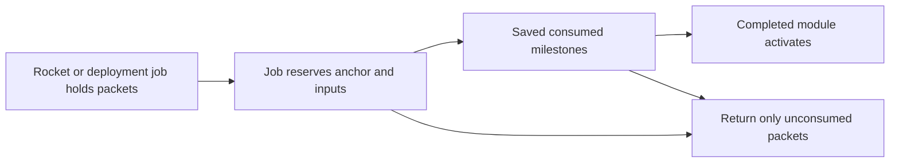

# R2MLVS11 - Orbital Stations and Manufacturing

## Global Mandatory Reading

> **Execution protocol**
>
> - Read this Global Mandatory Reading section before the first task and again
>   after every context compaction.
> - Before starting or resuming a task group, read the nearest preceding Area
>   Mandatory Reading block whose `Applies to` label includes that group. Area
>   blocks appear immediately before the first group they govern.
> - A referenced heading or exported symbol is authoritative. Global navigation
>   hints and Area line ranges are for navigation only; if they drift, relocate
>   the named section or symbol rather than expanding to the whole file.
> - Mandatory reading is non-transitive. Do not preload a linked file's own
>   Mandatory Reading, Consult on Demand, or Planning Provenance entries unless
>   this plan names them directly for the current area.
> - Do not read Consult on Demand or Planning Provenance merely because those
>   sources are listed. Use a Consult on Demand source only when its trigger
>   occurs.
> - No created source file, test file or JSON file should start with same prefix as a planning MD file (such as r2). Only MD files can have that prefix. No MD file should be created anywhere in source directories unless specifically asked.
> - After EVERY CONTEXT COMPACTION, you must add a note above the task group
>   which is currently in execution. The note will say: "Context has compacted
>   X times while executing this group.". If the compaction occurs before any
>   meaningful work was done (this can happen when there is a lot of baggage
>   from the previous compaction), then and ONLY then you can skip this step.
> - When exceeding 3 context compactions, YOU MUST ask yourself if you're not 
>   chewing more than we can handle :). Heck, plans change! :). In such a case, 
>   the way out is to split the group on the spot,
>   in the plan, into more groups, 
>   by appending B, C, D as a suffixes to those groups (splitting sub-groups 
>   themselves is also allowed). When you do this, create Local Mandatory
>   Reading areas so you can optimize your context only for the
>   ACTUAL task at hand.
>   Before starting or resuming a task group, read the nearest preceding Area
>   Mandatory Reading block whose `Applies to` label includes that group. Area
>   blocks appear immediately before the first group they govern.

| File name | Line Ranges | Description |
| --- | --- | --- |
| [docs/zz-reach2/upgrades/2026-10/r2mlvs-multilayer-vehicles-and-structures.md](r2mlvs-multilayer-vehicles-and-structures.md) | 352-376 | `AD-12` supplies the canonical gameplay/ownership decision for every group of this plan. It constrains delivered module/robot construction and bounded orbital processing; a consumer must not redefine it locally. |
| [src/map_layer.h](../../../../src/map_layer.h) | 81-89 | `MultiLayerMap` ownership preamble: `Map` owns packed storage/geometry and this controller owns layer semantics. Every group uses world tiles/explicit layer helpers; camera selection and ad hoc plane offsets cannot define gameplay. |
| [src/cargopacket.cpp](../../../../src/cargopacket.cpp) | 96-121 | Complete `CargoPacket::Split` and `Merge` define quantity/feeder-share ownership and allocation failure. Every construction, production and transport group must conserve actual packet quantities; station vehicle-loading reservations are not a generic orbital inventory API. |

Status: construction prerequisite Groups1-6 delivered,2026-10-14; Assembly activation6B, reservations7, native materialization8 and ordinary purchases8B delivered,2026-10-15; paid clones8BB and replacement settlement8BC delivered,2026-10-16. The current429 consumer is `logs/manufacturing-replacement-verification.json`; its428 clone,427 purchase/materialization and earlier422/425/426 proofs remain immutable dated handoffs. Original aggregate7.3 is complete. Plan10 Group8B is now complete in both430 builds. Its8C.3 consumer requires remaining mining/processor/freight producers. Group9's immutable per-miner contract now passes both430 builds; paid commissioning/content compatibility9B is now complete in both431 builds (logs/heavy-commissioning-verification.json); Group9C finite heavy mining/precise orbital return is now complete in both432 builds (`logs/heavy-mining-runtime-verification.json`); Group9CB original paid supply/custody is now complete in both433 builds (`logs/heavy-supply-custody-verification.json`;275 focused/2,259 native/2,212 resumed assertions each,30 owners/630 comparisons). Group9CBBA genuine433 descent input is now complete in both builds (logs/legacy-descent-verification.json;145 focused/6,024 native/5,980 resumed assertions each,30owners/420 comparisons). Group9CBB heavy Surface descent is now complete in both434 builds (logs/heavy-descent-verification.json;257 focused/6,734 native/2,449 resumed assertions each,30 owners/600 comparisons). Onboard service 9CC, genuine legacy producer 9CCB and contained Core service 9CCC now pass both builds; the current 436 handoff is `logs/heavy-contained-service-verification.json`. Paid Dock service 9CCCC and original service aggregate 9CC.1 are now complete in both 436 builds (`logs/heavy-dock-service-verification.json`). Joined validation/disclosures9CD are now complete in both437 builds (`logs/heavy-joined-verification.json`). Original two-miner role9D acceptance now passes both437 builds (`logs/heavy-role-runtime-verification.json`). Actual paid heavy mission cycle9DB now passes both437 builds (`logs/heavy-cycle-verification.json`). Integrated heavy native network acceptance9DC and original9.1 now pass both437 builds (`logs/heavy-network-verification.json`). Shared staged electrical-work prerequisite10 is now complete in both builds (`logs/orbital-recipe-work-verification.json`). Orbital packet participant10B now passes both builds (`logs/orbital-inventory-verification.json`). Native processing/runtime10C now passes both438builds (`logs/orbital-runtime-verification.json`). Continue sequentially at11-12. Presentation/persistence/source-plan gates remain open. Parent: [R2MLVS master](r2mlvs-multilayer-vehicles-and-structures.md).

**Artifact-layout migration (2026-10-09):** this plan consumes the parent [Development artifact layout](r2mlvs-multilayer-vehicles-and-structures.md#development-artifact-layout), implemented by [R2FC](r2fc-file-cleanup.md). It supersedes earlier docs asset/review/helper placement and fixed runtime-config destinations below. New native homes use `mlm/runtime/`, generated feature reviews use `mlm/reviews/`, logs remain under `logs/`, and reusable code/curated inputs keep their code/test owners. Paths and focused native/cold verification are complete; R2FC records the results and retained-input identities. Repository-relative executable commands run from the checkout root through their context-aware wrappers. Historical pass records remain dated evidence and are not new acceptance claims. No gameplay task is completed by this migration and the separate post-demo fixture-pruning gate remains.

## Outcome and Boundaries

**Delivered definition/queue handoff,2026-10-12:** Plan1 Group12B publishes
`multilayer_space_content.h` revision2 recipes, mass, budgets and paid-facility
admission; Plan8 Group6B publishes native `space_orders.h` queue/generation
ownership. Save410 carries exact `SDEF` content identity and separate bounded
`SPOR` transport, preserving ground/profile/package1 and paid old objects.
Both builds and focused native save/replay/refusal gates pass; see
`logs/space-content-orders-verification.json`. These handoffs grant no missing
commissioning, survey, blueprint, processing, descent, service, UI/art or network
producer. Consume their public definitions/commands; retain unfinished tasks.

Earth-launched construction probes deliver Steel and Goods to orbital
blueprints. Completed stations process mined ore into Steel/Goods and may
consume that output in further construction or vehicle assembly, haul it to
another station or send it to Earth through the authorized drop service.

**User revision,2026-10-12:** consume the canonical
[Space economy contract](r2mlvs1-d-recipes-and-bootstrap.md#space-economy-revision---2026-10-12)
and [revised numerical defaults](r2mlvs1-e-ground-and-space-budgets.md#space-economy-revision---2026-10-12).
All orbital builds require Steel/Goods; initial station/module recipes use
those two inputs. Later advanced equipment may add declared inputs. The former
Surface-preassembled Core recipe is superseded: a construction probe builds
the first Core from delivered packets at a placed blueprint. Earth-built
probes remain launch-center payloads until deployed; local probe manufacture
requires a completed orbital Assembly. These requirements are not yet delivered.

## Module contract

| Module | Role | Bootstrap input |
| --- | --- | --- |
| Core | Anchor, initial assembly/service capacity and ownership | Construction-probe-delivered Steel/Goods; no earlier station |
| Dock | Rocket/hauler service and explicit cargo exchange | Steel/Goods |
| Storage | Bounded cargo inventory | Steel/Goods |
| Utility | Station power/service capacity | Steel/Goods to construct; separately declared operating supplies |
| Assembly | Builds mining/survey/construction probes, later heavy robots and haulers | Steel/Goods to construct; each vehicle's paid recipe/capacity gate |
| Steelworks | Bounded metallic-ore conversion to Steel | Steel/Goods to construct; NORE feedstock and utility grant |
| Goodsworks | Bounded Steel/rare-earth conversion to Goods | Steel/Goods to construct; STEL and RARE feedstock and utility grant |
| Advanced processor | Later Refined Metals/Water Ice alternatives | Both common construction materials plus any declared advanced inputs |

Exact quantities, footprints and service consumption belong to r2mlvs1's
revised numerical tables. The first Core/Assembly/processor/probe path must
accept entirely Earth-delivered inputs. No processor supplies the materials
needed for its own first construction. GOOD keeps its crate unit and native
weight; displays, holds and recipe caps must not silently treat crates as tonnes.

## Public Handoff Contract

[src/orbital_station.h](../../../../src/orbital_station.h) publishes
`OrbitalModule`, `OrbitalConstructionJob`, `ReserveOrbitalConstructionInputs`
and `CommitOrbitalConstructionStep`, contained by the native `SpaceStructure`
in [src/space_structure.h](../../../../src/space_structure.h). Groups1/1B/2/3
have RelWithDebInfo/Debug producer evidence. Groups4/4B/4C/5/5B/5C now also
have both configurations' focused and native boundaries. The final exact type/
signature fixture passes with3,605 assertions in26 focused cases per configuration;
22 bounded Debug native phases cover activation, shared approaches, delivered
Dock services, removal, evacuation, company lifecycle and independent refusals.
`logs/orbital-handoff-debug-verification.json` freezes this422 handoff and the
repaired current Release freight fixture. Earlier dated Release proofs remain
immutable. Plan9 task11.3 now verifies423 direct rocket-to-module delivery and
original-hull recovery/failure acceptance in RelWithDebInfo/Debug
(`logs/module-flight-verification.json`). Orbital
Assembly activation and its explicit work connection are now delivered by
Group6B in both425 configurations (`logs/assembly-facility-verification.json`).
Manufacturing and processing remain later producers.

| Native authority | Published contract |
| --- | --- |
| `SpaceStructure` / `SpaceStructureRef` | One paid static footprint, phase and monotonic generation. IDs may be reused only with a new generation; absent, stale or zero-generation references resolve to no owner. `FrameComplete` alone grants no facilities. |
| `OrbitalConstructionJob` | Two exclusive actual STEL/GOOD packet containers, consumed receipts, bounded whole/fractional work and saved native tick/allocation receipts. Final completion consumes one whole canonical recipe once; cancellation preserves only unconsumed material and refunds no work. |
| `ReserveOrbitalConstructionInputs(SpaceStructure &, SpaceVehicle &, bool)` | Actual precise admitted builder and matching typed Construct order. Estimate moves nothing; execution reserves only physically delivered still-missing material. `CmdReserveOrbitalModuleInputs` separately fills all missing labels atomically from actual adjacent Core stock. |
| `CommitOrbitalConstructionStep(SpaceVehicle &)` | Normal prepared native opportunity only. Portable paid tooling bootstraps Core; extensions consume the original Core's shared allocation. Queries, pauses and repeated callbacks earn no work. |
| `OrbitalModule` | Sole contained role-bounded stock, at most1,024 units/64 packet references per label. Explicit paid-frame activation begins empty. Core/Storage/Power/Dock/Assembly are supported; later recipe frames remain inert. Assembly has no general cargo stock or probe-service berth. Connection never expands another module's container. |
| `OrbitalServiceJob` / `GetServiceJobs()` | Core capacity1, activated Dock capacity2. Each contained job owns one RFMT/ELEC pair, exact craft generation/service serial and once-only750J work receipt. Onboard/contained jobs cannot overlap. Cancellation preserves actual parts and spent energy; it grants no return allowance. |
| `OrbitalFacilityState` | Original typed producer/work/construction consumer IDs; `UINT32_MAX` means absent. Core30kW and Power60kW use the shared Space electricity ledger. Dock/Assembly have no panel: explicit `utility_source` binds an adjacent owned original Core/Power and `consumer`, bounded to1,500J for Dock or750J for Assembly. `assembly_consumer` remains the separate Core-only construction slot. Old inventory-only Cores commission explicitly. |
| `space_approach.h` / contained `SpaceOrderQueue` | Shared generation-qualified admission, stable saved priority, precise physical slot and safe waiting point. This is the berth authority; service and freight consume it rather than create another registry. Dependency loss blocks handling; zero panel generation blocks service work. Both retain paid Dock geometry. |
| Removal/evacuation (422; RelWithDebInfo verified) | Exact owned empty removal preflights every physical/dependency/utility owner. `SpaceStructureRetirementHistory` remains beside native generation issuance, preserving spent material/service totals without retired-object inventory. Whole packet evacuation cancels jobs into one safe adjacent native inventory; hull holds/poses remain actual until explicit departure. |

Schema422 preserves the421 module row and appends no new inventory owner.
Its SPST header stores next generation(8bytes), live count(2), removed count(8),
spent STEL(8), spent GOOD(8) and completed services(8). Older schemas start
with zero retired aggregates. Native capture/install/digest and independent
preview use the same bounded history; rejected snapshots cannot borrow live
modules or reactivate retired utility identities.

Schema425 `OrbitalAssemblyFacilities` retains the SPST byte layout and admits
explicit activation of a fully paid Assembly. Earlier schemas can retain inert
Assembly frames but reject activated Assembly rows. Activation requires the
actual adjacent owned operational Core, the complete STEL8/GOOD16 receipt,
592 construction ticks and74 activation ticks. `CmdConnectOrbitalServices`
and `CmdDisconnectOrbitalServices` supply the same estimate/execute boundary
for Dock and Assembly; `GetOrbitalServicePowerSite` resolves the exact original
adjacent owned Core/Power. Loading issues no connection, energy, cargo or hull.
Source outage retains identity and gives no work. Copied and full-load
validation resolve their own snapshot's source/consumer and reject aliases,
unfinished activation or service history. These exports supply the facility
prerequisite for Group7; they do not reserve manufacturing stock or create a
vehicle.

Downstream consumers use these actual owners and command estimate/execute
boundaries. They cannot replace them with copied pools, private utility/cargo
tables, blueprint capacity, implicit activation or another capital/material
debit. The existing `orbital_removal.cpp` fixture binds exact exported types,
packet containers, contained ownership and function signatures at compile time;
the native producer fixtures verify their physical behavior.

**Construction batch,2026-10-13:** `space_structure.h` is the native Plan8
identity/occupancy owner; `orbital_station.h` owns its contained construction
job. The coordinated Plan8 Group13B / Plan10 Group8C batch implements those
missing producers before claiming their handoff. Job inventories contain real
packets; completion consumes the full canonical material batch atomically.
A finished frame is explicitly awaiting activation, with no storage, dock,
assembly or utility grant. Operational Core activation and those facilities
remain required by Groups1-5 and are not completed by the owner foundation.

## Implementation Tasks

Deepening pass, 2026-10-04: implementation groups use only SIMPLE, MEDIUM or HARD difficulty, with at most eight pending tasks each. Sketches describe proposed implementation contracts; verify the named earlier producers at each assumption gate. No gameplay or asset implementation is marked complete by this planning pass.

Groups are chronological and contain consecutive tasks of one difficulty. Each difficulty batch has at most eight tasks; area reading changes only when the implementation boundary or source of truth changes.

### Area Mandatory Reading - Delivered construction

_Applies to Groups 1-6._

**Entry gate.** The following public contracts must exist before dependent implementation in this area: `src/multilayer_content.h`: `MultiLayerGameplayProfile`, `LayerVehicleCapability`, `GetMultiLayerContentProfile`, `CheckDeepLayerAvailability`, `UtilityPowerAccount`; `src/multilayer_industry.h`: `LayerIndustryCapability`, `ValidateMineDepositClaim`, `ProduceLayerMineCargo`, `PrepareLayerRecipeBatch`, `CommitLayerRecipeBatch`; `src/space.h`: `SpaceVehicle`, `OrbitalBodyID`, `SpaceMission`, `SpaceStructure`, `SpaceTransition`; `src/launch_center.h`: `LaunchCenterAnchor`, `LaunchCollectionHub`, `SurfaceHandlingJob`, `SpaceDescentJob`, `CanReleaseOrbitalCargo`, `CommitOrbitalCargoRelease`; `src/asteroid.h`: `AsteroidBody`, `AdvanceAsteroidField`, plus `SpaceVehicle`, `SpaceMission`, `AssignSpaceMiningMission` and `SpaceVehicle::Tick` in `src/space_vehicle.h`.
**Delivered owner locations:** `space.h` supplies geometry and world types.
Native fleet/mission owners are in `space_vehicle.h`, static sites and contained
module identity in `space_structure.h`, and flights in `space_transition.h`.
The historical `space.h` navigation row below does not relocate those owners.
Use these actual headers with `orbital_station.h` and their compiled producer
fixtures; no consumer should add replacement declarations or a second pool.

Verify each public file/export/schema field with `rg` in the current workspace and inspect its command/field ownership. For a same-plan contract, compile its type/signature fixture or validate its artifact after the preceding producer groups. For cross-plan behavior, also run the producer's focused executable boundary test; declarations alone cannot authorize dependent mutations or runtime claims.
If a required export is absent, stop the dependent implementation, mutation and runtime claims in Groups 1-6. Read-only characterization, source/range verification, test-case design and asset-template work that does not assume the missing behavior may continue.
Do not bypass this gate by copying private pool/tile state, inventing local IDs or cargo registries, using a historical plan as a delivered implementation, opening user-wide content stores, substituting a second utility/accounting authority, or adding an unreviewed fallback path. Finish the named producer or revise the shared contract and its direct consumers first.

| File name | Line Ranges | Description |
| --- | --- | --- |
| [src/command.cpp](../../../../src/command.cpp) | 301-328 | `CommandHelperBase::InternalExecuteValidateTestAndPrepExec` defines refusal/estimate before execution; no validation phase may consume inventory, RNG or funds. |
| [src/industry.h](../../../../src/industry.h) | 75-106 | `ProducedCargo`, `AcceptedCargo`, `ProducedCargoes`, `AcceptedCargoes` expose bounded inventory and economy-time history; conserve materials and avoid narrow-counter overflow. |
| [src/vehicle_cmd.h](../../../../src/vehicle_cmd.h) | 20-42 | Build/refit/clone/depot-autoreplace commands and traits expose all purchase paths; `CloneVehicle` is `NoTest`, so do not rely on a generic estimate to enforce capability/commissioning. |
| `src/multilayer_content.h` (planned public contract; link after implementation) | Live definitions; no fixed range | [r2mlvs1-gameplay-contracts-and-content.md](r2mlvs1-gameplay-contracts-and-content.md) Groups 1-6, ending with Group 6's public-contract task, publish `MultiLayerGameplayProfile`, `LayerVehicleCapability`, `GetMultiLayerContentProfile`, `CheckDeepLayerAvailability`, `UtilityPowerAccount`. These exports/schema fields are authoritative for this area. Same-plan consumers follow those earlier groups; cross-plan consumers verify the producer's required implementation/tests as well. Proposed names alone do not prove delivery. |
| `src/multilayer_industry.h` (planned public contract; link after implementation) | Live definitions; no fixed range | [r2mlvs6-mines-and-resource-chains.md](r2mlvs6-mines-and-resource-chains.md) Groups 1-6, ending with Group 6's public-contract task, publish `LayerIndustryCapability`, `ValidateMineDepositClaim`, `ProduceLayerMineCargo`, `PrepareLayerRecipeBatch`, `CommitLayerRecipeBatch`. These exports/schema fields are authoritative for this area. Same-plan consumers follow those earlier groups; cross-plan consumers verify the producer's required implementation/tests as well. Proposed names alone do not prove delivery. |
| `src/space.h` (planned public contract; link after implementation) | Live definitions; no fixed range | [r2mlvs8-space-world-and-construction.md](r2mlvs8-space-world-and-construction.md) Groups 1-7, ending with Group 7's public-contract task, publish `SpaceVehicle`, `OrbitalBodyID`, `SpaceMission`, `SpaceStructure`, `SpaceTransition`. These exports/schema fields are authoritative for this area. Same-plan consumers follow those earlier groups; cross-plan consumers verify the producer's required implementation/tests as well. Proposed names alone do not prove delivery. |
| `src/launch_center.h` (planned public contract; link after implementation) | Live definitions; no fixed range | [r2mlvs9-launch-centers-and-rockets.md](r2mlvs9-launch-centers-and-rockets.md) Groups 1-7, ending with Group 7's public-contract task, publish `LaunchCenterAnchor`, `LaunchCollectionHub`, `SurfaceHandlingJob`, `SpaceDescentJob`, `CanReleaseOrbitalCargo`, `CommitOrbitalCargoRelease`. These exports/schema fields are authoritative for this area. Same-plan consumers follow those earlier groups; cross-plan consumers verify the producer's required implementation/tests as well. Proposed names alone do not prove delivery. |
| `src/asteroid.h` (planned public contract; link after implementation) | Live definitions; no fixed range | [r2mlvs10-asteroids-and-mining-probes.md](r2mlvs10-asteroids-and-mining-probes.md) Groups 1-7, ending with Group 7's public-contract task, publish `AsteroidBody`, `AdvanceAsteroidField`, plus `SpaceVehicle`, `SpaceMission`, `AssignSpaceMiningMission` and `SpaceVehicle::Tick` in `src/space_vehicle.h`. These exports/schema fields are authoritative for this area. Same-plan consumers follow those earlier groups; cross-plan consumers verify the producer's required implementation/tests as well. Proposed names alone do not prove delivery. |

**ASSUMPTION: this was already built previously. If not, re-asses at runtime**. This applies only to the producer contracts named in this area's gate, after their listed producer groups have run. Verify their actual exports and focused tests before using the sketches below; proposed types and helper names in sketches are not evidence of delivered code.

**Assembly ownership sketch (proposed).** The earlier blueprint and rocket producers supply occupancy and physical delivery. This plan adds assembly/function; it cannot accept a delivery into an imaginary completed station.



**ASSUMPTION: this was already built previously. If not, re-asses at runtime**. Later groups use completed core/module and public inventory ownership from these construction groups. Verify the actual completion/cancellation fixture before using it as a manufacturing predecessor; blueprint presence is insufficient.

Context has compacted 1 times while executing this group.

### Group 1 - Build the first Core from construction-probe deliveries

{{HARD}}
- [X] 1.1 Add the Fund Industry-style Space station/module selector and blueprint placement through r2mlvs8 occupancy commands. Show money, Steel/Goods required/delivered/missing and assigned probes; validate empty anchor/owner/recipe before reserving the site.
- [X] 1.2 Keep deliveries in one saved construction-job inventory while no Core exists. Accept Earth-launched construction probes with actual Steel/Goods; reserve progress without inventing completed storage/docking or teleporting material from Earth.
- [X] 1.3 Construct the first Core using probe work without its own Dock/Storage/Utility/heavy robot. Verify the28t two-material recipe through two capacity-checked Earth launches or subsequent actual resupply; publish starter capacity for the next module.

**Resumed batch,2026-10-13; both configurations verified.** The native selector now
uses the canonical static recipe catalogue, shows available funds and separate
required/delivered/missing/consumed materials, and places typed module blueprints.
Extensions require an owned operational Core edge. Explicit Core activation
retains its74-tick countdown and a separate real packet inventory in save416's
bounded `SPST` extension; genuine415 frames migrate inert. The shared1,024-unit
stock cap and64 packet slots per label are preflighted before precise exchange.
`orbital_core.cpp` and `orbital_core_checks-1.py` / `-2.py` cover activation,
actual paid resupply, stock exchange, continuation and malformed transport.
Each configuration passes77 contract assertions in four cases, exact18-family
activation/populated-stock continuation and paused resaves, and eight independent
full-load plus preview refusals. The real software-rendered selector capture
and registered artifact export pass. See `logs/orbital-core-verification.json`;
the genuine paid415 predecessor is unchanged. The focused native bursts take
approximately11 and36 seconds in RelWithDebInfo; Debug is also focused and
bounded. Precise berth/service
work, shared utility publication and the Plan9 rocket-to-module delivery path
remain required; an inventory-only Core does not complete task1.4 or Group4.

**Saved owner verified,2026-10-13; paused.** Plan8 Group13B's save415 `SPST`
family owns the real job packets, progress and consumed-material receipt.
RelWithDebInfo verifies two paid launches,740 single-slot working ticks,
interrupted replay, cancelled-job return/collection and company lifecycle.
`logs/space-construction-verification.json` records the exact binaries, input,
reports and native captures. Debug is deferred to the next substantial batch.
The user requested stopping at that earlier checkpoint. Its415 finished frame
remains inert until explicit activation. The later416 batch above completes
module selection and starter inventory; the417 Group1B checkpoint below completes
the initial Core service portion of task1.4.

### Local Mandatory Reading - Core service and shared power

_Applies to Group 1B; this splits the remaining service portion of original task1.4 after the verified selector/activation/inventory handoff._

Read the actual exports and owners below before service mutation. The shared
utility producer's `[utility-power-mutation]` fixture passes61 assertions in
two cases in both configurations; source/epoch proposals must still be
revalidated together with actual physical work. Declarations alone grant no power.

| Source | Relevant section or exports | Why required |
| --- | --- | --- |
| `r2mlvs1-e-ground-and-space-budgets.md` | Revised Space defaults: Core panel30,000W, station work750J/tick, serviceRFMT1/ELEC1 and148 ticks | Owns quantities, units and costs; no feature-local retuning. |
| `src/orbital_station.h`, `src/space_structure.h/.cpp` | `OrbitalModule`, `OrbitalConstructionJob`, generation-qualified site ownership and physical packet validation | Service is contained by the same native module; reserved service inputs are separate from stock and construction. |
| `src/space_manifest.cpp` | `GetSpaceSupplyCapacity`, `CmdServiceLaunchProbe`, `IsSpaceServiceWorkTick`, `TickSpaceManifests` | Existing paid supplies, service count and bounded return allowance remain authoritative; no duplicate renewal or timer. |
| `src/space_vehicle.cpp` | `SpaceVehicle::Tick`, `ValidateAsteroidPacketCustody` | One eligibility decision determines active upkeep and actual work; all extracted packets retain one physical owner. |
| `src/utility_power.h` | `RegisterUtilityPowerProducer`, `RegisterUtilityPowerConsumer`, `PublishUtilityGeneration`, `GetUtilityAllocation`, `PrepareUtilityMutation`, `CommitUtilityMutation`, `UtilityMutationParticipant` | Native IDs, source lineage and atomic750J work settlement; no local energy account. |
| `src/transport_tube_runtime.cpp`, `src/vehicle.cpp` | `PrepareTubePowerTick`, call before native vehicle iteration | Existing common per-tick source/request/allocation owner must include Core panels and jobs before vehicle work. |
| `src/saveload/space_structure_sl.cpp`, `src/saveload/afterload.cpp` | Bounded417 `SPST` decoder retaining415/416 and native-owner acceptance before shared utility validation | Explicit schema/migration, copied preview, and final validation after both physical sites and utility IDs resolve. |
| `src/space_manifest.cpp`, `src/space_descent.cpp`, `src/orbital_station.cpp` | `OtherPacketOwners`, `PhysicalDescents`, `InsertOrbitalPacketOwners` | Reserved service packets cannot simultaneously belong to a craft, descent, module stock or construction job. |

**Execution notes.** The delivered common interval driver already allocates once
per synchronized simulation tick; the older1-f Group16 table's74-tick cadence is
not this controller's cadence. Join that driver instead of opening another
interval. The30-kW generic AssemblyWork ceiling does not replace the revised
Space750J exact work debit. A Core service job owns RFMT/ELEC packets until
completion/cancellation, retains one generation-qualified craft/berth reference,
and renews the existing craft allowance to its declared maximum, never adds to it.
Old416 inventory-only Core records must not acquire power or service stock on load.
The retained415/416 builders were launched without a spare RFMT/ELEC preload.
Their paid Steel/Goods hull recipe is embodied hardware, separate from service
stock. The native service fixture imports actual RFMT/ELEC on an additional paid
flight of the same rocket; never turn a hull's assembly receipt into service parts.

Context has compacted 1 times while executing this group.

### Group 1B - Complete the first Core's paid service functions

{{HARD}}
- [X] 1B.1 Add one contained service/berth job per Core with real reserved RFMT/ELEC packets, saved progress and typed craft identity. Pause and cancellation retain or explicitly return only unconsumed material.
- [X] 1B.2 Register the actual Core panel and service consumer with the shared utility owner, join common source/request gathering, and settle750J with each actual service tick. Zero grants preserve progress/materials; no second utility authority or free service.
- [X] 1B.3 Add precise same-owner supply exchange and service start/pause/resume/cancel commands and native controls. One predicate controls active upkeep and work; completion consumes inputs once and renews the existing craft service allowance without stacking it.
- [X] 1B.4 Add explicit bounded persistence/migration and copied/full-load packet/reference checks. Verify partial work, pauses, cancellation, missing either input, lost/foreign references and exact continuation in focused bursts.
- [X] 1.4 Complete Core construction once, then activate only its declared initial inventory/service functions. Test missing either material, cancelled/partial delivery and saves before/after activation; returned unconsumed packets and recorded consumption must balance.

**Verified417 Core service checkpoint,2026-10-13.** RelWithDebInfo and Debug
build the game and focused test executable with two outer workers and
`CL_MPCount=2`. Each passes5,463 assertions in14 focused cases. Native paid
resupply supplies the real service parts;148 working ticks settle111,000J and
consume RFMT1/ELEC1 once, renewing the existing allowance to two. Manual pause,
zero generation, cancellation, foreign commands, takeover, company deletion
and ID reuse preserve their declared material/energy owners. Four interrupted
service phases and ordinary paused resaves match all26 owner families; completed
Release/Debug service state also matches across those families. Ten service and
eight Core malformed cases fail full load and independent copied preview.
Both construction-material shortages and cancellation return actual unconsumed
packets. Every focused burst stays below two minutes (Debug maximum about93s).
`logs/orbital-service-verification.json` binds sources, binaries, immutable paid
predecessors, reports and the native controls capture. Groups2-6 and direct
rocket-to-module delivery remain required for Plan9 task11.3.

### Local Mandatory Reading - Module construction after Core commissioning

_Applies to Groups 2-6. The Delivered construction entry gate above remains applicable._

Read `SpaceConstructionDefinition` in `src/multilayer_space_content.h`, actual
site/approach overlap and ownership commands in `src/space_structure.cpp`, and
`ReserveOrbitalConstructionInputs` / `CommitOrbitalConstructionStep` in
`src/orbital_station.cpp`. Consume the verified native `OrbitalModule` inventory
and Core service owner rather than creating another station, cargo pool or
energy meter. Re-read only the relevant command estimate/execute boundary in
`src/command.cpp` and packet split/merge/transfer semantics in `src/cargopacket.cpp`
and `src/hub_cargo.h` when those paths are changed. Repeat current focused
`[space-construction-contract]` / `[orbital-core-contract]` or their native
boundary producer as required by the actual changed dependency.

### Group 2 - Reserve module footprint and delivered inputs

Context has compacted 1 times while executing this group.

{{HARD}}
- [X] 2.1 Validate module type, adjacency/dependency, footprint, approach clearance and owner against the completed core. A blueprint grants no production/storage/service capacity.
- [X] 2.2 Select actual delivered packets for the module recipe and reserve them exclusively to a typed construction job; competing jobs cannot count the same quantity.
- [X] 2.3 Preflight the blueprint's reserved output identity/footprint and canonical assembly time, then atomically reserve every still-missing Steel/Goods input from adjacent Core stock. Refuse missing materials without partial inventory loss; accept imported and locally produced stock under the same recipe.

**Existing-owner clarification.** Paid blueprint placement already reserves the
native module identity and footprint while granting no function. Input
reservation fills that same job atomically; it must not allocate another site
or require a second capital payment. Physical builder deliveries remain valid
and can supply part of the recipe before this all-missing-input reservation.

**Verified, 2026-10-13.** Release and Debug each pass77 focused construction/Core
assertions and the native paid-import reservation observer. A real additional
rocket flight imports10 Steel; the existing paid Storage job reserves8 Steel
and8 Goods exclusively, leaving2 Steel in the Core. Missing either input,
competing jobs, foreign/stale references and repeated reservation preserve all
owners. The split retains provenance, age and total feeder share; reservation
earns no second capital charge or delivery payment. Ordinary paused resaves
and74-tick continuations match all26 packet/job/company/vehicle/utility owner
families. The frame remains inert with no assigned builder. Both native
controls captures were inspected, including the corrected selected recipe.
Evidence: `logs/orbital-module-reservation-verification.json`.

**Provenance scope.** The reservation boundary admits actual canonical cargo
containers without filtering Earth versus Space production origin. The native
acceptance here uses genuine imported stock; end-to-end local manufacture
remains in the later manufacturing groups and is not claimed by this result.

Context has compacted 1 times while executing this group.

### Group 3 - Advance saved assembly milestones and cancellation

{{HARD}}
- [X] 3.1 Define monotonic assembly milestones with explicit input quantities consumed at each step, saved progress/remainder and one commit marker. Preview/reservation consumes nothing.
- [X] 3.2 At each milestone, revalidate remaining inputs and utility/service capacity, then consume the exact inputs and advance progress once. Save at either side of the milestone and compare next-step behavior.
- [X] 3.3 On cancellation, return only unconsumed reserved packets through the explicit inventory-transfer path. Already consumed materials remain recorded as consumption or a declared bounded salvage recipe; never regenerate the original cargo.

**Assembly milestone contract.** Reservation and partial work retain both full
recipe inputs. Only final frame completion consumes both lists together and
records their exact canonical quantities. Save418 appends Q16 work, its exact
division remainder, the native work tick and original utility interval; these
describe physical progress, not another energy balance. Each operational Core
has one bounded construction consumer competing with its separate service
berth for the actual paid panel. Partial grants advance only their useful work,
and the last request cannot exceed the remaining work. Paid portable builders
still bootstrap a Core independently. Old415-417 records receive zero new work
receipts and no implicit consumer, cargo, energy or functionality. Cancellation
retains spent work and exposes only actual unconsumed packets for collection.

**Verified, 2026-10-13.** Release and Debug build both native targets and each
pass3,173 assertions in10 focused cases. Real810J panel competition supplies
60J partial work, then exact30J final use; Storage consumes Steel8/Goods8 once
and settles222,000J of assembly. Four interrupted continuations and ordinary
resaves preserve all26 owner families; both configurations agree at every
checkpoint and completed frame. Cancellation physically returns only the
unconsumed packets, with no energy refund or freight payment. Ten malformed
receipts/consumer/material/schema cases fail full load and copied preview.
Genuine415 first-Core work still bootstraps independently and migrates exactly.
The132-second Debug wrapper was split into `-3-1` and `-4-1` companion files;
all replacement bursts finish within two minutes. Frozen evidence:
`logs/orbital-assembly-verification.json`. Implementation stops after this
group at the user's2026-10-13 request; Groups4 onward remain unchecked.

**Activation ordering clarification.** Former task3.4 is now4.0 below because
its functionality preflight requires Group4's actual module owner. Assembly
finishes an accountable inert frame and keeps its exact native identity and
footprint reserved; the following group owns once-only functional activation.

Context has compacted 1 times while executing this group.

### Group 4 - Activate completed module functions

**Execution split,2026-10-13:** this group supplies atomic Core/Storage/Power
activation, bounded physical stock and the actual shared-ledger panel. Group4B
retains the shared approach prerequisite; Group4C retains Dock activation/berths
and dependency acceptance. Plan8 Group11's generic approach producer must pass
its public boundary before the Dock consumer is claimed.
The current user instruction resumes execution after the earlier Group3 pause.

{{MEDIUM}}
- [X] 4.0 Activate fully consumed Core/Storage/Power frames once through a synchronized, generation-checked command and saved countdown. Prepare native functionality and any shared producer before committing activation; preserve the native footprint/identity. No construction consumption, activation or refund generates a second delivery payment. Dock activation remains in Group4B.
- [X] 4.2 Activate Storage with a declared capacity and Utility with explicit power/service inputs and grants. Connecting modules does not create unlimited shared inventory or free energy.

**RelWithDebInfo verified,2026-10-13; paused at the user's request.** Save419
retains the418 byte layout and admits explicit74-tick Storage/Power activation;
old-version non-Core activation is refused. Storage has its own bounded1,024-unit
stock and no panel/work consumers. Power has no freight stock and publishes its
original60kW panel through the shared utility owner; the Core retains30kW.
The focused producer/consumer contracts pass285 assertions in11 cases. Native
activation and actual typed Core-to-Storage transport of one existing Steel
packet preserve26 owner families through interrupted replay and ordinary resave,
without another material debit or freight payment. Four malformed schema,
panel, stock-cap and work-consumer cases fail both full load and independent
preview, with live authority unchanged. All four native bursts finish under10s.
`logs/orbital-activation-verification.json` freezes sources, binaries, the
unchanged paid418 input, exact reports and logs. Debug remains explicitly
deferred to the next substantial Dock/approach/removal/handoff batch, following
the user's instruction to bundle costly builds. Group4B and later groups remain
unchecked; this checkpoint does not claim their functionality.

### Local Mandatory Reading - Shared approach prerequisite

_Applies to Group4B. Read the Global and Delivered construction Area gates,
the module-construction Local reading above, Plan8 Global/Orbital world and
construction Area reading, and its Group11 shared approach contract. Inspect
the actual `space_approach.h/.cpp`, contained native `SpaceOrderQueue`, SPOR
decoder/full-load/copied-preview boundaries and ordinary native movement.
Existing asteroid mining leases remain the physical attachment authority.
Reconcile and verify this producer before implementing its Dock consumer._

### Group 4B - Deliver shared approach reservations

**Execution split,2026-10-13:** the missing shared approach producer includes
saved priority, exclusive slots, local staging, actual movement and independent
loader/preview acceptance. Give it its own prerequisite group; original4.1/4.3
continue unchanged in Group4C. This preserves the original order while keeping
each active group and its reading focused.

{{HARD}}
- [X] 4B.1 Complete Plan8 Group11's actual shared approach producer, publish its native request/admission/release boundary and verify simultaneous contention, removed targets and queued reload before the Dock consumer.

**RelWithDebInfo verified,2026-10-14.** Plan8 Group11 publishes the contained
native queue request and `space_approach.h` admission/release/precise-berth
queries in save420. Focused contracts pass3,369 assertions in16 cases. Real
paid craft demonstrate static/body contention, actual departure, target
cancellation and moving-body tracking without acquiring mining/survey rights.
Both queued continuations and ordinary resaves preserve26 owner families;
four malformed cases fail both full load and copied preview with live owners,
cash and RNG unchanged. Frozen evidence: `logs/space-approach-verification.json`.
Debug remains queued with the next substantial batch. This completes the
shared prerequisite only; original4.1/4.3 remain unchecked in Group4C.

### Local Mandatory Reading - Dock functions and completed-module dependencies

_Applies to Group4C. Read the Global and Delivered construction Area gates,
the module-construction Local reading above, the verified Group4B/Plan8 Group11
approach handoff and Group4 activation/save validation. Inspect the actual
`OrbitalModule`, `SpaceStructureRef`, contained service jobs, precise admitted
berth queries and shared utility registration/settlement. Dock capacity must
consume explicit physically connected original sources and actual service
packets; no second inventory, berth registry or energy balance may bypass them._

### Group 4C - Activate Dock services and verify module dependencies

Context has compacted 1 times while executing this group.

{{MEDIUM}}
- [X] 4.1 Activate Core/Dock services only after completion; expose bounded berth and handling capacity through the r2mlvs8 approach contract. Complete the missing shared approach producer and its focused fixtures before claiming this consumer.
- [X] 4.3 Recompute adjacency/dependency queries from authoritative completed modules; unfinished modules remain inert. Verify activation/source outages against actual owners. Actual removal's dependent-only acceptance continues as task5.4 after the safe-removal producer.

**RelWithDebInfo verified,2026-10-14.** Focused Dock/activation/approach/
construction/Core contracts pass294 assertions in12 cases. Genuine418 paid
builders and the same recovered rocket import STEL8/GOOD12 plus two actual
RFMT/ELEC service pairs. Native shared work completes the444-tick Dock frame,
then explicit74-tick activation supplies two precise berths without a panel.
The one1,500J consumer binds the original adjacent Core; two real jobs compete
for its810J generation and settle750J once per admitted working tick, with
matching upkeep. Job pause and zero generation retain parts. Interrupted
service, completion and cancellation ordinary resaves preserve26 owner
families. Cancellation returns both unconsumed pairs and retires an idle
connection without refunding settled power. Four malformed source/hull/part/
schema cases fail full load and independent preview with active owners
unchanged; the older-schema case reaches the explicit Dock-version refusal.
The native inspector was inspected and shared module labels corrected through
a language-only build. Frozen evidence: `logs/orbital-dock-verification.json`.
Debug remains queued with Groups4/4B for the next substantial batch. This
handoff supplies Dock functions and outage queries; Group5 owns actual removal.

### Local Mandatory Reading - Safe module removal and evacuation

_Applies to Group5. Read the Global and Delivered construction Area gates,
the module-construction Local block, Group4C's contained service/connection
handoff and actual `SpaceStructure` generations, packet owners and job receipts.
Inspect `utility_power.cpp` source/share retirement and operation-sequence
preflight before retiring physical bindings. Whole refusal preserves every
packet, ledger, field and reference; only unconsumed material can be evacuated.
Preserve spent construction/material history while permitting generation-safe
native ID reuse. Read native queue/approach cancellation and company lifecycle
only where removal changes those owners. No copied ledger or private cargo
registry may replace the shared native authority._

### Group 5 - Classify and safely remove empty modules

**Execution split,2026-10-14:** retain original task order while separating
whole empty removal/retired receipts, packet evacuation, and lifecycle
acceptance. These changes share the next build batch; each group is checked
only after its own focused evidence passes.

{{HARD}}
- [X] 5.1 Classify dependent berths, vehicles, assembly jobs and stored packets before removing a module. Refuse final Core/Dock/Storage removal if an accountable item has nowhere valid to go.
- [X] 5.1B Remove only fully preflighted empty native owners, preserving aggregate spent-material/service receipts and exact utility history. Save issuance/retired history together through explicit schema422; old saves gain zero retired history.
- [X] 5.1C Verify estimate/refusal purity, empty removal, receipt conservation and generation-safe identity reuse at the native owner boundary.

**RelWithDebInfo verified,2026-10-14.** Focused dependency/removal contracts pass3,559 assertions in24 cases. The genuine paid Storage frame is removed through the actual command, preserving STEL8/GOOD8 in native retirement history. Its reused numeric ID receives a new generation and another capital payment; the old saved queue remains TargetRemoved. Stocked Core/occupied Dock and stale/foreign requests refuse unchanged. Ordinary resave preserves26 owner families. Four malformed issuance/material/service history cases fail both full load and independent preview, leaving active owners/cash/RNG unchanged. Exact construction signatures/contained types compile in the same fixture. Frozen evidence: `logs/orbital-removal-verification.json`. Debug remains queued; evacuation/lifecycle still require their own gates.

### Local Mandatory Reading - Explicit module evacuation

_Applies to Group5B. Read Global/Delivered construction and module-construction
Local reading, Group5's exact removal classifier/history handoff, actual
`HubCargoTransfer` station-to-station preflight/move, native module stock limits
and contained construction/service jobs. Preflight every destination label,
packet bound and held craft before moving anything. Return only unconsumed
parts/materials and leave spent source history and unrelated owners unchanged.
Packet evacuation cancels contained jobs and preserves actual hull holds,
poses and surviving berth admission. Craft departure remains an explicit
native order/movement step; occupied modules remain protected from removal._

### Group 5B - Evacuate unconsumed module inventory explicitly

Context has compacted 1 times while executing this group.

{{HARD}}
- [X] 5.2 Implement a deterministic explicit evacuation/cancellation path where possible, using the public cargo/job APIs and preserving unconsumed components.

**RelWithDebInfo verified,2026-10-14.** Focused evacuation contracts pass46 assertions in2 cases, including full replacement inventory and unsafe last-Core destination refusal. Native paid Dock-job and unfinished-assembly evacuation preserve actual packet quantity/provenance/feeder share, spent work/energy, hull holds/poses and manifest allowances. Both ordinary resaves preserve26 owner families; occupied completed Dock still refuses removal. Both native inspector captures were reviewed. Frozen evidence: `logs/orbital-evacuation-verification.json`. Debug remains queued.

### Local Mandatory Reading - Module removal lifecycle acceptance

_Applies to Group5C. Read Global/Delivered construction, the verified Group5
removal and Group5B evacuation handoffs, actual company ownership hooks and
native generation-qualified queue/approach/service owners. Exercise actual
removal and takeover commands; copied fixture deletion is not gameplay proof.
Inspect copied/full-load validators only for changed cross-family owners.
Reuse the frozen paid Dock421 predecessor and exact identity-bound reports._

### Group 5C - Verify removal dependencies and company lifecycle

{{HARD}}
- [X] 5.3 Test full replacement storage, occupied last dock, active assembly and company transfer. Reused module IDs cannot inherit old berth/recipe assignments.
- [X] 5.4 Test actual safe module removal changes only its dependents, using authoritative completed-module queries. This is the removal-acceptance portion of original4.3; it follows the producer that makes removal possible.

**RelWithDebInfo verified,2026-10-14.** Actual takeover/loss/company-ID reuse, occupied last-Dock refusal followed by native hull departure/empty removal, and dependency-local Core removal pass924 assertions in3 native cases. Completed Dock removal retains spent STEL8/GOOD12 and two completed services while its original Core panel survives. Actual Core stock leaves in paid native hull compartments; removing that empty Core disables only its empty Storage/Dock, preserving independent paid inert blueprint, queues, cargo, manifest, cash and spent source history. All three ordinary resaves preserve26 owner families. Group5/5B supply full destination/active assembly and generation-reuse boundaries. The original replacement-flight test design was narrowed because the immutable input has only8 fuel; no fuel/material was fabricated. Frozen evidence: `logs/orbital-lifecycle-verification.json`. Debug remains queued.

### Local Mandatory Reading - Delivered construction publication

_Applies to Group6. Read Global/Delivered construction and module-construction
Local reading, the Public Handoff Contract above, and the verified5/5B/5C
producer evidence when available. Inspect exact public owner/signature/schema
fields in `orbital_station.h`, `space_structure.h`, `space_structure_cmd.h`,
`orbital_service.h` and `space_approach.h`; use their actual compiled fixture.
Publish only delivered behavior and scoped configuration evidence. Keep direct
rocket-to-module integration and later manufacturing gates explicit. Update
direct consumer references if an actual owner/signature differs from the
contract, rather than aliasing a second registry or a private mutation path._

### Group 6 - Delivered construction

{{HARD}}
- [X] 6.1 Publish `src/orbital_station.h` with the exact exports/schema fields in `Public Handoff Contract`; document authoritative fields, invalid-ID semantics and command/estimate boundaries. Register any created C++ source in the existing build list. If the chosen implementation uses a different public location, update this contract and every direct consumer before declaring the producer ready.

**Delivered,2026-10-14.** The native public owner/signature/schema table above matches `orbital_station.h`, `space_structure.h`, commands, service jobs and shared approaches. Exact type/function bindings compile in both configurations. Focused handoff contracts pass3,605 assertions/26 cases per configuration; all22 bounded Debug native phases and repaired Release freight replay/resave pass. Sixteen malformed schema/ownership/history cases refuse in both independent load paths. Actual Debug Dock/evacuation captures were inspected. This closes deferred Debug for4/4B/4C/5/5B/5C; earlier dated pending statements are superseded by this checkpoint. Frozen evidence: `logs/orbital-handoff-debug-verification.json`. Return to Plan9 task11.3. Later recipes and final source-plan acceptance remain open.

### Area Mandatory Reading - Orbital manufacture and processing

_Applies to Groups 6B-12B._

**Entry gate.** The following public contracts must exist before dependent implementation in this area: `src/orbital_station.h`: `OrbitalModule`, `OrbitalConstructionJob`, `ReserveOrbitalConstructionInputs`, `CommitOrbitalConstructionStep`.
Verify each public file/export/schema field with `rg` in the current workspace and inspect its command/field ownership. For a same-plan contract, compile its type/signature fixture or validate its artifact after the preceding producer groups. For cross-plan behavior, also run the producer's focused executable boundary test; declarations alone cannot authorize dependent mutations or runtime claims.
If a required export is absent, stop the dependent implementation, mutation and runtime claims in Groups 7-12. Read-only characterization, source/range verification, test-case design and asset-template work that does not assume the missing behavior may continue.
Do not bypass this gate by copying private pool/tile state, inventing local IDs or cargo registries, using a historical plan as a delivered implementation, opening user-wide content stores, substituting a second utility/accounting authority, or adding an unreviewed fallback path. Finish the named producer or revise the shared contract and its direct consumers first.

| File name | Line Ranges | Description |
| --- | --- | --- |
| [src/industry_cmd.cpp](../../../../src/industry_cmd.cpp) | 1152-1240 | `ProduceIndustryGoodsHelper` and `ProduceIndustryGoods` expose complete rate/callback production paths; augment output once before authoritative monthly accounting. |
| [src/cargopacket.h](../../../../src/cargopacket.h) | 458-489 | `VehicleCargoList::Append`, `AgeCargo`, `Stage`, `Return`, `Unload`, `Shift` move accountable packets; exchange/descent/processing must not clone packet age or feeder shares. |
| [src/economy_base.h](../../../../src/economy_base.h) | 20-38 | `CargoPayment`, `PayTransfer`, `PayFinalDelivery` own transport income. Visiting an origin station, a descent, or handling transfer is not automatic final payment. |
| `src/orbital_station.h` (planned public contract; link after implementation) | Live definitions; no fixed range | [r2mlvs11-orbital-stations-and-manufacturing.md](r2mlvs11-orbital-stations-and-manufacturing.md) Groups 1-6, ending with Group 6's public-contract task, publish `OrbitalModule`, `OrbitalConstructionJob`, `ReserveOrbitalConstructionInputs`, `CommitOrbitalConstructionStep`. These exports/schema fields are authoritative for this area. Same-plan consumers follow those earlier groups; cross-plan consumers verify the producer's required implementation/tests as well. Proposed names alone do not prove delivery. |
| `src/multilayer_industry.h` (planned public contract; link after implementation) | Live definitions; no fixed range | r2mlvs6 `Publish layer-industry and recipe boundaries` declares `PrepareLayerRecipeBatch` and `CommitLayerRecipeBatch`; its following production groups implement and test inventory-view/commit participants. Consume those behaviors for orbital processing, not an `Industry*`-only private implementation. |
| [src/core/pool_type.hpp](../../../../src/core/pool_type.hpp) | 331-368 | `Create`, `CreateAtIndex` and `CanAllocateItem` separate runtime materialization from save reconstruction; exhausted allocation leaves a saved manufacturing job. |
| [src/vehicle.cpp](../../../../src/vehicle.cpp) | 829-895 | Complete `Vehicle::PreDestructor` truncates cargo and cleans accounting; orbital sale/replacement must settle holdings and mission references before generic destruction. |
| `src/utility_power.h` (planned public contract; link after implementation) | Live definitions; no fixed range | [r2mlvs12](r2mlvs12-solar-farms-mirrors-and-eti.md) `Useful Power Handoff`, produced by its native-ledger, atomic-mutation and consumer-effect groups, supplies `PublishUtilityGeneration`, `AllocateUtilityPower`, `GetUtilityAllocation`, `UtilityGrantID`, `UtilityMutationKind`, `PrepareUtilityMutation`, `CommitUtilityMutation`. Verify its allocation, consume/release/layer-transfer, effect and save/retry fixtures before dependent power mutations; no private account writes or duplicate grid. |

**ASSUMPTION: this was already built previously. If not, re-asses at runtime**. This applies only to the producer contracts named in this area's gate, after their listed producer groups have run. Verify their actual exports and focused tests before using the sketches below; proposed types and helper names in sketches are not evidence of delivered code.

**Shared batch sketch.** r2mlvs6 owns the all-input recipe algorithm. This area supplies an orbital inventory participant plus local service grants and commits through that same contract.

```text
proposal = PrepareLayerRecipeBatch(recipe, orbital_inventory_view, service_grant)
if proposal cannot fit every input/output: retain stock and wait
else CommitLayerRecipeBatch(proposal, orbital_inventory_commit_participant)
```

The helper names are proposed public exports, not evidence of delivery. **ASSUMPTION: this was already built previously. If not, re-asses at runtime**. Verify their definitions and r2mlvs6 atomic-batch tests before implementing processor mutation; if absent, stop processing work but continue module UI/test design. Do not copy an industry-private loop or invent a second utility authority.

**Scoped electricity gate. ASSUMPTION: this was already built previously. If not, re-asses at runtime**. Any recipe/service participant using common electrical grants must verify r2mlvs12 Useful Power Handoff and its mutation fixtures first. If absent, stop those power mutations while independent module/cargo tests continue; do not mutate `UtilityPowerAccount` privately. Local non-electrical service inputs remain explicit recipe inventory.

### Local Mandatory Reading - Paid Assembly activation prerequisite

_Applies to Group6B only._ Read the Global block and the Orbital manufacture/processing Area above, limiting recipe/industry material to the later producer gate: this group activates a physical Assembly and its electrical connection, not a processor. Before6B, `IsSupportedOrbitalModuleKind` activated only Core/Dock/Storage/Power; an Assembly definition or inert frame is not a manufacturing facility. Read `orbital_station.h`, `IsOrbitalModuleOperational`, `CmdActivateOrbitalModule`, `CmdConnectOrbitalServices`/`CmdDisconnectOrbitalServices`, `GetOrbitalServicePowerSite`, `ValidateOrbitalServiceUtilityRecords`, and their copied `SPST` preview validation. Verify actual construction/module and shared utility allocation/mutation/effect/save boundaries before dependent mutation. Use original paid Core/Power panel IDs and one750J bounded consumer; no Assembly panel, service allowance, freight stock or vehicle is granted. Preserve precise approaches, removal/takeover, immutable inputs and old readers. Group7 owns saved material reservations; Group8 owns work and vehicle materialization.

Context has compacted 1 times while executing this group.

### Group 6B - Activate the paid Assembly manufacturing facility

{{HARD}}
- [X] 6B.1 Activate a physically constructed STEL8/GOOD16 Assembly after its paid592-tick frame and74-tick activation. Require its real adjacent owned Core; grant no vehicle, cargo, panel or service berth.
- [X] 6B.2 Connect one bounded AssemblyWork consumer to an explicitly chosen adjacent owned Core/Power panel through the shared utility owner. Preserve original source identity, zero generation/outage behavior, native removal/takeover and exact save/preview validation; loading never commissions a connection.
- [X] 6B.3 Verify actual paid construction/activation/connection and interrupted ordinary reload in both configurations, including estimates, missing/foreign/reused dependencies, exhausted source, disconnect/removal and malformed copied/full-load boundaries. Publish the exact manufacturing entry contract before Group7 consumes it.

**Delivered,2026-10-15.** Both configurations pass3,341 focused assertions/15 cases,7,006 physical assertions and100 interrupted-activation assertions. Original paid418 input supplies actual rocket freight,592 construction ticks and74 activation ticks; no hull, packet or receipt is fabricated. Nine ordinary checkpoints preserve26 owners, including company loss and the removed Assembly;260 cross-configuration owner comparisons also pass. Seven malformed copies each refuse full load and independent preview. The retained native controls were inspected. `logs/assembly-facility-verification.json` binds46 acceptance reports/62 native processes (48 successful,14 expected full-load refusals),108 nested reports and192 current identities. Ordinary console copies' complete executable bytes are verified against the matching product with only PE output routing changed. Core stock correctly takes priority over its connection removal reason; unsafe last-Core evacuation refuses unchanged, while isolated empty-Core contracts prove the connection guard. Continue at Group7 with the public entry contract above.

### Local Mandatory Reading - Manufacturing reservations

_Applies to Group7 only._ Read Global and the Orbital manufacture/processing Area, deferring industry-recipe implementation until Group10. Consume the delivered6B Public Handoff Contract and its exact verification index; `OrbitalFacilityState::consumer` is the external750J Assembly work owner, while `assembly_consumer` is Core construction only. Inspect `GetSpaceVehicleConstruction`/`CanCommissionSpaceVehicle` and the four-input heavy recipes in `multilayer_space_content.h/.cpp`, actual `orbital_station.h` contained packet owners, `space_approach.h` berth authority, `launch_operations.h/.cpp` paid commissioning, ordinary purchase/clone/replacement entry points, shared utility demand/allocation/mutation ownership, and SPST capture/full/copied-preview validation. Reserve actual Surface-delivered or orbital stock once, with explicit bounded role/model/source/berth/job identities. No private cargo registry, Earth-origin fabrication, free hull or work advancement belongs in this reservation group; Group8 supplies exact progress/materialization. Read complete packet movement and pool functions only where used, and company/removal hooks for the new contained job. Preserve original current and historical accepted inputs.

Context has compacted 1 times while executing this group.

### Group 7 - Prepare heavy-robot and hauler manufacturing orders

{{HARD}}
- [X] 7.1 Add typed manufacture requests at completed Assembly modules for mining/survey/construction probes and later heavy robots/haulers. Resolve the profile recipe, role and compatible berth; preserve Earth commissioning as the only pre-station path.
- [X] 7.2 Validate actual Steel/Goods, declared extra inputs, funds, service grants and free berth before reserving stock. A paid queued request owns no material until a normal shared allocation supplies its actual work grant; idle facilities allocate no speculative power. All first vehicle recipes accept entirely Surface-delivered inputs; local production is an alternate source, not a prerequisite.

**Public Handoff Contract - Manufacturing reservations,426.** Both configurations pass. `logs/manufacturing-reservation-verification.json` freezes the exact producer evidence; [manufacturing notes](r2mlsp-z-a-manufacturing-notes.md) retain the implementation and resumption boundary.

- `orbital_station.h` contains one optional `OrbitalManufactureJob` per actual Assembly, its monotonic `manufacture_serial`, the `Queued`/`Reserved` phase and four native packet containers. `OrbitalManufactureRecord` carries only copied quantities/references for save/preview validation. The original module incarnation plus job serial, model, stock-source incarnation, capital, berth and reservation interval remain explicit.
- `CmdQueueOrbitalManufacture`/`CmdCancelOrbitalManufacture` in `space_structure_cmd.h` are the synchronized admission/cancellation owners. A request validates every profile input, funds, real adjacent owned operational Core/Storage, free native berth and original connected panel, then charges recipe capital once. It creates a packet-free queued job. Cancellation preflights one explicit destination for the whole reserved batch, returns the original packets, retains the issuance serial and refunds no capital.
- `AppendOrbitalManufacturingRequests` and `TickOrbitalManufacturingReservations` in `orbital_manufacturing.h` participate in the existing normal common allocation. Only an eligible queued job requests its actual external750J `consumer`; an idle facility requests none. A full current grant admits all declared inputs atomically after aggregate split-pool preflight. Reservation spends no energy, material or work and creates no vehicle. `assembly_consumer` remains Core construction only.
- `space_approach.h` owns the exclusive output berth through existing physical occupancy/admission. Removal, source dependencies, disconnection, evacuation, takeover, company loss and company-ID reuse preserve the actual job and sole packet owners. `ValidateOrbitalManufacturingRecords` and SPST full/copied validation use the same snapshot's models, owners, packets and utility epoch; loading never commissions or reserves a job. Schema426 appends the bounded job within SPST; older accepted inputs remain immutable.
- Supported recipes are15/20 STEL4/GOOD8,19 STEL2/GOOD4,16/17 STEL6/GOOD12/RBPT4/ELEC2. Native tests declare starting Surface test stock consistently with the retained launch acceptance conditions, then use four actual rocket freight flights and actual command payment/allocation. This proves the wholly Surface-delivered manufacturing path from prepared content; it does not prove Surface procurement or a factory-to-launch production chain. Group8 still owns saved work, consumption and canonical vehicle materialization; Group8B follows that producer for generic fleet requests.

**Delivered,2026-10-15.** Each426 configuration passes309 focused assertions/four cases,11,729 native assertions/19 scenarios and209 resumed assertions/five reservations. Four actual rocket flights supply all declared labels from prepared Surface content; all five model requests/reservations and heavy-model cancellation, power outage/recovery and company lifecycle pass. Fourteen ordinary checkpoints preserve26 owners each;19 checkpoints also pass494 cross-configuration owner comparisons. Twelve malformed copies each refuse full load and independent preview. Actual queued/reserved controls were inspected and are pixel-identical between configurations. The verification index binds92 acceptance reports,218 nested JSON reports,530 identities and126 native processes (102 successful,24 expected full-load refusals), including36 current source identities and the immutable425 Assembly boundary. Both native builds and whitespace checks pass. Surface procurement/factory-chain acceptance remains outside this group. The user requested a break after7; resume at8 without replaying completed reservation work.

**Consumer ordering correction,2026-10-15.** Original7.3 is now Group8B after the materialization producer. Native purchase/clone callbacks and autoreplacement require an immediate vehicle identity; Group7 deliberately creates only a saved request and exclusive packet reservation. Implementing those consumers before8 would require a fake hull or incompatible success result. Existing generic Space refusals remain safe but do not complete8B's routing task.

### Local Mandatory Reading - Paid manufacture progress and materialization

_Applies to Group8 only._ Read Global and the Orbital manufacture/processing Area, deferring industry-recipe implementation until10. Consume Group7's Public Handoff Contract and exact426 verification index, preserving its dated source/binary boundary after new edits. Inspect `OrbitalManufactureState`, `TickOrbitalManufacturingReservations`, native shared grant mutation/effect ownership, `SpaceConstructionState`, actual `SpaceVehicle`/Engine commissioning and free-unit allocation, `space_approach.h` physical admission, and complete SPST/SVST capture/full/copied-preview validation. Read pool `Create`/`CreateAtIndex`/`CanAllocateItem` and native destruction/accounting where used. Work must consume actual common energy once per opportunity; hold the complete recipe until the prepared completion milestone can consume every input and create one actual hull together. Exhausted pool/engine/unit/berth admission retains paid work and original inputs in AwaitingMaterialization. Give orbital hulls a real original factory-generation/job-serial receipt, never a fictitious Earth launch origin. Publish a completion receipt and exact repeat/load/failed-admission proof before8B consumes the producer. New saved fields require bounded, append-only same-snapshot validation; loading reconstructs existing owners without replaying production. Verify all five model definitions, preserving Earth commissioning and leaving later heavy mission differences to9.

Context has compacted 1 times while executing this group.

### Group 8 - Materialize one built vehicle without duplicate inputs

{{HARD}}
- [X] 8.1 Advance saved assembly progress with explicit consumption milestones and reserve vehicle-pool/engine/berth capacity before the completion commit.
- [X] 8.2 Create the canonical r2mlvs8 Space vehicle, bind it to the owned berth and mark the manufacturing job complete in one prepared action. On pool/unit/berth exhaustion retain a saved AwaitingMaterialization state; do not restart consumed work. `CreateAtIndex` on save loading reconstructs the vehicle without replaying manufacture.
- [X] 8.3 Test save immediately before/after completion, unavailable berth, insufficient final input and a repeated completion tick; assert one vehicle ID and one recipe consumption.

**Public Handoff Contract - Paid native materialization,427.** Both configurations pass. `logs/manufacturing-materialization-verification.json` freezes the current producer; [materialization notes](r2mlsp-z-b-materialization-notes.md) retain exact identities and continuation guidance.

- `OrbitalManufactureState` appends `Working`, `AwaitingMaterialization` and `Complete` progress, exact `work_ticks`/`last_work_interval`/`work_energy_j`, one generation-qualified `product` and four-label `consumed` receipt. Original factory incarnation/job serial, stock source, capital, berth and reservation epoch remain authoritative. Work holds the entire original packet batch; the single final consumption milestone embodies every label in the actual product together.
- `TickOrbitalManufacturingWork` in `orbital_manufacturing.h` follows normal grant-qualified reservation. Each new work opportunity consumes exactly750J through the existing common utility mutation participant. The reservation interval earns no work; pause/outage/repeated callbacks preserve existing work. `AppendOrbitalManufacturingRequests` requests power only for eligible queued or unfinished work; awaiting/complete jobs request none. No private utility debit or second capital payment occurs.
- Final admission preflights actual global fleet/Vehicle pool, original generation issuance, native Engine capacity, company free unit, full material bill and original facility/source/connection/physical berth. Exhausted admission retains paid work and original inputs in `AwaitingMaterialization`. One synchronous commit creates the canonical `SpaceVehicle`, consumes the whole bill, records completion and uses `BindSpaceManufactureBerth` in `space_approach.h` for its actual native slot. Repeated callbacks and ordinary reconstruction cannot issue another hull or consume the bill twice.
- `SpaceConstructionState::assembly`/`assembly_serial` in `space_production.h` name the actual original factory/job. Orbital products have no fabricated Earth home/origin/Surface tile. `ValidateOrbitalManufacturingProductionLinks` validates same-snapshot unique provenance and live completion links, while retaining legitimate dated receipts after factory/product removal. Schema427 appends40 bytes to each contained SPST job and18 to each SVST receipt; old readers remain version-bounded, old saves gain no work/hull/provenance and native `CreateAtIndex` reconstructs existing hulls without manufacture.
- `CmdCancelOrbitalManufacture` returns the complete unconsumed batch after unfinished work without refunding capital or electricity. A completed-job acknowledgement clears only its receipt; the actual paid product survives. Native company transfer/loss and ID reuse preserve these owners. All five models15/19/20/16/17 materialize through their declared immutable recipes; later heavy mission/service/extraction differences remain9 and ordinary purchase/clone/replacement routing remains8B.

**Delivered,2026-10-15.** Each final427 configuration passes1,060 focused assertions/six cases,4,639 native assertions/26 scenarios and270 resumed assertions/five final completions. Actual64-hull fleet and company-unit exhaustion, late physical berth obstruction and missing final heavy input retain the same paid batch; capacity unit layouts are explicit contract fixtures. Native gameplay uses the exact accepted426 Surface-delivered reservations, then actual normal work, all five products, repeat, outage/recovery, cancellation, departure, second paid manufacture and completed-product company lifecycle. Twenty-six ordinary checkpoints preserve26 owners each;26 native and five resumed checkpoints pass806 cross-configuration owner comparisons. Ten malformed copies each refuse independent full load and preview. All ten before/after native controls are pixel-identical between configurations; heavy-model controls were inspected. The index binds126 acceptance reports,305 nested JSON reports,729 identities,46 current source files and156 native processes (136 successful,20 intended full-load refusals), with exact ordinary console/product PE equivalence. Both final builds and whitespace checks pass. The declared starting Surface content/procurement boundary from7 remains unchanged. Continue at8B.

### Local Mandatory Reading - Paid ordinary purchase consumers

_Applies to Group8B only._ Read Global and the Orbital manufacture/processing Area, then delivered7/8 contracts and the exact427 verification index. Inspect `CmdBuildVehicle` in vehicle_cmd.cpp, `CcBuildPrimaryVehicle`/`CcBuildWagon`, build_vehicle_gui.cpp, command return/callback serialization and actual launch/Assembly commands. The existing generic command requires a real ordinary depot and returns an immediate VehicleID; Space facilities are separate physical owners. Preserve the original paid Earth producer. Identify an admitted asynchronous request through its actual saved job/result contract and handle callbacks safely, with no proxy hull or invalid-ID dereference. The existing command framework can supply original command arguments to a callback; resolve its actual freshly admitted physical job where that existing contract suffices before widening generic return tuples. Resolve actual world-layer facility/source/model ownership before any mutation; never use camera selection or a private inventory. Check native Engine catalogue availability without registering definitions during estimates/load. Industry processing remains deferred to10. All supported purchases consume the existing physical recipe/facility owner; a generic refusal does not complete routing. Clone/replacement ownership is scoped to8BB/8BC below.

Context has compacted 1 times while executing this group.

### Group 8B - Route ordinary purchases through paid facilities

{{HARD}}
- [X] 8B.1 Adapt the ordinary purchase command/result/callback boundary to the actual paid Earth or queued orbital facility owner. Resolve original world-layer facility, source and canonical model without a fake hull, temporary refit purchase, speculative Engine registration or a second bill.
- [X] 8B.2 Verify pure estimates/refusals, actual paid request and native completion/reload for supported models, callback handling, insufficient/foreign/ambiguous dependencies and repeated requests. Publish the concrete purchase result/producer contract before clone or replacement consumes it.

Native acceptance may declare initial Surface test content for an independent second heavy/Earth purchase scenario, consistently with7's prepared-content boundary. Record those starting packets explicitly before traffic/purchase, then use actual loading, fuel, flights, reservation and work; grant no orbital stock, capital, hull or paid receipt and claim no Surface procurement/factory-chain proof. Existing valid Engine mappings come from the exact real producer checkpoints; estimates/UI must not manufacture catalogue identities.

**Public Handoff Contract - Ordinary paid purchases,427.** Both configurations pass. `logs/manufacturing-purchase-verification.json` freezes the delivered consumer; [purchase notes](r2mlsp-z-c-purchase-notes.md) retain exact identities, fixture cleanup findings and clone entry guidance.

- `space_purchase.h` publishes `SpacePurchaseResult`, `IsSpacePurchaseEngine`, `GetSpacePurchaseAssembly` and `PurchaseSpaceVehicleAtFacility`. Lookups accept existing canonical native Engines and actual world-layer footprints. They register no speculative Engine and create no camera-derived facility, proxy hull, private stock owner or second ledger.
- Surface requests resolve the actual LaunchCenter station's rotated Workshop zone and delegate `CmdAssembleLaunchCraft`, retaining its genuine immediate Assembling VehicleID and Earth provenance. Orbital requests quote actual inventory candidates through `CmdQueueOrbitalManufacture`; a generic command with no source argument requires exactly one eligible source. Ambiguity refuses unchanged and leaves the existing explicit source-selection command available. Accepted execution creates one actual paid contained job; its result identifies the real factory/issued serial and has no VehicleID until Group8 materializes the actual product.
- `CmdBuildVehicle` retains its original five-field return tuple. `CcBuildPrimaryVehicle` uses the existing return-plus-original-command-arguments callback framework: an actual Earth/ordinary hull opens its vehicle view, while queued orbital success resolves the actual original tile/Engine/job and opens `ShowSpaceConstructionWindow` without dereferencing Invalid. Command finance charges the original capital once; common work/final input consumption remain exclusively Group8's producers.
- Pure quotes, including mixed Execute/QueryCost, preserve packets, work, identities, money and RNG. Default/INVALID cargo is supported; unsupported refits and context-free AutoReplace flags refuse before a temporary purchase. Foreign/missing/ambiguous facility/source, insufficient capital/power/last input and repeated requests preserve original owners. Clone intent and old-hull replacement settlement remain8BB/8BC. No saved layout changed;427 remains current.

**Delivered,2026-10-15.** Each configuration passes615 focused assertions/four cases,26,841 native assertions/44 scenarios and255 resumed assertions/five actual ordinary-resave completions. Twenty-one ordinary checkpoints preserve26 families;44 native and five resumed checkpoints pass1,274 cross-configuration comparisons. Two malformed provenance copies per configuration refuse independent full load and preview. All15 queued/before/complete native control pairs match pixels. One shared-fixture check passes1,369 assertions/ten cases each after correcting bulk-cleanup viewport hashes. The index binds138 acceptance reports,291 nested JSON,768 identities,56 current sources and152 processes (148 accepted/four expected full-load refusals). Explicit initial Surface additions precede genuine freight/work and retain the procurement limitation above.

**Consumer split,2026-10-15.** Original7.3 is the joint acceptance of8B/8BB/8BC. Read-only characterization found independent immediate-ID purchase/clone callbacks and an immediate native replacement swap. A queued physical job cannot be returned as a fabricated vehicle. Purchase admission/result handling is delivered above; clone intent and replacement settlement retain their separate sequential groups and Local reading. The original aggregate checkbox remains unchecked below8BC.

### Local Mandatory Reading - Paid clone intent

_Applies to Group8BB only._ Read Global, applicable Area and delivered7/8/8B contracts plus exact current producer fixtures. Inspect `CmdCloneVehicle`, `CcCloneVehicle`, native Space typed orders/cargo/service/paid receipts and original source generation/owner lifecycle. Consume8B's actual delivered request/result contract, not its proposed shape. Preserve the source hull and its actual cargo/service owners; a new clone must pay a fresh full recipe. Capture only supported clone configuration/order intent with bounded save/full/preview ownership, and settle it once on the actual product. Do not copy freight/service packets, silently share an unsupported order list or return a proxy hull. Check cancellation, source loss/transfer/reuse and actual callbacks before claims.

Context has compacted 1 times while executing this group.

### Group 8BB - Clone through one new paid manufacture job

{{HARD}}
- [X] 8BB.1 Route supported ordinary clone requests through the delivered physical purchase/job owner, preserving source hull/assets and explicit supported configuration/order intent until one actual new paid product exists.
- [X] 8BB.2 Verify fresh payment/full recipe consumption, safe callback and order/configuration application, source mutation/loss/reuse, cancellation and exact interrupted completion without duplicate hulls or transferred source cargo/service allowances. Publish the concrete clone handoff.

**Supported intent scope,2026-10-16.** Clones commission the real paid canonical model with default cargo/subtype0, captured custom name and independent typed instruction entries. A source's dynamically assigned freight label and every actual freight/service packet stay with their original owner; a different current payload label is not a refit request. Shared lists, invalid cargo identities and unsupported subtypes refuse before payment. Current native queue validation allows instructions only on deployed orbital hulls: an immediate Earth Assembling clone therefore requires an empty source queue; nonempty Surface intent refuses unchanged rather than discarding instructions or inventing a deferred owner. Orbital intent starts stopped with fresh action progress and its own factory berth. Capture the original source incarnation as history; later source mutation/loss/transfer/reuse cannot retarget its immutable name/instructions. Any still-live foreign target at final preflight retains the original full paid work/bill for retry or cancellation. The delivered verification below covers this scope.

Native clone acceptance may declare initial Surface scenario content before new traffic, consistently with7/8B's explicit prepared-content boundary. Then use real loading, fuel-paid flights, typed berth-clearing navigation, original reservation/work and actual source asset transfers. Model15 may retain a separate starting Earth bill;20 may ship Goods/RFMT/ELEC into its real source compartments separately from the clone bill. Record all initial additions and keep procurement/factory-chain acceptance false; grant no orbital stock, money, hull, recipe receipt, utility grant or geometric pose.

**Source-loss fixture boundary,2026-10-16.** A pending manufacture job reserves its factory approach. An older product therefore cannot return to that original home berth to satisfy the current native sale command. Exercise source loss explicitly by destroying one actual empty stopped source through its native destructor; verify original-generation retirement and later numeric-ID reuse without granting a refund, replacement hull or work. This is a destruction/lifecycle contract fixture, not player-triggered sale acceptance. Actual company takeover remains a normal native ownership operation.

**Public Handoff Contract - Paid independent clones,428.** Both configurations pass. `logs/manufacturing-clone-verification.json` freezes the delivered consumer; [clone notes](r2mlsp-z-d-clone-notes.md) retain exact identities, supported configuration and fixture boundaries.

- `space_clone.h` publishes `SpaceCloneIntent`, bounded pure `ValidateSpaceCloneIntent`, current-target `CanApplySpaceCloneIntent`, prepared product configuration and `CloneSpaceVehicleAtFacility`. The original source incarnation is historical provenance. The existing optional contained manufacturing job owns its independent name/instructions; it owns no source packet, action progress, approach, service allowance or shared mutable queue.
- `CmdCloneVehicle` routes actual Space sources before ordinary temporary-build/refit logic and delegates the original physical purchase once. Command finance charges fresh capital; the original producer reserves/consumes every new recipe input. Its unchanged cost/VehicleID return contains Invalid only while the actual orbital job has no product. `CcCloneVehicle` uses original tile/source/share arguments to show that fresh real factory/job safely. Earth clones retain their actual Assembling ID and original paid work; the supported empty queue needs no deferred owner.
- Materialization prepares unique legal naming and independent instruction storage, then checks surviving target rights before native allocation or input consumption. One actual new stopped hull receives fresh action progress, its own factory berth and the original factory/job receipt. Source rename/reorder, removal, takeover or numeric-ID reuse cannot retarget the snapshot; foreign targets retain the original full paid milestone/bill for retry or cancellation. Completed receipts never apply configuration or consume inputs again. `MakeClonedVehicleName` also preserves the ordinary padded-suffix/unique-name convention with checked bounds and default-name fallback.
- Schema428 appends SPST's strict presence byte and optional original source12/name length1/up to124 UTF-8 bytes/order count1/up to32 typed14-byte entries. Every original job gains one absence byte; maximum extra587 bytes. Full/copied-preview/save validation uses same-snapshot issued epochs, immutable paid source model when surviving, and a product generation newer than its historical source. Earlier427 saves infer no clone/configuration/hull. SVST and native queue ownership remain unchanged.

**Delivered,2026-10-16.** Release/Debug pass1,289 focused assertions/six cases each,50,667/50,666 native assertions across73 bounded scenarios respectively, and543 resumed assertions/eight actual ordinary-resave completions each. All five roles use independent Surface-delivered bills and original shared work; loaded-source assets, mutation, native destruction/fresh-generation numeric reuse, real company takeover, cancellation, Earth work and pure refusals pass. Thirty-three ordinary checkpoints per configuration preserve26 owners;81 native/resumed pairs pass2,106 cross-configuration comparisons. Fourteen malformed copies per configuration refuse independent full load and copied preview; both exact427 upgrade and legacy last-tick comparisons normalize only absent-intent bytes. All27 native/resumed control pairs match pixels; queued15 and heavy16 before/after controls were inspected. The index binds246 accepted reports,543 nested JSON,1,344 identities,64 current sources and286 native processes (258 accepted,28 intended full-load refusals). Both builds, documented source boundaries and whitespace checks pass. Source destruction and prepared Surface content retain the explicit fixture limits above; procurement, pending-job sale and replacement are not claimed. Continue at8BC; original aggregate7.3 stays open.

### Local Mandatory Reading - Paid replacement settlement

_Applies to Group8BC only._ Read Global, applicable Area and exact delivered7/8/8B/8BB handoffs. Inspect `CmdAutoreplaceVehicle`, `BuildReplacementVehicle`, `GetNewEngineType`, native sell/destruction/accounting, actual Space orders/manifest/service/approach owners and company lifecycle. The ordinary replacement path expects immediate native identities and can construct temporary estimate vehicles; that behavior must not authorize orbital recipes. Retain the old real hull/assets while its paid physical replacement waits; preflight the complete final ownership/accounting settlement and commit it once. Resolve the actual current producer exports before mutation. Pool/unit/berth refusal, cancellation, old source loss/ownership change and reloaded jobs cannot sell/refund twice, discard cargo or manufacture a second hull.

Context has compacted 2 times while executing this group.

### Group 8BC - Settle one paid replacement without losing the old hull

{{HARD}}
- [X] 8BC.1 Route supported native replacement/renewal requests through the actual paid facility/job owner, with explicit original hull identity and no temporary estimate hull or early old-hull destruction.
- [X] 8BC.2 Prepare and commit the final native old/new accounting, unit, orders and permitted asset settlement once; retain the old hull and paid pending job on unavailable capacity or unsafe holdings. Verify cancellation/lifecycle, ordinary/replayed completion, full/preview malformed ownership and repeated settlement.
- [X] 7.3 Route ordinary purchase/clone/replacement requests for these models through the same physical-input facility gate. No generic vehicle command may bypass assembly or clone a paid recipe for free. Aggregate closes only after8B/8BB/8BC pass their own evidence.

**Public Handoff Contract - Paid replacement settlement,429.** Both configurations pass. `logs/manufacturing-replacement-verification.json` freezes the current consumer; [replacement notes](r2mlsp-z-e-replacement-notes.md) retain exact selectors, contracts and fixture limits.

- `space_replacement.h` publishes native policy admission, pure `PrepareSpaceReplacement`, once-only `CommitSpaceReplacement` and same-snapshot `ValidateSpaceReplacementLinks`. The actual orbital job or actual Earth Assembling hull contains `SpaceReplacementIntent`: original incarnation/model, running intent and settled sale receipt. No parallel inventory, hull pool or finance owner exists. `CmdAutoreplaceVehicle` routes Space before ordinary temporary estimate/build logic and consumes actual native company/group/age policy. Both producers charge their original full capital and recipe; projected sale proceeds cannot fund admission.
- Final preparation requires the current original at the same real Earth center or the job's precise owned adjacent Core/Storage berth. Preserve its current name/instruction index, native group/unit/statistics, complete permitted freight/service holdings, used return allowance and service/flight history. Active work, carried bodies/pods, reserved returns, incompatible whole holdings, missing/foreign source or unsafe rights retain the paid final milestone for retry/cancellation. Per-packet provenance is checked as well as total capacity. Configuration remains with the original until settlement, so supported later edits are assessed then. Native sale/destruction/accounting runs once inside a private prepared retirement scope; ordinary manual sale keeps its home-berth rules.
- Genuine typed Visit arrival offers the existing native automatic-replacement queue after a pure successful policy/facility quote. Explicit start/stop and native order/mission commands that implicitly start retain the same pending orbital running choice. Source departure holds the final full paid bill until genuine return. Orbital cancellation returns only the original unconsumed packets, with no capital/work refund. `CmdCancelEarthSpaceReplacement` and the workshop's Keep both hulls action detach intent; the already paid new body finishes as an ordinary purchase and the old hull/assets survive.
- Schema429 appends one strict presence byte plus20 payload bytes when present to each SPST job and each SVST receipt; clone and replacement intent are exclusive. SVST's428 fixed67-byte rows become bounded68..88-byte rows. Full load and independent copied preview share the strict codec and validate unique original authority, immutable surviving paid receipts, relative issuance and settled original absence against their own complete snapshot. Loading creates no replacement, payment or work. Older428 input gains only absent-intent bytes.
- Native `StartupNewEngine` initializes genuinely new canonical mappings through the original engine startup/reliability owner while preserving simulation RNG. The native ENGN loader initializes only proven wholly unstarted pre429 canonical Space histories after saved fields are restored, preserving user-hidden flags; retained availability/preview/history is never reopened. This supplies real native replacement eligibility for original paid428 sources without registering speculative definitions during quotes or load.

**Delivered,2026-10-16.** Each configuration passes611 focused assertions/nine cases,71,933 native assertions/54 scenarios and474 resumed assertions/nine continuations. All five orbital roles pay their full independent bills; Earth assembly, automatic arrival, current asset/configuration handover, native company takeover, source departure/return, cancellation, repeated settlement and unavailable final admission pass. Twenty-five ordinary checkpoints each preserve30 owner families;63 native/resumed pairs pass1,890 cross-configuration comparisons. Twenty-four malformed copies each refuse full load and independent copied preview; two exact428 upgrades each preserve all owners after absent-intent normalization. The adjacent purchase boundary passes615 assertions/four cases each. The index binds214 acceptance reports,503 nested JSON,1,145 identities,83 current sources and280 native processes (232 accepted,48 intended full-load refusals). Both builds, console/product byte equivalence and final identity/whitespace checks pass. This group supplies runtime and persistence acceptance; later presentation/art/processing gates remain open. Original aggregate7.3 closes with the separately retained8B/8BB producers. Continue at Plan10 task8B.1 in the master queue.

**Bounded renewal-age acceptance fixture,2026-10-16.** Native same-model rules always enforce when-old. Isolated tests declare age explicitly; loaded-world acceptance invokes each actual original's `OnNewCalendarDay`10,980 times before replacement, reporting the exact count while proving money, value, packets, RNG, hull count, work and issuance unchanged. This covers native age-policy admission; it does not simulate the corresponding calendar/economy. Paid work, ordinary aging/depreciation during subsequent real ticks, physical handover and final credit retain their actual owners. Original accepted traffic/material checkpoints remain immutable independent inputs. The source-loss branch explicitly destroys one empty native hull and proves blocked paid work/cancellation; it supplies no sale/refund claim or fabricated successor. Surface procurement and artwork are outside this acceptance.

### Local Mandatory Reading - Heavy mission role and native controller

_Applies to Group9 only._ Read Global and the Orbital manufacture/processing Area, limiting recipe-executor and electrical producer reading to their later Groups10-12 gate. Read the shared revised Space body/material tables, `multilayer_vehicle_catalogue.cpp` model15/16/17 roles, `multilayer_space_content.h/.cpp` construction/service budgets, `space_vehicle.h/.cpp` native mission work and `space_orders.h/.cpp` role/target admission. Consume the exact delivered7/8/8B/8BB/8BC paid factory and current Plan10 Group8B430 action/disclosure handoffs. Catalogue model16 is a heavy construction robot with no freight hold; the historical task9.1 mining wording conflicts with that role. Resolve the shared role/tuning contract explicitly before changing a native model, rather than silently repurposing a paid saved hull or borrowing another hull's cargo/service owner. New models, if required, append logical IDs and version content/save admission. Use actual native hull/manifest/lease/approach/packet owners; no second inventory, free commissioning, pods, service allowance or private utility state. Current processor definitions are not executable processing producers; keep later processor unload claims pending until Groups10-12 pass._

### Group 9 - Orbital manufacture and processing

{{MEDIUM}}

**Execution refinement and confirmed role decision,2026-10-16.** Original9.1 combines a missing role contract, paid commissioning, native mining/service and acceptance. The delivered catalogue defines model16 as a cargo-less construction robot. The user confirmed keeping16 for construction and adding the separate heavy miner21; this confirms the working implementation already in progress. Groups9/9B/9C/9D execute those four bounded stages in order, preserving original9.1 as the final aggregate. Processor-specific receiving behavior remains gated on Groups10-12; a definition or inert frame is not an operational receiver.

- [X] 9.1A Publish one immutable per-miner contract for existing15 and appended21, retaining model15's exact delivered tuning and the existing construction16/hauler17 roles.
- [X] 9.1B Record heavy21's full recipe, cargo mass, extraction/upkeep/service defaults and Earth/orbital commissioning rights in the shared catalogue/numerical contract; do not invent free pods or service allowance.
- [X] 9.1C Verify the current paid factory/type/role producer boundary and the immutable contract in focused tests. Publish exact public exports and the content/save compatibility policy before consumers mutate native state.

**Public Handoff Contract - Immutable mining roles,2026-10-16.** `space_mining_tuning.h` publishes `SPACE_HEAVY_MINER_MODEL=21`, immutable `SpaceMiningTuning` and pure `GetSpaceMiningTuning(uint16_t)`. Only15/21 have definitions; unrelated roles return nullptr. Model15 derives every operating value from the delivered shared budget. The shared numerical contract records21's independently paid Assembly recipe and operating ledger, plus pending content3/save431 admission preserving old content2 receipts without rewriting their embodied inputs. Native21 commissioning, SDEF changes and Mine execution are not enabled by this query. Both current430 builds pass1,294 focused assertions/11 cases across the new contract and existing content/order/materialization boundary. `logs/heavy-mining-tuning-verification.json` freezes ten source identities and both actual process reports. Continue at9B; original9.1 remains pending under9D.

### Local Mandatory Reading - Paid heavy-miner commissioning and compatibility

_Applies to Group9B only._ Read Global, the Orbital manufacture/processing Area and the delivered Group9 per-miner contract. Inspect `multilayer_space_content.h/.cpp`, `multilayer_content.h`, `multilayer_vehicle_catalogue.cpp`, actual `space_production`, `orbital_manufacturing`, `space_vehicle` Engine identity and their native/copy save readers. Reuse accepted paid factory429 inputs. Append model21 and construction-kind identity without changing0..20 or repurposing16; version the new content/save contract explicitly. Old content2 receipts, embodied recipes, work, native hulls and paid pending clone/replacement history must remain conserved under a documented compatibility rule. No generic purchase, quote, clone or load may commission a free hull. Native mining/service remains the next Group9C consumer._

Context has compacted 1 times while executing this group.

### Group 9B - Commission the appended heavy miner through the paid factory

{{HARD}}
- [X] 9B.1 Append catalogue21 and its full actual Assembly recipe, native Engine definition and paid factory/purchase admission. Keep Earth assembly unavailable unless the shared contract explicitly adds it.
- [X] 9B.2 Version SDEF/content and save admission; preserve old0..20 recipe receipts and exact native2-to-current reconstruction without granting parts, work, pod shells, allowance or money. Validate the same-file copied preview independently.
- [X] 9B.3 Preserve native clone/replacement, owner/generation/unit/berth/cancellation and paid materialization boundaries for the new model; unsupported operations must refuse before payment or input reservation.
- [X] 9B.4 Verify actual independently paid commissioning, legacy input reconstruction, once-only completion and focused full/preview malformed admission; publish the immutable consumer input for9C.

**Public Handoff Contract - Paid heavy commissioning,2026-10-16.** Content3/save431 appends model21 and its full four-input Assembly recipe, native Engine/40t mineral hold and original factory/purchase/clone/replacement admission. Existing0..20 receipts retain their original content2 fields and embodied bills;21 requires3. Versioned SDEF hashes the exact original2 table set independently of new3, and both native/copy decoders reject future hull/job/frame provenance in older files. The already accepted pre429 repair of never-started Engine definitions is matched byte-for-byte against its immutable429 input/output; initialized/denied/hiding history is retained. Both builds pass1,600 focused assertions/14 cases,2,160 native assertions/eight stages,2,075 resumed assertions/six own-resave continuations, eight ordinary checkpoints, four genuine legacy upgrades and eleven independent full/copy refusal pairs each. Thirty owner families agree across750 cross-build comparisons. `logs/heavy-commissioning-verification.json` SHA256 `bbe592959ba830cbfd24ba3c84f4f0d5b78743c4defd64c6d498c0e5ae42ffde` binds34 source identities,286 references and48 processes per build, including eleven intended full-load refusals. The actual complete consumer is model21 VehicleID22/generation8,40t, initial allowance2/history0, no physical shells or loose service parts. Both431 complete saves have SHA256 `7af4ff879e03fe147614cda081e16640ecb93dba0df2e4c141d9d65617fe320b`; resolve matching configuration's complete report from that index. Its full bill was delivered by the original paid rocket and independently consumed here; inherited declared Surface starting content remains explicit and procurement acceptance is false. No free Engine/hull comes from quotes/load. Mine/service21 and useful processor receiving remain9C/9D and10-12. The user confirmed retaining construction16 and adding separate miner21. [Current handoff notes](r2mlsp-z-h-heavy-miner-notes.md) retain the exact inputs and fixture limits.

### Local Mandatory Reading - Heavy extraction, return and real service

_Applies to Group9C only._ Read Global, applicable Area and exact delivered9/9B exports. Inspect native `space_vehicle`/`space_orders` work and upkeep, `space_manifest`/`orbital_service` parts and allowance, `space_order_actions` freight/service adapters, `space_pod`/`space_descent` and generation-qualified approach/target owners. Consume per-model tuning through the shared contract, preserving model15 behavior. Each heavy hold, lease, pod and service material remains owned by the actual paid hull or existing physical producer. Keep refinery/processor mutation out until Groups10-12; unavailable receivers retain the whole hold. No private service countdown, duplicate allowance or second packet registry._

Context has compacted 1 times while executing this group.

### Group 9C - Execute heavy mining, return and paid service

{{HARD}}
**Execution refinement,2026-10-16.** Source inspection shows separate native mining, freight/descent and reserved-service boundaries. Split original9C top-to-bottom into9C/9CB/9CC/9CD before implementation, keeping each physical owner and its save admission review bounded. Each mutation group validates its own newly possible saved states;9CD completes the joined audit and disclosures. Original9D remains the integrated paid/native acceptance gate.

- [X] 9C.1 Extend actual typed Mine admission, pursuit, exclusive attachment, finite extraction, mass-limited refits and upkeep to21 through the immutable per-model contract. Include the explicit podless operational-module return route and atomic one-batch allowance settlement needed for sustainable orbital mining, focused checks and native/full/copied admission for newly possible heavy mining states.

**Public Handoff Contract - Heavy finite mining and orbital return,2026-10-16.** Save432 `SpaceHeavyMinerMissions` retains content3 and existing wire owners. Typed21 Mine consumes immutable per-model capacity/extraction/upkeep through the original native hull, finite body, shared approach/exclusive attachment and actual packets. `IsSpaceMiningStateSupported` checks native/copy role, partial work and source admission;431 permits no typed21 history or extraction progress. The copied native preview reads actual mission target/phase/work/extraction fields. A podless21 needs its own explicit first subsequent handling action to be Unload at a real owned operational mineral-capable module; intervening Visits do not create receiving headroom. Actual positive orbital unload requires21's precise shared berth and spends one original manifest allowance atomically; quotes/refusals retain the whole hold/quota. Manual positive partials each count as a batch. The queue-clearing legacy mission command cannot borrow then discard that sole podless route. Existing15 tuning/pod/unload behavior and construction16/hauler17 roles are retained; useful processors remain10-12.

Both final432 builds pass14,258 focused assertions/12 cases,5,219 native assertions/four milestones,5,179 resumed assertions/three actual own-resave continuations and222 copied-preview assertions/six independent full/copy refusal pairs each. Four actual ordinary game checkpoints preserve30 physical families;330 cross-build comparisons agree. The original inherited construction probe's occupied Core berth is a real blocked40t checkpoint, then its normal Visit departure permits the whole return without a pose/lease edit. `logs/heavy-mining-runtime-verification.json` SHA256 `36c4f1680a1d63a01832cee9a2185cb2567979bc9fd66433835f08dc761d3799` freezes18 source identities,126 direct references and24 processes/configuration (six intended full-load refusals). The same paid21 Vehicle22/generation8 now has40 extracted units in the original Core stock, empty hold, allowance1/history0 and no physical shells/loose parts. Inherited declared Surface starting content remains explicit, procurement acceptance false. Heavy Surface descent/resupply and service remain9CB/9CC; joined inspector/validation and integrated network/paid-cycle acceptance remain9CD/9D. [Runtime notes](r2mlsp-z-i-heavy-mining-runtime-notes.md) preserve current exact evidence and fixture limits. Continue at9CB.

### Local Mandatory Reading - Heavy cargo return

_Applies to Group9CB only._ Read Global/applicable Area and exact9/9B/9C handoffs. Inspect `space_manifest` real resupply, `space_pod` custody/position, original `space_transition` and native/copy pod/manifest readers. A factory-built hull has no Surface workshop tile: retain the paid shell's actual last Surface location, not a fabricated carrier home. Use original paid pods/parts and the same rocket; resupply grants no allowance or service history. Preserve15 and factory product provenance. Actual larger Surface release remains9CBB; processors remain10-12._

Context has compacted 1 times while executing this group.

### Group 9CB - Supply paid pods to the orbital heavy miner

{{HARD}}
**Execution refinement,2026-10-16.** Actual source inspection found that factory products have no Surface storage tile, while old pod custody copies/requires that tile. Original9CB.1 therefore needs a separately bounded resupply/custody producer before larger descent. Execute9CB first, then9CBB, retaining original9C.2 below. No new private packet/pod registry or guessed home is permitted.

**Acceptance fixture boundary,2026-10-16.** The retained native input has insufficient remaining declared Surface propellant for another round trip. A separate saved starting-fuel fixture phase may declare only that one trip's missing Surface fuel, retaining existing packets and all original paid pods/parts/hulls. This is an explicit continuation of the inherited starting-content fixture, not a gameplay procurement producer or procurement acceptance. Subsequent packing, supply, fuel burn, flight fee, busy/capacity refusals and recovery use actual public commands and owners; no orbital stock, shell, parts, pose, work or allowance is granted.

- [X] 9CB.1 Admit21 through the original actual rocket resupply and physical pod/part custody. Preserve each shell's real last Surface location for paid orbital factory products, exact native/copy owner/position/source-version joins, whole capacity refusals and unchanged allowance/history. Verify actual paid supply, once-only handover and ordinary reconstruction before larger descent.

**Public Handoff Contract - Heavy paid supply and original shell custody,2026-10-16.** Save433 `SpaceHeavyMinerSupplies` retains content3 and unchanged SPOD/SPSU/SPFL framing. Original rocket resupply admits21 through the same whole-payload/capacity/idle-receiver preflight and once-only actual handover. It grants no service or return allowance. `IsSpacePodCarrierSurfaceTileValid` and `SyncSpacePods` preserve each shell's actual last Surface custody tile when a genuine paid orbital factory carrier has no Earth tile/home; actual Space position still follows that exact carrier. Native/copy checks join original paid carrier/manifest/shell identity, owner and position. No invented Earth home or drifting-shell recovery teleport is introduced. `IsSpaceHeavyResupplyStateSupported` rejects pre433 heavy shells/parts and rejects unavailable heavy pending descent/service history in every current native/full/copied path; corresponding producers remain9CBB/9CC. Pre433 in-flight heavy supply requests also refuse while the receiver is still empty.

Both final builds pass275 focused assertions/nine cases,2,259 native assertions/seven milestones,2,212 resumed assertions/six own-resave next actions and430 copied-preview assertions/ten independent full/copy refusal pairs each. Seven ordinary checkpoints and one genuine432 upgrade retain30 physical families;630 cross-build comparisons agree. `logs/heavy-supply-custody-verification.json` SHA256 `02160a11c6f8ce663eefd1e78cedb32799155a559900243cf0bef72d8f2724d6` freezes15 source identities,214 direct references and42 processes/configuration (ten intended full-load refusals). The immutable complete433 consumer remains paid21 Vehicle22/generation8, empty hold/extracted40, allowance1/history0, now carrying two original paid shells and two original RFMT/two ELEC, with no Earth home/tile. The original rocket recovered once. Both complete saves have SHA256 `69e0f8ceb5ad0329c0bae5a0cf301d1a89d2cc2c94d99657bd7cdab3813ead31`; resolve the matching configuration's complete report from the index. The separate starting-fuel phase declared15 Surface PROP because the inherited fixture retained0; inherited starting content and this bounded extension remain explicit, with procurement acceptance false. [Supply/custody notes](r2mlsp-z-j-pod-custody-notes.md) preserve exact evidence and fixture limits. Continue at9CBB.

### Local Mandatory Reading - Genuine pre-heavy descent input

_Applies to Group9CBBA only._ Read Global/applicable Area and exact9CB433 paid-world handoff. Inspect original `space_descent`/SPDJ, `space_orders` Earth Unload and public rocket/passenger/mining commands. Before changing save433 or any descent wire/runtime admission, use the original existing paid small miner15, its actual shells and original rocket to produce an actual current433 partial descent and recovery. The bounded one-trip Surface starting-fuel fixture policy from9CB remains explicit; no hull, shell, service part, cargo hold, pose, quota or work is granted. Capture finite extraction and original native packet custody through normal commands/ticks, ordinary current433 reconstruction and own-resave recovery. Freeze exact report/save membership for the later434 consumer; dated producer executables/source paths can subsequently change. Do not relabel a new-format save as an old input._

### Group 9CBBA - Preserve a genuine pre-heavy Surface descent

{{MEDIUM}}
**Execution refinement,2026-10-16.** A larger heavy hold needs a new immutable sender-role receipt in SPDJ. Preserve a genuine current433 small-miner descent before changing that format, keeping its compatibility proof independent of older engine/module-wire migrations. This bounded producer precedes9CBB; original9CBB.1 remains below.

- [X] 9CBBA.1 Deploy the original paid small miner with its existing shells through the original actual rocket; mine finite20t and release through its authorized Earth order. Keep the explicit bounded Surface starting-fuel fixture separate from actual fuel burn/payment and retain the heavy miner's original assets/history.
- [X] 9CBBA.2 Capture genuine433 partial descent/recovery, exact ordinary reconstruction and recovery from its own resave in both configurations. The paid shell is expended once at recovery, packets reach actual Surface inventory, and pending/used allowance settles once.
- [X] 9CBBA.3 Freeze exact current433 report/save/executable membership and physical owner comparisons as the immutable legacy input for9CBB, before any descent-format or heavy-release runtime mutation.

**Public Handoff Contract - Genuine433 small-miner descent,2026-10-16.** The unchanged433 game/descent transport produced a real partial20t return from original paid small15 Vehicle16/generation2, deployed by original rocket15, finite-mined and returned through its actual Earth Unload. Original heavy22/generation8 keeps its two shells/two RFMT/two ELEC, empty hold/extracted40 and allowance1/history0. The old SPDJ row is genuinely57 fixed bytes plus six packet references; partial remaining work111, pending1/remaining allowance2. Actual recovery transfers20t to Surface, expends the exact original shell once and leaves pending0/remaining allowance1. No heavy-release or descent-format mutation preceded this capture. The separate15 Surface PROP starting-content extension remains explicit and procurement acceptance false.

Both builds pass145 focused assertions/four cases,6,024 native assertions/five milestones and5,980 resumed assertions/four own-resave continuations each, with five ordinary checkpoints. Thirty physical families match across420 cross-build comparisons. `logs/legacy-descent-verification.json` SHA256 `dc10eb579476c65df77cf7c52cde4b40876c1d3c80f38dea6269060174c095e5` freezes12 source identities,92 direct references and15 successful processes/configuration. Both original partial433 saves have SHA256 `d6fd1b106f54ad376fdddc6d859eb73de4599a6165f1c8508657ece7e2983c73`; both recovered saves SHA256 `b4a0bf12cc210ca967032b22e54ca89417fc121796e64e85423798b51b765094`. Resolve matching configuration's actual partial report/save from that index and retain it as a dated producer boundary when later source/executable paths change. [Legacy descent notes](r2mlsp-z-k-legacy-descent-notes.md) preserve exact evidence. Continue at9CBB.

### Local Mandatory Reading - Heavy Surface descent and recovery

_Applies to Group9CBB only._ Read Global/applicable Area and exact9C/9CB/9CBBA handoffs. Inspect actual `CanReleaseOrbitalCargo`/`CommitOrbitalCargoRelease`, `space_orders` Earth Unload, `space_descent`/SPDJ transport and same-file sender/manifest/pod joins. Forty-tonne heavy release needs per-model admission that survives sender loss; version any immutable sender receipt inside the existing pod job without rewriting genuine old15/20 descent owners. Consume9CBBA's actual433 partial descent rather than relabelling a new-format save. Pending quota remains reserved until real recovery; full/lost/foreign receivers retain packets. Precise module berths and inclusive20-tile Earth release remain distinct. Service execution stays9CC._

Context has compacted 1 times while executing this group.

### Group 9CBB - Return the heavy hold through paid Surface descent

{{HARD}}
- [X] 9CBB.1 (original9C.2/9CB.1) Carry heavy holds through existing whole-freight and authorized paid-pod release/descent owners; retain cargo on unavailable capacity or target loss. Precise module docking and inclusive20-tile Surface release remain distinct. Validate and check new saved release/recovery states and genuine legacy descents before service changes.

**Public Handoff Contract - Heavy Surface descent and retained provenance,2026-10-16.** Save434 `SpaceHeavyMinerDescents` retains content3 and the original pod-owned SPDJ job, appending immutable sender model, actual cargo unit weight and total mass. Shared per-model admission permits heavy21's40t while retaining15/20's original20t mass bound; precise orbital berths remain distinct from the inclusive20-tile Earth circle. Genuine pre434 jobs retain explicit unknown role/zero new dimensions and conservative old rights; no original field, packet, work or quota is rewritten. Native full validation matches actual cargo dimensions and any surviving original sender. Copied preview independently joins same-file paid/native sender/company/quota/receiver, shell custody and original CAPA packet identities/counts; it checks immutable receipt arithmetic without borrowing active-world cargo specifications. Broader ordinary/hub packet exclusivity and arbitrary GRF weight reconstruction remain joined9CD scope. A missing native Space company now rejects during pointer fixing before generic vehicle initialization can dereference it; failed-load cleanup remains nonthrowing. Mixed QueryCost release/retarget commands preserve actual state.

Both final434 builds pass257 focused assertions/seven cases,6,734 native assertions/seven milestones,2,449 resumed assertions/five own-resave actions and348 copied-preview assertions/twelve independently paired full/copy refusals each. Eight ordinary checkpoints preserve30 physical families;600 cross-build comparisons agree. Full-storage, retired-target and foreign-target40t boundaries are explicit isolated unit scenarios. The separate native sender-destruction fixture destroys its onboard2RFMT/2ELEC and leaves its remaining paid shell drifting, while the actual40t descent retains provenance and recovers once. Genuine433 small20t input upgrades with only five explicit absent-provenance bytes added per job, then actually recovers from its own resave. The malformed missing-company case cleanly refuses; its earlier diagnostic crash is excluded from acceptance, and malformed full-load children now time out/terminate after30seconds rather than waiting indefinitely for a dialog.

`logs/heavy-descent-verification.json` SHA256 `73dfd9264f301f1b2a0a35c6bf53823cd737439f77f47721dc704c5b7e99dba7` freezes20 source identities,254 direct references and45 processes/configuration, including twelve intended clean full-load refusals. The regular recovered consumer is the original paid21 Vehicle22/generation8, empty hold/extracted80, allowance0/pending0/history0, one remaining original shell and two RFMT/two ELEC for9CC. Both recovered434 saves have SHA256 `b707d58a437c4c74165af3ad497839145673ac7b7ef18f6a207bc1ec11a55956`; resolve matching configuration's actual recovered report/save from the index. Its exact paid shell is expended once and40t reaches actual Surface stock. Inherited declared starting content and the accepted9CB fuel extension remain explicit; procurement acceptance is false. [Descent notes](r2mlsp-z-l-heavy-descent-notes.md) retain final proof membership and the excluded provisional crash. Continue at9CC.

### Local Mandatory Reading - Heavy paid service

_Applies to Group9CC only._ Read Global/applicable Area and exact9/9B/9C/9CB/9CBB handoffs. Inspect `space_manifest` onboard service, `space_order_actions` reached Return/Service, per-model upkeep and native/copy SPSU/CAPA joins. Consume the exact regular recovered434 original heavy from9CBB with quota0, one remaining shell and actual2RFMT/2ELEC. Use immutable296-opportunity/two-part tuning in the existing native manifest; retain pause/resume history, refuse premature top-up and validate actual copied packet quantities independently. Model15/19/20 keep accepted service behavior; a factory-only heavy hull gains no Earth workshop/deployment rights. No private countdown, free parts/shells or early allowance. Contained Core/Dock and shared-power mutation remain 9CCC; preserve a genuine pre-change contained job first in9CCB._

Context has compacted 1 times while executing this group.

### Group 9CC - Service the exhausted heavy miner with real parts

{{HARD}}
**Execution refinement,2026-10-16.** Existing onboard work lives on the native manifest, while Core/Dock work owns contained reserved packets and an independent SPST receipt capped at148ticks/one part. Execute9CC onboard first,9CCB genuine old contained-job input next, then 9CCC contained heavy work/compatibility. This prevents an inferred sender role or a relabelled new-format job from replacing old paid service history. Original9CC.1 remains the final aggregate below 9CCC.

- [X] 9CC.1A Execute heavy onboard service through the original manifest/typed action with actual2RFMT/2ELEC,296 earned opportunities and exhausted allowance. Retain pause/resume/lost-target work, mixed-query purity, model15 behavior and factory-only placement; validate current/source-era full/copied state and actual packet quantities. Verify ordinary reconstruction and completion from its own resave in both builds, freezing the exact paid heavy continuation.

**Public Handoff Contract - Original heavy onboard service,2026-10-16.** Save435 `SpaceHeavyMinerOnboardServices` retains content3 and unchanged SPSU/SPST/SPDJ/CAPA framing. `GetSpaceServiceTuning` derives15/21 quantities from their immutable mining contract;19/20 retain148/one-part service. The actual original manifest earns296 normal unpaused opportunities for21, retains both real2RFMT/2ELEC inputs until final consumption and replaces exhausted allowance with2 exactly once. Pause/resume, physically reached typed ReturnService and explicitly marked lost-target continuation retain that same owner. Successful mixed queries, paused/editor callbacks and premature sufficient-parts top-up grant no work or allowance. Factory-only heavy hulls gain no Earth workshop rights. Native/full/copied readers enforce source-era/per-model work and actual same-file packet quantities.

Both435 builds pass1,028 focused assertions/14cases,3,842 native assertions/eleven milestones,2,536 resumed assertions/eight own-resave actions and372 preview assertions/twelve independent clean full/copied refusal pairs each. Twelve ordinary checkpoints preserve30physical families;930 cross-build comparisons agree. `logs/heavy-onboard-service-verification.json` SHA256 `fbe4b7c9dd43788bb473c137806ac5f94b02a32e5d834d52d9e6c3fa1099596c` freezes22sources,318direct references and56processes/configuration, including12 intended clean full refusals. The manual completed consumer is original21 Vehicle22/generation8, empty hold/extracted80, history1/allowance2/pending0, no loose parts and one remaining original paid shell; both complete435 saves have SHA256 `ba9f99653e229d02d232ed8cbfd31320616d2a9365818e90e22a6fa4f66b9994`. Target retirement/reinstallation is a declared same-paid-footprint hook fixture, with normal recovery of the original Surface rocket; it claims no newly paid infrastructure. Inherited Surface starting content/fuel extension remain explicit; procurement acceptance is false. [Onboard notes](r2mlsp-z-m-heavy-onboard-service-notes.md) retain exact final membership and excluded diagnostic failures. Continue9CCB genuine old contained service before 9CCC; contained heavy acceptance and original9CC.1 aggregate remain open.

### Local Mandatory Reading - Genuine pre-heavy contained service input

_Applies to Group9CCB only._ Read Global/applicable Area and exact9CBB/9CC handoffs. Inspect original `orbital_service`, SPST service transport and actual `CmdMoveOrbitalSupply`/typed approach owners. Before changing the contained job format, fork the immutable regular9CBB recovered434 world: the original paid Core already retains one RFMT and one ELEC in its physical stock. Service original deployed construction20 Vehicle18/generation4 through its original one-part/148tick command/shared750J work. Original small15 Vehicle16/generation2 is not a deployed orbital consumer on this branch; its loose parts remain untouched. The previously suggested CmdExchangeProbeSupply does not exist; CmdMoveOrbitalSupply does not yet admit heavy21, whose2RFMT/2ELEC stay untouched. This is a separate compatibility producer branch, not the continuing heavy consumer or free material. Preserve its genuine current-format partial job, actual quantities/work/history, ordinary reconstruction and own-resave completion. Do not change service wire/runtime rules merely to manufacture a legacy input; no starting fuel, private ledger mutation, fabricated stock or hull is needed._

### Group 9CCB - Preserve a genuine pre-heavy contained service

{{MEDIUM}}
- [X] 9CCB.1 Use only the exact original paid Core, hulls and existing Core stock of one RFMT/one ELEC on the separate9CBB branch to capture a real old one-part partial Core service before changing its job format. Preserve actual shared-power work, once-only completion and all other physical owners, including untouched heavy parts; freeze exact legacy report/save membership in both configurations.

**Public Handoff Contract - Genuine pre-heavy contained service,2026-10-16.** Production/content/save rules remain unchanged435/content3. The regular9CBB recovered434 branch already contains one paid RFMT and one paid ELEC in originalCore0/generation1 stock. Actual deployed construction20 Vehicle18/generation4 reaches that Core by normal Visit and receives the unchanged one-part/148-opportunity contained job. After37 real750J opportunities its genuine partial job retains111ticks, original RFMTpacket13/ELECpacket11, serial0 and last_work_interval22047. Original small15's one part per label and heavy21's two parts per label remain aboard their own hulls. No new fuel, packet, deployment, panel, work or allowance fixture was needed. The existing legacy20 quota2 behavior remains unchanged while history0 becomes1 once; original Core history1 becomes2.

Both435 builds pass448 focused assertions/13cases (actual shared allocation/mutation/effect/saved retry and original Core contract),651 native assertions/four milestones and469 resumed assertions/three own-resave actions. Four ordinary checkpoints preserve30families;330 cross-build comparisons agree. `logs/legacy-contained-service-verification.json` SHA256 `042474085fd47f9750430043494901ee648c24e0712ec64d710a614d2a2cf698` freezes19sources,76direct references and12processes/configuration. Both genuine partial435 saves have SHA256 `44c904bc8ec91f56950b850762a2dd47fe76b92dde64f49793b42e202f922993`; the old active SPST job has39fixed bytes plus two6-byte references (51total), with no immutable sender-role field. Resolve configuration-matched actual partial report/save from the index;9CCC must upgrade/complete this real producer from its own ordinary resave before claiming compatibility. [Legacy service notes](r2mlsp-z-n-legacy-contained-service-notes.md) retain exact membership and corrected earlier source assumptions. Inherited procurement remains unverified. Continue 9CCC.

### Local Mandatory Reading - Heavy contained Core and Dock service

_Applies to Group 9CCC only._ Read Global/applicable Area and exact9/9CB/9CBB/9CC/9CCB handoffs. Inspect contained `OrbitalServiceState/Job/Record`, original Core/Dock readiness/reservation/cancellation, shared utility allocation/mutation and SPST native/copy joins. Consume immutable model tuning, actual two-part reservations and296 exact750J work opportunities. Retain immutable original role after sender loss; version changed job framing, preserve genuine9CCB old receipts without guessing missing roles and keep15/19/20 behavior unchanged. Core's one berth and Dock's two precise shared berths remain actual owners; no private countdown, premature heavy top-up, packet registry or utility account. Verify the delivered useful-power boundary before new electrical mutations. Implement the common Core/Dock contract and isolated berth checks here, with actual paid Core/native/full/copied/ordinary/own-resave and genuine435 upgrade acceptance. The regular recovered434 world contains no Dock (only Core, two Storage frames and Assembly); actual paid Dock construction/native acceptance follows 9CCCC. Joined disclosures and integrated network/paid-cycle acceptance remain9CD/9D._

Context has compacted 1 times while executing this group.

### Group 9CCC - Deliver contained heavy service and genuine legacy upgrades

{{HARD}}
- [X] 9CCC.1 Reserve/consume actual heavy2RFMT/2ELEC through the original contained Core/Dock jobs over296 earned shared750J opportunities, preserving pause/cancellation/loss history and exact berth/owner/serial admission. No premature top-up or duplicate completion; model15/19/20 retain their existing behavior.
- [X] 9CCC.2 Publish versioned immutable contained-job role admission and native/full/copied packet/work joins; preserve genuine9CCB old jobs and actually complete them from their own ordinary upgrade resaves without rewriting original paid fields.
- [X] 9CCC.3 Verify actual heavy Core work and refusals, isolated common Dock berth behavior, ordinary/own-resave next actions and independent full/copied malformed admission in both builds; freeze exact paid Core and genuine435 upgrade consumers. Actual Dock construction/native acceptance remains 9CCCC.

**Public Handoff Contract - Contained heavy service and genuine upgrades, 2026-10-16.** Save 436 `SpaceHeavyMinerContainedServices` appends the immutable `OrbitalServiceState::model` to each complete original contained-job row; content revision 3 remains unchanged. `GetOrbitalServiceJobTuning` binds new heavy jobs to two RFMT, two ELEC and 296 shared 750 J opportunities. Genuine older jobs retain unknown role `UINT16_MAX`, their original one-part bill, earned interval and serial, including after an ordinary upgrade resave. The original Core/Dock jobs, native packet containers, utility mutation participant and shared berth owner retain all authority. Cancellation returns only unconsumed parts and refunds no spent power; lost senders retain their original bill. Heavy allowance must be exhausted, and completion replaces it with two exactly once. Model 15/19/20 admission remains preserved.

Both builds pass 1,006 focused assertions in 20 cases, 3,568 native, 1,452 resumed and 354 preview assertions each. Sixteen native checkpoints, 19 ordinary reconstructions, 13 actions from their own resaves and twelve independent clean full/copied refusal pairs preserve 30 owner families; all 1,440 cross-build comparisons agree. `logs/heavy-contained-service-verification.json` SHA256 `5fced76266f959fb98e79a713561d54a189d629668af32a2b6c3419b603ef9bb` binds 31 sources, 544 direct references and 73 processes per build, including twelve intended clean full-load refusals. Executable and retained terminal-log identities are verified; ordinary console copies differ from their matching product only in PE subsystem output routing. Actual paid Core work and genuine 435 job completion pass without new fuel or infrastructure fixtures. Sender destruction is a declared casualty fixture; its remaining original shell drifts without compensation. Inherited starting-content procurement remains unverified. [Acceptance notes](r2mlsp-z-p-contained-service-acceptance-notes.md) retain exact scope membership and the excluded successful smoke selector. Continue at 9CCCC: this original recovered world has no Dock, so actual paid Dock construction/native acceptance and original 9CC.1 aggregate remain open, followed by 9CD/9D and 10-12.

### Local Mandatory Reading - Actual paid heavy Dock service

_Applies to Group 9CCCC only._ Read Global/applicable Area, exact9CBB/9CCC handoffs and original delivered Dock construction/activation/connection/approach contracts. The regular recovered434 heavy world contains no Dock. Build one through actual paid blueprint, Earth-delivered STEL/GOOD and original construction probes, then explicit activation/common Core connection; a definition or invented module cannot prove this consumer. Use original remaining Surface material and exact original rocket/builder identities; inspect available fuel first. Any additional starting-fuel-only fixture must be separately saved/disclosed and procurement acceptance remains false; never grant orbital material, construction work, completed modules or utility accounts. Use the original heavy's two parts per label and existing original Core's one-part pair for a second genuine legacy-role Dock job. Exercise the two precise shared berths, common750J contention, source outage, once-only completion and ordinary/own-resave continuation in both builds. Preserve accepted 9CCC role/transport gates; broad joined disclosures remain9CD._

**Physical-site refinement, 2026-10-16.** The original empty Storage blueprint 2/generation 3 at (2,4) reserves the usable Dock footprint; builder 18/generation 4 physically occupies its approach. First move that original builder to the actual Core, then cancel the empty blueprint through `CmdCancelSpaceBlueprint`, preserving its paid capital and zero consumed/held material. Place a separately paid Dock in the released footprint through `CmdBuildSpaceBlueprint`; no replacement identity, work, inventory or material refund is assigned. Inspect exact Surface fuel first; two actual material flights require their own paid fuel consumption. The original completed Storage 1/generation 2 and Assembly remain intact.

### Group 9CCCC - Verify heavy service at a newly paid Dock

{{HARD}}
- [X] 9CCCC.1 Deliver and build one actual paid Dock from the exact original heavy recovery branch through native rocket/builder commands and original common construction work, with explicit activation/source connection and no free orbital material or infrastructure.
- [X] 9CCCC.2 Verify actual heavy service and an original legacy probe in both precise shared Dock berths,750J contention/outage/pause and once-only completion, preserving each original input/serial/allowance owner.
- [X] 9CCCC.3 Verify ordinary reconstruction and next real actions from own resaves in both builds; freeze exact paid Dock producer/consumer membership, malformed berth admission where newly required and honest starting-content limits.
- [X] 9CC.1 (original9C.3 aggregate) Use original onboard/Core/Dock service owners with heavy21's real parts, saved work and used allowance; actual rocket resupply/pod producers remain required. No premature top-up, work during pause or duplicate completion. Include focused checks and saved service admission. Closes after9CC/9CCB/9CCC/9CCCC pass.

**Public Handoff Contract - Actual paid heavy Dock service, 2026-10-16.** Save 436/content revision 3 needs no new framing. The original rocket 15/generation 1 and builder 18/generation 4 physically deliver eight Steel and twelve Goods into the separately paid Dock 4/generation 5 at (2,4). Its original common construction job earns 444 work opportunities, consumes the full recipe once, then completes 74 activation opportunities and explicitly connects its 1,500 J consumer to original Core 0/generation 1. No panel or vehicle is added. The unused empty Storage blueprint 2/generation 3 is first cancelled after its original builder departs; its paid capital remains spent, with no material refund. Completed Storage 1 and Assembly 3 remain intact.

The original heavy 21, Vehicle 22/generation 8, contributes its actual two RFMT/two ELEC bill; original construction probe 20, Vehicle 18/generation 4, physically carries the original Core's separate one-part pair. Both roles are verified in both precise Dock berth positions. Normal 810 J Core generation admits one 750 J job opportunity per interval; pausing the first lets the second work. Source outage preserves both berths without work. Completion consumes each immutable 296/148-opportunity bill once; cancellation returns all three units per label into actual Dock stock without refunding energy or restoring heavy allowance. Both completed manifests reach service history 1/allowance 2, Dock history reaches 2 and original Core history remains 1. Original small-miner parts remain untouched. The manual heavy-first completed saves both have SHA256 `1c867acda2c107d1a64155fcbb35892be61cb7c996e5802dafe74b2ab42a07ae`; resolve their matching report/save members from the final index.

Both builds pass 1,006 focused assertions/20 cases, 12,608 native assertions/28 checkpoints, 12,575 resumed assertions/27 own-resave actions and 392 preview assertions/eight independent clean full/copied refusal pairs. Thirty-one ordinary reconstructions preserve 30 physical families; all 2,580 cross-build comparisons agree. `logs/heavy-dock-service-verification.json` SHA256 `2b70758f523be0bbdbdb825f4b392ab22f3e9e07c894764968df213dc4a31d3a` binds 35 sources, 776 direct references and 103 processes per build, including eight intended clean full-load refusals. The audit verifies actual saved construction/job/packet/berth identities, original reserved packet retention, exact material-flight fuel burn, terminal logs and matching executable bytes, including ordinary console routing. Inspection found sufficient original Surface materials but no fuel; a separately saved declared 30-unit Surface PROP fixture funds the two real round trips. Inherited starting-content procurement remains unverified. The failed station-family-name diagnostic and earlier producer binaries are excluded from current final membership. [Dock notes](r2mlsp-z-q-heavy-dock-service-notes.md) retain exact selectors and disclosures. Original 9CC.1 is now complete; continue 9CD/9D and 10-12. Joined presentation/network and processor acceptance remain open.

### Local Mandatory Reading - Joined heavy validation and disclosures

_Applies to Group9CD only._ Read Global/applicable Area and exact9C/9CB/9CBB/9CC/9CCB/9CCC/9CCCC handoffs, changed full/copied cross-family joins and source-linked inspector/service presentation. Audit only relevant native owners, preserving15 and unimplemented processor gates. Integrated paid/native/network proof remains9D._

Context has compacted 1 times while executing this group.

### Group 9CD - Publish joined heavy validation and disclosures

{{HARD}}
- [X] 9CD.1 (original9C.4) Extend native/full/copied cross-family validation and source-linked inspector/service disclosures for these saved heavy states without changing model15's accepted behavior.

**Public Handoff Contract - Joined heavy admission and service disclosures,2026-10-16.** Save437 `SpaceCargoDimensions` retains content3 and all existing physical owners/receipt layouts. The bounded `CDIM` metadata family captures actual configured cargo ordinal, label and unit mass for the selected profile; Classic writes an empty family. Full reconstruction matches it against actual required-content definitions, while independent copied preview compares known descent receipts to that same file's configured dimensions. Genuine older files retain their original full native weight checks, and unknown historical receipts keep their absent role/dimensions without invented provenance. Copied native Station goods, ordinary carrier freight and Surface handling now join all original Space freight, compartments, construction, stock, both service berths, manufacture and descent references for actual positive CAPA identity/exclusive ownership. Existing full native inventory authority remains unchanged; metadata grants no cargo, capacity, utility or work.

Service/mining controls now use shared model admission, including21. Actual inspector/service windows disclose canonical mining capacity/rate, original partial/lifetime work, per-role bills and the saved contained job's reserved parts. Genuine legacy jobs display their original unknown one-part/148-opportunity bill; lost senders retain their own reservation disclosure. The universal148 denominator and one-part wording are removed. These sixteen real captures per build prove UI only; final artwork remains a later presentation gate.

Both437 builds pass1,029 focused assertions/23cases,328 native,192 own-resave and160 preview assertions each. Twelve original checkpoints, twelve ordinary reconstructions, twelve admissions from their own resaves and ten independent clean full/copied refusal pairs preserve30 physical families; all1,080 cross-build physical comparisons and36 separate configured-metadata comparisons agree. `logs/heavy-joined-verification.json` SHA256 `255a3cf940bc341a0145e1b0283cd12d56f298f09be3e1bf4288c4a7be5d3dfe` binds39 sources,488 direct references and57 processes per build, including ten intended clean full-load refusals. The audit verifies current executable/terminal identities, exact PNG/native-PPM/process provenance and immutable dated input membership. The genuine423 handling sample normalizes only explicit absent provenance/starter fields, content2-to3 identity and the established native startup of four demonstrably unstarted engines; every other original byte remains exact. No new fuel, material or facility fixture was introduced; inherited procurement remains unverified. [Joined notes](r2mlsp-z-r-heavy-joined-validation-notes.md) retain exact scopes and excluded comparison diagnostics. Continue at9DB/9DC for integrated paid mission/next-action/network acceptance, then10-12 for processors.

### Local Mandatory Reading - Heavy native acceptance and publication

_Applies to Group9D only._ Read Global/applicable Area and exact completed9/9B/9C/9CBBA/9CBB/9CD handoffs. Use the actual437 upgrade of genuine433 small-miner descent, original15/21 hulls, native mining/approach admission, finite body motion/lease, actual cost accrual and current full/copied validators. Recover the original pending descent through normal ticks before competing with the original small miner; no deployment, hull, pod, pose, quota or resource grant. Verify unchanged15 work/budget alongside21, then ordinary/own-resave continuation in focused bursts. Retain service/processor implementation with its delivered owners and later consumer groups. Bind exact dated input report/save identities; do not requalify overwritten producer binaries or relabel current files as legacy._

### Group 9D - Verify and publish the heavy mission controller

{{HARD}}
**Execution refinement,2026-10-16.** Joined9CD exposed distinct actual paid inputs for two-miner lease acceptance and the reserved Dock cycle. Split original9D top-to-bottom into9D role/mining,9DB paid cycle and9DC network/publication, preserving the original task order. Each producer freezes its own bounded actual checkpoints before later source/binary paths change;9DC consumes these dated boundaries for the final aggregate.

- [X] 9D.1 Verify heavy capacity/extraction/upkeep and exclusive lease against a moving finite body, including service/slot/cargo refusals and unchanged small-miner behavior.

**Public Handoff Contract - Original two-miner role and lease acceptance,2026-10-16.** Both437/content3 builds pass the actual current upgrade of genuine433 small-miner descent. Its original20t/111-opportunity job recovers once through normal native ticks, expending its exact paid shell and reducing the original15 Vehicle16/generation2 allowance once. Original21 Vehicle22/generation8 then pursues a real moving metallic body, earns37 partial opportunities and a complete4-unit/74-tick batch while the original small miner waits outside its exclusive lease. Commanded heavy recall releases only its own lease and retains its four real units; original15 subsequently reaches that body and earns its unchanged2-unit/74-tick batch. Native40t/20t capacity, finite reserve debits, actual active/idle rates1000/200 versus500/100, original pods/parts/quota and mixed-query/refusal/paused behavior pass. Costs use each actual hull's financial records and normal economic-year carry; no date, pose, lease, body, work, hull or supply fixture is assigned.

Each configuration passes8,272 focused assertions/12cases,2,436 native and2,068 own-resave assertions. Seven native/ordinary checkpoints, six actual own-resave next actions and one terminal native admission preserve30 physical families; all630 cross-build physical comparisons and21 separate CDIM comparisons agree. `logs/heavy-role-runtime-verification.json` SHA256 `586029c49f5cfab79a02900b5ccfa87478e905b1ccbe4b9e0ae232cf293f14a7` binds28 sources,155 direct references and22 successful processes per build. Actual CAPA quantities, native mining targets/work/extraction, original manifests and ASTR lease IDs are independently qualified, alongside current executable/terminal and ordinary console byte identity. Production code/schema remains437; the change supplies native acceptance only. [Role notes](r2mlsp-z-s-heavy-role-runtime-notes.md) retain exact scope/input boundaries. Original9.1 aggregate remains open through9DB/9DC; processor-specific output remains10-12. Continue at9DB.

### Local Mandatory Reading - Actual paid heavy mission cycle

_Applies to Group9DB only._ Read Global/applicable Area and exact9CB/9CBB/9CC/9CCC/9CCCC/9CD/9D handoffs. Consume the original437 heavy-first partial Dock upgrade, actual two-role reserved bills, common750J work and original remaining paid shell. Finish service once, then mine and return through actual authorized Surface descent/module handling using native commands/ticks. Preserve explicit inherited starting-content/fuel disclosure; no additional orbital stock, work, shell, quota, panel or infrastructure grant. Check actual available Surface fuel before any new flight and retain procurement limits. Compare ordinary/own-resave next actions in bounded scopes. Processor-specific receiver/useful-output acceptance remains10-12; network dispatch/publication follows9DC._

### Group 9DB - Verify the actual paid heavy mission cycle

{{HARD}}
- [X] 9DB.1 (original9D.2) Verify actual paid heavy parts/pods/resupply, interrupted work, authorized return/descent and once-only service; retain explicit processor-receiver prerequisites until their producers pass.

**Public Handoff Contract - Actual paid heavy mission cycle,2026-10-16.** Both437/content3 builds consume the exact original9CD heavy-first partial Dock. Pause13 lets the legacy job earn13 while heavy259 stays reserved; resume17 leaves heavy242/legacy135. The remaining377 actual750J opportunities consume both original bills once, leaving both histories1/allowances2, Dock history2 and Core history1. Normal finite mining earns40t (heavy lifetime80->120); actual Earth Unload creates the40t/model21/weight16/mass640 receipt with111 remaining work. Recovery transfers40t to original Surface station4, expends its exact last paid shell and settles quota2->1 once. Original serviced builder18 physically occupies Core; a second finite40t (lifetime160) stays aboard the podless heavy with quota1 while that precise berth is busy. Its commanded departure to Dock admits the whole Core unload once, leaving heavy hold0/quota0/history1, Core NORE80 and Surface NORE80. Original small16 stays SurfaceStored with its two shells/one part per label. No additional fuel, material, infrastructure, pose, work, quota or shell fixture is used; inherited starting-content/fuel disclosures and procurementfalse remain explicit.

Release/Debug pass1,006 focused assertions/20cases each,10,520/10,519 native and10,487 own-resave assertions each. Eight original/ordinary checkpoints, seven actual own-resave next actions and terminal native admission preserve30 physical families; all720 cross-build comparisons plus24 separate CDIM comparisons agree. `logs/heavy-cycle-verification.json` SHA256 `587d80b60cf6bbb20b488e7ae3394e10d5a1c65213f2517264aaf25633332432` binds33 sources,177 direct references and25 successful processes/configuration. Independent CAPA/VEHS/SPSU/SPST and all original station4goods16 next-hop buckets qualify physical quantities, reserved role bills, history and quota. Production code/schema remains437; only native acceptance was added. [Paid-cycle notes](r2mlsp-z-t-heavy-cycle-notes.md) retain exact selectors/inputs. Continue9DC network/publication before closing original9.1; useful processor receivers/outputs remain10-12.

### Local Mandatory Reading - Heavy native network acceptance and publication

_Applies to Group9DC only._ Read Global/applicable Area and exact9D/9DB runtime handoffs plus9/9B/9C/9CB/9CBBA/9CBB/9CC/9CCB/9CCC/9CCCC/9CD dated boundaries. Inspect original native server command serialization/distribution/frame admission/PostFromNet and only changed full/copied validators. Match actual local/network twins and ordinary/own-resave next actions across physical owners, retaining original paid inputs and no private work/cargo/utility authority. Pair each malformed role/content/progress/owner candidate with independent clean full and copied refusal. Bind exact report/input/source/executable identities without requalifying overwritten producer graphs. Preserve processor prerequisites and inherited procurement/art limits; close original9.1 only after all required heavy runtime groups pass._

### Group 9DC - Publish integrated heavy mission and network acceptance

{{HARD}}
- [X] 9DC.1 (original9D.3) Compare ordinary/own-resave next actions and native network dispatch in both configurations; reject malformed heavy role/content/progress/owner states independently in full load and copied preview.
- [X] 9.1 Extend the mining mission controller with heavy-robot capacity, service and extraction differences. Return orders may unload at a compatible station processor or launch-center descent point. Original aggregate closes only after9/9B/9C/9CB/9CBBA/9CBB/9CC/9CCB/9CCC/9CCCC/9CD/9D/9DB/9DC pass; processor-specific receiver/output acceptance remains explicitly owned by10-12.

**Public Handoff Contract - Integrated heavy native network acceptance, 2026-10-16.** Both 437/content 3 builds pass four actual local/native-server twins: original moving-body mining, reserved heavy Dock resume/completion, last-shell paid Surface release/recovery and original builder departure admitting the whole podless Core return. Native `SendNet` serializes the actual typed arguments; server distribution/frame admission and `PostFromNet` execute them. Same-frame dispatch earns nothing, repeated queue draining cannot settle twice, and native opportunities alone move craft or earn work. Matching commands/opportunities agree exactly with the immutable 9D/9DB results. Every initial twin also loads ordinarily and executes its actual next action from its own resave. Original paid bills, hull incarnations, shell, finite stock, quota and utility owners remain intact; no additional fixture is introduced.

Each configuration passes 1,006 focused assertions/20 cases, 9,482 native, 7,874 own-resave and 64 copied-preview assertions. Four malformed actual heavy role/content/progress/packet-owner candidates independently refuse clean full startup and copied preview, preserving the valid world's authority, money and RNG. Thirty physical families agree across 960 cross-build comparisons and 480 local/server comparisons per configuration, with 32 cross-build and 16 per-configuration metadata comparisons kept separate. `logs/heavy-network-verification.json` SHA256 `e2587e78690a8e31643e17cdf92e4e6f38c53efff02c4e716dab4c17a1d15d03` binds 46 sources, 300 direct references, 13 dated producer indexes and 41 processes/configuration, including four intended clean full refusals. Eight ordinary checkpoints and eight actual own-resave next actions pass per configuration. The first Debug broad reload scope exceeded two minutes; subsequent scope membership is partitioned by case without repeating or changing original process reports, and the runner supports those smaller scopes directly. [Network notes](r2mlsp-z-u-heavy-network-notes.md) retain exact evidence and this refinement. Production/schema remains 437; inherited starting-content procurement and later art remain unverified. Original 9.1 is now complete through 9DC. Continue at 10-12 for useful processor receivers and outputs.

### Local Mandatory Reading - Orbital recipe inventory participant

_Applies to Group 10 only._ Read Global/applicable Orbital manufacture and processing Area and AD-12. Read only the delivered `multilayer_industry.h` inventory/proposal/commit interfaces, `layer_industry_recipe.cpp` shared algorithm and its focused `[layer-recipe-batch]`/`[utility-power-recipe]` producer fixtures. Read r2mlvs6's complete-batch handoff, r2mlvs12 Useful Power Handoff public use/ordering, actual grant/mutation/work interfaces and focused allocation/mutation/effect/saved-retry fixtures before electrical mutation. Resolve OSTL/OGDS's exact published work/power bill from profile content and the shared Space budget. Extend staged paid physical work through the same public shared batch/utility owners; copied scalar power/work cannot authorize it. Keep existing whole-grant and unpowered callers compatible, and publish bounded receipt/save-validation invariants before orbital mutation. Actual module stock/activation/removal, native paid inputs and processor packet adaptation move to10B; runtime/full/copied file integration moves to10C. Do not preload those deferred implementation areas for this shared producer group._

### Group 10 - Bind orbital inventory to the shared recipe executor

{{HARD}}
**Execution refinement, 2026-10-16.** Source inspection confirms the shared batch executor requires one current grant for a batch's full electrical cost, while OSTL/OGDS require 55,500 J earned over 74 actual 750 J work opportunities. Introduce a shared, recipe-bound receipt of already consumed electrical work before implementing the orbital participant. Such a receipt records physical progress and cannot store, transfer or refund electricity. The original utility ledger remains the only energy owner, and the original all-input/output batch algorithm remains the only material planner. Split this work into 10 shared contract, 10B orbital inventory and 10C runtime/save integration, preserving original 10.1-10.4 order. Current whole-grant and unpowered callers must retain their existing behavior.

- [X] 10.1A Extend the shared recipe work/commit boundary to earn bounded, recipe-bound paid progress through actual atomic utility mutations and settle that progress once in the original complete-batch executor. Scalar copied power/work cannot authorize a prepaid batch.
- [X] 10.1B Verify partial grants, complete work, missing inputs/full output, owner/recipe mismatch, stale/repeated proposals, failed physical participants and unchanged old whole-grant callers in focused shared producer tests. Publish the public work receipt and its save-validation invariants before orbital mutation.

**Public Handoff Contract - Shared staged electrical recipe work, 2026-10-16.** `layer_recipe_work.h` publishes noncopyable `LayerRecipeElectricalWork`, its bounded read-only `LayerRecipeElectricalWorkRecord`, `LayerRecipeElectricalWorkParticipant`, `PrepareLayerRecipeWork`, `CommitLayerRecipeWork` and `ValidateLayerRecipeElectricalWork`. The existing inventory and commit interfaces expose optional pointers to the same private receipt; default whole-grant/unpowered callers expose none. The original complete-batch algorithm remains authoritative. A receipt binds immutable recipe/rate and an existing consumer, records at most one pending batch's already consumed work, and retains exact sequence/opportunity use. It cannot allocate, transfer or refund electricity. Actual native utility mutations alone earn progress; 300 J then 450 J retain exact progress and earn one 750 J work tick. A large genuine grant cannot compress the recipe into one opportunity. Moving the receipt invalidates its original object.

Complete material settlement revalidates all original stocks/work and the same private receipt, debits paid progress once and charges no second electrical grant. Failed physical participants retain both materials and paid work. Missing inputs, full outputs, changed owner/recipe/layer, invented scalar work, stale/tampered quotes, moved receipts and invalid record arithmetic refuse unchanged. Whole-grant callers retain their existing actual electrical-token path. Staged work currently supports positive integral joules per work tick and refuses thermal/geological/nonintegral alternatives; existing other paths retain their contracts. Source-independent record validation supplies the arithmetic boundary; 10B/10C must add actual module/consumer-incarnation joins, native restore/cancellation and file admission before using it in a game.

Both configurations pass 2,447 focused assertions in 23 cases. `logs/orbital-recipe-work-verification.json` SHA256 `d263e286fcc6b443f13b46ed024f477d774b01185452b2f62c60bd42d10274ac` binds 22 current sources, six direct references and one passing actual process per configuration, including executable and terminal identities. Release build3/work2 and Debug build1/work1 are final. The missing test include and reversed isolated generator arguments are corrected; their failed build1/work1 diagnostics are excluded. [Recipe notes](r2mlsp-z-v-orbital-recipe-notes.md) retain exact scope and saved-state invariants. No native module state or saved wire layout changes here; schema remains437. Continue10B packet inventory, then10C runtime/file integration and11/12 useful-output acceptance.

### Local Mandatory Reading - Orbital packet inventory adapter

_Applies to Group 10B only._ Read Global/applicable Area and the completed Group10 shared staged-work handoff. Read OrbitalModule/SpaceStructure physical stock, activation, construction and removal validation, actual cargo units, GetMultiLayerManufacturingRecipes Space alternatives and native packet allocation/ownership APIs. Bind the adapter to one actual generation-qualified structure and native packet inventories; use the shared planner/commit participant and tested utility boundary. Original recipe choices, storage caps and progress receipts must have bounded owners. Keep scheduling, new file transport and complete paid native processor construction in10C/11 until their producers pass._

Context has compacted 1 times while executing this group.

### Group 10B - Implement the orbital inventory participant

{{HARD}}
- [X] 10.1 Implement an orbital inventory view/commit participant for r2mlvs6 `PrepareLayerRecipeBatch`/`CommitLayerRecipeBatch`; `SpaceStructure` is not an `Industry*` and must not duplicate the batch algorithm.
- [X] 10.2 Resolve profile recipes, physical cargo forms and local utility/service requirements. Keep input/output packet storage bounded and attach an explicit owner to every reserved amount.

**Public Handoff Contract - Native orbital packet participant, 2026-10-16.** `orbital_recipe.h` publishes canonical defaults/alternatives/capacity, generation-qualified `OrbitalRecipeState` and `OrbitalRecipeInventory`. Every actual input/product stays in the existing `OrbitalModule::stock`; all original outputs are allocated under temporary exclusive ownership before any material debit. Query and failed allocation preserve physical stocks, private paid progress, history, money and source energy. The original shared executor owns all-input planning/revalidation and paid-work settlement; its extracted pure `ValidateLayerRecipeBatchProposal` also guards preallocation. Explicit actual native utility consumers and original adjacent panel incarnations supply work, with no replacement energy account. Powered OSTL/OGDS consume 74 real750-J opportunities before one actual complete packet settlement. PICE/OREF retain their published unpowered baseline-work path and family alternatives. Role buffers retain the published1024-unit/64-reference bounds. Native validation resolves actual configured cargo meanings; copied validation resolves same-file CDIM meanings, independently of the active world. No new wire field/version is introduced.

Both builds pass3,549 focused assertions/26cases. `logs/orbital-inventory-verification.json` SHA256 `c0209f73c3c2bdc0c9833841f66b6a97cd8d326a4d68fd78bed80c8d9b0ea652` binds36sources, six direct identities and two dated producer indexes. Exact Releasebuild5/inventory3 and Debugbuild1/inventory1 pass, with one actual process/terminal per configuration. Fixtures explicitly declare isolated consumed frames, actual command activation/ticks and native input packets; they establish the packet/utility participant rather than paid gameplay procurement. Native metadata attachment, consumer uniqueness, scheduling, restore/cancellation and ordinary full/copied processing-file admission remain10C; paid native processor/congestion/useful freight acceptance remains11/12. [Inventory notes](r2mlsp-z-w-orbital-inventory-notes.md) retain the bounded handoff.

### Local Mandatory Reading - Orbital batch runtime and persistence

_Applies to Group 10C only._ Read Global/applicable Area and completed10/10B public receipt/packet-adapter handoffs. Inspect native construction/activation/utility source connection and tick ordering, actual packet-stock movement, safe removal, copied physical-owner joins and current save framing before adding scheduler/transport. Every partial work, committed batch and historical consumed/produced/residue counter must have one bounded native owner and independent full/copied admission. Legacy saves acquire explicit empty processing state only, never free work or output. Useful native congestion/recovery/output freight stays11/12._

Context has compacted 1 times while executing this group.

### Group 10C - Execute and persist bounded orbital batches

{{HARD}}
- [X] 10.3 Prepare the batch from all transported inputs, all output headroom and actual service grants. If any bound is zero, preserve inputs and show the limiting reason.
- [X] 10.4 Commit consumed materials, utility use, output creation and progress once with checked integer remainders. Record a material ledger per recipe/cargo and avoid using ordinary delivery callbacks as construction consumption.

**Public Handoff Contract - Native bounded processing and persistence, 2026-10-16.** `OrbitalModule::processing` owns one generation-qualified recipe choice, private paid-work receipt, opportunity stamp and exact batch/material/residue history; actual packets remain solely in `OrbitalModule::stock`. Original typed connection/control commands, common utility allocation and the native inventory tick execute one bounded opportunity through the shared work/batch participants. Pause retains work; cancellation records exact discarded spent work without refund or opportunity renewal. Every output is preallocated before input debit. Native wait reasons expose missing inputs, output congestion, work, power and allocation/history limits for the later presentation consumer. Safe evacuation/removal preserve physical cargo and bounded retired processing history; takeover/liquidation retain their original owner rules.

Schema438 adds required bounded `SPRC` metadata, retaining original `SPST` framing and all30physical owners. Full restore and independent copied admission join the same file's actual module/source incarnation, unique original consumer, immutable recipe, utility epoch/settled work and exact historical arithmetic before restoring any private receipt. Legacy files acquire disabled empty metadata only. Both builds pass3,738focused assertions/32cases and4,165native assertions across34processes each: six explicit unit exports,12ordinary original/own-resave loads, seven independent full/copied refusal pairs and one genuine437paid-world upgrade. `logs/orbital-runtime-verification.json` SHA256 `95b892b2c0d6c5abc9f5885764eb15de858cd403020ea0d2157d5857b8f6edbd` binds46sources/234direct identities/two dated producer indexes,540physical+36metadata comparisons per build and900physical+60metadata comparisons between builds. Releasebuild3/Debugbuild1 and final audit1 pass. Explicit unit processor frames, input packets and date setup establish runtime/file ownership; actual paid processor procurement/congestion/useful freight remains11/12. [Runtime notes](r2mlsp-z-x-orbital-runtime-notes.md) preserve exact accepted membership and excluded diagnostics. Player presentation remains13.

### Local Mandatory Reading - Paid processor congestion and recovery

_Applies to Group 11 only._ Read Global/applicable Orbital manufacture and processing Area and completed10/10B/10C public handoffs. Consume the exact438 runtime index above as a dated boundary; later builds must not requalify its historical executable/source graph. Inspect actual paid blueprint placement, delivered construction reservations, builder assignment/work, processor activation and native connection/control APIs, plus the original paid factory/heavy-mission source saves and their retained report identities. Inspect the original shared recipe definitions and current processor stock/work/status/retirement owners. Construct specialized processors through paid native commands and transported/reserved physical inputs; no declared prefab, free inventory/work/source account, forced date or edited native pose can supply this acceptance. Use actual native mining/transport for resource inputs, including the secondary input, with explicit saved recipe alternatives. Exercise congestion, utility loss and allocation refusal through existing public participants, keeping native procurement proof distinct from any deterministic additional refusal veto. Ordinary midpoint/commit/cancel/restart saves must preserve the same actual material and spent-work owners. Useful product freight and downstream construction/export remain12._

Context has compacted 1 times while executing this group.

### Group 11 - Verify recipe congestion and recovery before scaling

{{HARD}}
- [X] 11.1 Test NORE-to-Steel and Steel/RARE-to-Goods batches in constructed specialized processors, with bounded output and residue ledgers. Also retain Water Ice/Propellant and mineral/Refined Metals alternatives with saved explicit choices.
- [X] 11.2 Test missing secondary input, full output, utility loss and failed packet allocation; no input disappears when output cannot be represented.
- [X] 11.3 Save midway through work and after output commit, then cancel/restart the order. Compare input/output/consumed quantities and prevent a repeated batch from the same reserved input.

**Public Handoff Contract - Paid native processor congestion and recovery, 2026-10-17.** Both438 builds construct actual Steelworks, Goodsworks and Refinery through original220000-capital blueprints, transported10STEL/16GOOD bills,740 shared paid work opportunities and74 activation opportunities. Original416 paid Core inventory supplies inherited starting stock only; real reusable rocket flights, original builders and finite metallic/rich/carbonaceous mining supply every later delivery. Eight actual first-stage SpaceSteel units help build Goodsworks; ten later units build Refinery, while two distinct units fund Goods production. Explicit OREF/PICE choices retain their own saved baseline work and material histories. No new stock, hull, date, pose, source account or processing work is installed.

Ten OSTL batches consume40NORE/produce20STEL/residue320 sixteenths; one OGDS consumes2STEL+1RARE/produces4GOOD crates/residue16. One OREF consumes4NORE/produces2RFMT and one PICE consumes2WICE/produces1PROP, with zero canonical residue and no electrical account. Missing secondary input earns no work. Actual panel outage retains partial paid work and all inputs; restoration completes once. Cancellation records12750 already spent joules without refund; restart spends a fresh55500J and settles one actual batch. Existing focused physical-participant tests separately cover1024-unit/64-reference congestion and deterministic failed whole-output allocation; these component vetoes are not native procurement evidence.

`logs/orbital-processor-verification.json` SHA256 `45ddf32a5b13afccea72e1af6753cfe87cfcea5119d351ba063f9ee875406747` freezes63 current sources,379 direct identities and two dated producer indexes. Each configuration passes49 actual processes:29 native checkpoints,12 unchanged ordinary own-resaves, seven actual own-resave next actions and one focused3738-assertion/32-case boundary. Release passes46664 and Debug46663 native/save assertions. All30 physical families plus CDIM/SPRC agree across570 physical/38 metadata comparisons per configuration and1440 physical/96 metadata comparisons between builds. Independent same-file CDIM/CAPA/SPST/SPRC decoding verifies actual stock, original paid construction bills and exact consumed/produced/residue/paid-work arithmetic. Final Releasebuild18/Debugbuild1 and audit1 pass; preliminary incremental builds are excluded. [Processor notes](r2mlsp-z-y-orbital-processor-notes.md) retain the acceptance boundary. Starting-content procurement remains unverified. Continue12 useful freight/Surface collection; presentation remains13.

### Local Mandatory Reading - Explicit processor product freight

_Applies to Group12 only._ Read Global/applicable Orbital manufacture and processing Area and completed11 public handoff. Consume the exact438 processor index as a dated boundary; later executable/source builds cannot requalify its historical graph. Read original Space order/manifest/module stock/refit command APIs, canonical cargo units/handling and existing typed precise-berth versus inclusive20-tile release admission. Inspect original launch/descent, returned packet custody and linked Surface collection producer tests before extending their consumers. Existing paid11 output may supply a real downstream construction or authorized return branch, but one physical quantity cannot fund both. Resolve current transport capability explicitly; no proximity CargoDist links, alternate packet account, fake Surface stock, edited pose or free flight. Verify interrupted freight/reservations and ordinary own-resave next actions before closing12. Keep inherited starting-content procurement and later artwork claims separate.

### Group 12 - Connect processor outputs to explicit orbital freight

**Execution refinement,2026-10-17.** The catalogue already admits common product forms, but actual hauler loading and retained-packet validation are incomplete. Keep original12.1/12.2 together for that shared transport boundary and its actual paid-hauler save proof; original12.3/12.4 follow in12B for paid product return/Surface collection. Both must pass before Plan10task8C.3 closes.

{{MEDIUM}}
- [X] 12.1 Verify Steel/Goods and the later Propellant/Refined Metals recipe identities, output provenance and transport refits from the preceding batch groups. Extend rocket/hauler/pod/collection admission for STEL and Express-class GOOD; keep crates and tonnes distinct.
- [X] 12.2 Give haulers/robots explicit typed dock destinations and loading/unloading rules. Declare whether orbital CargoDist endpoints are supported; absent such support, use explicit orders rather than fabricate proximity-based graph links.
**Public Handoff Contract - Explicit native hauler freight, 2026-10-17.** Paid model17 haulers now load their canonical cargo labels through the original module exchange command, retain physical mass limits and preserve imported or processed packet provenance. Empty holds retain a declared refit; loaded holds cannot change labels. Original constructors retain STEL/GOOD and miners retain extraction-only loading rules. Actual shared berths authorize hauler handling, while the destination's published stock role remains authoritative: an Assembly berth supplies no general inventory. Orbital CargoDist endpoints are unsupported; typed navigation/orders and explicit packet commands own each exchange. Rocket, hauler, constructor and passive-pod catalogue tests retain STEL/GOOD and Express-class Goods, with distinct tonne/crate capacities and the later RFMT/PROP hauler alternatives. Existing Surface handling admission retains these common labels; useful returned collection follows in12B.

The actual dated ordinary-purchase producer contains two haulers. The native observer resolves its current completed factory job's exact product and serial, preserving the older hull. Its real Core holds two Steel units; an existing120000-capital Storage frame already consumed8STEL/8GOOD and296 construction work. Native activation earns74 real opportunities before creating its empty buffer. Original Core/Storage occupants depart through actual navigation. The same two Steel units and20 feeder-credit units travel Core->hauler->Storage->hauler->Core through precise typed destinations, including an interrupted order. No stock, hull, pose, date or work source is supplied. Component fixtures separately declare physical cargo dimensions and reached Storage geometry; they verify all canonical packet forms and the direct replacement-retention caller rather than gameplay procurement.

Copied preview reads original VEHS cargo label/capacity fields and independently joins paid17 receipts, same-file CDIM meanings/weights and actual CAPA quantities. Unsupported labels, invented headroom and excessive physical packet mass independently refuse full startup and copied preview; the valid world retains money, RNG, clock, stock and utility state. No wire/schema version changes:438 and all30 physical families remain intact. `logs/processor-freight-verification.json` SHA256 `6b6479c4e5ee1c8ba31b3329253c67fc487bc56036171229e793efb95c5a9fc0` freezes74 current sources,155 direct identities and two dated producer indexes. Each configuration passes22 actual processes,916 focused assertions/12cases and2073 native/save/refusal assertions: six native checkpoints, five unchanged ordinary resaves, four own-resave next actions, one focused burst and three independent full/copied pairs. Both builds agree across450 physical/30 metadata comparisons, with270 physical/18 metadata own/resume comparisons per build. Independent saved-state decoding verifies the paid Storage bill, original factory identity, quantities and feeder credit. Releasebuild7/Debugbuild1 and audit1 pass; excluded fixture/berth and recorder-input diagnostics are retained in [freight notes](r2mlsp-z-z-processor-freight-notes.md). Inherited starting-content procurement remains unverified. Continue12B with the accepted11 processor-product world; its packets remain separate from this paid-hauler fork.

### Local Mandatory Reading - Paid product return and Surface collection

_Applies to Group12B only._ Read Global/applicable Orbital manufacture and processing Area, completed11 paid processor handoff and12 hauler contract. Consume their exact dated indexes without reopening historical binaries. Read existing paid-shell packing/resupply, native20-tile circular release, separate precise orbital berths, descent metadata/packet custody and linked Surface train/lorry handling APIs and focused producer boundaries. Drive actual11 product packets through original paid carrier/shell/flight owners; never add fuel, materials, poses or release work. Preserve distinct construction-versus-export packet owners and saved interrupted next actions. Required common Steel/Goods returns and collection close this group; later RefinedMetal/Propellant remain explicit canonical transport alternatives.

Context has compacted 1 times while executing this group.

### Group 12B - Return useful products and collect them at Surface members

{{MEDIUM}}
- [X] 12.3 Carry processed Steel/Goods into an actual next blueprint/vehicle recipe or r2mlvs9 authorized descent service. Reserve each quantity for one chosen use; construction and export cannot both consume it. All craft retain the inclusive20-tile release rule and distinct precise docking/service requirements.
- [X] 12.4 Collect returned products through linked Surface train/lorry stations. Treat later Mantle Forge supplies as an additional recipe source, never a first-station prerequisite.

**Public Handoff Contract - Actual paid product returns and Surface collection,2026-10-17.** The accepted11 world supplies the original five hulls, constructed processors, finite deposits and paid shells. A fresh actual20NORE extraction earns370 shared opportunities, consumes277500J and produces10Steel. Two selected Steel and the original four Goods travel in original constructors18/19; eight Steel remain at the Steelworks. Previous20Steel already financed18 construction and two Goods inputs and cannot finance these exports. Two original stored shells reach those constructors through actual reusable rocket flights, burning30 of38 original Surface Propellant. No new input, hull, shell, pose, work or allowance is installed.

Both typed Unloads release from actual nonanchor points within the inclusive20-tile circle, independently of precise orbital handling berths. Original descent owners retain exact sender20, twoSteel/16weight and fourGoods/8weight, each32sixteenths mass. Actual countdown recovery expends the two paid shells once, leaving eight original pods/next generation11 and one remaining return per constructor. Original Surface36Steel/64Goods are first handled to an old separate member and unlinked; the earlier note's4Steel was stale and initial native inspection exposed it. New processor packets retain their actual source-invalid industry provenance and cannot masquerade as those historical supplies or automatic asteroid pickup demand.

Actual newly built/linked train and lorry members each receive oneSteel/twoGoods through four explicit original handling reservations. An ordinary save precedes throughput, then one real opportunity completes all six units, charging four currency plus independently observed native spacecraft upkeep; delivered-cargo counters do not change. `logs/processor-returns-verification.json` SHA256 `0a2006417589f3b28cd5149ee1cbad417aa0a15f2104cb95d48c77bf5f45c6d2` binds both438 builds:31 processes each,261 focused assertions/nine cases and23476 native/save assertions,11 native stages,ten unchanged own-resaves and nine resumed next actions. Thirty physical families plus CDIM/SPRC match570physical/38metadata own/resume comparisons per build and900physical/60metadata cross-configuration comparisons. Independent STNN/CAPA/SPST/SPRC/SPOD/SPDJ/LCHB/LHND decoding verifies quantities, original provenance, feeder credit, paid custody and exact receipt arithmetic. Releasebuild2/Debugbuild1/audit1 pass. Inherited starting-content procurement remains unverified; schema438 is unchanged. Continue Plan10task8C.3, then8C.4; presentation remains13.

### Area Mandatory Reading - Presentation and acceptance

_Applies to Groups 13-16._

**Entry gate.** The following public contracts must exist before dependent implementation in this area: `src/orbital_station.h`: `OrbitalModule`, `OrbitalConstructionJob`, `ReserveOrbitalConstructionInputs`, `CommitOrbitalConstructionStep`.
Verify each public file/export/schema field with `rg` in the current workspace and inspect its command/field ownership. For a same-plan contract, compile its type/signature fixture or validate its artifact after the preceding producer groups. For cross-plan behavior, also run the producer's focused executable boundary test; declarations alone cannot authorize dependent mutations or runtime claims.
If a required export is absent, stop the dependent implementation, mutation and runtime claims in Groups 13-16. Read-only characterization, source/range verification, test-case design and asset-template work that does not assume the missing behavior may continue.
Do not bypass this gate by copying private pool/tile state, inventing local IDs or cargo registries, using a historical plan as a delivered implementation, opening user-wide content stores, substituting a second utility/accounting authority, or adding an unreviewed fallback path. Finish the named producer or revise the shared contract and its direct consumers first.

| File name | Line Ranges | Description |
| --- | --- | --- |
| [src/saveload/vehicle_sl.cpp](../../../../src/saveload/vehicle_sl.cpp) | 1119-1196 | `VEHSChunkHandler` and registration construct the vehicle class from saved type before member loading; protect old enum meanings and validate new references. |
| [src/network/network_command.cpp](../../../../src/network/network_command.cpp) | 256-288 | `NetworkExecuteLocalCommandQueue` executes agreed frame order/company authority; all jobs use deterministic simulation time. |
| [src/network/network_server.cpp](../../../../src/network/network_server.cpp) | 670-687 | `ServerNetworkGameSocketHandler::SendSync` compares RNG seeds, not a full gameplay checksum; validate orbital/geology/cargo ledgers in addition to a no-desync result. |
| `src/orbital_station.h` (planned public contract; link after implementation) | Live definitions; no fixed range | [r2mlvs11-orbital-stations-and-manufacturing.md](r2mlvs11-orbital-stations-and-manufacturing.md) Groups 1-6, ending with Group 6's public-contract task, publish `OrbitalModule`, `OrbitalConstructionJob`, `ReserveOrbitalConstructionInputs`, `CommitOrbitalConstructionStep`. These exports/schema fields are authoritative for this area. Same-plan consumers follow those earlier groups; cross-plan consumers verify the producer's required implementation/tests as well. Proposed names alone do not prove delivery. |
| [Sprite Contract and delivery owner](r2mlvs13-graphics-and-asset-pipeline.md#public-handoff-contract) | Live definitions; no fixed range | `Sprite Contract Handoff` defines manifest fields `asset_id`, `consumer`, `directions`, `frames`, `anchor`, `source`; the matching authoring/conversion/runtime groups deliver actual assets. Verify the requested family and packed loading fixture before graphics integration; template/manifest publication alone is not final art. |

**ASSUMPTION: this was already built previously. If not, re-asses at runtime**. This applies only to the producer contracts named in this area's gate, after their listed producer groups have run. Verify their actual exports and focused tests before using the sketches below; proposed types and helper names in sketches are not evidence of delivered code.

**Scoped graphics gate. ASSUMPTION: this was already built previously. If not, re-asses at runtime**. Final graphics tasks in this area require the corresponding r2mlvs13 manifest entries, delivered sprites and packed loading fixture. Verify them before binding/review; if absent, stop only those art tasks and their acceptance claims, continue independent code/state tests, and never count placeholders as finished assets.

### Group 13 - Presentation and acceptance

{{MEDIUM}}
- [ ] 13.1 Integrate module construction stages, adjacency connectors, docking foregrounds, heavy robots, haulers and process animations from r2mlvs13. Show required/delivered/consumed inventory and blocked reasons.
- [ ] 13.2 Test insufficient deliveries, overlapping blueprints, competing jobs reserving the same stock, missing utilities, full buffers, invalid dock references and unsafe removal.

### Group 14 - Verify construction and processing save boundaries

{{HARD}}
- [ ] 14.1 Round-trip first-core delivery and every module type at a partial milestone, checking reserved versus consumed inventory and inactive/completed functionality.
- [ ] 14.2 Round-trip robot/hauler materialization boundaries and compare vehicle count/IDs, berth occupancy and recipe ledger.
- [ ] 14.3 Round-trip processor partial inputs/full outputs and unsafe-removal refusals; reconcile packet ownership, utility grants and consumed totals before the end-to-end acceptance chain.

### Group 15 - Presentation and acceptance

{{MEDIUM}}
- [ ] 15.1 Demonstrate a complete chain: Surface-made components -> rocket -> Core/Dock/Assembly -> heavy robot -> asteroid -> processor -> useful Surface or orbital output.
- [ ] 15.2 Use no cheat-built predecessor in the acceptance run.

### Group 16 - Presentation and acceptance

{{SIMPLE}}
- [ ] 16.1 Record the implemented public exports, focused test commands/results and remaining runtime/art/network gaps in this plan; retain original supplied saves and repository-local evidence.
- [ ] 16.2 Update affected architecture/handoff documentation to describe delivered behavior and reconcile the parent index only when this plan's Completion Conditions are met. Keep every unfinished task unchecked.

## Consult on Demand

| Trigger | File name | Start at | Expand only when | Consultation purpose |
| --- | --- | --- | --- | --- |
| Module input cargo is lost or duplicated after cancellation | [../../../../src/cargopacket.cpp](../../../../src/cargopacket.cpp) | `VehicleCargoList::Unload`, `StationCargoList::Load` and `StationCargoList::Reroute` | Job inventory/reservation ownership passes its tests but packet transfer fails | Trace bounded actual packet ownership and relocation; a copied inventory counter is not a valid replacement. |
| A required public export is absent and its owner/location is disputed | [r2mlvs-multilayer-vehicles-and-structures.md](r2mlvs-multilayer-vehicles-and-structures.md) | `Requirements and ownership` and `Plan Index` | The named producer confirms an intentional contract/ownership change | Find the responsible producer and reconcile its public handoff with direct consumers; the hub cannot substitute for missing implementation. |
| Current behavior contradicts a historical subsystem description | [../../architecture/map-layers/archi-map-layers.md](../../architecture/map-layers/archi-map-layers.md) | `Invariants` and the relevant named source in `Code map` | The live symbol and executable test do not explain the difference | Locate layer addressing or lifecycle rationale. Live code/tests govern delivered behavior; this architecture page does not prove future interfaces exist. |

## Planning Provenance

This is not an execution reading queue. Do not preload it after context compaction. It is non-transitive; ranges record planning use, not runtime authority.

| File name | Sections or Line Ranges used while planning | Planning contribution |
| --- | --- | --- |
| [docs/zz-reach2/architecture/initial-inventory.md](../../architecture/initial-inventory.md) | 185-220 | `Command as the only world mutation`, `Pool-indexed game objects`, `Tile map as a packed array` and `File-suffix modules` oriented command/pool/header ownership and source registration. This historical inventory is a location survey, not authority for current layer behavior. |
| [docs/zz-reach2/architecture/@archi-ttd-level0.md](../../architecture/@archi-ttd-level0.md) | 24-63 | `How the program fits together` and `Source and runtime boundaries` located shared simulation, data/presentation, CMake targets and subsystem handoffs used to choose the live reading sources. |
| [docs/zz-reach2/upgrades/2026-10/r2mlvs-multilayer-vehicles-and-structures.md](r2mlvs-multilayer-vehicles-and-structures.md) | 119-140 | `Requirements and ownership` assigned this plan's feature responsibilities; it shaped the decomposition without making every sibling plan a mandatory reading dependency. |
| [src/cargopacket.h](../../../../src/cargopacket.h) | 596-603 | The inspected live boundary helped separate characterization, public-contract production, implementation and acceptance batches. It materially constrained delivered module/robot construction and bounded orbital processing; this entry records planning influence rather than an additional reading obligation. |
| [User planning-format instructions](<C:/Users/Axonn/.codex/attachments/cd59b20a-3a96-4d54-b4bd-1e8f37639e7d/Pasted text.txt>) | `Global Mandatory Reading`, `Area Mandatory Reading`, `Consult on Demand`, `Planning Provenance`, `Final validation` | Supplies the exact protocol, chronological difficulty batches of at most eight tasks, reading gates and validation format. |
| [src/core/pool_type.hpp](../../../../src/core/pool_type.hpp) | 331-368 | Deeper planning pass, 2026-10-04: Allocation versus saved reconstruction shaped completed assembly waiting and one-time vehicle materialization. |

## Completion Conditions

Completion includes the revised first-Core path through Earth-launched
construction probes, both Steel/Goods specialized processors, reuse of their
output in another build/locally assembled probe, and useful Earth export.
Blueprints remain inert until both materials and construction work commit;
consumption, cancellation, output and payment ledgers survive reload/network.

Station construction and robot manufacturing consume delivered goods, and orbital processing produces transportable useful output. Every first component can be supplied from Earth. Free blueprint placement, instant vehicle purchase or save/load cannot substitute for the supply chain.
